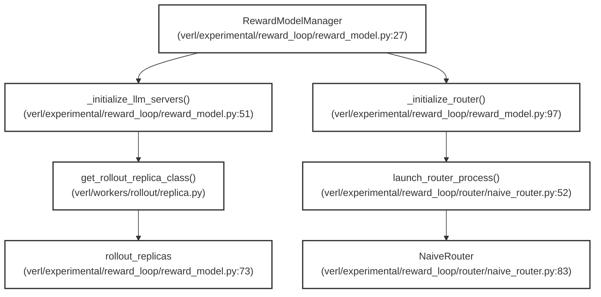
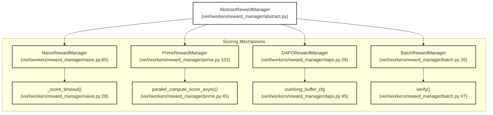
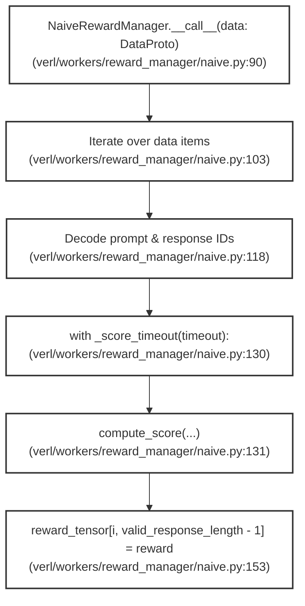

<!-- source: DeepWiki mcp.deepwiki.com · repo volcengine/verl · page 6.5 Reward Model Workers · fetched 2026-10-21 -->

# Reward Model Workers

Relevant source files

The following files were used as context for generating this wiki page:

- [examples/generation/run_deepseek_llm_7b.sh](examples/generation/run_deepseek_llm_7b.sh)
- [examples/tutorial/agent_loop_get_started/agent_loop_tutorial.ipynb](examples/tutorial/agent_loop_get_started/agent_loop_tutorial.ipynb)
- [examples/tutorial/agent_loop_get_started/sandbox.py](examples/tutorial/agent_loop_get_started/sandbox.py)
- [tests/experimental/agent_loop/test_standalone_rollout.py](tests/experimental/agent_loop/test_standalone_rollout.py)
- [tests/experimental/reward_loop/run_determinism_e2e_with_rm.py](tests/experimental/reward_loop/run_determinism_e2e_with_rm.py)
- [tests/experimental/reward_loop/test_agent_reward_loop_standalone.py](tests/experimental/reward_loop/test_agent_reward_loop_standalone.py)
- [tests/workers/reward_manager/test_naive_on_cpu.py](tests/workers/reward_manager/test_naive_on_cpu.py)
- [tests/workers/rollout/rollout_trtllm/test_adapter.py](tests/workers/rollout/rollout_trtllm/test_adapter.py)
- [tests/workers/rollout/rollout_trtllm/test_async_server.py](tests/workers/rollout/rollout_trtllm/test_async_server.py)
- [tests/workers/rollout/rollout_trtllm/test_inter_node_rollout.py](tests/workers/rollout/rollout_trtllm/test_inter_node_rollout.py)
- [tests/workers/rollout/rollout_vllm/test_vllm_generation_determinism.py](tests/workers/rollout/rollout_vllm/test_vllm_generation_determinism.py)
- [verl/experimental/reward_loop/reward_model.py](verl/experimental/reward_loop/reward_model.py)
- [verl/experimental/reward_loop/router/naive_router.py](verl/experimental/reward_loop/router/naive_router.py)
- [verl/trainer/ppo/__init__.py](verl/trainer/ppo/__init__.py)
- [verl/utils/ray_utils.py](verl/utils/ray_utils.py)
- [verl/utils/reward_score/__init__.py](verl/utils/reward_score/__init__.py)
- [verl/workers/reward_manager/abstract.py](verl/workers/reward_manager/abstract.py)
- [verl/workers/reward_manager/batch.py](verl/workers/reward_manager/batch.py)
- [verl/workers/reward_manager/dapo.py](verl/workers/reward_manager/dapo.py)
- [verl/workers/reward_manager/naive.py](verl/workers/reward_manager/naive.py)
- [verl/workers/reward_manager/prime.py](verl/workers/reward_manager/prime.py)
- [verl/workers/reward_manager/registry.py](verl/workers/reward_manager/registry.py)

## Purpose and Scope

This document details the reward model worker setup, batch processing architecture, and integration with the reward loop manager in `verl`. Reward workers handle rule-based reward evaluation, parallel process scoring, and neural reward model inference across distributed Ray resource pools [verl/experimental/reward_loop/reward_model.py:27-125](), [verl/workers/reward_manager/naive.py:65-155]().

Sources: [verl/experimental/reward_loop/reward_model.py:27-125](), [verl/workers/reward_manager/naive.py:65-155]()

---

## Overview and Neural Reward Model Architecture

When neural reward models are enabled (`config.reward.reward_model.enable`), the `RewardModelManager` class orchestrates rollout replicas and HTTP routers to process reward scoring requests asynchronously [verl/experimental/reward_loop/reward_model.py:27-111]().

**Diagram: Reward Model Initialization and Router Code Entities**

Sources: [verl/experimental/reward_loop/reward_model.py:27-111](), [verl/experimental/reward_loop/router/naive_router.py:52-83]()

---

## Reward Model Deployment Modes

`RewardModelManager` supports two operational modes depending on resource configuration parameters:

| Deployment Mode | Implementation Details | Code Pointer |
|-----------------|------------------------|--------------|
| **Colocated Mode** | Splits the existing `RayResourcePool` using `split_resource_pool` to share GPUs with actor/rollout workers [verl/experimental/reward_loop/reward_model.py:83-90](). | [verl/experimental/reward_loop/reward_model.py:83-90]() |
| **Standalone Mode** | Allocates a dedicated GPU pool based on `nnodes` and `n_gpus_per_node`, calling `init_standalone()` [verl/experimental/reward_loop/reward_model.py:60-93](). | [verl/experimental/reward_loop/reward_model.py:60-93]() |

Sources: [verl/experimental/reward_loop/reward_model.py:60-93]()

---

## Reward Manager Hierarchy and Implementations

Rule-based and hybrid scoring managers inherit from `AbstractRewardManager` [verl/workers/reward_manager/abstract.py:1](). They process `DataProto` batches by decoding responses and invoking scoring functions.

**Diagram: Reward Manager Class Hierarchy and Code Entities**

*   `NaiveRewardManager`: Evaluates generated responses sequentially, protecting against hanging evaluation scripts using `_score_timeout` [verl/workers/reward_manager/naive.py:28-62](), [verl/workers/reward_manager/naive.py:65-155]().
*   `PrimeRewardManager`: Utilizes `ProcessPoolExecutor` with `asyncio` and process termination guards for parallel batch scoring [verl/workers/reward_manager/prime.py:31-89](), [verl/workers/reward_manager/prime.py:102-150]().
*   `DAPORewardManager`: Incorporates overlong response length checks and penalty factors via `overlong_buffer_cfg` [verl/workers/reward_manager/dapo.py:26-56](), [verl/workers/reward_manager/dapo.py:121-131]().
*   `BatchRewardManager`: Vectorizes prompt/response length calculations and computes scores across data batches in a single pass [verl/workers/reward_manager/batch.py:26-78]().

Sources: [verl/workers/reward_manager/abstract.py:1](), [verl/workers/reward_manager/naive.py:28-155](), [verl/workers/reward_manager/prime.py:31-150](), [verl/workers/reward_manager/dapo.py:26-131](), [verl/workers/reward_manager/batch.py:26-78]()

---

## Batch Processing and Timeout Controls

Reward managers handle token decoding and reward tensor assignment for `DataProto` objects. To prevent infinite loops or catastrophic regex backtracking in custom reward scripts, managers wrap execution with timeout context managers or process pools [verl/workers/reward_manager/naive.py:28-62](), [verl/workers/reward_manager/prime.py:31-43]().

**Diagram: Naive Reward Processing and Timeout Control Flow**

Sources: [verl/workers/reward_manager/naive.py:28-155]()

---

## Design Rationale and Extensibility

1.  **Signal-Based Timeouts**: `NaiveRewardManager` implements `_score_timeout` using `signal.SIGALRM` to bound evaluation time for individual completion strings [verl/workers/reward_manager/naive.py:28-62]().
2.  **Process Isolation**: `PrimeRewardManager` executes scoring in isolated subprocess pools (`ProcessPoolExecutor`), automatically terminating hanging worker processes after timeouts [verl/workers/reward_manager/prime.py:31-78]().
3.  **Registry Pattern**: Custom reward managers are registered dynamically using the `@register` decorator, allowing seamless integration into training configuration files [verl/workers/reward_manager/naive.py:64](), [verl/workers/reward_manager/prime.py:102](), [verl/workers/reward_manager/dapo.py:25](), [verl/workers/reward_manager/batch.py:25]().

Sources: [verl/workers/reward_manager/naive.py:28-64](), [verl/workers/reward_manager/prime.py:31-102](), [verl/workers/reward_manager/dapo.py:25](), [verl/workers/reward_manager/batch.py:25]()

---

