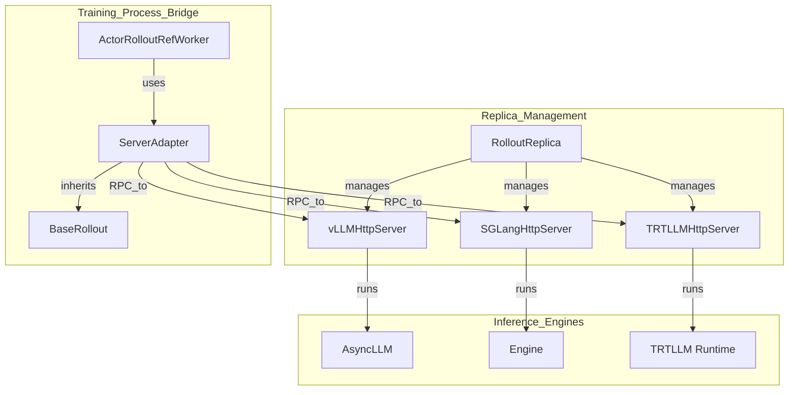
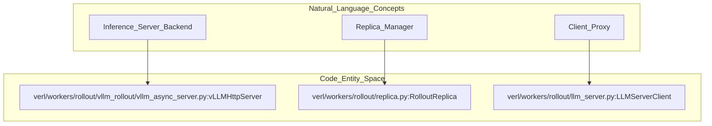

<!-- source: DeepWiki mcp.deepwiki.com · repo volcengine/verl · page 7 Rollout and Inference System · fetched 2026-10-21 -->

# Rollout and Inference System

Relevant source files

The following files were used as context for generating this wiki page:

- [tests/workers/rollout/test_prometheus_rollout_targets_on_cpu.py](tests/workers/rollout/test_prometheus_rollout_targets_on_cpu.py)
- [verl/workers/rollout/llm_server.py](verl/workers/rollout/llm_server.py)
- [verl/workers/rollout/replica.py](verl/workers/rollout/replica.py)
- [verl/workers/rollout/sglang_rollout/async_sglang_server.py](verl/workers/rollout/sglang_rollout/async_sglang_server.py)
- [verl/workers/rollout/sglang_rollout/sglang_rollout.py](verl/workers/rollout/sglang_rollout/sglang_rollout.py)
- [verl/workers/rollout/trtllm_rollout/trtllm_async_server.py](verl/workers/rollout/trtllm_rollout/trtllm_async_server.py)
- [verl/workers/rollout/utils.py](verl/workers/rollout/utils.py)
- [verl/workers/rollout/vllm_rollout/vllm_async_server.py](verl/workers/rollout/vllm_rollout/vllm_async_server.py)

The Rollout and Inference System provides high-throughput sequence generation capabilities for reinforcement learning training in `verl`. It decouples specialized inference engines (such as `vLLM`, `SGLang`, and `TensorRT-LLM`) from training backends (such as FSDP and Megatron), enabling flexible on-policy and off-policy training workflows through distinct deployment modes, efficient weight synchronization mechanisms, multi-turn agent loops, and asynchronous streaming pipelines.

For related subsystems, see [Worker Architecture](#6) for training worker design and [Data Pipeline](#9) for data handling.

Sources: [verl/workers/rollout/replica.py:70-130](), [verl/workers/rollout/vllm_rollout/vllm_async_server.py:87-144]()

## Overview and Architecture

The rollout system implements `verl`'s HybridFlow architecture by orchestrating separate inference servers that can share or disaggregate GPU resources from training actors [verl/workers/rollout/replica.py:70-130](). This design separates the high-concurrency generation workload from the memory-intensive training backward pass.

Title: "Rollout System Component Interaction"

Sources: [verl/workers/rollout/replica.py:123-130](), [verl/workers/rollout/vllm_rollout/vllm_async_server.py:87-144](), [verl/workers/rollout/sglang_rollout/async_sglang_server.py:123-167](), [verl/workers/rollout/trtllm_rollout/trtllm_async_server.py:85-111]()

Title: "Natural Language to Code Entity Mapping in Rollout System"

Sources: [verl/workers/rollout/replica.py:70-92](), [verl/workers/rollout/vllm_rollout/vllm_async_server.py:90-110](), [verl/workers/rollout/llm_server.py:43-55]()

---

## 7.1 Rollout Replica Architecture and Deployment Modes

The rollout system relies on the `RolloutReplica` abstraction to manage individual inference server instances across single or multiple nodes [verl/workers/rollout/replica.py:70-92](). It supports three primary deployment modes via the `RolloutMode` enum: `HYBRID` (fusing rollout and training in the same process/GPUs with context switching), `COLOCATED` (running rollout in separate processes sharing the same GPU placement group), and `STANDALONE` (fully disaggregated servers on dedicated GPU resources) [verl/workers/rollout/replica.py:54-68](). Experimental separation architectures are also supported for disaggregated prefill/decode scaling.

For in-depth coverage of replica abstractions, deployment configurations, and tradeoffs, see [Rollout Replica Architecture and Deployment Modes](#7.1).

Sources: [verl/workers/rollout/replica.py:54-130]()

---

## 7.2 vLLM Rollout Backend

The `vLLM` integration utilizes `vLLM`'s `AsyncLLM` engine wrapped by `vLLMHttpServer` and accessed via `ServerAdapter` [verl/workers/rollout/vllm_rollout/vllm_async_server.py:40-87](). The `vLLMHttpServer` class initializes and manages the `vLLM` server, handling configuration, GPU visibility, and disaggregation roles [verl/workers/rollout/vllm_rollout/vllm_async_server.py:87-144](). It supports advanced features such as tensor parallelism, pipeline parallelism, LoRA adapters, PagedAttention, and experimental diffusion model support through `vllm-omni`.

For detailed configuration options, performance tuning, and server implementation details, see [vLLM Rollout Backend](#7.2).

Sources: [verl/workers/rollout/vllm_rollout/vllm_async_server.py:40-144]()

---

## 7.3 SGLang Rollout Backend

The `SGLang` backend integrates `SGLang`'s high-performance inference engine via `SGLangHttpServer` and `ServerAdapter` [verl/workers/rollout/sglang_rollout/async_sglang_server.py:123-167](). The `SGLangHttpServer` manages the `SGLang` server process, including environment setup, configuration, and handling disaggregation roles [verl/workers/rollout/sglang_rollout/async_sglang_server.py:138-167](). It leverages RadixAttention for prefix caching, optimized multi-turn conversation handling, and native support for disaggregated prefill and decode roles. The `ServerAdapter` class acts as a client to the `SGLang` server, facilitating weight synchronization and request handling [verl/workers/rollout/sglang_rollout/sglang_rollout.py:117-121]().

For complete coverage of `SGLang` server internals and multi-turn optimizations, see [SGLang Rollout Backend](#7.3).

Sources: [verl/workers/rollout/sglang_rollout/async_sglang_server.py:123-167](), [verl/workers/rollout/sglang_rollout/sglang_rollout.py:117-121]()

---

## 7.4 TensorRT-LLM Rollout Backend

The `TensorRT-LLM` rollout backend integrates NVIDIA's `TensorRT-LLM` inference runtime via `TRTLLMHttpServer` to deliver high throughput and low latency on NVIDIA hardware [verl/workers/rollout/trtllm_rollout/trtllm_async_server.py:84-111](). It provides specialized support for Mixture-of-Experts (MoE) models, custom stopping criteria, and compiled engine execution. The `_resolve_chat_stop_tokens` function handles chat-format specific stop tokens to prevent models from generating beyond a single turn [verl/workers/rollout/trtllm_rollout/trtllm_async_server.py:43-81]().

For implementation specifics and hardware configuration guidelines, see [TensorRT-LLM Rollout Backend](#7.4).

Sources: [verl/workers/rollout/trtllm_rollout/trtllm_async_server.py:43-111]()

---

## 7.5 Weight Synchronization and Checkpoint Engines

Weight synchronization bridges the training engine (FSDP or Megatron) and rollout inference servers. `verl` implements a pluggable `CheckpointEngine` abstraction supporting multiple transfer backends including Colocated IPC, NCCL, HCCL, NIXL, Mooncake, and Kimi [verl/workers/rollout/replica.py:65-80](). These engines support full-parameter synchronization as well as delta weight updates for sparse or disaggregated updates.

For detailed documentation on checkpoint engines and weight transfer protocols, see [Weight Synchronization and Checkpoint Engines](#7.5).

Sources: [verl/workers/rollout/replica.py:65-80]()

---

## 7.6 Agent Loop and Multi-Turn Orchestration

For complex interactive tasks and tool-use workflows, `verl` provides the `AgentLoopManager` and `AgentLoopWorker` frameworks. These components coordinate multi-turn conversations, execute tool calls, manage environment interactions, and balance request loads across inference servers. The `TokenOutput` Pydantic model defines the structure for generated tokens, including log probabilities, routed experts, and stop reasons, facilitating structured communication within the agent loop [verl/workers/rollout/replica.py:34-46]().

For architectural details on multi-turn conversation handling and tool integration, see [Agent Loop and Multi-Turn Orchestration](#7.6).

Sources: [verl/workers/rollout/replica.py:34-46]()

---

## 7.7 Fully Async Policy and Partial Rollout

To maximize hardware utilization and decouple rollout generation from policy updates, `verl` supports asynchronous execution models through `FullyAsyncLLMServerManager` and the `TransferQueue` data system. This infrastructure enables partial rollouts with request resumption, one-step off-policy training, disaggregated separation architectures, and dynamic resource scheduling. The `run_uvicorn` utility is used to launch asynchronous HTTP servers for inference engines, allowing for dynamic port assignment and non-blocking operation [verl/workers/rollout/utils.py:67-80]().

For deep dives into asynchronous training pipelines and data flow, see [Fully Async Policy and Partial Rollout](#7.7).

Sources: [verl/workers/rollout/replica.py:54-68](), [verl/workers/rollout/utils.py:67-80]()

---

