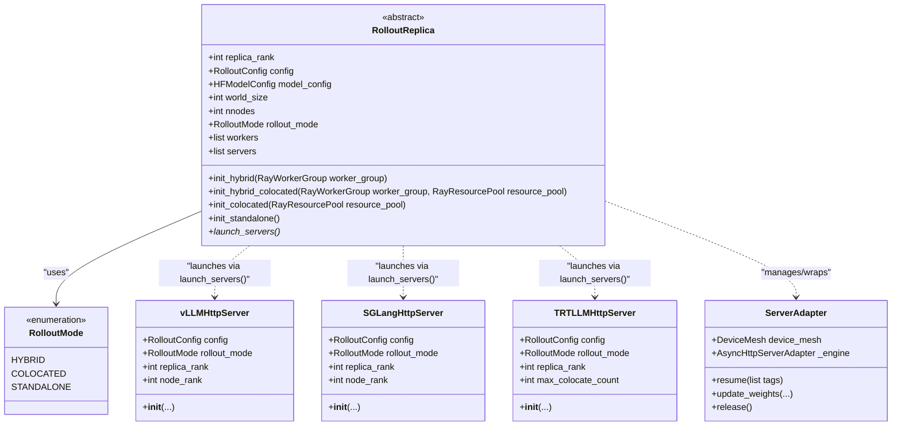
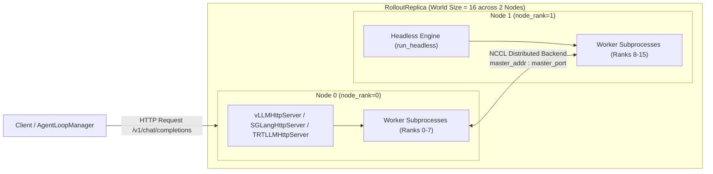
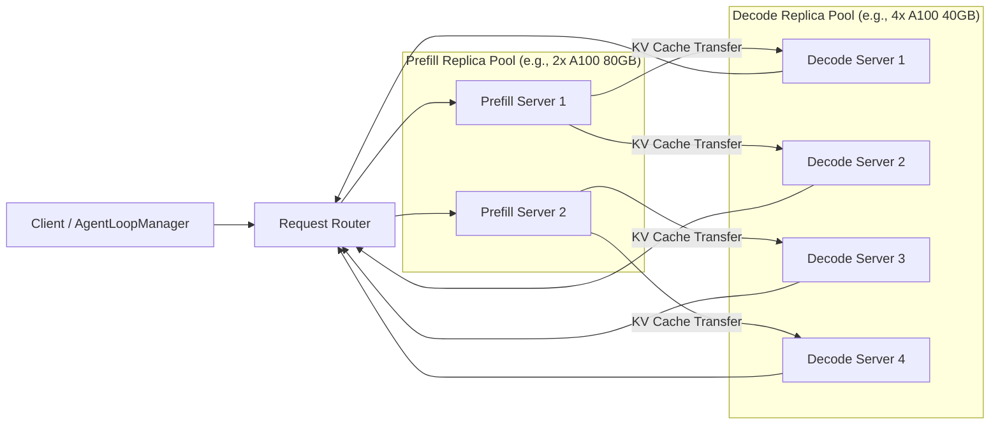
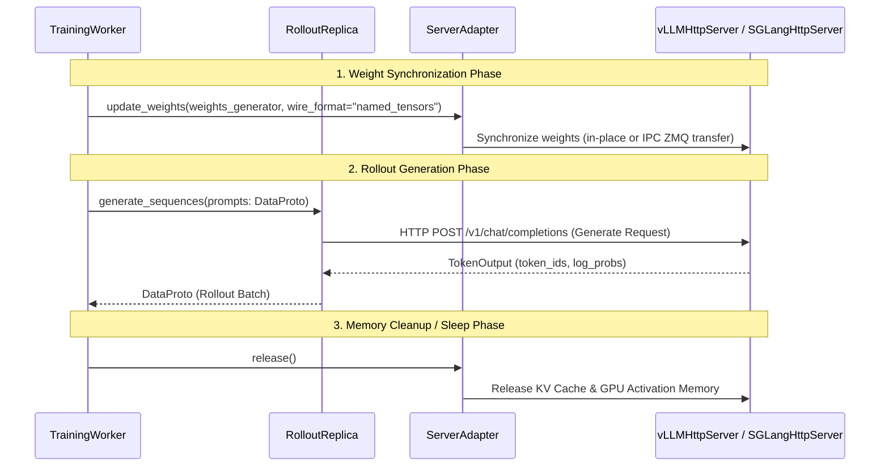

<!-- source: DeepWiki mcp.deepwiki.com · repo volcengine/verl · page 7.1 Rollout Replica Architecture and Deployment Modes · fetched 2026-10-21 -->

# Rollout Replica Architecture and Deployment Modes

Relevant source files

The following files were used as context for generating this wiki page:

- [docs/advance/delta_weight_sync.md](docs/advance/delta_weight_sync.md)
- [tests/checkpoint_engine/test_block_placement.py](tests/checkpoint_engine/test_block_placement.py)
- [tests/checkpoint_engine/test_sharded_delta.py](tests/checkpoint_engine/test_sharded_delta.py)
- [tests/special_distributed/test_sharded_delta_gather.py](tests/special_distributed/test_sharded_delta_gather.py)
- [tests/workers/rollout/rollout_vllm/test_vllm_abort.py](tests/workers/rollout/rollout_vllm/test_vllm_abort.py)
- [tests/workers/rollout/test_prometheus_rollout_targets_on_cpu.py](tests/workers/rollout/test_prometheus_rollout_targets_on_cpu.py)
- [verl/checkpoint_engine/delta_checkpoint_engine.py](verl/checkpoint_engine/delta_checkpoint_engine.py)
- [verl/checkpoint_engine/delta_sync/sparse_gather.py](verl/checkpoint_engine/delta_sync/sparse_gather.py)
- [verl/workers/engine/spec.py](verl/workers/engine/spec.py)
- [verl/workers/rollout/base.py](verl/workers/rollout/base.py)
- [verl/workers/rollout/llm_server.py](verl/workers/rollout/llm_server.py)
- [verl/workers/rollout/replica.py](verl/workers/rollout/replica.py)
- [verl/workers/rollout/sglang_rollout/async_sglang_server.py](verl/workers/rollout/sglang_rollout/async_sglang_server.py)
- [verl/workers/rollout/sglang_rollout/delta_loader.py](verl/workers/rollout/sglang_rollout/delta_loader.py)
- [verl/workers/rollout/sglang_rollout/sglang_rollout.py](verl/workers/rollout/sglang_rollout/sglang_rollout.py)
- [verl/workers/rollout/trtllm_rollout/trtllm_async_server.py](verl/workers/rollout/trtllm_rollout/trtllm_async_server.py)
- [verl/workers/rollout/utils.py](verl/workers/rollout/utils.py)
- [verl/workers/rollout/vllm_rollout/vllm_async_server.py](verl/workers/rollout/vllm_rollout/vllm_async_server.py)

This document details the `RolloutReplica` abstraction and its deployment modes (`HYBRID`, `COLOCATED`, `STANDALONE`) defined in `verl/workers/rollout/replica.py`, which manage inference engines (such as vLLM, SGLang, and TensorRT-LLM) and coordinate GPU memory sharing with training backends [verl/workers/rollout/replica.py:49-86](). It also covers the prefill-decode disaggregation architecture and replica lifecycle APIs [verl/workers/rollout/vllm_rollout/vllm_async_server.py:124-131](), [verl/workers/rollout/base.py:29-76]().

---

## 1. RolloutReplica Abstraction

The `RolloutReplica` class (`verl.workers.rollout.replica.RolloutReplica`) is the foundational abstraction representing a single rollout server instance [verl/workers/rollout/replica.py:65-86](). A replica can span single or multiple cluster nodes and encapsulates worker handles, resource pools, and underlying HTTP inference servers (`vLLMHttpServer`, `SGLangHttpServer`, `TRTLLMHttpServer`) [verl/workers/rollout/replica.py:88-125]().

### Core Responsibilities
- **Lifecycle & Process Management**: Spawns and manages distributed inference server processes via Ray [verl/workers/rollout/replica.py:88-125]().
- **Mode Polymorphism**: Instantiates different deployment workflows through dedicated initialization methods (`init_hybrid`, `init_hybrid_colocated`, `init_colocated`, `init_standalone`) [verl/workers/rollout/replica.py:126-212]().
- **State Synchronization**: Exposes unified control hooks for weight updates, KV cache management, and memory occupation releasing/resuming [verl/workers/rollout/base.py:29-76]().

Title: "RolloutReplica Class Structure and Code Mapping"

Sources: [verl/workers/rollout/replica.py:65-125](), [verl/workers/rollout/vllm_rollout/vllm_async_server.py:90-110](), [verl/workers/rollout/sglang_rollout/async_sglang_server.py:124-152](), [verl/workers/rollout/sglang_rollout/sglang_rollout.py:117-145](), [verl/workers/rollout/trtllm_rollout/trtllm_async_server.py:84-111]()

---

## 2. Deployment Modes and Tradeoffs

The `RolloutMode` enumeration (`verl.workers.rollout.replica.RolloutMode`) defines three distinct architectural modes for deploying rollout replicas [verl/workers/rollout/replica.py:49-63]():

1. **`HYBRID` (`hybrid`)**: Rollout engine and training engine (FSDP/Megatron) are fused in the same process/replica, alternating on the same GPUs [verl/workers/rollout/replica.py:49-54]().
2. **`COLOCATED` (`colocated`)**: Rollout engine and training workers reside in separate processes within the same Ray placement group, sharing physical GPUs without weight duplication [verl/workers/rollout/replica.py:55-59]().
3. **`STANDALONE` (`standalone`)**: Rollout servers occupy dedicated GPU resource pools completely separate from training infrastructure [verl/workers/rollout/replica.py:60-63]().

Title: "Deployment Mode Resource and Process Topology"

```mermaid
graph TB
    subgraph HYBRID_Mode ["HYBRID Mode (Fused Process)"]
        TrainingEngine_H["TrainingEngine FSDP/Megatron"]
        RolloutEngine_H["RolloutEngine vLLM/SGLang/TRTLLM"]
        GPUMemory_H["GPU Memory Pool"]
        TrainingEngine_H -.->|"In-place Context Switch<br/>Weight Sync"| RolloutEngine_H
        TrainingEngine_H -->|"Allocates"| GPUMemory_H
        RolloutEngine_H -->|"Allocates"| GPUMemory_H
    end

    subgraph COLOCATED_Mode ["COLOCATED Mode (Separate Process)"]
        HybridEngine_C["HybridEngine Training Process"]
        RolloutEngine_C["RolloutEngine Server Process"]
        GPUMemory_C["GPU Memory Pool"]
        HybridEngine_C -.->|"IPC Zero-Copy / ZMQ<br/>No Weight Sync"| RolloutEngine_C
        HybridEngine_C -->|"Allocates"| GPUMemory_C
        RolloutEngine_C -->|"Allocates"| GPUMemory_C
    end

    subgraph STANDALONE_Mode ["STANDALONE Mode (Disaggregated)"]
        TrainingEngine_S["TrainingEngine Workers"]
        RolloutEngine_S["RolloutEngine Replica Servers"]
        TrainingGPU["Training GPU Pool"]
        RolloutGPU["Rollout GPU Pool"]
        TrainingEngine_S -->|"Allocates"| TrainingGPU
        RolloutEngine_S -->|"Allocates"| RolloutGPU
        TrainingEngine_S -.->|"Network / Async Transfer"| RolloutEngine_S
    end
```

### Tradeoffs and Comparison

| Mode | GPU Utilization | Memory Overhead | Weight Sync Cost | Primary Use Case |
| :--- | :--- | :--- | :--- | :--- |
| **HYBRID** | High (Time-multiplexed) | Minimal (Shared Weights) | High (Every rollout step) | Standard On-Policy RL (PPO / GRPO) [verl/workers/rollout/replica.py:49-54]() |
| **COLOCATED** | High (Process isolation) | Moderate (IPC/ZMQ buffers) | Moderate | LLM-as-a-Judge (GRM), Multi-Agent setups [verl/workers/rollout/replica.py:55-59]() |
| **STANDALONE** | Lower per pool, high scale | High (Duplicate weights across pools) | Asynchronous / Pipeline | Off-policy training, large-scale distributed inference [verl/workers/rollout/replica.py:60-63]() |

Sources: [verl/workers/rollout/replica.py:49-63](), [verl/workers/rollout/replica.py:126-212]()

---

## 3. Multi-Node Server Architecture and Coordination

When tensor-parallel or pipeline-parallel requirements span multiple nodes (`world_size > gpus_per_node`), `RolloutReplica` deploys a distributed server cluster across nodes [verl/workers/rollout/replica.py:102-113]().

- **Master Node (`node_rank = 0`)**: Initializes the main HTTP API server (`vLLMHttpServer`, `SGLangHttpServer`, or `TRTLLMHttpServer`) and accepts external generation requests [verl/workers/rollout/vllm_rollout/vllm_async_server.py:90-110]().
- **Worker Nodes (`node_rank > 0`)**: Launch headless background worker processes (via `run_headless` for vLLM or equivalent mechanisms for SGLang/TRTLLM) that join the NCCL communication group without binding external HTTP ports [verl/workers/rollout/vllm_rollout/vllm_async_server.py:27-33]().

Title: "Multi-Node Rollout Replica Coordination Topology"

Sources: [verl/workers/rollout/replica.py:102-113](), [verl/workers/rollout/vllm_rollout/vllm_async_server.py:27-33](), [verl/workers/rollout/vllm_rollout/vllm_async_server.py:90-110](), [verl/workers/rollout/trtllm_rollout/trtllm_async_server.py:84-85]()

---

## 4. Experimental Separation and Disaggregation Mode

Verl supports an experimental disaggregated rollout architecture where prompt processing (**Prefill**) and token generation (**Decode**) are decoupled into separate replica pools.

### Disaggregation Parameters
- **`disaggregation_role`**: Configured as `"prefill"` or `"decode"` (defaults to `"null"` for standard mode) [verl/workers/rollout/vllm_rollout/vllm_async_server.py:124-125](), [verl/workers/rollout/sglang_rollout/async_sglang_server.py:159-160]().
- **`disaggregation_kv_transfer_config`**: Dictionary parameter passed to vLLM's `KVTransferConfig` to govern cross-replica KV cache streaming [verl/workers/rollout/vllm_rollout/vllm_async_server.py:124-131]().
- **Asymmetric TP**: Allows independent tensor parallel sizes for prefill (`tensor_model_parallel_size`) versus decode (`decode_tensor_model_parallel_size`) [verl/workers/rollout/sglang_rollout/sglang_rollout.py:150-163]().

Title: "Prefill-Decode Disaggregation Architecture"

Sources: [verl/workers/rollout/vllm_rollout/vllm_async_server.py:124-131](), [verl/workers/rollout/sglang_rollout/sglang_rollout.py:150-163](), [verl/workers/rollout/sglang_rollout/async_sglang_server.py:159-160]()

---

## 5. Replica Lifecycle Methods and Weight Sync Interface

All rollout wrappers implement the `BaseRollout` interface (`verl.workers.rollout.base.BaseRollout`), standardizing lifecycle control across engines [verl/workers/rollout/base.py:29-76](), [verl/workers/rollout/sglang_rollout/sglang_rollout.py:117-124]().

Title: "Rollout Replica Lifecycle and Weight Sync Sequence with Code Mapping"

### Key Interface Methods
- **`resume(tags: list[str])`**: Restores model parameters or KV cache allocations in GPU memory [verl/workers/rollout/base.py:44-51]().
- **`update_weights(weights, wire_format="named_tensors")`**: Consumes weight generators (`named_tensors` or `delta_flush`) to synchronize weights from training to inference servers [verl/workers/rollout/base.py:54-70]().
- **`release()`**: Frees weights and KV cache space from GPU memory to yield capacity back to training engines [verl/workers/rollout/base.py:73-75]().

Sources: [verl/workers/rollout/base.py:29-76](), [verl/workers/rollout/replica.py:65-125](), [verl/workers/rollout/sglang_rollout/sglang_rollout.py:34-49]()

---

