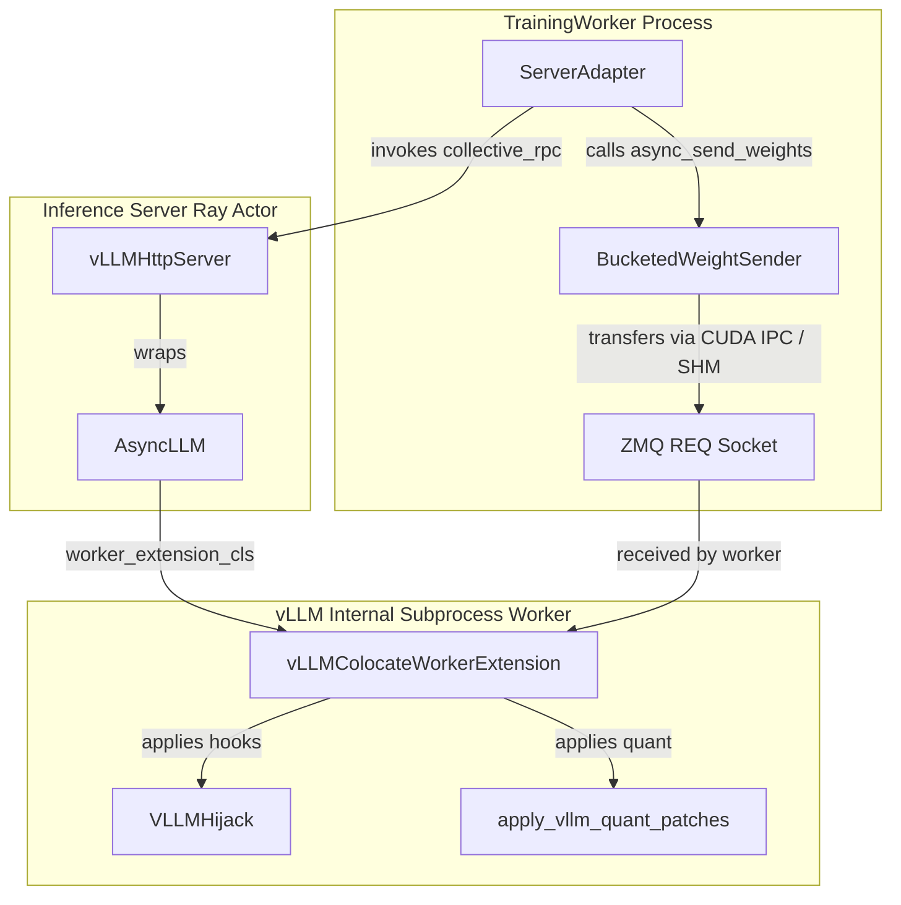
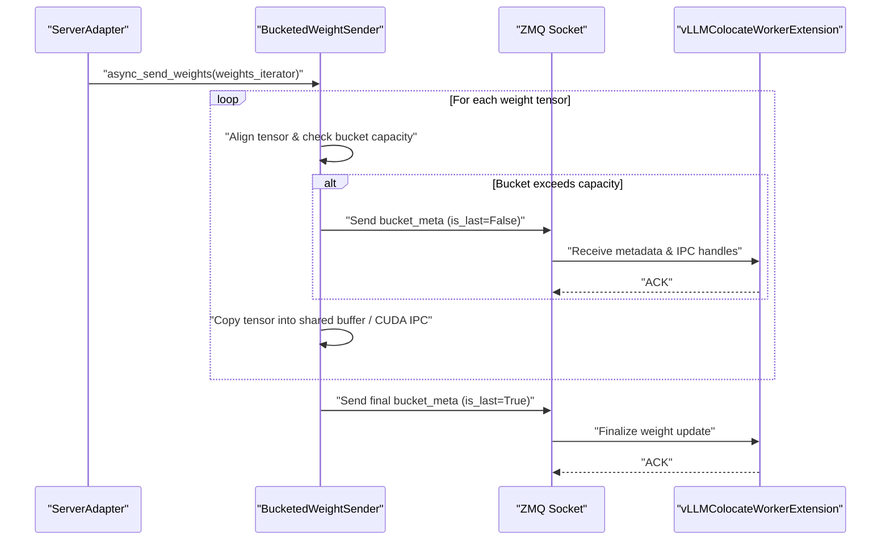

<!-- source: DeepWiki mcp.deepwiki.com · repo volcengine/verl · page 7.2 vLLM Rollout Backend · fetched 2026-10-21 -->

# vLLM Rollout Backend

Relevant source files

The following files were used as context for generating this wiki page:

- [docs/advance/deepseek_v4_integration.rst](docs/advance/deepseek_v4_integration.rst)
- [tests/trainer/ppo/test_reinforce_pp_multiturn_on_cpu.py](tests/trainer/ppo/test_reinforce_pp_multiturn_on_cpu.py)
- [tests/utils/test_bucketed_weight_transfer.py](tests/utils/test_bucketed_weight_transfer.py)
- [tests/utils/test_npu_vllm_patch_on_cpu.py](tests/utils/test_npu_vllm_patch_on_cpu.py)
- [tests/utils/test_vllm_fp8_restage_same_shape_on_cpu.py](tests/utils/test_vllm_fp8_restage_same_shape_on_cpu.py)
- [tests/utils/test_vllm_quant_utils_moe_on_cpu.py](tests/utils/test_vllm_quant_utils_moe_on_cpu.py)
- [tests/utils/test_vllm_unquant_utils_on_cpu.py](tests/utils/test_vllm_unquant_utils_on_cpu.py)
- [tests/utils/test_vllm_weight_name_normalization_on_cpu.py](tests/utils/test_vllm_weight_name_normalization_on_cpu.py)
- [tests/workers/rollout/test_vllm_cli_args_on_cpu.py](tests/workers/rollout/test_vllm_cli_args_on_cpu.py)
- [tests/workers/rollout/test_vllm_weight_update_utils_on_cpu.py](tests/workers/rollout/test_vllm_weight_update_utils_on_cpu.py)
- [verl/utils/distributed.py](verl/utils/distributed.py)
- [verl/utils/megatron/dist_checkpointing.py](verl/utils/megatron/dist_checkpointing.py)
- [verl/utils/megatron_peft_utils.py](verl/utils/megatron_peft_utils.py)
- [verl/utils/vllm/__init__.py](verl/utils/vllm/__init__.py)
- [verl/utils/vllm/npu_vllm_patch.py](verl/utils/vllm/npu_vllm_patch.py)
- [verl/utils/vllm/patch.py](verl/utils/vllm/patch.py)
- [verl/utils/vllm/utils.py](verl/utils/vllm/utils.py)
- [verl/utils/vllm/vllm_fp8_utils.py](verl/utils/vllm/vllm_fp8_utils.py)
- [verl/utils/vllm/vllm_quant_utils.py](verl/utils/vllm/vllm_quant_utils.py)
- [verl/utils/vllm/vllm_unquant_utils.py](verl/utils/vllm/vllm_unquant_utils.py)
- [verl/workers/rollout/vllm_rollout/bucketed_weight_transfer.py](verl/workers/rollout/vllm_rollout/bucketed_weight_transfer.py)
- [verl/workers/rollout/vllm_rollout/utils.py](verl/workers/rollout/vllm_rollout/utils.py)
- [verl/workers/rollout/vllm_rollout/vllm_rollout.py](verl/workers/rollout/vllm_rollout/vllm_rollout.py)
- [verl/workers/rollout/vllm_rollout/weight_update_utils.py](verl/workers/rollout/vllm_rollout/weight_update_utils.py)

## Purpose and Scope
This page details the vLLM rollout backend implementation in `verl`. It covers the orchestration of `vLLMHttpServer` `[verl/workers/rollout/vllm_rollout/vllm_async_server.py:88-108]()`, the `AsyncLLM` engine integration `[verl/workers/rollout/vllm_rollout/vllm_async_server.py:40-40]()`, configuration options, performance tuning, weight synchronization via `ServerAdapter` `[verl/workers/rollout/vllm_rollout/vllm_rollout.py:49-53]()` and `BucketedWeightSender` `[verl/workers/rollout/vllm_rollout/bucketed_weight_transfer.py:74-85]()`, and specialized extensions like `vLLMColocateWorkerExtension` `[verl/workers/rollout/vllm_rollout/utils.py:149-161]()` and `VLLMHijack` `[verl/utils/vllm/utils.py:36-126]()`. For general rollout deployment modes and the `RolloutReplica` abstract base class, see section 7.1. For the SGLang backend, see section 7.3. For weight synchronization internals and checkpoint engines, see section 7.5.

Sources: `[verl/workers/rollout/vllm_rollout/vllm_async_server.py:88-108]()`, `[verl/workers/rollout/vllm_rollout/vllm_rollout.py:49-53]()`, `[verl/workers/rollout/vllm_rollout/bucketed_weight_transfer.py:74-85]()`, `[verl/workers/rollout/vllm_rollout/utils.py:149-161]()`, `[verl/utils/vllm/utils.py:36-126]()`

---

## 1. Component Architecture & System Overview

The vLLM rollout backend integrates vLLM as an asynchronous inference server running alongside distributed training workers (in `HYBRID` or `COLOCATED` deployment modes) `[verl/workers/rollout/replica.py:49-64]()`. Training workers use `ServerAdapter` to communicate weight updates and control signals to the vLLM server via ZeroMQ (ZMQ) sockets and CUDA IPC or shared memory (`BucketedWeightSender` / `BucketedWeightReceiver`) `[verl/workers/rollout/vllm_rollout/vllm_rollout.py:49-141]()`, `[verl/workers/rollout/vllm_rollout/bucketed_weight_transfer.py:74-165]()`. Inside vLLM workers, `vLLMColocateWorkerExtension` handles lifecycle events, dynamic LoRA loading, and FP8 refits `[verl/workers/rollout/vllm_rollout/utils.py:149-161]()`.

### Diagram: vLLM Backend Code Entity Mapping

Sources: `[verl/workers/rollout/vllm_rollout/vllm_rollout.py:49-53]()`, `[verl/workers/rollout/vllm_rollout/vllm_async_server.py:88-108]()`, `[verl/workers/rollout/vllm_rollout/bucketed_weight_transfer.py:74-85]()`, `[verl/workers/rollout/vllm_rollout/utils.py:149-161]()`, `[verl/utils/vllm/utils.py:36-126]()`, `[verl/utils/vllm/vllm_quant_utils.py]()`

---

## 2. Key Classes and File Mappings

| Class / Symbol | File Path | Role and Description |
|---|---|---|
| `vLLMHttpServer` | `verl/workers/rollout/vllm_rollout/vllm_async_server.py` | Ray actor running the vLLM async inference engine and HTTP server on a node `[verl/workers/rollout/vllm_rollout/vllm_async_server.py:88-108]()`. |
| `ServerAdapter` | `verl/workers/rollout/vllm_rollout/vllm_rollout.py` | Training-side rollout client interfacing with the vLLM server to push weights and KV cache commands `[verl/workers/rollout/vllm_rollout/vllm_rollout.py:49-53]()`. |
| `vLLMColocateWorkerExtension` | `verl/workers/rollout/vllm_rollout/utils.py` | Injected into vLLM worker subprocesses to handle weight updates via IPC, LoRA, and FP8 quantization `[verl/workers/rollout/vllm_rollout/utils.py:149-161]()`. |
| `BucketedWeightSender` | `verl/workers/rollout/vllm_rollout/bucketed_weight_transfer.py` | Packs model weights into fixed-size communication buffers and transfers them via ZMQ + CUDA IPC or shared memory `[verl/workers/rollout/vllm_rollout/bucketed_weight_transfer.py:74-85]()`. |
| `TensorLoRARequest` | `verl/utils/vllm/utils.py` | Extension of vLLM's `LoRARequest` that holds raw PyTorch tensors for memory-based LoRA loading `[verl/utils/vllm/utils.py:31-35]()`. |
| `VLLMHijack` | `verl/utils/vllm/utils.py` | Monkey-patches vLLM's worker LoRA manager (`LRUCacheWorkerLoRAManager`) to accept `TensorLoRARequest` `[verl/utils/vllm/utils.py:36-126]()`. |

Sources: `[verl/workers/rollout/vllm_rollout/vllm_async_server.py:88-108]()`, `[verl/workers/rollout/vllm_rollout/vllm_rollout.py:49-53]()`, `[verl/workers/rollout/vllm_rollout/utils.py:149-161]()`, `[verl/workers/rollout/vllm_rollout/bucketed_weight_transfer.py:74-85]()`, `[verl/utils/vllm/utils.py:31-35]()`, `[verl/utils/vllm/utils.py:36-126]()`

---

## 3. `vLLMHttpServer` and `vLLMReplica` Architecture

`vLLMHttpServer` operates as a Ray actor instantiated by `RolloutReplica` `[verl/workers/rollout/replica.py:65-136]()`. It initializes the underlying vLLM `AsyncLLM` engine and configures worker extensions `[verl/workers/rollout/vllm_rollout/vllm_async_server.py:40-40]()`, `[verl/workers/rollout/vllm_rollout/vllm_async_server.py:88-168]()`.

- **Rank Calculation and Asymmetric Layouts**: `ServerAdapter` computes rollout and replica ranks based on environment variables (`RANK`, `RAY_LOCAL_WORLD_SIZE`) and accounts for prefill-decode disaggregation layouts if enabled `[verl/workers/rollout/vllm_rollout/vllm_rollout.py:65-81]()`.
- **ZMQ Communication Socket**: A unique ZMQ socket handle (`ipc:///tmp/rl-colocate-zmq-<job_id>-replica-<replica_rank>-rank-<local_rank>.sock`) is established per rank to coordinate weight transfers without file namespace collisions `[verl/workers/rollout/vllm_rollout/vllm_rollout.py:140-141]()`.

Sources: `[verl/workers/rollout/vllm_rollout/vllm_async_server.py:40-40]()`, `[verl/workers/rollout/vllm_rollout/vllm_async_server.py:88-168]()`, `[verl/workers/rollout/vllm_rollout/vllm_rollout.py:65-141]()`, `[verl/workers/rollout/replica.py:65-136]()`

---

## 4. Weight Synchronization & `ServerAdapter`

Weight updates from the training engine (such as FSDP or Megatron) to the vLLM rollout workers are managed by `ServerAdapter` and executed via `BucketedWeightSender` `[verl/workers/rollout/vllm_rollout/vllm_rollout.py:49-166]()`, `[verl/workers/rollout/vllm_rollout/bucketed_weight_transfer.py:74-165]()`.

### Diagram: Bucketed Weight Transfer Protocol Flow

Sources: `[verl/workers/rollout/vllm_rollout/vllm_rollout.py:49-166]()`, `[verl/workers/rollout/vllm_rollout/bucketed_weight_transfer.py:74-165]()`, `[verl/workers/rollout/vllm_rollout/utils.py:149-161]()`

- **Bucketed Transfer**: `BucketedWeightSender` packs parameters into a fixed-size communication buffer (defaulting to 512 MB) and uses CUDA IPC or shared-memory fallback (`use_shm`) when IPC is unsupported (e.g., on certain NPUs) `[verl/workers/rollout/vllm_rollout/bucketed_weight_transfer.py:74-96]()`.
- **Sleep Levels**: `self.sleep_level` determines resource reclamation during training phases, defaulting to `VLLM_SLEEP_LEVEL` (Level 2 releases both weights and KV cache; Level 1 releases only KV cache to prevent memory overflow when `layered_summon` is active) `[verl/workers/rollout/vllm_rollout/vllm_rollout.py:125-130]()`.

Sources: `[verl/workers/rollout/vllm_rollout/vllm_rollout.py:125-166]()`, `[verl/workers/rollout/vllm_rollout/bucketed_weight_transfer.py:74-96]()`

---

## 5. Advanced Features: LoRA, Quantization, and NPU Patches

### LoRA Integration via `VLLMHijack`
vLLM does not natively support adding LoRA adapters directly from memory-resident PyTorch tensors. Verl provides `VLLMHijack` to monkey-patch `LRUCacheWorkerLoRAManager._load_adapter`, enabling the ingestion of `TensorLoRARequest` objects containing dynamic PEFT weights `[verl/utils/vllm/utils.py:36-126]()`. The `_resolve_vllm_weight_sync_local_rank` utility function is used to correctly map worker local ranks for weight synchronization, especially in parallel configurations `[verl/workers/rollout/vllm_rollout/utils.py:60-84]()`.

### Quantization
For quantized models, `verl` integrates with vLLM's quantization utilities. `apply_vllm_quant_patches` and `load_quanted_weights` from `verl.utils.vllm.vllm_quant_utils` apply necessary patches and load quantized weights, ensuring compatibility `[verl/workers/rollout/vllm_rollout/utils.py:34-40]()`. The `vllm_fp8_utils` module provides refit support for vLLM's `Fp8LinearMethod` and `Fp8MoEMethod`, handling the complexities of block-FP8 layers during weight updates `[verl/utils/vllm/vllm_fp8_utils.py:16-31]()`. This includes preserving subclass metadata and folding post-processing outputs into live parameters `[verl/utils/vllm/vllm_fp8_utils.py:73-94]()`, `[verl/utils/vllm/vllm_fp8_utils.py:116-130]()`.

### Huawei Ascend NPU Patches
When running on Ascend NPUs, `verl` automatically enforces required environment variables (`VLLM_ALL2ALL_BACKEND=flashinfer_all2allv`, `VLLM_ASCEND_ENABLE_NZ=0`) `[verl/workers/rollout/vllm_rollout/utils.py:57-57]()` and applies runtime compatibility patches. Specifically, `patch_vllm_ascend_glm52` `[verl/utils/vllm/npu_vllm_patch.py:143-159]()` applies fixes for GLM-5.2 models on vLLM-Ascend, addressing issues like `AscendRMSNorm` and `AscendSFAImpl` `[verl/utils/vllm/npu_vllm_patch.py:45-71]()`, `[verl/utils/vllm/npu_vllm_patch.py:74-107]()`, `[verl/utils/vllm/npu_vllm_patch.py:110-140]()`.

Sources: `[verl/utils/vllm/utils.py:36-126]()`, `[verl/workers/rollout/vllm_rollout/utils.py:60-84]()`, `[verl/workers/rollout/vllm_rollout/utils.py:34-40]()`, `[verl/workers/rollout/vllm_rollout/utils.py:57-57]()`, `[verl/utils/vllm/vllm_fp8_utils.py:16-31]()`, `[verl/utils/vllm/vllm_fp8_utils.py:73-94]()`, `[verl/utils/vllm/vllm_fp8_utils.py:116-130]()`, `[verl/utils/vllm/npu_vllm_patch.py:143-159]()`, `[verl/utils/vllm/npu_vllm_patch.py:45-71]()`, `[verl/utils/vllm/npu_vllm_patch.py:74-107]()`, `[verl/utils/vllm/npu_vllm_patch.py:110-140]()`

---

## 6. Multi-Token Prediction (MTP) Support

The vLLM rollout backend supports Multi-Token Prediction (MTP) for models like mimo-7B-RL, Qwen-next, and Deepseek series. This enables speculative decoding during rollout inference, potentially improving acceptance rates `[docs/advance/mtp.md:9-15]()`, `[docs/advance/mtp.md:40-40]()`.

- **Configuration**: MTP is enabled via `enable=True` and `enable_rollout=True` in the vLLM configuration, with `method="mtp"` and `num_speculative_tokens` `[docs/advance/mtp.md:32-33]()`.
- **Performance Considerations**: While MTP can improve acceptance rates, its impact on overall throughput is highly dependent on model size and inference hardware. For example, on H20 GPUs, MTP speculative decoding might decrease rollout throughput `[docs/advance/mtp.md:73-77]()`, `[docs/advance/mtp.md:90-91]()`.
- **MTP Patching**: The `mtp_patch.py` module `[verl/models/mcore/mtp_patch.py:1-16]()` provides utilities to patch Megatron-Core's `GPTModel._postprocess` method to correctly handle MTP-specific logic, including loss calculation and scaling `[verl/models/mcore/mtp_patch.py:97-173]()`.

Sources: `[docs/advance/mtp.md:9-15]()`, `[docs/advance/mtp.md:40-40]()`, `[docs/advance/mtp.md:32-33]()`, `[docs/advance/mtp.md:73-77]()`, `[docs/advance/mtp.md:90-91]()`, `[verl/models/mcore/mtp_patch.py:1-16]()`, `[verl/models/mcore/mtp_patch.py:97-173]()`

---

## 7. vllm-omni for Diffusion Models

Experimental RL training for diffusion models (e.g., via FlowGRPO and FlowRL recipes) leverages the `vllm-omni` rollout backend. This backend extends standard LLM inference mechanisms to handle continuous latent generation and multi-step denoising trajectories required for diffusion policy optimization `[verl/workers/rollout/vllm_rollout/vllm_rollout.py:14-27]()`.

Sources: `[verl/workers/rollout/vllm_rollout/vllm_rollout.py:14-27]()`

---

