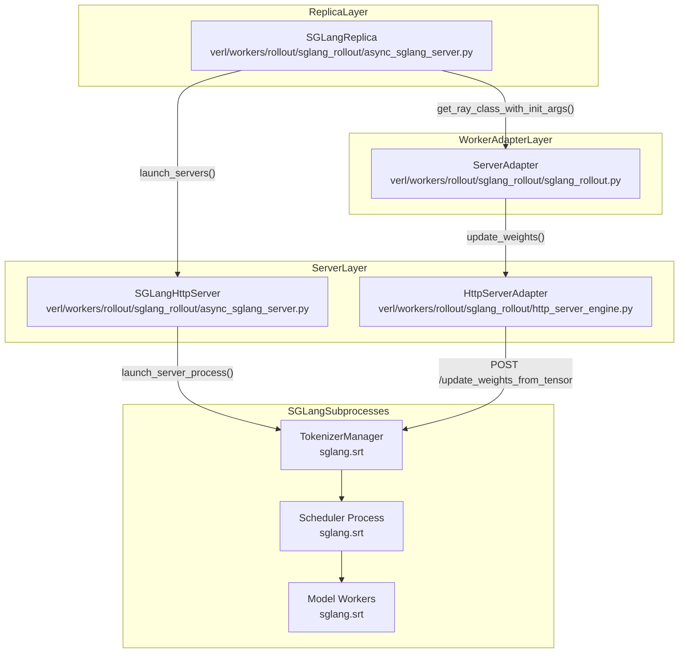
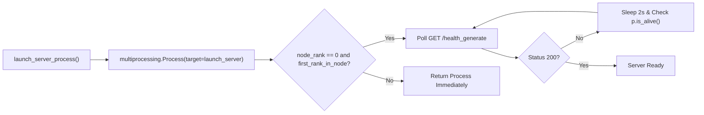
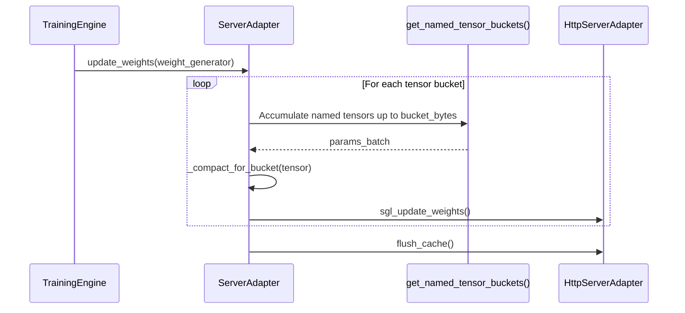
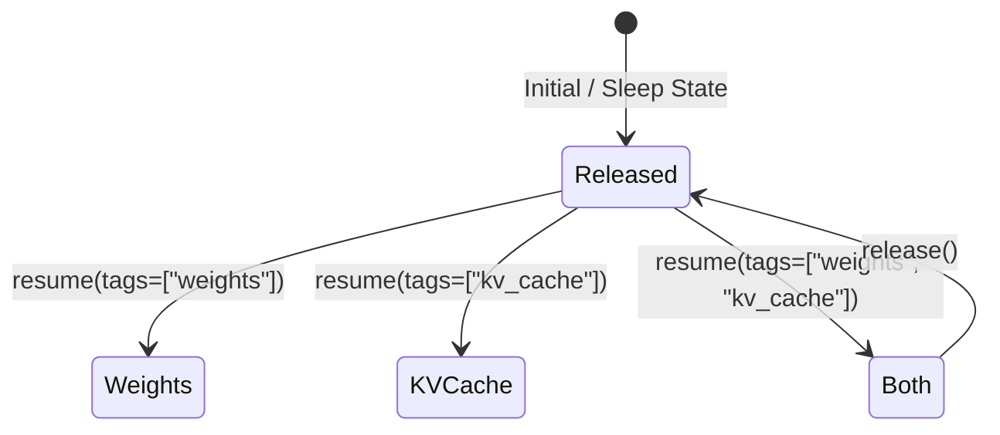
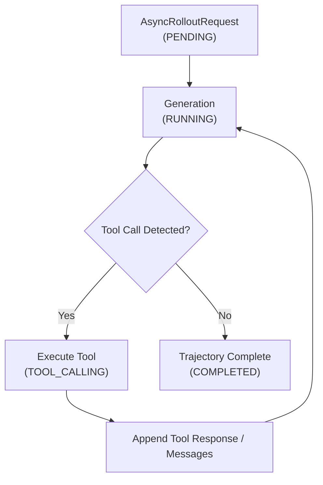

<!-- source: DeepWiki mcp.deepwiki.com · repo volcengine/verl · page 7.3 SGLang Rollout Backend · fetched 2026-10-21 -->

# SGLang Rollout Backend

Relevant source files

The following files were used as context for generating this wiki page:

- [docs/workers/sglang_worker.rst](docs/workers/sglang_worker.rst)
- [tests/checkpoint_engine/test_sglang_fusion_bucketing_on_cpu.py](tests/checkpoint_engine/test_sglang_fusion_bucketing_on_cpu.py)
- [tests/workers/rollout/rollout_sglang/test_http_server_engine.py](tests/workers/rollout/rollout_sglang/test_http_server_engine.py)
- [tests/workers/rollout/rollout_sglang/test_lora_merge_mode_on_cpu.py](tests/workers/rollout/rollout_sglang/test_lora_merge_mode_on_cpu.py)
- [tests/workers/rollout/test_sglang_rollout_sharding_manager.py](tests/workers/rollout/test_sglang_rollout_sharding_manager.py)
- [verl/workers/rollout/sglang_rollout/http_server_engine.py](verl/workers/rollout/sglang_rollout/http_server_engine.py)
- [verl/workers/rollout/sglang_rollout/utils.py](verl/workers/rollout/sglang_rollout/utils.py)

This page documents the SGLang rollout backend implementation in `verl`, providing high-throughput inference capabilities optimized for multi-turn agent interactions, tool calling, and complex conversational workloads. SGLang serves as one of several rollout engines in `verl` and is specifically designed for scenarios requiring advanced multi-turn capabilities with state management through RadixAttention.

Sources: [verl/workers/rollout/sglang_rollout/utils.py:1-14](), [docs/workers/sglang_worker.rst:1-19]()

---

## 1. Architecture Overview and Code Entities

SGLang integration in `verl` consists of multiple primary components working together to handle process launching, HTTP server management, and weight synchronization.

Sources: [verl/workers/rollout/sglang_rollout/http_server_engine.py:41-45](), [verl/workers/rollout/sglang_rollout/sglang_rollout.py:116-241]()

### Key Classes and Their Roles

| Class / Module | Location | Purpose |
|----------------|----------|---------|
| `SGLangReplica` | `verl/workers/rollout/sglang_rollout/async_sglang_server.py` | Manages multi-node SGLang server lifecycle, creates `SGLangHttpServer` per node. |
| `SGLangHttpServer` | `verl/workers/rollout/sglang_rollout/async_sglang_server.py` | HTTP server wrapper for SGLang's tokenizer manager, handling generation requests. |
| `ServerAdapter` | `verl/workers/rollout/sglang_rollout/sglang_rollout.py` | Worker-side adapter for weight synchronization and memory management. |
| `HttpServerAdapter` / `AsyncHttpServerAdapter` | [verl/workers/rollout/sglang_rollout/http_server_engine.py:41-45]() | Synchronous and asynchronous HTTP adapters for SGLang engine endpoints. |

Sources: [verl/workers/rollout/sglang_rollout/async_sglang_server.py:123-600](), [verl/workers/rollout/sglang_rollout/sglang_rollout.py:116-241](), [verl/workers/rollout/sglang_rollout/http_server_engine.py:41-45]()

---

## 2. SGLangHttpServer and Process Management

The `SGLangHttpServer` class manages a single-node SGLang inference server instance. It handles process spawning, health polling, and configuration translation.

### Server Launch Process

The `launch_server_process` function [verl/workers/rollout/sglang_rollout/http_server_engine.py:111-145]() initializes an SGLang server in a separate multiprocessing process and verifies readiness via health endpoints.

Sources: [verl/workers/rollout/sglang_rollout/http_server_engine.py:111-178]()

### TP Memory Imbalance Handling
When initializing SGLang in a Ray distributed environment, `DeviceMesh.init()` internally checks free GPU memory across participating ranks. Because Ray workers load models at asynchronous times, memory usage can drift, causing initialization failures. Setting the environment variable `SGL_DISABLE_TP_MEMORY_INBALANCE_CHECK=True` bypasses this assertion [docs/workers/sglang_worker.rst:87-132]().

Sources: [docs/workers/sglang_worker.rst:87-132]()

---

## 3. ServerAdapter and Weight Synchronization

The `ServerAdapter` class executes inside each hybrid worker process to synchronize weights from the training engine into SGLang.

### Weight Synchronization Flow and Code Integration

Sources: [verl/workers/rollout/sglang_rollout/sglang_rollout.py:203-241](), [verl/workers/rollout/sglang_rollout/utils.py:150-178]()

### Tensor Bucketing and DeepSeek Fusion Groups
To reduce communication overhead during weight updates, tensors are grouped into size-bounded buckets using `get_named_tensor_buckets` [verl/workers/rollout/sglang_rollout/utils.py:161-178](). 
- **Fusion Groups**: For architectures like DeepSeek-V4, specific parameter tensors (e.g., `wq_a.weight`, `wkv.weight`) must be bundled together into a single bucket. `DEEPSEEK_V4_FUSION_GROUPS` defines these constraints to prevent splitting fused operations [verl/workers/rollout/sglang_rollout/utils.py:28-39]().
- **Memory Compaction**: `_compact_for_bucket` inspects tensors and clones non-contiguous views or partial buffers to prevent backing buffer retention while avoiding unnecessary allocations on freshly gathered contiguous tensors [verl/workers/rollout/sglang_rollout/utils.py:150-170]().

Sources: [verl/workers/rollout/sglang_rollout/utils.py:28-39](), [verl/workers/rollout/sglang_rollout/utils.py:150-178](), [tests/checkpoint_engine/test_sglang_fusion_bucketing_on_cpu.py:33-52](), [tests/workers/rollout/test_sglang_rollout_sharding_manager.py:61-87]()

### PEFT and LoRA Normalization
When loading LoRA adapters, `normalize_peft_config_for_sglang` translates enums to strings and ensures `target_modules` conform to SGLang requirements [verl/workers/rollout/sglang_rollout/utils.py:54-68](). Furthermore, `lora_served_as_adapter` detects whether LoRA is active as a hot-swappable adapter versus being merged directly into base weights via `model.lora.merge=True` [verl/workers/rollout/sglang_rollout/utils.py:77-90]().

Sources: [verl/workers/rollout/sglang_rollout/utils.py:54-68](), [verl/workers/rollout/sglang_rollout/utils.py:77-90](), [tests/workers/rollout/rollout_sglang/test_lora_merge_mode_on_cpu.py:15-66]()

---

## 4. Memory Management and Lifecycle

SGLang manages GPU memory allocation dynamically via `resume()` and `release()` hooks.

Sources: [verl/workers/rollout/sglang_rollout/async_sglang_server.py:372-398]()

- **Resume**: Allocates memory occupation for weights or KV cache in the tokenizer manager [verl/workers/rollout/sglang_rollout/async_sglang_server.py:382-382]().
- **Release**: Frees GPU memory so the training engine can utilize device memory during backward passes [verl/workers/rollout/sglang_rollout/async_sglang_server.py:395-395]().
- **LoRA Handling**: When LoRA is served as an adapter, base weights are kept resident during sleep cycles, releasing only the KV cache [tests/workers/rollout/rollout_sglang/test_lora_merge_mode_on_cpu.py:73-80]().

Sources: [verl/workers/rollout/sglang_rollout/async_sglang_server.py:372-398](), [tests/workers/rollout/rollout_sglang/test_lora_merge_mode_on_cpu.py:73-80]()

---

## 5. Multi-Turn Optimizations, Agent Loops, and RadixAttention

### Multi-Turn Interactions and RadixAttention
SGLang maintains conversation histories across turns using RadixAttention. Prefill caching avoids redundant computations in agent loops and tool-calling workflows. Multi-turn rollouts are enabled by setting `actor_rollout_ref.rollout.multi_turn=True` [docs/workers/sglang_worker.rst:18]().

Sources: [docs/workers/sglang_worker.rst:1-19]()

### Request Management via `AsyncRolloutRequest`
Multi-turn conversations and tool executions are orchestrated via `AsyncRolloutRequest` [verl/workers/rollout/schemas.py:81-122](). The request state transitions through `AsyncRolloutRequestStateEnum` [verl/workers/rollout/schemas.py:63-71]():
- `PENDING`: Initial state before request submission.
- `RUNNING`: Active generation phase.
- `TOOL_CALLING`: Intercepting model outputs to execute external functions or tools defined via `BaseTool` [verl/tools/base_tool.py:24-34]() or `@function_tool` [docs/workers/sglang_worker.rst:18]().
- `COMPLETED` / `FAILED`: Final states of the rollout trajectory.

Sources: [verl/workers/rollout/schemas.py:63-122](), [docs/workers/sglang_worker.rst:1-19]()

### Distillation Logprob Extraction
For on-policy distillation and training workflows, SGLang outputs are formatted to match expectations via `_extract_prompt_logprobs_sglang`, ensuring `prompt_ids` and `prompt_logprobs` align with vLLM specifications [verl/workers/rollout/sglang_rollout/async_sglang_server.py:73-121]().

Sources: [verl/workers/rollout/sglang_rollout/async_sglang_server.py:73-121](), [docs/workers/sglang_worker.rst:1-19]()

---

