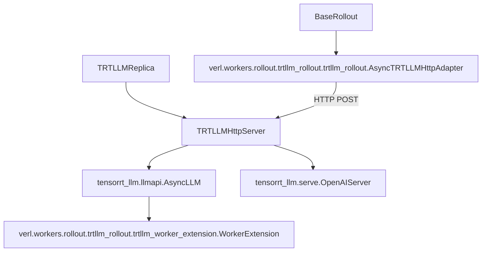
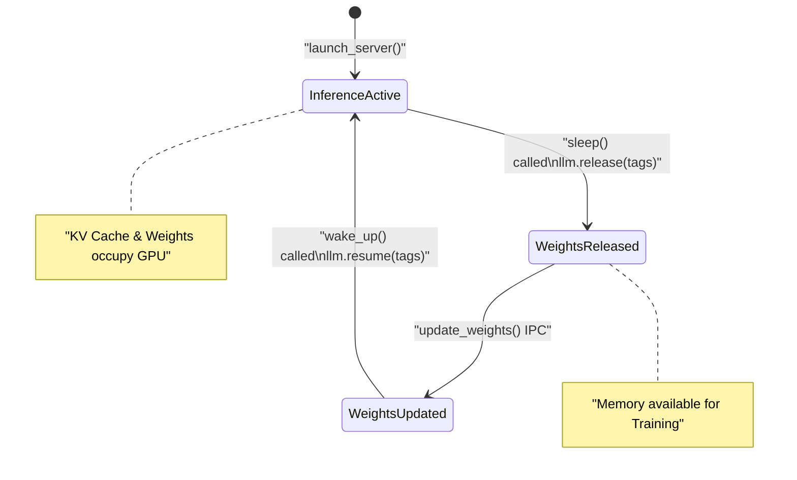
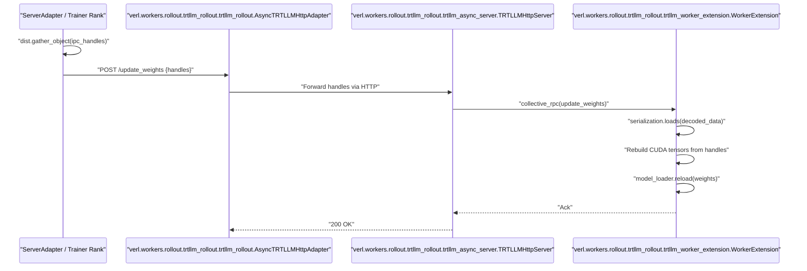

<!-- source: DeepWiki mcp.deepwiki.com · repo volcengine/verl · page 7.4 TensorRT-LLM Rollout Backend · fetched 2026-10-21 -->

# TensorRT-LLM Rollout Backend

<details>
<summary>Relevant source files</summary>

The following files were used as context for generating this wiki page:

- [.github/workflows/e2e_ppo_grpo_trainer_trtllm.yml](.github/workflows/e2e_ppo_grpo_trainer_trtllm.yml)
- [docker/Dockerfile.stable.trtllm](docker/Dockerfile.stable.trtllm)
- [docs/workers/trtllm_worker.rst](docs/workers/trtllm_worker.rst)
- [tests/workers/rollout/rollout_trtllm/__init__.py](tests/workers/rollout/rollout_trtllm/__init__.py)
- [tests/workers/rollout/rollout_trtllm/test_trtllm_rollout_utils.py](tests/workers/rollout/rollout_trtllm/test_trtllm_rollout_utils.py)
- [verl/workers/rollout/trtllm_rollout/trtllm_async_rollout.md](verl/workers/rollout/trtllm_rollout/trtllm_async_rollout.md)
- [verl/workers/rollout/trtllm_rollout/trtllm_rollout.py](verl/workers/rollout/trtllm_rollout/trtllm_rollout.py)
- [verl/workers/rollout/trtllm_rollout/trtllm_worker_extension.py](verl/workers/rollout/trtllm_rollout/trtllm_worker_extension.py)

</details>


## Purpose and Scope

This page covers the TensorRT-LLM (TRT-LLM) rollout backend in `verl`, explaining its component classes, deployment topology, GPU memory lifecycle, and the IPC-based weight update protocol. The backend enables high-performance inference on NVIDIA hardware with comprehensive Mixture-of-Experts (MoE) and Vision-Language Model (VLM) support. It is implemented primarily under `verl/workers/rollout/trtllm_rollout/` [verl/workers/rollout/trtllm_rollout/trtllm_rollout.py:1-15](), [docs/workers/trtllm_worker.rst:8-23]().

Sources: [verl/workers/rollout/trtllm_rollout/trtllm_rollout.py:1-15](), [docs/workers/trtllm_worker.rst:8-23]()

---

## Overview and Architecture

The TRT-LLM backend wraps NVIDIA's `tensorrt_llm.llmapi.AsyncLLM` engine behind a Ray actor that exposes an OpenAI-compatible HTTP API [verl/workers/rollout/trtllm_rollout/trtllm_async_rollout.md:3-7]().

For synchronous and asynchronous training, the integration relies on a **hybrid-colocated** GPU sharing model where training workers (FSDP or Megatron) and TRT-LLM inference workers are pinned to the same physical GPUs [verl/workers/rollout/trtllm_rollout/trtllm_async_rollout.md:5-7](). To manage memory contention between training and inference workloads, it uses explicit memory release and resume calls [verl/workers/rollout/trtllm_rollout/trtllm_async_rollout.md:5](). Weight updates flow from training ranks to the inference engine via CUDA Inter-Process Communication (IPC) handles, allowing direct GPU-to-GPU memory updates without host-side copies [verl/workers/rollout/trtllm_rollout/trtllm_worker_extension.py:56-70]().

Sources: [verl/workers/rollout/trtllm_rollout/trtllm_async_rollout.md:3-7](), [verl/workers/rollout/trtllm_rollout/trtllm_worker_extension.py:56-70]()

---

## Component Map

### Component Mapping Architecture


**Component map: bridging natural language concepts to code entities**
- `TRTLLMReplica`: Manages replica-level orchestration [verl/workers/rollout/trtllm_rollout/trtllm_async_rollout.md:51-55]().
- `TRTLLMHttpServer`: Ray actor wrapping the OpenAI HTTP server and `AsyncLLM` [verl/workers/rollout/trtllm_rollout/trtllm_async_rollout.md:59-63]().
- `WorkerExtension`: Extends TRT-LLM worker functionality for verl-specific weight updates [verl/workers/rollout/trtllm_rollout/trtllm_worker_extension.py:40-42]().
- `AsyncTRTLLMHttpAdapter`: HTTP client wrapper managing asynchronous communication [verl/workers/rollout/trtllm_rollout/trtllm_rollout.py:125-141]().

Sources: [verl/workers/rollout/trtllm_rollout/trtllm_async_rollout.md:51-63](), [verl/workers/rollout/trtllm_rollout/trtllm_worker_extension.py:40-42](), [verl/workers/rollout/trtllm_rollout/trtllm_rollout.py:125-141]()

---

## Component Details

### `TRTLLMHttpServer`
`TRTLLMHttpServer` is a Ray remote actor (one per replica) managing the TRT-LLM engine lifecycle [verl/workers/rollout/trtllm_rollout/trtllm_async_rollout.md:59-63]():
- **Engine Initialization**: Instantiates `tensorrt_llm.llmapi.AsyncLLM` using Ray-based orchestration, respecting Ray `PlacementGroup` and bundle indices [verl/workers/rollout/trtllm_rollout/trtllm_async_rollout.md:65-71]().
- **HTTP API**: Wraps `AsyncLLM` with `tensorrt_llm.serve.OpenAIServer` and launches a Uvicorn server [verl/workers/rollout/trtllm_rollout/trtllm_async_rollout.md:59-63]().
- **Memory Management**: Exposes endpoints triggering TRT-LLM's internal `resume` and `release` logic [verl/workers/rollout/trtllm_rollout/trtllm_async_rollout.md:5]().

### `WorkerExtension`
`WorkerExtension` inherits from `TrtllmWorkerExtension` to provide reinforcement learning integration inside TRT-LLM Ray workers [verl/workers/rollout/trtllm_rollout/trtllm_worker_extension.py:40]():
- **Weight Reloading**: Deserializes base64-encoded pickled IPC handles using a restricted unpickler (`tensorrt_llm.serialization.loads`) with an explicit `approved_imports` map to safely reconstruct `torch.Tensor` objects [verl/workers/rollout/trtllm_rollout/trtllm_worker_extension.py:74-149]().
- **Partial Loading**: Checks model support for `allow_partial_loading` to optimize update overhead [verl/workers/rollout/trtllm_rollout/trtllm_worker_extension.py:45-53]().

### `AsyncTRTLLMHttpAdapter`
`AsyncTRTLLMHttpAdapter` handles client requests from the trainer to the rollout server using `aiohttp` with connection pooling, exponential backoff, and retry logic [verl/workers/rollout/trtllm_rollout/trtllm_rollout.py:125-220]().

Sources: [verl/workers/rollout/trtllm_rollout/trtllm_async_rollout.md:5-7](), [verl/workers/rollout/trtllm_rollout/trtllm_worker_extension.py:40-149](), [verl/workers/rollout/trtllm_rollout/trtllm_rollout.py:125-220]()

---

## GPU Memory Lifecycle

### GPU Memory State Transitions


- **`sleep()`**: Invoked at the start of a training iteration via `llm.release()` to free weights and KV cache memory back to the system [verl/workers/rollout/trtllm_rollout/trtllm_async_rollout.md:5]().
- **`wake_up()`**: Invoked before rollout generation via `llm.resume()` to re-allocate memory buffers [verl/workers/rollout/trtllm_rollout/trtllm_async_rollout.md:5]().

Sources: [verl/workers/rollout/trtllm_rollout/trtllm_async_rollout.md:5]()

---

## IPC-Based Weight Update Protocol

### Weight Update Sequence


**Bucket Management**: Weights are transferred in configurable chunks to avoid memory fragmentation [verl/workers/rollout/trtllm_rollout/trtllm_rollout.py:387-439]().

Sources: [verl/workers/rollout/trtllm_rollout/trtllm_rollout.py:387-439](), [verl/workers/rollout/trtllm_rollout/trtllm_worker_extension.py:56-160]()

---

## Configuration Reference

Key configuration parameters for the TRT-LLM backend under `actor_rollout_ref.rollout`:

| Parameter | Description |
|---|---|
| `name` | Must be set to `"trtllm"` [tests/workers/rollout/rollout_trtllm/test_trtllm_rollout_utils.py:52]() |
| `mode` | Rollout mode, typically `"async"` [tests/workers/rollout/rollout_trtllm/test_trtllm_rollout_utils.py:53]() |
| `tensor_model_parallel_size` | Tensor parallel degree for the rollout engine [tests/workers/rollout/rollout_trtllm/test_trtllm_rollout_utils.py:67]() |
| `gpu_memory_utilization` | Fraction of GPU memory allocated for KV cache [tests/workers/rollout/rollout_trtllm/test_trtllm_rollout_utils.py:62]() |
| `max_model_len` | Maximum sequence length supported by the engine [tests/workers/rollout/rollout_trtllm/test_trtllm_rollout_utils.py:70]() |

Sources: [tests/workers/rollout/rollout_trtllm/test_trtllm_rollout_utils.py:50-75]()

---

## Installation and Testing

TRT-LLM support requires NVIDIA's TRT-LLM release container environments (`docker/Dockerfile.stable.trtllm`) which bundle required packages like `DeepEP` and pinned `tensorrt-llm` versions [docker/Dockerfile.stable.trtllm:4-53]().

**Unit Testing Suite**:
- `tests/workers/rollout/rollout_trtllm/test_adapter.py`: HTTP adapter tests.
- `tests/workers/rollout/rollout_trtllm/test_async_server.py`: Ray resource pool and placement group tests [.github/workflows/e2e_ppo_grpo_trainer_trtllm.yml:151-155]().
- `tests/workers/rollout/rollout_trtllm/test_trtllm_rollout_utils.py`: End-to-end unimodal and multimodal generation tests [tests/workers/rollout/rollout_trtllm/test_trtllm_rollout_utils.py:103-186]().
- `tests/workers/rollout/rollout_trtllm/test_inter_node_rollout.py`: Multi-node TP configuration tests [.github/workflows/e2e_ppo_grpo_trainer_trtllm.yml:151-155]().

Run tests with `pytest`:
```bash
pytest tests/workers/rollout/rollout_trtllm/test_trtllm_rollout_utils.py
```

Sources: [.github/workflows/e2e_ppo_grpo_trainer_trtllm.yml:146-155](), [tests/workers/rollout/rollout_trtllm/test_trtllm_rollout_utils.py:103-186](), [docker/Dockerfile.stable.trtllm:4-53]()

---

