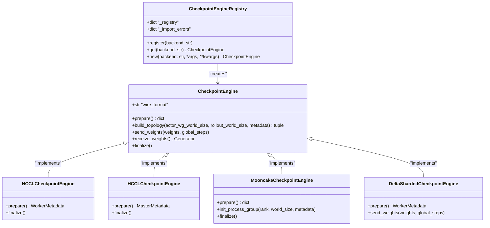
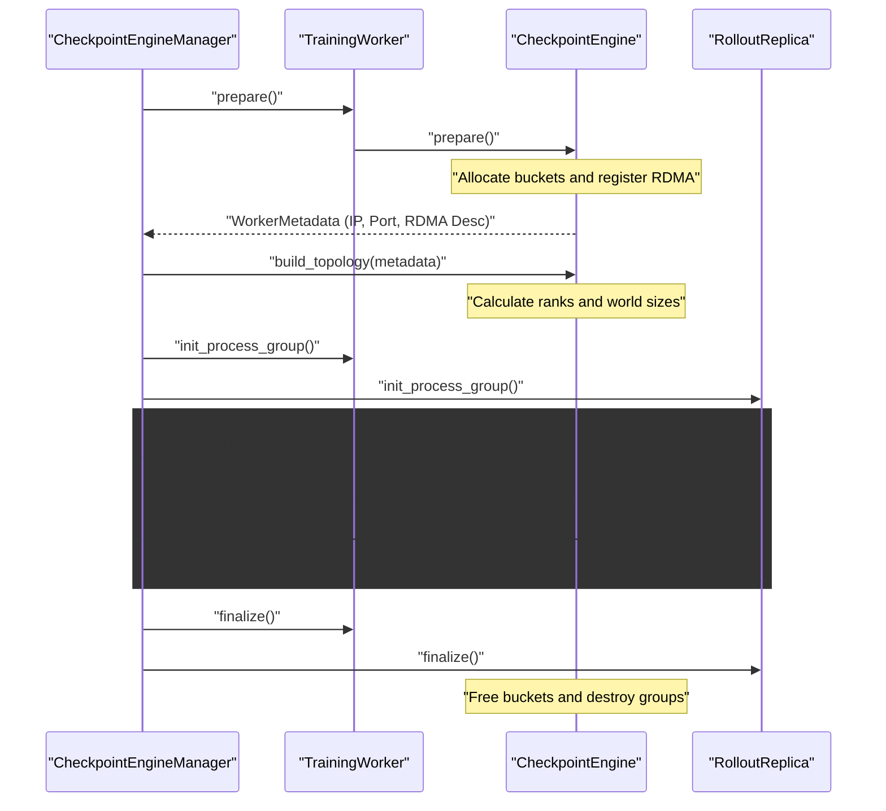

<!-- source: DeepWiki mcp.deepwiki.com · repo volcengine/verl · page 7.5 Weight Synchronization and Checkpoint Engines · fetched 2026-10-21 -->

# Weight Synchronization and Checkpoint Engines

<details>
<summary>Relevant source files</summary>

The following files were used as context for generating this wiki page:

- [docs/advance/delta_weight_sync.md](docs/advance/delta_weight_sync.md)
- [tests/checkpoint_engine/test_block_placement.py](tests/checkpoint_engine/test_block_placement.py)
- [tests/checkpoint_engine/test_correctness_on_gpu.py](tests/checkpoint_engine/test_correctness_on_gpu.py)
- [tests/checkpoint_engine/test_correctness_on_npu.py](tests/checkpoint_engine/test_correctness_on_npu.py)
- [tests/checkpoint_engine/test_sharded_delta.py](tests/checkpoint_engine/test_sharded_delta.py)
- [tests/checkpoint_engine/test_utils.py](tests/checkpoint_engine/test_utils.py)
- [tests/special_distributed/test_sharded_delta_gather.py](tests/special_distributed/test_sharded_delta_gather.py)
- [tests/workers/rollout/rollout_vllm/test_vllm_abort.py](tests/workers/rollout/rollout_vllm/test_vllm_abort.py)
- [verl/checkpoint_engine/README.md](verl/checkpoint_engine/README.md)
- [verl/checkpoint_engine/__init__.py](verl/checkpoint_engine/__init__.py)
- [verl/checkpoint_engine/base.py](verl/checkpoint_engine/base.py)
- [verl/checkpoint_engine/delta_checkpoint_engine.py](verl/checkpoint_engine/delta_checkpoint_engine.py)
- [verl/checkpoint_engine/delta_sync/sparse_gather.py](verl/checkpoint_engine/delta_sync/sparse_gather.py)
- [verl/checkpoint_engine/hccl_checkpoint_engine.py](verl/checkpoint_engine/hccl_checkpoint_engine.py)
- [verl/checkpoint_engine/kimi_checkpoint_engine.py](verl/checkpoint_engine/kimi_checkpoint_engine.py)
- [verl/checkpoint_engine/mooncake_checkpoint_engine.py](verl/checkpoint_engine/mooncake_checkpoint_engine.py)
- [verl/checkpoint_engine/nccl_checkpoint_engine.py](verl/checkpoint_engine/nccl_checkpoint_engine.py)
- [verl/checkpoint_engine/nixl_checkpoint_engine.py](verl/checkpoint_engine/nixl_checkpoint_engine.py)
- [verl/utils/net_utils.py](verl/utils/net_utils.py)
- [verl/workers/engine/spec.py](verl/workers/engine/spec.py)
- [verl/workers/rollout/base.py](verl/workers/rollout/base.py)
- [verl/workers/rollout/sglang_rollout/delta_loader.py](verl/workers/rollout/sglang_rollout/delta_loader.py)

</details>


## Purpose and Scope

This document explains how model weights are transferred from training workers to inference servers after each training step. The mechanism is unified under the `CheckpointEngine` abstraction, which provides a consistent interface for weight synchronization across various training and inference backends [verl/checkpoint_engine/README.md:4-11]().

Key topics covered:
- **CheckpointEngine Abstraction**: Unified APIs for sending, receiving, and caching weights [verl/checkpoint_engine/base.py:116-128]().
- **Implementations**: `NCCLCheckpointEngine`, `HCCLCheckpointEngine`, `NIXLCheckpointEngine`, `MooncakeCheckpointEngine`, `KimiCheckpointEngine`, and `DeltaShardedCheckpointEngine` [verl/checkpoint_engine/README.md:13-23]().
- **Weight Transfer Mechanisms**: Collective communication (AllGather/Broadcast), P2P ring topologies, CUDA IPC, and RDMA-based transfers [verl/checkpoint_engine/README.md:13-22]().
- **Sharded Delta Engine**: Optimized sparse updates for high-performance weight synchronization in disaggregated setups [verl/checkpoint_engine/delta_checkpoint_engine.py:14-48]().
- **Deployment Patterns**: Integration with `HYBRID`, `COLOCATED`, and `STANDALONE` rollout modes [verl/workers/rollout/base.py:29-30]().

Sources: [verl/checkpoint_engine/README.md:4-11](), [verl/checkpoint_engine/base.py:116-128](), [verl/checkpoint_engine/delta_checkpoint_engine.py:14-48]()

---

## CheckpointEngine Abstraction and Registry

The `CheckpointEngine` is an abstract base class designed to decouple weight synchronization from specific training or inference backends [verl/checkpoint_engine/README.md:4-11](). It defines three primary operations:

1. `send_weights`: Streams named tensors from the generator (`TrainingWorker`) to the communication fabric [verl/checkpoint_engine/base.py:202-206]().
2. `receive_weights`: Returns a tensor generator that yields named tensors to the consumer (`RolloutReplica`) [verl/checkpoint_engine/base.py:210-214]().
3. `prepare` and `finalize`: Lifecycle methods for allocating/freeing buckets and managing communication handles [verl/checkpoint_engine/base.py:135-149](), [verl/checkpoint_engine/base.py:189-190]().

The `CheckpointEngineRegistry` tracks available backends and handles dynamic instantiation via `register`, `get`, and `new` methods [verl/checkpoint_engine/base.py:49-114]().

Title: CheckpointEngine Class Hierarchy and Registry Integration

Sources: [verl/checkpoint_engine/base.py:33-175](), [verl/checkpoint_engine/README.md:4-11]()

Title: CheckpointEngine Lifecycle and Data Flow Sequence

Sources: [verl/checkpoint_engine/base.py:33-190](), [verl/checkpoint_engine/README.md:6-10]()

---

## Supported Backends and Performance Matrix

verl supports multiple backends tailored to different hardware and network topologies.

| Backend | Comm Library | Topology | Hardware | Performance | Elastic | Use Case |
| :--- | :--- | :--- | :--- | :--- | :--- | :--- |
| **naive** | torch.distributed | all_gather | NVIDIA/AMD/Ascend | Very High | NA | On-policy training<br>- Actor/rollout colocated [verl/checkpoint_engine/README.md:17]() |
| **nccl** | NCCL | all_gather+broadcast | NVIDIA GPU & NCCL | Very High | Low: rebuild nccl group | Off-policy training<br>- Actor/rollout disaggregated<br>- Fixed clusters [verl/checkpoint_engine/README.md:18]() |
| **hccl** | HCCL | all_gather+broadcast | Ascend NPU & HCCL | High | Low: rebuild hccl group | Off-policy training<br>- Actor/rollout disaggregated<br>- Fixed clusters [verl/checkpoint_engine/README.md:19]() |
| **nixl** | NIXL | all_gather+ring p2p | Various transport (UCX, UCCL, Mooncake) | Medium/High | High: dynamic adjust ring topology | Off-policy training<br>- Actor/rollout disaggregated<br>- Elastic rollout<br>- Fault tolerance [verl/checkpoint_engine/README.md:20]() |
| **mooncake**| Mooncake Transfer Engine | all_gather+ring p2p | NVIDIA/Ascend | High | High: dynamic adjust ring topology | Off-policy training<br>- Actor/rollout disaggregated<br>- Fixed clusters [verl/checkpoint_engine/README.md:22]() |
| **kimi_ckpt_engine** | Mooncake + NCCL/HCCL | p2p+broadcast | NVIDIA/Ascend | High | Low: rebuild communication group | Off-policy training<br>- Actor/rollout disaggregated<br>- Save checkpoint each time [verl/checkpoint_engine/README.md:21]() |

Sources: [verl/checkpoint_engine/README.md:13-23](), [verl/checkpoint_engine/base.py:49-52]()

---

## Collective and P2P Implementations

### NCCL and HCCL Engines

The `NCCLCheckpointEngine` and `HCCLCheckpointEngine` provide high-performance synchronization using collective communications [verl/checkpoint_engine/nccl_checkpoint_engine.py:120-155](), [verl/checkpoint_engine/hccl_checkpoint_engine.py:104-135](). They use a **Master/Worker** coordination pattern where a master process uses ZeroMQ (`zmq`) via `MasterMetadata` to broadcast tensor metadata, while tensor data is transferred via NCCL/HCCL broadcast operations encapsulated in `BroadcastOperation` [verl/checkpoint_engine/nccl_checkpoint_engine.py:43-117](), [verl/checkpoint_engine/hccl_checkpoint_engine.py:43-101]().

Title: NCCL and HCCL Code Entity Execution Flow
```mermaid
graph TD
    subgraph "MasterNode"
        TW["TrainingWorker"]
        CE_NCCL["NCCLCheckpointEngine"]
        ZMQ_S["zmq.PUB (MasterMetadata)"]
        Buf_S["send_buf (cp.zeros / torch.zeros)"]
    end

    subgraph "RolloutNode"
        RR["RolloutReplica"]
        CE_Rollout["NCCLCheckpointEngine (Rank 1..N)"]
        ZMQ_C["zmq.SUB"]
        Buf_R["recv_buf (torch.Tensor)"]
    end

    TW -->| "send_weights()" | CE_NCCL
    CE_NCCL -->| "zmq.Socket.send_pyobj()" | ZMQ_S
    ZMQ_S -- "TensorMeta via ZMQ" --> ZMQ_C
    Buf_S -- "collective.broadcast()" --> Buf_R
    Buf_R -->| "receive_weights()" | RR
```
Sources: [verl/checkpoint_engine/nccl_checkpoint_engine.py:43-155](), [verl/checkpoint_engine/hccl_checkpoint_engine.py:43-135]()

### Mooncake and Kimi Checkpoint Engines

The `MooncakeCheckpointEngine` utilizes Mooncake's `TransferEngine` to perform P2P transfers across nodes [verl/checkpoint_engine/mooncake_checkpoint_engine.py:39-77]().
- **Memory Registration**: Buffers are registered via `TransferEngine.batch_register_memory()` for zero-copy RDMA or Ascend Direct transport [verl/checkpoint_engine/mooncake_checkpoint_engine.py:88-92]().
- **Kimi Checkpoint Engine**: Implements an offload-to-CPU workflow, transmitting via Mooncake P2P to a designated rollout worker, followed by an intra-rollout broadcast [verl/checkpoint_engine/README.md:26-30]().

Sources: [verl/checkpoint_engine/mooncake_checkpoint_engine.py:39-93](), [verl/checkpoint_engine/README.md:24-30]()

---

## Sharded Delta Engine and Sparse Updates

For high-performance training, verl implements the `DeltaShardedCheckpointEngine` to transmit only changed weight elements [verl/checkpoint_engine/delta_checkpoint_engine.py:14-48](). This engine is designed for disaggregated rollout setups where the trainer broadcasts updated weights to the rollout engine after each step. It significantly reduces weight-sync traffic by sending only the "delta" (changed parameters) rather than the full model weights [docs/advance/delta_weight_sync.md:6-10]().

### Motivation and Benefits
The `delta_sharded` backend offers two main advantages [docs/advance/delta_weight_sync.md:14-24]():
- **Sparse wire**: Only 1-3% of parameter bytes change per step, drastically shrinking the broadcast payload. This is especially beneficial for large models and across network distances.
- **Shard-local diff + sparse gather**: No rank materializes full tensors or full-model snapshots. Each actor rank diffs its own FSDP shard locally and gathers only the changed `(position, value)` pairs to rank 0. This avoids the costly full-tensor all-gather and rank-0 staging of traditional methods.

### Shard-Export Contract
Training engines interact with checkpoint engines through `get_per_tensor_param_shard` which yields `(name, local_shard, ShardSpec)` [verl/workers/engine/spec.py](). The `delta_sharded` backend consumes final HF-coordinate payloads, meaning all backend-specific conversions and diffing (weight to HF naming, diff against base) occur on the backend side [docs/advance/delta_weight_sync.md:65-71]().

### Delta Machinery
- **`_GatherQueue`**: Manages per-ProcessGroup batching of slot-keyed queue entries `(slots, dtype_str, counts, idx, val)` [verl/checkpoint_engine/delta_checkpoint_engine.py:155-166](). These entries carry final-coordinate payloads, meaning rank 0 receives assembled per-slot pieces directly from the gather [verl/checkpoint_engine/delta_checkpoint_engine.py:155-166]().
- **`_FlushBucket`**: Accumulates delta pieces into `_FlushPiece` (for indexed flushes) or `_ValuesPiece` (for seed sync's values-only flush) objects until reaching `cap` bytes [verl/checkpoint_engine/delta_checkpoint_engine.py:82-139](). It then assembles these into a `DeltaFlush` object and publishes it [verl/checkpoint_engine/delta_checkpoint_engine.py:103-110]().
- **Receiver Side**: SGLang and vLLM loaders decode sparse payloads and apply them in place. SGLang uses a VERL loader registered via the `--custom-weight-loader` hook, while vLLM uses a `WeightTransferEngine` adapter and its checkpoint patch API. Both paths verify checksums and update live weights without requiring a full rollout-model copy [verl/checkpoint_engine/delta_checkpoint_engine.py:14-35](), [docs/advance/delta_weight_sync.md:90-95]().
- **Seeding**: The first synchronization is an explicit **dense** pass, streaming raw weights through the same bucketed wire without positions. This populates the trainer-side snapshot and provides a correct base for dummy-initialized rollouts. Subsequent syncs are sparse [docs/advance/delta_weight_sync.md:96-99]().

Title: Sharded Delta Weight Synchronization Code Entities and Data Flow
```mermaid
graph TD
    subgraph "SenderSideTrainer"
        Engine["BaseEngine.get_per_tensor_param_delta_shard()"]
        GatherQ["_GatherQueue"]
        FlushB["_FlushBucket"]
        SyncEngine["DeltaShardedCheckpointEngine.send_weights()"]
    end

    subgraph "ReceiverSideRollout"
        Receive["DeltaShardedCheckpointEngine.receive_weights()"]
        Loader["verl.workers.rollout.sglang_rollout.delta_loader"]
        LiveModel["In-Place Weight Update"]
    end

    Engine -->| "per_tensor_param_shard" | GatherQ
    GatherQ -->| "_FlushPiece / _ValuesPiece" | FlushB
    FlushB -->| "DeltaFlush" | SyncEngine
    SyncEngine -- "indices / values wire" --> Receive
    Receive --> Loader
    Loader --> LiveModel
```
Sources: [verl/workers/engine/spec.py](), [verl/checkpoint_engine/delta_checkpoint_engine.py:14-139](), [docs/advance/delta_weight_sync.md:6-99]()

---

## Training Loop Integration and Asynchronous Synchronization

Weight synchronization is orchestrated across `TrainingWorker` and `RolloutReplica` groups [tests/checkpoint_engine/test_correctness_on_npu.py:77-79](). Asynchronous synchronization allows the trainer to push weights via background execution while rollout workers complete current inference steps, minimizing pipeline stalls [verl/checkpoint_engine/base.py:210-214]().

In testing utilities, `TrainingWorkerTest` interacts directly with the `CheckpointEngine` through `send_weights` while `MockServerAdapter` validates correctness against reference PyTorch model states [tests/checkpoint_engine/test_utils.py:31-90]().

Sources: [verl/checkpoint_engine/base.py:202-214](), [tests/checkpoint_engine/test_correctness_on_npu.py:77-79](), [tests/checkpoint_engine/test_utils.py:31-90]()

---

