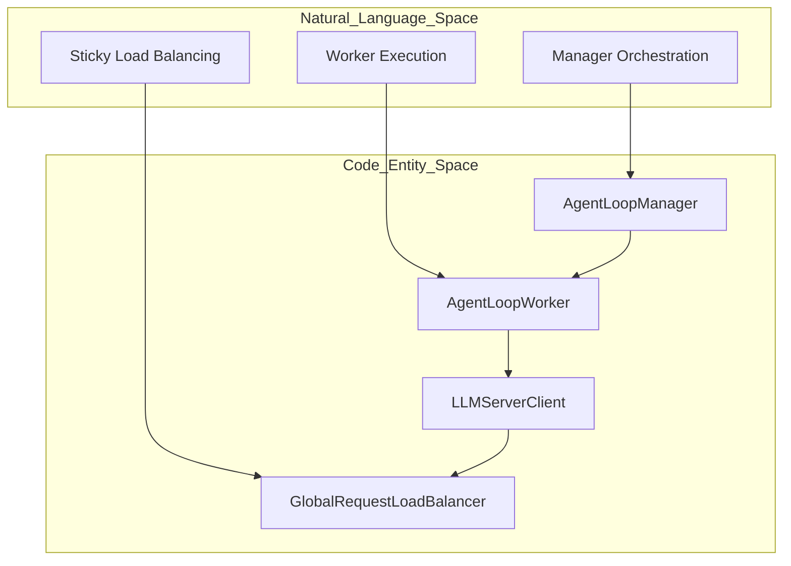
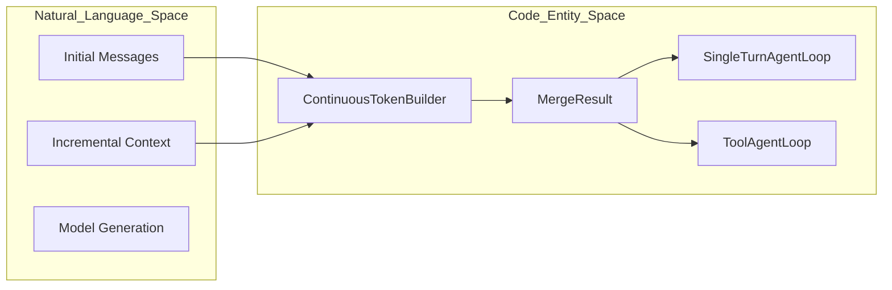

<!-- source: DeepWiki mcp.deepwiki.com · repo volcengine/verl · page 7.6 Agent Loop and Multi-Turn Orchestration · fetched 2026-10-21 -->

# Agent Loop and Multi-Turn Orchestration

Relevant source files

The following files were used as context for generating this wiki page:

- [docs/advance/agent_loop.rst](docs/advance/agent_loop.rst)
- [docs/start/agentic_rl.rst](docs/start/agentic_rl.rst)
- [examples/data_preprocess/gsm8k.py](examples/data_preprocess/gsm8k.py)
- [examples/data_preprocess/gsm8k_multiturn_w_tool.py](examples/data_preprocess/gsm8k_multiturn_w_tool.py)
- [examples/data_preprocess/gsm8k_tool_agent_loop.py](examples/data_preprocess/gsm8k_tool_agent_loop.py)
- [scripts/chat_template_checker.py](scripts/chat_template_checker.py)
- [scripts/chat_template_mock_trajectories.py](scripts/chat_template_mock_trajectories.py)
- [tests/experimental/agent_loop/test_agent_loop_extra_fields_schema_on_cpu.py](tests/experimental/agent_loop/test_agent_loop_extra_fields_schema_on_cpu.py)
- [tests/experimental/agent_loop/test_basic_agent_loop.py](tests/experimental/agent_loop/test_basic_agent_loop.py)
- [tests/experimental/agent_loop/test_gpt_oss_tool_parser.py](tests/experimental/agent_loop/test_gpt_oss_tool_parser.py)
- [tests/experimental/agent_loop/test_multi_modal.py](tests/experimental/agent_loop/test_multi_modal.py)
- [tests/experimental/agent_loop/test_qwen3_tool_parser_on_cpu.py](tests/experimental/agent_loop/test_qwen3_tool_parser_on_cpu.py)
- [tests/experimental/agent_loop/test_tool_call_id_on_cpu.py](tests/experimental/agent_loop/test_tool_call_id_on_cpu.py)
- [tests/utils/test_continuous_token_on_cpu.py](tests/utils/test_continuous_token_on_cpu.py)
- [tests/utils/test_turn_separator_on_cpu.py](tests/utils/test_turn_separator_on_cpu.py)
- [verl/experimental/agent_loop/agent_loop.py](verl/experimental/agent_loop/agent_loop.py)
- [verl/experimental/agent_loop/single_turn_agent_loop.py](verl/experimental/agent_loop/single_turn_agent_loop.py)
- [verl/experimental/agent_loop/tool_agent_loop.py](verl/experimental/agent_loop/tool_agent_loop.py)
- [verl/experimental/agent_loop/tool_parser.py](verl/experimental/agent_loop/tool_parser.py)
- [verl/experimental/teacher_loop/teacher_manager.py](verl/experimental/teacher_loop/teacher_manager.py)
- [verl/experimental/teacher_loop/teacher_model.py](verl/experimental/teacher_loop/teacher_model.py)
- [verl/utils/tokenizer/chat_template.py](verl/utils/tokenizer/chat_template.py)
- [verl/utils/tokenizer/continuous_token.py](verl/utils/tokenizer/continuous_token.py)
- [verl/utils/tokenizer/continuous_token_wiring.py](verl/utils/tokenizer/continuous_token_wiring.py)
- [verl/utils/tokenizer/deepseek.py](verl/utils/tokenizer/deepseek.py)

The Agent Loop system provides infrastructure for orchestrating multi-turn conversations between large language models (LLMs), tools, and external environments during RLHF rollout. This system handles request routing, load balancing, continuous token wiring, tool execution, and state management for complex agent workflows beyond simple single-turn prompt-response pairs [verl/experimental/agent_loop/agent_loop.py:15-28]().

For information about the underlying rollout engines (vLLM, SGLang) that execute generation, see [Rollout Replica Architecture and Deployment Modes (7.1)](), [vLLM Rollout Backend (7.2)](), and [SGLang Rollout Backend (7.3)](). For weight synchronization between training and inference, see [Weight Synchronization and Checkpoint Engines (7.5)]().

---

## 1. System Architecture and Component Layers

The agent loop architecture decouples the agent client environment from the underlying rollout generation servers. It consists of three primary execution layers:
1. **Management Layer**: `AgentLoopManager` coordinates parallel agent workers and tracks global execution state [verl/experimental/agent_loop/agent_loop.py:20]().
2. **Worker Layer**: `AgentLoopWorker` instances run asynchronous coroutines (`asyncio`) to process batches of prompts concurrently [verl/experimental/agent_loop/agent_loop.py:19]().
3. **Load Balancing & Routing Layer**: `GlobalRequestLoadBalancer` allocates requests to rollout replicas while maintaining sticky-session context for conversation caches [tests/experimental/agent_loop/test_basic_agent_loop.py:31]().

Title: "Management and Worker Orchestration Architecture"

Sources: [verl/experimental/agent_loop/agent_loop.py:19-28](), [verl/workers/rollout/llm_server.py:71](), [verl/workers/rollout/router.py:31]()

---

## 2. AgentLoopManager and AgentLoopWorker

`AgentLoopManager` acts as the host-side orchestrator that distributes prompt datasets across multiple `AgentLoopWorker` Ray actors [verl/experimental/agent_loop/agent_loop.py:20](). Each worker manages its own event loop and dispatches generation tasks via `LLMServerClient` [verl/workers/rollout/llm_server.py:71]().

**Key Worker Responsibilities**:
* **Asynchronous Concurrency**: Runs multiple independent conversation threads in parallel using `asyncio.gather` [verl/experimental/agent_loop/agent_loop.py:19]().
* **State Aggregation**: Collects token trajectories, response masks, and multi-turn turn counters into structured outputs.
* **Post-processing**: Converts raw token lists and attention masks back into `DataProto` format for consumption by the PPO trainer [verl/experimental/agent_loop/agent_loop.py:471-540]().

Sources: [verl/experimental/agent_loop/agent_loop.py:19-28](), [verl/experimental/agent_loop/agent_loop.py:400-540]()

---

## 3. Continuous Token Handling and Incremental Merging

To support multi-turn generation without irreversible text-to-token conversions that degrade policy optimization accuracy, verl implements a **Continuous Token** wiring architecture [verl/utils/tokenizer/continuous_token.py:14-76]().

`ContinuousTokenBuilder` and model-specific subclasses manage runtime token streams across conversation turns.

Title: "Continuous Token Tokenization and Merging Flow"

Sources: [verl/utils/tokenizer/continuous_token.py:14-76](), [verl/experimental/agent_loop/single_turn_agent_loop.py:29](), [verl/experimental/agent_loop/tool_agent_loop.py:102]()

**Core Mechanics**:
* **Initial Prompt Building**: `build_initial_tokens` renders chat templates into exact token arrays [verl/utils/tokenizer/continuous_token.py:99-111]().
* **Incremental Appending**: `tokenize_context_incremental_messages` computes suffix deltas when environment responses or tool outputs are appended, avoiding full re-tokenization [verl/utils/tokenizer/continuous_token.py:113-124]().
* **Metadata Alignment**: `MergeResult` tracks inserted boundary tokens, appended token counts, and removed prefix counts so that loss masks and log probabilities align precisely with the model token stream [verl/utils/tokenizer/continuous_token.py:38-55]().

Sources: [verl/utils/tokenizer/continuous_token.py:14-156](), [verl/experimental/agent_loop/single_turn_agent_loop.py:54-90]()

---

## 4. Agent Loop Implementations and State Machines

Verl provides distinct loop implementations selected dynamically via the `agent_name` dataset field [docs/start/agentic_rl.rst:80]().

### SingleTurnAgentLoop
A lightweight loop for standard chat completions. It processes multimodal data, invokes `server_manager.generate()`, and wraps the resulting tokens into an `AgentLoopOutput` [verl/experimental/agent_loop/single_turn_agent_loop.py:29-115]().

### ToolAgentLoop State Machine
`ToolAgentLoop` implements a ReAct-style state machine to coordinate iterative reasoning, tool execution, and conversation termination [verl/experimental/agent_loop/tool_agent_loop.py:48-172]().

| State | Role & Transition Logic |
| :--- | :--- |
| `PENDING` | Initializes request parameters, active tool schemas, and multimodal buffers [verl/experimental/agent_loop/tool_agent_loop.py:130-172](). |
| `GENERATING` | Queries the inference engine for assistant responses and invokes `ToolParser` to inspect tool invocation requests [verl/experimental/agent_loop/tool_agent_loop.py:120, 170-172](). |
| `PROCESSING_TOOLS` | Executes matched tool functions concurrently, formats observations, and appends them to conversation history [verl/experimental/agent_loop/tool_agent_loop.py:117-118, 170-172](). |
| `TERMINATED` | Finalizes trajectory assembly, computes scores, and returns `AgentLoopOutput` [verl/experimental/agent_loop/tool_agent_loop.py:48-52](). |

Sources: [verl/experimental/agent_loop/tool_agent_loop.py:48-172]()

---

## 5. Tool Parsers and Tool Integration

`ToolParser` is an abstract base class responsible for parsing model-generated tool calls from raw token IDs [verl/experimental/agent_loop/tool_parser.py:48-79]().

**Supported Parsers**:
* **Hermes**: Extracts tool calls enclosed in `<tool_call>` and `</tool_call>` tags using regular expressions [verl/experimental/agent_loop/tool_parser.py:96-130]().
* **GPT-OSS**: Parses OpenAI-harmony style channel markers such as `<|channel|>analysis` and tool invocation blocks [verl/experimental/agent_loop/tool_parser.py:132-176]().

**Tool Execution Lifecycle**:
1. **Schema Definition**: Tools inherit from `BaseTool` and expose OpenAI-compatible function schemas [verl/tools/base_tool.py]().
2. **Extraction**: The active `ToolParser` scans assistant response tokens for invocation schemas [verl/experimental/agent_loop/tool_parser.py:67-79]().
3. **Execution**: Matched arguments are dispatched to tool execution handlers asynchronously [verl/tools/function_tool.py]().

Sources: [verl/experimental/agent_loop/tool_parser.py:48-176](), [verl/tools/base_tool.py]()

---

## 6. Multi-Turn Conversation Handling and Data Structures

### AgentLoopOutput Structure
The output container returned by agent loops normalizes multi-turn trajectories into flat token arrays suitable for tensor batching [verl/experimental/agent_loop/agent_loop.py:88-116]().

| Field | Description |
| :--- | :--- |
| `prompt_ids` | Tokenized prompt sequence [verl/experimental/agent_loop/agent_loop.py:91](). |
| `response_ids` | Combined assistant and tool response tokens [verl/experimental/agent_loop/agent_loop.py:93](). |
| `response_mask` | Binary mask (`1` for LLM tokens, `0` for tool/environment outputs) [verl/experimental/agent_loop/agent_loop.py:95](). |
| `num_turns` | Count of conversation turns [verl/experimental/agent_loop/agent_loop.py:105](). |
| `extra_fields` | Dynamic storage for teacher distillation outputs, top-k logprobs, and turn metrics [verl/experimental/agent_loop/agent_loop.py:109-160](). |

### Multi-Modal and Teacher Alignment
The agent loop framework aligns processor configurations across rollout generation and distillation teacher passes [verl/experimental/agent_loop/agent_loop.py:112-115](). SGLang video payloads and vision processor arguments are preserved in `mm_processor_output` to ensure multimodal teacher models receive identical visual features during on-policy distillation [verl/experimental/agent_loop/agent_loop.py:112-115](), [verl/experimental/teacher_loop/teacher_manager.py:116-144]().

Sources: [verl/experimental/agent_loop/agent_loop.py:88-161](), [verl/experimental/teacher_loop/teacher_manager.py:116-144]()

---

