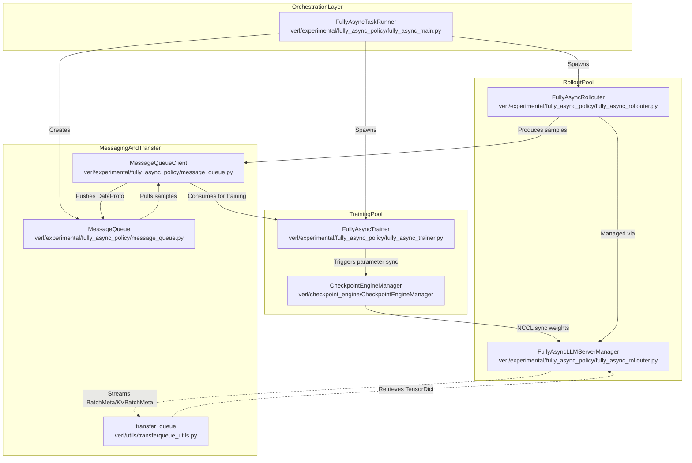
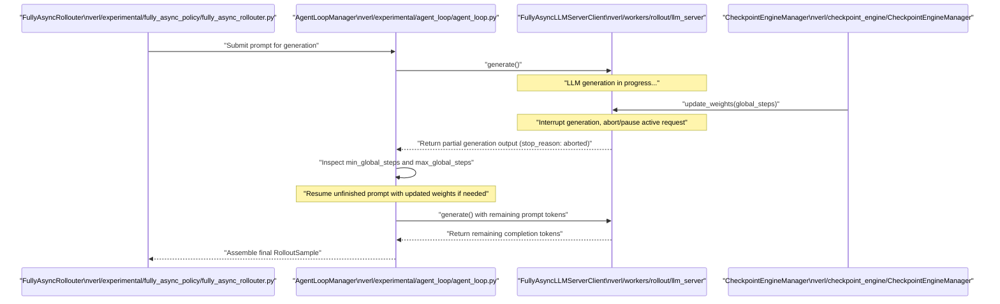

<!-- source: DeepWiki mcp.deepwiki.com · repo volcengine/verl · page 7.7 Fully Async Policy and Partial Rollout · fetched 2026-10-21 -->

# Fully Async Policy and Partial Rollout

Relevant source files

The following files were used as context for generating this wiki page:

- [docs/advance/fully_async.md](docs/advance/fully_async.md)
- [verl/experimental/fully_async_policy/README.md](verl/experimental/fully_async_policy/README.md)
- [verl/experimental/fully_async_policy/README_zh.md](verl/experimental/fully_async_policy/README_zh.md)
- [verl/experimental/fully_async_policy/detach_utils.py](verl/experimental/fully_async_policy/detach_utils.py)
- [verl/experimental/fully_async_policy/fully_async_main.py](verl/experimental/fully_async_policy/fully_async_main.py)
- [verl/experimental/fully_async_policy/fully_async_rollouter.py](verl/experimental/fully_async_policy/fully_async_rollouter.py)
- [verl/experimental/fully_async_policy/fully_async_trainer.py](verl/experimental/fully_async_policy/fully_async_trainer.py)
- [verl/experimental/fully_async_policy/shell/dapo_30b_a3b_base_math_fsdp.sh](verl/experimental/fully_async_policy/shell/dapo_30b_a3b_base_math_fsdp.sh)
- [verl/experimental/fully_async_policy/shell/dapo_30b_a3b_math_fsdp_npu.sh](verl/experimental/fully_async_policy/shell/dapo_30b_a3b_math_fsdp_npu.sh)
- [verl/experimental/fully_async_policy/shell/dapo_7b_math_fsdp2_16_16.sh](verl/experimental/fully_async_policy/shell/dapo_7b_math_fsdp2_16_16.sh)
- [verl/experimental/fully_async_policy/shell/dapo_7b_math_fsdp2_32_32.sh](verl/experimental/fully_async_policy/shell/dapo_7b_math_fsdp2_32_32.sh)
- [verl/experimental/fully_async_policy/shell/dapo_7b_math_fsdp2_4_12.sh](verl/experimental/fully_async_policy/shell/dapo_7b_math_fsdp2_4_12.sh)
- [verl/experimental/fully_async_policy/shell/dapo_7b_math_fsdp2_4_4.sh](verl/experimental/fully_async_policy/shell/dapo_7b_math_fsdp2_4_4.sh)
- [verl/experimental/fully_async_policy/shell/dapo_7b_math_fsdp2_64_64.sh](verl/experimental/fully_async_policy/shell/dapo_7b_math_fsdp2_64_64.sh)
- [verl/experimental/fully_async_policy/shell/dapo_7b_math_fsdp2_8_8.sh](verl/experimental/fully_async_policy/shell/dapo_7b_math_fsdp2_8_8.sh)
- [verl/experimental/fully_async_policy/shell/geo3k_qwen3vl_30b_a3b_fsdp2_32_32.sh](verl/experimental/fully_async_policy/shell/geo3k_qwen3vl_30b_a3b_fsdp2_32_32.sh)
- [verl/experimental/one_step_off_policy/main_ppo.py](verl/experimental/one_step_off_policy/main_ppo.py)
- [verl/experimental/one_step_off_policy/ray_trainer.py](verl/experimental/one_step_off_policy/ray_trainer.py)
- [verl/experimental/separation/ray_trainer.py](verl/experimental/separation/ray_trainer.py)
- [verl/experimental/separation/utils.py](verl/experimental/separation/utils.py)
- [verl/trainer/ppo/utils.py](verl/trainer/ppo/utils.py)

## Purpose and Scope

This page covers the fully asynchronous reinforcement learning training system in `verl`, focusing on the complete decoupling of the trainer and rollout engines, streaming data management via `TransferQueue`, partial rollout execution with request resumption, and dynamic resource scheduling. The features detailed here enable significant end-to-end throughput improvements (2.35x–2.67x) in large-scale LLM post-training by overlapping generation and training phases and mitigating long-tail generation bottlenecks.

Sources: [verl/experimental/fully_async_policy/fully_async_trainer.py:53-60](), [docs/advance/fully_async.md:7-10]()

---

## Architecture & Separation Design

The fully asynchronous policy framework departs from the traditional synchronous `HybridEngine` model by separating computation resources between a dedicated `Rollouter` worker pool and a `Trainer` worker pool [verl/experimental/fully_async_policy/fully_async_trainer.py:75-76](). It extends the separation architecture introduced in `SeparateRayPPOTrainer` [verl/experimental/separation/ray_trainer.py:52-57]() and expands upon the synchronous restrictions of `OneStepOffRayTrainer` [verl/experimental/one_step_off_policy/ray_trainer.py:49-50]() by introducing multi-step asynchronous training, freshness control, and message queue streaming.

### System Architecture and Code Entity Mapping

The diagram below bridges natural language architectural concepts to exact code entities across the `verl` codebase.

Title: Fully Async Architecture and Code Entity Mapping

Sources: [verl/experimental/fully_async_policy/fully_async_main.py:35-155](), [verl/experimental/fully_async_policy/fully_async_rollouter.py:54-144](), [verl/experimental/fully_async_policy/fully_async_trainer.py:53-146]()

---

## Rollout Management & `FullyAsyncLLMServerManager`

Rollout generation under the fully async system is managed by `FullyAsyncLLMServerManager`, which inherits from `LLMServerManager` [verl/experimental/fully_async_policy/fully_async_rollouter.py:54-55]() and coordinates both hybrid and standalone server replicas.

### Hybrid vs. Standalone Replicas
- **Hybrid Replicas**: Initialized starting from rank `0` using the trainer's worker group (`worker_group`), allowing them to share placement groups and GPU affinity with the training engine [verl/experimental/fully_async_policy/fully_async_rollouter.py:78-96](). These are initially registered in `self.hybrid_replicas` in a sleeping state (not yet inserted into the global load balancer) [verl/experimental/fully_async_policy/fully_async_rollouter.py:64-67]().
- **Standalone Replicas**: Initialized via the parent `LLMServerManager` logic [verl/experimental/fully_async_policy/fully_async_rollouter.py:104-123]() on dedicated rollout nodes. They support independent memory configurations via `standalone_gpu_memory_utilization` [verl/experimental/fully_async_policy/fully_async_rollouter.py:115-128]().

### Dynamic Replica Activation
`FullyAsyncLLMServerManager` implements `add_replicas` to dynamically awaken and register sleeping hybrid replicas back into active service based on scheduling context signals [verl/experimental/fully_async_policy/fully_async_rollouter.py:144-150]().

Sources: [verl/experimental/fully_async_policy/fully_async_rollouter.py:54-150]()

---

## Partial Rollout and Request Resumption

Partial rollout addresses synchronization stalls where ongoing, long-tail generation requests block parameter updates from the trainer. By pausing in-flight requests during NCCL weight synchronization and resuming them afterward, the system preserves work already generated.

### Execution Flow for Request Resumption

Title: Partial Rollout and Request Resumption Sequence

Sources: [verl/experimental/fully_async_policy/fully_async_rollouter.py:1-1392]()

### Key Metadata and Tracking
- **Version Spans**: Trajectories are tagged with `min_global_steps` and `max_global_steps` to record which parameter versions participated in generation [verl/experimental/fully_async_policy/detach_utils.py:151-152]().
- **Metrics**: `assemble_batch_from_rollout_samples` calculates metrics such as `fully_async/partial/total_partial_num`, `partial_ratio`, and `max_partial_span` to monitor the frequency and impact of request interruptions [verl/experimental/fully_async_policy/detach_utils.py:155-159]().

Sources: [verl/experimental/fully_async_policy/detach_utils.py:151-172]()

---

## TransferQueue Data System

The `transfer_queue` system provides an asynchronous streaming layer designed to decouple explicit data dependencies between distributed workers.

### Core Mechanisms
- **Gateway Abstraction**: Acts as an intermediate high-throughput buffer for moving `TensorDict` and `DataProto` objects between rollout generation processes and training consumers.
- **Background Event Loop**: Manages asynchronous socket or memory queues in a background daemon thread, eliminating blocking waits during batch handoff.
- **Meta-to-Real Data Translation**: Operates using lightweight references in transit, resolving them to raw tensor payloads only when consumption occurs.

Sources: [docs/advance/fully_async.md:51-52]()

---

## Dynamic Resource Scheduling & One-Step Off-Policy Trainer

Dynamic resource scheduling (`use_dynamic_resource_scheduling`) allows the system to flexibly manage compute allocation between training and rollout stages.

- **`DynamicScheduleContext`**: Controls when trainer nodes reclaim or release rollout resources [verl/experimental/fully_async_policy/fully_async_trainer.py:32]() based on training idle periods and queue pressure.
- **Colocated Hybrid Rollouts**: When dynamic scheduling or validation via the trainer is enabled (`use_trainer_do_validate`), trainer workers carry a rollout engine role (`Role.ActorRollout`) so weight updates can be pushed directly to colocated rollout instances without out-of-band overhead [verl/experimental/fully_async_policy/fully_async_trainer.py:148-155]().
- **One-Step Off-Policy Trainer**: `OneStepOffRayTrainer` provides a foundational single-round asynchronous separation between rollout and train [verl/experimental/one_step_off_policy/ray_trainer.py:49-50](), while `FullyAsyncTrainer` extends this to multi-step asynchronous streaming execution [verl/experimental/fully_async_policy/fully_async_trainer.py:53-58]().

Sources: [verl/experimental/fully_async_policy/fully_async_trainer.py:32-155](), [verl/experimental/one_step_off_policy/ray_trainer.py:49-50]()

---

## Trainer & Data Flow (`FullyAsyncTrainer`)

`FullyAsyncTrainer` inherits from `SeparateRayPPOTrainer` and manages asynchronous consumption from the `MessageQueue` [verl/experimental/fully_async_policy/fully_async_trainer.py:53-58]().

### Training Loop Steps
1. **Sample Gathering**: Continuously pulls generated samples from the `MessageQueueClient` until the required sample threshold (`required_samples = ppo_mini_batch_size * require_batches`) is satisfied [verl/experimental/fully_async_policy/fully_async_trainer.py:158-159]().
2. **Batch Assembly**: Combines samples into a unified `DataProto` structure using `assemble_batch_from_rollout_samples()` [verl/experimental/fully_async_policy/detach_utils.py:84-86]().
3. **Parameter Synchronization**: After completing `trigger_parameter_sync_step` training iterations, triggers weight synchronization with the rollout replicas using the `CheckpointEngineManager` [verl/experimental/fully_async_policy/fully_async_trainer.py:146]().

Sources: [verl/experimental/fully_async_policy/fully_async_trainer.py:53-160](), [verl/experimental/fully_async_policy/detach_utils.py:84-176]()

---

## Configuration Reference

Key configuration options governing the fully asynchronous policy and partial rollout behavior:

| Configuration Parameter | Type / Scope | Default / Example | Description |
|-------------------------|--------------|-------------------|-------------|
| `async_training.staleness_threshold` | Float | `0.75` | Maximum allowable staleness ratio for generated samples [docs/advance/fully_async.md:55](). |
| `async_training.trigger_parameter_sync_step` | Integer | `2` | Number of local trainer update steps between weight synchronization broadcasts [verl/experimental/fully_async_policy/fully_async_trainer.py:146](). |
| `async_training.require_batches` | Integer | `1` | Multiplier for `ppo_mini_batch_size` determining minimum batch collection size [verl/experimental/fully_async_policy/fully_async_trainer.py:158](). |
| `async_training.partial_rollout` | Boolean | `True` | Enables partial rollout request resumption during weight updates [docs/advance/fully_async.md:57](). |
| `async_training.use_dynamic_resource_scheduling` | Boolean | `False` | Enables dynamic activation and deactivation of hybrid rollout replicas [verl/experimental/fully_async_policy/fully_async_trainer.py:152-154](). |
| `actor_rollout_ref.hybrid_engine` | Boolean | `False` | Must be disabled for separated fully async training topologies [verl/experimental/fully_async_policy/fully_async_trainer.py:75-76](). |

Sources: [verl/experimental/fully_async_policy/fully_async_trainer.py:75-159](), [docs/advance/fully_async.md:52-60]()

---

