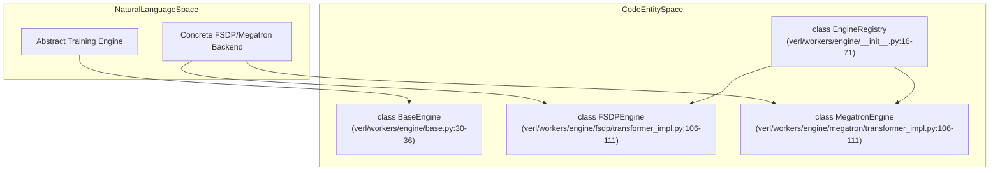
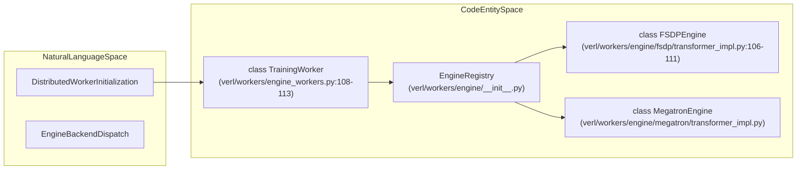

<!-- source: DeepWiki mcp.deepwiki.com · repo volcengine/verl · page 8 Training Engines and Distributed Backends · fetched 2026-10-21 -->

# Training Engines and Distributed Backends

Relevant source files

The following files were used as context for generating this wiki page:

- [tests/models/test_engine.py](tests/models/test_engine.py)
- [tests/models/test_model_forward_fused.py](tests/models/test_model_forward_fused.py)
- [tests/utils/test_linear_cross_entropy_on_cpu.py](tests/utils/test_linear_cross_entropy_on_cpu.py)
- [tests/utils/test_special_linear_cross_entropy_tp.py](tests/utils/test_special_linear_cross_entropy_tp.py)
- [tests/workers/test_megatron_liger_fused_kernels_on_cpu.py](tests/workers/test_megatron_liger_fused_kernels_on_cpu.py)
- [verl/models/mcore/__init__.py](verl/models/mcore/__init__.py)
- [verl/models/mcore/model_forward.py](verl/models/mcore/model_forward.py)
- [verl/models/mcore/model_forward_fused.py](verl/models/mcore/model_forward_fused.py)
- [verl/models/mcore/registry.py](verl/models/mcore/registry.py)
- [verl/models/mcore/util.py](verl/models/mcore/util.py)
- [verl/utils/checkpoint/megatron_checkpoint_manager.py](verl/utils/checkpoint/megatron_checkpoint_manager.py)
- [verl/utils/megatron_utils.py](verl/utils/megatron_utils.py)
- [verl/utils/model.py](verl/utils/model.py)
- [verl/workers/engine/base.py](verl/workers/engine/base.py)
- [verl/workers/engine/fsdp/transformer_impl.py](verl/workers/engine/fsdp/transformer_impl.py)
- [verl/workers/engine/megatron/transformer_impl.py](verl/workers/engine/megatron/transformer_impl.py)
- [verl/workers/engine/utils.py](verl/workers/engine/utils.py)
- [verl/workers/engine_workers.py](verl/workers/engine_workers.py)
- [verl/workers/engine_workers_tinker.py](verl/workers/engine_workers_tinker.py)

This page provides a comprehensive high-level guide to the training engine abstraction layer and distributed backend implementations in `verl`. The engine architecture decouples the RL training logic (implemented in trainers and workers) from underlying distributed execution frameworks such as PyTorch FSDP and NVIDIA Megatron-LM.

For deep technical details, implementation specifics, and configuration guides, refer to the child pages:
- [BaseEngine Architecture and Interface](#8.1)
- [FSDP Engine Implementation](#8.2)
- [Megatron Engine Implementation](#8.3)
- [Megatron-Core Model Integration](#8.4)
- [Parallelism Strategies and Configuration](#8.5)
- [Checkpoint Management and State Persistence](#8.6)
- [TorchTitan, Megatron Lite, FSDP-Turbo, MindSpeed, and VeOmni Backends](#8.7)

---

## BaseEngine Architecture and Interface

The `BaseEngine` class [verl/workers/engine/base.py:30-36]() defines the abstract interface that all training engines must implement, establishing a unified API for model training, evaluation, optimizer updates, and state persistence.

Title: Engine Abstraction and Code Entities

Sources: [verl/workers/engine/base.py:30-36](), [verl/workers/engine/__init__.py:16-71](), [verl/workers/engine/fsdp/transformer_impl.py:106-111](), [verl/workers/engine/megatron/transformer_impl.py:106-111]()

### Core Interface Summary

| Method | Role / Responsibility | Code Pointer |
|:-------|:----------------------|:-------------|
| `initialize()` | Instantiates or loads model, optimizer, and lr scheduler. | [verl/workers/engine/base.py:38-44]() |
| `train_mode()` / `eval_mode()` | Context managers managing execution modes and device placement. | [verl/workers/engine/base.py:58-76]() |
| `forward_backward_batch()` | Executes forward and backward passes on a `TensorDict` batch. | [verl/workers/engine/base.py:99-111]() |
| `train_batch()` | Coordinates `optimizer_zero_grad`, `forward_backward_batch`, and `optimizer_step`. | [verl/workers/engine/base.py:113-132]() |
| `get_per_tensor_param()` | Yields full parameter name-tensor tuples and optional PEFT config. | [verl/workers/engine/base.py:151-161]() |
| `get_per_tensor_param_shard()` | Yields local parameter shards with placement specs (`ShardSpec`). | [verl/workers/engine/base.py:163-181]() |

For comprehensive documentation on the abstract interface, training/evaluation context managers, and lifecycle methods, see [BaseEngine Architecture and Interface](#8.1).

Sources: [verl/workers/engine/base.py:30-181]()

---

## FSDP Engine Implementation

The `FSDPEngine` integrates PyTorch's `FullyShardedDataParallel` (FSDP and FSDP2) into `verl` [verl/workers/engine/fsdp/transformer_impl.py:106-111](). It provides sharded model wrappers, mixed precision policies, CPU offloading options for parameters and optimizer states, Ulysses sequence parallelism, and Quantization-Aware Training (QAT) support [verl/workers/engine/fsdp/transformer_impl.py:113-178]().

For details on FSDP/FSDP2 wrapping, sharding strategies, and performance tunings, see [FSDP Engine Implementation](#8.2).

Sources: [verl/workers/engine/fsdp/transformer_impl.py:106-178]()

---

## Megatron Engine Implementation

The `MegatronEngine` integrates NVIDIA Megatron-Core for large-scale distributed training. It configures 3D parallelism (Tensor Parallelism, Pipeline Parallelism, Context Parallelism, and Expert Parallelism) via Megatron's model parallel initialization state (`mpu`) [verl/workers/engine/megatron/transformer_impl.py:23-28](). It also supports dynamic context parallel scheduling and router replay for MoE models [verl/workers/engine/megatron/transformer_impl.py:37-58]().

For details on model parallel initialization, DDP wrapping, and Megatron-Bridge integration, see [Megatron Engine Implementation](#8.3).

Sources: [verl/workers/engine/megatron/transformer_impl.py:23-58](), [verl/utils/megatron_utils.py:29-37]()

---

## Megatron-Core Model Integration

Model integration with Megatron-Core involves converting HuggingFace model configurations into Megatron `TransformerConfig` objects, managing model registries, implementing custom forward passes, and converting weights between formats. The `get_mcore_engine_forward_fn` [verl/models/mcore/registry.py:37-43]() and `get_mcore_forward_fused_model_engine_fn` [verl/models/mcore/registry.py:45-54]() utilities handle the forward pass implementations, while configuration conversion maps HuggingFace architectures.

For details on model initialization, config conversion, and weight translation, see [Megatron-Core Model Integration](#8.4).

Sources: [verl/models/mcore/registry.py:37-54]()

---

## Parallelism Strategies and Configuration

`verl` supports diverse parallelism dimensions across backends: Tensor Parallelism (TP), Pipeline Parallelism (PP), Expert Parallelism (EP), Context Parallelism (CP), Virtual Pipeline (VP), and Data Parallelism (DP). The configuration classes provide granular control over these settings for both FSDP and Megatron-based engines [verl/workers/config.py]() (see [Parallelism Strategies and Configuration](#8.5)).

Title: Backend Selection and Worker Initialization Flow

Sources: [verl/workers/engine_workers.py:108-113](), [verl/workers/engine/fsdp/transformer_impl.py:106-111]()

For comparisons between FSDP and Megatron parallelism schemes, configuration examples, and best practices, see [Parallelism Strategies and Configuration](#8.5).

Sources: [verl/workers/engine_workers.py:108-144]()

---

## Checkpoint Management and State Persistence

State persistence is handled via backend-specific checkpoint managers:
- **FSDP Checkpointing**: Managed via `FSDPCheckpointManager` [verl/utils/checkpoint/fsdp_checkpoint_manager.py]() (imported in [verl/workers/engine/fsdp/transformer_impl.py:38]()). It supports `FullStateDictConfig` and `ShardedStateDictConfig` for saving model states [verl/workers/engine/fsdp/transformer_impl.py:30-30]().
- **Megatron Checkpointing**: Managed via `MegatronCheckpointManager` using Megatron's native distributed checkpointing utilities [verl/utils/checkpoint/megatron_checkpoint_manager.py]() (imported in [verl/workers/engine/megatron/transformer_impl.py:32]()).
- **Delta Weight Synchronization**: Optimizes disaggregated rollouts by computing shard-local byte-diffs and streaming sparse updates over NCCL.

For details on save/load procedures, distributed checkpointing, PEFT adapter handling, and weight merging, see [Checkpoint Management and State Persistence](#8.6).

Sources: [verl/workers/engine/fsdp/transformer_impl.py:30-38](), [verl/workers/engine/megatron/transformer_impl.py:32]()

---

## TorchTitan, Megatron Lite, FSDP-Turbo, MindSpeed, and VeOmni Backends

In addition to standard FSDP and Megatron-Core engines, `verl` supports auxiliary and experimental training backends:
- **TorchTitan**: Leverages modern FSDP2 and pipeline primitives.
- **Megatron Lite**: Lightweight Megatron variant for rapid prototyping.
- **FSDP-Turbo**: Optimized FSDP path.
- **MindSpeed**: Optimization toolkit for Ascend NPU integration.
- **VeOmni**: Specialized backend for multimodal vision-language models.

These engines are registered in the `EngineRegistry` and can be selected via the backend strategy configuration.

For configuration details and use cases for each backend, see [TorchTitan, Megatron Lite, FSDP-Turbo, MindSpeed, and VeOmni Backends](#8.7).

Sources: [verl/workers/engine/fsdp/transformer_impl.py:106-111]()

---

