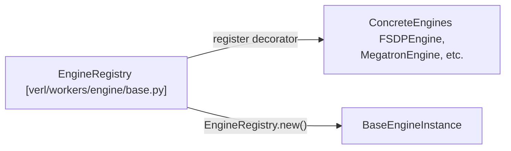
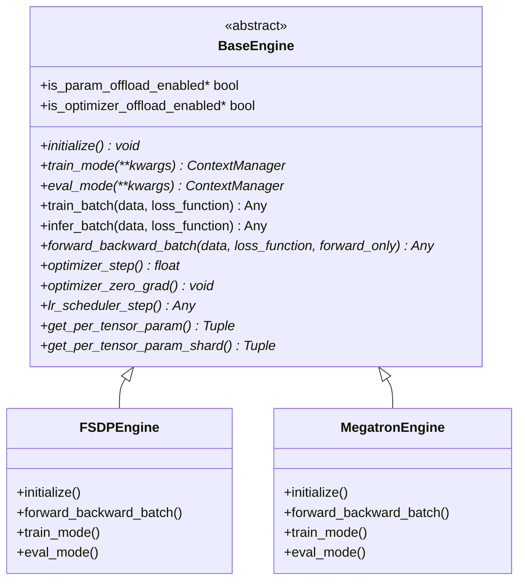
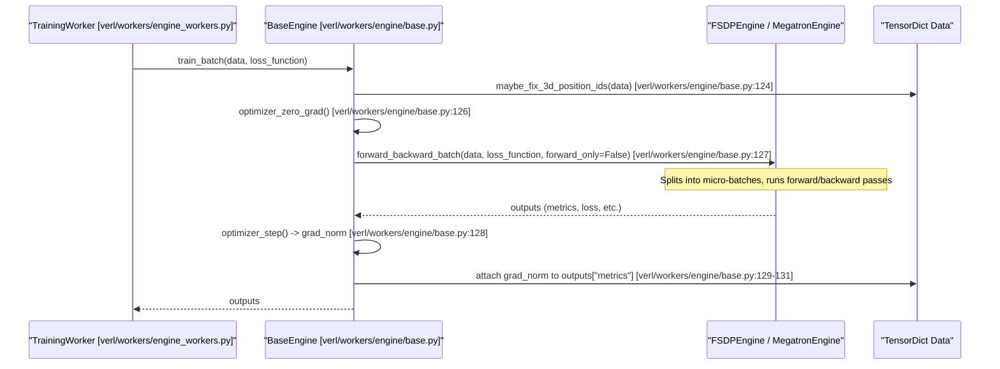

<!-- source: DeepWiki mcp.deepwiki.com · repo volcengine/verl · page 8.1 BaseEngine Architecture and Interface · fetched 2026-10-21 -->

# BaseEngine Architecture and Interface

<details>
<summary>Relevant source files</summary>

The following files were used as context for generating this wiki page:

- [docs/workers/engine_workers.rst](docs/workers/engine_workers.rst)
- [tests/models/test_engine.py](tests/models/test_engine.py)
- [tests/special_sanity/check_device_api_usage.py](tests/special_sanity/check_device_api_usage.py)
- [verl/workers/engine/__init__.py](verl/workers/engine/__init__.py)
- [verl/workers/engine/base.py](verl/workers/engine/base.py)
- [verl/workers/engine/fsdp/__init__.py](verl/workers/engine/fsdp/__init__.py)
- [verl/workers/engine/fsdp/transformer_impl.py](verl/workers/engine/fsdp/transformer_impl.py)
- [verl/workers/engine/megatron/__init__.py](verl/workers/engine/megatron/__init__.py)
- [verl/workers/engine/mindspeed/__init__.py](verl/workers/engine/mindspeed/__init__.py)
- [verl/workers/engine/mindspeed/transformer_impl.py](verl/workers/engine/mindspeed/transformer_impl.py)
- [verl/workers/engine/mindspeed/utils.py](verl/workers/engine/mindspeed/utils.py)
- [verl/workers/engine/utils.py](verl/workers/engine/utils.py)
- [verl/workers/engine_workers.py](verl/workers/engine_workers.py)
- [verl/workers/engine_workers_tinker.py](verl/workers/engine_workers_tinker.py)

</details>


**Purpose**: This document describes the `BaseEngine` abstract class and its role as the unified interface for distributed training backends in `verl`. The `BaseEngine` provides a backend-agnostic API for model training, enabling seamless switching between backends like FSDP, Megatron-Core, Automodel, VeOmni, TorchTitan, and Mindspeed without changing higher-level training code [verl/workers/engine/base.py:14-16]().

**Scope**: Covers the abstract interface definition, concrete implementations, context management for `train_mode`/`eval_mode`, training execution lifecycle (`forward_backward_batch`), `EngineRegistry` registration, micro-batching, and the sharded delta sync interface for efficient weight transfers.

---

## 1. Overview and System Architecture

The `BaseEngine` serves as the core abstraction layer separating training logic from parallelism implementation details. It encapsulates model initialization, optimizer management, forward/backward computation, checkpointing, and weight sharding exports behind a uniform interface [verl/workers/engine/base.py:29-35]().

### System-to-Code Architecture Mapping

The following diagram bridges natural language system components with their corresponding code entities in the `verl` codebase.

```mermaid
graph TB
    subgraph "TrainingOrchestration"
        TrainingWorker["TrainingWorker [verl/workers/engine_workers.py]"]
        ActorRolloutRefWorker["ActorRolloutRefWorker [verl/workers/engine_workers.py]"]
        TinkerTrainingWorker["TinkerTrainingWorker [verl/workers/engine_workers_tinker.py]"]
        TinkerActorRolloutRefWorker["TinkerActorRolloutRefWorker [verl/workers/engine_workers_tinker.py]"]
    end
    
    subgraph "EngineAbstraction"
        BaseEngine["BaseEngine [verl/workers/engine/base.py]"]
        EngineRegistry["EngineRegistry [verl/workers/engine/base.py]"]
    end
    
    subgraph "ConcreteBackends"
        FSDPEngine["FSDPEngine [verl/workers/engine/fsdp/transformer_impl.py]"]
        MegatronEngine["MegatronEngine [verl/workers/engine/megatron/transformer_impl.py]"]
        AutomodelEngine["AutomodelEngine [verl/workers/engine/automodel/transformer_impl.py]"]
        TorchTitanEngine["TorchTitanEngine [verl/workers/engine/torchtitan/transformer_impl.py]"]
        VeOmniEngine["VeOmniEngine [verl/workers/engine/veomni/transformer_impl.py]"]
        MindspeedEngine["MindspeedEngine [verl/workers/engine/mindspeed/transformer_impl.py]"]
    end
    
    TrainingWorker -->|"instantiates/delegates"| BaseEngine
    ActorRolloutRefWorker -->|"delegates"| TrainingWorker
    TinkerTrainingWorker --|> TrainingWorker
    TinkerActorRolloutRefWorker --|> ActorRolloutRefWorker
    EngineRegistry -->|"registers & creates"| BaseEngine
    BaseEngine <|-- FSDPEngine
    BaseEngine <|-- MegatronEngine
    BaseEngine <|-- AutomodelEngine
    BaseEngine <|-- TorchTitanEngine
    BaseEngine <|-- VeOmniEngine
    BaseEngine <|-- MindspeedEngine
```

Sources: [verl/workers/engine/base.py:29-36](), [verl/workers/engine_workers.py:135-142](), [verl/workers/engine/__init__.py:16-71](), [verl/workers/engine/fsdp/__init__.py:14-17](), [verl/workers/engine/megatron/__init__.py:24-29](), [verl/workers/engine/mindspeed/__init__.py:15-17](), [verl/workers/engine_workers_tinker.py:110-111]()

---

## 2. BaseEngine Abstract Interface, Registry, and Lifecycle Methods

The `BaseEngine` class defines the contract that all backend implementations must fulfill [verl/workers/engine/base.py:29-35](). It provides lifecycle management, execution primitives, state accessors, and context managers for training/evaluation modes.

### EngineRegistry and Factory Pattern

`EngineRegistry` acts as a registry for backend implementations, allowing dynamic instantiation of concrete engines based on model type, hardware device, and strategy backend string (e.g. `"fsdp"`, `"megatron"`).



Sources: [verl/workers/engine/base.py:30-181](), [verl/workers/engine_workers.py:137-144](), [verl/workers/engine/mindspeed/transformer_impl.py:56-56]()

### Class Hierarchy and Interface Methods



Sources: [verl/workers/engine/base.py:30-181]()

### Core Lifecycle Methods and Context Managers Table

| Method / Property Name | Signature | Description |
|------------------------|-----------|-------------|
| `initialize()` | `()` -> `None` | Instantiate or load model, optimizer, and LR scheduler [verl/workers/engine/base.py:38-44]() |
| `train_mode()` | `(**kwargs)` -> `ContextManager` | Context manager entry for switching engine and model into training mode [verl/workers/engine/base.py:58-66]() |
| `eval_mode()` | `(**kwargs)` -> `ContextManager` | Context manager entry for switching engine and model into evaluation mode [verl/workers/engine/base.py:68-76]() |
| `optimizer_zero_grad()` | `()` -> `None` | Zero optimizer gradients [verl/workers/engine/base.py:78-82]() |
| `optimizer_step()` | `()` -> `float` | Perform optimizer step and return gradient norm [verl/workers/engine/base.py:84-88]() |
| `lr_scheduler_step()` | `()` -> `Any` | Advance learning rate scheduler and return current LR [verl/workers/engine/base.py:90-97]() |
| `forward_backward_batch()` | `(data, loss_function, forward_only)` -> `Any` | Execute forward pass and optional backward pass on a batch [verl/workers/engine/base.py:99-111]() |

Sources: [verl/workers/engine/base.py:38-111]()

---

## 3. Training Execution Flow and Micro-Batching

The high-level training methods `train_batch` and `infer_batch` are built on top of `forward_backward_batch`. They handle preprocessing steps such as `maybe_fix_3d_position_ids` and manage gradient zeroing and stepping [verl/workers/engine/base.py:113-150]().

### Execution Data Flow



Sources: [verl/workers/engine/base.py:113-150](), [verl/workers/engine/base.py:124-132]()

### Micro-Batch Preparation Utility

Engines utilize helper functions from `verl.workers.engine.utils` to prepare micro-batches based on dynamic token length constraints or fixed micro-batch sizes:
* `prepare_micro_batches(data, ...)`: Inspects `use_dynamic_bsz` and chunks data accordingly or balances sequence lengths across devices [verl/workers/engine/utils.py:92-130]().
* `postprocess_batch_func(...)`: Reorders and aggregates micro-batch outputs back into the unified batch format [verl/workers/engine/utils.py:133-169]().

Sources: [verl/workers/engine/utils.py:92-169]()

### Tinker-style Split Training Primitives

The `TinkerTrainingWorker` extends `TrainingWorker` to expose finer-grained control over the training loop, allowing explicit separation of gradient clearing, forward/backward passes, and optimizer steps. This is useful for advanced training schedules or custom optimization logic.
* `optimizer_zero_grad()`: Calls `self.engine.optimizer_zero_grad()` within a `train_mode` context [verl/workers/engine_workers_tinker.py:119-121]().
* `forward_backward(data)`: Performs the forward and backward passes, ensuring `return_model_output=True` for client-side log-prob processing [verl/workers/engine_workers_tinker.py:125-157]().
* `optimizer_step(optim_step_params)`: Executes the optimizer step, optionally applying runtime parameter overrides (e.g., learning rate, betas, weight decay) to all parameter groups via `_apply_optim_step_params` [verl/workers/engine_workers_tinker.py:65-108]().

Sources: [verl/workers/engine_workers_tinker.py:110-157](), [verl/workers/engine_workers_tinker.py:65-108]()

---

## 4. Sharded Delta Sync Interface

To reduce communication overhead in disaggregated reinforcement learning setups (where the rollout worker and actor trainer run on separate process groups or nodes), `BaseEngine` provides interfaces for sharded weight exports [verl/workers/engine/base.py:151-181]().

| Method | Return Type | Description |
|--------|-------------|-------------|
| `get_per_tensor_param()` | `Tuple[Generator[Tuple[str, torch.Tensor], None, None], Optional[dict]]` | Yields full parameter name-tensor pairs and optional PEFT config [verl/workers/engine/base.py:151-161]() |
| `get_per_tensor_param_shard()` | `Tuple[Generator, Optional[dict]]` | Yields rank-local parameter shards along with placement metadata (`ShardSpec`), avoiding full tensor all-gather [verl/workers/engine/base.py:163-181]() |

Sources: [verl/workers/engine/base.py:151-181]()

---

## 5. Memory Management and Determinism Utilities

`BaseEngine` exposes properties to query offloading status, and `verl.workers.engine.utils` provides configuration helpers for full reproducibility [verl/workers/engine/base.py:46-56](), [verl/workers/engine/utils.py:31-63]().

* `is_param_offload_enabled`: Boolean property indicating whether model parameters are offloaded to CPU memory [verl/workers/engine/base.py:48-50]().
* `is_optimizer_offload_enabled`: Boolean property indicating whether optimizer states are offloaded to CPU memory [verl/workers/engine/base.py:53-56]().
* `enable_full_determinism(seed)`: Sets environment variables (`FLASH_ATTENTION_DETERMINISTIC`, `NCCL_DETERMINISTIC`, `CUBLAS_WORKSPACE_CONFIG`, etc.) and fixes seeds across `random`, `numpy`, and `torch` [verl/workers/engine/utils.py:31-63](). This also includes specific environment variables for NPU devices like `HCCL_DETERMINISTIC` and `CLOSE_MATMUL_K_SHIFT` when NPU is available [verl/workers/engine/utils.py:49-53]().

Sources: [verl/workers/engine/base.py:46-56](), [verl/workers/engine/utils.py:31-63]()

---

