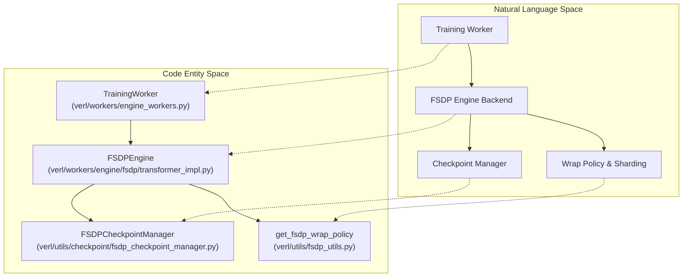
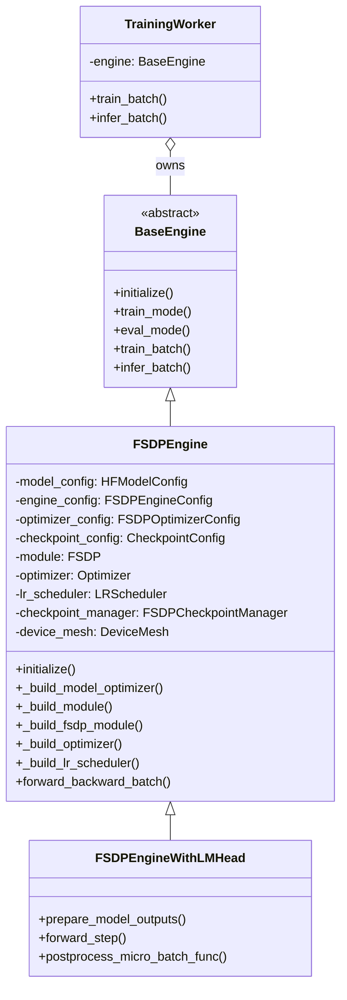
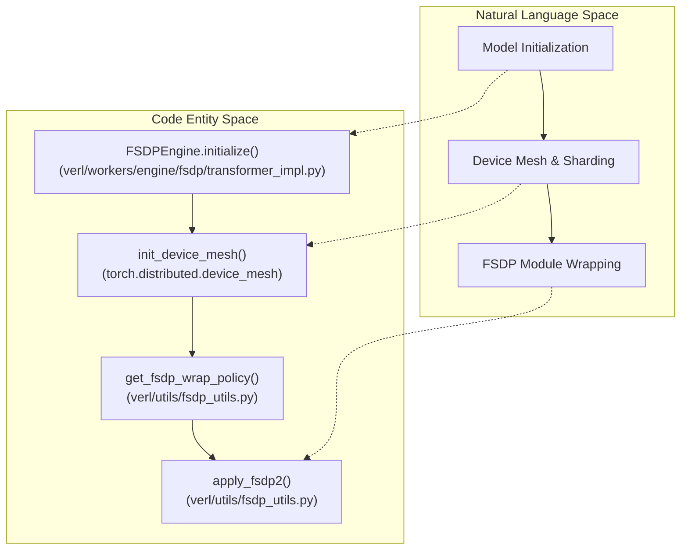
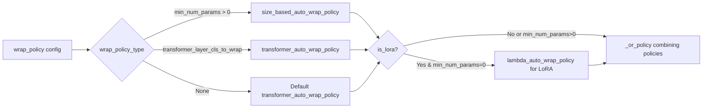

<!-- source: DeepWiki mcp.deepwiki.com · repo volcengine/verl · page 8.2 FSDP Engine Implementation · fetched 2026-10-21 -->

# FSDP Engine Implementation

Relevant source files

The following files were used as context for generating this wiki page:

- [docs/advance/ppo_lora.rst](docs/advance/ppo_lora.rst)
- [tests/single_controller/test_device_agnostic_resources_on_cpu.py](tests/single_controller/test_device_agnostic_resources_on_cpu.py)
- [tests/special_distributed/run_all.sh](tests/special_distributed/run_all.sh)
- [tests/special_distributed/test_fsdp2_cpu_offload_state_dict.py](tests/special_distributed/test_fsdp2_cpu_offload_state_dict.py)
- [tests/special_distributed/test_fsdp2_pinned_model_transfer.py](tests/special_distributed/test_fsdp2_pinned_model_transfer.py)
- [tests/special_distributed/test_torch_functional.py](tests/special_distributed/test_torch_functional.py)
- [tests/special_sanity/check_license.py](tests/special_sanity/check_license.py)
- [tests/utils/test_fsdp2_model_transfer_on_cpu.py](tests/utils/test_fsdp2_model_transfer_on_cpu.py)
- [tests/workers/config/test_engine_config_on_cpu.py](tests/workers/config/test_engine_config_on_cpu.py)
- [tests/workers/test_fsdp_gradient_accumulation_sync_on_cpu.py](tests/workers/test_fsdp_gradient_accumulation_sync_on_cpu.py)
- [verl/trainer/config/engine/fsdp.yaml](verl/trainer/config/engine/fsdp.yaml)
- [verl/utils/fsdp_utils.py](verl/utils/fsdp_utils.py)

## Purpose and Scope

This document details the **FSDPEngine** implementation, which provides PyTorch FSDP (Fully Sharded Data Parallel) and FSDP2 backend support for distributed training in `verl`. `FSDPEngine` wraps Hugging Face transformer models with FSDP for data-parallel sharding across accelerators, supporting mixed precision, LoRA/PEFT adapters, Quantization-Aware Training (QAT), Ulysses sequence parallelism, and CPU offloading.

For the abstract engine interface, see [BaseEngine Architecture and Interface](#8.1). For Megatron-based 3D parallelism, see [Megatron Engine Implementation](#8.3). For checkpoint persistence details, see [Checkpoint Management and State Persistence](#8.6).

Sources: [verl/utils/fsdp_utils.py:14-16](), [verl/trainer/config/engine/fsdp.yaml:1-80]()

---

## FSDPEngine Architecture

The `FSDPEngine` class implements the `BaseEngine` interface for PyTorch FSDP backends. It handles model initialization, distributed wrapping, optimizer configuration, and training/inference micro-batch execution.

### System-to-Code Mapping: Core Architecture

The following diagram bridges high-level architectural concepts to their concrete code entities in the codebase.

Sources: [verl/trainer/config/engine/fsdp.yaml:1-80](), [verl/utils/fsdp_utils.py:80-87]()

### Class Hierarchy

Sources: [verl/trainer/config/engine/fsdp.yaml:1-80](), [verl/utils/fsdp_utils.py:42-55]()

---

## Configuration

The FSDP engine is configured via Hydra configuration files (`verl/trainer/config/engine/fsdp.yaml`), which define wrapping policies, offloading flags, sequence parallelism, and Quantization-Aware Training (QAT).

| Field | Type | Default | Description |
|-------|------|---------|-------------|
| `strategy` | str | `"fsdp"` | Backend strategy: `"fsdp"`, `"fsdp2"`, or `"fsdp_turbo"` |
| `wrap_policy` | dict | `{}` | FSDP wrapping policy configuration |
| `param_offload` | bool | `False` | Offload parameters to CPU |
| `optimizer_offload` | bool | `False` | Offload optimizer states to CPU |
| `offload_policy` | bool | `False` | Only for FSDP2: offload param/grad/optimizer during train |
| `reshard_after_forward` | bool | `True` | Re-shard after forward pass (FSDP2) |
| `fsdp_size` | int | `-1` | FSDP shard group size (-1 = world size) |
| `ulysses_sequence_parallel_size` | int | `1` | Ulysses SP size |
| `qat` | QATEngineConfig | disabled | Quantization-aware training configuration |
| `use_no_sync_for_gradient_accumulation` | bool | `True` | Defer gradient sync until final micro-batch |

Sources: [verl/trainer/config/engine/fsdp.yaml:1-111]()

---

## Initialization Flow and Device Mesh

The `initialize()` method coordinates engine setup, device mesh allocation, quantization wrapping, and model distribution.

### System-to-Code Mapping: Initialization Flow

Sources: [verl/utils/fsdp_utils.py:42-87](), [verl/trainer/config/engine/fsdp.yaml:1-80]()

---

## FSDP Module Wrapping and Sharding Strategies

### Wrap Policy Resolution

The `get_fsdp_wrap_policy()` function inspects module structures to determine wrapping boundaries based on transformer layer definitions or parameter size thresholds.

Sources: [verl/utils/fsdp_utils.py:80-165]()

### FSDP vs FSDP2

* **FSDP (`strategy="fsdp"`)**: Relies on `FullyShardedDataParallel` with options like `forward_prefetch` and `use_orig_params`.
* **FSDP2 (`strategy="fsdp2"`)**: Utilizes PyTorch's composable `fully_shard` API with `MixedPrecisionPolicy` and `CPUOffloadPolicy`.

Sources: [verl/utils/fsdp_utils.py:42-54](), [verl/trainer/config/engine/fsdp.yaml:1-80]()

---

## LoRA, PEFT, and QAT Support

FSDPEngine supports Low-Rank Adaptation (LoRA) via Hugging Face PEFT integration. When `lora_rank > 0`, the model is wrapped via PEFT before distributed sharding. 

Quantization-Aware Training (QAT) can be enabled via `qat.enable=True` in `fsdp.yaml`, which supports blockwise quantization modes (such as `w4a16` with group size 16) prior to engine wrapping.

Sources: [docs/advance/ppo_lora.rst:20-53](), [verl/trainer/config/engine/fsdp.yaml:84-111]()

---

## Ulysses Sequence Parallelism

When `ulysses_sequence_parallel_size > 1`, sequences are split across sequence-parallel communication groups using All-to-All collectives, reducing memory consumption for extremely long contexts.

Sources: [verl/trainer/config/engine/fsdp.yaml:44-46]()

---

## Offloading Mechanisms

FSDPEngine provides parameters and optimizer offloading to conserve GPU memory. 
- **Parameter Offload**: Managed via non-blocking host transfers (`offload_fsdp2_model_to_cpu`, `load_fsdp2_model_to_gpu`).
- **FSDP2 CPU Offload Policy**: Configured using `CPUOffloadPolicy(pin_memory=True)` during initialization.

Sources: [tests/utils/test_fsdp2_model_transfer_on_cpu.py:26-42](), [tests/special_distributed/test_fsdp2_cpu_offload_state_dict.py:35-70]()

---

## Forward/Backward Pass and Gradient Accumulation

The engine optimizes training through `_gradient_sync_context`, which controls whether gradient synchronization occurs on every micro-batch or is deferred to the final micro-batch when `use_no_sync_for_gradient_accumulation=True`.

Sources: [tests/workers/test_fsdp_gradient_accumulation_sync_on_cpu.py:31-107]()

---

