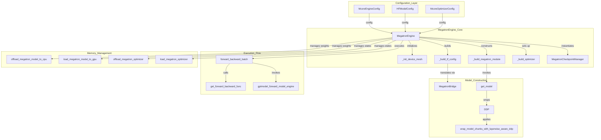
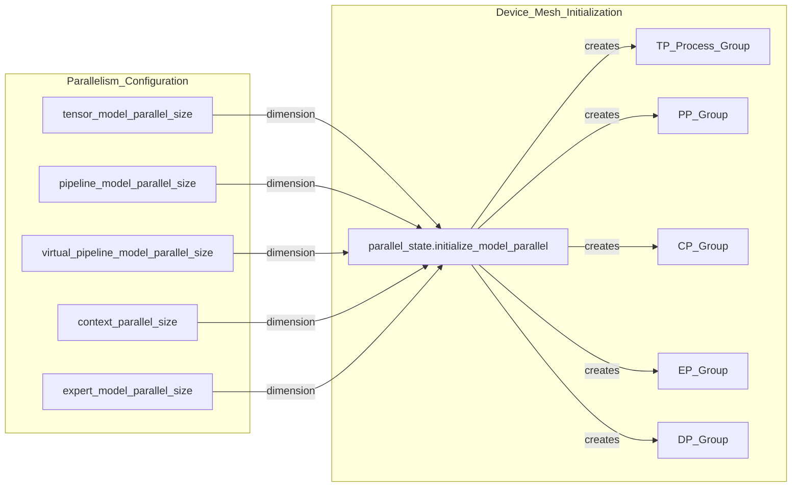

<!-- source: DeepWiki mcp.deepwiki.com · repo volcengine/verl · page 8.3 Megatron Engine Implementation · fetched 2026-10-21 -->

# Megatron Engine Implementation

Relevant source files

The following files were used as context for generating this wiki page:

- [examples/muon/README.md](examples/muon/README.md)
- [tests/models/test_model_forward_fused.py](tests/models/test_model_forward_fused.py)
- [tests/special_e2e/run_ppo_trainer_megatron.sh](tests/special_e2e/run_ppo_trainer_megatron.sh)
- [tests/utils/megatron/muon_optim_gpu_smoke.py](tests/utils/megatron/muon_optim_gpu_smoke.py)
- [tests/utils/megatron/test_muon_optim_realcfg_on_cpu.py](tests/utils/megatron/test_muon_optim_realcfg_on_cpu.py)
- [tests/utils/megatron/test_muon_optim_wiring_on_cpu.py](tests/utils/megatron/test_muon_optim_wiring_on_cpu.py)
- [tests/utils/test_linear_cross_entropy_on_cpu.py](tests/utils/test_linear_cross_entropy_on_cpu.py)
- [tests/utils/test_special_linear_cross_entropy_tp.py](tests/utils/test_special_linear_cross_entropy_tp.py)
- [tests/workers/config/test_optim_config_on_cpu.py](tests/workers/config/test_optim_config_on_cpu.py)
- [tests/workers/test_megatron_liger_fused_kernels_on_cpu.py](tests/workers/test_megatron_liger_fused_kernels_on_cpu.py)
- [verl/models/mcore/__init__.py](verl/models/mcore/__init__.py)
- [verl/models/mcore/model_forward.py](verl/models/mcore/model_forward.py)
- [verl/models/mcore/model_forward_fused.py](verl/models/mcore/model_forward_fused.py)
- [verl/models/mcore/registry.py](verl/models/mcore/registry.py)
- [verl/models/mcore/util.py](verl/models/mcore/util.py)
- [verl/trainer/config/engine/megatron.yaml](verl/trainer/config/engine/megatron.yaml)
- [verl/trainer/config/optim/fsdp.yaml](verl/trainer/config/optim/fsdp.yaml)
- [verl/trainer/config/optim/megatron.yaml](verl/trainer/config/optim/megatron.yaml)
- [verl/utils/checkpoint/megatron_checkpoint_manager.py](verl/utils/checkpoint/megatron_checkpoint_manager.py)
- [verl/utils/megatron/optimizer.py](verl/utils/megatron/optimizer.py)
- [verl/utils/megatron_utils.py](verl/utils/megatron_utils.py)
- [verl/utils/model.py](verl/utils/model.py)
- [verl/workers/config/optimizer.py](verl/workers/config/optimizer.py)
- [verl/workers/engine/megatron/transformer_impl.py](verl/workers/engine/megatron/transformer_impl.py)

This page documents the `MegatronEngine` implementation, which provides distributed training capabilities using Megatron-LM's multi-dimensional parallelism strategies (Tensor Parallel, Pipeline Parallel, Expert Parallel, Context Parallel, Virtual Pipeline). For the base engine interface, see [verl/workers/engine/base.py:30-159]().

## Overview

`MegatronEngine` is a concrete implementation of `BaseEngine` [verl/workers/engine/base.py:30-36]() that leverages NVIDIA's Megatron-LM framework to enable scaling large language models. It supports:

- **Multi-dimensional parallelism**: Tensor Parallel (TP), Pipeline Parallel (PP), Expert Parallel (EP), Context Parallel (CP), and Virtual Pipeline (VP) [verl/trainer/config/engine/megatron.yaml:10-26]().
- **Megatron-Bridge integration**: Seamless conversion between HuggingFace and Megatron-Core model formats using `use_mbridge=True` [verl/trainer/config/engine/megatron.yaml:95]().
- **Distributed Data Parallel (DDP)**: Automatic DDP wrapping via `DistributedDataParallel` (DDP) with distributed optimizer support [verl/utils/megatron_utils.py:27-30](), [verl/utils/megatron_utils.py:126-142]().
- **Router Replay**: Deterministic MoE routing for reproducible RL training using `apply_router_replay_patch` [verl/workers/engine/megatron/transformer_impl.py:46]().
- **Memory optimization**: Parameter, gradient, and optimizer state offloading to CPU [verl/trainer/config/engine/megatron.yaml:5-8]().
- **Multi-Token Prediction (MTP)**: Support for training with multiple prediction heads via `MTPLossLoggingHelper` and `patch_engine_mtp` [verl/utils/megatron_utils.py:33](), [verl/utils/megatron_utils.py:73]().
- **Dynamic Context Parallel (DCP)**: Support for variable sequence lengths in context parallelism via `DynamicCPScheduler` and helper validation routines [verl/workers/engine/megatron/transformer_impl.py:36-44]().
- **Quantization-Aware Training (QAT)**: Integration with quantization schemes for Megatron-Core [verl/trainer/config/engine/megatron.yaml:142-154]().
- **Muon Optimizer**: Support for the Muon emerging optimizer, including layer-wise distributed optimization (`wrap_model_chunks_with_layerwise_aware_ddp`) and AdamW update RMS norm matching (`adamw_rms_match_scale_factor`) [verl/utils/megatron/optimizer.py:29-155](), [verl/utils/megatron_utils.py:72-142]().

Sources: [verl/trainer/config/engine/megatron.yaml:5-154](), [verl/utils/megatron_utils.py:27-142](), [verl/workers/engine/megatron/transformer_impl.py:36-46](), [verl/utils/megatron/optimizer.py:29-155]()

## Architecture and Component Flow

*Figure 1: MegatronEngine Architecture and Initialization Flow bridging Natural Language Concepts to Code Entities (`MegatronEngine`, `McoreEngineConfig`, `MegatronCheckpointManager`, `get_model`)*

Sources: [verl/workers/engine/megatron/transformer_impl.py:164-300](), [verl/utils/megatron_utils.py:72-142](), [verl/workers/config/optimizer.py:128-156]()

## Initialization and Device Mesh Setup

### Model Parallel Initialization

The engine initializes Megatron's distributed backend by calling `mpu.initialize_model_parallel()` with specified dimensions from `McoreEngineConfig`. It also supports `dynamic_context_parallel` if configured [verl/workers/engine/megatron/transformer_impl.py:181-228]():

*Figure 2: Device Mesh and Process Group Initialization using `parallel_state.initialize_model_parallel`*

Sources: [verl/workers/engine/megatron/transformer_impl.py:181-228](), [verl/trainer/config/engine/megatron.yaml:10-26]()

## Dynamic Context Parallel (DCP)

`MegatronEngine` implements a `DynamicCPScheduler` to handle varying sequence lengths across context-parallel ranks.

- **Validation**: DCP requires `use_remove_padding=True` and is validated via `_check_dcp_unsupported_features` to ensure compatibility [verl/workers/engine/megatron/transformer_impl.py:112-136]().
- **Topology**: The DPxCP world size must be validated via `_validate_dcp_world_size` as an even integer of at least two [verl/workers/engine/megatron/transformer_impl.py:102-108]().
- **Routing**: In MoE models, `_attach_dcp_recorded_routes` ensures recorded routes are correctly associated with DCP micro-batches [verl/workers/engine/megatron/transformer_impl.py:138-156]().

Sources: [verl/workers/engine/megatron/transformer_impl.py:36-44](), [verl/workers/engine/megatron/transformer_impl.py:102-156]()

## Router Replay for MoE Models

For Mixture-of-Experts (MoE) models, `MegatronEngine` implements **Router Replay** to ensure deterministic expert routing during RL training [verl/utils/megatron/router_replay_patch.py:46]().

- **Mechanism**: Patches Megatron's core router logic using `apply_router_replay_patch()` [verl/utils/megatron/router_replay_patch.py:46]().
- **Configuration**: Controlled via the `router_replay` field in `McoreEngineConfig`, supporting `R2` and `R3` modes [verl/trainer/config/engine/megatron.yaml:123-132]().
- **Helper Functions**: Uses `RouterReplayHelper` and `set_router_replay_data` to align and merge routing data across pipeline and virtual pipeline stages [verl/utils/megatron/router_replay_utils.py:48-57]().

Sources: [verl/trainer/config/engine/megatron.yaml:123-132](), [verl/workers/engine/megatron/transformer_impl.py:46](), [verl/utils/megatron/router_replay_utils.py:48-57]()

## Optimizer Configuration

The `McoreOptimizerConfig` dataclass [verl/workers/config/optimizer.py:128-156]() defines the configuration for Megatron-Core optimizers.

- **Optimizer Selection**: Supports `adam`, `sgd`, and `muon` optimizers. The `muon` optimizer routes through Megatron-Core's `emerging_optimizers` path (`_MUON_ALGORITHMS`) [verl/utils/megatron/optimizer.py:29-30](), [verl/workers/config/optimizer.py:154-156]().
- **Muon Specific Parameters**: When `optimizer` is set to `muon`, `_add_muon_args` forwards parameters like `muon_momentum`, `muon_nesterov`, `muon_split_qkv`, `muon_scale_mode`, `muon_coefficient_type`, `muon_num_ns_steps`, `muon_tp_mode`, `muon_fp32_matmul_prec`, `muon_extra_scale_factor`, and `muon_scalar_optimizer` [verl/utils/megatron/optimizer.py:46-88]().
- **Layer-wise Distributed Optimizer**: The `use_layer_wise_distributed_optimizer` flag enables Megatron's LayerWise DDP layouts (`wrap_model_chunks_with_layerwise_aware_ddp`), which requires specific Megatron-Core support verified by `_assert_muon_layer_wise_ddp_supported` [verl/utils/megatron_utils.py:49-142](), [verl/utils/megatron/optimizer.py:32-40]().
- **AdamW RMS Matching**: The `muon_match_adamw_update_rms` option automatically invokes `adamw_rms_match_scale_factor` to derive `muon_extra_scale_factor` from `beta1` to match AdamW's update RMS norm [verl/utils/megatron/optimizer.py:91-118]().

Sources: [verl/workers/config/optimizer.py:128-156](), [verl/utils/megatron/optimizer.py:29-155](), [verl/utils/megatron_utils.py:49-142]()

## Memory and Offloading

The engine implements a multi-tier offloading strategy to manage GPU memory constraints [verl/utils/megatron_utils.py:69-72]():

| Tier | Component | Implementation |
|------|-----------|----------------|
| **Parameter** | Model Weights | Offloaded via `offload_megatron_model_to_cpu` [verl/utils/megatron_utils.py:71](). |
| **Optimizer** | Optimizer States | Managed by `offload_megatron_optimizer` [verl/utils/megatron_utils.py:72](). |
| **Active Mode** | Model Weights | Reloaded via `load_megatron_model_to_gpu` [verl/utils/megatron_utils.py:69](). |

Sources: [verl/trainer/config/engine/megatron.yaml:5-8](), [verl/utils/megatron_utils.py:69-72]()

## Checkpoint Management

`MegatronCheckpointManager` handles the persistence of distributed state [verl/utils/checkpoint/megatron_checkpoint_manager.py:115-187]():

- **Distributed Checkpointing**: Uses Megatron's `dist_checkpointing` for efficient sharded I/O [verl/trainer/config/engine/megatron.yaml:34]().
- **HuggingFace Compatibility**: Can export weights to standard HF format via `bridge` integration [verl/utils/checkpoint/megatron_checkpoint_manager.py:152-154]().

Sources: [verl/utils/checkpoint/megatron_checkpoint_manager.py:115-187](), [verl/trainer/config/engine/megatron.yaml:34]()

## Megatron-Core Model Integration

`verl` integrates with Megatron-Core models through a registry system and utility functions to handle configuration conversion, model initialization, and forward passes.

### Model Initialization

- **Model Registry**: Maps model architectures using components from `verl.models.mcore.registry` [verl/models/mcore/registry.py:37-54]().
- **MTP and Fused Patches**: Automatically neutralizes broken flash attention cute modules and applies MTP or fused attention patches during package initialization [verl/models/mcore/__init__.py:16-32]().

Sources: [verl/models/mcore/__init__.py:16-32](), [verl/models/mcore/registry.py:37-54]()

### Forward Pass Implementations

`verl` provides different forward pass implementations for Megatron-Core models, including a fused version for performance.

- **Default Forward**: `gptmodel_forward_model_engine` [verl/models/mcore/model_forward.py:116-134]() serves as the default forward pass for GPT models, supporting optional sequence packing and multimodal inputs. It handles `thd` and `bshd` data formats.
- **Fused Forward**: `fused_forward_model_engine` [verl/models/mcore/model_forward_fused.py:179-191]() provides an optimized forward pass for no-padding inputs, leveraging fused kernels like `linear_cross_entropy` [verl/models/mcore/model_forward_fused.py:110-117]().
    - **Hook vs. Legacy Mode**: Dynamically resolves between Megatron's native `output_processor` hook (`_supports_output_processor_hook`) and a legacy monkey-patching approach (`_fused_GPTModel_forward`) [verl/models/mcore/model_forward_fused.py:46-75]().
    - **Output Processing**: The `fused_output_processor` function [verl/models/mcore/model_forward_fused.py:83-134]() computes fused log probabilities and entropy at Megatron's post-processing boundary.
- **Packed Sequences**: `preprocess_packed_seqs` [verl/models/mcore/util.py:61-151]() prepares input sequences for efficient processing by packing them and handling padding, including FP8 thd alignment (`_compute_fp8_thd_align_size`) [verl/models/mcore/util.py:49-58]().

Sources: [verl/models/mcore/model_forward.py:116-134](), [verl/models/mcore/model_forward_fused.py:46-191](), [verl/models/mcore/util.py:49-151]()

## Key Implementation Entities

| Code Entity | Role | File Reference |
|-------------|------|----------------|
| `MegatronEngine` | Primary engine implementation for Megatron-Core | [verl/workers/engine/megatron/transformer_impl.py:164]() |
| `get_model` | Factory function for creating models with MP/PP/VP and DDP wrapping | [verl/utils/megatron_utils.py:152]() |
| `MegatronCheckpointManager` | Manages distributed and HF-compatible checkpoints | [verl/utils/checkpoint/megatron_checkpoint_manager.py:115]() |
| `McoreEngineConfig` | Dataclass for Megatron parallelism configuration | [verl/workers/config/engine.py:147]() |
| `McoreOptimizerConfig` | Dataclass for Megatron optimizer configuration, including Muon | [verl/workers/config/optimizer.py:128]() |
| `DistributedDataParallel` | Megatron-Core DDP implementation for gradient reduction | [verl/utils/megatron_utils.py:27]() |
| `wrap_model_chunks_with_layerwise_aware_ddp` | Handles DDP wrapping for Muon layer-wise optimizer | [verl/utils/megatron_utils.py:72]() |
| `DynamicCPScheduler` | Manages variable sequence lengths for Context Parallelism | [verl/workers/engine/megatron/transformer_impl.py:41]() |
| `adamw_rms_match_scale_factor` | Calculates Muon's extra scale factor for AdamW RMS matching | [verl/utils/megatron/optimizer.py:91]() |
| `gptmodel_forward_model_engine` | Default forward pass for GPT models | [verl/models/mcore/model_forward.py:116]() |
| `fused_forward_model_engine` | Optimized fused forward pass for no-padding inputs | [verl/models/mcore/model_forward_fused.py:179]() |
| `preprocess_packed_seqs` | Preprocesses sequences for packed attention | [verl/models/mcore/util.py:61]() |

Sources: [verl/workers/engine/megatron/transformer_impl.py:164](), [verl/utils/megatron_utils.py:152](), [verl/utils/checkpoint/megatron_checkpoint_manager.py:115](), [verl/workers/config/engine.py:147](), [verl/workers/config/optimizer.py:128](), [verl/utils/megatron_utils.py:27](), [verl/utils/megatron_utils.py:72](), [verl/workers/engine/megatron/transformer_impl.py:41](), [verl/utils/megatron/optimizer.py:91](), [verl/models/mcore/model_forward.py:116](), [verl/models/mcore/model_forward_fused.py:179](), [verl/models/mcore/util.py:61]()

---

