<!-- source: DeepWiki mcp.deepwiki.com · repo volcengine/verl · page 8.4 Megatron-Core Model Integration · fetched 2026-10-21 -->

# Megatron-Core Model Integration

Relevant source files

The following files were used as context for generating this wiki page:

- [tests/models/test_model_forward_fused.py](tests/models/test_model_forward_fused.py)
- [tests/single_controller/detached_worker/server.py](tests/single_controller/detached_worker/server.py)
- [tests/special_npu/nightly_ci_ascend/run_grpo_glm52_top16_megatron_npu_multinode.sh](tests/special_npu/nightly_ci_ascend/run_grpo_glm52_top16_megatron_npu_multinode.sh)
- [tests/special_sanity/check_api_docs.py](tests/special_sanity/check_api_docs.py)
- [tests/utils/megatron/test_muon_layerwise_bridge_ddp_on_cpu.py](tests/utils/megatron/test_muon_layerwise_bridge_ddp_on_cpu.py)
- [tests/utils/test_linear_cross_entropy_on_cpu.py](tests/utils/test_linear_cross_entropy_on_cpu.py)
- [tests/utils/test_special_linear_cross_entropy_tp.py](tests/utils/test_special_linear_cross_entropy_tp.py)
- [tests/workers/test_megatron_liger_fused_kernels_on_cpu.py](tests/workers/test_megatron_liger_fused_kernels_on_cpu.py)
- [verl/models/mcore/__init__.py](verl/models/mcore/__init__.py)
- [verl/models/mcore/model_forward.py](verl/models/mcore/model_forward.py)
- [verl/models/mcore/model_forward_fused.py](verl/models/mcore/model_forward_fused.py)
- [verl/models/mcore/patch.py](verl/models/mcore/patch.py)
- [verl/models/mcore/registry.py](verl/models/mcore/registry.py)
- [verl/models/mcore/util.py](verl/models/mcore/util.py)
- [verl/utils/checkpoint/megatron_checkpoint_manager.py](verl/utils/checkpoint/megatron_checkpoint_manager.py)
- [verl/utils/megatron_utils.py](verl/utils/megatron_utils.py)
- [verl/utils/model.py](verl/utils/model.py)
- [verl/workers/engine/megatron/transformer_impl.py](verl/workers/engine/megatron/transformer_impl.py)

## Purpose and Scope

This page documents `verl`'s integration with NVIDIA Megatron-Core for large-scale distributed training using 3D parallelism (tensor, pipeline, data, context, and expert parallelism). It covers configuration conversion from HuggingFace (HF) to Megatron-Core, model initialization via specialized initializers, model registry management, custom forward pass implementations for sequence packing (THD format), Multi-Token Prediction (MTP), weight conversion utilities, and runtime patches.

---

## 1. Architecture and Data Flow

The integration bridges the gap between HuggingFace's modular design and Megatron-Core's performance-oriented 3D parallelism. The `MegatronEngine` serves as the primary interface for managing these models within the `verl` ecosystem.

### Model Integration Pipeline

The following diagram bridges the high-level conceptual pipeline of model integration to the exact code entities responsible for configuration conversion, model registration, initialization, and execution.

```mermaid
graph TD
    subgraph NaturalLanguageSpace ["Conceptual Pipeline"]
    A["HuggingFace Config"] --> B["Config Converter"]
    C["HF Weights"] --> D["Weight Converter"]
    B --> E["Model Registry Lookup"]
    E --> F["Model Initialization"]
    F --> G["Forward Execution"]
    end

    subgraph CodeEntitySpace ["Code Entities"]
    HFModelConfig["PretrainedConfig"] --> ConfigConverter["hf_to_mcore_config_dense (verl/models/mcore/config_converter.py)"]
    HFW["weights (.safetensors)"] --> WeightConverter["convert_checkpoint_from_transformers_to_megatron (scripts/converter_hf_to_mcore.py)"]
    ConfigConverter --> TransformerConfig["TransformerConfig / MLATransformerConfig"]
    TransformerConfig --> ModelRegistry["get_mcore_forward_fn (verl/models/mcore/registry.py)"]
    ModelRegistry --> ModelInitializer["DenseModel / DeepseekV3Model (verl/models/mcore/model_initializer.py)"]
    ModelInitializer --> GPTModel["GPTModel (megatron.core.models.gpt)"]
    GPTModel --> ForwardPass["model_forward (verl/models/mcore/model_forward.py)"]
    end
```

Sources: `[verl/models/mcore/registry.py:40-70]`, `[verl/models/mcore/config_converter.py:167-170]`, `[scripts/converter_hf_to_mcore.py:121]()`

---

## 2. Configuration Conversion

HuggingFace `PretrainedConfig` objects are converted into Megatron-Core `TransformerConfig` or `MLATransformerConfig` (for DeepSeek-style models). This process maps architecture-specific hyperparameters to Megatron's internal configuration schema.

### Key Conversion Functions
- `hf_to_mcore_config_dense`: Handles standard causal language models like Llama and Qwen2. `[verl/models/mcore/config_converter.py:167-170]()`
- `_get_base_transformer_config`: Initializes common Megatron settings such as `RMSNorm`, activation functions (`F.silu`), and parallel world sizes from the global parallel state (`mpu`). `[verl/models/mcore/config_converter.py:34-92]()`
- `_get_mla_transformer_config`: Configures Multi-head Latent Attention (MLA) parameters for models like DeepSeek-V3. `[verl/models/mcore/config_converter.py:101-136]()`

Sources: `[verl/models/mcore/config_converter.py:34-136]`, `[verl/models/mcore/registry.py:54]()`

---

## 3. Model Initializers & Registry

Initializers instantiate the `GPTModel` from Megatron-Core using specific layer specifications (`gpt_layer_specs`).

### Registry Lookup and Initializers

| Initializer Class | Target Architectures | Key Responsibility |
|:---|:---|:---|
| `DenseModel` | Llama, Qwen2, Qwen3 | Standard decoder block initialization via `get_gpt_decoder_block_spec`. `[verl/models/mcore/model_initializer.py:99-106]()` |
| `Qwen2MoEModel` | Qwen2-MoE | Configures shared experts and patches MoE routers. `[verl/models/mcore/model_initializer.py:108-130]()` |
| `MixtralModel` | Mixtral-8x7B | Standard MoE initialization with router freezing support. `[verl/models/mcore/model_initializer.py:133-147]()` |
| `DeepseekV3Model` | DeepSeek-V3 | Implements Multi-head Latent Attention (MLA) layers. `[verl/models/mcore/registry.py:54]()` |

The registry provides lookup functions via `get_mcore_engine_forward_fn` and `get_mcore_forward_fused_model_engine_fn` to map HuggingFace architecture strings to their corresponding Megatron-Core builders and forward passes. `[verl/models/mcore/registry.py:37-54]()`

Sources: `[verl/models/mcore/registry.py:37-55]`, `[verl/models/mcore/model_initializer.py:27-155]()`

---

## 4. Forward Pass Implementations and Sequence Packing

`verl` provides specialized forward pass logic to handle **Sequence Packing** (THD format), which is critical for RL training efficiency by removing padding tokens.

### Data Flow and Sequence Preprocessing

```mermaid
graph TD
    subgraph NaturalLanguageSpace ["Sequence Layout Concept"]
    A["Variable Length Sequences"] --> B["Token Packing (THD)"]
    B --> C["Context Parallel Sharding"]
    C --> D["Model Forward Pass"]
    D --> E["Unpacking and Gathering"]
    end

    subgraph CodeEntitySpace ["Code Implementation"]
    Input["input_ids, attention_mask"] --> Preproc["preprocess_packed_seqs (verl/models/mcore/util.py)"]
    Preproc --> PackedParams["PackedSeqParams (megatron.core)"]
    PackedParams --> Model["gptmodel_forward_model_engine (verl/models/mcore/model_forward.py)"]
    Model --> FusedHook["fused_output_processor (verl/models/mcore/model_forward_fused.py)"]
    end
```

Sources: `[verl/models/mcore/util.py:61-151]`, `[verl/models/mcore/model_forward.py:116-164]`, `[verl/models/mcore/model_forward_fused.py:105-155]()`

### THD vs BSHD Formats
- **THD (`thd`)**: Total tokens, Heads, Dimension. Preferred for RL variable-length sequences with `preprocess_packed_seqs`. `[verl/models/mcore/util.py:61-151]()`
- **BSHD (`bshd`)**: Batch, Sequence, Heads, Dimension. Standard padded format used as a fallback for architectures that do not support THD. `[verl/models/mcore/model_forward.py:136-164]()`

### Fused Forward Pass and Output Processor Hook
For performance optimization, `fused_forward_model_engine` and `fused_output_processor` combine model forward computation with cross-entropy and entropy calculation using `linear_cross_entropy`. Depending on Megatron version constraints, it selects either native output-processor hooks or legacy monkey patches via `_resolve_fused_forward_mode`. `[verl/models/mcore/model_forward_fused.py:47-156]()`

Sources: `[verl/models/mcore/model_forward.py:116-164]`, `[verl/models/mcore/model_forward_fused.py:47-156]()`

---

## 5. Multi-Token Prediction (MTP) Support

`verl` integrates Megatron-Core's Multi-Token Prediction (MTP) architecture for advanced models through specialized loss masking and post-processing integration.

### MTP Loss Mask Alignment
- **`_build_mtp_loss_mask_nested`**: Expands response-only masks into full packed input length sequences (prompt zeros followed by valid response positions) for nested Tensors. `[verl/models/mcore/model_forward.py:65-114]()`
- **Engine MTP Integration**: `patch_engine_mtp` and related helper utilities manage model hooks for logging and loss calculation across auxiliary MTP transformer layers. `[verl/utils/megatron_utils.py:66-74]()`

Sources: `[verl/models/mcore/model_forward.py:65-114]`, `[verl/utils/megatron_utils.py:66-74]()`

---

## 6. Weight Conversion and Checkpointing

`verl` manages state persistence through the `MegatronCheckpointManager`, supporting both native distributed checkpointing (`dist_checkpointing`) and bridge-based HuggingFace conversions.

### MegatronCheckpointManager Responsibilities
- **`MegatronCheckpointManager`**: Coordinates model, optimizer, LR-scheduler, and RNG state saving and loading. When `use_dist_checkpointing=True`, sharded weights are written under `model/dist_ckpt/`, while `bridge` configurations handle HuggingFace compatibility trees. `[verl/utils/checkpoint/megatron_checkpoint_manager.py:114-180]()`

Sources: `[verl/utils/checkpoint/megatron_checkpoint_manager.py:114-180]`, `[verl/utils/megatron_utils.py:35-44]()`

---

## 7. Patching, Distributed Optimizers, and Hardware Workarounds

Runtime patches address hardware compatibility, missing upstream kernels, and advanced optimizer layer layouts in Megatron-Core.

### Fast Hadamard Transform Shim
- **`pure_torch_hadamard_transform` & `apply_fast_hadamard_transform_shim`**: Provides a pure PyTorch fallback for `fast_hadamard_transform` when the native CUDA kernel is unavailable (e.g., on AMD ROCm environments), preventing crashes during DeepSeek sparse-attention (DSA) imports. `[verl/models/mcore/patch.py:20-94]()`

### FlashAttention-4 Cute Neutralization
- **`neutralize_broken_flash_attn_cute`**: Intercepts failed imports of `flash_attn.cute` to ensure probes fall back correctly to FlashAttention-2 without aborting engine initialization. `[verl/models/mcore/patch.py:106-154]()`

### LayerWise DDP and Muon Optimizer Layouts
- **`wrap_model_chunks_with_layerwise_aware_ddp`**: Prepares model chunks with `tag_params_for_buffer_routing` and computes full parameter layouts for layer-wise distributed optimizers like Muon before wrapping them in Megatron's `DistributedDataParallel` (`DDP`). `[verl/utils/megatron_utils.py:72-142]()`

### Dynamic Context Parallel (DCP) Validation
- **`_check_dcp_unsupported_features`**: Validates model and batch restrictions when running with dynamic context parallelism (`dynamic_context_parallel=True`), asserting compatibility with remove-padding constraints and language-only architectures. `[verl/workers/engine/megatron/transformer_impl.py:110-137]()`

Sources: `[verl/models/mcore/patch.py:20-154]`, `[verl/utils/megatron_utils.py:72-142]`, `[verl/workers/engine/megatron/transformer_impl.py:110-137]()`

---

