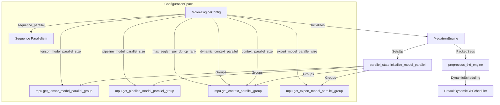
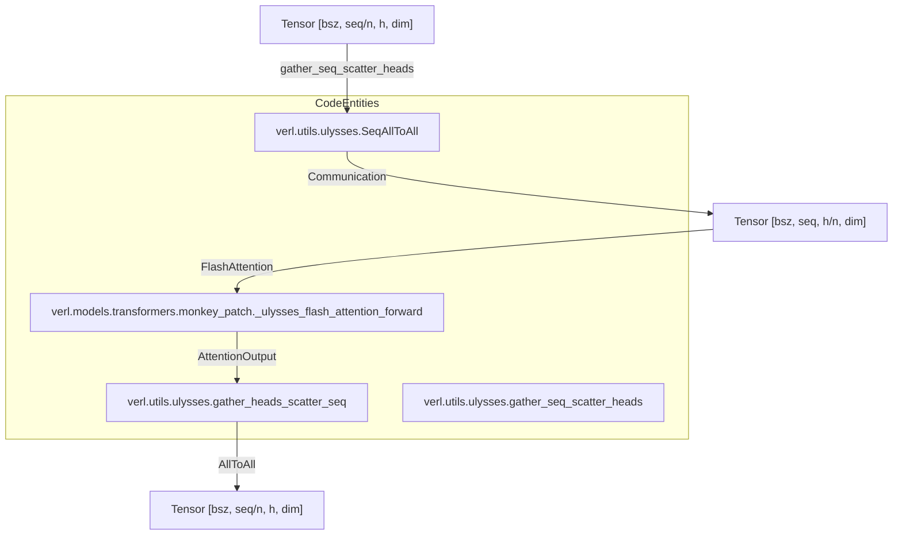

<!-- source: DeepWiki mcp.deepwiki.com · repo volcengine/verl · page 8.5 Parallelism Strategies and Configuration · fetched 2026-10-21 -->

# Parallelism Strategies and Configuration

Relevant source files

The following files were used as context for generating this wiki page:

- [docs/advance/dynamic_context_parallel.rst](docs/advance/dynamic_context_parallel.rst)
- [docs/advance/fsdp_extension.rst](docs/advance/fsdp_extension.rst)
- [docs/advance/megatron_extension.rst](docs/advance/megatron_extension.rst)
- [docs/algo/otb.md](docs/algo/otb.md)
- [docs/preparation/prepare_data.rst](docs/preparation/prepare_data.rst)
- [tests/special_distributed/test_megatron_dynamic_cp_features.py](tests/special_distributed/test_megatron_dynamic_cp_features.py)
- [tests/special_distributed/test_tensor_dict.py](tests/special_distributed/test_tensor_dict.py)
- [tests/utils/test_megatron_mtp_dcp.py](tests/utils/test_megatron_mtp_dcp.py)
- [tests/utils/test_torch_functional.py](tests/utils/test_torch_functional.py)
- [verl/utils/megatron/tensor_parallel.py](verl/utils/megatron/tensor_parallel.py)

## Purpose and Scope

This page documents the parallelism strategies supported by verl's training engines, specifically comparing the FullyShardedDataParallel (FSDP) and Megatron-LM (Mcore) backends. It provides technical details on Tensor Parallelism (TP), Pipeline Parallelism (PP), Data Parallelism (DP), Context Parallelism (CP), Expert Parallelism (EP), Sequence Parallelism (SP), and Dynamic Context Parallelism (DCP) implementations. It also details the configuration structure for these strategies and performance tuning best practices for large-scale RL training.

Sources: `[docs/advance/fsdp_extension.rst:1-126]()`, `[docs/advance/dynamic_context_parallel.rst:1-87]()`, `[verl/trainer/config/engine/megatron.yaml:1-154]()`

---

## Backend Comparison: FSDP vs Megatron

verl provides a unified interface for distributed training through the `BaseEngine` abstraction. The primary implementations are `FSDPEngine` and `MegatronEngine`.

### Parallelism Support Matrix

| Parallelism Type | Abbreviation | FSDP Backend | Megatron Backend | Configuration Class |
|-----------------|--------------|--------------|------------------|---------------------|
| **Data Parallelism** | DP | ✓ (ZeRO-3/FSDP2) | ✓ | `FSDPEngineConfig` / `McoreEngineConfig` `[verl/trainer/config/engine/megatron.yaml:2-32]()` |
| **Tensor Parallelism** | TP | ✗ | ✓ | `McoreEngineConfig` `[verl/trainer/config/engine/megatron.yaml:10-11]()` |
| **Pipeline Parallelism** | PP | ✗ | ✓ | `McoreEngineConfig` `[verl/trainer/config/engine/megatron.yaml:19-20]()` |
| **Virtual Pipeline** | VPP | ✗ | ✓ | `McoreEngineConfig` `[verl/trainer/config/engine/megatron.yaml:22-23]()` |
| **Context Parallelism** | CP | ✗ | ✓ (Dynamic CP) | `McoreEngineConfig` `[verl/trainer/config/engine/megatron.yaml:25-45]()` |
| **Expert Parallelism** | EP | ✓ (VeOmni) | ✓ | `McoreEngineConfig` / `VeOmniEngineConfig` `[verl/trainer/config/engine/megatron.yaml:13-17]()` |
| **Sequence Parallelism**| SP | ✓ (Ulysses) | ✓ (Megatron SP) | Multiple `[verl/models/transformers/monkey_patch.py:87-155]()`, `[verl/trainer/config/engine/megatron.yaml:28-29]()` |

### Architectural Trade-offs

*   **FSDP Backend**: Native support for Hugging Face models via checkpoint loading and `from_pretrained` execution paths `[docs/advance/fsdp_extension.rst:24-27]()`. It utilizes PyTorch's native FSDP/FSDP2 wrapping and supports Ulysses Sequence Parallelism for long contexts `[verl/models/transformers/monkey_patch.py:87-155]()`. It supports parameter and optimizer offloading to CPU `[docs/advance/fsdp_extension.rst:115-120]()`.
*   **Megatron Backend**: Designed for maximum scalability using Megatron-Core (Mcore). It enables complex 3D parallelism strategies (TP+PP+DP) and specialized expert parallelism for MoE models, configured through `McoreEngineConfig` `[verl/trainer/config/engine/megatron.yaml:1-154]()`.
*   **VeOmni Backend**: A multimodal-optimized backend extending FSDP2, supporting Ulysses and Expert Parallelism specifically for vision-language tasks.

Sources: `[docs/advance/fsdp_extension.rst:1-126]`, `[verl/trainer/config/engine/megatron.yaml:1-154]`, `[verl/models/transformers/monkey_patch.py:87-155]`

---

## Megatron Parallelism Configuration

### Configuration and Initialization
Megatron parallelism is configured via the `McoreEngineConfig` dataclass (`verl/trainer/config/engine/megatron.yaml`) `[verl/trainer/config/engine/megatron.yaml:2-3]`. The configuration options govern sharding across model parallel units, supporting advanced features like dynamic context parallel scheduling, distributed optimizers, and QAT.

**Key Parallelism Parameters (`McoreEngineConfig`):**
*   `tensor_model_parallel_size`: Specifies the TP degree across tensor operations `[verl/trainer/config/engine/megatron.yaml:10-11]()`.
*   `pipeline_model_parallel_size`: Specifies the PP degree for inter-stage layer sharding `[verl/trainer/config/engine/megatron.yaml:19-20]()`.
*   `virtual_pipeline_model_parallel_size`: Enables interleaved pipeline scheduling (VPP) to reduce bubble overhead `[verl/trainer/config/engine/megatron.yaml:22-23]()`.
*   `context_parallel_size` & `dynamic_context_parallel`: Controls sequence chunking across GPUs, where `dynamic_context_parallel=True` enables dynamic micro-batch scheduling via `max_seqlen_per_dp_cp_rank` and Megatron-Core's `DefaultDynamicCPScheduler` `[docs/advance/dynamic_context_parallel.rst:6-9]()`, `[verl/trainer/config/engine/megatron.yaml:25-45]()`.
*   `expert_model_parallel_size` & `expert_tensor_parallel_size`: Controls Mixture-of-Experts (MoE) sharding parameters `[verl/trainer/config/engine/megatron.yaml:13-17]()`.
*   `sequence_parallel`: Shards layer activations across tensor parallel groups `[verl/trainer/config/engine/megatron.yaml:28-29]()`.

Diagram: Megatron Parallelism Architecture to Code Entity Mapping

Sources: `[docs/advance/dynamic_context_parallel.rst:1-88]`, `[verl/trainer/config/engine/megatron.yaml:10-45]`, `[verl/models/mcore/util.py:1-50]`

---

## FSDP Parallelism Configuration

### Sharding and Precision
FSDP manages model sharding through PyTorch's `FullyShardedDataParallel` and `FSDP2`. It is configured via `FSDPEngineConfig` and supports sequence packing (`use_remove_padding=True`) alongside PEFT/LoRA integration `[docs/advance/fsdp_extension.rst:1-126]`.

### Ulysses Sequence Parallelism
The `FSDPEngine` supports DeepSpeed Ulysses Sequence Parallelism for long context training `[verl/utils/ulysses.py:15-18]()`. This strategy shards the sequence dimension across GPUs while keeping attention local, requiring `use_remove_padding=True`. 
*   `gather_seq_scatter_heads` and `gather_heads_scatter_seq` handle tensor layout transpositions between sequence and head dimensions `[verl/utils/ulysses.py:66-105]()`.
*   `SeqAllToAll` implements the underlying `torch.autograd.Function` communication primitive using `torch.distributed.all_to_all` `[verl/utils/ulysses.py:137-183]()`.
*   Model attention layers are monkey-patched to integrate `_ulysses_flash_attention_forward` into standard Hugging Face transformer architectures (e.g., Llama, Qwen2, Qwen3) `[verl/models/transformers/monkey_patch.py:87-155]()`, `[verl/models/transformers/llama.py:78-89]()`.

Diagram: FSDP Ulysses SP Data Flow to Code Entities

Sources: `[verl/utils/ulysses.py:66-183]`, `[verl/models/transformers/monkey_patch.py:87-155]`, `[verl/models/transformers/llama.py:78-89]`

---

## Performance Tuning and Best Practices

### Memory Management and Offloading
For models that exceed GPU memory, verl provides offloading controls via `McoreEngineConfig` and `FSDPEngineConfig`:
*   **Parameter Offload**: `param_offload: True` in `McoreEngineConfig` offloads model parameters to CPU and releases gradient buffers while inactive `[verl/trainer/config/engine/megatron.yaml:4-5]()`.
*   **Optimizer Offload**: `optimizer_offload: True` offloads optimizer states (such as Adam states) to host memory `[verl/trainer/config/engine/megatron.yaml:7-8]()`.
*   **FSDP Offload**: Supports parameter and optimizer state offloading to host memory via FSDP2 context managers `[docs/advance/fsdp_extension.rst:115-120]()`.

### Best Practices

1.  **Sequence Packing**: Enable `use_remove_padding=True` in `McoreEngineConfig` `[verl/trainer/config/engine/megatron.yaml:98-98]()` to eliminate computation on padding tokens. For FSDP with Ulysses SP, this is mandatory.
2.  **Optimal Token Baseline (OTB)**: Utilizes tensor-parallel sharded entropy and sum-of-squares calculations over vocabulary dimensions (`vocab_parallel_entropy` and `vocab_parallel_sum_pi_squared` implemented via `_VocabParallelEntropy`) to stabilize policy-gradient updates without full-vocabulary gather overheads `[docs/algo/otb.md:30-41]()`, `[verl/utils/megatron/tensor_parallel.py:109-156]()`.
3.  **Dynamic Context Parallelism (DCP)**: For Megatron, enable `dynamic_context_parallel=True` and set `max_seqlen_per_dp_cp_rank` to leverage Megatron-Core's sequence-length-aware scheduler `[docs/advance/dynamic_context_parallel.rst:30-45]()`. This allows the engine to dynamically adapt context parallel groups per packed micro-batch.
4.  **Router Replay**: For MoE models, configure `router_replay` in `McoreEngineConfig` (`mode: R2` or `R3`) to record and replay expert routing decisions, ensuring deterministic execution during policy updates `[verl/trainer/config/engine/megatron.yaml:119-137]()`. Note that router replay modes R2/R3 require `moe_router_fusion=False` `[docs/advance/dynamic_context_parallel.rst:26-29]()`.
5.  **Quantization-Aware Training (QAT)**: Configure the `qat` section in `McoreEngineConfig` to enable low-precision training modes (`w4a16` or `w4a4`) with blockwise quantization and activation observers `[verl/trainer/config/engine/megatron.yaml:138-154]()`.

Sources: `[docs/advance/dynamic_context_parallel.rst:1-87]()`, `[docs/algo/otb.md:1-58]()`, `[verl/trainer/config/engine/megatron.yaml:4-154]()`, `[verl/utils/megatron/tensor_parallel.py:109-172]()`, `[docs/advance/fsdp_extension.rst:115-120]()`

---

