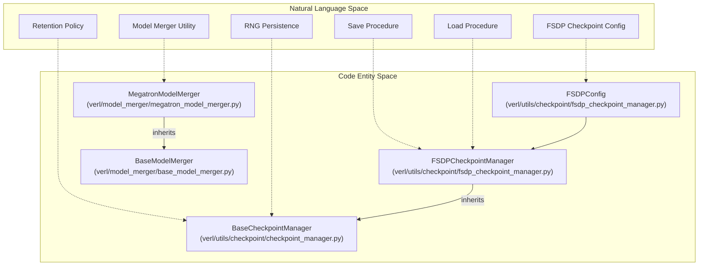
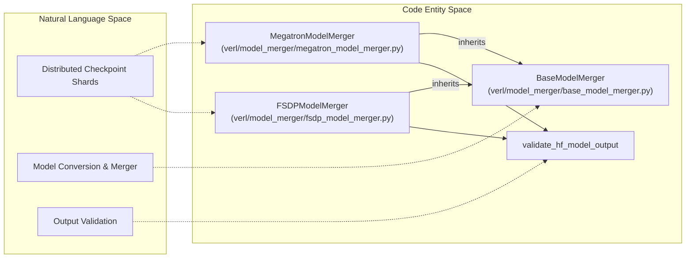

<!-- source: DeepWiki mcp.deepwiki.com · repo volcengine/verl · page 8.6 Checkpoint Management and State Persistence · fetched 2026-10-21 -->

# Checkpoint Management and State Persistence

<details>
<summary>Relevant source files</summary>

The following files were used as context for generating this wiki page:

- [.gitignore](.gitignore)
- [docs/advance/checkpoint.rst](docs/advance/checkpoint.rst)
- [scripts/converter_hf_to_mcore.py](scripts/converter_hf_to_mcore.py)
- [scripts/legacy_model_merger.py](scripts/legacy_model_merger.py)
- [tests/checkpoint_engine/test_fsdp_lora_only_checkpoint_on_cpu.py](tests/checkpoint_engine/test_fsdp_lora_only_checkpoint_on_cpu.py)
- [tests/model_merger/test_fsdp_merge_non_dtensor_shards_on_cpu.py](tests/model_merger/test_fsdp_merge_non_dtensor_shards_on_cpu.py)
- [tests/model_merger/test_output_validation_on_cpu.py](tests/model_merger/test_output_validation_on_cpu.py)
- [tests/model_merger/test_shard_configuration_on_cpu.py](tests/model_merger/test_shard_configuration_on_cpu.py)
- [tests/utils/ckpt/test_checkpoint_cleanup_on_cpu.py](tests/utils/ckpt/test_checkpoint_cleanup_on_cpu.py)
- [tests/workers/rollout/rollout_vllm/test_submitter_gate_on_cpu.py](tests/workers/rollout/rollout_vllm/test_submitter_gate_on_cpu.py)
- [verl/model_merger/__main__.py](verl/model_merger/__main__.py)
- [verl/model_merger/base_model_merger.py](verl/model_merger/base_model_merger.py)
- [verl/model_merger/fsdp_model_merger.py](verl/model_merger/fsdp_model_merger.py)
- [verl/model_merger/megatron_model_merger.py](verl/model_merger/megatron_model_merger.py)
- [verl/model_merger/output_validation.py](verl/model_merger/output_validation.py)
- [verl/model_merger/veomni_model_merger.py](verl/model_merger/veomni_model_merger.py)
- [verl/models/mcore/bridge_checkpoint.py](verl/models/mcore/bridge_checkpoint.py)
- [verl/utils/checkpoint/checkpoint_manager.py](verl/utils/checkpoint/checkpoint_manager.py)
- [verl/utils/checkpoint/fsdp_checkpoint_manager.py](verl/utils/checkpoint/fsdp_checkpoint_manager.py)
- [verl/utils/transformers_compat.py](verl/utils/transformers_compat.py)

</details>


This document describes `verl`'s checkpoint management system, which handles saving and loading model states, optimizer states, learning rate schedulers, and random number generator (RNG) states across distributed training setups. The system supports both FSDP and Megatron-LM backends with automatic sharding, retention policies, and HuggingFace format conversion.

For information about training engine implementations that use these checkpoint managers, see [Training Engines and Distributed Backends](8.1). For details about the configuration system that controls checkpoint behavior, see [Configuration System](4).

## Overview and Architecture

`verl` provides a modular checkpoint management system through primary abstract and concrete classes:

- **`BaseCheckpointManager`**: Abstract base class defining the shared checkpoint lifecycle interface `[verl/utils/checkpoint/checkpoint_manager.py:29-41]()`.
- **`FSDPCheckpointManager`**: Implementation for PyTorch FSDP models handling rank-sharded states `[verl/utils/checkpoint/fsdp_checkpoint_manager.py:57-100]()`.
- **`FSDPConfig`**: A dataclass encapsulating FSDP checkpointing configurations such as FSDP version and world size `[verl/utils/checkpoint/fsdp_checkpoint_manager.py:44-56]()`.

The checkpoint system handles multiple state components independently, allowing selective save and load operations through configuration flags (`checkpoint.load_contents` and `checkpoint.save_contents`) `[docs/advance/checkpoint.rst:15-35]()`.

### System Entity Mapping

The following diagram maps high-level checkpointing concepts to specific code entities within the `verl` framework, bridging natural language concepts to code identifiers.

**Title: Checkpoint System Entity Map**


Sources: `[verl/utils/checkpoint/checkpoint_manager.py:29-41]()`, `[verl/utils/checkpoint/fsdp_checkpoint_manager.py:44-56]()`, `[verl/utils/checkpoint/fsdp_checkpoint_manager.py:57-100]()`, `[verl/model_merger/base_model_merger.py:83-140]()`, `[verl/model_merger/megatron_model_merger.py:37-142]()`, `[docs/advance/checkpoint.rst:15-35]()`

### Checkpoint Components

The checkpoint system manages four independent components, each controlled by `checkpoint_config.load_contents` and `checkpoint_config.save_contents` `[verl/utils/checkpoint/checkpoint_manager.py:52-66]()`. Component selection logic is implemented via `BaseCheckpointManager` properties:

| Component | Content | Sharding | Manager Properties |
|-----------|---------|----------|-------------------|
| **model** | Model parameters (weights, biases) | Per-rank shards | `should_save_model` `[verl/utils/checkpoint/checkpoint_manager.py:72-76]()`, `should_load_model` `[verl/utils/checkpoint/checkpoint_manager.py:115-119]()` |
| **optimizer** | Optimizer states (momentum, variance) | Per-rank shards | `should_save_optimizer` `[verl/utils/checkpoint/checkpoint_manager.py:79-83]()`, `should_load_optimizer` `[verl/utils/checkpoint/checkpoint_manager.py:122-127]()` |
| **extra** | RNG states, LR scheduler, metadata | Per-rank or full | `should_save_extra` `[verl/utils/checkpoint/checkpoint_manager.py:86-90]()`, `should_load_extra` `[verl/utils/checkpoint/checkpoint_manager.py:129-133]()` |
| **hf_model** | Full HuggingFace model | Rank 0 / Bridge | `should_save_hf_model` `[verl/utils/checkpoint/checkpoint_manager.py:93-98]()`, `should_load_hf_model` `[verl/utils/checkpoint/checkpoint_manager.py:136-141]()` |

Sources: `[verl/utils/checkpoint/checkpoint_manager.py:71-141]()`, `[docs/advance/checkpoint.rst:15-35]()`

## Checkpoint Directory Structure

`verl` organizes checkpoints by global steps. The internal directory structure differs between backends to accommodate sharding strategies.

### FSDP Structure
All model shards, optimizers, and extra states are stored in a per-rank sharded format.
```text
checkpoints/${trainer.project_name}/${trainer.experiment_name}
├── global_steps_${i}
│   ├── actor
│   │   ├── huggingface      # default save config and tokenizer, save huggingface model if include ``hf_model`` in checkpoint.contents
│   │   └── fsdp_config.json # FSDP config file, including world_size and fsdp version
│   │   ├── model_world_size_{self.world_size}_rank_{self.rank}.pt
│   │   ├── optim_world_size_{self.world_size}_rank_{self.rank}.pt
│   │   └── extra_state_world_size_{self.world_size}_rank_{self.rank}.pt
│   ├── critic
│   │   ├── huggingface
│   │   └── fsdp_config.json
│   │   ├── model_world_size_{self.world_size}_rank_{self.rank}.pt
│   │   ├── optim_world_size_{self.world_size}_rank_{self.rank}.pt
│   │   └── extra_state_world_size_{self.world_size}_rank_{self.rank}.pt
└── latest_checkpointed_iteration.txt
```
Sources: `[verl/utils/checkpoint/fsdp_checkpoint_manager.py:44-56]()`, `[docs/advance/checkpoint.rst:82-106]()`

### Megatron Structure (Layout Schema v2)
Megatron uses a nested layout for HuggingFace artifacts and distributed shards. The HF tree is nested under `model/` alongside the optional `dist_ckpt/` shards `[verl/model_merger/base_model_merger.py:137-152]()`.
```text
checkpoints/${trainer.project_name}/${trainer.experiment_name}
├── global_steps_${i}
│   ├── actor
│   │   ├── ckpt_contents.json       # manifest mapping each saved content (model, optimizer, …) to its on-disk path
│   │   ├── transformer_config.json  # serialised Megatron TransformerConfig (written when ``extra`` is in save_contents)
│   │   ├── model
│   │   │   ├── huggingface          # HF weights + config + tokenizer (bridge ``bridge`` + ``model`` / ``hf_model`` in save_contents)
│   │   │   └── dist_ckpt            # Megatron model shards
│   │   ├── optimizer
│   │   │   └── dist_ckpt            # Sharded optimizer state
│   └── critic                      
└── latest_checkpointed_iteration.txt
```
Sources: `[verl/model_merger/base_model_merger.py:137-152]()`, `[docs/advance/checkpoint.rst:130-141]()`

## LoRA-only Checkpoints and PEFT Adapter Handling

When training with PEFT / LoRA, `verl` can save only the adapter weights to dramatically reduce checkpoint storage overhead.

- **Detection**: The system identifies LoRA-only checkpoints automatically by inspecting whether all keys in the state dict contain `lora_` or `.adapter_` `[verl/utils/checkpoint/checkpoint_manager.py:109-112]()`.
- **Implementation**: `FSDPCheckpointManager` extracts metadata such as rank and alpha, filtering out base model weights `[verl/utils/checkpoint/fsdp_checkpoint_manager.py:102-136]()`.
- **Safety**: During LoRA saving, the manager ensures that the defining source of the base model is handled via `custom_object_save` `[verl/utils/checkpoint/fsdp_checkpoint_manager.py:31]()`. This preserves `trust_remote_code` custom model definitions by targeting the base model wrapper correctly.

Sources: `[verl/utils/checkpoint/checkpoint_manager.py:101-112]()`, `[verl/utils/checkpoint/fsdp_checkpoint_manager.py:31-136]()`, `[docs/advance/checkpoint.rst:111-130]()`

## Checkpoint Callbacks

Users can execute custom routines after a trainer checkpoint is successfully saved by setting `trainer.checkpoint_callback_class`.
- **Interface**: Subclass `verl.trainer.ppo.checkpoint_callback.CheckpointCallback` and override the `on_save` hook `[docs/advance/checkpoint.rst:41-60]()`.
- **Execution**: The hook is executed exclusively on the driver process once worker-group saves complete `[docs/advance/checkpoint.rst:69-78]()`.

Sources: `[docs/advance/checkpoint.rst:41-81]()`

## Model Merger and HuggingFace Format Conversion

The `model_merger` package provides tools to convert distributed checkpoints back into standard HuggingFace format for inference or evaluation `[verl/model_merger/__main__.py:15-56]()`.

### FSDP Model Merger
`FSDPModelMerger` handles the conversion of FSDP distributed checkpoints into HuggingFace format `[verl/model_merger/fsdp_model_merger.py:53-56]()`. It reconstructs the full model by loading and concatenating sharded parameters across all ranks `[verl/model_merger/fsdp_model_merger.py:57-59]()`.
- **World Size Detection**: Extracts world size parameters from `fsdp_config.json` `[verl/model_merger/fsdp_model_merger.py:86-105]()`.
- **DTensor Handling**: Supports DTensor and non-DTensor state dicts, extracting device mesh layouts and determining shard mappings `[verl/model_merger/fsdp_model_merger.py:115-153]()`.
- **Shard Merging**: Merges tensors using `_merge_by_placement` according to their DTensor placements `[verl/model_merger/fsdp_model_merger.py:156-164]()`. Non-DTensor shards are validated for rank consistency `[verl/model_merger/fsdp_model_merger.py:35-50]()`.

### Megatron Model Merger
`MegatronModelMerger` reconstructs models from TP/PP shards using Megatron-Bridge integration `[verl/model_merger/megatron_model_merger.py:37-110]()`. It handles parameter remapping, custom pipeline parallelism shards, and conversion of value networks via `AutoBridge` and `build_conversion_model` `[scripts/converter_hf_to_mcore.py:50-110]`, `[verl/models/mcore/bridge_checkpoint.py:79-126]()`.

### Output Validation
To ensure data integrity, `validate_hf_model_output` checks for the presence of `config.json` and complete weight files (such as `model.safetensors` or index shards) before marking an export successful `[verl/model_merger/output_validation.py]()`.

**Title: Model Merger Architecture & Entity Mapping**


Sources: `[verl/model_merger/fsdp_model_merger.py:35-164]()`, `[verl/model_merger/megatron_model_merger.py:37-110]()`, `[verl/model_merger/base_model_merger.py:83-140]()`, `[scripts/converter_hf_to_mcore.py:50-110]()`, `[verl/models/mcore/bridge_checkpoint.py:79-126]()`

## Memory and State Persistence Optimizations

To prevent out-of-memory errors during save/load and guarantee compatibility:
- **Tied Weights**: `drop_tied_target_keys` removes alias weights (such as `lm_head.weight`) from state dicts before export to prevent downstream reloading conflicts in HuggingFace transformers `[verl/utils/transformers_compat.py:95-121]()`.
- **CPU Initialization**: `use_cpu_initialization` allows loading massive models onto CPU memory during merge tasks when GPU capacity is constrained `[verl/model_merger/base_model_merger.py:66-70]()`.

Sources: `[verl/model_merger/base_model_merger.py:66-70]()`, `[verl/utils/transformers_compat.py:95-121]()`

---

