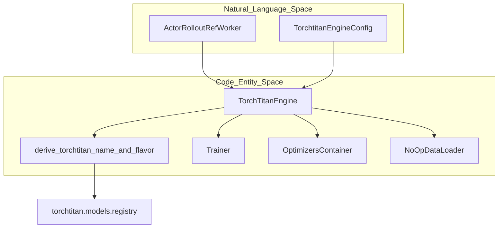
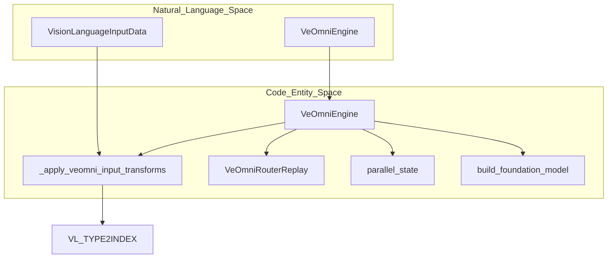

<!-- source: DeepWiki mcp.deepwiki.com · repo volcengine/verl · page 8.7 TorchTitan, Megatron Lite, FSDP-Turbo, MindSpeed, and VeOmni Backends · fetched 2026-10-21 -->

# TorchTitan, Megatron Lite, FSDP-Turbo, MindSpeed, and VeOmni Backends

Relevant source files

The following files were used as context for generating this wiki page:

- [.github/workflows/e2e_ppo_trainer_torchtitan_vllm.yml](.github/workflows/e2e_ppo_trainer_torchtitan_vllm.yml)
- [.pre-commit-config.yaml](.pre-commit-config.yaml)
- [docs/advance/fsdp_turbo_backend.rst](docs/advance/fsdp_turbo_backend.rst)
- [docs/advance/megatron_lite_backend.rst](docs/advance/megatron_lite_backend.rst)
- [docs/workers/torchtitan_workers.rst](docs/workers/torchtitan_workers.rst)
- [examples/grpo_trainer/run_deepseek_v4_megatron_lite.sh](examples/grpo_trainer/run_deepseek_v4_megatron_lite.sh)
- [examples/grpo_trainer/run_deepseek_v4_veomni.sh](examples/grpo_trainer/run_deepseek_v4_veomni.sh)
- [examples/grpo_trainer/run_kimi_k2_6_glm5_1_megatron_lite.sh](examples/grpo_trainer/run_kimi_k2_6_glm5_1_megatron_lite.sh)
- [examples/grpo_trainer/run_qwen3_5_27b_fsdp_turbo.sh](examples/grpo_trainer/run_qwen3_5_27b_fsdp_turbo.sh)
- [examples/grpo_trainer/run_qwen3_5_35b_fsdp_turbo.sh](examples/grpo_trainer/run_qwen3_5_35b_fsdp_turbo.sh)
- [examples/grpo_trainer/run_qwen3_5_35b_megatron_lite.sh](examples/grpo_trainer/run_qwen3_5_35b_megatron_lite.sh)
- [examples/sft/gsm8k/run_deepseek_v4_megatron_lite.sh](examples/sft/gsm8k/run_deepseek_v4_megatron_lite.sh)
- [tests/special_e2e/run_ppo_trainer_torchtitan.sh](tests/special_e2e/run_ppo_trainer_torchtitan.sh)
- [tests/special_npu/nightly_ci_ascend/run_grpo_qwen3_5_2b_fsdp_turbo_npu.sh](tests/special_npu/nightly_ci_ascend/run_grpo_qwen3_5_2b_fsdp_turbo_npu.sh)
- [tests/special_sanity/test_check_example_naming.py](tests/special_sanity/test_check_example_naming.py)
- [tests/utils/veomni/test_router_replay_on_cpu.py](tests/utils/veomni/test_router_replay_on_cpu.py)
- [tests/workers/test_router_replay_engine_helpers_on_cpu.py](tests/workers/test_router_replay_engine_helpers_on_cpu.py)
- [verl/trainer/config/actor/veomni_actor.yaml](verl/trainer/config/actor/veomni_actor.yaml)
- [verl/trainer/config/engine/torchtitan.yaml](verl/trainer/config/engine/torchtitan.yaml)
- [verl/trainer/config/engine/veomni.yaml](verl/trainer/config/engine/veomni.yaml)
- [verl/trainer/config/ref/torchtitan_ref.yaml](verl/trainer/config/ref/torchtitan_ref.yaml)
- [verl/trainer/config/ref/veomni_ref.yaml](verl/trainer/config/ref/veomni_ref.yaml)
- [verl/utils/reward_score/math_dapo.py](verl/utils/reward_score/math_dapo.py)
- [verl/utils/veomni/router_replay.py](verl/utils/veomni/router_replay.py)
- [verl/workers/config/engine.py](verl/workers/config/engine.py)
- [verl/workers/engine/fsdp/fsdp_turbo_impl.py](verl/workers/engine/fsdp/fsdp_turbo_impl.py)
- [verl/workers/engine/torchtitan/transformer_impl.py](verl/workers/engine/torchtitan/transformer_impl.py)
- [verl/workers/engine/torchtitan/utils.py](verl/workers/engine/torchtitan/utils.py)
- [verl/workers/engine/veomni/transformer_impl.py](verl/workers/engine/veomni/transformer_impl.py)

This page documents the integration of advanced training backends into the verl framework: **TorchTitan** (leveraging PyTorch's native FSDP2, Tensor Parallelism, and Pipeline Parallelism) [verl/workers/engine/torchtitan/transformer_impl.py:15-17](), the experimental **Megatron Lite** (`mlite`) backend [examples/grpo_trainer/run_deepseek_v4_megatron_lite.sh:1-11](), the **FSDP-Turbo** backend for hybrid parallelism [docs/advance/fsdp_turbo_backend.rst:4-6](), the **MindSpeed** backend for Huawei Ascend NPU optimizations, and the **VeOmni** engine [verl/workers/engine/veomni/transformer_impl.py:99-125](). These backends provide alternative execution strategies to standard FSDP and Megatron-LM engines, offering deep integration with native PyTorch primitives, hardware-specific acceleration (NVIDIA and Ascend NPU), and specialized optimizations for Mixture-of-Experts (MoE) and multimodal models.

Sources: [verl/workers/engine/torchtitan/transformer_impl.py:15-17](), [examples/grpo_trainer/run_deepseek_v4_megatron_lite.sh:1-11](), [docs/advance/fsdp_turbo_backend.rst:4-6](), [verl/workers/engine/veomni/transformer_impl.py:99-125]()

---

## 1. TorchTitan Engine Implementation

The `TorchTitanEngine` is a concrete implementation of `BaseEngine` that utilizes the PyTorch **TorchTitan** repository's parallelism components [verl/workers/engine/torchtitan/transformer_impl.py:105-111](). It supports high-performance training using FSDP2 (per-parameter sharding), Tensor Parallelism (TP), and Pipeline Parallelism (PP) [verl/workers/engine/torchtitan/transformer_impl.py:15-17]().

### 1.1. Architecture and Integration
The engine acts as a bridge between verl's training workflow and TorchTitan's `Trainer` class [verl/workers/engine/torchtitan/transformer_impl.py:39-39](). It translates HuggingFace model configurations into TorchTitan-compatible `ModelSpec` objects by deriving names and flavors based on architectural metadata [verl/workers/engine/torchtitan/utils.py:80-95]().

Key features include:
*   **FSDP2 Integration**: Uses the latest PyTorch distributed features for memory-efficient sharding and resharding [verl/workers/engine/torchtitan/transformer_impl.py:16-17]().
*   **Flexible Attention**: Supports `flex`, `flex_flash`, and `varlen` attention backends via `get_attention_masks` [verl/workers/engine/torchtitan/utils.py:62-62]().
*   **Hybrid Workflow Support**: Manages mode switching between training and evaluation to support the Actor-Rollout-Reference cycle in RLHF [verl/workers/engine/torchtitan/transformer_impl.py:105-131]().
*   **No-Op DataLoader**: Satisfies TorchTitan's interface via `NoOpDataLoader` while allowing verl to manage its own data pipeline [verl/workers/engine/torchtitan/utils.py:39-45]().

Sources: [verl/workers/engine/torchtitan/transformer_impl.py:15-39](), [verl/workers/engine/torchtitan/transformer_impl.py:105-131](), [verl/workers/engine/torchtitan/utils.py:39-45](), [verl/workers/engine/torchtitan/utils.py:62-62](), [verl/workers/engine/torchtitan/utils.py:80-95]()

### 1.2. Model and Flavor Derivation
Since TorchTitan uses a registry-based model system, verl includes utility functions like `derive_torchtitan_name_and_flavor` to map HuggingFace `model_type` to TorchTitan names and flavors by matching architectural traits [verl/workers/engine/torchtitan/utils.py:80-95](). Supported types include `qwen2`, `llama`, and `deepseek_v3` [verl/workers/engine/torchtitan/utils.py:68-77]().

Diagram: TorchTitan Engine Entity Mapping

Sources: [verl/workers/engine/torchtitan/transformer_impl.py:105-131](), [verl/workers/engine/torchtitan/utils.py:39-45](), [verl/workers/engine/torchtitan/utils.py:68-77](), [verl/workers/engine/torchtitan/utils.py:80-95]()

---

## 2. Megatron Lite (`mlite`) Backend

Megatron Lite is an experimental path for Megatron-LM, integrated into verl for fast iteration on large-scale models. It is frequently employed in massive MoE runs where it manages large expert parallel (EP), context parallel (CP), and pipeline parallel (PP) meshes.

### 2.1. Scale and Parallelism
*   **Optimization Options**: Supports FSDP2-like sharding wrappers or the original Megatron distributed optimizer via `use_distributed_optimizer` [verl/workers/config/engine.py:166-166]().
*   **Model Support**: Targets models requiring bridge configurations to Megatron-Core equivalents using `McoreEngineConfig` [verl/workers/config/engine.py:148-170]().
*   **Delta Export**: Provides specialized machinery for exporting sharded tensor parallel (TP), expert parallel (EP), and pipeline parallel (PP) weights back to HuggingFace formats.
*   **Example Usage**: Scripts such as `run_deepseek_v4_megatron_lite.sh` provide canonical launch templates for massive models [examples/grpo_trainer/run_deepseek_v4_megatron_lite.sh:1-11]().

Sources: [verl/workers/config/engine.py:148-170](), [examples/grpo_trainer/run_deepseek_v4_megatron_lite.sh:1-11]()

---

## 3. FSDP-Turbo Backend

The FSDP-Turbo backend provides hybrid parallelism with Expert Parallelism (EP) and Context Parallelism (CP) optimized for both Ascend NPU and NVIDIA hardware [docs/advance/fsdp_turbo_backend.rst:4-6]().

### 3.1. Implementation and Hardware Support
*   **Hybrid Parallelism**: Combines fully-sharded data parallelism with EP and CP on a single device mesh [docs/advance/fsdp_turbo_backend.rst:4-10]().
*   **Hardware Agnostic**: Supports both NVIDIA GPUs and Huawei Ascend NPUs [docs/advance/fsdp_turbo_backend.rst:4-14]().
*   **Configuration**: Enabled by setting `strategy=fsdp_turbo` [examples/grpo_trainer/run_qwen3_5_35b_fsdp_turbo.sh:116-116](). Parallelism options are configured under `turbo_config` [examples/grpo_trainer/run_qwen3_5_35b_fsdp_turbo.sh:59-60]().
    *   `fully_shard_parallel_size`: FSDP group size [examples/grpo_trainer/run_qwen3_5_35b_fsdp_turbo.sh:117-117]().
    *   `expert_parallel_size`: EP group size for MoE models [examples/grpo_trainer/run_qwen3_5_35b_fsdp_turbo.sh:118-118]().
    *   `ulysses_parallel_size`: Context parallel size, splitting sequences along the sequence/head dimension [examples/grpo_trainer/run_qwen3_5_35b_fsdp_turbo.sh:119-119]().
*   **Module-level Sharding**: Allows explicit module-glob patterns for FSDP wrapping (`fsdp_plan.apply_modules`), hook management (`fsdp_plan.hook_modules`), and expert parameter splitting (`ep_plan.apply_modules`) [examples/grpo_trainer/run_qwen3_5_35b_fsdp_turbo.sh:62-70]().
*   **Memory Plan**: Activation checkpointing is enabled via `recompute=True` and applied to specific modules listed in `recompute_plan` [examples/grpo_trainer/run_qwen3_5_35b_fsdp_turbo.sh:71-71]().
*   **Module Patches**: For context parallelism, specific HuggingFace model implementations require targeted patches via `ulysses_function_patches`, `loss_function_patches`, and `module_patches` [examples/grpo_trainer/run_qwen3_5_35b_fsdp_turbo.sh:73-82]().
*   **Offload Policy**: Integrates with parameter and optimizer offloading configurations [examples/grpo_trainer/run_qwen3_5_35b_fsdp_turbo.sh:130-132]().

Sources: [docs/advance/fsdp_turbo_backend.rst:4-14](), [examples/grpo_trainer/run_qwen3_5_35b_fsdp_turbo.sh:59-132]()

---

## 4. MindSpeed Backend and Ascend NPU Integration

The MindSpeed backend integrates Huawei's **MindSpeed** framework into verl, enabling optimized training workflows on Ascend NPU hardware through CANN (Compute Architecture for Neural Networks).

### 4.1. Core Features
*   **Ascend Custom Kernels**: Leverages MindSpeed fused operators (such as RMSNorm, SwiGLU, and rotary embeddings) to optimize execution efficiency on Ascend NPUs.
*   **Parallelism Extensions**: Works in conjunction with Ascend-specific communication primitives (HCCL) to scale tensor, pipeline, and expert parallelism across multi-node NPU clusters.
*   **Integration with FSDP-Turbo**: Frequently paired with `fsdp_turbo` configurations on NPU environments to support specialized layout transformations and attention patches [examples/grpo_trainer/run_qwen3_5_35b_fsdp_turbo.sh:1-4]().

Sources: [examples/grpo_trainer/run_qwen3_5_35b_fsdp_turbo.sh:1-4]()

---

## 5. VeOmni Engine Implementation

The `VeOmniEngine` is a backend optimized for models requiring **Expert Parallelism (EP)**, **Ulysses Sequence Parallelism (USP)**, and specialized multimodal handling [verl/workers/engine/veomni/transformer_impl.py:99-125](). It subclasses `FSDPEngine` to leverage FSDP2 while adding multimodal-specific transformations [verl/workers/engine/veomni/transformer_impl.py:50-50](), [verl/workers/engine/veomni/transformer_impl.py:99-101]().

### 5.1. Multimodal and Parallelism Features
*   **Multimodal Transforms**: Handles vision-language model masks for image and video tokens using `VL_TYPE2INDEX` within `_apply_veomni_input_transforms` [verl/workers/engine/veomni/transformer_impl.py:102-118]().
*   **Ulysses Sequence Parallelism**: Integrates USP for long-context sequences, including sharding input tensors across the Ulysses group [verl/workers/engine/veomni/transformer_impl.py:109-124]().
*   **Router Replay**: Supports deterministic MoE training through `VeOmniRouterReplay` (R2/R3 modes), ensuring rollout and training routing decisions are aligned [verl/workers/engine/veomni/transformer_impl.py:46-46](), [verl/trainer/config/engine/veomni.yaml:112-124]().
*   **MoE Export**: Specialized parameter handlers convert fused expert tensors (e.g., `gate_up_proj`) to standard HF expert formats [verl/workers/engine/veomni/transformer_impl.py:54-54]().

Diagram: VeOmni Engine and Multimodal Integration

Sources: [verl/workers/engine/veomni/transformer_impl.py:46-54](), [verl/workers/engine/veomni/transformer_impl.py:99-125](), [verl/trainer/config/engine/veomni.yaml:112-124]()

---

## 6. Configuration and Use Cases

### 6.1. Engine Configuration Comparison
Backends are selected via configuration parameters in the engine and model registry.

| Feature | TorchTitan | VeOmni | FSDP-Turbo | MindSpeed | Megatron Lite |
| :--- | :--- | :--- | :--- | :--- | :--- |
| **Backend Name** | `torchtitan` | `veomni` | `fsdp_turbo` | `mindspeed` | `mlite` |
| **Primary Parallelism** | FSDP2 + TP + PP | FSDP2 + EP + USP | FSDP + EP + CP | EP + TP + PP (NPU) | TP + PP + EP |
| **MoE Support** | Yes | Yes (R2/R3 Replay) | Yes | Yes | Yes |
| **Multimodal** | Limited | Native (VL Indices) | Limited | Limited | Limited |
| **Hardware** | CUDA | CUDA | CUDA, NPU | Ascend NPU | CUDA |

Sources: [verl/workers/config/engine.py:29-39](), [verl/workers/engine/torchtitan/transformer_impl.py:105-111](), [verl/workers/engine/veomni/transformer_impl.py:99-125](), [docs/advance/fsdp_turbo_backend.rst:4-10]()

### 6.2. VeOmni Kernel Selection
VeOmni allows granular selection of kernel implementations for operations via `OpsImplementationConfig` managed through `_build_ops_implementation_config` [verl/workers/engine/veomni/transformer_impl.py:65-96](). Users choose between `eager`, `fused`, `triton`, or `tilelang` for operations like RMSNorm, Attention, and activation functions [verl/trainer/config/engine/veomni.yaml:68-79](). The engine verifies that the installed VeOmni version supports the requested implementations before initialization [verl/workers/engine/veomni/transformer_impl.py:88-92]().

Sources: [verl/workers/engine/veomni/transformer_impl.py:65-96](), [verl/trainer/config/engine/veomni.yaml:68-79]()

---

