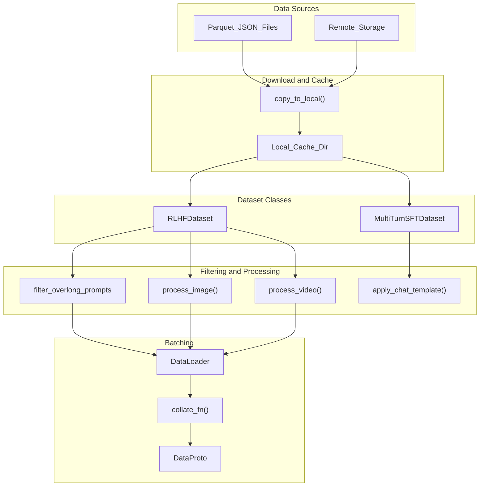
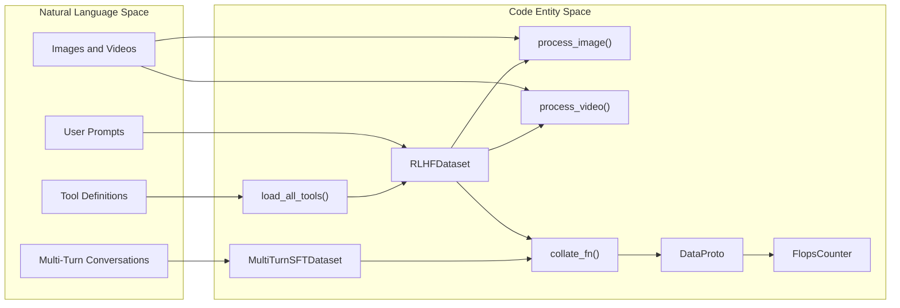
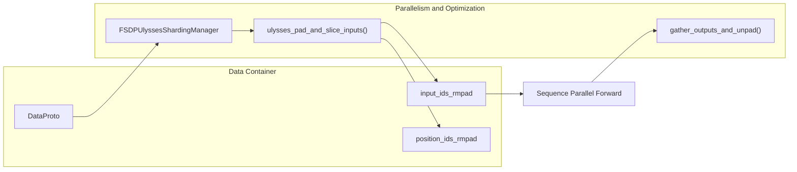

<!-- source: DeepWiki mcp.deepwiki.com · repo volcengine/verl · page 9 Data Pipeline · fetched 2026-10-21 -->

# Data Pipeline

Relevant source files

The following files were used as context for generating this wiki page:

- [tests/utils/dataset/test_rl_dataset_on_cpu.py](tests/utils/dataset/test_rl_dataset_on_cpu.py)
- [tests/utils/test_flops_counter.py](tests/utils/test_flops_counter.py)
- [verl/models/transformers/apertus.py](verl/models/transformers/apertus.py)
- [verl/trainer/config/data/legacy_data.yaml](verl/trainer/config/data/legacy_data.yaml)
- [verl/utils/dataset/rl_dataset.py](verl/utils/dataset/rl_dataset.py)
- [verl/utils/dataset/vision_utils.py](verl/utils/dataset/vision_utils.py)
- [verl/utils/flops_counter.py](verl/utils/flops_counter.py)

The Data Pipeline system handles all aspects of data preparation, loading, and processing for RLHF and SFT training in `verl`. It supports multimodal data (text, images, videos), multi-turn conversations, custom reward functions, tool integration, and various data filtering and batching strategies.

For information about how data flows through the training loop after loading, see [PPO Training System](#3). For dataset-specific configuration options, see [Data and Dataset Configuration](#4.4).

Sources: [verl/utils/dataset/rl_dataset.py:41-165](), [verl/utils/dataset/vision_utils.py:22-107]()

## Overview

The data pipeline transforms raw Parquet or JSON files into batched training samples. The primary components are `RLHFDataset` (for RLHF) and related dataset wrappers which handle data downloading, local caching, tokenization, prompt filtering, multimodal processing, and sample collation.

Title: "Data Pipeline Flow"

Sources: [verl/utils/dataset/rl_dataset.py:41-165](), [verl/utils/dataset/vision_utils.py:22-107]()

## RLHFDataset and Data Preparation (#9.1)

The `RLHFDataset` class is the core implementation for RLHF workflows [verl/utils/dataset/rl_dataset.py:72-87](). It manages the lifecycle of training data from raw files to tokenized prompts, downloading files locally, applying chat templates via `PreTrainedTokenizer`, and filtering overlong prompts in parallel using multiple CPU workers [verl/utils/dataset/rl_dataset.py:107-148]().

For details, see [RLHFDataset and Data Preparation](#9.1).

Sources: [verl/utils/dataset/rl_dataset.py:72-165]()

## Multimodal Data Processing (#9.2)

Verl provides extensive support for Vision-Language Models (VLM) through `vision_utils.py` [verl/utils/dataset/vision_utils.py:22-131](). Functions like `process_image` and `process_video` interface with underlying media tools to fetch and resize media based on `image_patch_size` [verl/utils/dataset/vision_utils.py:22-107](). It also includes helpers like `process_multi_modal_inputs_for_minicpmo` to adjust image bounds and sequence lengths for specific vision architectures [verl/utils/dataset/vision_utils.py:109-131]().

For details, see [Multimodal Data Processing](#9.2).

Sources: [verl/utils/dataset/vision_utils.py:22-131](), [verl/utils/dataset/rl_dataset.py:109-111]()

## DataProto and Batch Processing (#9.3)

Training data is organized into `DataProto` objects to simplify distributed communication across Ray workers. The `collate_fn` function stacks `torch.Tensor` entries into batched tensors and converts non-tensor metadata into `np.ndarray` of object type [verl/utils/dataset/rl_dataset.py:41-69](). `DataProto` acts as the primary container for tensors and non-tensor metadata throughout the training loop.

For details, see [DataProto and Batch Processing](#9.3).

Sources: [verl/utils/dataset/rl_dataset.py:41-69]()

## Sequence Balancing and Dynamic Batching (#9.4)

To optimize throughput, `verl` implements strategies for handling variable sequence lengths and monitoring performance. The `FlopsCounter` class calculates theoretical FLOPS for various architectures including Llama, Qwen2, Qwen3, and DeepSeek-V3 [verl/utils/flops_counter.py:92-182](). Sequence balancing mechanisms pack sequences into micro-batches to balance workloads across workers.

For details, see [Sequence Balancing and Dynamic Batching](#9.4).

Sources: [verl/utils/flops_counter.py:22-182]()

## Custom Datasets and Extension (#9.5)

The framework is designed for extensibility, allowing users to register custom dataset classes via configuration [verl/trainer/config/data/legacy_data.yaml:106-113](). Users can specify a `custom_cls` path and name in the data config to override default loading behavior, integrate custom tool schemas via `load_all_tools`, or define custom SFT and reward model datasets [verl/utils/dataset/rl_dataset.py:125-144](), [verl/trainer/config/data/legacy_data.yaml:106-113]().

For details, see [Custom Datasets and Extension](#9.5).

Sources: [verl/utils/dataset/rl_dataset.py:94-144](), [verl/trainer/config/data/legacy_data.yaml:106-113]()

## Data Pipeline Entities

Title: "Natural Language to Code Entity Space"

Sources: [verl/utils/dataset/rl_dataset.py:72](), [verl/utils/dataset/vision_utils.py:22-67](), [verl/utils/flops_counter.py:19]()

Title: "Training Execution Data Context"

Sources: [tests/models/test_transformers_ulysses.py:31-175]()

---

