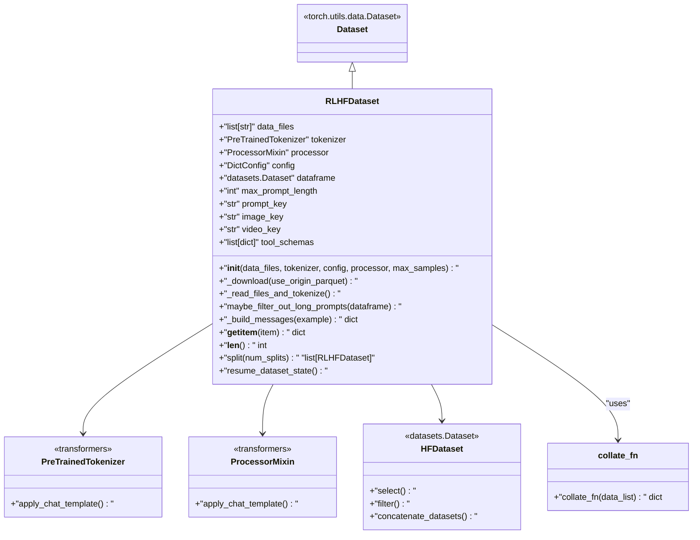
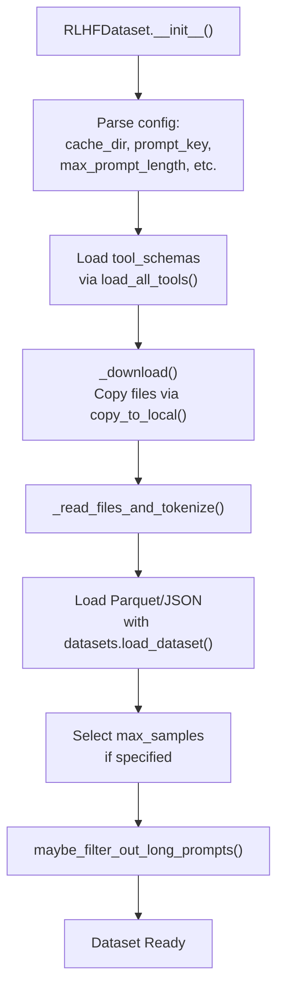
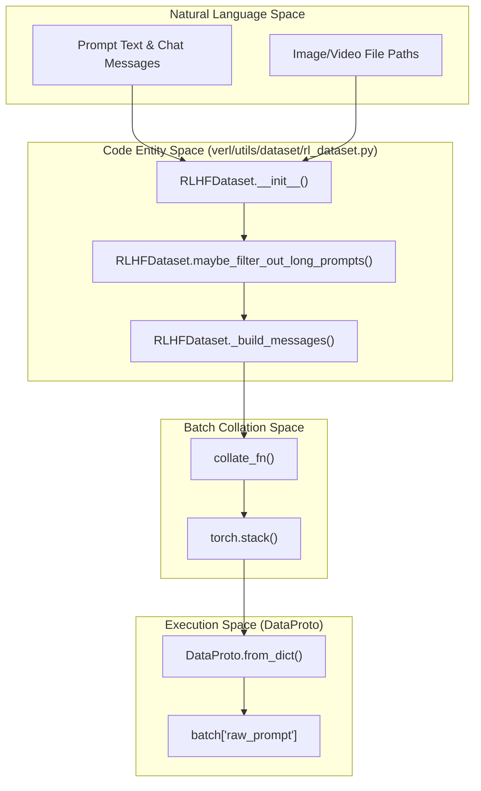
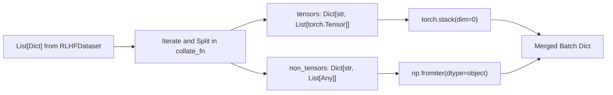

<!-- source: DeepWiki mcp.deepwiki.com · repo volcengine/verl · page 9.1 RLHFDataset and Data Preparation · fetched 2026-10-21 -->

# RLHFDataset and Data Preparation

<details>
<summary>Relevant source files</summary>

The following files were used as context for generating this wiki page:

- [docs/advance/agent_loop.rst](docs/advance/agent_loop.rst)
- [docs/advance/fsdp_extension.rst](docs/advance/fsdp_extension.rst)
- [docs/advance/megatron_extension.rst](docs/advance/megatron_extension.rst)
- [docs/preparation/prepare_data.rst](docs/preparation/prepare_data.rst)
- [docs/start/agentic_rl.rst](docs/start/agentic_rl.rst)
- [examples/data_preprocess/gsm8k.py](examples/data_preprocess/gsm8k.py)
- [examples/data_preprocess/gsm8k_multiturn_w_tool.py](examples/data_preprocess/gsm8k_multiturn_w_tool.py)
- [examples/data_preprocess/gsm8k_tool_agent_loop.py](examples/data_preprocess/gsm8k_tool_agent_loop.py)
- [tests/utils/dataset/test_rl_dataset_on_cpu.py](tests/utils/dataset/test_rl_dataset_on_cpu.py)
- [tests/utils/test_flops_counter.py](tests/utils/test_flops_counter.py)
- [verl/models/transformers/apertus.py](verl/models/transformers/apertus.py)
- [verl/trainer/config/data/legacy_data.yaml](verl/trainer/config/data/legacy_data.yaml)
- [verl/utils/dataset/rl_dataset.py](verl/utils/dataset/rl_dataset.py)
- [verl/utils/dataset/vision_utils.py](verl/utils/dataset/vision_utils.py)
- [verl/utils/flops_counter.py](verl/utils/flops_counter.py)

</details>


This document covers the data pipeline for RLHF and SFT training in `verl`, focusing on the `RLHFDataset` class and related data preparation utilities. It explains data format requirements, loading mechanisms, multimodal support, filtering strategies, batch collation, and dataset configuration.

For information about how data flows through the training loop after batch preparation, see [DataProto and Batch Processing](9.3). For dataset configuration options, see [Data and Dataset Configuration](4.4).

---

## Overview and Purpose

The `RLHFDataset` class handles data ingestion and preprocessing for reinforcement learning from human feedback (RLHF) workflows:

1. **Loading prompt data** from Parquet or JSON files [verl/utils/dataset/rl_dataset.py:73-76]().
2. **Caching files locally** for efficient access (HDFS/remote to local storage or shared memory) [verl/utils/dataset/rl_dataset.py:162-168]().
3. **Processing multimodal inputs** (images, videos, audios) via Hugging Face `ProcessorMixin` [verl/utils/dataset/rl_dataset.py:103-103]().
4. **Filtering overlong prompts** based on tokenized length to prevent OOM errors during rollout [verl/utils/dataset/rl_dataset.py:119-119]().
5. **Preparing raw messages** for the AgentLoop (without premature tokenization) [verl/utils/dataset/rl_dataset.py:116-117]().
6. **Supporting custom dataset implementations** via dynamic loading [verl/trainer/config/data/legacy_data.yaml:107-112]().

Unlike traditional supervised learning datasets that immediately return fully tokenized tensors, `RLHFDataset` returns **raw message dictionaries** (`raw_prompt` field). Actual tokenization and chat template application occur during rollout generation in the `AgentLoop` workers, enabling multi-turn interactions and dynamic prompt construction.

Sources: [verl/utils/dataset/rl_dataset.py:73-76](), [verl/utils/dataset/rl_dataset.py:162-168](), [verl/utils/dataset/rl_dataset.py:103-103](), [verl/utils/dataset/rl_dataset.py:119-119](), [verl/utils/dataset/rl_dataset.py:116-117](), [verl/trainer/config/data/legacy_data.yaml:107-112]()

---

## Data Format Requirements

### File Formats

`RLHFDataset` supports two file formats loaded via the Hugging Face `datasets` library [verl/utils/dataset/rl_dataset.py:170-174]():

* **Parquet** (`.parquet`): Recommended for large-scale datasets with efficient columnar storage.
* **JSON/JSONL** (`.json`, `.jsonl`): Human-readable alternative for smaller datasets.

Files can be specified as a single path or a list of paths [verl/utils/dataset/rl_dataset.py:97-98]().

### Row Structure

Each dataset row typically contains the following fields:

| Field      | Type                     | Required | Description                                                              |
| :--------- | :----------------------- | :------- | :----------------------------------------------------------------------- |
| `prompt`   | `list[dict]`             | Yes      | Chat messages in OpenAI format [verl/utils/dataset/rl_dataset.py:108-108]() |
| `images`   | `list[dict \| PIL.Image]` | No       | Image data for multimodal models [verl/utils/dataset/rl_dataset.py:109-109]() |
| `videos`   | `list[dict]`             | No       | Video data for multimodal models [verl/utils/dataset/rl_dataset.py:110-110]() |
| `audios`   | `list[dict]`             | No       | Audio data for multimodal models [verl/utils/dataset/rl_dataset.py:111-111]() |
| `extra_info` | `dict`                   | No       | Metadata (index, tools_kwargs, etc.) [verl/trainer/config/data/legacy_data.yaml:26-31]() |

Sources: [verl/utils/dataset/rl_dataset.py:108-111](), [verl/trainer/config/data/legacy_data.yaml:26-31]()

---

## RLHFDataset Class Architecture

### Class Diagram: Code Entity Space


Sources: [verl/utils/dataset/rl_dataset.py:72-103](), [verl/utils/dataset/rl_dataset.py:170-174]()

### Initialization Workflow


Sources: [verl/utils/dataset/rl_dataset.py:89-158](), [verl/utils/dataset/rl_dataset.py:162-183]()

---

## Data Loading and Caching

### File Download and Caching

The `_download()` method copies remote or HDFS files to local storage using `verl.utils.fs.copy_to_local()` [verl/utils/dataset/rl_dataset.py:162-168]():

1. **Cache Directory**: Defaults to `~/.cache/verl/rlhf` (configurable via `config.cache_dir`) [verl/utils/dataset/rl_dataset.py:107-107]().
2. **Shared Memory Support**: If `config.use_shm=True`, files are copied to `/dev/shm` for lower latency access [verl/utils/dataset/rl_dataset.py:150-150]().
3. **Resumption Tracking**: Original file paths are preserved in `original_data_files` to support state resumption [verl/utils/dataset/rl_dataset.py:101-101]().

Sources: [verl/utils/dataset/rl_dataset.py:101-168]()

---

## Prompt Filtering and Validation

### Filtering Mechanism

The `maybe_filter_out_long_prompts()` method removes prompts exceeding `max_prompt_length` tokens using multiprocessing [verl/utils/dataset/rl_dataset.py:119-149](). This prevents out-of-memory errors during rollout generation.

### Token Length Calculation

For **text-only** prompts, `tokenizer.apply_chat_template` computes the sequence length. For **multimodal** prompts, the `processor.apply_chat_template` and vision preprocessing determine the final sequence length including visual token spans.

**Tool Schema Integration**: If `tool_config_path` or `function_tool_path` is configured, `tool_schemas` are loaded via `load_all_tools` so length filtering accounts for tool definitions [verl/utils/dataset/rl_dataset.py:125-146](). This is crucial for agentic RL scenarios where tool calls can significantly impact prompt length [docs/start/agentic_rl.rst:75-76]().

Sources: [verl/utils/dataset/rl_dataset.py:125-149](), [docs/start/agentic_rl.rst:75-76]()

---

## Multimodal Data Processing

### Vision Placeholder Replacement

The `_build_messages()` method replaces `<image>` and `<video>` placeholders in message contents with structured dictionaries required by multimodal processors.

### Image and Video Processing

`process_image()` and `process_video()` in `verl/utils/dataset/vision_utils.py` handle decoding and sampling [verl/utils/dataset/vision_utils.py:22-106]().

* **Images**: Supports PIL images, raw bytes, or file paths using `qwen_vl_utils.fetch_image` with automatic RGB conversion [verl/utils/dataset/vision_utils.py:22-36]().
* **Videos**: Supports frame lists or video files with custom FPS and frame limits using `qwen_vl_utils.fetch_video` [verl/utils/dataset/vision_utils.py:67-106]().

Sources: [verl/utils/dataset/vision_utils.py:22-106]()

---

## Data Flow: Natural Language to Code Entity Space


Sources: [verl/utils/dataset/rl_dataset.py:41-72](), [verl/utils/dataset/rl_dataset.py:119-149]()

---

## Batch Collation

The `collate_fn()` function separates tensors from non-tensors for batching across distributed workers [verl/utils/dataset/rl_dataset.py:41-69]().


Sources: [verl/utils/dataset/rl_dataset.py:41-69]()

---

## Checkpoint and State Management

To optimize memory usage during checkpointing, `RLHFDataset` excludes the heavy `dataframe` from its serialized state. Upon resumption, the dataset state is restored by re-reading the original files via `resume_dataset_state()`.

Sources: [verl/utils/dataset/rl_dataset.py:101-101]()

---

## Data Preprocessing Examples

The `examples/data_preprocess/` directory contains scripts for preparing common datasets for RLHF training. These scripts demonstrate how to convert raw data into the Parquet format expected by `RLHFDataset`.

### GSM8k Dataset

The `examples/data_preprocess/gsm8k.py` script preprocesses the GSM8k math word problem dataset [examples/data_preprocess/gsm8k.py:1-105]().

It performs the following steps:
1. Loads the `openai/gsm8k` dataset from Hugging Face [examples/data_preprocess/gsm8k.py:47-53]().
2. Adds an instruction following prompt to each question [examples/data_preprocess/gsm8k.py:58-65]().
3. Extracts the numerical solution from the answer for reward modeling [examples/data_preprocess/gsm8k.py:27-32]().
4. Formats the data into a dictionary with `prompt` (OpenAI chat format), `ability`, `reward_model` (with ground truth), and `extra_info` fields [examples/data_preprocess/gsm8k.py:68-84]().
5. Saves the processed data as `train.parquet` and `test.parquet` [examples/data_preprocess/gsm8k.py:99-100]().

Example usage:
```bash
python examples/data_preprocess/gsm8k.py --local_save_dir ~/data/gsm8k
```

Sources: [examples/data_preprocess/gsm8k.py:1-105]()

### GSM8k with Multi-turn and Tools

The `examples/data_preprocess/gsm8k_multiturn_w_tool.py` script extends the GSM8k preprocessing to support multi-turn conversations and tool calls [examples/data_preprocess/gsm8k_multiturn_w_tool.py:1-125]().

Key differences from the basic GSM8k script:
1. Adds a system prompt to guide the model to use tools and reason step-by-step [examples/data_preprocess/gsm8k_multiturn_w_tool.py:74-82]().
2. Includes `need_tools_kwargs: True` and `tools_kwargs` in `extra_info` to configure tool usage for the `calc_gsm8k_reward` tool [examples/data_preprocess/gsm8k_multiturn_w_tool.py:95-103](). This enables the `AgentLoop` to dynamically create and use tools during rollout.

Example usage:
```bash
python examples/data_preprocess/gsm8k_multiturn_w_tool.py --local_save_dir ~/data/gsm8k_multiturn_w_tool
```

Sources: [examples/data_preprocess/gsm8k_multiturn_w_tool.py:1-125]()

---

