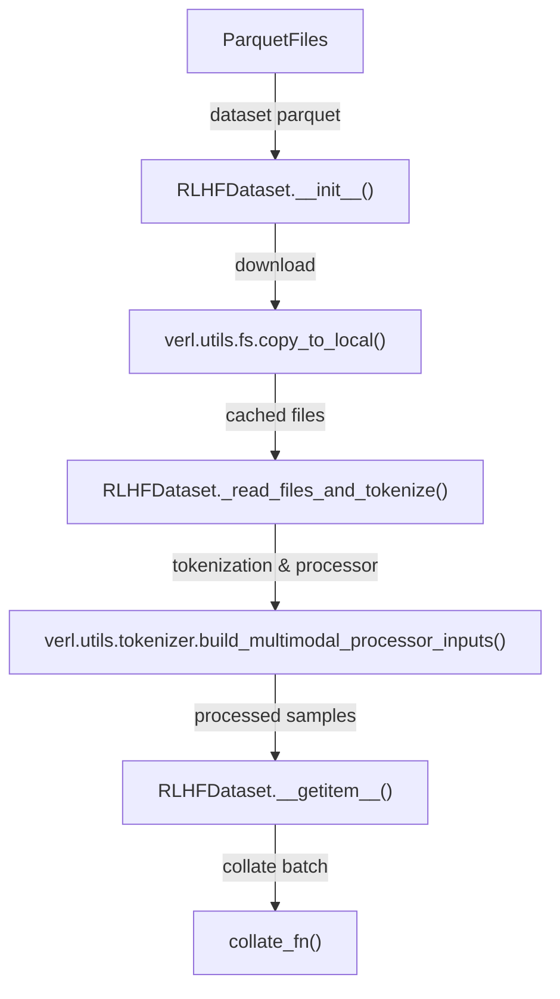
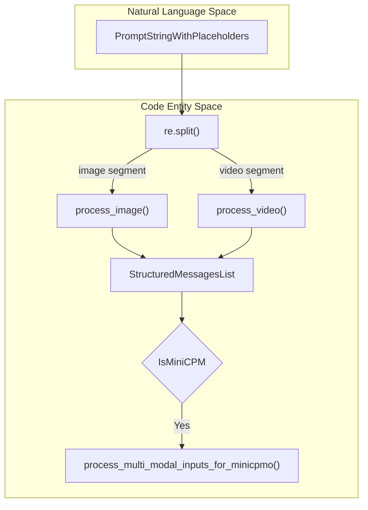
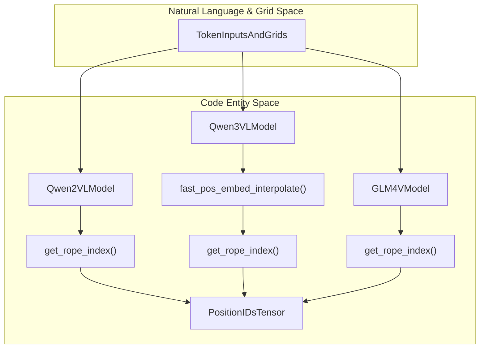
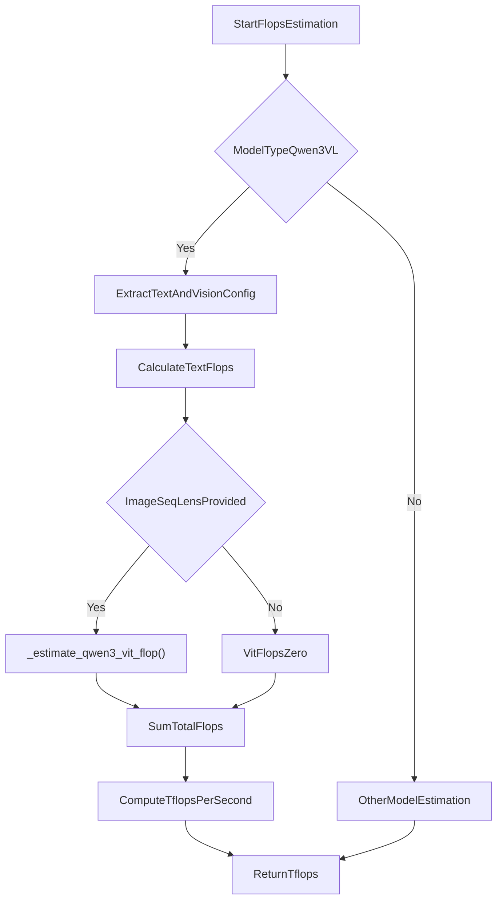

<!-- source: DeepWiki mcp.deepwiki.com · repo volcengine/verl · page 9.2 Multimodal Data Processing · fetched 2026-10-21 -->

# Multimodal Data Processing

Relevant source files

The following files were used as context for generating this wiki page:

- [tests/models/test_fused_kernels_ulysses_sp_on_cpu.py](tests/models/test_fused_kernels_ulysses_sp_on_cpu.py)
- [tests/utils/dataset/test_rl_dataset_on_cpu.py](tests/utils/dataset/test_rl_dataset_on_cpu.py)
- [tests/utils/test_experimental_torch_functional_on_cpu.py](tests/utils/test_experimental_torch_functional_on_cpu.py)
- [tests/utils/test_flops_counter.py](tests/utils/test_flops_counter.py)
- [verl/models/transformers/apertus.py](verl/models/transformers/apertus.py)
- [verl/models/transformers/dense_common.py](verl/models/transformers/dense_common.py)
- [verl/models/transformers/glm4v.py](verl/models/transformers/glm4v.py)
- [verl/models/transformers/kimi_vl.py](verl/models/transformers/kimi_vl.py)
- [verl/models/transformers/llama.py](verl/models/transformers/llama.py)
- [verl/models/transformers/monkey_patch.py](verl/models/transformers/monkey_patch.py)
- [verl/models/transformers/qwen2.py](verl/models/transformers/qwen2.py)
- [verl/models/transformers/qwen2_vl.py](verl/models/transformers/qwen2_vl.py)
- [verl/models/transformers/qwen3_5.py](verl/models/transformers/qwen3_5.py)
- [verl/models/transformers/qwen3_vl.py](verl/models/transformers/qwen3_vl.py)
- [verl/trainer/config/data/legacy_data.yaml](verl/trainer/config/data/legacy_data.yaml)
- [verl/utils/dataset/rl_dataset.py](verl/utils/dataset/rl_dataset.py)
- [verl/utils/dataset/vision_utils.py](verl/utils/dataset/vision_utils.py)
- [verl/utils/experimental/torch_functional.py](verl/utils/experimental/torch_functional.py)
- [verl/utils/flops_counter.py](verl/utils/flops_counter.py)
- [verl/utils/ulysses.py](verl/utils/ulysses.py)

The purpose of this page is to detail how `verl` handles multimodal data processing for Vision-Language Models (VLMs) during reinforcement learning and SFT workflows. The system integrates closely with HuggingFace's `ProcessorMixin` [verl/utils/dataset/rl_dataset.py:33](), custom vision utilities [verl/utils/dataset/vision_utils.py:22](), and specialized rotary position embedding (`RoPE`) index generators across various VLM architectures (e.g., Qwen2-VL, Qwen3-VL, GLM4V).

---

## 1. RLHFDataset and Processor Integration

The `RLHFDataset` class [verl/utils/dataset/rl_dataset.py:72-87]() inherits from `torch.utils.data.Dataset` and handles loading, preprocessing, caching, and tokenizing multimodal RLHF datasets from Parquet files. It extracts configuration parameters such as `image_key`, `video_key`, `audio_key`, and `image_patch_size` [verl/utils/dataset/rl_dataset.py:109-114](), utilizing a HuggingFace processor (`ProcessorMixin`) to handle tokenization and multimodal feature alignment.

### Dataset Processing Flow

**Diagram: RLHFDataset & Processor Code Entity Flow**

Sources: [verl/utils/dataset/rl_dataset.py:41-161](), [verl/utils/tokenizer.py:36]()

---

## 2. Vision Utilities and Placeholder Replacement

The dataset stores messages containing string placeholders like `<image>` and `<video>`, which are dynamically mapped to structural dictionaries expected by HuggingFace VLM processors.

### Placeholder Replacement Mechanics

The preprocessing logic handles media parsing via specialized utilities defined in `verl/utils/dataset/vision_utils.py`:
1. **Image Substitution**: `process_image()` [verl/utils/dataset/vision_utils.py:22]() accepts raw `PIL.Image.Image` objects or dictionaries containing raw bytes (`bytes`), opening them via `Image.open(BytesIO(...))` [verl/utils/dataset/vision_utils.py:28-30]() and passing them to `qwen_vl_utils.fetch_image()` [verl/utils/dataset/vision_utils.py:33]().
2. **Video Substitution**: `process_video()` [verl/utils/dataset/vision_utils.py:67-107]() parses video dictionary descriptors, injects default sampling rates (`fps`, `nframes`, `min_frames`, `max_frames`), and invokes `qwen_vl_utils.fetch_video()` [verl/utils/dataset/vision_utils.py:81]() to return a tensor of shape `[n_frames, 3, H, W]`.
3. **MiniCPM-o Special Handling**: `process_multi_modal_inputs_for_minicpmo()` adjusts image boundaries relative to left-padding lengths and cumulative sequence lengths (`cu_seqlens`) [verl/utils/dataset/vision_utils.py:109-131]().

**Diagram: Natural Language Space to Code Entity Space for Multimodal Placeholders**

Sources: [verl/utils/dataset/vision_utils.py:22-131]()

---

## 3. Position ID Generation & Model Integration

For vision-language models utilizing 2D or 3D Rotary Position Embeddings (RoPE), standard token position IDs must account for interleaved visual grids (image and video patch dimensions). `verl` implements or patches `get_rope_index` across supported VLM backends:

*   **Qwen2-VL / Qwen2.5-VL**: Computes spatial grid dimensions (`image_grid_thw` and `video_grid_thw`) and maps text/vision offsets prior to sequence sharding [verl/models/transformers/qwen2_vl.py:64-150]().
*   **Qwen3-VL**: Handles specialized timestamp separators and dynamic patch embeddings via `fast_pos_embed_interpolate` [verl/models/transformers/qwen3_vl.py:34-96]() and custom RoPE index generation [verl/models/transformers/qwen3_vl.py:99-164]().
*   **GLM4V**: Uses `itertools.groupby` to isolate image and video spans in padding-free formats to build multi-dimensional position IDs [verl/models/transformers/glm4v.py:64-161]().

**Diagram: Natural Language and Grid Input to RoPE Code Entities**

Sources: [verl/models/transformers/qwen2_vl.py:64-150](), [verl/models/transformers/qwen3_vl.py:34-164](), [verl/models/transformers/glm4v.py:64-161]()

---

## 4. Filtering and Batch Construction

### Prompt Length Filtering

The prompt filtering methods ensure prompts do not exceed `max_prompt_length` [verl/utils/dataset/rl_dataset.py:182-268](). When a VLM processor is active, it computes the exact token length including visual patch tokens via `build_multimodal_processor_inputs` [verl/utils/tokenizer.py:36]().

### Collate Function

The `collate_fn()` utility organizes individual sample dictionaries into batched data structures [verl/utils/dataset/rl_dataset.py:41-69]():
*   **Tensors**: Stacked along `dim=0` via `torch.stack()` [verl/utils/dataset/rl_dataset.py:63-64]().
*   **Non-Tensors**: Converted to object-dtype `np.ndarray` of shape `(batch_size,)` to preserve variable-length objects [verl/utils/dataset/rl_dataset.py:66-67]().

Sources: [verl/utils/dataset/rl_dataset.py:41-69](), [verl/utils/dataset/rl_dataset.py:182-268](), [verl/utils/tokenizer.py:36]()

---

## 5. Vision Model FLOPS Estimation

The `FlopsCounter` system provides analytical FLOPS estimations for multimodal architectures, including ViT patch projections and vision-language fusion layers [verl/utils/flops_counter.py:127-207](). For instance, `_estimate_qwen3_vl_flops` computes dense text operations, attention token counts, and invokes `_estimate_qwen3_vit_flop` when `images_seqlens` are present [verl/utils/flops_counter.py:127-168]().

**Diagram: Multimodal FLOPS Estimation for Qwen3-VL**

Sources: [verl/utils/flops_counter.py:127-207](), [tests/utils/test_flops_counter.py:82-123]()

---

