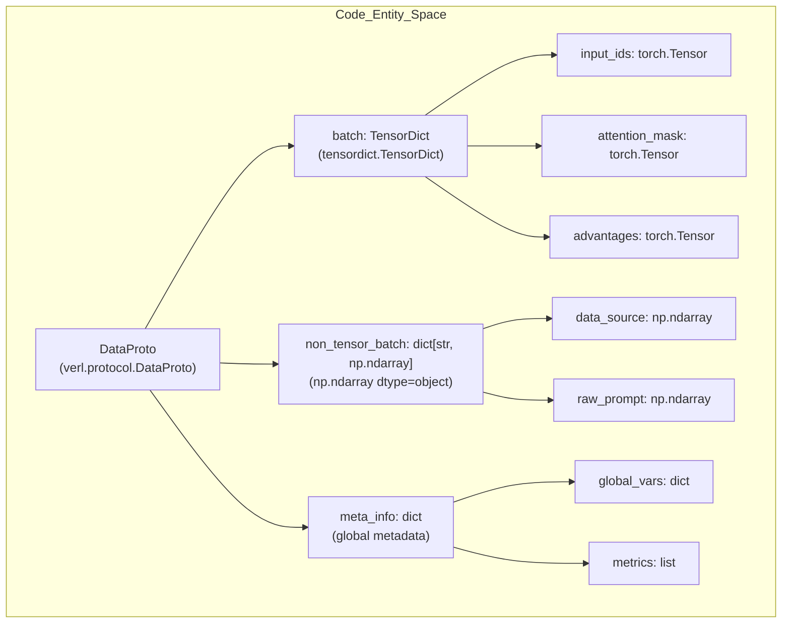
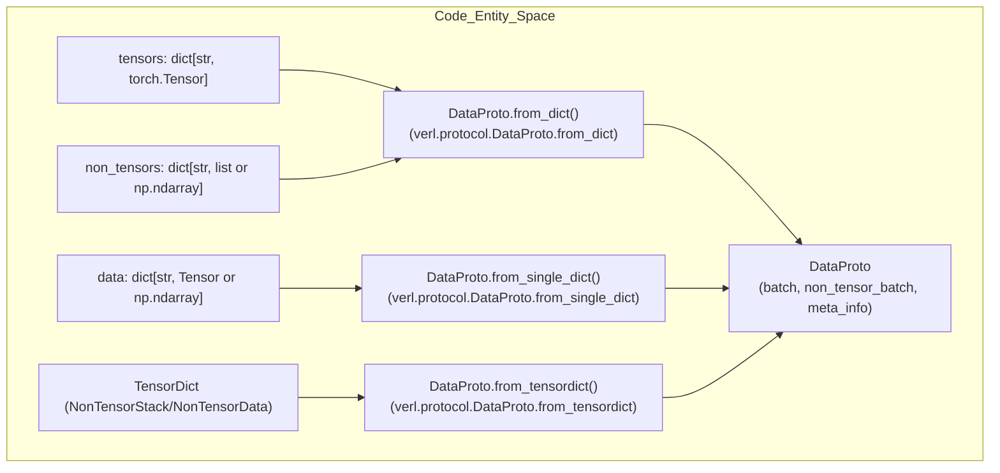
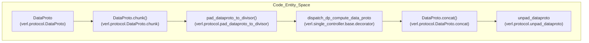

<!-- source: DeepWiki mcp.deepwiki.com · repo volcengine/verl · page 9.3 DataProto and Batch Processing · fetched 2026-10-21 -->

# DataProto and Batch Processing

Relevant source files

The following files were used as context for generating this wiki page:

- [tests/single_controller/test_decorator_on_cpu.py](tests/single_controller/test_decorator_on_cpu.py)
- [tests/special_e2e/sft/compare_sft_engine_results.py](tests/special_e2e/sft/compare_sft_engine_results.py)
- [tests/special_sanity/validate_structure.py](tests/special_sanity/validate_structure.py)
- [tests/test_protocol_on_cpu.py](tests/test_protocol_on_cpu.py)
- [tests/test_protocol_v2_on_cpu.py](tests/test_protocol_v2_on_cpu.py)
- [verl/protocol.py](verl/protocol.py)
- [verl/single_controller/base/decorator.py](verl/single_controller/base/decorator.py)
- [verl/utils/dataset/dataset_utils.py](verl/utils/dataset/dataset_utils.py)
- [verl/utils/tensordict_utils.py](verl/utils/tensordict_utils.py)

## Purpose and Scope

This document describes the data structures and batch processing infrastructure used throughout `verl` for RLHF and SFT training. It covers `DataProto` — the standard data exchange format — along with its underlying `TensorDict` and `non_tensor_batch` storage, creation methods, indexing, splitting, concatenation, padding, serialization, and DataLoader integration.

For distributed dispatch mechanisms that operate on `DataProto`, see page 5.2. For dataset loading and filtering, see page 9.1. For multimodal data processing, see page 9.2. For sequence balancing and dynamic batching, see page 9.4.

Sources: `[verl/protocol.py:14-17]()`

---

## DataProto Structure

`DataProto` is defined in `[verl/protocol.py:317-327]()` as a `@dataclass` and serves as the standard protocol for data exchange between any two components in `verl` — between workers, between the controller and workers, and between training stages.

**Fields:**

| Field | Type | Purpose |
|-------|------|---------|
| `batch` | `TensorDict` or `None` | All tensor data (`input_ids`, `attention_mask`, `log_probs`, `advantages`, etc.) — batched along dim 0 |
| `non_tensor_batch` | `dict[str, np.ndarray]` | Non-tensor per-sample data (strings, variable-length lists, image arrays) — each value must be a numpy array with `shape[0] == batch_size` |
| `meta_info` | `dict` | Global metadata not indexed per-sample (sampling config, hyperparams, metric dicts from workers) |

**Consistency invariant**: When both `batch` and `non_tensor_batch` are non-empty, all entries must share the same `batch_size[0]`. Enforced by `check_consistency()` on `__post_init__` `[verl/protocol.py:329-340]()`.

**Companion class** `DataProtoItem` `[verl/protocol.py:308-313]()` is returned when indexing with a single integer. It holds a single-sample `TensorDict` and a plain `dict` for non-tensor data.

### Diagram: DataProto Architecture to Code Entities

Sources: `[verl/protocol.py:308-340]()`

---

## TensorDict and Non-Tensor Storage

### TensorDict (`batch` field)

`DataProto.batch` is a `tensordict.TensorDict` `[verl/protocol.py:35]()`. All tensors in `batch` must share the same `batch_size[0]`. Nested tensors (`layout=torch.jagged`) are supported for packed/remove-padding mode via `nested_tensor_from_tensor_list` `[verl/utils/tensordict_utils.py:162-176]()`. `verl` uses `tensordict.set_lazy_legacy(False)` to ensure modern behavior `[verl/protocol.py:46]()`.

### Non-Tensor Batch

`non_tensor_batch` stores per-sample data that cannot be a regular tensor. Every value must be a `numpy.ndarray` with `dtype=object` (for heterogeneous contents). This accommodates:
- Strings (prompts, data sources)
- Variable-length lists (multi-turn messages)
- Image/video arrays of different sizes `[tests/test_protocol_v2_on_cpu.py:162-172]()`

`verl` provides utilities to handle these in `TensorDict` via `NonTensorData` and `NonTensorStack` `[verl/utils/tensordict_utils.py:23-73]()`. Specifically, `assign_non_tensor` `[verl/utils/tensordict_utils.py:76-107]()` automatically detects if a value is a list with nested structures and wraps it in `NonTensorStack` or `NonTensorData`.

Sources: `[verl/protocol.py:35](), [verl/protocol.py:46](), [verl/utils/tensordict_utils.py:23-73](), [verl/utils/tensordict_utils.py:76-107](), [verl/utils/tensordict_utils.py:162-176](), [tests/test_protocol_v2_on_cpu.py:162-172]()`

---

## Creating DataProto

`DataProto` provides three class methods for construction:

### Diagram: DataProto Creation Methods to Code Entities

Sources: `[verl/protocol.py:478-583]()`

- **`from_dict()`**: Primary constructor. Validates that all tensors share the same `batch_size[:num_batch_dims]`. Non-tensors are auto-converted to `np.array(dtype=object)`.
- **`from_single_dict()`**: Dispatches each key to `tensors` or `non_tensors` based on whether it is a `torch.Tensor` or `np.ndarray`.
- **`from_tensordict()`**: Splits a mixed `TensorDict` into tensor batch, `non_tensor_batch` (from `NonTensorStack`), and `meta_info` (from `NonTensorData`). Requires `tensordict` ≥ 0.10.0.

Sources: `[verl/protocol.py:478-583](), [verl/utils/tensordict_utils.py:76-107]()`

---

## Indexing and Selection

`DataProto.__getitem__()` `[verl/protocol.py:342-374]()` dispatches to different implementations depending on index type:

| Index type | Returns | Implementation |
|-----------|---------|----------------|
| `int` | `DataProtoItem` | Direct indexing of `batch[i]` and `non_tensor_batch[key][i]` `[verl/protocol.py:350-353]()` |
| `slice` | `DataProto` | `DataProto.slice(start, stop, step)` `[verl/protocol.py:354-355]()` |
| `list`, `np.ndarray`, `torch.Tensor` | `DataProto` | `DataProto.select_idxs(idxs)` `[verl/protocol.py:356-357]()` |

- **`select_idxs(idxs)`**: Selects rows using a boolean mask or integer indices. Applies the same index to all tensors in `batch` and all arrays in `non_tensor_batch`.
- **`slice(start, end, step)`**: Returns a new `DataProto` with sliced `batch` and sliced numpy arrays.

Sources: `[verl/protocol.py:342-374]()`

---

## Concatenation and Chunking

### `concat`

**`DataProto.concat(data: list[DataProto])`** is a class method that:
1. Concatenates all `batch` TensorDicts using `TensorDict.cat()`.
2. Concatenates all `non_tensor_batch` arrays using `np.concatenate()`.
3. Merges `meta_info` dicts — list-valued metrics are accumulated; other values are kept from the first element.

This is the primary mechanism used in distributed dispatch to reassemble results from multiple workers after computation, specifically in `_concat_data_proto_or_future` `[verl/single_controller/base/decorator.py:138-145]()`.

### `chunk`

**`DataProto.chunk(chunks: int)`**: Splits the `DataProto` into `chunks` equal parts along the batch dimension. Used by the dispatcher to split data across DP ranks before remote invocation in `dispatch_dp_compute_data_proto` `[verl/single_controller/base/decorator.py:167-178]()`.

Sources: `[verl/protocol.py:850-982](), [verl/single_controller/base/decorator.py:138-145](), [verl/single_controller/base/decorator.py:167-178]()`

---

## Union

**`DataProto.union(other: DataProto)`**: Merges another `DataProto` into `self` in-place. Rules:
- `batch`: keys present in `other` but not `self` are added; conflicting keys must be equal tensors via `union_tensor_dict` `[verl/protocol.py:109-122]()`.
- `non_tensor_batch`: same rule, uses `union_numpy_dict()` which handles NaN, object-dtype arrays, and circular references `[verl/protocol.py:188-199]()`.
- `meta_info`: same rule via `union_two_dict()`.

Sources: `[verl/protocol.py:109-122](), [verl/protocol.py:188-199](), [verl/protocol.py:780-797]()`

---

## Padding and Unpadding

Two module-level functions handle padding when `len(data)` is not divisible by a required divisor:

- **`pad_dataproto_to_divisor(data, size_divisor)`** `[verl/protocol.py:74-99]()`: Computes `pad_size = size_divisor - len(data) % size_divisor`, repeats samples from the beginning of `data` to fill the gap, and returns `(data_padded, pad_size)`.
- **`unpad_dataproto(data, pad_size)`** `[verl/protocol.py:102-106]()`: Returns `data[:-pad_size]` if `pad_size > 0`.

**Auto-padding via `DataProtoConfig`** `[verl/protocol.py:51-68]()`:
`DataProtoConfig.auto_padding` is a class-level flag that enables automatic padding during distributed dispatch. It can be set via environment variable `VERL_AUTO_PADDING=TRUE` `[verl/protocol.py:58-59]()`. During Ray worker execution, the `func_generator` automatically applies `select_idxs` to remove padding based on `_padding_size_key` `[verl/single_controller/ray/base.py:58-61]()`.

Sources: `[verl/protocol.py:51-106](), [verl/protocol.py:58-59]()`

---

## Serialization

`DataProto` implements pickle serialization via `__getstate__` / `__setstate__` `[verl/protocol.py:376-423]()` for transport over Ray.

Two serialization backends are supported, selected by environment variable `VERL_DATAPROTO_SERIALIZATION_METHOD`:

| Backend | Mechanism | Notes |
|---------|-----------|-------|
| Default (unset) | `torch.save` / `torch.load` via `BytesIO` | Standard PyTorch serialization `[verl/protocol.py:388-393]()` |
| `numpy` | Custom `serialize_tensordict()` / `deserialize_tensordict()` | Converts tensors to dtype string + shape + raw bytes `[verl/protocol.py:401-411]()` |

The numpy path is implemented by `serialize_single_tensor()` and `serialize_tensordict()` which encode each tensor as `(dtype_str, shape, uint8_memoryview)`.

Sources: `[verl/protocol.py:240-433]()`

---

## DataLoader and Collation

### SFTTensorCollator

`SFTTensorCollator` `[verl/utils/dataset/dataset_utils.py:32-50]()` provides flexible batching for SFT:
- **`collate_variable_batch`**: Handles variable-length sequences by converting them to `NestedTensors` via `nested_tensor_from_tensor_list` `[verl/utils/dataset/dataset_utils.py:52-80]()`.
- **Padding Modes**: Supports `RIGHT`, `LEFT_RIGHT`, and `NO_PADDING` `[verl/utils/dataset/dataset_utils.py:24-30]()`.

### `make_iterator` for Mini-Batching

**`DataProto.make_iterator(mini_batch_size, epochs, seed, dataloader_kwargs)`**:
Creates a Python iterator for PPO-style mini-batch updates. Uses a `DataLoader` over `self`. Returns `DataProto` objects at each step with `meta_info` re-attached.

Sources: `[verl/protocol.py:799-837](), [verl/utils/dataset/dataset_utils.py:24-50](), [verl/utils/dataset/dataset_utils.py:52-80]()`

---

## Batch Processing and Micro-Batching

Throughout the training loop, `DataProto` and its underlying `TensorDict` are processed through several stages to support distributed execution and memory efficiency.

### Sequence Length Balancing and Splitting
- **`rearrange_micro_batches`**: Reorders samples to balance sequence lengths across micro-batches, reducing GPU idle time.
- **`DataProto.split(size)`**: Handles uneven splitting where the total length is not a multiple of the split size, producing chunks of the requested size with the remainder in the final chunk.

### Diagram: Batch Processing and Dispatch Pipeline

Sources: `[verl/protocol.py:74-106](), [verl/protocol.py:720-982](), [verl/single_controller/base/decorator.py:138-178]()`

---

