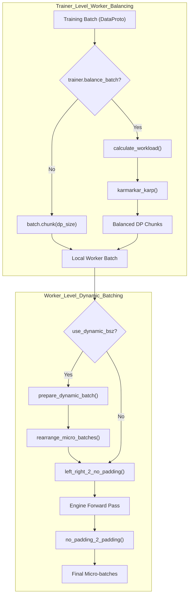
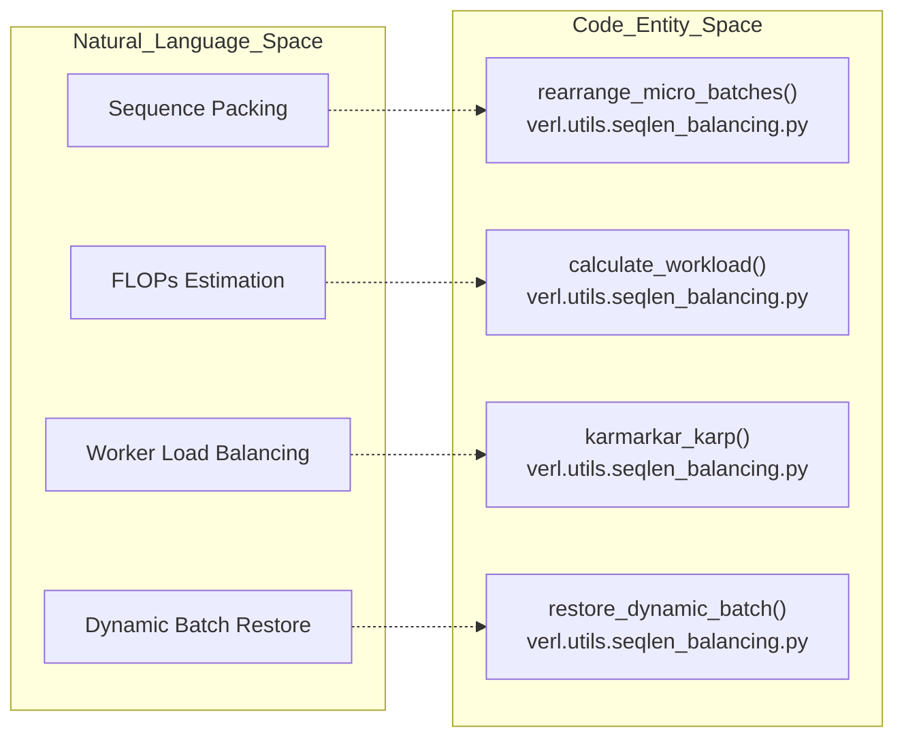
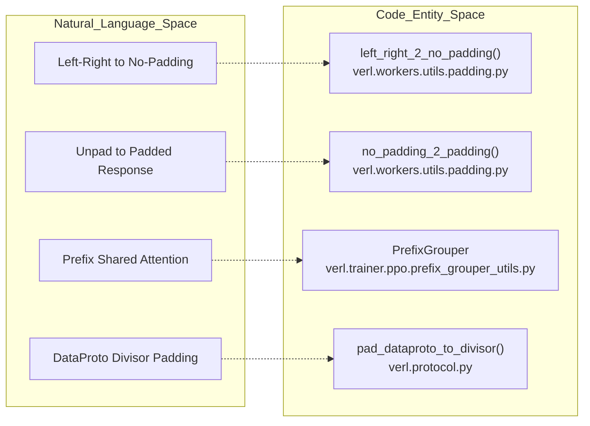

<!-- source: DeepWiki mcp.deepwiki.com · repo volcengine/verl · page 9.4 Sequence Balancing and Dynamic Batching · fetched 2026-10-21 -->

# Sequence Balancing and Dynamic Batching

Relevant source files

The following files were used as context for generating this wiki page:

- [examples/prefix_grouper/README.md](examples/prefix_grouper/README.md)
- [tests/models/test_fsdp_no_padding_on_gpu.py](tests/models/test_fsdp_no_padding_on_gpu.py)
- [tests/special_distributed/test_qwen35_linear_attention_ulysses_sp.py](tests/special_distributed/test_qwen35_linear_attention_ulysses_sp.py)
- [tests/utils/test_padding_on_cpu.py](tests/utils/test_padding_on_cpu.py)
- [tests/utils/test_prepare_micro_batches_with_group_size.py](tests/utils/test_prepare_micro_batches_with_group_size.py)
- [tests/utils/test_seqlen_balancing.py](tests/utils/test_seqlen_balancing.py)
- [verl/trainer/ppo/prefix_grouper_utils.py](verl/trainer/ppo/prefix_grouper_utils.py)
- [verl/utils/seqlen_balancing.py](verl/utils/seqlen_balancing.py)
- [verl/workers/utils/losses.py](verl/workers/utils/losses.py)
- [verl/workers/utils/padding.py](verl/workers/utils/padding.py)

## Purpose and Scope

This page documents verl's mechanisms for balancing computational workload across distributed workers and optimizing batch sizes based on sequence lengths. The system provides four complementary strategies:

1. **Worker-level sequence balancing**: Partitioning batches across data-parallel workers to equalize computational workload using heuristic algorithms [verl/utils/seqlen_balancing.py:27-46]().
2. **Micro-batch dynamic batching**: Adjusting micro-batch sizes within workers based on token count constraints to maximize throughput while preventing Out-of-Memory (OOM) errors [verl/utils/seqlen_balancing.py:215-306]().
3. **Padding and Unpadding Operations**: Converting between padded and non-padded (jagged/nested) tensor formats to optimize computation and memory usage [verl/workers/utils/padding.py:23-94]().
4. **Prefix Shared Attention Optimization**: Integrating `PrefixGrouper` to eliminate redundant prefix computations for algorithms like GRPO [verl/trainer/ppo/prefix_grouper_utils.py:51-148]().

Sources: [verl/utils/seqlen_balancing.py:27-46](), [verl/workers/utils/padding.py:23-94]()

---

## Overview of Sequence Management

The system implements multi-level sequence length management, bridging high-level data distribution and low-level engine execution.

**Diagram: Sequence Management and Batching Architecture**

Sources: [verl/utils/seqlen_balancing.py:27-46](), [verl/utils/seqlen_balancing.py:215-248](), [verl/utils/seqlen_balancing.py:251-306]()

---

## Worker-Level Sequence Balancing

### Workload Calculation
Verl estimates computational workload using a calibrated formula for Transformer attention. The `calculate_workload` function estimates relative FLOPs based on a 7B model profile [verl/utils/seqlen_balancing.py:27-45]().

**Formula**: $\text{Workload} \propto 24576 \times \text{seqlen} + \text{seqlen}^2$ [verl/utils/seqlen_balancing.py:46-46]()

### Partitioning Algorithms
The library provides two primary heuristics in `verl/utils/seqlen_balancing.py` to solve the multi-way number partitioning problem:

1. **Karmarkar-Karp (Largest Differencing Method)**: Produces near-optimal partitions by iteratively combining sets with the largest difference [verl/utils/seqlen_balancing.py:49-172](). It uses a `Set` class [verl/utils/seqlen_balancing.py:73-92](), a `State` class [verl/utils/seqlen_balancing.py:94-142](), and a priority queue to manage the spread between partitions [verl/utils/seqlen_balancing.py:158-163]().
2. **Greedy Partition**: A simpler strategy that assigns items to the partition with the smallest current sum [verl/utils/seqlen_balancing.py:175-212]().

Both functions support an `equal_size` flag, which forces partitions to have the same number of samples [verl/utils/seqlen_balancing.py:59-60]().

Sources: [verl/utils/seqlen_balancing.py:27-212]()

---

## Micro-Batch Dynamic Batching

### prepare_dynamic_batch
Within a training worker, the `prepare_dynamic_batch` utility determines how to split the local `DataProto` into micro-batches [verl/utils/seqlen_balancing.py:215-225](). It delegates to `rearrange_micro_batches` to execute packing logic and returns a list of micro-batches alongside index mappings for restoration [verl/utils/seqlen_balancing.py:238-248]().

### rearrange_micro_batches
This function optimizes throughput and memory safety by:
1. Extracting sequence lengths from the `attention_mask` [verl/utils/seqlen_balancing.py:255-257]().
2. Synchronizing sequence counts across DP ranks if `dp_group` is provided to prevent deadlocks [verl/utils/seqlen_balancing.py:261-276]().
3. Enforcing minimum micro-batch constraints for group-based algorithms [verl/utils/seqlen_balancing.py:278-285]().
4. Supporting `force_group_size` to ensure samples in the same group remain together [tests/utils/test_prepare_micro_batches_with_group_size.py:19-25]().
5. Greedily packing sequences until `max_token_len` is reached [verl/utils/seqlen_balancing.py:287-302]().

Sources: [verl/utils/seqlen_balancing.py:215-306](), [tests/utils/test_prepare_micro_batches_with_group_size.py:15-25]()

---

## Padding and Unpadding Operations

Verl removes padding tokens during forward passes using `NestedTensor` structures and restores them for loss computations.

### Conversion Functions
- **`left_right_2_no_padding`**: Converts a `TensorDict` from standard padding to a non-padded format [verl/workers/utils/padding.py:23-38]() by unpadding `input_ids` with `unpad_input` [verl/workers/utils/padding.py:44-56]().
- **`no_padding_2_padding`**: Slices response regions from unpadded model outputs back into a padded tensor of shape `[bsz, max_response_len, *]` [verl/workers/utils/padding.py:97-141]().
- **`build_attention_mask_from_nested`**: Constructs a full-sequence attention mask from nested `input_ids` [verl/workers/utils/padding.py:144-152]().

Sources: [verl/workers/utils/padding.py:23-152]()

---

## Prefix Shared Attention Optimization (PrefixGrouper)

For algorithms like GRPO where multiple responses share a single prompt, `PrefixGrouper` eliminates redundant prefix computations [examples/prefix_grouper/README.md:13-17]().

- **`build_pg_from_micro_batch`**: Identifies groups sharing the same `uid` and constructs the `PrefixGrouper` instance [verl/trainer/ppo/prefix_grouper_utils.py:51-101]().
- **`pg_forward`**: Executes the optimized forward pass, splitting outputs into prefix and suffix components [verl/trainer/ppo/prefix_grouper_utils.py:103-148]().
- **`build_position_ids_for_prefix_grouper`**: Manages position ID restarts so responses align with shared prefix lengths [verl/trainer/ppo/prefix_grouper_utils.py:23-43]().
- **`forward_micro_batch_with_prefix_grouper`**: Coordinates micro-batch execution under autocast and entropy calculation [verl/trainer/ppo/prefix_grouper_utils.py:150-215]().

Sources: [verl/trainer/ppo/prefix_grouper_utils.py:23-215]()

**Diagram: Natural Language Space to Code Entity Space (Sequence Management)**

Sources: [verl/utils/seqlen_balancing.py:27-172](), [verl/utils/seqlen_balancing.py:251-306]()

**Diagram: Natural Language Space to Code Entity Space (Padding & Grouping)**

Sources: [verl/protocol.py:74-99](), [verl/workers/utils/padding.py:23-141](), [verl/trainer/ppo/prefix_grouper_utils.py:51-101]()

---

## Summary of Key Functions

| Function / Class | Location | Purpose |
| :--- | :--- | :--- |
| `calculate_workload` | `verl/utils/seqlen_balancing.py` | Estimates Transformer FLOPs for balancing [verl/utils/seqlen_balancing.py:27-46](). |
| `karmarkar_karp` | `verl/utils/seqlen_balancing.py` | Heuristic for balanced sample partitioning using LDM [verl/utils/seqlen_balancing.py:49-172](). |
| `rearrange_micro_batches` | `verl/utils/seqlen_balancing.py` | Packs samples into micro-batches by token limit [verl/utils/seqlen_balancing.py:251-306](). |
| `left_right_2_no_padding` | `verl/workers/utils/padding.py` | Converts TensorDict to non-padded NestedTensor format [verl/workers/utils/padding.py:23-38](). |
| `no_padding_2_padding` | `verl/workers/utils/padding.py` | Slices response and restores padding for loss calc [verl/workers/utils/padding.py:97-141](). |
| `PrefixGrouper` | `prefix_grouper` | Decomposes attention into prefix and suffix paths [examples/prefix_grouper/README.md:13-17](). |
| `build_pg_from_micro_batch` | `verl/trainer/ppo/prefix_grouper_utils.py` | Initializes shared-prefix optimization [verl/trainer/ppo/prefix_grouper_utils.py:51-101](). |

Sources: [verl/utils/seqlen_balancing.py:27-306](), [verl/workers/utils/padding.py:23-141](), [verl/trainer/ppo/prefix_grouper_utils.py:51-101]()

---

