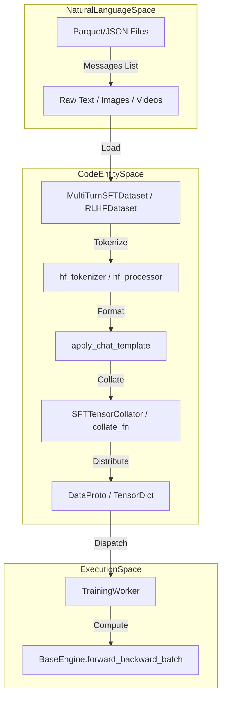
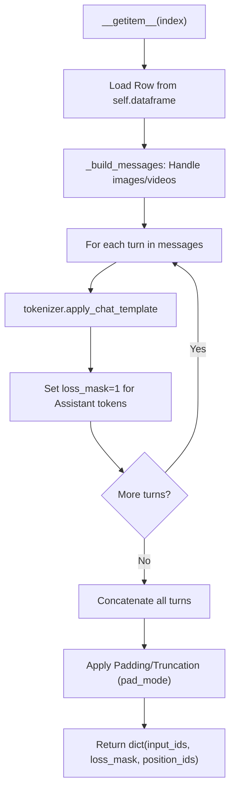
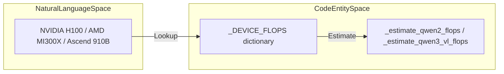

<!-- source: DeepWiki mcp.deepwiki.com · repo volcengine/verl · page 9.5 Custom Datasets and Extension · fetched 2026-10-21 -->

# Custom Datasets and Extension

Relevant source files

The following files were used as context for generating this wiki page:

- [.github/workflows/README.md](.github/workflows/README.md)
- [.github/workflows/e2e_ppo_trainer_veomni_vllm.yml](.github/workflows/e2e_ppo_trainer_veomni_vllm.yml)
- [.github/workflows/e2e_sft_llm.yml](.github/workflows/e2e_sft_llm.yml)
- [.github/workflows/e2e_sft_vlm.yml](.github/workflows/e2e_sft_vlm.yml)
- [examples/tpu/sft/README.md](examples/tpu/sft/README.md)
- [examples/tpu/sft/run_qwen3_0_6b_torchtitan.sh](examples/tpu/sft/run_qwen3_0_6b_torchtitan.sh)
- [tests/special_e2e/ppo_trainer/run_function_reward.sh](tests/special_e2e/ppo_trainer/run_function_reward.sh)
- [tests/special_e2e/run_ppo_trainer_veomni.sh](tests/special_e2e/run_ppo_trainer_veomni.sh)
- [tests/special_e2e/sft/run_sft_engine.sh](tests/special_e2e/sft/run_sft_engine.sh)
- [tests/special_e2e/sft/test_sft_engine_all.sh](tests/special_e2e/sft/test_sft_engine_all.sh)
- [tests/utils/dataset/test_multiturn_sft_dataset_on_cpu.py](tests/utils/dataset/test_multiturn_sft_dataset_on_cpu.py)
- [verl/trainer/config/sft_trainer_engine.yaml](verl/trainer/config/sft_trainer_engine.yaml)
- [verl/trainer/sft_trainer.py](verl/trainer/sft_trainer.py)
- [verl/trainer/sft_trainer_ray.py](verl/trainer/sft_trainer_ray.py)
- [verl/utils/checkpoint/__init__.py](verl/utils/checkpoint/__init__.py)
- [verl/utils/checkpoint/checkpoint_handler.py](verl/utils/checkpoint/checkpoint_handler.py)
- [verl/utils/dataset/multiturn_sft_dataset.py](verl/utils/dataset/multiturn_sft_dataset.py)

Purpose: Guide for implementing custom dataset classes, SFT datasets, reward model datasets, and registering them via configuration.

---

## Data Abstraction and Flow

In `verl`, data is encapsulated in `DataProto` or `TensorDict` objects as it moves between the controller and worker groups. For custom datasets, the primary requirement is to produce a dictionary of tensors (and optionally non-tensor metadata) that can be collated into these distributed structures.

### From Natural Language to Code Entities

The following diagram bridges the gap between raw data formats and the code entities responsible for processing them.

**Data Transformation Pipeline**

Sources: [`verl/utils/dataset/multiturn_sft_dataset.py:73-130`](), [`verl/trainer/sft_trainer_ray.py:148-171`]()

---

## Implementing Custom SFT Datasets

The `MultiTurnSFTDataset` serves as the reference implementation for multi-turn conversation training [verl/utils/dataset/multiturn_sft_dataset.py:73-83](). To implement a custom SFT dataset, your class should inherit from `torch.utils.data.Dataset` [verl/utils/dataset/multiturn_sft_dataset.py:73]() and return a dictionary containing specific keys required by the training engines.

### Key Components

1.  **Message Processing**: Converting raw conversation turns into token IDs using `tokenizer.apply_chat_template` [verl/utils/dataset/multiturn_sft_dataset.py:58-70]().
2.  **Loss Masking**: Identifying which tokens (typically assistant responses) should contribute to the gradient. `MultiTurnSFTDataset` sets `loss_mask=1` for assistant tokens and `0` otherwise [verl/utils/dataset/multiturn_sft_dataset.py:96-97]().
3.  **Multimodal Handling**: If using VLM models, processing images/videos into pixel values or patch features via `hf_processor` and `vision_utils` [verl/utils/dataset/multiturn_sft_dataset.py:105-108](), [verl/utils/dataset/vision_utils.py:22-36]().
4.  **Thinking Support**: For models like Qwen-Thinking, the dataset handles `<think>` tags and can enable/disable thinking tokens via configuration using `enable_thinking_key` [verl/utils/dataset/multiturn_sft_dataset.py:109-111](), [verl/trainer/config/sft_trainer_engine.yaml:28-29]().
5.  **Chat Template Logic**: The `apply_chat_template` utility handles edge cases, such as models requiring at least one user message, by prepending dummy messages and stripping them post-tokenization [verl/utils/tokenizer/chat_template.py:151-165]().

**SFT Dataset Logic**

Sources: [`verl/utils/dataset/multiturn_sft_dataset.py:165-175`](), [`verl/utils/dataset/multiturn_sft_dataset.py:85-127`](), [`verl/utils/dataset/multiturn_sft_dataset.py:58-70`](), [`verl/utils/tokenizer/chat_template.py:151-165`]()

---

## RLHF and PPO Datasets

The `RLHFDataset` is used for RL algorithms like PPO and GRPO. Unlike SFT datasets which provide full sequences with loss masks, RLHF datasets primarily focus on prompt preparation for the rollout engine.

### Implementation Details

*   **Prompt Tokenization**: Prompts are extracted via `prompt_key` and tokenized.
*   **Filtering**: Overlong prompts can be filtered using multiple workers to speed up dataset preparation via `filter_overlong_prompts_workers`.
*   **Multimodal Integration**: Support for images and videos is handled via `ProcessorMixin`.
*   **Tool Support**: Can initialize tool schemas from a config path to include in the dataset for agentic RL tasks using `load_all_tools`.
*   **Collation**: Uses a custom `collate_fn` that stacks tensors and converts non-tensor objects (like raw strings) into NumPy arrays of type `object`.

Sources: [`docs/preparation/prepare_data.rst:70-125`]()

---

## Engine Configuration and Custom Classes

Custom datasets can be registered via the Hydra configuration [verl/trainer/config/sft_trainer_engine.yaml:35-37](). Users can specify a `custom_cls` path to override the default loading behavior.

| Configuration Field | Description | Code Reference |
|---|---|---|
| `data.custom_cls.path` | Path to the Python file containing the custom dataset class. | [`verl/trainer/config/sft_trainer_engine.yaml:36-36`]() |
| `data.custom_cls.name` | The name of the class within the specified file. | [`verl/trainer/config/sft_trainer_engine.yaml:37-37`]() |
| `data.pad_mode` | Behavior of the collator (`right` or `no_padding`). | [`verl/trainer/config/sft_trainer_engine.yaml:30-30`]() |
| `data.use_dynamic_bsz` | Adjusts micro-batch sizes dynamically based on token counts. | [`verl/trainer/config/sft_trainer_engine.yaml:20-20`]() |
| `data.ignore_input_ids_mismatch` | Ignores mismatch between concatenated input_ids and whole-message template. | [`verl/trainer/config/sft_trainer_engine.yaml:47-47`]() |

Sources: [`verl/trainer/config/sft_trainer_engine.yaml:16-47`]()

---

## Checkpointing and Data Persistence

When extending datasets, it is crucial to handle state persistence to allow training to resume correctly. The `CheckpointHandler` manages this by saving the state of the `StatefulDataLoader` [verl/trainer/sft_trainer.py:70-98]().

*   **Dataloader State**: The handler saves the dataloader state to ensure data consumption resumes correctly [verl/utils/checkpoint/checkpoint_handler.py:121-125]().
*   **Resuming**: During initialization, the `load_checkpoint` method restores the global step and dataloader state [verl/utils/checkpoint/checkpoint_handler.py:143-168]().
*   **Metadata**: For LoRA training, metadata including rank and alpha is also persisted alongside the dataset state [verl/utils/checkpoint/checkpoint_handler.py:109-114]().

Sources: [`verl/utils/checkpoint/checkpoint_handler.py:49-177`](), [`verl/trainer/sft_trainer.py:82-98`]()

---

## Performance Monitoring: FLOPS Counter

When extending datasets, it is often necessary to track computational efficiency. The `FlopsCounter` provides utilities to estimate theoretical FLOPS for various architectures based on sequence lengths and token counts provided by the datasets.

### Hardware and Model Metrics

The `verl/utils/flops_counter.py` file maps specific hardware identifiers to their theoretical peak performance in the `_DEVICE_FLOPS` dictionary [verl/utils/flops_counter.py:22-44]().

**Hardware to Code Mapping**

Sources: [`verl/utils/flops_counter.py:22-44`]()

*   **Device Capacity**: Retrieves theoretical FLOPS for hardware like H100, A100, or Ascend 910B [verl/utils/flops_counter.py:22-44]().
*   **Model-Specific Estimation**: Includes logic for dense models (Qwen2) and MoE architectures (Qwen3-MoE, DeepSeek-V3) [verl/utils/flops_counter.py:92-124](), [verl/utils/flops_counter.py:171-200]().

Sources: [`verl/utils/flops_counter.py:1-200`]()

---

## Testing and Validation

The framework provides comprehensive tests for dataset implementations:
1.  **Multi-turn SFT**: Verifies that assistant responses are correctly masked and position IDs are handled for different padding modes [tests/utils/dataset/test_multiturn_sft_dataset_on_cpu.py:88-168]().
2.  **Engine Consistency**: End-to-end scripts test datasets across multiple backends (FSDP, Megatron, VeOmni) to ensure consistency in loss computation and data handling [docs/advance/fsdp_extension.rst:103-109](), [docs/advance/megatron_extension.rst:10-12]().

Sources: [`tests/utils/dataset/test_multiturn_sft_dataset_on_cpu.py:47-162`](), [`docs/advance/fsdp_extension.rst:103-109`](), [`docs/advance/megatron_extension.rst:10-12`]()

---

