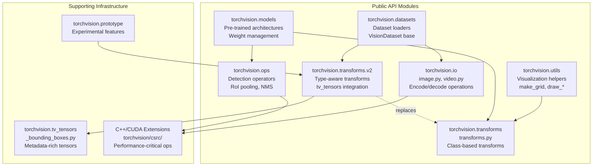
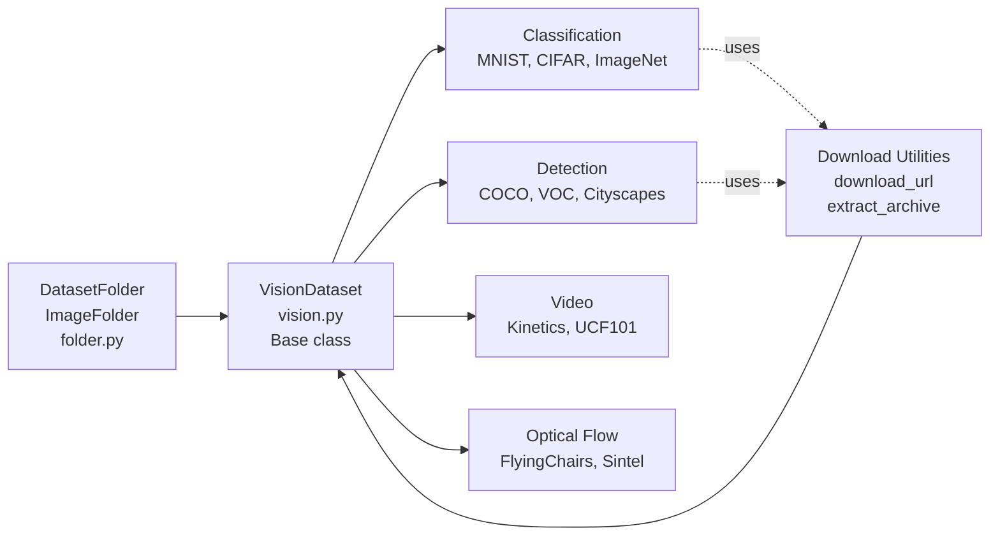
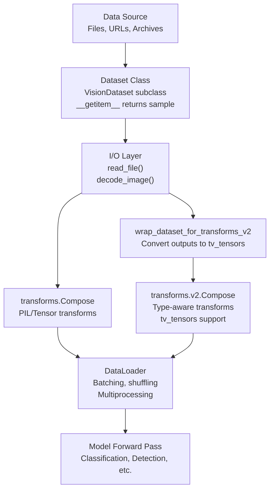
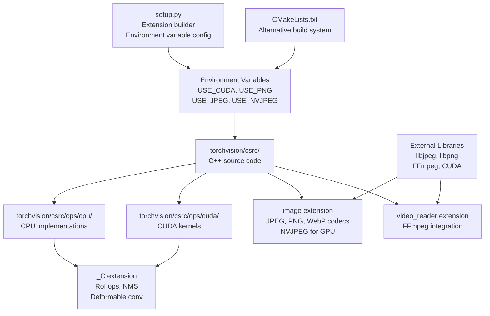
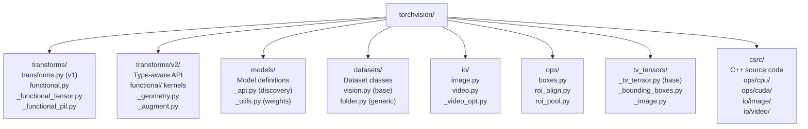

<!-- source: DeepWiki mcp.deepwiki.com · repo pytorch/vision · page 1 Overview · fetched 2026-10-21 -->

# Overview

<details>
<summary>Relevant source files</summary>

The following files were used as context for generating this wiki page:

- [CMakeLists.txt](CMakeLists.txt)
- [docs/source/datasets.rst](docs/source/datasets.rst)
- [docs/source/io.rst](docs/source/io.rst)
- [docs/source/models.rst](docs/source/models.rst)
- [hubconf.py](hubconf.py)
- [references/classification/README.md](references/classification/README.md)
- [setup.py](setup.py)
- [test/assets/fakedata/draw_rotated_boxes.png](test/assets/fakedata/draw_rotated_boxes.png)
- [test/common_extended_utils.py](test/common_extended_utils.py)
- [test/common_utils.py](test/common_utils.py)
- [test/datasets_utils.py](test/datasets_utils.py)
- [test/expect/ModelTester.test_vit_h_14_expect.pkl](test/expect/ModelTester.test_vit_h_14_expect.pkl)
- [test/test_datasets.py](test/test_datasets.py)
- [test/test_extended_models.py](test/test_extended_models.py)
- [test/test_functional_tensor.py](test/test_functional_tensor.py)
- [test/test_image.py](test/test_image.py)
- [test/test_models.py](test/test_models.py)
- [test/test_transforms.py](test/test_transforms.py)
- [test/test_transforms_tensor.py](test/test_transforms_tensor.py)
- [test/test_transforms_v2.py](test/test_transforms_v2.py)
- [test/test_transforms_v2_utils.py](test/test_transforms_v2_utils.py)
- [test/test_tv_tensors.py](test/test_tv_tensors.py)
- [torchvision/csrc/io/image/cpu/decode_image.cpp](torchvision/csrc/io/image/cpu/decode_image.cpp)
- [torchvision/csrc/io/image/image.cpp](torchvision/csrc/io/image/image.cpp)
- [torchvision/csrc/io/image/image.h](torchvision/csrc/io/image/image.h)
- [torchvision/datasets/__init__.py](torchvision/datasets/__init__.py)
- [torchvision/datasets/_optical_flow.py](torchvision/datasets/_optical_flow.py)
- [torchvision/datasets/_stereo_matching.py](torchvision/datasets/_stereo_matching.py)
- [torchvision/datasets/inaturalist.py](torchvision/datasets/inaturalist.py)
- [torchvision/datasets/places365.py](torchvision/datasets/places365.py)
- [torchvision/io/__init__.py](torchvision/io/__init__.py)
- [torchvision/io/image.py](torchvision/io/image.py)
- [torchvision/models/__init__.py](torchvision/models/__init__.py)
- [torchvision/models/_api.py](torchvision/models/_api.py)
- [torchvision/ops/_box_convert.py](torchvision/ops/_box_convert.py)
- [torchvision/transforms/autoaugment.py](torchvision/transforms/autoaugment.py)
- [torchvision/transforms/functional.py](torchvision/transforms/functional.py)
- [torchvision/transforms/transforms.py](torchvision/transforms/transforms.py)
- [torchvision/transforms/v2/_geometry.py](torchvision/transforms/v2/_geometry.py)
- [torchvision/transforms/v2/functional/_geometry.py](torchvision/transforms/v2/functional/_geometry.py)
- [torchvision/transforms/v2/functional/_meta.py](torchvision/transforms/v2/functional/_meta.py)
- [torchvision/transforms/v2/functional/_utils.py](torchvision/transforms/v2/functional/_utils.py)
- [torchvision/tv_tensors/__init__.py](torchvision/tv_tensors/__init__.py)
- [torchvision/tv_tensors/_bounding_boxes.py](torchvision/tv_tensors/_bounding_boxes.py)

</details>


TorchVision is a computer vision library for PyTorch that provides fundamental building blocks for image and video processing tasks. This document covers the library's architecture, major components, and how they integrate to support computer vision workflows.

**Scope**: This page introduces TorchVision's overall structure and component interactions. For detailed information on specific subsystems, see:
- Image and video transformations: [Transforms](#2)
- Pre-trained neural network architectures: [Models](#3)
- Dataset loaders and utilities: [Datasets](#4)
- Image/video reading and writing: [I/O Operations](#5)
- Computer vision operators: [Operators](#6)

## Purpose and Design

TorchVision provides three primary capabilities:

1. **Data Processing**: Transform and augment images/videos for training and inference
2. **Pre-trained Models**: Access to state-of-the-art architectures with standardized weight management
3. **Dataset Integration**: Loaders for standard computer vision datasets with built-in downloading and preprocessing

The library is designed around PyTorch's tensor operations and integrates seamlessly with `torch.utils.data.DataLoader` for efficient data loading pipelines.

Sources: [torchvision/transforms/transforms.py:1-57](), [torchvision/models/__init__.py:1-14](), [torchvision/datasets/__init__.py:1-148]()

## Core Architecture



**Core Architecture Diagram**: Shows the seven main public modules and their relationships. Solid arrows indicate dependencies; dashed arrows indicate evolutionary relationships.

Sources: [torchvision/transforms/transforms.py:1-60](), [torchvision/transforms/v2/__init__.py](), [torchvision/models/__init__.py:1-14](), [torchvision/datasets/__init__.py:1-148](), [torchvision/io/__init__.py:1-58](), [torchvision/ops/__init__.py]()

## Module Overview

### Transform System

The transform system provides data augmentation and preprocessing capabilities through two APIs:

| Component | Module Path | Purpose |
|-----------|-------------|---------|
| **v1 Transforms** | `torchvision.transforms` | Legacy PIL/Tensor transforms with type dispatch |
| **v2 Transforms** | `torchvision.transforms.v2` | Type-aware transforms with kernel registry |
| **Functional API** | `torchvision.transforms.functional` | Stateless transform functions |
| **TV Tensors** | `torchvision.tv_tensors` | Metadata-preserving tensor subclasses |

**Key Classes**:
- `Compose`: Sequential transform application [torchvision/transforms/transforms.py:60-104]()
- `RandomHorizontalFlip`, `Resize`, `Normalize`: Common v1 transforms [torchvision/transforms/transforms.py:697-757]()
- Transform v2 variants with type awareness [torchvision/transforms/v2/_geometry.py]()

Sources: [torchvision/transforms/transforms.py:1-104](), [torchvision/transforms/functional.py:1-51](), [torchvision/tv_tensors/_tv_tensor.py]()

### Models System

Pre-trained model architectures organized by task:

| Task Category | Module | Example Models |
|---------------|--------|----------------|
| Classification | `torchvision.models` | ResNet, VGG, EfficientNet, ViT |
| Detection | `torchvision.models.detection` | Faster R-CNN, RetinaNet, FCOS |
| Segmentation | `torchvision.models.segmentation` | FCN, DeepLabV3, LRASPP |
| Video | `torchvision.models.video` | R3D, MC3, MViT |
| Optical Flow | `torchvision.models.optical_flow` | RAFT |

**Weight Management**: Each model has a `WeightsEnum` class (e.g., `ResNet50_Weights`) containing versioned weight sets with metadata including accuracy metrics, preprocessing transforms, and training details.

Sources: [torchvision/models/__init__.py:1-14](), [torchvision/models/_api.py:1-100](), [hubconf.py:1-50]()

### Datasets System

Built-in dataset loaders with automatic downloading:



**Dataset Base Class**: All datasets inherit from `VisionDataset` which provides standard `__getitem__` and `__len__` interfaces compatible with PyTorch's DataLoader.

Sources: [torchvision/datasets/__init__.py:1-148](), [torchvision/datasets/vision.py](), [torchvision/datasets/folder.py]()

### I/O Operations

Efficient image and video encoding/decoding through C++ extensions:

**Image I/O Functions**:
- `read_image(path)`: Read and decode image files [torchvision/io/image.py:52-300]()
- `decode_jpeg(data, mode)`: JPEG decoding with CPU/CUDA support
- `decode_png(data, mode)`: PNG decoding
- `encode_jpeg(input, quality)`: JPEG encoding
- Format auto-detection via `decode_image(data)`

**Video I/O**: Functions for reading/writing video files (deprecated in favor of TorchCodec).

Sources: [torchvision/io/image.py:1-300](), [torchvision/io/__init__.py:1-58](), [torchvision/io/video.py]()

### Operators

Computer vision operations optimized with C++/CUDA:

**Detection Operators**:
- `nms`, `batched_nms`: Non-maximum suppression
- `roi_align`, `roi_pool`: Region of interest pooling
- `MultiScaleRoIAlign`: Multi-scale feature extraction

**Box Operations**:
- `box_iou`, `box_convert`: Bounding box utilities
- `clip_boxes`, `remove_small_boxes`: Box filtering
- `BoxCoder`: Encode/decode box deltas

**Layer Components**:
- `FrozenBatchNorm2d`: Batch normalization with frozen statistics
- `DeformConv2d`: Deformable convolutions
- `SqueezeExcitation`: Channel attention mechanism

Sources: [torchvision/ops/__init__.py](), [torchvision/ops/boxes.py](), [torchvision/ops/roi_align.py]()

## Data Pipeline Flow



**Typical Usage Pattern**:

1. **Dataset Instantiation**: Create dataset with `root` directory and optional `download=True`
2. **Transform Application**: Apply preprocessing via `transform` parameter
3. **DataLoader Integration**: Wrap in `DataLoader` for batching and parallel loading
4. **Model Inference/Training**: Pass batched data to model

Sources: [torchvision/datasets/vision.py](), [torchvision/tv_tensors/_dataset_wrapper.py](), [test/test_datasets.py:1-50]()

## Build System and Extensions

TorchVision includes C++/CUDA extensions for performance-critical operations:



**Build Configuration**:

| Environment Variable | Default | Purpose |
|---------------------|---------|---------|
| `USE_CUDA` | Auto-detect | Enable CUDA operations |
| `USE_PNG` | `1` | Enable PNG codec support |
| `USE_JPEG` | `1` | Enable JPEG codec support |
| `USE_NVJPEG` | `1` | Enable NVJPEG GPU decoder |
| `FORCE_CUDA` | `0` | Force CUDA build |

**Extension Modules**:
- `torchvision._C`: Core operators (NMS, RoI operations) [setup.py:158-203]()
- `torchvision.image`: Image codecs with optional GPU support [setup.py:288-374]()
- `torchvision.video_reader`: CPU video decoder (FFmpeg-based) [setup.py:436-476]()

Sources: [setup.py:1-550](), [CMakeLists.txt:1-100](), [torchvision/csrc/]()

## Integration with PyTorch Ecosystem

### DataLoader Integration

TorchVision datasets implement `torch.utils.data.Dataset` interface:

```python
# All datasets provide __len__ and __getitem__
dataset = torchvision.datasets.CIFAR10(root='./data', train=True, download=True, transform=transform)
loader = torch.utils.data.DataLoader(dataset, batch_size=32, shuffle=True, num_workers=4)
```

Sources: [torchvision/datasets/vision.py](), [test/test_datasets.py:14-30]()

### TorchScript Compatibility

Most transforms and models support TorchScript compilation:

```python
# Transforms can be scripted
scripted_transform = torch.jit.script(transforms.Normalize(mean=[0.5], std=[0.5]))

# Models support scripting and tracing
model = torchvision.models.resnet50(weights=ResNet50_Weights.DEFAULT)
scripted_model = torch.jit.script(model)
```

Sources: [test/test_models.py:158-190](), [test/test_transforms.py:44-53]()

### ONNX Export Support

Detection models include custom ONNX symbolic functions for export compatibility:

- Custom operators registered via `_register_onnx_ops` mechanism
- Symbolic functions for `nms`, `roi_align`, `roi_pool` operations
- Model-specific export handling in detection module

Sources: [torchvision/onnx/](), test files referencing ONNX export

## File Organization



**Key Implementation Files**:

| File | Purpose | Lines of Code |
|------|---------|---------------|
| `transforms/transforms.py` | v1 transform classes | ~1500 |
| `transforms/functional.py` | Transform functional API | ~1200 |
| `transforms/v2/functional/_geometry.py` | v2 geometry kernels | ~2500 |
| `models/_api.py` | Model discovery/registration | ~300 |
| `io/image.py` | Image I/O interface | ~300 |
| `ops/boxes.py` | Bounding box operations | ~500 |
| `csrc/ops/` | C++/CUDA implementations | ~10000+ |

Sources: [torchvision/transforms/transforms.py:1-1500](), [torchvision/transforms/functional.py:1-1200](), [torchvision/models/_api.py:1-300]()

## Testing Infrastructure

TorchVision includes comprehensive testing with specialized utilities:

- **Transform Testing**: Cross-backend validation (PIL vs Tensor), gradient checks, scriptability
- **Model Testing**: Forward pass validation, TorchScript compatibility, FX tracing
- **Dataset Testing**: Fake data injection, integrity checking, v2 wrapper validation
- **Ops Testing**: CPU vs CUDA consistency, deterministic algorithms, gradient checks

**Test Utilities**: `common_utils.py` provides fixtures for device parametrization, RNG state management, and assertion helpers.

Sources: [test/common_utils.py:1-400](), [test/datasets_utils.py:1-200](), [test/test_transforms_v2.py:1-100]()

---

