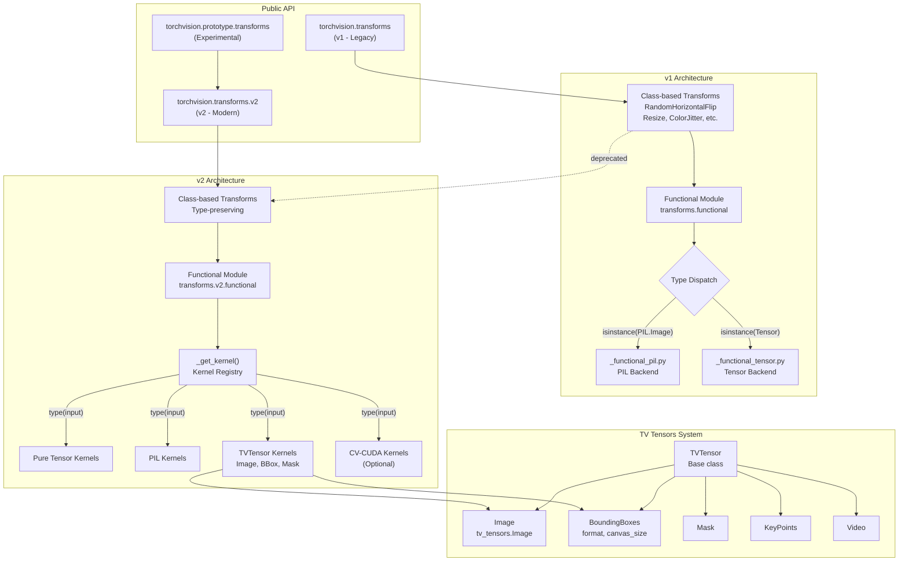
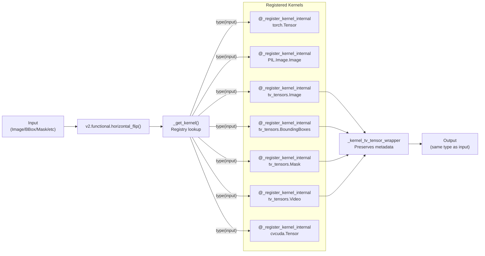
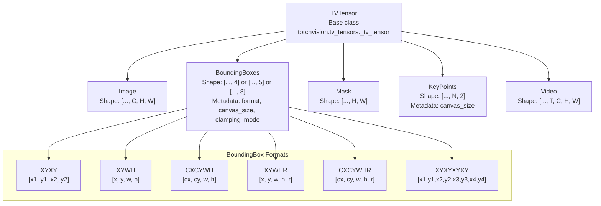
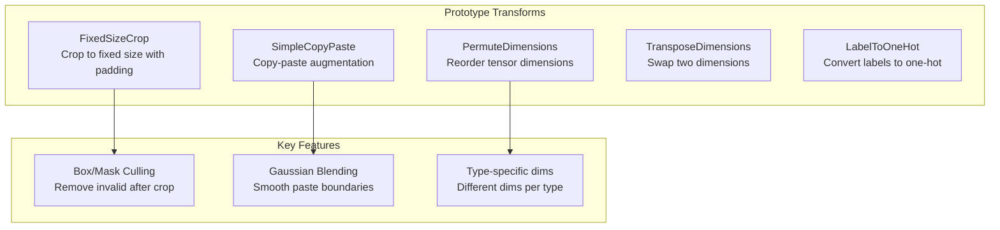
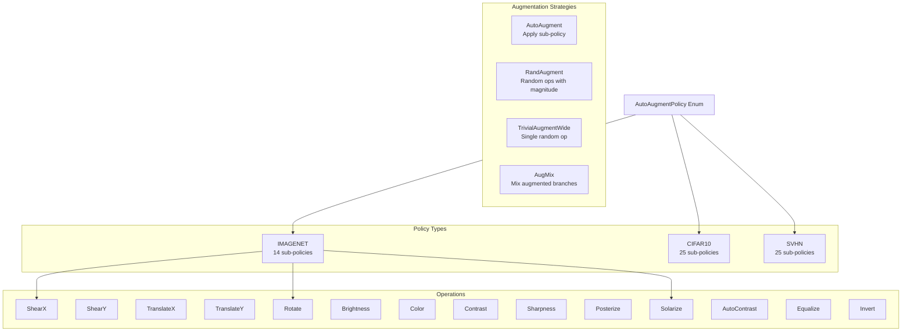

<!-- source: DeepWiki mcp.deepwiki.com · repo pytorch/vision · page 2 Transforms · fetched 2026-10-21 -->

# Transforms

<details>
<summary>Relevant source files</summary>

The following files were used as context for generating this wiki page:

- [test/assets/fakedata/draw_rotated_boxes.png](test/assets/fakedata/draw_rotated_boxes.png)
- [test/common_utils.py](test/common_utils.py)
- [test/test_functional_tensor.py](test/test_functional_tensor.py)
- [test/test_prototype_transforms.py](test/test_prototype_transforms.py)
- [test/test_transforms.py](test/test_transforms.py)
- [test/test_transforms_tensor.py](test/test_transforms_tensor.py)
- [test/test_transforms_v2.py](test/test_transforms_v2.py)
- [test/test_transforms_v2_utils.py](test/test_transforms_v2_utils.py)
- [test/test_tv_tensors.py](test/test_tv_tensors.py)
- [torchvision/ops/_box_convert.py](torchvision/ops/_box_convert.py)
- [torchvision/prototype/transforms/__init__.py](torchvision/prototype/transforms/__init__.py)
- [torchvision/prototype/transforms/_augment.py](torchvision/prototype/transforms/_augment.py)
- [torchvision/prototype/transforms/_geometry.py](torchvision/prototype/transforms/_geometry.py)
- [torchvision/prototype/transforms/_misc.py](torchvision/prototype/transforms/_misc.py)
- [torchvision/transforms/autoaugment.py](torchvision/transforms/autoaugment.py)
- [torchvision/transforms/functional.py](torchvision/transforms/functional.py)
- [torchvision/transforms/transforms.py](torchvision/transforms/transforms.py)
- [torchvision/transforms/v2/_geometry.py](torchvision/transforms/v2/_geometry.py)
- [torchvision/transforms/v2/functional/_geometry.py](torchvision/transforms/v2/functional/_geometry.py)
- [torchvision/transforms/v2/functional/_meta.py](torchvision/transforms/v2/functional/_meta.py)
- [torchvision/transforms/v2/functional/_utils.py](torchvision/transforms/v2/functional/_utils.py)
- [torchvision/tv_tensors/__init__.py](torchvision/tv_tensors/__init__.py)
- [torchvision/tv_tensors/_bounding_boxes.py](torchvision/tv_tensors/_bounding_boxes.py)

</details>


## Purpose and Scope

The Transforms system provides image augmentation and preprocessing operations for computer vision tasks. This page covers the architecture and APIs for applying transformations to images, videos, bounding boxes, masks, and other vision data types. 

For information about pre-trained model architectures, see [Models](#3). For dataset loading and integration with transforms, see [Datasets](#4). For prototype/experimental features, see [Prototype Transforms](#2.3).

The system has evolved through two major API versions:
- **v1 (Legacy)**: Simple class-based and functional APIs with PIL/Tensor backend dispatch
- **v2 (Modern)**: Type-aware transformations with kernel registry and metadata preservation via `tv_tensors`

## System Architecture

The transforms system consists of three primary components: the v1 legacy API, the v2 modern API with kernel dispatch, and the tv_tensors metadata system.



**Sources:** [torchvision/transforms/transforms.py:1-2500](), [torchvision/transforms/functional.py:1-1500](), [torchvision/transforms/v2/functional/_geometry.py:1-200](), [torchvision/transforms/v2/functional/_utils.py:1-200]()

## Core Transform Classes

The transforms module provides both class-based and functional interfaces. The class-based transforms are stateful and can be composed together, while functional transforms are stateless operations.

### Class-Based Transform Hierarchy

```mermaid
graph TB
    TRANSFORM["Transform<br/>(v2 base class)"]
    TORCH_MODULE["torch.nn.Module<br/>(v1 base class)"]
    
    subgraph "Geometric Transforms"
        RESIZE["Resize"]
        CROP["RandomCrop"]
        HFLIP["RandomHorizontalFlip"]
        VFLIP["RandomVerticalFlip"]
        ROTATE["RandomRotation"]
        AFFINE["RandomAffine"]
        PERSPECTIVE["RandomPerspective"]
    end
    
    subgraph "Color Transforms"
        JITTER["ColorJitter"]
        GRAYSCALE["RandomGrayscale"]
        POSTERIZE["RandomPosterize"]
        SOLARIZE["RandomSolarize"]
        AUTOCONTRAST["RandomAutocontrast"]
        EQUALIZE["RandomEqualize"]
    end
    
    subgraph "Augmentation Policies"
        AUTOAUGMENT["AutoAugment"]
        RANDAUGMENT["RandAugment"]
        TRIVIALAUGMENT["TrivialAugmentWide"]
        AUGMIX["AugMix"]
    end
    
    subgraph "Utility Transforms"
        COMPOSE["Compose"]
        TOTENSOR["ToTensor"]
        PILTOTENSOR["PILToTensor"]
        NORMALIZE["Normalize"]
        CONVERT_DTYPE["ConvertImageDtype"]
    end
    
    TRANSFORM --> RESIZE
    TRANSFORM --> CROP
    TRANSFORM --> HFLIP
    TRANSFORM --> VFLIP
    
    TORCH_MODULE --> JITTER
    TORCH_MODULE --> NORMALIZE
    
    AUTOAUGMENT --> RANDAUGMENT
```



**Sources:** [torchvision/transforms/transforms.py:60-1500](), [torchvision/transforms/v2/_geometry.py:1-2000](), [torchvision/transforms/autoaugment.py:1-600]()

## Transform v1 (Legacy API)

### Dispatch Mechanism

The v1 API uses a simple type-based dispatch to route operations to either PIL or tensor implementations:

| Input Type | Dispatch Target | Implementation File |
|------------|-----------------|---------------------|
| `PIL.Image.Image` | PIL backend | `_functional_pil.py` |
| `torch.Tensor` | Tensor backend | `_functional_tensor.py` |
| `accimage.Image` | AccImage backend | Special handling in functional |

The dispatch logic occurs in [torchvision/transforms/functional.py:66-480](), where functions like `resize()`, `crop()`, and `pad()` check the input type and call the appropriate backend:

```python
def resize(img, size, interpolation, max_size, antialias):
    if not isinstance(img, torch.Tensor):
        # PIL path
        return F_pil.resize(img, size=output_size, interpolation=pil_interpolation)
    # Tensor path
    return F_t.resize(img, size=output_size, interpolation=interpolation.value, antialias=antialias)
```

**Sources:** [torchvision/transforms/functional.py:387-480](), [torchvision/transforms/_functional_pil.py:1-500](), [torchvision/transforms/_functional_tensor.py:1-1000]()

### Common v1 Transforms

The following table lists key v1 transform classes:

| Transform Class | Purpose | Key Parameters | Functional Equivalent |
|----------------|---------|----------------|----------------------|
| `ToTensor` | Convert PIL/ndarray to float tensor [0,1] | None | `F.to_tensor()` |
| `PILToTensor` | Convert PIL to tensor (no scaling) | None | `F.pil_to_tensor()` |
| `ToPILImage` | Convert tensor/ndarray to PIL | `mode` | `F.to_pil_image()` |
| `Normalize` | Normalize with mean/std | `mean`, `std`, `inplace` | `F.normalize()` |
| `Resize` | Resize to given size | `size`, `interpolation`, `max_size`, `antialias` | `F.resize()` |
| `CenterCrop` | Crop at center | `size` | `F.center_crop()` |
| `RandomCrop` | Random crop | `size`, `padding`, `pad_if_needed` | `F.crop()` |
| `RandomHorizontalFlip` | Random horizontal flip | `p` | `F.hflip()` |
| `RandomVerticalFlip` | Random vertical flip | `p` | `F.vflip()` |
| `ColorJitter` | Random brightness, contrast, saturation, hue | `brightness`, `contrast`, `saturation`, `hue` | Multiple functionals |
| `RandomRotation` | Random rotation | `degrees`, `interpolation`, `expand`, `center`, `fill` | `F.rotate()` |
| `RandomAffine` | Random affine transformation | `degrees`, `translate`, `scale`, `shear` | `F.affine()` |
| `Compose` | Compose transforms sequentially | `transforms` | N/A |
| `Lambda` | Apply custom function | `lambd` | N/A |

**Sources:** [torchvision/transforms/transforms.py:60-1500]()

## Transform v2 (Modern API)

The v2 API introduces a sophisticated kernel registry system that enables type-aware transformations and metadata preservation.

### Kernel Registry Architecture



The kernel registration mechanism in [torchvision/transforms/v2/functional/_utils.py:16-60]() works as follows:

1. **Registration**: Kernels are registered using the `@_register_kernel_internal()` decorator
2. **Lookup**: `_get_kernel(functional, type(input))` retrieves the appropriate kernel
3. **Wrapping**: TV tensor kernels are wrapped to preserve metadata via `_kernel_tv_tensor_wrapper()`
4. **Dispatch**: The kernel is called with the input converted to a pure tensor

**Sources:** [torchvision/transforms/v2/functional/_utils.py:1-150](), [torchvision/transforms/v2/functional/_geometry.py:54-150]()

### Transform v2 vs v1 Comparison

| Aspect | v1 (Legacy) | v2 (Modern) |
|--------|-------------|-------------|
| Input types | PIL, Tensor | PIL, Tensor, tv_tensors |
| Type preservation | No | Yes (via `tv_tensors.wrap()`) |
| Metadata handling | Lost | Preserved (format, canvas_size, etc.) |
| Kernel dispatch | Simple isinstance check | Registry with MRO lookup |
| Bounding box support | No native support | Full support with format conversion |
| Video support | Limited | First-class support |
| Extensibility | Hard to extend | Easy via kernel registration |
| TorchScript support | Partial | Enhanced |
| Backend options | PIL, Tensor | PIL, Tensor, CV-CUDA |

**Sources:** [torchvision/transforms/functional.py:387-600](), [torchvision/transforms/v2/functional/_geometry.py:54-200]()

### Key v2 Functionals by Category

**Geometric Transformations:**
- `horizontal_flip()` - [torchvision/transforms/v2/functional/_geometry.py:54-148]()
- `vertical_flip()` - [torchvision/transforms/v2/functional/_geometry.py:150-200]()
- `resize()` - [torchvision/transforms/v2/functional/_geometry.py:200-500]()
- `rotate()` - [torchvision/transforms/v2/functional/_geometry.py:500-800]()
- `affine()` - [torchvision/transforms/v2/functional/_geometry.py:800-1200]()
- `perspective()` - [torchvision/transforms/v2/functional/_geometry.py:1200-1500]()
- `crop()` - Crop operations
- `pad()` - Padding operations

**Metadata Operations:**
- `get_dimensions()` - [torchvision/transforms/v2/functional/_meta.py:22-52]()
- `get_size()` - [torchvision/transforms/v2/functional/_meta.py:90-130]()
- `get_num_channels()` - [torchvision/transforms/v2/functional/_meta.py:54-88]()
- `convert_bounding_box_format()` - Format conversion
- `clamp_bounding_boxes()` - Clamp to canvas

**Sources:** [torchvision/transforms/v2/functional/_geometry.py:1-2000](), [torchvision/transforms/v2/functional/_meta.py:1-400]()

## TV Tensors System

TV Tensors are metadata-rich tensor subclasses that preserve semantic information through transformations.

### TVTensor Hierarchy



### BoundingBoxes Metadata

The `BoundingBoxes` class stores critical metadata:

| Attribute | Type | Purpose | Example |
|-----------|------|---------|---------|
| `format` | `BoundingBoxFormat` | Coordinate format | `BoundingBoxFormat.XYXY` |
| `canvas_size` | `tuple[int, int]` | Image dimensions (H, W) | `(480, 640)` |
| `clamping_mode` | `str` or `None` | How to handle out-of-bounds | `"soft"`, `"hard"`, `None` |

Format conversions are handled by `convert_bounding_box_format()` which understands all six formats defined in [torchvision/tv_tensors/_bounding_boxes.py:14-56]():

- `XYXY`: Top-left and bottom-right corners
- `XYWH`: Top-left corner, width, height
- `CXCYWH`: Center, width, height
- `XYWHR`: Top-left corner, width, height, rotation angle (degrees)
- `CXCYWHR`: Center, width, height, rotation angle (degrees)
- `XYXYXYXY`: Four corners (for rotated boxes)

**Sources:** [torchvision/tv_tensors/_bounding_boxes.py:1-200](), [torchvision/tv_tensors/_tv_tensor.py:1-300](), [torchvision/tv_tensors/__init__.py:1-50]()

### Metadata Preservation Pattern

The `tv_tensors.wrap()` function preserves metadata through transformations:

```python
# In kernel implementation
def horizontal_flip_bounding_boxes_dispatch(inpt: tv_tensors.BoundingBoxes):
    output = horizontal_flip_bounding_boxes(
        inpt.as_subclass(torch.Tensor),  # Convert to pure tensor
        format=inpt.format,               # Extract metadata
        canvas_size=inpt.canvas_size
    )
    return tv_tensors.wrap(output, like=inpt)  # Restore metadata
```

This pattern is used throughout [torchvision/transforms/v2/functional/_geometry.py:96-143]().

**Sources:** [torchvision/tv_tensors/__init__.py:16-50](), [torchvision/transforms/v2/functional/_utils.py:20-36]()

## Prototype Transforms

Experimental transforms are located in `torchvision.prototype.transforms` and provide advanced functionality not yet stabilized in the main API.

### Prototype Transform Catalog



### FixedSizeCrop

Located in [torchvision/prototype/transforms/_geometry.py:22-136](), `FixedSizeCrop` crops images to a fixed size and handles undersized images by padding:

**Key Features:**
- Crops to `(crop_height, crop_width)` if image is larger
- Pads with `padding_mode` if image is smaller
- Automatically culls invalid bounding boxes (width or height ≤ 0)
- Preserves labels/masks for valid boxes only

**Validity Check:** After cropping, boxes are checked via format conversion to XYWH and testing if `height_and_width > 0` ([lines 88-93]()).

### SimpleCopyPaste

Located in [torchvision/prototype/transforms/_augment.py:15-160](), this implements copy-paste augmentation for object detection:

**Algorithm:**
1. Extract images and targets (boxes, masks, labels) from batch
2. Randomly select objects from paste image
3. Resize if source and paste have different sizes
4. Create alpha mask from paste masks (with optional Gaussian blur)
5. Blend images: `output = image * (1 - alpha) + paste_image * alpha`
6. Merge masks, boxes, and labels
7. Remove degenerate boxes

**Sources:** [torchvision/prototype/transforms/_augment.py:1-160](), [torchvision/prototype/transforms/_geometry.py:1-136](), [torchvision/prototype/transforms/_misc.py:1-70]()

## AutoAugment Policies

AutoAugment and related policies provide learned augmentation strategies.

### Policy Architecture



### Operation Implementation

All operations are dispatched through `_apply_op()` in [torchvision/transforms/autoaugment.py:13-150]():

| Operation | Implementation | Parameters |
|-----------|---------------|------------|
| ShearX/Y | `F.affine()` with shear | `magnitude` → arctan(magnitude) |
| TranslateX/Y | `F.affine()` with translate | `magnitude` in pixels |
| Rotate | `F.affine()` with angle | `magnitude` in degrees |
| Brightness | `F.adjust_brightness()` | `magnitude` as factor |
| Color | `F.adjust_saturation()` | `magnitude` as factor |
| Contrast | `F.adjust_contrast()` | `magnitude` as factor |
| Sharpness | `F.adjust_sharpness()` | `magnitude` as factor |
| Posterize | `F.posterize()` | `magnitude` as bits |
| Solarize | `F.solarize()` | `magnitude` as threshold |
| AutoContrast | `F.autocontrast()` | No magnitude |
| Equalize | `F.equalize()` | No magnitude |
| Invert | `F.invert()` | No magnitude |

**Sources:** [torchvision/transforms/autoaugment.py:1-600]()

## Transform Composition and Utilities

### Compose

The `Compose` class chains transforms sequentially:

```python
transforms.Compose([
    transforms.Resize(256),
    transforms.CenterCrop(224),
    transforms.ToTensor(),
    transforms.Normalize(mean=[0.485, 0.456, 0.406], std=[0.229, 0.224, 0.225])
])
```

Implementation in [torchvision/transforms/transforms.py:60-104]() simply iterates through transforms.

### RandomApply, RandomChoice, RandomOrder

| Transform | Behavior | Key Parameter |
|-----------|----------|---------------|
| `RandomApply` | Apply list of transforms with probability `p` | `p` (float) |
| `RandomChoice` | Apply single randomly chosen transform | `p` (optional weights) |
| `RandomOrder` | Apply transforms in random order | None |

**Sources:** [torchvision/transforms/transforms.py:518-587]()

### Type Conversion Utilities

| Function | Input | Output | Purpose |
|----------|-------|--------|---------|
| `to_tensor()` | PIL/ndarray (uint8) | float32 Tensor [0,1] | Convert and scale |
| `pil_to_tensor()` | PIL | uint8 Tensor | Convert without scaling |
| `to_pil_image()` | Tensor/ndarray | PIL Image | Convert to PIL |
| `convert_image_dtype()` | Tensor | Tensor (new dtype) | Change dtype with scaling |

Channel ordering:
- PIL/ndarray: `(H, W, C)`
- Tensor: `(C, H, W)`

**Sources:** [torchvision/transforms/functional.py:127-324]()

## Testing Infrastructure

The transforms system has comprehensive testing across multiple dimensions:

### Test Coverage Matrix

| Test Type | v1 Coverage | v2 Coverage | Key Files |
|-----------|-------------|-------------|-----------|
| Functional ops | ✓ | ✓ | `test_functional_tensor.py` |
| Class transforms | ✓ | ✓ | `test_transforms.py`, `test_transforms_v2.py` |
| Type preservation | - | ✓ | `test_transforms_v2.py` |
| Kernel dispatch | - | ✓ | `test_transforms_v2.py` |
| Scripting | ✓ | ✓ | Both test files |
| Batched inputs | ✓ | ✓ | Both test files |
| PIL vs Tensor | ✓ | ✓ | `test_functional_tensor.py` |
| Device (CPU/CUDA) | ✓ | ✓ | Parametrized tests |
| Prototype transforms | - | ✓ | `test_prototype_transforms.py` |

### Test Utilities

Helper functions from [test/common_utils.py:1-550]():

- `make_image()` - Create test images
- `make_bounding_boxes()` - Create test bounding boxes
- `make_keypoints()` - Create test keypoints
- `make_detection_masks()` - Create test masks
- `assert_close()` - Compare outputs with tolerance
- `freeze_rng_state()` - Reproducible randomness

### Validation Patterns

Key validation patterns in [test/test_transforms_v2.py:164-424]():

1. **Kernel checks**: `check_kernel()` validates:
   - No in-place operations (`input._version` unchanged)
   - Output dtype matches input dtype
   - Output device matches input device
   - CUDA vs CPU consistency
   - Scripted vs eager consistency
   - Batched vs unbatched consistency

2. **Functional checks**: `check_functional()` validates:
   - Raises TypeError on unknown input
   - API usage logging
   - Output type matches input type
   - BoundingBox format preservation

3. **Transform checks**: `check_transform()` validates:
   - Pickleable
   - Output type matches input type
   - v1 compatibility (if `_v1_transform_cls` defined)
   - Sample input handling

**Sources:** [test/test_transforms_v2.py:164-424](), [test/common_utils.py:227-423]()

## Interpolation Modes

All resize, rotate, and affine operations support configurable interpolation:

| Mode | v1 Enum | PIL Constant | Use Case |
|------|---------|--------------|----------|
| NEAREST | `InterpolationMode.NEAREST` | 0 | Fast, blocky |
| NEAREST_EXACT | `InterpolationMode.NEAREST_EXACT` | 0 | PyTorch exact semantics |
| BILINEAR | `InterpolationMode.BILINEAR` | 2 | Good quality/speed |
| BICUBIC | `InterpolationMode.BICUBIC` | 3 | High quality |
| BOX | `InterpolationMode.BOX` | 4 | PIL only |
| HAMMING | `InterpolationMode.HAMMING` | 5 | PIL only |
| LANCZOS | `InterpolationMode.LANCZOS` | 1 | Highest quality |

The `InterpolationMode` enum is defined in [torchvision/transforms/functional.py:23-37]() and mapping to PIL constants in [lines 53-61]().

**Sources:** [torchvision/transforms/functional.py:23-61](), [torchvision/transforms/v2/functional/_geometry.py:43-52]()

---

