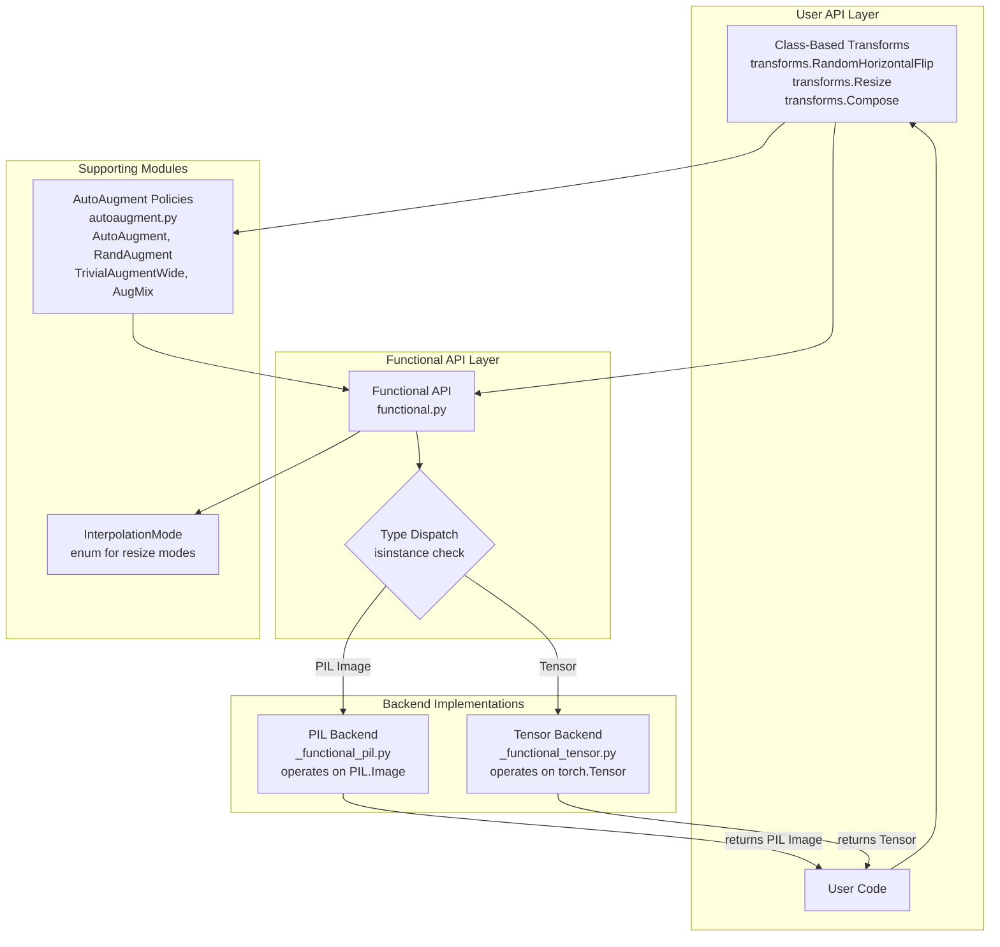
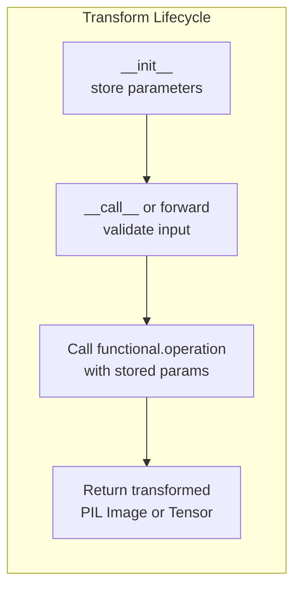
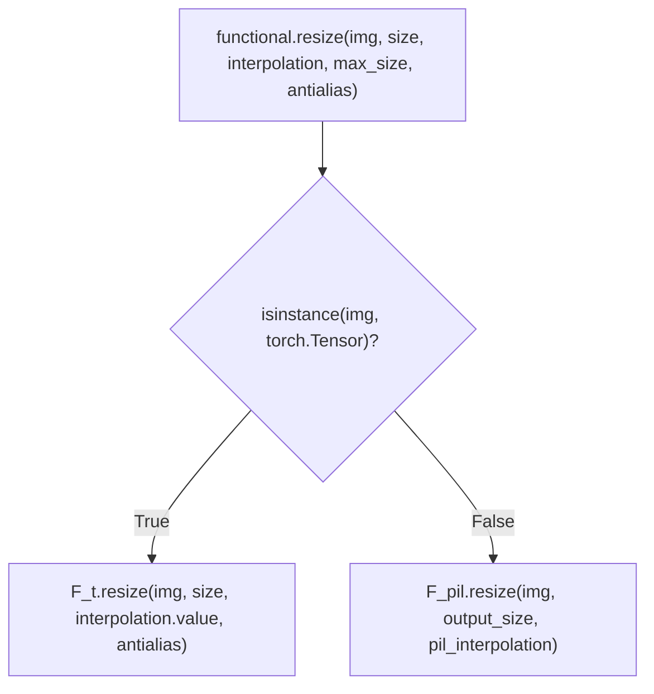
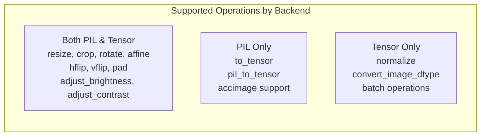
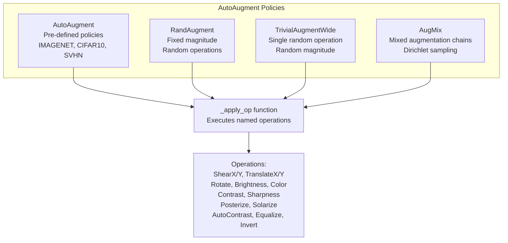
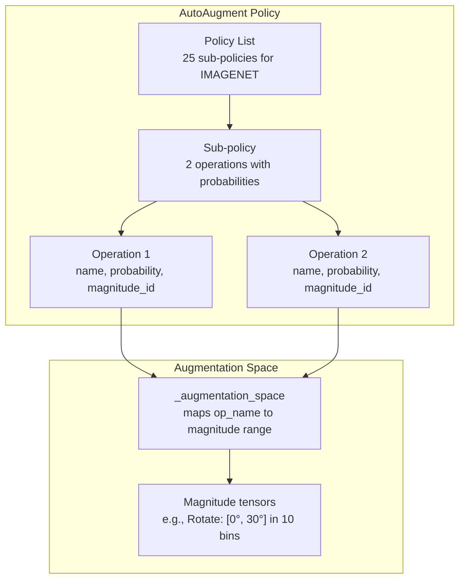
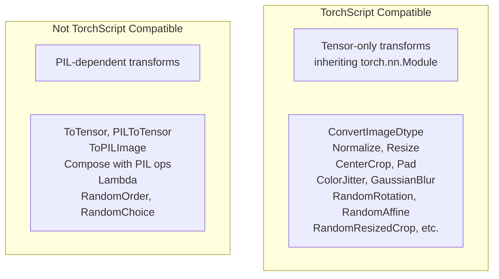

<!-- source: DeepWiki mcp.deepwiki.com · repo pytorch/vision · page 2.1 Transforms v1 · fetched 2026-10-21 -->

# Transforms v1

<details>
<summary>Relevant source files</summary>

The following files were used as context for generating this wiki page:

- [test/test_functional_tensor.py](test/test_functional_tensor.py)
- [test/test_transforms.py](test/test_transforms.py)
- [test/test_transforms_tensor.py](test/test_transforms_tensor.py)
- [torchvision/transforms/autoaugment.py](torchvision/transforms/autoaugment.py)
- [torchvision/transforms/functional.py](torchvision/transforms/functional.py)
- [torchvision/transforms/transforms.py](torchvision/transforms/transforms.py)

</details>


## Purpose and Scope

Transforms v1 is the legacy image transformation API in torchvision, providing a dual interface for image preprocessing and augmentation. This system operates on both PIL Images and PyTorch Tensors, dispatching operations to appropriate backend implementations. While still maintained, it has been superseded by transforms v2 for advanced use cases requiring type-aware transformations and metadata preservation. For the modern API with support for bounding boxes, masks, and videos, see [Transforms v2](#2.2).

This document covers:
- The class-based and functional transform APIs
- Type-based dispatch mechanism to PIL and Tensor backends
- Common transformation operations (geometric, photometric, composition)
- AutoAugment policy implementations

Sources: [torchvision/transforms/transforms.py:1-57](), [torchvision/transforms/functional.py:1-20]()

## Architecture Overview

The transforms v1 system consists of three layers: a user-facing class-based API, a functional API with type dispatch, and backend-specific implementations.



**Dispatch Logic**: The functional API in [torchvision/transforms/functional.py]() checks the input type using `isinstance(img, torch.Tensor)` and routes to the appropriate backend. This allows the same function signature to support both PIL Images and PyTorch Tensors transparently.

Sources: [torchvision/transforms/functional.py:63-98](), [torchvision/transforms/transforms.py:1-105]()

## Class-Based Transforms API

The class-based API provides callable transform objects that can be composed into pipelines. Each transform is a class that implements `__call__` and optionally `forward` for `torch.nn.Module` subclasses.

### Transform Categories

| Category | Transforms | Description |
|----------|-----------|-------------|
| **Conversion** | `ToTensor`, `PILToTensor`, `ToPILImage`, `ConvertImageDtype` | Convert between PIL Images, Tensors, and dtypes |
| **Geometric** | `Resize`, `CenterCrop`, `RandomCrop`, `RandomResizedCrop`, `Pad`, `RandomHorizontalFlip`, `RandomVerticalFlip`, `RandomRotation`, `RandomAffine`, `RandomPerspective`, `FiveCrop`, `TenCrop` | Spatial transformations |
| **Photometric** | `ColorJitter`, `Grayscale`, `RandomGrayscale`, `GaussianBlur`, `RandomInvert`, `RandomPosterize`, `RandomSolarize`, `RandomAdjustSharpness`, `RandomAutocontrast`, `RandomEqualize` | Color and intensity transformations |
| **Normalization** | `Normalize`, `LinearTransformation` | Statistical normalization |
| **Augmentation** | `RandomErasing`, `AutoAugment`, `RandAugment`, `TrivialAugmentWide`, `AugMix`, `ElasticTransform` | Advanced augmentation strategies |
| **Composition** | `Compose`, `RandomApply`, `RandomChoice`, `RandomOrder`, `Lambda` | Transform pipeline utilities |

### Base Transform Pattern



Most transforms follow this pattern from [torchvision/transforms/transforms.py:291-367]():

1. **Initialization**: Store transformation parameters (e.g., `size`, `interpolation`, `fill`)
2. **Call/Forward**: Validate input and delegate to functional API
3. **Return**: Preserve input type (PIL Image returns PIL Image, Tensor returns Tensor)

Sources: [torchvision/transforms/transforms.py:20-57](), [torchvision/transforms/transforms.py:107-289]()

## Functional API and Dispatch Mechanism

The functional API provides stateless transformation functions that dispatch to backend implementations based on input type. This design enables the class-based API to remain backend-agnostic.

### Dispatch Pattern



**Example**: The `resize` function in [torchvision/transforms/functional.py:387-479]() demonstrates the dispatch pattern:

```python
def resize(img, size, interpolation, max_size, antialias):
    # ... validation and size computation ...
    if not isinstance(img, torch.Tensor):
        # PIL path: convert interpolation enum to PIL constant
        pil_interpolation = pil_modes_mapping[interpolation]
        return F_pil.resize(img, size=output_size, interpolation=pil_interpolation)
    # Tensor path: use native tensor operations
    return F_t.resize(img, size=output_size, interpolation=interpolation.value, antialias=antialias)
```

### Key Functional Operations

| Function | Purpose | Dispatches To |
|----------|---------|---------------|
| `to_tensor` | Convert PIL/ndarray to Tensor, scale [0,255]→[0.0,1.0] | PIL only (no dispatch) |
| `pil_to_tensor` | Convert PIL to Tensor without scaling | PIL only |
| `to_pil_image` | Convert Tensor/ndarray to PIL Image | Manual conversion |
| `normalize` | Statistical normalization with mean/std | Tensor only |
| `resize` | Resize image to target size | Both backends |
| `crop` | Crop rectangular region | Both backends |
| `hflip`, `vflip` | Horizontal/vertical flip | Both backends |
| `rotate` | Rotate by angle with interpolation | Both backends |
| `affine` | Apply affine transformation | Both backends |
| `adjust_brightness`, `adjust_contrast`, etc. | Photometric adjustments | Both backends |

Sources: [torchvision/transforms/functional.py:127-243](), [torchvision/transforms/functional.py:387-754]()

## Backend Implementations

The backend implementations in `_functional_pil.py` and `_functional_tensor.py` provide the actual transformation logic for their respective input types.

### PIL Backend (`_functional_pil.py`)

- Operates on `PIL.Image.Image` objects
- Uses PIL's built-in transformation methods
- Handles color mode conversions (RGB, L, LA, RGBA, etc.)
- Example: `resize` uses `PIL.Image.resize()` with Pillow interpolation constants

### Tensor Backend (`_functional_tensor.py`)

- Operates on `torch.Tensor` objects with shape `[C, H, W]` or `[..., C, H, W]`
- Implements transformations using PyTorch operations
- Supports batched operations (leading dimensions preserved)
- Supports GPU acceleration
- Example: `resize` uses `torch.nn.functional.interpolate()`

### Backend Compatibility



**Note**: The tensor backend generally provides better performance and GPU support, while the PIL backend may have slightly different numerical results due to implementation differences.

Sources: [torchvision/transforms/functional.py:63-115](), [test/test_functional_tensor.py:36-52]()

## Common Transform Operations

### Geometric Transforms

**Resize**: Resizes image to target size while optionally preserving aspect ratio.

Key parameters from [torchvision/transforms/transforms.py:291-367]():
- `size`: int (smaller edge) or `(h, w)` tuple
- `max_size`: Optional maximum for longer edge when `size` is int
- `interpolation`: `InterpolationMode` enum (NEAREST, BILINEAR, BICUBIC)
- `antialias`: Enable antialiasing for tensor backend (default True in v0.17+)

**RandomCrop**: Extracts random crops from images with optional padding.

From [torchvision/transforms/transforms.py:589-695]():
- Uses `get_params` static method to generate random crop coordinates
- Supports `pad_if_needed` to ensure minimum image size
- Padding modes: constant, edge, reflect, symmetric

**RandomResizedCrop**: Combines random crop with resize for training data augmentation.

From [test/test_transforms.py:309-334]():
- Samples crop with random scale and aspect ratio
- Common for training classification models (e.g., ImageNet preprocessing)

### Photometric Transforms

**ColorJitter**: Randomly changes brightness, contrast, saturation, and hue.

Parameters from [torchvision/transforms/transforms.py:1196-1382]():
- Each parameter can be float (symmetric range) or tuple (min, max)
- Operations applied in random order
- Example: `brightness=0.2` allows adjustment in range [0.8, 1.2]

**AutoAugment Family**: Policy-based augmentation strategies.



Sources: [torchvision/transforms/autoaugment.py:1-91](), [torchvision/transforms/autoaugment.py:104-285]()

### Conversion Transforms

**ToTensor**: Converts PIL Image or ndarray to float Tensor with value scaling.

From [torchvision/transforms/transforms.py:107-141]():
- Converts `[H, W, C]` layout to `[C, H, W]`
- Scales uint8 values from [0, 255] to [0.0, 1.0]
- Uses `torch.get_default_dtype()` for output dtype
- Note: Not suitable for target masks (use `PILToTensor` instead)

**PILToTensor**: Converts PIL Image to Tensor without value scaling.

From [torchvision/transforms/transforms.py:143-178]():
- Preserves original dtype and value range
- Performs deep copy of underlying array
- Appropriate for masks, labels, and other discrete data

**ConvertImageDtype**: Converts Tensor dtype with appropriate value scaling.

From [torchvision/transforms/transforms.py:180-207]():
- Scales values when converting between int/float types
- Example: uint8 [0, 255] → float32 [0.0, 1.0]
- Raises error for unsafe conversions (e.g., float32 → int32)

Sources: [torchvision/transforms/functional.py:127-244](), [test/test_transforms.py:42-154]()

## AutoAugment Policies

AutoAugment and related methods implement learned augmentation strategies from research papers. These transforms combine multiple operations with learned or stochastic parameters.

### Policy Structure



### Implementation Details

**AutoAugment** [torchvision/transforms/autoaugment.py:104-285]():
- Three pre-defined policies: IMAGENET, CIFAR10, SVHN
- Each policy has 25 sub-policies with 2 operations each
- Operations have associated probability and discrete magnitude level
- Example sub-policy: `(("Posterize", 0.4, 8), ("Rotate", 0.6, 9))`

**RandAugment** [torchvision/transforms/autoaugment.py:287-378]():
- Simplified approach with fixed magnitude across operations
- Parameters: `num_ops` (operations per image), `magnitude` (0-30 scale)
- Randomly selects operations from augmentation space
- More efficient than AutoAugment (no policy search needed)

**TrivialAugmentWide** [torchvision/transforms/autoaugment.py:380-463]():
- Simplest approach: single random operation per image
- Randomly samples both operation and magnitude
- Wider magnitude ranges than RandAugment
- Surprisingly effective despite simplicity

**AugMix** [torchvision/transforms/autoaugment.py:466-616]():
- Creates multiple augmentation chains
- Mixes original and augmented images using Dirichlet distribution
- Parameters: `severity`, `mixture_width`, `chain_depth`, `alpha`
- Improves robustness and uncertainty estimation

### Operation Space

The `_apply_op` function [torchvision/transforms/autoaugment.py:13-90]() implements the following operations:

| Operation | Description | Magnitude Range |
|-----------|-------------|-----------------|
| ShearX/Y | Shear transformation | 0.0 to 0.3 (AutoAugment) or 0.99 (TrivialAugment) |
| TranslateX/Y | Pixel translation | Image-size dependent |
| Rotate | Rotation angle | 0° to 30° (AutoAugment) or 135° (TrivialAugment) |
| Brightness | Brightness adjustment | 0.0 to 0.9 additive |
| Color | Saturation adjustment | 0.0 to 0.9 additive |
| Contrast | Contrast adjustment | 0.0 to 0.9 additive |
| Sharpness | Sharpness adjustment | 0.0 to 0.9 additive |
| Posterize | Bit reduction | 4-8 bits |
| Solarize | Invert above threshold | 0-255 threshold |
| AutoContrast | Normalize histogram | No magnitude |
| Equalize | Equalize histogram | No magnitude |
| Invert | Invert colors | No magnitude |

Sources: [torchvision/transforms/autoaugment.py:13-90](), [torchvision/transforms/autoaugment.py:223-240]()

## Compose and Transform Composition

The `Compose` transform chains multiple transforms into a sequential pipeline.

### Basic Composition

From [torchvision/transforms/transforms.py:60-105]():

```python
transforms.Compose([
    transforms.RandomResizedCrop(224),
    transforms.RandomHorizontalFlip(),
    transforms.ToTensor(),
    transforms.Normalize((0.485, 0.456, 0.406), (0.229, 0.224, 0.225))
])
```

**Implementation**: Compose stores a list of transforms and applies them sequentially in `__call__`. Each transform's output becomes the next transform's input.

### Advanced Composition Transforms

**RandomApply** [torchvision/transforms/transforms.py:518-559]():
- Applies a list of transforms with probability `p`
- If not applied, returns input unchanged
- Can be scripted using `torch.nn.ModuleList`

**RandomChoice** [torchvision/transforms/transforms.py:572-587]():
- Randomly selects one transform from a list
- Optional probability weights for each transform
- Useful for mutually exclusive augmentations

**RandomOrder** [torchvision/transforms/transforms.py:561-570]():
- Applies transforms in random order
- Shuffles transform list for each image
- Not TorchScript compatible

**Lambda** [torchvision/transforms/transforms.py:473-491]():
- Wraps arbitrary callable as transform
- Useful for custom operations
- Not TorchScript compatible

Sources: [torchvision/transforms/transforms.py:60-105](), [torchvision/transforms/transforms.py:493-587]()

## TorchScript Support

Many v1 transforms support TorchScript compilation for deployment, though with limitations.

### TorchScript-Compatible Transforms



### Usage Pattern

From [torchvision/transforms/transforms.py:75-85]():

```python
# For TorchScript, use torch.nn.Sequential instead of Compose
transforms = torch.nn.Sequential(
    transforms.CenterCrop(10),
    transforms.Normalize((0.485, 0.456, 0.406), (0.229, 0.224, 0.225)),
)
scripted_transforms = torch.jit.script(transforms)
```

**Requirements** [test/test_transforms_tensor.py:31-52]():
1. Only operate on Tensors (no PIL Images)
2. Avoid `lambda` functions
3. Use `torch.nn.ModuleList` for containers
4. Handle int parameters as sequences in TorchScript mode (e.g., `size=[32]` instead of `size=32`)

**Testing**: The test suite [test/test_transforms_tensor.py]() extensively validates TorchScript equivalence by comparing scripted and non-scripted transform outputs.

Sources: [torchvision/transforms/transforms.py:75-85](), [test/test_transforms_tensor.py:31-93]()

## Interpolation Modes

The `InterpolationMode` enum defines interpolation methods for geometric transforms.

### Available Modes

From [torchvision/transforms/functional.py:23-37]():

| Mode | Description | Tensor Support | PIL Support |
|------|-------------|----------------|-------------|
| `NEAREST` | Nearest neighbor | ✓ | ✓ |
| `NEAREST_EXACT` | Exact nearest (pixel center) | ✓ | ✓ |
| `BILINEAR` | Bilinear interpolation | ✓ | ✓ |
| `BICUBIC` | Bicubic interpolation | ✓ | ✓ |
| `BOX` | Box filter | ✗ | ✓ |
| `HAMMING` | Hamming window | ✗ | ✓ |
| `LANCZOS` | Lanczos resampling | ✗ | ✓ |

**Legacy Support**: Integer constants (0, 1, 2, 3, 4, 5) from PIL are converted to InterpolationMode using `_interpolation_modes_from_int` [torchvision/transforms/functional.py:41-50]().

**Antialias Parameter**: For tensor backend with BILINEAR or BICUBIC, the `antialias` parameter controls antialiasing during downsampling. Default changed from `None` to `True` in v0.17 for consistency [torchvision/transforms/transforms.py:318-335]().

Sources: [torchvision/transforms/functional.py:23-61](), [test/test_functional_tensor.py:447-499]()

---

