<!-- source: DeepWiki mcp.deepwiki.com · repo pytorch/vision · page 2.2 Transforms v2 · fetched 2026-10-21 -->

# Transforms v2

<details>
<summary>Relevant source files</summary>

The following files were used as context for generating this wiki page:

- [test/assets/fakedata/draw_rotated_boxes.png](test/assets/fakedata/draw_rotated_boxes.png)
- [test/common_utils.py](test/common_utils.py)
- [test/test_transforms_v2.py](test/test_transforms_v2.py)
- [test/test_transforms_v2_utils.py](test/test_transforms_v2_utils.py)
- [test/test_tv_tensors.py](test/test_tv_tensors.py)
- [torchvision/ops/_box_convert.py](torchvision/ops/_box_convert.py)
- [torchvision/transforms/v2/_geometry.py](torchvision/transforms/v2/_geometry.py)
- [torchvision/transforms/v2/functional/_geometry.py](torchvision/transforms/v2/functional/_geometry.py)
- [torchvision/transforms/v2/functional/_meta.py](torchvision/transforms/v2/functional/_meta.py)
- [torchvision/transforms/v2/functional/_utils.py](torchvision/transforms/v2/functional/_utils.py)
- [torchvision/tv_tensors/__init__.py](torchvision/tv_tensors/__init__.py)
- [torchvision/tv_tensors/_bounding_boxes.py](torchvision/tv_tensors/_bounding_boxes.py)

</details>


## Purpose and Scope

Transforms v2 is a modern, type-aware transformation system that extends the legacy transforms API with support for metadata-rich tensor types. Unlike v1 transforms that primarily handle PIL images and plain tensors, v2 provides seamless transformation of detection and segmentation data structures while preserving critical metadata such as bounding box formats, canvas sizes, and coordinate systems.

For information about the legacy transforms API, see [2.1](#2.1). For details on the tv_tensors system that underpins v2, see [2.4](#2.4). For experimental transforms, see [2.3](#2.3).

Sources: [torchvision/transforms/v2/__init__.py:1-50](), Diagram 2 from high-level architecture

## Architecture Overview

The transforms v2 system is built around three core architectural components: a kernel dispatch registry, type-aware transform classes, and functional implementations for each supported input type.

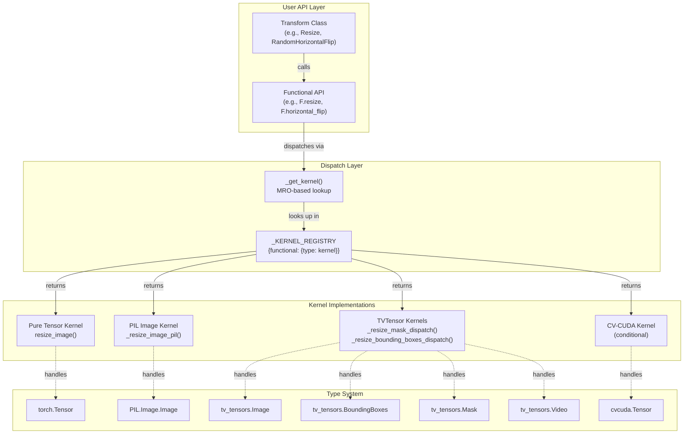

Sources: [torchvision/transforms/v2/functional/_utils.py:16-120](), [torchvision/transforms/v2/functional/_geometry.py:54-82](), [torchvision/transforms/v2/_geometry.py:36-76]()

### Transform Execution Flow

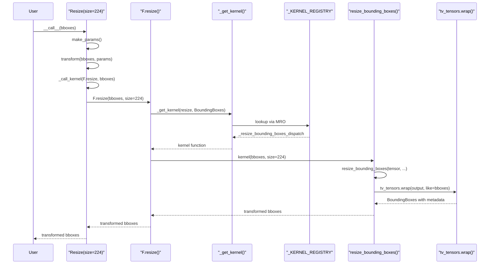

Sources: [torchvision/transforms/v2/_transform.py:1-100](), [torchvision/transforms/v2/functional/_geometry.py:265-280](), [test/test_transforms_v2.py:406-423]()

## Kernel Registry System

The kernel registry is the central mechanism for type-aware dispatch in transforms v2. It maps each functional operation to a dictionary of type-specific kernel implementations.

### Registration Mechanism

Kernels are registered using the `@_register_kernel_internal` decorator, which associates a kernel implementation with a specific input type:

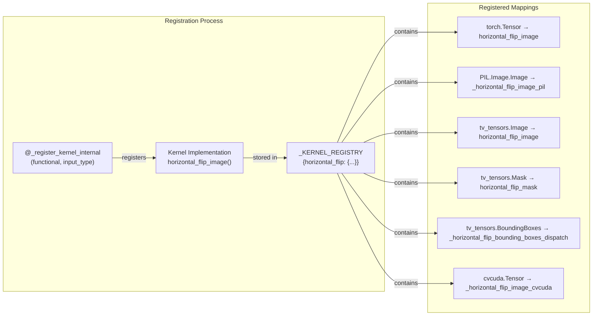

The registry is implemented as a nested dictionary structure:

| Component | Type | Description |
|-----------|------|-------------|
| `_KERNEL_REGISTRY` | `dict[Callable, dict[type, Callable]]` | Top-level registry mapping functionals to type dictionaries |
| First key | `Callable` | Functional operation (e.g., `horizontal_flip`) |
| Second key | `type` | Input type (e.g., `torch.Tensor`, `tv_tensors.Image`) |
| Value | `Callable` | Type-specific kernel implementation |

Sources: [torchvision/transforms/v2/functional/_utils.py:16-52](), [torchvision/transforms/v2/functional/_geometry.py:65-100]()

### MRO-Based Dispatch

The `_get_kernel()` function traverses the Method Resolution Order (MRO) of the input type to find the most specific registered kernel:

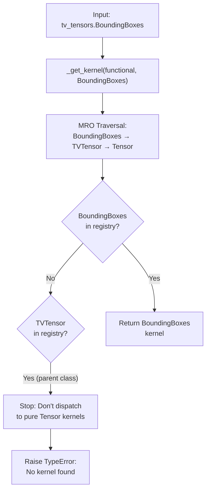

The MRO traversal explicitly stops at `tv_tensors.TVTensor` to prevent user-defined TVTensor subclasses from inadvertently dispatching to pure tensor kernels, which would lose metadata.

Sources: [torchvision/transforms/v2/functional/_utils.py:99-119](), [test/test_transforms_v2.py:206-224]()

### TVTensor Kernel Wrapper

TVTensor kernels are automatically wrapped with `_kernel_tv_tensor_wrapper()` to handle metadata preservation:

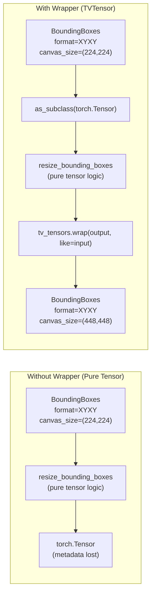

Sources: [torchvision/transforms/v2/functional/_utils.py:20-36](), [torchvision/transforms/v2/functional/_geometry.py:419-425](), [torchvision/tv_tensors/__init__.py:16-40]()

## Supported Input Types

Transforms v2 supports six primary input types, each with specialized kernel implementations:

| Input Type | Class | Metadata | Primary Use Case |
|------------|-------|----------|------------------|
| Pure Tensor | `torch.Tensor` | None | Raw image data, generic tensors |
| PIL Image | `PIL.Image.Image` | Mode (RGB, L, etc.) | Legacy PIL workflows |
| Image | `tv_tensors.Image` | None | Type-safe image representation |
| Video | `tv_tensors.Video` | None | Video frame sequences |
| Mask | `tv_tensors.Mask` | None | Segmentation masks |
| BoundingBoxes | `tv_tensors.BoundingBoxes` | `format`, `canvas_size`, `clamping_mode` | Object detection |
| KeyPoints | `tv_tensors.KeyPoints` | `canvas_size` | Keypoint detection |
| CV-CUDA Tensor | `cvcuda.Tensor` | Layout (NHWC) | GPU-accelerated processing |

Sources: [torchvision/transforms/v2/functional/_utils.py:12-14](), [torchvision/tv_tensors/__init__.py:1-40](), [torchvision/transforms/v2/functional/_geometry.py:38-82]()

### Type-Specific Behaviors

Different input types require different kernel implementations due to their underlying representations:

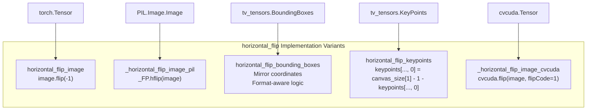

For geometric transforms like `horizontal_flip`, the coordinate transformation logic differs by format:

| Format | Coordinate Transformation |
|--------|---------------------------|
| `XYXY` | `x' = canvas_size[1] - x`, swap x1 and x2 |
| `XYWH` | `x' = canvas_size[1] - x - width` |
| `CXCYWH` | `cx' = canvas_size[1] - cx` |
| `XYXYXYXY` | `x' = canvas_size[1] - x` for all 4 x-coordinates |
| `XYWHR` / `CXCYWHR` | Transform center point, negate angle |

Sources: [torchvision/transforms/v2/functional/_geometry.py:102-143](), [test/test_transforms_v2.py:501-641]()

## Transform Classes

All v2 transforms inherit from the `Transform` base class, which provides the infrastructure for parameter generation, kernel dispatching, and sample handling.

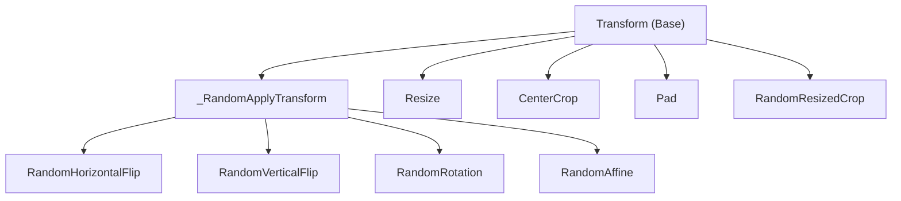

### Core Transform Methods

Each transform implements these key methods:

| Method | Purpose | Required |
|--------|---------|----------|
| `__init__()` | Store transform parameters | Yes |
| `make_params()` | Generate random parameters per sample | For random transforms |
| `transform()` | Apply transformation to single input | Yes |
| `_call_kernel()` | Dispatch to appropriate kernel | Yes (inherited) |
| `check_inputs()` | Validate input compatibility | Optional |

Sources: [torchvision/transforms/v2/_transform.py:1-150](), [torchvision/transforms/v2/_geometry.py:36-177]()

### Example: Resize Transform

The `Resize` transform demonstrates the standard pattern:


The `Resize` class stores parameters and delegates to the functional API:

- **Parameters**: `size` (int, sequence, or None), `interpolation`, `max_size`, `antialias`
- **Supported inputs**: All image-like types, bounding boxes, masks, keypoints, videos
- **Behavior**: Resizes to specified size, optionally constraining longer edge with `max_size`
- **Kernel dispatch**: Different kernels for images, masks, bounding boxes, and keypoints

Sources: [torchvision/transforms/v2/_geometry.py:78-177](), [torchvision/transforms/v2/functional/_geometry.py:265-603]()

### Sample Input Handling

Transforms can process complex nested structures (dicts, lists, tuples) containing multiple input types:

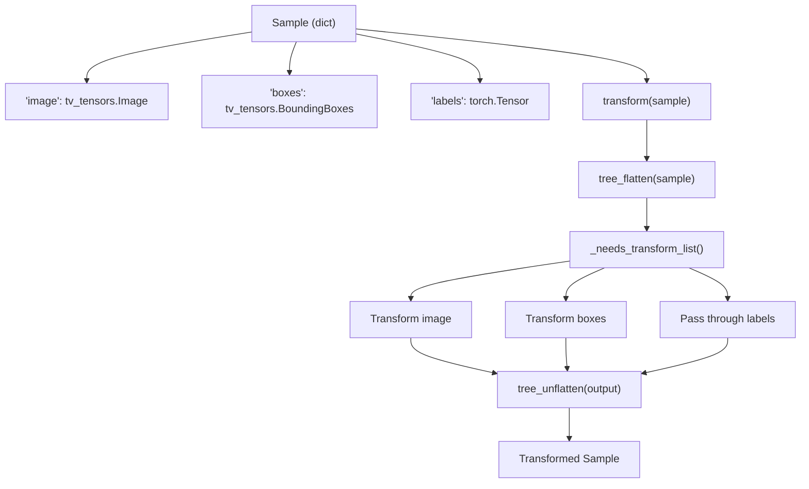

The `_needs_transform_list()` method determines which inputs should be transformed:

| Input Type | Transformed? |
|------------|--------------|
| `tv_tensors.Image` | ✓ |
| `tv_tensors.Video` | ✓ |
| `tv_tensors.BoundingBoxes` | ✓ |
| `tv_tensors.Mask` | ✓ |
| `tv_tensors.KeyPoints` | ✓ |
| `PIL.Image.Image` | ✓ |
| Pure `torch.Tensor` | ✓ |
| `cvcuda.Tensor` | ✓ (if available) |
| `int`, `float`, `str`, `Path` | ✗ (pass through) |

Sources: [test/test_transforms_v2.py:356-404](), [torchvision/transforms/v2/_transform.py:1-100]()

## Functional API

The functional API provides direct access to transformation operations without instantiating transform classes. Each functional operation follows a consistent pattern:

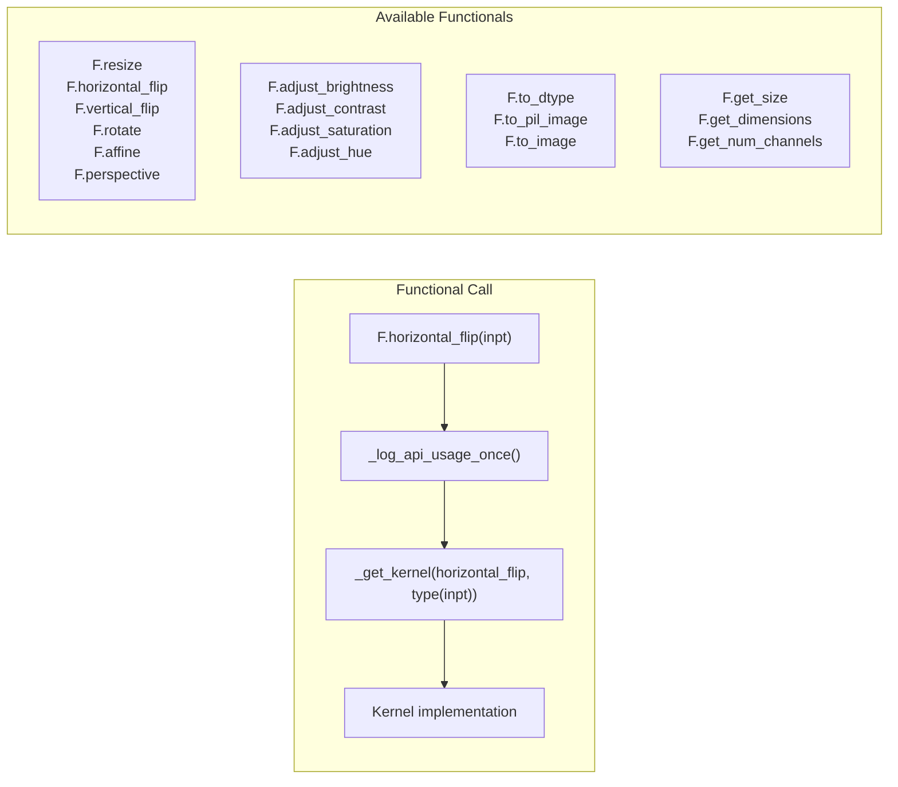

### Functional-Kernel Correspondence

Each transform class has a corresponding functional operation:

| Transform Class | Functional | Primary Kernels |
|-----------------|------------|-----------------|
| `Resize` | `F.resize` | `resize_image`, `resize_bounding_boxes`, `resize_keypoints`, `resize_mask` |
| `RandomHorizontalFlip` | `F.horizontal_flip` | `horizontal_flip_image`, `horizontal_flip_bounding_boxes`, `horizontal_flip_keypoints` |
| `CenterCrop` | `F.center_crop` | `center_crop_image`, `center_crop_bounding_boxes` |
| `Pad` | `F.pad` | `pad_image`, `pad_bounding_boxes` |
| `RandomAffine` | `F.affine` | `affine_image`, `affine_bounding_boxes`, `affine_keypoints` |

Sources: [torchvision/transforms/v2/functional/__init__.py:1-100](), [torchvision/transforms/v2/functional/_geometry.py:54-280]()

### Direct Functional Usage

Functionals can be used directly for imperative-style transformations:

```python
# Functional API usage (from test examples)
import torchvision.transforms.v2.functional as F

# Single operation
output = F.resize(image, size=[224, 224], antialias=True)

# Chained operations
output = F.horizontal_flip(image)
output = F.adjust_brightness(output, brightness_factor=1.2)
output = F.to_pil_image(output)
```

Sources: [test/test_transforms_v2.py:817-828](), [torchvision/transforms/v2/functional/_geometry.py:265-280]()

## Metadata Preservation

A key feature of transforms v2 is automatic preservation of metadata through transformation pipelines. This is critical for detection and segmentation tasks where coordinate systems and format information must remain consistent.

### BoundingBoxes Metadata Flow

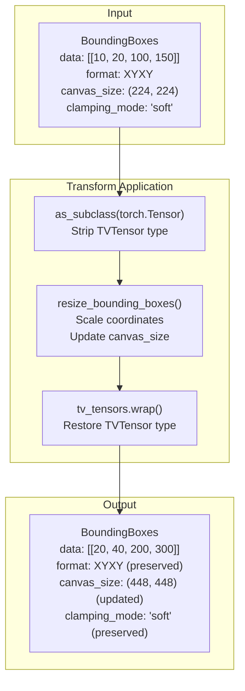

The metadata preservation mechanism works as follows:

1. **Extraction**: Input TVTensor is converted to plain tensor via `as_subclass(torch.Tensor)`
2. **Transformation**: Pure tensor logic operates on data without metadata overhead
3. **Restoration**: `tv_tensors.wrap(output, like=input)` reconstructs TVTensor with updated metadata

Sources: [torchvision/transforms/v2/functional/_utils.py:20-36](), [torchvision/transforms/v2/functional/_geometry.py:579-592](), [torchvision/tv_tensors/__init__.py:16-40]()

### Metadata Update Strategies

Different metadata fields follow different update strategies during transformations:

| Metadata | Transform Type | Update Strategy |
|----------|----------------|-----------------|
| `format` | All geometric | **Preserved** (except `ConvertBoundingBoxFormat`) |
| `canvas_size` | Resize, Crop | **Updated** to new image dimensions |
| `canvas_size` | Flip, Rotate | **Preserved** (dimensions don't change) |
| `clamping_mode` | All | **Preserved** |
| KeyPoints `canvas_size` | Resize, Crop | **Updated** to match transformed image |

### Format-Aware Transformations

Bounding box transformations must account for the coordinate format:

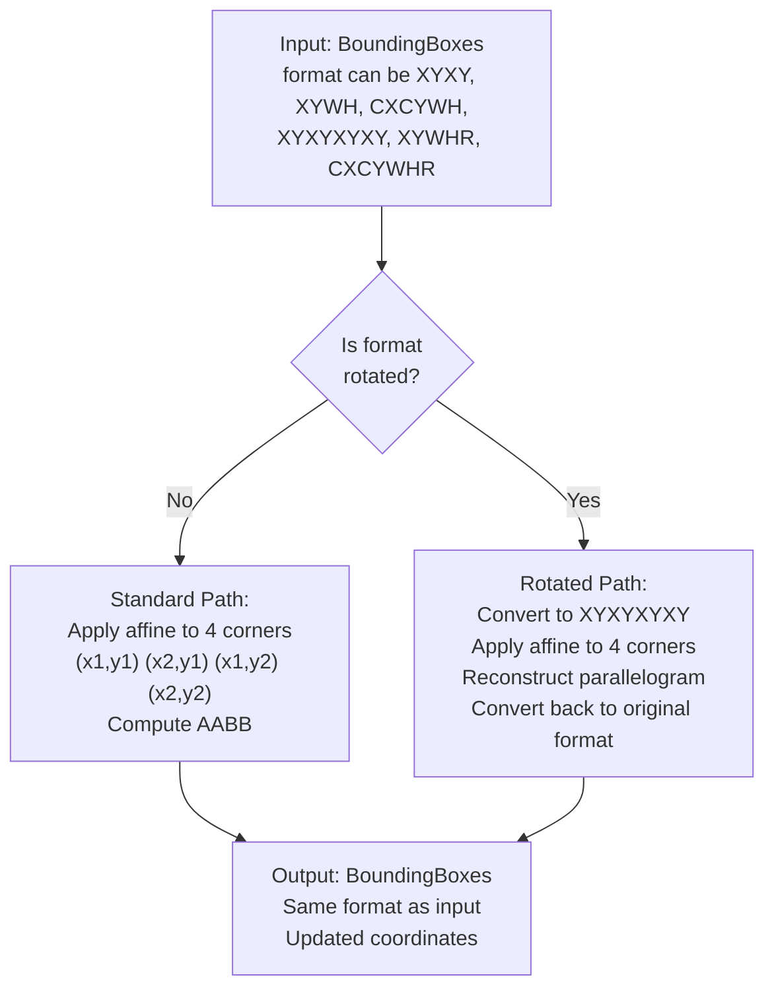

Sources: [torchvision/transforms/v2/functional/_geometry.py:523-592](), [torchvision/tv_tensors/_bounding_boxes.py:14-60](), [test/test_transforms_v2.py:501-641]()

### Clamping Modes

The `clamping_mode` parameter controls how bounding boxes are handled when they extend beyond canvas boundaries:

| Mode | Behavior |
|------|----------|
| `"soft"` | Clamp coordinates to canvas bounds, potentially changing box aspect ratio |
| `"hard"` | For rotated boxes: find largest inscribed box within canvas that preserves angle |
| `None` | No clamping applied; boxes may extend beyond canvas |

Sources: [torchvision/tv_tensors/_bounding_boxes.py:59-98](), [torchvision/transforms/v2/functional/_meta.py:368-521]()

## V1 Compatibility

Transforms v2 maintains compatibility with the v1 API through the `_v1_transform_cls` attribute and shared `get_params` implementations.

### Compatibility Bridge

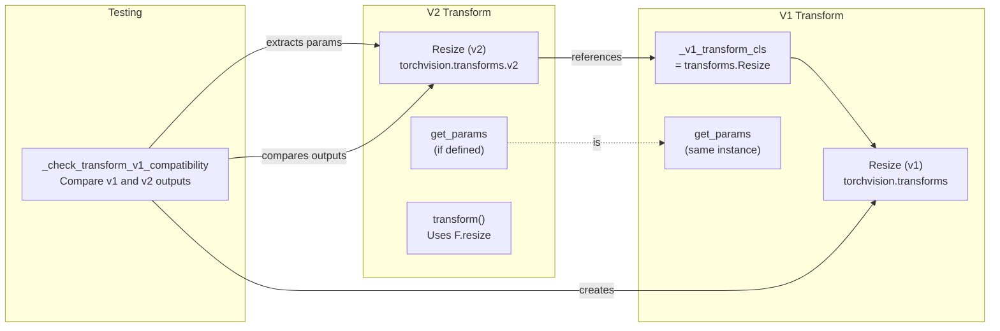

### Shared Parameter Generation

For transforms with random behavior, v2 classes reuse v1's `get_params` method:

```python
# Example from RandomAffine (conceptual)
class RandomAffine(Transform):
    _v1_transform_cls = _transforms.RandomAffine
    
    # This is the actual v1 get_params method, not a copy
    get_params = _transforms.RandomAffine.get_params
```

This ensures:
- Identical random parameter generation between v1 and v2
- Single source of truth for parameter logic
- Backward compatibility for users migrating from v1

Sources: [test/test_transforms_v2.py:258-286](), [torchvision/transforms/v2/_geometry.py:36-76]()

### Parameter Extraction for V1

The `_extract_params_for_v1_transform()` method converts v2 parameters to v1-compatible format:

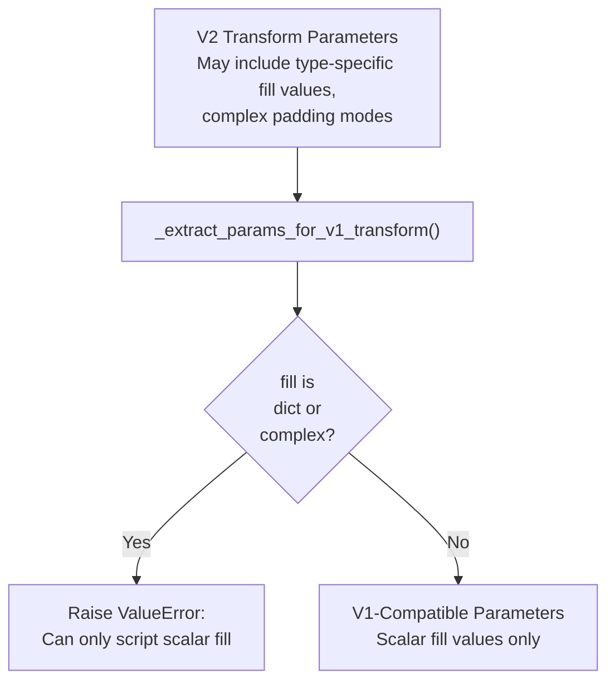

Sources: [torchvision/transforms/v2/_geometry.py:468-474]()

### Testing Strategy

V1 compatibility is validated through automated testing:

| Test | Purpose |
|------|---------|
| `_check_transform_v1_compatibility` | Ensures v1 and v2 produce identical outputs for same inputs |
| `get_params` identity check | Verifies v2 uses actual v1 `get_params`, not a copy |
| Scriptability check | Confirms v1 transform can be TorchScript compiled |

Sources: [test/test_transforms_v2.py:258-286](), [test/test_transforms_v2.py:406-423]()

## CV-CUDA Integration

Transforms v2 provides experimental support for NVIDIA CV-CUDA, enabling GPU-accelerated image processing operations on `cvcuda.Tensor` inputs.

### Conditional Registration

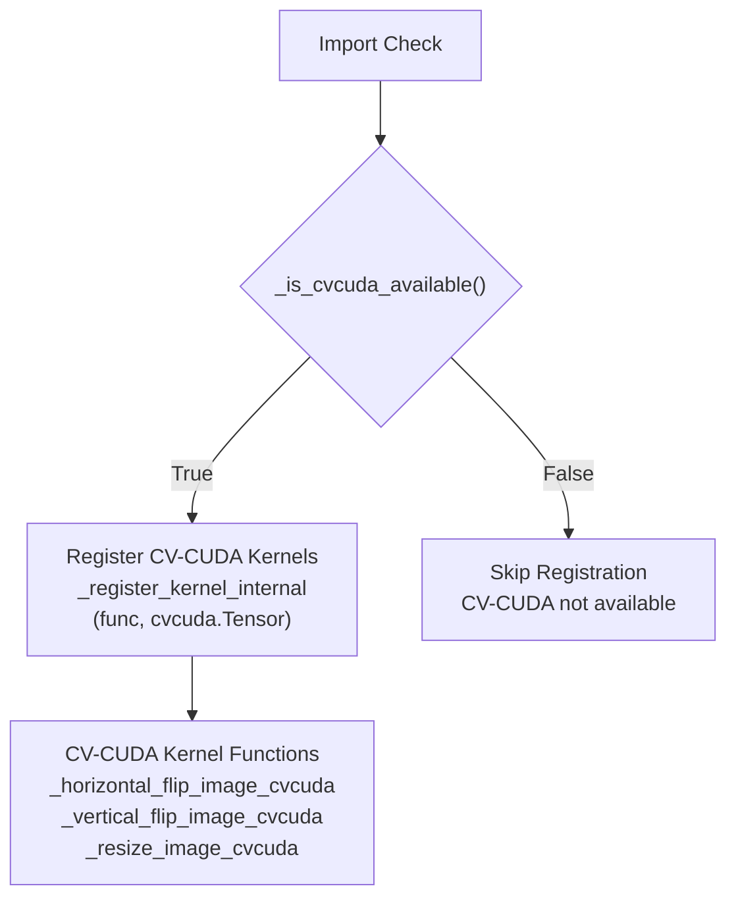

CV-CUDA kernels are conditionally registered at module import time:

```python
# Pattern used in functional/_geometry.py
CVCUDA_AVAILABLE = _is_cvcuda_available()

if CVCUDA_AVAILABLE:
    _register_kernel_internal(horizontal_flip, _import_cvcuda().Tensor)(
        _horizontal_flip_image_cvcuda
    )
```

Sources: [torchvision/transforms/v2/functional/_geometry.py:38-82](), [torchvision/transforms/v2/functional/_utils.py:145-180]()

### Layout Considerations

CV-CUDA tensors use NHWC (batch, height, width, channels) layout, different from PyTorch's NCHW:

| Operation | PyTorch Layout | CV-CUDA Layout |
|-----------|----------------|----------------|
| `get_size()` | `shape[-2:]` | `shape[-3:-1]` |
| Channel dimension | `shape[-3]` | `shape[-1]` |
| Batch dimension | `shape[:-3]` | `shape[0]` |

Sources: [torchvision/transforms/v2/functional/_meta.py:117-129](), [common_utils.py:294-306]()

### Transform Class Support

Transform classes opt-in to CV-CUDA support by extending `_transformed_types`:

```python
# Example from RandomHorizontalFlip
class RandomHorizontalFlip(_RandomApplyTransform):
    if CVCUDA_AVAILABLE:
        _transformed_types = _RandomApplyTransform._transformed_types + (_is_cvcuda_tensor,)
```

This allows the transform to identify and process CV-CUDA tensors in sample dictionaries.

Sources: [torchvision/transforms/v2/_geometry.py:48-54](), [torchvision/transforms/v2/_transform.py:1-100]()

---

