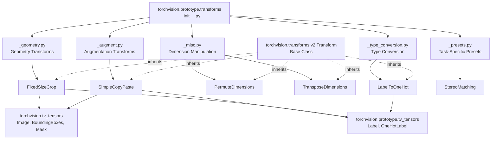
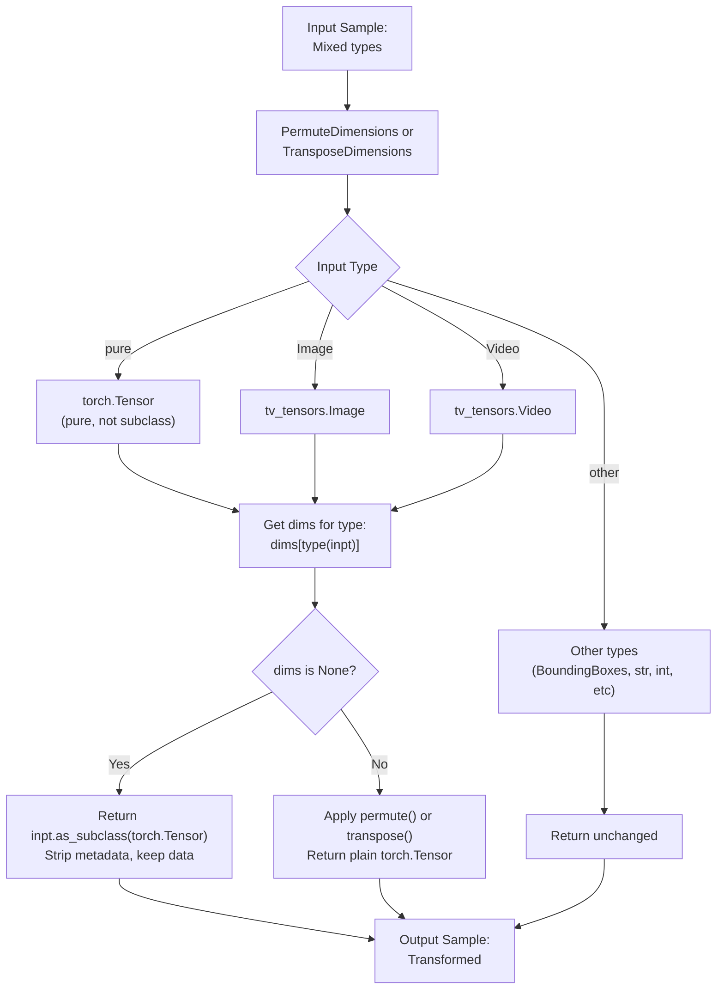
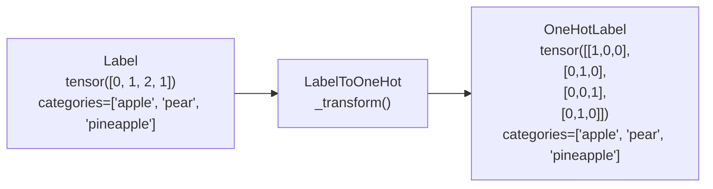
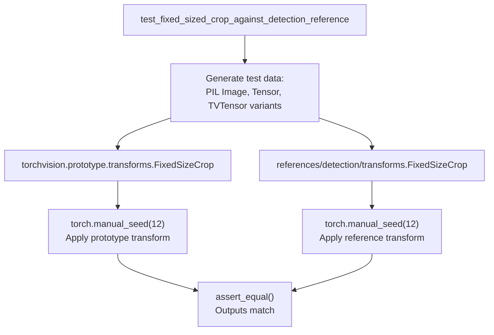

<!-- source: DeepWiki mcp.deepwiki.com · repo pytorch/vision · page 2.3 Prototype Transforms · fetched 2026-10-21 -->

# Prototype Transforms

<details>
<summary>Relevant source files</summary>

The following files were used as context for generating this wiki page:

- [test/test_prototype_transforms.py](test/test_prototype_transforms.py)
- [torchvision/prototype/transforms/__init__.py](torchvision/prototype/transforms/__init__.py)
- [torchvision/prototype/transforms/_augment.py](torchvision/prototype/transforms/_augment.py)
- [torchvision/prototype/transforms/_geometry.py](torchvision/prototype/transforms/_geometry.py)
- [torchvision/prototype/transforms/_misc.py](torchvision/prototype/transforms/_misc.py)

</details>


## Purpose and Scope

This document describes the `torchvision.prototype.transforms` module, which provides experimental transforms that extend the transforms.v2 API. These transforms are designed for advanced use cases in object detection, instance segmentation, and specialized data preprocessing workflows. They are considered experimental and may change or be promoted to the stable API in future releases.

For information about the stable transforms system, see [Transforms v2](#2.2). For the legacy transforms API, see [Transforms v1](#2.1). For the TV Tensors system that these transforms operate on, see [TV Tensors](#2.4).

**Sources:** [torchvision/prototype/transforms/__init__.py:1-7](), [test/test_prototype_transforms.py:1-430]()

## Module Organization

The prototype transforms module is organized into several focused submodules, each containing transforms for specific purposes:



**Sources:** [torchvision/prototype/transforms/__init__.py:1-7]()

## Design Patterns

All prototype transforms inherit from `torchvision.transforms.v2.Transform` and follow the v2 transform architecture with type-aware kernel dispatch. They implement the standard transform interface:

| Method | Purpose | Required |
|--------|---------|----------|
| `__init__()` | Configure transform parameters | Yes |
| `check_inputs()` | Validate input types and combinations | Optional |
| `make_params()` | Generate random parameters from input | Optional |
| `transform()` | Apply transformation to single input | Yes |
| `forward()` | Process structured input (may be overridden) | Optional |

Unlike stable v2 transforms, prototype transforms often have more specialized requirements and may impose stricter constraints on input structure. For example, `SimpleCopyPaste` requires batch inputs with matching numbers of images, bounding boxes, masks, and labels.

**Sources:** [torchvision/prototype/transforms/_geometry.py:22-136](), [torchvision/prototype/transforms/_augment.py:15-206]()

## FixedSizeCrop

`FixedSizeCrop` performs spatial cropping to a fixed output size, with automatic padding if the input is smaller than the target size. This transform is commonly used in detection pipelines where consistent output dimensions are required.

### Algorithm Flow

```mermaid
graph TB
    INPUT["Input: Image, BoundingBoxes,<br/>Masks, Labels"]
    CHECK["check_inputs()<br/>Validate presence of Image/Video<br/>If BoundingBoxes present, require Labels"]
    MAKE_PARAMS["make_params()<br/>Calculate crop region"]
    
    QUERY_SIZE["query_size(flat_inputs)<br/>Get (height, width)"]
    CALC_CROP["Calculate crop dimensions:<br/>new_height = min(height, crop_height)<br/>new_width = min(width, crop_width)"]
    RANDOM_OFFSET["Random offset:<br/>top = rand() * (height - crop_height)<br/>left = rand() * (width - crop_width)"]
    
    BBOX_CHECK{"BoundingBoxes<br/>present?"}
    CROP_BBOX["F.crop_bounding_boxes()<br/>F.clamp_bounding_boxes()"]
    CALC_VALID["Calculate is_valid:<br/>Filter boxes with height/width > 0"]
    
    CALC_PAD["Calculate padding:<br/>pad_bottom = max(crop_height - new_height, 0)<br/>pad_right = max(crop_width - new_width, 0)"]
    
    TRANSFORM["transform()<br/>Apply to each input"]
    
    CROP_STEP{"needs_crop?"}
    CROP_APPLY["F.crop(inpt, top, left,<br/>height, width)"]
    
    CULL_STEP{"is_valid<br/>available?"}
    CULL_APPLY["Cull invalid items:<br/>inpt[is_valid]"]
    
    PAD_STEP{"needs_pad?"}
    PAD_APPLY["F.pad(inpt, padding,<br/>fill, padding_mode)"]
    
    OUTPUT["Output: Transformed data<br/>with fixed size"]
    
    INPUT --> CHECK
    CHECK --> MAKE_PARAMS
    MAKE_PARAMS --> QUERY_SIZE
    QUERY_SIZE --> CALC_CROP
    CALC_CROP --> RANDOM_OFFSET
    RANDOM_OFFSET --> BBOX_CHECK
    
    BBOX_CHECK -->|Yes| CROP_BBOX
    CROP_BBOX --> CALC_VALID
    CALC_VALID --> CALC_PAD
    BBOX_CHECK -->|No| CALC_PAD
    
    CALC_PAD --> TRANSFORM
    
    TRANSFORM --> CROP_STEP
    CROP_STEP -->|Yes| CROP_APPLY
    CROP_STEP -->|No| CULL_STEP
    CROP_APPLY --> CULL_STEP
    
    CULL_STEP -->|Yes| CULL_APPLY
    CULL_STEP -->|No| PAD_STEP
    CULL_APPLY --> PAD_STEP
    
    PAD_STEP -->|Yes| PAD_APPLY
    PAD_STEP -->|No| OUTPUT
    PAD_APPLY --> OUTPUT
```



### Implementation Details

The transform operates in three stages:

1. **Cropping Stage** ([torchvision/prototype/transforms/_geometry.py:112-120]()):
   - If input is larger than target size, randomly crops to `(new_height, new_width)`
   - Random offset is calculated using `torch.rand(1)` for reproducibility

2. **Culling Stage** ([torchvision/prototype/transforms/_geometry.py:122-129]()):
   - For `BoundingBoxes`, `Mask`, and `Label`/`OneHotLabel` types, removes invalid instances
   - Validity is determined by checking if bounding boxes have positive height/width after cropping
   - Uses `is_valid` boolean tensor generated in `make_params()`

3. **Padding Stage** ([torchvision/prototype/transforms/_geometry.py:131-133]()):
   - If input is smaller than target size, pads to reach `(crop_height, crop_width)`
   - Respects fill values and padding mode (constant, reflect, replicate, circular)

### Key Features

| Feature | Implementation |
|---------|----------------|
| **Input Validation** | Requires Image/Video tensor; if BoundingBoxes present, must have Label/OneHotLabel ([torchvision/prototype/transforms/_geometry.py:39-55]()) |
| **Bounding Box Clamping** | Automatically clamps boxes to valid canvas after crop ([torchvision/prototype/transforms/_geometry.py:87]()) |
| **Degenerate Box Removal** | Filters out boxes with zero or negative dimensions ([torchvision/prototype/transforms/_geometry.py:88-91]()) |
| **Type Preservation** | Uses `tv_tensors.wrap()` to maintain metadata ([torchvision/prototype/transforms/_geometry.py:124-129]()) |
| **Fill Value Customization** | Supports per-type fill values via dict ([torchvision/prototype/transforms/_geometry.py:26]()) |

**Sources:** [torchvision/prototype/transforms/_geometry.py:22-136](), [test/test_prototype_transforms.py:161-257]()

## SimpleCopyPaste

`SimpleCopyPaste` implements the copy-paste augmentation technique for instance segmentation and object detection. This transform pastes objects from one image onto another using instance masks, with optional Gaussian blending.

### Algorithm Overview

```mermaid
graph TB
    INPUT["Input: Batch of<br/>(Images, BoundingBoxes, Masks, Labels)"]
    
    EXTRACT["_extract_image_targets()<br/>Separate images from targets"]
    
    ROLL["Create shifted batch:<br/>paste_images = images[-1:] + images[:-1]<br/>paste_targets = targets[-1:] + targets[:-1]"]
    
    LOOP_START["For each (image, target,<br/>paste_image, paste_target):"]
    
    SELECT["Random selection:<br/>random_selection = randint(0, num_masks)<br/>random_selection = unique(random_selection)"]
    
    COPY_PASTE["_copy_paste()"]
    
    RESIZE_CHECK{"Image sizes<br/>match?"}
    RESIZE["F.resize() paste data<br/>to match source size"]
    
    ALPHA_MASK["Create alpha mask:<br/>paste_alpha_mask = paste_masks.sum(dim=0) > 0"]
    
    BLEND_CHECK{"blending<br/>enabled?"}
    BLUR["F.gaussian_blur()<br/>kernel=[5,5], sigma=[2.0]"]
    
    PASTE_IMG["Blend images:<br/>image * ~alpha + paste_image * alpha"]
    
    PASTE_MASK["Blend masks:<br/>masks * ~alpha<br/>Remove all-zero masks"]
    
    BBOX_RECONSTRUCT["masks_to_boxes()<br/>Reconstruct boxes from masks<br/>Add +1 to x2y2 for exclusive coords"]
    
    CONCAT["Concatenate:<br/>masks, boxes, labels"]
    
    DEGENERATE["Remove degenerate boxes:<br/>Filter boxes where x2 <= x1 or y2 <= y1"]
    
    INSERT["_insert_outputs()<br/>Restore structure"]
    
    OUTPUT["Output: Augmented batch"]
    
    INPUT --> EXTRACT
    EXTRACT --> ROLL
    ROLL --> LOOP_START
    LOOP_START --> SELECT
    SELECT --> COPY_PASTE
    COPY_PASTE --> RESIZE_CHECK
    
    RESIZE_CHECK -->|No| RESIZE
    RESIZE_CHECK -->|Yes| ALPHA_MASK
    RESIZE --> ALPHA_MASK
    
    ALPHA_MASK --> BLEND_CHECK
    BLEND_CHECK -->|Yes| BLUR
    BLEND_CHECK -->|No| PASTE_IMG
    BLUR --> PASTE_IMG
    
    PASTE_IMG --> PASTE_MASK
    PASTE_MASK --> BBOX_RECONSTRUCT
    BBOX_RECONSTRUCT --> CONCAT
    CONCAT --> DEGENERATE
    DEGENERATE --> INSERT
    INSERT --> OUTPUT
```



### Data Flow

The transform processes inputs through three main phases:

1. **Extraction Phase** ([torchvision/prototype/transforms/_augment.py:105-133]()):
   - Flattens input structure and groups by type: `images`, `bboxes`, `masks`, `labels`
   - Validates equal counts of each type
   - Converts PIL images to tensors using `F.to_image()`

2. **Copy-Paste Phase** ([torchvision/prototype/transforms/_augment.py:27-103]()):
   - Creates alpha mask from paste masks: areas where any mask is present
   - Optionally blurs alpha mask with Gaussian kernel for smoother blending
   - Blends images: `image * (1 - alpha) + paste_image * alpha`
   - Removes source masks that are fully occluded
   - Reconstructs bounding boxes from masks using `masks_to_boxes()`
   - Adds +1 to x2/y2 coordinates (masks_to_boxes produces inclusive coords, but format expects exclusive)

3. **Insertion Phase** ([torchvision/prototype/transforms/_augment.py:135-161]()):
   - Restores outputs to original input structure
   - Preserves types: converts back to PIL if needed, wraps tv_tensors

### Configuration

| Parameter | Type | Default | Purpose |
|-----------|------|---------|---------|
| `blending` | `bool` | `True` | Enable Gaussian blur on alpha mask for smooth blending |
| `resize_interpolation` | `InterpolationMode` | `BILINEAR` | Interpolation mode when resizing paste data |
| `antialias` | `Optional[bool]` | `None` | Antialiasing for resize operation |

### Batch Processing Pattern

The transform operates on batch inputs by rolling the list:

```
Original:      [img0, img1, img2, img3]
Paste source:  [img1, img2, img3, img0]
```

This creates a shifted pairing where each image receives paste objects from the next image in the batch, with the last image using the first as source.

**Sources:** [torchvision/prototype/transforms/_augment.py:15-206](), [test/test_prototype_transforms.py:42-159]()

## Dimension Manipulation Transforms

The prototype module includes two transforms for reordering tensor dimensions: `PermuteDimensions` and `TransposeDimensions`. These are useful for adapting data to different layout conventions (e.g., channels-first vs channels-last).

### Type-Specific Dimension Handling



### PermuteDimensions

Reorders all dimensions according to a specified permutation:

```python
# Example: Convert CHW to HWC
transform = PermuteDimensions(dims=(1, 2, 0))
# or per-type:
transform = PermuteDimensions(dims={
    Image: (1, 2, 0),  # CHW -> HWC
    Video: (0, 2, 3, 1),  # TCHW -> THWC
})
```

**Implementation:** [torchvision/prototype/transforms/_misc.py:28-48]()

Key behaviors:
- If `dims` is a sequence, applies to all transformed types uniformly
- If `dims` is a dict, applies type-specific permutations
- If `dims[type] is None`, unwraps tv_tensor to plain tensor without permuting
- Always returns plain `torch.Tensor`, not tv_tensor subclasses

### TransposeDimensions

Swaps two dimensions:

```python
# Example: Swap last two dimensions
transform = TransposeDimensions(dims=(-1, -2))
# or per-type:
transform = TransposeDimensions(dims={
    Image: (1, 2),  # Swap height and width
    Video: None,  # No transformation
})
```

**Implementation:** [torchvision/prototype/transforms/_misc.py:50-69]()

Operates identically to `PermuteDimensions` but uses `transpose()` instead of `permute()`.

### Plain Tensor Warning

Both transforms issue a warning if `torch.Tensor` is specified in the dims dict alongside `Image` or `Video`:

```
UserWarning: Note that a plain `torch.Tensor` will *not* be transformed 
by this (or any other transformation) in case a `tv_tensors.Image` or 
`tv_tensors.Video` is present in the input.
```

This is because the v2 transform system treats pure tensors as images when an `Image` tv_tensor is present, preventing type-specific behavior.

**Sources:** [torchvision/prototype/transforms/_misc.py:1-70](), [test/test_prototype_transforms.py:270-363]()

## LabelToOneHot

`LabelToOneHot` converts `Label` tv_tensors to `OneHotLabel` tv_tensors, preserving category information:



The transform uses `torch.nn.functional.one_hot()` internally and preserves the `categories` attribute from the input `Label`. This is commonly used before loss functions that expect one-hot encoded targets.

**Sources:** [test/test_prototype_transforms.py:259-268]()

## Relationship to Detection References

`FixedSizeCrop` in the prototype module is compatible with the reference implementation used in torchvision's detection training scripts. The test suite validates equivalence:



This ensures that models trained with reference scripts can use the prototype transform as a drop-in replacement.

**Sources:** [test/test_prototype_transforms.py:386-430]()

## Comparison with Stable Transforms

| Feature | Stable v2 Transforms | Prototype Transforms |
|---------|---------------------|----------------------|
| **API Stability** | Guaranteed backward compatibility | Experimental, may change |
| **Type Requirements** | Flexible, works with any inputs | Often requires specific type combinations |
| **Batch Operations** | Single-sample focused | Some support batch processing (SimpleCopyPaste) |
| **Input Validation** | Minimal | Strict validation via `check_inputs()` |
| **Use Cases** | General preprocessing | Specialized detection/segmentation workflows |
| **Documentation** | Comprehensive | Limited, implementation-focused |

Prototype transforms may be promoted to the stable v2 API after maturation and community feedback. Users should import from `torchvision.prototype.transforms` and expect potential breaking changes.

**Sources:** [torchvision/prototype/transforms/_geometry.py:22-55](), [torchvision/prototype/transforms/_augment.py:105-127]()

---

