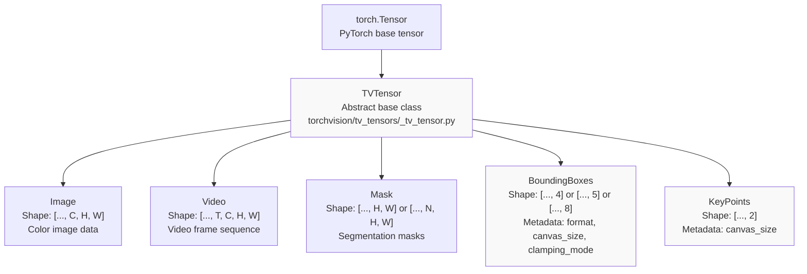
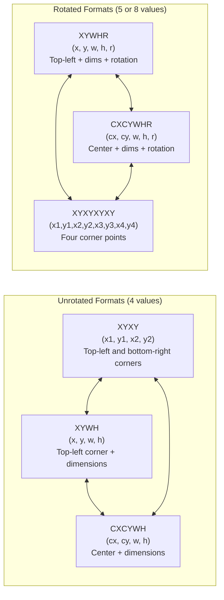
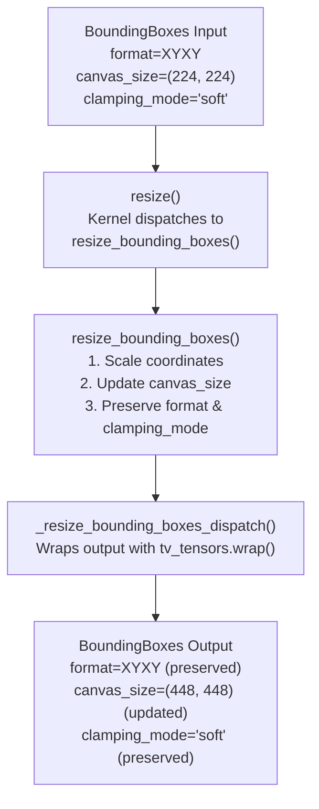
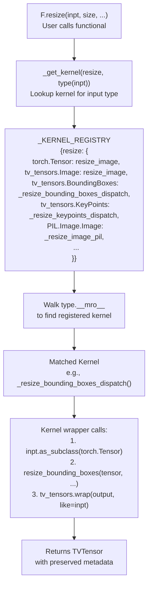

<!-- source: DeepWiki mcp.deepwiki.com · repo pytorch/vision · page 2.4 TV Tensors · fetched 2026-10-21 -->

# TV Tensors

<details>
<summary>Relevant source files</summary>

The following files were used as context for generating this wiki page:

- [test/assets/fakedata/draw_rotated_boxes.png](test/assets/fakedata/draw_rotated_boxes.png)
- [test/common_utils.py](test/common_utils.py)
- [test/test_transforms_v2.py](test/test_transforms_v2.py)
- [test/test_transforms_v2_utils.py](test/test_transforms_v2_utils.py)
- [test/test_tv_tensors.py](test/test_tv_tensors.py)
- [torchvision/ops/_box_convert.py](torchvision/ops/_box_convert.py)
- [torchvision/transforms/v2/_geometry.py](torchvision/transforms/v2/_geometry.py)
- [torchvision/transforms/v2/functional/_geometry.py](torchvision/transforms/v2/functional/_geometry.py)
- [torchvision/transforms/v2/functional/_meta.py](torchvision/transforms/v2/functional/_meta.py)
- [torchvision/transforms/v2/functional/_utils.py](torchvision/transforms/v2/functional/_utils.py)
- [torchvision/tv_tensors/__init__.py](torchvision/tv_tensors/__init__.py)
- [torchvision/tv_tensors/_bounding_boxes.py](torchvision/tv_tensors/_bounding_boxes.py)

</details>


## Purpose and Scope

TV Tensors (short for TorchVision Tensors) are specialized `torch.Tensor` subclasses that carry metadata about computer vision data types. They enable type-aware transformations in the transforms v2 API by attaching semantic information to tensors, such as bounding box formats, canvas sizes, and clamping modes. This metadata is automatically preserved through transformation pipelines, eliminating the need for manual parameter tracking.

This page covers the tv_tensor type system, metadata handling, wrapping/unwrapping patterns, and the kernel dispatch mechanism. For information about how transforms use tv_tensors, see [Transforms v2](#2.2). For prototype features, see [Prototype Transforms](#2.3).

**Sources:** [torchvision/tv_tensors/__init__.py:1-40]()

---

## TV Tensor Class Hierarchy



**TV Tensor Type System**

All tv_tensor types inherit from `TVTensor`, which itself inherits from `torch.Tensor`. This hierarchy allows tv_tensors to behave as normal tensors while carrying additional metadata.

**Sources:** [torchvision/tv_tensors/__init__.py:1-40](), [torchvision/tv_tensors/_tv_tensor.py:1-50](), [torchvision/tv_tensors/_bounding_boxes.py:63-94]()

---

## TVTensor Base Class

The `TVTensor` class is the abstract base class for all tv_tensor types. It provides:

- Subclassing of `torch.Tensor` with metadata preservation
- `_wrap()` classmethod for internal construction
- `__torch_function__` override for metadata propagation
- `_wrap_output()` for restoring metadata after operations

**Key Characteristics:**
- TV tensors are actual `torch.Tensor` instances (not wrappers)
- Share the same underlying data pointer as their base tensor
- Override `__torch_function__` to intercept operations
- Automatically preserve type and metadata through most operations

**Sources:** [torchvision/tv_tensors/_tv_tensor.py:1-100](), [test/test_tv_tensors.py:150-155]()

---

## Image and Video

### Image

`Image` is a tv_tensor for image data with shape `[..., C, H, W]`.

**Constructor:**
```python
tv_tensors.Image(data, dtype=None, device=None, requires_grad=None)
```

**Usage:**
- Wraps RGB, grayscale, or multi-channel image tensors
- Can be constructed from `torch.Tensor` or `PIL.Image`
- No additional metadata beyond tensor properties

### Video

`Video` is a tv_tensor for video data with shape `[..., T, C, H, W]`, where `T` is the number of frames.

**Constructor:**
```python
tv_tensors.Video(data, dtype=None, device=None, requires_grad=None)
```

**Usage:**
- Extends Image with a temporal dimension
- Shares most functionality with Image
- Transforms treat Video similar to batched Images

**Sources:** [torchvision/tv_tensors/_image.py:1-50](), [torchvision/tv_tensors/_video.py:1-50](), [test/test_tv_tensors.py:26-31]()

---

## BoundingBoxes

`BoundingBoxes` is the most complex tv_tensor type, storing bounding box coordinates with associated metadata.

### Metadata

| Attribute | Type | Description |
|-----------|------|-------------|
| `format` | `BoundingBoxFormat` | Coordinate encoding (XYXY, XYWH, CXCYWH, etc.) |
| `canvas_size` | `tuple[int, int]` | (height, width) of the associated image |
| `clamping_mode` | `str or None` | "soft", "hard", or None - controls box clamping behavior |

### Constructor

```python
tv_tensors.BoundingBoxes(
    data,
    format: BoundingBoxFormat | str,
    canvas_size: tuple[int, int],
    clamping_mode: str | None = "soft",
    dtype=None,
    device=None,
    requires_grad=None
)
```

### Shape Constraints

- Unrotated boxes (XYXY, XYWH, CXCYWH): `[..., 4]`
- Rotated boxes (XYWHR, CXCYWHR): `[..., 5]`
- Rotated boxes (XYXYXYXY): `[..., 8]`
- Automatically unsqueezes 1D tensors to 2D

### Rotated Bounding Boxes (BETA)

Rotated bounding box support was introduced in TorchVision 0.23 and requires floating-point tensors. Three rotated formats are supported:
- `XYWHR`: (x, y, width, height, rotation_degrees)
- `CXCYWHR`: (center_x, center_y, width, height, rotation_degrees)
- `XYXYXYXY`: (x1, y1, x2, y2, x3, y3, x4, y4) - four corner points

**Sources:** [torchvision/tv_tensors/_bounding_boxes.py:63-171](), [test/test_tv_tensors.py:40-103]()

---

## KeyPoints

`KeyPoints` stores 2D coordinate points with a canvas size reference.

### Metadata

| Attribute | Type | Description |
|-----------|------|-------------|
| `canvas_size` | `tuple[int, int]` | (height, width) of the associated image |

### Constructor

```python
tv_tensors.KeyPoints(
    data,
    canvas_size: tuple[int, int],
    dtype=None,
    device=None,
    requires_grad=None
)
```

### Shape Constraints

- Must have shape `[..., 2]` where the last dimension is (x, y) coordinates
- Raises `ValueError` if shape constraint is violated

**Sources:** [torchvision/tv_tensors/_keypoints.py:1-50](), [test/test_tv_tensors.py:111-122]()

---

## Mask

`Mask` represents segmentation masks with two interpretations:

### Detection Masks
Shape: `[..., N, H, W]` - N boolean masks, one per detected object

### Segmentation Masks  
Shape: `[..., H, W]` - Single mask where pixel values encode categories

### Constructor

```python
tv_tensors.Mask(
    data,
    dtype=None,
    device=None,
    requires_grad=None
)
```

**Sources:** [torchvision/tv_tensors/_mask.py:1-50](), [test/test_tv_tensors.py:33-38]()

---

## Bounding Box Formats



**Bounding Box Format Conversions**

### Format Details

| Format | Values | Description | Dtype Support |
|--------|--------|-------------|---------------|
| `XYXY` | 4 | (x1, y1, x2, y2) - opposite corners | int or float |
| `XYWH` | 4 | (x, y, w, h) - corner + size | int or float |
| `CXCYWH` | 4 | (cx, cy, w, h) - center + size | int or float |
| `XYWHR` | 5 | (x, y, w, h, r°) - corner + size + rotation | float only |
| `CXCYWHR` | 5 | (cx, cy, w, h, r°) - center + size + rotation | float only |
| `XYXYXYXY` | 8 | (x1, y1, x2, y2, x3, y3, x4, y4) - four corners | float only |

### Format Conversion

Conversions are handled by `convert_bounding_box_format()`:

```python
# Functional API
output = F.convert_bounding_box_format(
    bboxes,
    old_format=BoundingBoxFormat.XYXY,
    new_format=BoundingBoxFormat.CXCYWH,
    inplace=False
)

# For BoundingBoxes tv_tensor, old_format is inferred
output = F.convert_bounding_box_format(
    bboxes,  # BoundingBoxes with format attribute
    new_format=BoundingBoxFormat.CXCYWH
)
```

**Important Constraints:**
- Cannot convert between rotated and unrotated formats
- Rotated formats require floating-point tensors
- Use `is_rotated_bounding_format()` to check format type

**Sources:** [torchvision/tv_tensors/_bounding_boxes.py:14-57](), [torchvision/transforms/v2/functional/_meta.py:167-327](), [torchvision/ops/_box_convert.py:1-208]()

---

## Clamping Modes

Bounding boxes may extend beyond canvas boundaries after transformations. The `clamping_mode` attribute controls this behavior:

| Mode | Behavior |
|------|----------|
| `"soft"` | Clamp box coordinates to canvas boundaries. For rotated boxes, finds the smallest angle-preserving box that encloses the intersection of the box and canvas. |
| `"hard"` | More aggressive clamping. For rotated boxes, finds the largest angle-preserving box enclosed within both the original box and canvas. |
| `None` | No clamping applied. Boxes can extend beyond canvas. |

**Default:** `"soft"` - balances between preserving box content and staying within bounds.

**Sources:** [torchvision/tv_tensors/_bounding_boxes.py:86-88](), [torchvision/transforms/v2/functional/_meta.py:368-495]()

---

## Metadata Preservation Through Operations



**Metadata Flow in Transform Pipeline**

### Preservation Mechanism

1. **Kernel Dispatch:** Transform functionals use `_get_kernel()` to find the appropriate kernel based on input type
2. **Pure Tensor Processing:** Kernels receive `tensor.as_subclass(torch.Tensor)` to avoid `__torch_function__` overhead
3. **Metadata Wrapping:** After kernel execution, `tv_tensors.wrap(output, like=input)` restores metadata
4. **Selective Updates:** Some metadata (like `canvas_size`) may be updated by the kernel

### Automatic vs. Manual Updates

**Automatically Preserved:**
- `format` (BoundingBoxes)
- `clamping_mode` (BoundingBoxes)
- `canvas_size` (for operations that don't change dimensions)

**Updated by Kernels:**
- `canvas_size` (resize, crop, pad operations)

**Sources:** [torchvision/transforms/v2/functional/_utils.py:20-51](), [torchvision/transforms/v2/functional/_geometry.py:579-591]()

---

## Wrapping and Unwrapping Patterns

### Creating TV Tensors

```python
# From raw data
bbox = tv_tensors.BoundingBoxes(
    [[0, 0, 100, 100], [50, 50, 150, 150]],
    format="XYXY",
    canvas_size=(224, 224)
)

# From existing tensor
tensor = torch.tensor([[0, 0, 100, 100]])
bbox = tv_tensors.BoundingBoxes(
    tensor,
    format="XYXY", 
    canvas_size=(224, 224)
)
```

### Unwrapping to Pure Tensors

```python
# Get underlying tensor
pure_tensor = bbox.as_subclass(torch.Tensor)

# Operations on pure_tensor don't preserve metadata
scaled = pure_tensor * 2.0  # Returns torch.Tensor, not BoundingBoxes
```

### Re-wrapping

```python
# After operation, re-wrap to restore metadata
output = some_operation(bbox.as_subclass(torch.Tensor))
wrapped = tv_tensors.wrap(output, like=bbox)
# wrapped is BoundingBoxes with same format, canvas_size, clamping_mode
```

### The wrap() Function

```python
def wrap(wrappee, *, like, **kwargs):
    """Convert tensor to same TVTensor subclass as 'like'."""
```

**Behavior by Type:**

| `like` Type | Additional `kwargs` | Result |
|-------------|-------------------|--------|
| `BoundingBoxes` | `format`, `canvas_size`, `clamping_mode` (optional) | `BoundingBoxes` with metadata from `like` or `kwargs` |
| `KeyPoints` | `canvas_size` (optional) | `KeyPoints` with `canvas_size` from `like` or `kwargs` |
| Other TVTensor | None | Same subclass as `like` |

**Sources:** [torchvision/tv_tensors/__init__.py:16-40](), [test/test_tv_tensors.py:324-334]()

---

## Kernel Dispatch System



**Transform Kernel Dispatch Mechanism**

### Registration

Kernels are registered using `_register_kernel_internal()`:

```python
@_register_kernel_internal(resize, tv_tensors.BoundingBoxes, tv_tensor_wrapper=False)
def _resize_bounding_boxes_dispatch(
    inpt: tv_tensors.BoundingBoxes, 
    size: Optional[list[int]], 
    max_size: Optional[int] = None, 
    **kwargs: Any
) -> tv_tensors.BoundingBoxes:
    output, canvas_size = resize_bounding_boxes(
        inpt.as_subclass(torch.Tensor),
        format=inpt.format,
        canvas_size=inpt.canvas_size,
        size=size,
        max_size=max_size,
        clamping_mode=inpt.clamping_mode,
    )
    return tv_tensors.wrap(output, like=inpt, canvas_size=canvas_size)
```

### Dispatch Logic

1. **Kernel Lookup:** `_get_kernel(functional, input_type)` searches `_KERNEL_REGISTRY`
2. **MRO Traversal:** Walks `input_type.__mro__` to find the first registered type
3. **Stops at TVTensor:** Won't fall through to `torch.Tensor` for custom tv_tensors
4. **Error on Missing:** Raises `TypeError` if no kernel found

### Wrapper Modes

The `tv_tensor_wrapper` parameter controls automatic wrapping:

- `tv_tensor_wrapper=True` (default): Automatically applies `_kernel_tv_tensor_wrapper`
- `tv_tensor_wrapper=False`: Kernel manually handles wrapping (used when updating metadata)

**Sources:** [torchvision/transforms/v2/functional/_utils.py:38-120](), [torchvision/transforms/v2/functional/_geometry.py:579-591]()

---

## Return Type Control

The `set_return_type()` context manager controls whether operations return tv_tensors or pure tensors.

### API

```python
tv_tensors.set_return_type(mode: str)
```

**Modes:**
- `"TVTensor"`: Operations return tv_tensor instances (default for transforms v2)
- `"Tensor"`: Operations return pure `torch.Tensor` instances

### Usage

```python
bbox = tv_tensors.BoundingBoxes([[0, 0, 100, 100]], format="XYXY", canvas_size=(224, 224))

# Default: returns BoundingBoxes
with tv_tensors.set_return_type("TVTensor"):
    output = bbox * 2
    assert isinstance(output, tv_tensors.BoundingBoxes)

# Returns pure tensor
with tv_tensors.set_return_type("Tensor"):
    output = bbox * 2
    assert type(output) is torch.Tensor
```

### Scope

This setting affects:
- Arithmetic operations (`+`, `-`, `*`, `/`)
- Torch functions that go through `__torch_function__`
- Does NOT affect transform functional/kernel outputs (they always preserve type)

**Sources:** [torchvision/tv_tensors/_torch_function_helpers.py:1-100](), [test/test_tv_tensors.py:172-285]()

---

## Common Utility Functions

### get_size()

Returns `[height, width]` for any tv_tensor type.

```python
size = F.get_size(image)  # [H, W]
size = F.get_size(bounding_boxes)  # bounding_boxes.canvas_size as list
```

### get_dimensions()

Returns `[channels, height, width]` for Image/Video.

```python
dims = F.get_dimensions(image)  # [C, H, W]
```

### is_pure_tensor()

Checks if input is a pure `torch.Tensor` (not a tv_tensor).

```python
from torchvision.transforms.v2.functional._utils import is_pure_tensor

is_pure_tensor(torch.rand(3, 224, 224))  # True
is_pure_tensor(tv_tensors.Image(torch.rand(3, 224, 224)))  # False
```

**Sources:** [torchvision/transforms/v2/functional/_meta.py:22-149](), [torchvision/transforms/v2/functional/_utils.py:12-14]()

---

## Testing Utilities

Test helpers for creating tv_tensors are provided in `common_utils.py`:

```python
from common_utils import (
    make_image,           # Create Image tv_tensor
    make_bounding_boxes,  # Create BoundingBoxes with format
    make_keypoints,       # Create KeyPoints
    make_detection_masks, # Create detection Mask (N, H, W)
    make_segmentation_mask, # Create segmentation Mask (H, W)
    make_video,          # Create Video tv_tensor
)

# Example usage
image = make_image(size=(224, 224), color_space="RGB", device="cuda")
bbox = make_bounding_boxes(
    canvas_size=(224, 224),
    format=tv_tensors.BoundingBoxFormat.XYXY,
    num_boxes=5
)
```

**Sources:** [test/common_utils.py:386-521]()

---

