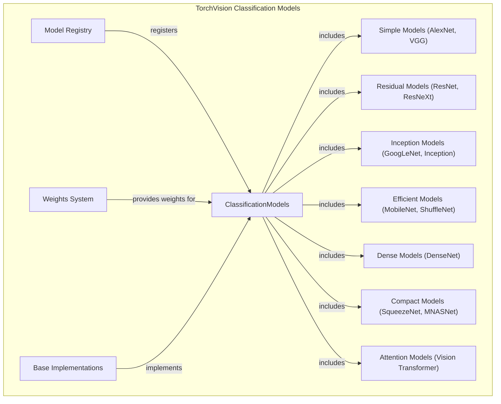
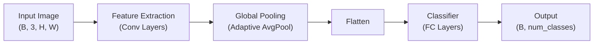
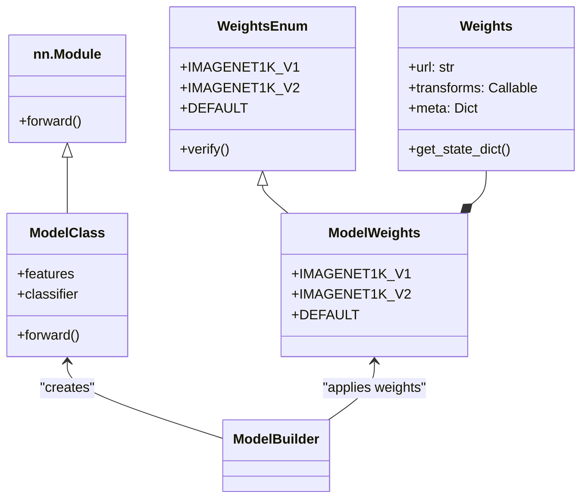
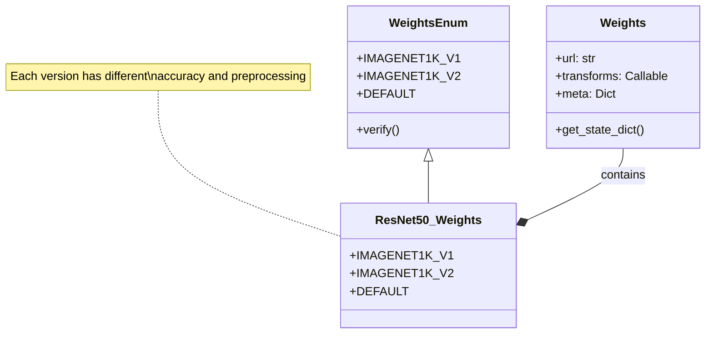
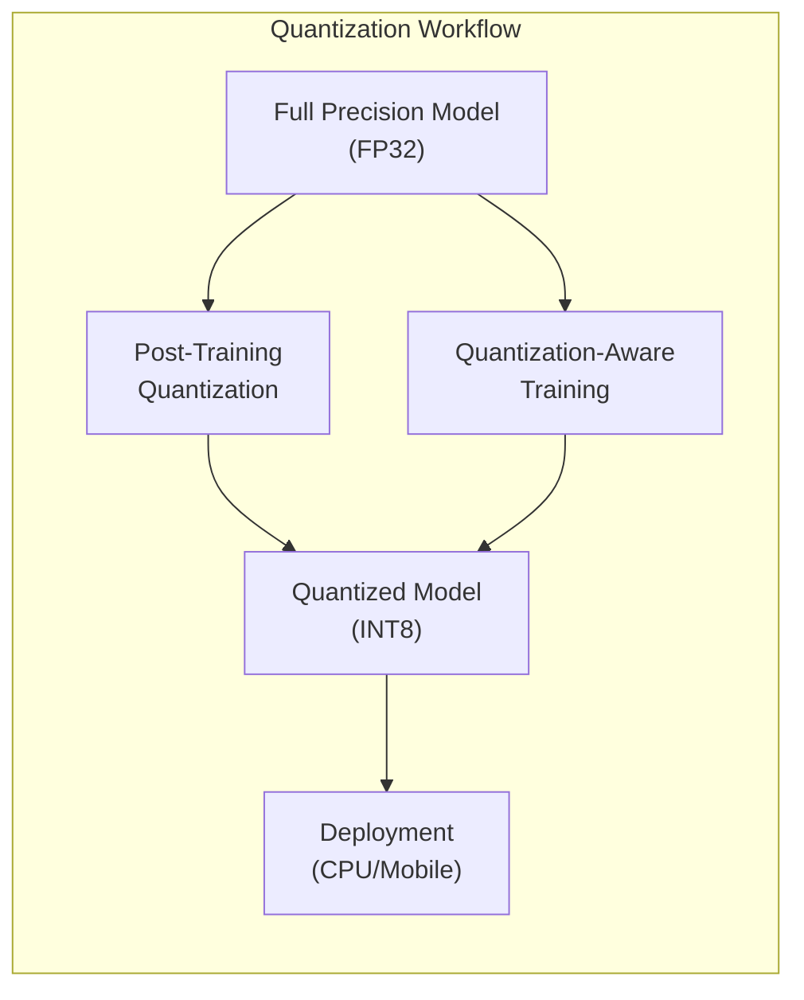

<!-- source: DeepWiki mcp.deepwiki.com · repo pytorch/vision · page 3.1 Classification Models · fetched 2026-10-21 -->

# Classification Models

<details>
<summary>Relevant source files</summary>

The following files were used as context for generating this wiki page:

- [docs/source/models.rst](docs/source/models.rst)
- [hubconf.py](hubconf.py)
- [references/classification/README.md](references/classification/README.md)
- [test/common_extended_utils.py](test/common_extended_utils.py)
- [test/expect/ModelTester.test_vit_h_14_expect.pkl](test/expect/ModelTester.test_vit_h_14_expect.pkl)
- [test/test_extended_models.py](test/test_extended_models.py)
- [test/test_models.py](test/test_models.py)
- [torchvision/models/__init__.py](torchvision/models/__init__.py)
- [torchvision/models/_api.py](torchvision/models/_api.py)
- [torchvision/models/alexnet.py](torchvision/models/alexnet.py)
- [torchvision/models/densenet.py](torchvision/models/densenet.py)
- [torchvision/models/googlenet.py](torchvision/models/googlenet.py)
- [torchvision/models/inception.py](torchvision/models/inception.py)
- [torchvision/models/mnasnet.py](torchvision/models/mnasnet.py)
- [torchvision/models/resnet.py](torchvision/models/resnet.py)
- [torchvision/models/shufflenetv2.py](torchvision/models/shufflenetv2.py)
- [torchvision/models/squeezenet.py](torchvision/models/squeezenet.py)
- [torchvision/models/vgg.py](torchvision/models/vgg.py)

</details>


This document provides comprehensive documentation of the image classification models available in TorchVision. Classification models are neural networks designed to assign input images to one of many predefined categories or classes. TorchVision offers a wide range of pre-implemented architectures with pre-trained weights, making them ready for both direct use and fine-tuning. For detection models, see [Detection Models](#3.2).

## Overview of Classification Models System

The classification models in TorchVision follow a consistent API design while implementing various popular architectures from the research literature. All models are implemented as PyTorch `nn.Module` subclasses and share a similar interface pattern, enabling easy interchangeability.



Sources:
- [torchvision/models/__init__.py]()
- [docs/source/models.rst]()

## Model Architecture

Classification models in TorchVision share a common structure despite their architectural differences. A typical classification model consists of:

1. **Feature extraction layers** - A series of convolutional layers that extract hierarchical features
2. **Global pooling** - Usually adaptive average pooling to a fixed size
3. **Classifier head** - Fully connected layers that predict class probabilities



Sources:
- [torchvision/models/resnet.py:166-285]()
- [torchvision/models/vgg.py:35-70]()

### Common Implementation Pattern

Most classification models in TorchVision follow this implementation pattern:

1. A model class (e.g., `ResNet`, `VGG`) that defines the architecture
2. A weight enum class (e.g., `ResNet50_Weights`) that contains pre-trained weight options
3. A builder function (e.g., `resnet50()`) that constructs the model and loads weights



Sources:
- [torchvision/models/_api.py:20-142]()
- [torchvision/models/resnet.py:288-303]()

## Available Classification Models

TorchVision provides a comprehensive selection of classification models:

| Model Family | Available Variants | Key Features |
|--------------|-------------------|-------------|
| ResNet | ResNet18/34/50/101/152, ResNeXt, Wide ResNet | Residual connections, bottleneck blocks |
| DenseNet | DenseNet121/169/201/161 | Dense connectivity pattern, feature reuse |
| VGG | VGG11/13/16/19 (with/without BN) | Simple stacked convolutional layers |
| Inception | Inception v3 | Parallel convolutional blocks with varying kernel sizes |
| GoogLeNet | GoogLeNet | Inception modules, auxiliary classifiers |
| AlexNet | AlexNet | Early CNN architecture with stacked conv layers |
| MobileNet | v2, v3 (small/large) | Depthwise separable convolutions for efficiency |
| EfficientNet | B0-B7, v2 (S/M/L) | Compound scaling method, inverted residual blocks |
| ShuffleNet | v2 with various channel multipliers | Channel shuffle operation |
| SqueezeNet | 1.0, 1.1 | Fire modules, reduced parameters |
| MNASNet | Various width multipliers | Mobile neural architecture search |
| Vision Transformer | Various configurations | Self-attention mechanisms |
| ConvNeXt | Tiny, Small, Base, Large | Modern ConvNet design |
| RegNet | Various configurations | Systematically designed ConvNets |
| Swin Transformer | Various configurations | Hierarchical vision transformer |

Sources:
- [docs/source/models.rst:197-256]()
- [references/classification/README.md]()
- [hubconf.py]()

### Architecture Example: ResNet

ResNet is a fundamental architecture that introduced residual connections to enable training of very deep networks.


Sources:
- [torchvision/models/resnet.py:166-285]()
- [torchvision/models/resnet.py:59-106]()
- [torchvision/models/resnet.py:108-163]()

### Architecture Example: DenseNet

DenseNet connects each layer to every other layer in a feed-forward fashion, improving feature reuse and gradient flow.

```mermaid
flowchart TD
    subgraph "DenseNet Architecture"
        Input["Input Image"] --> Conv1["First Convolution"]
        Conv1 --> Pool1["MaxPool"]
        
        subgraph "Dense Block 1"
            Pool1 --> DB1_L1["Layer 1"]
            DB1_L1 --> DB1_L2["Layer 2"]
            DB1_L1 -->|"Feature Reuse"| DB1_L2
            DB1_L2 --> DB1_L3["Layer 3"]
            DB1_L1 -->|"Feature Reuse"| DB1_L3
            DB1_L2 -->|"Feature Reuse"| DB1_L3
            DB1_L3 --> DB1_Out["Dense Block 1 Output"]
        end
        
        DB1_Out --> Trans1["Transition Layer 1"]
        
        subgraph "Dense Block 2"
            Trans1 --> DB2_L1["Layer 1"]
            DB2_L1 --> DB2_L2["Layer 2"]
            DB2_L1 -->|"Feature Reuse"| DB2_L2
            DB2_L2 --> DB2_Out["Dense Block 2 Output"]
        end
        
        DB2_Out --> Trans2["Transition Layer 2"]
        Trans2 --> MoreBlocks["More Dense Blocks..."]
        MoreBlocks --> BN["Batch Norm"]
        BN --> ReLU["ReLU"]
        ReLU --> AvgPool["Global Average Pooling"]
        AvgPool --> Linear["Linear Classifier"]
        Linear --> Output["Class Probabilities"]
    end
```



Sources:
- [torchvision/models/densenet.py:136-218]()
- [torchvision/models/densenet.py:31-93]()
- [torchvision/models/densenet.py:96-125]()
- [torchvision/models/densenet.py:127-133]()

## Model Weights System

TorchVision provides a sophisticated weights system that manages pre-trained model weights, transforms for preprocessing, and metadata.



### Weight Variants and Metadata

Each model typically offers multiple weight variants with different training regimes, accuracies, and preprocessing requirements:

1. **IMAGENET1K_V1**: Original weights trained on ImageNet
2. **IMAGENET1K_V2**: Improved training recipe weights
3. **DEFAULT**: Typically points to the best available weights

The metadata for each weight includes:
- Categories (class names)
- Model parameters count
- Performance metrics (accuracy)
- Training recipe references
- Input size requirements

Sources:
- [torchvision/models/_api.py:20-142]()
- [torchvision/models/resnet.py:306-397]()
- [docs/source/models.rst:35-62]()

## Using Classification Models

### Loading and Initializing Models

There are several ways to initialize classification models:

```python
# Method 1: Using DEFAULT weights (recommended)
import torchvision.models as models
model = models.resnet50(weights=models.ResNet50_Weights.DEFAULT)

# Method 2: Specifying a specific weight version
model = models.resnet50(weights=models.ResNet50_Weights.IMAGENET1K_V2)

# Method 3: Using string shorthand
model = models.resnet50(weights="IMAGENET1K_V2")

# Method 4: Without pre-trained weights
model = models.resnet50(weights=None)
```

### Image Transformation and Inference

Each pre-trained model requires specific image preprocessing:

```python
# Get the appropriate transforms
weights = models.ResNet50_Weights.DEFAULT
preprocess = weights.transforms()

# Apply transforms and run inference
transformed_img = preprocess(img)
model.eval()
prediction = model(transformed_img.unsqueeze(0))
```

Sources:
- [docs/source/models.rst:84-106]()
- [docs/source/models.rst:232-253]()

## Model Selection Considerations

When choosing a classification model, consider these factors:

| Factor | Description |
|--------|-------------|
| Accuracy | Higher accuracy models typically have more parameters |
| Model Size | Parameter count affects memory requirements |
| Inference Speed | Computational complexity affects throughput |
| Device Constraints | Some models are optimized for mobile/edge deployment |
| Fine-tuning Needs | Larger models may perform better when fine-tuned |

### Performance Comparison

The table below provides an approximate comparison of key classification models:

| Model | Parameters (M) | Top-1 Accuracy (%) | Relative Speed |
|-------|----------------|-------------------|----------------|
| AlexNet | 61.1 | 56.5 | Fast |
| VGG16 | 138.4 | 71.6 | Slow |
| ResNet50 | 25.6 | 80.9 | Medium |
| DenseNet121 | 8.0 | 74.4 | Medium |
| MobileNetV3 Large | 5.5 | 75.2 | Very Fast |
| EfficientNet-B0 | 5.3 | 77.1 | Fast |
| ViT-B/16 | 86.6 | 81.1 | Medium |

Sources:
- [docs/source/models.rst:262-263]()
- [test/test_models.py:374-396]()
- [references/classification/README.md]()

## Quantized Models

TorchVision also provides quantized versions of many classification models, which use 8-bit integer (INT8) representation to reduce model size and improve inference speed with minimal accuracy loss.



Available quantized models include:
- Quantized ResNet
- Quantized MobileNetV2/V3
- Quantized GoogLeNet
- Quantized ShuffleNetV2

Sources:
- [docs/source/models.rst:270-321]()
- [references/classification/README.md:283-368]()
- [test/test_models.py:953-1009]()

## Training and Fine-tuning

TorchVision provides training recipes for all classification models. These recipes are documented in the reference code and include:

1. **Training parameters**: Learning rates, weight decay, momentum
2. **Data augmentation**: Transforms applied during training
3. **Training schedules**: Epochs, learning rate scheduling
4. **Regularization techniques**: Dropout, label smoothing, mixup

For example, the default training parameters for many models are:
- Batch size: 32
- Epochs: 90
- Learning rate: 0.1
- Momentum: 0.9
- Weight decay: 1e-4

Sources:
- [references/classification/README.md:9-18]()
- [references/classification/README.md:49-54]()

## Best Practices

### Evaluation Mode

Always set models to evaluation mode before inference:

```python
model.eval()  # Important for models with BatchNorm or Dropout
```

### Preprocessing

Use the model's own transforms to ensure correct preprocessing:

```python
preprocess = weights.transforms()
```

### Hardware Considerations

- For faster inference on CPU, consider quantized models
- For mobile deployment, prioritize MobileNet, ShuffleNet, or EfficientNet
- For maximum accuracy on GPU, larger models like ResNet-101 or ViT are suitable

Sources:
- [docs/source/models.rst:108-112]()
- [docs/source/models.rst:232-253]()
- [references/classification/README.md:272-279]()

## Extending and Customizing Models

The models can be extended by:

1. **Modifying the classifier head**: Replace the final fully connected layer
2. **Feature extraction**: Remove the classifier to use as a backbone
3. **Adding custom layers**: Wrap the model in a new module

Example of modifying the classifier head:

```python
model = models.resnet50(weights=models.ResNet50_Weights.DEFAULT)
num_features = model.fc.in_features
model.fc = nn.Linear(num_features, num_custom_classes)
```

Sources:
- [torchvision/models/resnet.py:166-285]()
- [test/test_models.py:570-587]()

---

