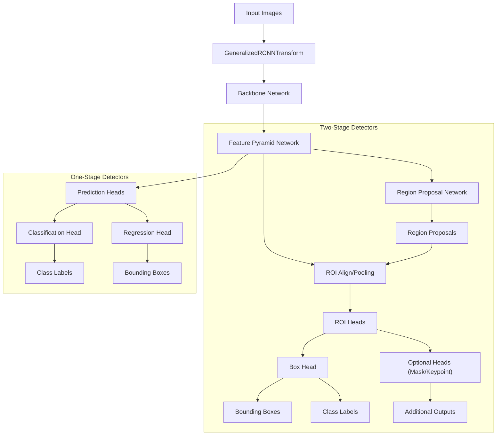
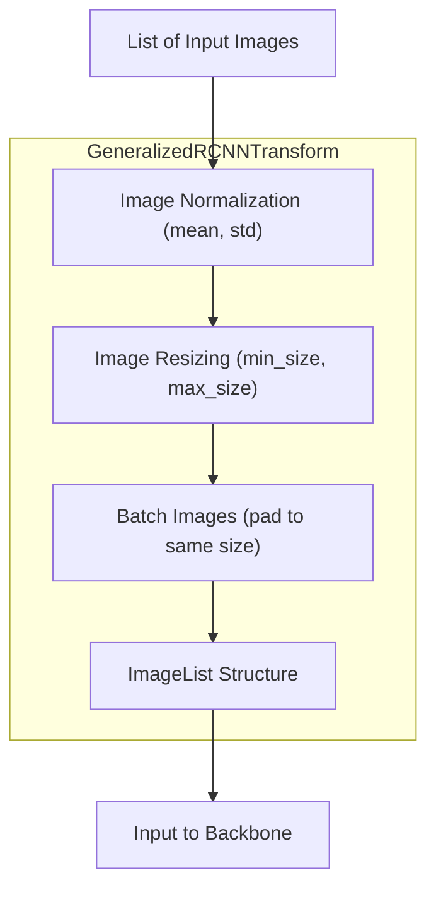
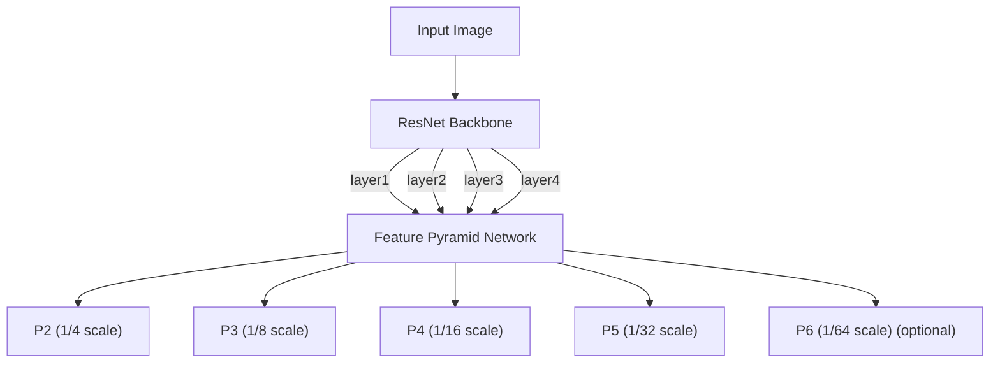
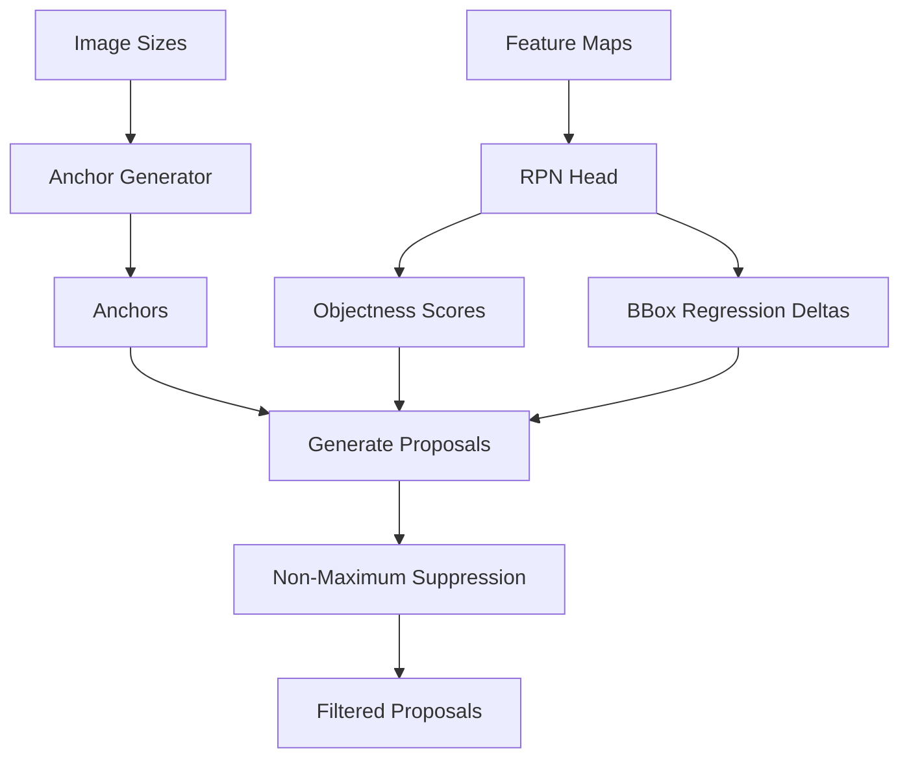
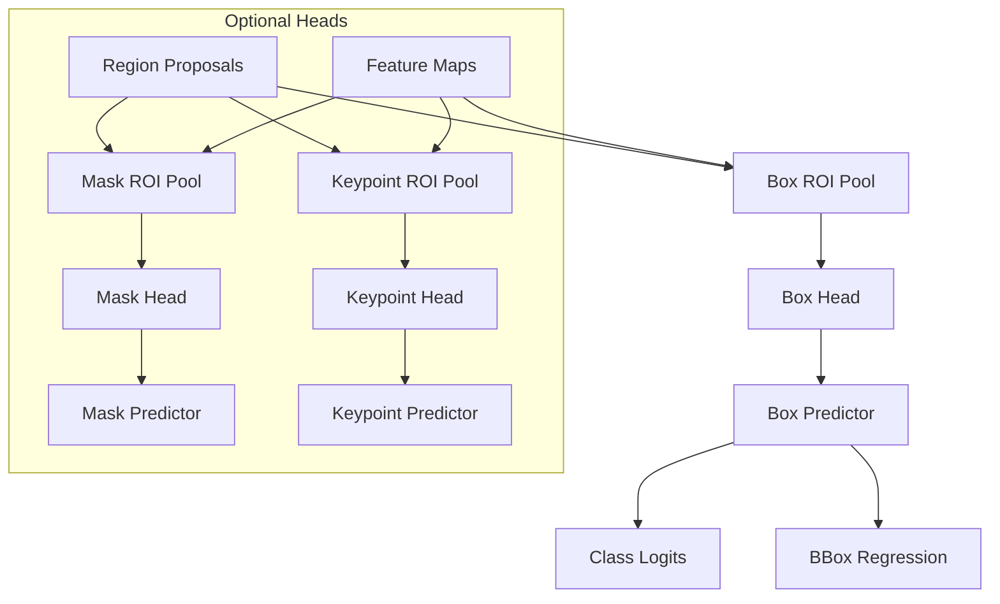
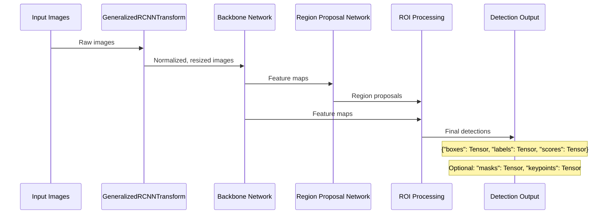

<!-- source: DeepWiki mcp.deepwiki.com · repo pytorch/vision · page 3.2 Detection and Segmentation Models · fetched 2026-10-21 -->

# Detection Models

<details>
<summary>Relevant source files</summary>

The following files were used as context for generating this wiki page:

- [docs/source/ops.rst](docs/source/ops.rst)
- [test/test_models_detection_utils.py](test/test_models_detection_utils.py)
- [test/test_onnx.py](test/test_onnx.py)
- [test/test_ops.py](test/test_ops.py)
- [torchvision/models/detection/_utils.py](torchvision/models/detection/_utils.py)
- [torchvision/models/detection/generalized_rcnn.py](torchvision/models/detection/generalized_rcnn.py)
- [torchvision/models/detection/image_list.py](torchvision/models/detection/image_list.py)
- [torchvision/models/detection/roi_heads.py](torchvision/models/detection/roi_heads.py)
- [torchvision/models/detection/rpn.py](torchvision/models/detection/rpn.py)
- [torchvision/models/detection/transform.py](torchvision/models/detection/transform.py)
- [torchvision/ops/__init__.py](torchvision/ops/__init__.py)
- [torchvision/ops/_register_onnx_ops.py](torchvision/ops/_register_onnx_ops.py)
- [torchvision/ops/_utils.py](torchvision/ops/_utils.py)
- [torchvision/ops/boxes.py](torchvision/ops/boxes.py)
- [torchvision/ops/deform_conv.py](torchvision/ops/deform_conv.py)
- [torchvision/ops/drop_block.py](torchvision/ops/drop_block.py)
- [torchvision/ops/feature_pyramid_network.py](torchvision/ops/feature_pyramid_network.py)
- [torchvision/ops/misc.py](torchvision/ops/misc.py)
- [torchvision/ops/poolers.py](torchvision/ops/poolers.py)
- [torchvision/ops/ps_roi_align.py](torchvision/ops/ps_roi_align.py)
- [torchvision/ops/ps_roi_pool.py](torchvision/ops/ps_roi_pool.py)
- [torchvision/ops/roi_align.py](torchvision/ops/roi_align.py)
- [torchvision/ops/roi_pool.py](torchvision/ops/roi_pool.py)
- [torchvision/ops/stochastic_depth.py](torchvision/ops/stochastic_depth.py)

</details>


This document provides a technical overview of the object detection models available in TorchVision. These models can identify and locate objects in images by predicting bounding boxes and class labels. Some models also provide additional functionality like segmentation masks or keypoints. For image classification models, see [Classification Models](#3.1).

## Architecture Overview

TorchVision contains several state-of-the-art object detection architectures, which can be categorized into two main types:

- **Two-stage detectors**: Models that first generate region proposals and then classify/refine them (Faster R-CNN family)
- **One-stage detectors**: Models that directly predict bounding boxes and classes in a single step (RetinaNet, SSD, FCOS)

Most detection models in TorchVision implement the Generalized R-CNN framework, which consists of these main components:



Sources: 
- [torchvision/models/detection/generalized_rcnn.py:15-49]()
- [torchvision/models/detection/transform.py:86-285]()
- [torchvision/models/detection/faster_rcnn.py:43-284]()
- [torchvision/models/detection/retinanet.py:323-504]()
- [torchvision/models/detection/ssd.py:57-105]()

## Available Models

### Two-Stage Detectors

#### Faster R-CNN

Faster R-CNN is a two-stage detector that first proposes regions of interest using a Region Proposal Network (RPN), then classifies and refines the bounding boxes for these regions.

```python
from torchvision.models.detection import fasterrcnn_resnet50_fpn, FasterRCNN_ResNet50_FPN_Weights

# Load pre-trained model
model = fasterrcnn_resnet50_fpn(weights=FasterRCNN_ResNet50_FPN_Weights.DEFAULT)
model.eval()
```

Key variants available:
- `fasterrcnn_resnet50_fpn`: Standard implementation with ResNet-50 backbone and FPN
- `fasterrcnn_resnet50_fpn_v2`: Enhanced implementation with better accuracy
- `fasterrcnn_mobilenet_v3_large_fpn`: Mobile-friendly version with MobileNetV3 backbone
- `fasterrcnn_mobilenet_v3_large_320_fpn`: Lower-resolution mobile version

Sources:
- [torchvision/models/detection/faster_rcnn.py:43-284]()
- [torchvision/models/detection/faster_rcnn.py:466-581]()

#### Mask R-CNN

Mask R-CNN extends Faster R-CNN by adding a branch for predicting segmentation masks. It shares the backbone and RPN with Faster R-CNN but adds a mask prediction head.

```python
from torchvision.models.detection import maskrcnn_resnet50_fpn, MaskRCNN_ResNet50_FPN_Weights

# Load pre-trained model
model = maskrcnn_resnet50_fpn(weights=MaskRCNN_ResNet50_FPN_Weights.DEFAULT)
model.eval()
```

Key variants available:
- `maskrcnn_resnet50_fpn`: Standard implementation with ResNet-50 backbone and FPN
- `maskrcnn_resnet50_fpn_v2`: Enhanced implementation with better accuracy

Sources:
- [torchvision/models/detection/mask_rcnn.py:27-268]()
- [torchvision/models/detection/mask_rcnn.py:411-511]()

#### Keypoint R-CNN

Keypoint R-CNN extends Faster R-CNN to detect human keypoints (joints and landmarks). It's particularly useful for human pose estimation.

```python
from torchvision.models.detection import keypointrcnn_resnet50_fpn, KeypointRCNN_ResNet50_FPN_Weights

# Load pre-trained model
model = keypointrcnn_resnet50_fpn(weights=KeypointRCNN_ResNet50_FPN_Weights.DEFAULT)
model.eval()
```

Sources:
- [torchvision/models/detection/keypoint_rcnn.py:25-270]()
- [torchvision/models/detection/keypoint_rcnn.py:372-473]()

### One-Stage Detectors

#### RetinaNet

RetinaNet is a one-stage detector that addresses class imbalance using focal loss. It consists of a backbone with FPN and two task-specific subnetworks for classification and bounding box regression.

```python
from torchvision.models.detection import retinanet_resnet50_fpn, RetinaNet_ResNet50_FPN_Weights

# Load pre-trained model
model = retinanet_resnet50_fpn(weights=RetinaNet_ResNet50_FPN_Weights.DEFAULT)
model.eval()
```

Key variants available:
- `retinanet_resnet50_fpn`: Standard implementation with ResNet-50 backbone and FPN
- `retinanet_resnet50_fpn_v2`: Enhanced implementation with better accuracy

Sources:
- [torchvision/models/detection/retinanet.py:323-592]()
- [torchvision/models/detection/retinanet.py:595-702]()

#### SSD (Single Shot Detector)

SSD (Single Shot Detector) is a one-stage detector that predicts bounding boxes and class probabilities directly from feature maps at multiple scales.

```python
from torchvision.models.detection import ssd300_vgg16, SSD300_VGG16_Weights

# Load pre-trained model
model = ssd300_vgg16(weights=SSD300_VGG16_Weights.DEFAULT)
model.eval()
```

TorchVision also includes SSDLite, a mobile-friendly version of SSD that uses depthwise separable convolutions:

```python
from torchvision.models.detection import ssdlite320_mobilenet_v3_large, SSDLite320_MobileNet_V3_Large_Weights

# Load pre-trained model
model = ssdlite320_mobilenet_v3_large(weights=SSDLite320_MobileNet_V3_Large_Weights.DEFAULT)
model.eval()
```

Sources:
- [torchvision/models/detection/ssd.py:57-105]()
- [torchvision/models/detection/ssdlite.py:29-113]()

#### FCOS (Fully Convolutional One-Stage)

FCOS is an anchor-free, one-stage detector that directly predicts class probabilities and bounding box coordinates at each location on the feature maps.

```python
from torchvision.models.detection import fcos_resnet50_fpn, FCOS_ResNet50_FPN_Weights

# Load pre-trained model
model = fcos_resnet50_fpn(weights=FCOS_ResNet50_FPN_Weights.DEFAULT)
model.eval()
```

Sources:
- [torchvision/models/detection/fcos.py:31-590]()

## Common Components

### Data Handling and Transformation



The `GeneralizedRCNNTransform` class handles preprocessing of input images, including normalization and resizing, returning an `ImageList` structure that preserves original image size information.

Sources:
- [torchvision/models/detection/transform.py:86-285]()
- [torchvision/models/detection/image_list.py:7-25]()

### Backbone Networks

The backbone network extracts features from the input image. Common backbones include:

- ResNet (usually ResNet-50) with Feature Pyramid Network (FPN)
- MobileNetV3 with FPN for mobile applications

The `_resnet_fpn_extractor` function creates a feature pyramid network on top of a ResNet backbone:



Sources:
- [torchvision/models/detection/backbone_utils.py:13-59]()
- [torchvision/models/detection/backbone_utils.py:118-150]()
- [torchvision/ops/feature_pyramid_network.py:36-123]()

### Region Proposal Network (RPN)

For two-stage detectors, the Region Proposal Network generates region proposals from feature maps:



Sources:
- [torchvision/models/detection/rpn.py:15-78]()
- [torchvision/models/detection/rpn.py:113-388]()
- [torchvision/models/detection/anchor_utils.py:10-133]()

### ROI Heads

ROI Heads process the region proposals to produce the final detections:



Sources:
- [torchvision/models/detection/roi_heads.py:11-49]()
- [torchvision/ops/poolers.py:13-134]()

## Model Forward Pass



During training, the model expects both images and targets (ground truth boxes and labels) and returns a dictionary of losses. During inference, it only requires images and returns a list of predictions, one per input image.

Sources:
- [torchvision/models/detection/generalized_rcnn.py:15-49]()
- [torchvision/models/detection/faster_rcnn.py:43-284]()

## Usage Examples

### Basic Inference

```python
import torch
from torchvision.models.detection import fasterrcnn_resnet50_fpn, FasterRCNN_ResNet50_FPN_Weights
from torchvision.transforms._presets import ObjectDetection

# Load pre-trained model
weights = FasterRCNN_ResNet50_FPN_Weights.DEFAULT
model = fasterrcnn_resnet50_fpn(weights=weights)
model.eval()

# Get the transforms
preprocess = weights.transforms()

# Preprocess image
image = preprocess(image)

# Make prediction
with torch.no_grad():
    prediction = model([image])[0]

# Access predictions
boxes = prediction["boxes"]
labels = prediction["labels"]
scores = prediction["scores"]
```

### Training on Custom Data

```python
# Initialize model
model = fasterrcnn_resnet50_fpn(weights=FasterRCNN_ResNet50_FPN_Weights.DEFAULT)
model.train()

# Optimizer
params = [p for p in model.parameters() if p.requires_grad]
optimizer = torch.optim.SGD(params, lr=0.005, momentum=0.9, weight_decay=0.0005)

# Training loop
for images, targets in data_loader:
    # Forward pass
    loss_dict = model(images, targets)
    losses = sum(loss for loss in loss_dict.values())
    
    # Backward pass
    optimizer.zero_grad()
    losses.backward()
    optimizer.step()
```

Sources:
- [test/test_onnx.py:425-448]()
- [references/detection/README.md:23-28]()

## Advanced Topics

### ONNX Export

Detection models can be exported to ONNX format for deployment:

```python
import torch
from torchvision.models.detection import fasterrcnn_resnet50_fpn

model = fasterrcnn_resnet50_fpn(pretrained=True)
model.eval()

dummy_input = [torch.rand(3, 300, 400)]
torch.onnx.export(model, dummy_input, "faster_rcnn.onnx", opset_version=11)
```

Sources:
- [test/test_onnx.py:425-448]()
- [torchvision/ops/_register_onnx_ops.py:13-90]()

### Box Coding

Two box coding methods are available:
- `BoxCoder`: Standard box coder used by R-CNN models
- `BoxLinearCoder`: Linear box coder used by FCOS

Sources:
- [torchvision/models/detection/_utils.py:74-224]()
- [torchvision/models/detection/_utils.py:227-317]()

### Anchor Generation

Anchor boxes are used as reference points for predicting the final bounding boxes. The `AnchorGenerator` class generates these anchors with different sizes and aspect ratios.

Sources:
- [torchvision/models/detection/anchor_utils.py:10-133]()
- [test/test_models_detection_anchor_utils.py:9-33]()

### Model Performance

The table below shows the performance metrics of the detection models on COCO validation set:

| Model | Backbone | mAP | Additional Outputs |
|-------|----------|-----|-------------------|
| Faster R-CNN | ResNet-50-FPN | 37.0 | - |
| Faster R-CNN v2 | ResNet-50-FPN | 46.7 | - |
| Mask R-CNN | ResNet-50-FPN | 37.9 | Masks (AP: 34.6) |
| Mask R-CNN v2 | ResNet-50-FPN | 47.4 | Masks (AP: 41.8) |
| Keypoint R-CNN | ResNet-50-FPN | 54.6 | Keypoints (AP: 65.0) |
| RetinaNet | ResNet-50-FPN | 36.4 | - |
| RetinaNet v2 | ResNet-50-FPN | 41.5 | - |
| SSD300 | VGG16 | 25.1 | - |
| SSDLite | MobileNetV3-Large | 21.3 | - |
| FCOS | ResNet-50-FPN | 39.2 | - |

Sources:
- [torchvision/models/detection/faster_rcnn.py:381-399]()
- [torchvision/models/detection/mask_rcnn.py:362-403]()
- [torchvision/models/detection/keypoint_rcnn.py:319-359]()

## Extending Detection Models

TorchVision's detection models are designed to be easily extended and customized. Here are common customization points:

1. **Custom Backbone**: Replace the default backbone with a custom one
2. **Custom Anchor Generator**: Modify the anchor sizes and aspect ratios
3. **Custom Heads**: Replace or modify detection/segmentation heads
4. **Custom Transforms**: Change the preprocessing transformations

Example of creating a custom Faster R-CNN model with a MobileNetV2 backbone:

```python
import torch
import torchvision
from torchvision.models.detection import FasterRCNN
from torchvision.models.detection.rpn import AnchorGenerator

# Load a pre-trained MobileNetV2 and use it as backbone
backbone = torchvision.models.mobilenet_v2(pretrained=True).features
backbone.out_channels = 1280  # Set output channels for FPN

# Create anchor generator with custom sizes and aspect ratios
anchor_generator = AnchorGenerator(
    sizes=((32, 64, 128, 256, 512),),
    aspect_ratios=((0.5, 1.0, 2.0),)
)

# Create ROI pooler
roi_pooler = torchvision.ops.MultiScaleRoIAlign(
    featmap_names=['0'],
    output_size=7,
    sampling_ratio=2
)

# Create the Faster R-CNN model
model = FasterRCNN(
    backbone=backbone,
    num_classes=91,  # COCO classes + background
    rpn_anchor_generator=anchor_generator,
    box_roi_pool=roi_pooler
)
```

Sources:
- [torchvision/models/detection/faster_rcnn.py:124-165]()
- [torchvision/models/detection/mask_rcnn.py:117-162]()
- [torchvision/models/detection/keypoint_rcnn.py:116-162]()

---

