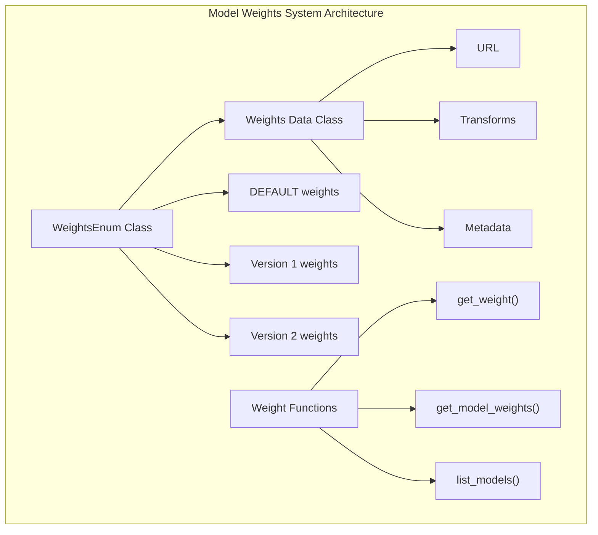
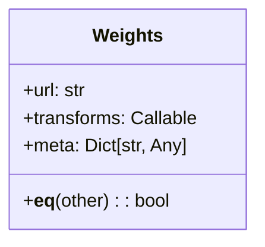
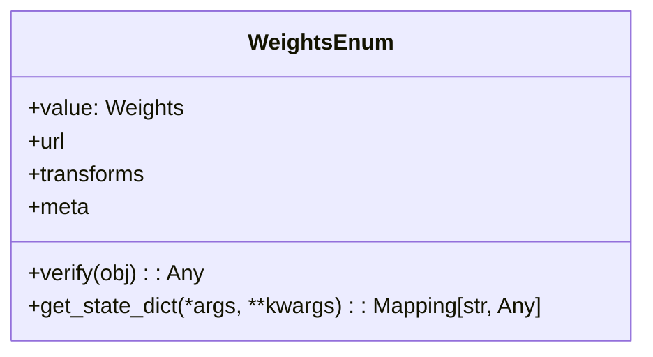
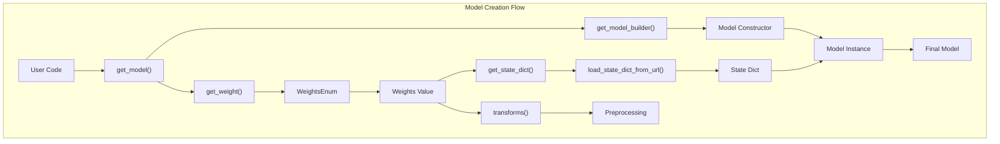
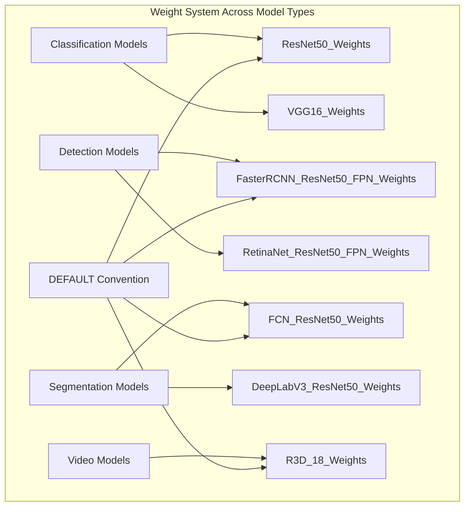

<!-- source: DeepWiki mcp.deepwiki.com · repo pytorch/vision · page 3.3 Model Weights System · fetched 2026-10-21 -->

# Model Weights System

<details>
<summary>Relevant source files</summary>

The following files were used as context for generating this wiki page:

- [docs/source/models.rst](docs/source/models.rst)
- [hubconf.py](hubconf.py)
- [references/classification/README.md](references/classification/README.md)
- [test/common_extended_utils.py](test/common_extended_utils.py)
- [test/expect/ModelTester.test_vit_h_14_expect.pkl](test/expect/ModelTester.test_vit_h_14_expect.pkl)
- [test/test_extended_models.py](test/test_extended_models.py)
- [test/test_models.py](test/test_models.py)
- [torchvision/models/__init__.py](torchvision/models/__init__.py)
- [torchvision/models/_api.py](torchvision/models/_api.py)

</details>


This document describes the weights system in TorchVision, which provides standardized access to pre-trained model weights. The weights system offers a consistent interface for loading pre-trained models, accessing metadata, and applying appropriate transforms across all model types (classification, detection, segmentation, etc.). For information about specific model architectures, see the respective model pages in section [Models](#3).

## 1. Overview

TorchVision's model weights system serves several key purposes:

1. Providing a standardized way to access pre-trained weights
2. Attaching appropriate transforms to each set of weights
3. Storing metadata about weights (like accuracy, training recipe, etc.)
4. Versioning different weight sets for the same model architecture

The system uses an enum-based approach where each model has its own `WeightsEnum` that contains all available pre-trained weights with their metadata and transforms.



Sources: [torchvision/models/_api.py:68-106](torchvision/models/_api.py:68-106), [torchvision/models/_api.py:20-66](torchvision/models/_api.py:20-66)

## 2. Core Components

### 2.1 The `Weights` Class

The `Weights` class is a data class that groups important attributes associated with pre-trained weights:



- **`url`**: Location where the weights are stored
- **`transforms`**: A callable that constructs preprocessing method or validation transforms
- **`meta`**: Dictionary storing metadata about the weights (e.g., accuracy, number of parameters, classes)

Sources: [torchvision/models/_api.py:20-66](torchvision/models/_api.py:20-66)

### 2.2 The `WeightsEnum` Class

The `WeightsEnum` class is the parent class of all model weights, inheriting from Python's `Enum`. Each model has its own `WeightsEnum` subclass, such as `ResNet50_Weights`.



Key methods and properties:
- **`verify(obj)`**: Verifies that the provided object is a valid weight value
- **`get_state_dict()`**: Loads the state dictionary from the URL
- **`url`**, **`transforms`**, **`meta`**: Properties that access the corresponding fields in the weights value

Sources: [torchvision/models/_api.py:68-106](torchvision/models/_api.py:68-106)

## 3. Using Pre-trained Weights

### 3.1 Initializing Models with Weights

There are several ways to initialize a model with pre-trained weights:

```python
# Using the weights enum directly
model = resnet50(weights=ResNet50_Weights.IMAGENET1K_V2)

# Using string representation
model = resnet50(weights="IMAGENET1K_V2")

# Using the DEFAULT weights (currently IMAGENET1K_V2)
model = resnet50(weights=ResNet50_Weights.DEFAULT)

# No weights - random initialization
model = resnet50(weights=None)
```

The `weights` parameter has replaced the deprecated `pretrained` parameter from earlier versions.

Sources: [docs/source/models.rst:36-62](docs/source/models.rst:36-62), [docs/source/models.rst:63-82](docs/source/models.rst:63-82)

### 3.2 Using Weight Transforms

Each weight set comes with appropriate preprocessing transforms necessary for the model:

```python
# Initialize the weights
weights = ResNet50_Weights.DEFAULT
# Get the preprocessing transforms
preprocess = weights.transforms()
# Apply transforms to your input
img_transformed = preprocess(img)
```

These transforms ensure that inputs to the model are preprocessed in the same way as during training.

Sources: [docs/source/models.rst:84-107](docs/source/models.rst:84-107)

### 3.3 Accessing Weight Metadata

Weights contain metadata that provides important information about the model:

```python
weights = ResNet50_Weights.IMAGENET1K_V2
# Access class names
class_names = weights.meta["categories"]
# Access other metadata like accuracy
accuracy = weights.meta["acc@1"]
```

Common metadata fields include:
- `categories`: Class names for classification models
- `acc@1`, `acc@5`: Top-1 and Top-5 accuracy
- `recipe`: Training recipe or method
- `num_params`: Number of parameters in the model

Sources: [docs/source/models.rst:256](docs/source/models.rst:256), [references/classification/train.py:248-254](references/classification/train.py:248-254)

## 4. Weight System Architecture

The weights system integrates with the model loading and creation process:



Sources: [torchvision/models/_api.py:190-271](torchvision/models/_api.py:190-271), [torchvision/models/_api.py:108-187](torchvision/models/_api.py:108-187)

## 5. Creating and Training Models with Weights

### 5.1 Loading Weights During Training

When fine-tuning a model or resuming training, weights can be loaded explicitly:

```python
# Create model with pre-trained weights
model = torchvision.models.get_model(args.model, weights=args.weights, num_classes=num_classes)

# Load custom weights from checkpoint
if args.resume:
    checkpoint = torch.load(args.resume, map_location="cpu", weights_only=True)
    model_without_ddp.load_state_dict(checkpoint["model"])
```

Sources: [references/classification/train.py:248-249](references/classification/train.py:248-249), [references/classification/train.py:341-351](references/classification/train.py:341-351)

### 5.2 Saving Models for Weights Creation

During training, models are saved as checkpoints:

```python
checkpoint = {
    "model": model_without_ddp.state_dict(),
    "optimizer": optimizer.state_dict(),
    "lr_scheduler": lr_scheduler.state_dict(),
    "epoch": epoch,
    "args": args,
}
utils.save_on_master(checkpoint, os.path.join(args.output_dir, f"model_{epoch}.pth"))
```

These checkpoints can be used to create new weights entries.

Sources: [references/classification/train.py:374-386](references/classification/train.py:374-386), [references/detection/train.py:312-321](references/detection/train.py:312-321)

### 5.3 Creating Custom Weight Enums

To create a custom weights entry, you would:

1. Create a new `Weights` instance
2. Add it to a custom `WeightsEnum`
3. Register it with your model

```python
class MyModelWeights(WeightsEnum):
    CUSTOM_WEIGHTS = Weights(
        url="https://path/to/weights.pth",
        transforms=lambda: my_transforms(),
        meta={
            "acc@1": 76.0,
            "categories": ["class1", "class2", ...],
        }
    )
    DEFAULT = CUSTOM_WEIGHTS
```

Sources: [torchvision/models/_api.py:68-106](torchvision/models/_api.py:68-106)

## 6. Weight Utility Functions

TorchVision provides several utility functions for working with weights:

| Function | Purpose |
|----------|---------|
| `get_weight(name)` | Gets a weights enum value by its full name (e.g., "ResNet50_Weights.IMAGENET1K_V1") |
| `get_model_weights(name)` | Returns the weights enum class associated with a model |
| `get_model(name, **config)` | Creates a model by name with optional weights configuration |
| `list_models(module)` | Lists available models in a module |

Sources: [torchvision/models/_api.py:108-142](torchvision/models/_api.py:108-142), [torchvision/models/_api.py:144-187](torchvision/models/_api.py:144-187), [torchvision/models/_api.py:206-243](torchvision/models/_api.py:206-243), [torchvision/models/_api.py:246-271](torchvision/models/_api.py:246-271)

## 7. Using Weights Across Different Model Types

Each model type (classification, detection, segmentation, etc.) has its own weight system, but they all follow the same pattern:



All model types follow the same pattern:
1. Each has a `WeightsEnum` class specific to the model
2. All provide a `DEFAULT` weight entry for the best available weights
3. All include metadata specific to their task (e.g., class names, accuracy metrics)
4. All provide appropriate transforms for preprocessing

Sources: [docs/source/models.rst:195-256](docs/source/models.rst:195-256), [docs/source/models.rst:323-372](docs/source/models.rst:323-372), [docs/source/models.rst:384-499](docs/source/models.rst:384-499), [docs/source/models.rst:508-557](docs/source/models.rst:508-557)

## 8. Testing and Validation

When testing models with weights, you can verify correctness by checking against expected outputs or by comparing with reference models:

```python
# Create model with default weights
weights = ResNet50_Weights.DEFAULT
model = resnet50(weights=weights)
model.eval()

# Apply appropriate transforms
preprocess = weights.transforms()
batch = preprocess(img).unsqueeze(0)

# Run inference and check output
prediction = model(batch)
```

The weights system includes tools to validate outputs against expected values for regression testing.

Sources: [test/test_models.py:67-78](test/test_models.py:67-78), [test/test_models.py:673-716](test/test_models.py:673-716)

## 9. Loading Models from Hub

Most pre-trained models can be accessed directly via PyTorch Hub:

```python
import torch

# Load model with specific weights
model = torch.hub.load("pytorch/vision", "resnet50", weights="IMAGENET1K_V2")

# Get weights enum first then load model
weights = torch.hub.load(
    "pytorch/vision",
    "get_weight",
    weights="ResNet50_Weights.IMAGENET1K_V2",
)
model = torch.hub.load("pytorch/vision", "resnet50", weights=weights)
```

This provides a way to use TorchVision models without directly installing TorchVision.

Sources: [docs/source/models.rst:162-193](docs/source/models.rst:162-193)

## 10. Best Practices

1. **Always use the transforms associated with weights**: Each weight has specific preprocessing requirements
2. **Use `DEFAULT` for the best performance**: The `DEFAULT` weight is always pointed to the best performing weight set
3. **Access metadata through the weights**: Model metadata is available through the weights object
4. **Use `model.eval()` before inference**: Many models have different behaviors in training and evaluation modes
5. **Create custom weight enums for your own models**: Follow the pattern to ensure consistency

Sources: [docs/source/models.rst:84-122](docs/source/models.rst:84-122)

---

