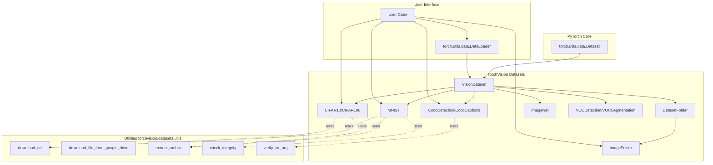
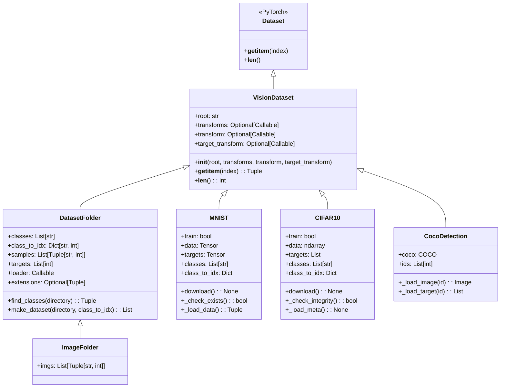
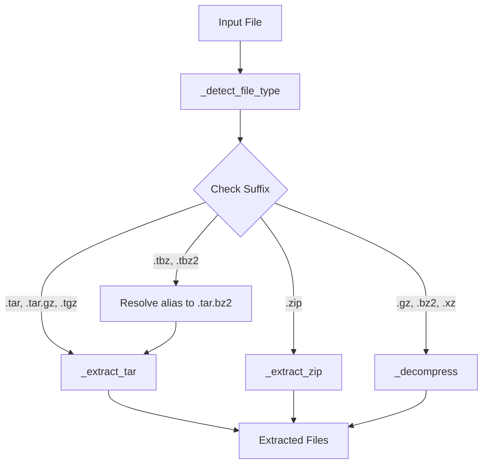
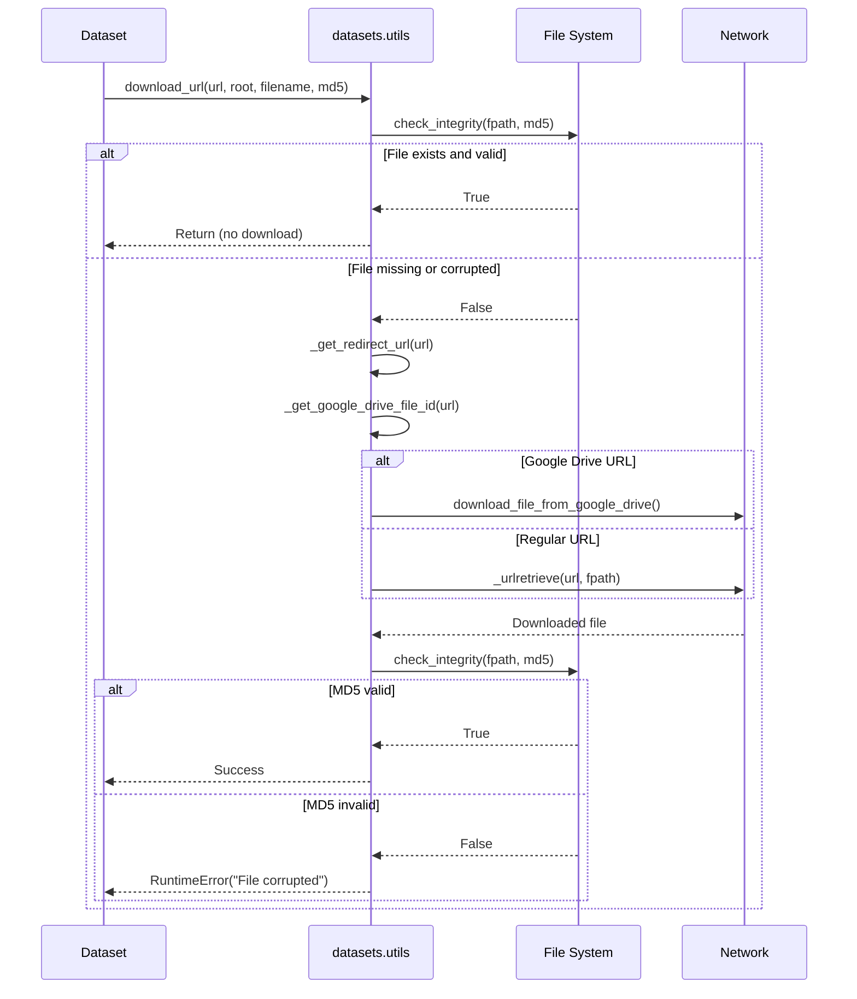
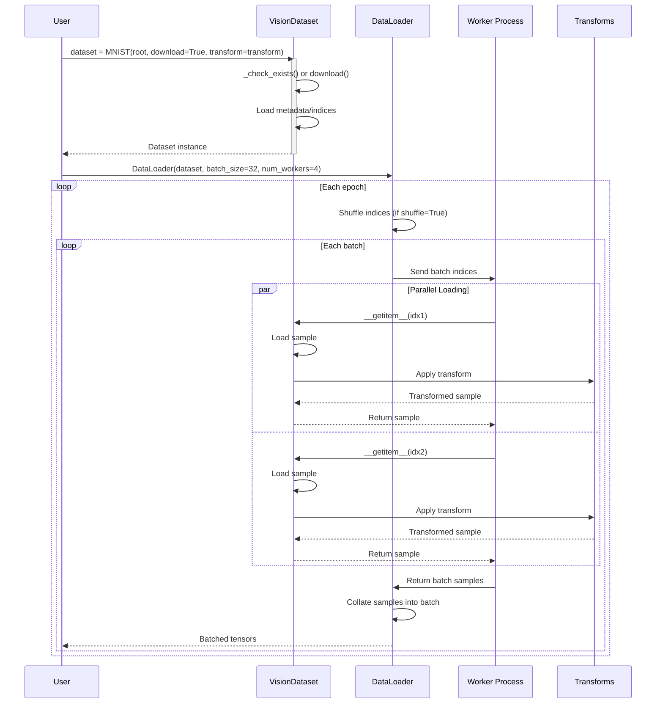

<!-- source: DeepWiki mcp.deepwiki.com · repo pytorch/vision · page 4 Datasets · fetched 2026-10-21 -->

# Datasets

<details>
<summary>Relevant source files</summary>

The following files were used as context for generating this wiki page:

- [docs/source/datasets.rst](docs/source/datasets.rst)
- [test/datasets_utils.py](test/datasets_utils.py)
- [test/test_datasets.py](test/test_datasets.py)
- [test/test_datasets_utils.py](test/test_datasets_utils.py)
- [torchvision/datasets/__init__.py](torchvision/datasets/__init__.py)
- [torchvision/datasets/_optical_flow.py](torchvision/datasets/_optical_flow.py)
- [torchvision/datasets/_stereo_matching.py](torchvision/datasets/_stereo_matching.py)
- [torchvision/datasets/caltech.py](torchvision/datasets/caltech.py)
- [torchvision/datasets/celeba.py](torchvision/datasets/celeba.py)
- [torchvision/datasets/cifar.py](torchvision/datasets/cifar.py)
- [torchvision/datasets/coco.py](torchvision/datasets/coco.py)
- [torchvision/datasets/folder.py](torchvision/datasets/folder.py)
- [torchvision/datasets/inaturalist.py](torchvision/datasets/inaturalist.py)
- [torchvision/datasets/lsun.py](torchvision/datasets/lsun.py)
- [torchvision/datasets/mnist.py](torchvision/datasets/mnist.py)
- [torchvision/datasets/omniglot.py](torchvision/datasets/omniglot.py)
- [torchvision/datasets/phototour.py](torchvision/datasets/phototour.py)
- [torchvision/datasets/places365.py](torchvision/datasets/places365.py)
- [torchvision/datasets/semeion.py](torchvision/datasets/semeion.py)
- [torchvision/datasets/stl10.py](torchvision/datasets/stl10.py)
- [torchvision/datasets/svhn.py](torchvision/datasets/svhn.py)
- [torchvision/datasets/usps.py](torchvision/datasets/usps.py)
- [torchvision/datasets/utils.py](torchvision/datasets/utils.py)
- [torchvision/datasets/widerface.py](torchvision/datasets/widerface.py)
- [torchvision/transforms/_functional_pil.py](torchvision/transforms/_functional_pil.py)

</details>


The TorchVision datasets module provides a unified interface for loading standard computer vision datasets. All datasets inherit from `VisionDataset`, which extends PyTorch's `Dataset` class, enabling seamless integration with `DataLoader` for batching and parallel loading. The module includes utilities for downloading, extracting, and verifying dataset files.

## System Overview

The datasets system consists of three main components: the `VisionDataset` base class, download/extraction utilities, and task-specific dataset implementations.

**High-Level Dataset System Architecture**



Sources: [torchvision/datasets/__init__.py:1-148](), [torchvision/datasets/utils.py:1-469](), [torchvision/datasets/folder.py:1-338]()

## VisionDataset Base Class

`VisionDataset` is the base class for all TorchVision datasets. It extends `torch.utils.data.Dataset` and provides standardized handling of transformations.

**VisionDataset Class Structure**



The `VisionDataset` constructor accepts:
- `root`: Root directory where dataset files are stored
- `transforms`: Function applied to both input and target (for detection/segmentation datasets)
- `transform`: Function applied only to input samples
- `target_transform`: Function applied only to targets

Sources: [torchvision/datasets/folder.py:109-254](), [torchvision/datasets/mnist.py:20-202](), [torchvision/datasets/cifar.py:13-144](), [torchvision/datasets/coco.py:10-64]()

## Download and Extraction Utilities

The `torchvision.datasets.utils` module provides utilities for downloading, extracting, and verifying dataset files. These utilities are used internally by dataset classes but can also be used independently.

**Key Utility Functions**

| Function | Purpose | Key Parameters |
|----------|---------|----------------|
| `download_url` | Download file from URL | `url`, `root`, `filename`, `md5` |
| `download_file_from_google_drive` | Download from Google Drive | `file_id`, `root`, `filename`, `md5` |
| `extract_archive` | Extract compressed archives | `from_path`, `to_path`, `remove_finished` |
| `download_and_extract_archive` | Download and extract in one step | `url`, `download_root`, `extract_root` |
| `check_integrity` | Verify file integrity using MD5 | `fpath`, `md5` |
| `check_md5` | Compute and verify MD5 checksum | `fpath`, `md5` |
| `verify_str_arg` | Validate string arguments | `value`, `arg`, `valid_values` |

Sources: [torchvision/datasets/utils.py:87-427]()

**File Type Detection and Extraction**

The utilities automatically detect and handle various archive formats:



Supported formats include: `.tar`, `.tar.gz`, `.tgz`, `.tar.bz2`, `.tbz`, `.tbz2`, `.tar.xz`, `.zip`, `.gz`, `.bz2`, `.xz`

Sources: [torchvision/datasets/utils.py:209-391]()

**Download and Integrity Check Flow**



Sources: [torchvision/datasets/utils.py:87-207]()

## Dataset Structure Patterns

TorchVision provides two generic dataset classes for common folder structures: `DatasetFolder` and `ImageFolder`.

**DatasetFolder Pattern**

`DatasetFolder` is a generic data loader for datasets organized in the following structure:

```
root/class_x/xxx.ext
root/class_x/xxy.ext
root/class_y/123.ext
root/class_y/nsdf3.ext
```

Key components:
- `find_classes(directory)`: Discovers class folders and creates class-to-index mapping
- `make_dataset(directory, class_to_idx)`: Generates list of `(sample_path, class_index)` tuples
- `loader`: Callable function to load a sample given its path

Sources: [torchvision/datasets/folder.py:109-254]()

**ImageFolder Pattern**

`ImageFolder` extends `DatasetFolder` specifically for image data, using `default_loader` which automatically selects between PIL and accimage backends based on configuration.

```python
# ImageFolder usage example
from torchvision.datasets import ImageFolder
import torchvision.transforms as transforms

transform = transforms.Compose([
    transforms.Resize(256),
    transforms.CenterCrop(224),
    transforms.ToTensor(),
])

dataset = ImageFolder(root='path/to/data', transform=transform)
# Automatically creates classes from folder names
# dataset.classes -> ['class_a', 'class_b', ...]
# dataset.class_to_idx -> {'class_a': 0, 'class_b': 1, ...}
```

Supported image extensions: `.jpg`, `.jpeg`, `.png`, `.ppm`, `.bmp`, `.pgm`, `.tif`, `.tiff`, `.webp`

Sources: [torchvision/datasets/folder.py:257-338](), [torchvision/datasets/folder.py:36-107]()

## Integration with DataLoader

TorchVision datasets are fully compatible with PyTorch's `DataLoader` for efficient batching, shuffling, and parallel data loading.

**Dataset to DataLoader Pipeline**



Sources: [torchvision/datasets/mnist.py:131-154](), [torchvision/datasets/cifar.py:104-127]()

**Multi-Process Loading Considerations**

When using `num_workers > 0`, dataset initialization should handle:
- Download logic should be triggered before creating DataLoader to avoid race conditions
- File I/O operations in `__getitem__` should be thread-safe
- Random number generators should be seeded per worker for reproducibility

Sources: [docs/source/datasets.rst:30-37]()

## Transform Integration

TorchVision datasets support three types of transformations: input transforms, target transforms, and combined transforms.

**Transform Application Patterns**

Most datasets follow this pattern in `__getitem__`:

```python
def __getitem__(self, index: int) -> Tuple[Any, Any]:
    # Load raw data
    img, target = self.data[index], self.targets[index]
    img = Image.fromarray(img)  # Convert to PIL Image
    
    # Apply transforms
    if self.transform is not None:
        img = self.transform(img)
    
    if self.target_transform is not None:
        target = self.target_transform(target)
    
    return img, target
```

Sources: [torchvision/datasets/mnist.py:131-151](), [torchvision/datasets/cifar.py:104-124]()

**Detection/Segmentation Datasets**

Detection and segmentation datasets use a `transforms` parameter that applies to both image and target together:

```python
def __getitem__(self, index: int) -> Tuple[Any, Any]:
    img = self._load_image(id)
    target = self._load_target(id)
    
    # Both image and target transformed together
    if self.transforms is not None:
        img, target = self.transforms(img, target)
    
    return img, target
```

This is critical for tasks where the transformation must be consistent between image and annotations (e.g., cropping must apply to both bounding boxes and image).

Sources: [torchvision/datasets/coco.py:48-60]()

**Transforms v2 Wrapper**

For compatibility with transforms v2, datasets can be wrapped using `wrap_dataset_for_transforms_v2`:

```python
from torchvision.datasets import wrap_dataset_for_transforms_v2, CocoDetection

dataset = CocoDetection(root='path/to/coco', annFile='annotations.json')
wrapped = wrap_dataset_for_transforms_v2(dataset, target_keys='all')
```

This wrapper converts dataset outputs to `tv_tensors` types for type-aware transformations.

Sources: [torchvision/datasets/__init__.py:137-147]()

## Common Dataset Patterns

**Initialization and Download Pattern**

Most datasets follow this initialization pattern:

```python
def __init__(self, root, train=True, transform=None, 
             target_transform=None, download=False):
    super().__init__(root, transform=transform, 
                     target_transform=target_transform)
    
    self.train = train
    
    if download:
        self.download()
    
    if not self._check_exists():
        raise RuntimeError("Dataset not found. Use download=True")
    
    self.data, self.targets = self._load_data()
```

Sources: [torchvision/datasets/mnist.py:84-105](), [torchvision/datasets/cifar.py:52-93]()

**Data Loading Strategies**

| Strategy | Datasets | Implementation |
|----------|----------|----------------|
| Fully in-memory | MNIST, CIFAR10/100, SVHN | Load all data during `__init__`, return from memory in `__getitem__` |
| Lazy loading | ImageNet, COCO, Places365 | Store file paths during `__init__`, load from disk in `__getitem__` |
| Hybrid | STL10, CelebA | Load metadata and indices during `__init__`, load images on-demand |

Sources: [torchvision/datasets/mnist.py:122-129](), [torchvision/datasets/folder.py:236-251](), [torchvision/datasets/stl10.py:65-85]()

**Dataset Metadata Pattern**

Datasets commonly expose these attributes:
- `classes`: List of class names
- `class_to_idx`: Dictionary mapping class names to indices
- `samples` or `data`: Collection of data samples
- `targets`: List of target labels

Sources: [torchvision/datasets/folder.py:161-164](), [torchvision/datasets/mnist.py:51-62](), [torchvision/datasets/cifar.py:46-50]()

## Testing Infrastructure

TorchVision provides a comprehensive testing framework for datasets in the test suite.

**DatasetTestCase Base Class**

The `DatasetTestCase` class provides a standardized testing framework:

```python
class DatasetTestCase(unittest.TestCase):
    DATASET_CLASS = None  # Set to dataset class being tested
    FEATURE_TYPES = None  # Expected types of returned data
    DEFAULT_CONFIG = None  # Default configuration parameters
    ADDITIONAL_CONFIGS = None  # Additional test configurations
    
    def inject_fake_data(self, tmpdir, config):
        # Create minimal fake data for testing
        pass
    
    def create_dataset(self, config=None):
        # Create dataset with patched download/extract
        pass
```

Key features:
- `inject_fake_data()`: Creates minimal synthetic data for testing without downloading
- Automatic patching of download/extract functions during tests
- Configuration-based testing for multiple dataset splits/options
- Verification of integrity checks, transform application, and feature types

Sources: [test/datasets_utils.py:180-521]()

**Testing Utilities**

| Utility | Purpose |
|---------|---------|
| `create_image_file` | Generate synthetic image files |
| `create_video_file` | Generate synthetic video files |
| `create_image_folder` | Create folder structure with fake images |
| `make_tar` / `make_zip` | Create archive files for testing |
| `LazyImporter` | Import optional dependencies only when needed |

Sources: [test/datasets_utils.py:38-53]()

## Dataset Compatibility with Transforms v2

Recent versions of TorchVision introduce a wrapper for datasets to make them compatible with the new transforms v2 API:

```python
from torchvision.datasets import wrap_dataset_for_transforms_v2

# Create wrapped dataset that works with transforms v2
dataset = MNIST('./data', train=True, download=True)
wrapped_dataset = wrap_dataset_for_transforms_v2(dataset)
```

This is particularly useful for datasets that need to handle complex transformations of images and masks/bounding boxes together.

Sources: [torchvision/datasets/__init__.py:141-145](), [docs/source/datasets.rst:185-192]()

## Conclusion

The TorchVision datasets module provides a comprehensive collection of computer vision datasets with a consistent interface, making it easy to use with PyTorch's data loading utilities. The common patterns across datasets allow for quick adaptation from one dataset to another. The datasets support automatic downloading and are designed to work seamlessly with TorchVision's transformation pipeline for efficient data preprocessing.

For more detailed information about specific dataset architectures, refer to [Dataset Architecture](#4.1). For a comprehensive list of available datasets and their specific features, see [Available Datasets](#4.2).

---

