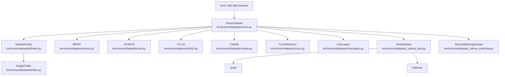
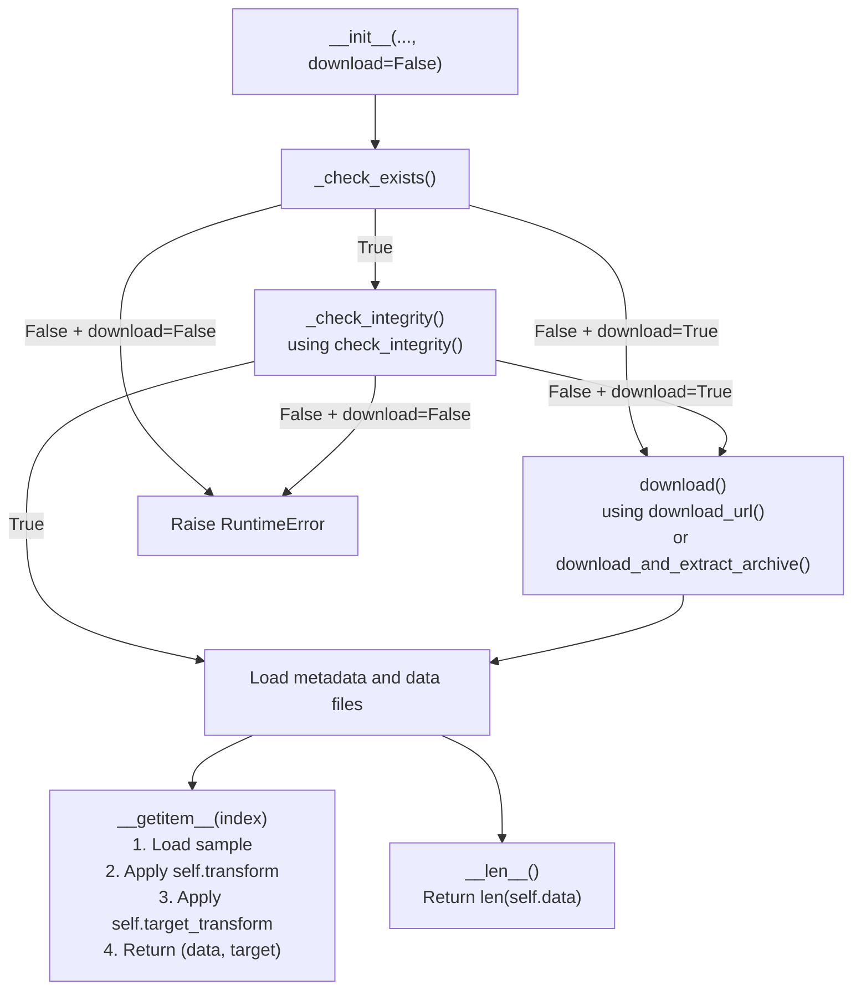
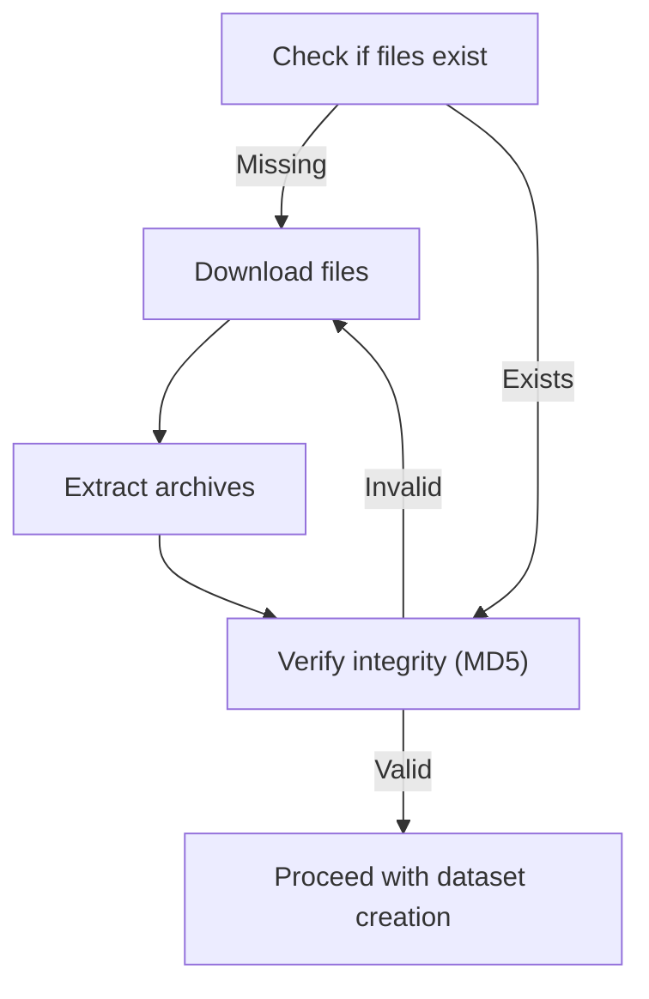
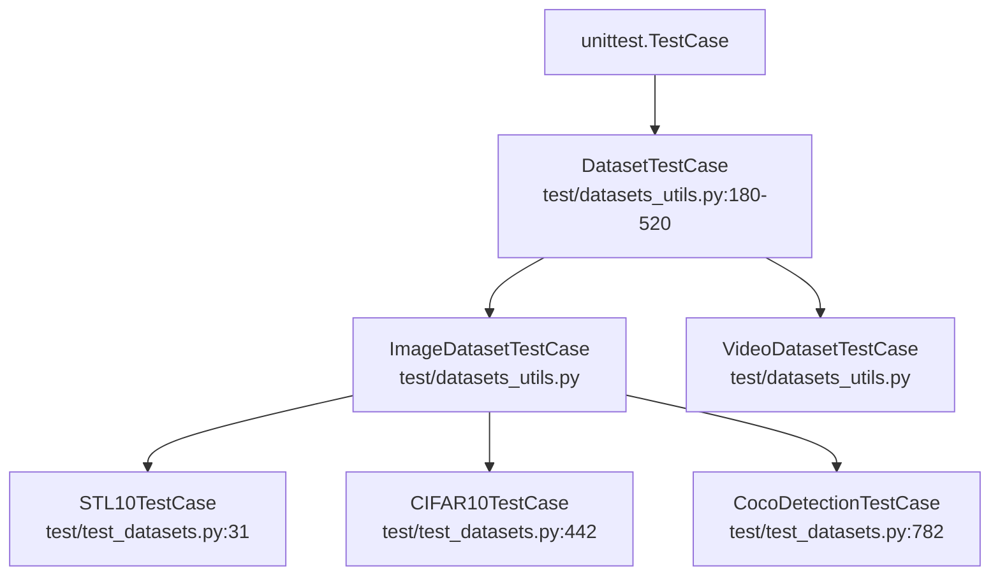

<!-- source: DeepWiki mcp.deepwiki.com · repo pytorch/vision · page 4.1 Dataset Architecture · fetched 2026-10-21 -->

# Dataset Architecture

<details>
<summary>Relevant source files</summary>

The following files were used as context for generating this wiki page:

- [docs/source/datasets.rst](docs/source/datasets.rst)
- [test/datasets_utils.py](test/datasets_utils.py)
- [test/test_datasets.py](test/test_datasets.py)
- [test/test_datasets_utils.py](test/test_datasets_utils.py)
- [torchvision/datasets/__init__.py](torchvision/datasets/__init__.py)
- [torchvision/datasets/_optical_flow.py](torchvision/datasets/_optical_flow.py)
- [torchvision/datasets/_stereo_matching.py](torchvision/datasets/_stereo_matching.py)
- [torchvision/datasets/caltech.py](torchvision/datasets/caltech.py)
- [torchvision/datasets/celeba.py](torchvision/datasets/celeba.py)
- [torchvision/datasets/cifar.py](torchvision/datasets/cifar.py)
- [torchvision/datasets/coco.py](torchvision/datasets/coco.py)
- [torchvision/datasets/folder.py](torchvision/datasets/folder.py)
- [torchvision/datasets/inaturalist.py](torchvision/datasets/inaturalist.py)
- [torchvision/datasets/lsun.py](torchvision/datasets/lsun.py)
- [torchvision/datasets/mnist.py](torchvision/datasets/mnist.py)
- [torchvision/datasets/omniglot.py](torchvision/datasets/omniglot.py)
- [torchvision/datasets/phototour.py](torchvision/datasets/phototour.py)
- [torchvision/datasets/places365.py](torchvision/datasets/places365.py)
- [torchvision/datasets/semeion.py](torchvision/datasets/semeion.py)
- [torchvision/datasets/stl10.py](torchvision/datasets/stl10.py)
- [torchvision/datasets/svhn.py](torchvision/datasets/svhn.py)
- [torchvision/datasets/usps.py](torchvision/datasets/usps.py)
- [torchvision/datasets/utils.py](torchvision/datasets/utils.py)
- [torchvision/datasets/widerface.py](torchvision/datasets/widerface.py)
- [torchvision/transforms/_functional_pil.py](torchvision/transforms/_functional_pil.py)

</details>


This document explains the architectural design and structure of the dataset system in TorchVision. It covers the foundational classes, inheritance hierarchy, and patterns used for implementing vision datasets. For information about specific available datasets, see [Available Datasets](#4.2).

## Core Architecture Overview

The TorchVision dataset architecture is built on `VisionDataset` as the base class, with utility functions in `torchvision.datasets.utils` providing common operations like download, extraction, and integrity checking. The architecture supports both generic folder-based datasets and specialized implementations for specific computer vision tasks.

### Class Hierarchy



Sources: [torchvision/datasets/__init__.py:1-148](), [torchvision/datasets/folder.py:109-337](), [torchvision/datasets/_optical_flow.py:30-86](), [torchvision/datasets/_stereo_matching.py:25-54]()

## Base Classes

The dataset architecture is built on a foundation of base classes that provide common functionality and interfaces.

### VisionDataset Base Class

`VisionDataset` is the abstract base class defined in [torchvision/datasets/vision.py]() that all TorchVision datasets inherit from. It extends `torch.utils.data.Dataset` with vision-specific functionality.

**Key Attributes:**
- `root`: Root directory path for the dataset (type: `str`)
- `transform`: Optional callable to transform input data
- `target_transform`: Optional callable to transform targets
- `transforms`: Optional callable for joint transformations

**Core Methods:**
The class itself does not implement `__getitem__` or `__len__` - these must be provided by subclasses. It provides:
- `__init__(root, transforms=None, transform=None, target_transform=None)`: Constructor that stores paths and transforms
- `__repr__()`: String representation showing class name and root directory
- `_format_transform_repr(transform, head)`: Helper for formatting transform representation

**Transform Priority:**
If both `transforms` and individual `transform`/`target_transform` are specified, `transforms` takes precedence. This allows for backward compatibility while supporting the newer transforms v2 API.

Sources: [torchvision/datasets/vision.py]() (inferred from usage patterns in [torchvision/datasets/mnist.py:84-92](), [torchvision/datasets/cifar.py:52-61]())

## DatasetFolder and ImageFolder

`DatasetFolder` and `ImageFolder` provide generic dataset classes for folder-organized data, commonly used for custom datasets.

### DatasetFolder

Defined in [torchvision/datasets/folder.py:109-255](), `DatasetFolder` loads data from a directory structure where subfolders represent classes:

```
root/
├── class_a/
│   ├── sample_1.ext
│   ├── sample_2.ext
│   └── ...
├── class_b/
│   ├── sample_1.ext
│   └── ...
└── class_c/
    └── ...
```

**Constructor Parameters:**
- `root`: Root directory path
- `loader`: Function to load a sample given its path
- `extensions`: Tuple of valid file extensions (e.g., `('.jpg', '.png')`)
- `transform`, `target_transform`: Transform functions
- `is_valid_file`: Optional function to check file validity (alternative to `extensions`)
- `allow_empty`: Whether to allow classes with no valid files (default: `False`)

**Key Methods:**
- `find_classes(directory)`: Returns `(classes, class_to_idx)` by scanning subdirectories
- `make_dataset(directory, class_to_idx, extensions, is_valid_file)`: Returns list of `(path, class_index)` tuples

**Attributes Set:**
- `classes`: List of class names (sorted alphabetically)
- `class_to_idx`: Dict mapping class name to index
- `samples`: List of `(path, class_index)` tuples
- `targets`: List of class indices for each sample

**Helper Functions:**

`find_classes(directory)` in [torchvision/datasets/folder.py:36-46]() discovers classes:
```python
classes = sorted(entry.name for entry in os.scandir(directory) if entry.is_dir())
class_to_idx = {cls_name: i for i, cls_name in enumerate(classes)}
```

`make_dataset()` in [torchvision/datasets/folder.py:49-106]() walks the directory tree to build the sample list, filtering by extensions or `is_valid_file`.

Sources: [torchvision/datasets/folder.py:109-255](), [torchvision/datasets/folder.py:36-106]()

### ImageFolder

Defined in [torchvision/datasets/folder.py:287-337](), `ImageFolder` is a specialized `DatasetFolder` for images:

**Differences from DatasetFolder:**
- Uses `default_loader` (PIL-based) by default
- Pre-configured with `IMG_EXTENSIONS`: `('.jpg', '.jpeg', '.png', '.ppm', '.bmp', '.pgm', '.tif', '.tiff', '.webp')`
- Provides `imgs` attribute as alias for `samples`

**Default Loaders:**

`pil_loader(path)` in [torchvision/datasets/folder.py:260-264](): Opens image with PIL and converts to RGB

`default_loader(path)` in [torchvision/datasets/folder.py:278-284](): Checks `torchvision.get_image_backend()` to choose between PIL and accimage

**Usage Example:**
```python
from torchvision.datasets import ImageFolder
import torchvision.transforms as transforms

dataset = ImageFolder(
    root='/path/to/imagefolder',
    transform=transforms.Compose([
        transforms.Resize(256),
        transforms.ToTensor(),
    ])
)
# Automatically discovers classes from subdirectories
# dataset.classes == ['class_a', 'class_b', 'class_c']
# dataset[0] returns (transformed_image, class_index)
```

Sources: [torchvision/datasets/folder.py:287-337](), [torchvision/datasets/folder.py:260-284]()

## Utility Functions

The `torchvision.datasets.utils` module provides essential utilities for dataset implementation. These functions handle downloading, extracting, and verifying dataset files.

### Download Functions

**`download_url(url, root, filename=None, md5=None, max_redirect_hops=3)`**

Downloads a file from a URL with integrity verification.
- Supports automatic redirect following (up to `max_redirect_hops`)
- Detects Google Drive URLs and routes to `download_file_from_google_drive`
- Falls back from HTTPS to HTTP if connection fails
- Verifies downloaded file using MD5 checksum if provided

**`download_file_from_google_drive(file_id, root, filename=None, md5=None)`**

Downloads files from Google Drive using the `gdown` library. Requires `gdown` to be installed.

**`download_and_extract_archive(url, download_root, extract_root=None, filename=None, md5=None, remove_finished=False)`**

Convenience function combining download and extraction.

Sources: [torchvision/datasets/utils.py:87-138](), [torchvision/datasets/utils.py:172-207](), [torchvision/datasets/utils.py:374-391]()

### Integrity Checking

**`check_integrity(fpath, md5=None)`**

Verifies file existence and optional MD5 checksum.
- Returns `False` if file doesn't exist
- Returns `True` if file exists and no MD5 provided
- Returns result of `check_md5(fpath, md5)` if MD5 provided

**`check_md5(fpath, md5, chunk_size=1024*1024)`**

Computes and verifies MD5 checksum of a file.
- Uses `hashlib.md5(usedforsecurity=False)` for FIPS compliance
- Processes file in chunks to handle large files efficiently

Sources: [torchvision/datasets/utils.py:50-56](), [torchvision/datasets/utils.py:35-47]()

### Archive Extraction

**`extract_archive(from_path, to_path=None, remove_finished=False)`**

Automatically detects archive type and extracts contents.
- Supports: `.tar`, `.tar.gz`, `.tgz`, `.tar.bz2`, `.tbz`, `.tar.xz`, `.zip`
- Also handles compressed files: `.gz`, `.bz2`, `.xz`
- Uses `_detect_file_type()` to identify format from file extension
- Dispatches to appropriate extractor: `_extract_tar()` or `_extract_zip()`

**`_detect_file_type(file)`**

Returns tuple of `(suffix, archive_type, compression)` by analyzing file suffixes.

Sources: [torchvision/datasets/utils.py:326-371](), [torchvision/datasets/utils.py:247-288]()

### File System Utilities

**`list_dir(root, prefix=False)`**

Lists directories at the given root, optionally with full paths.

**`list_files(root, suffix, prefix=False)`**

Lists files with specific suffix at the given root.

**`verify_str_arg(value, arg=None, valid_values=None, custom_msg=None)`**

Validates string arguments against a set of valid values, raising `ValueError` if invalid.

Sources: [torchvision/datasets/utils.py:140-169](), [torchvision/datasets/utils.py:401-426]()

## Dataset Implementation Pattern

Most dataset implementations follow a standard pattern using these utilities:



**Example: MNIST Implementation**

The MNIST dataset demonstrates this pattern in [torchvision/datasets/mnist.py:84-202]():
- `__init__`: Checks for legacy cached data, optionally downloads, then loads data
- `_check_exists()`: Verifies raw data files exist
- `download()`: Downloads from multiple mirrors with fallback, uses `download_and_extract_archive()`
- `_load_data()`: Reads binary files into tensors
- `__getitem__`: Converts tensor to PIL Image, applies transforms, returns `(img, target)`

Sources: [torchvision/datasets/mnist.py:84-202](), [torchvision/datasets/cifar.py:52-144](), [torchvision/datasets/stl10.py:47-175]()

## Dataset Categories

The TorchVision library includes datasets for various computer vision tasks:

### Classification Datasets

These datasets return `(image, class_index)` pairs:
- `MNIST`, `FashionMNIST`, `KMNIST`: Variations of the MNIST dataset
- `CIFAR10`, `CIFAR100`: Small-image classification datasets
- `ImageNet`: Large-scale image classification
- `STL10`, `SVHN`, `Caltech101/256`: Other common classification datasets

### Detection and Segmentation Datasets

These datasets return more complex annotations:
- `CocoDetection`: Returns `(image, annotations)` where annotations include bounding boxes
- `VOCDetection`: Provides XML annotations for object detection
- `Cityscapes`: Urban scene understanding with pixel-level segmentation

### Video Datasets

These datasets handle temporal data:
- `Kinetics`: Large-scale action recognition dataset
- `UCF101`: Human action recognition
- `HMDB51`: Human motion database

### Specialized Task Datasets

TorchVision also includes datasets for specific vision tasks:
- **Optical Flow**: `FlyingChairs`, `Sintel`, `KittiFlow`
- **Stereo Matching**: `Kitti2012Stereo`, `Middlebury2014Stereo`
- **Image Captioning**: `CocoCaptions`

Sources: [torchvision/datasets/__init__.py:1-59](), [docs/source/datasets.rst:40-171]()

## Data Flow and Processing

The typical data flow through a TorchVision dataset follows this pattern:


Key aspects of the processing pipeline:

1. **Data Loading**: Reading raw data from disk, often using specialized formats
2. **Preprocessing**: Converting to a standardized format (typically PIL Image or tensor)
3. **Caching**: Some datasets cache processed data to improve access speed
4. **Transform Application**: Applying user-specified transforms to inputs and targets
5. **Sample Construction**: Building the final sample tuple to return

Sources: [torchvision/datasets/mnist.py:131-151](), [torchvision/datasets/cifar.py:104-124]()

## Common Dataset Operations

### Transforms

Datasets in TorchVision typically accept transform functions through their constructor:

- `transform`: Applied to input data (e.g., images)
- `target_transform`: Applied to target data (e.g., class labels)
- Some datasets support a `transforms` parameter for joint transforms

Example implementation pattern:
```python
def __getitem__(self, index):
    img, target = self.data[index], self.targets[index]
    
    # Convert to standard format (e.g., PIL Image)
    img = Image.fromarray(img)
    
    # Apply transforms
    if self.transform is not None:
        img = self.transform(img)
    if self.target_transform is not None:
        target = self.target_transform(target)
    
    return img, target
```

### Download and Integrity Checking

Many datasets include functionality to automatically download the dataset files:



This functionality is implemented using utility functions from `torchvision.datasets.utils`:
- `download_url`: Downloads a file from a URL
- `download_and_extract_archive`: Downloads and extracts an archive
- `check_integrity`: Verifies a file using its MD5 hash

Sources: [torchvision/datasets/utils.py:90-140](), [torchvision/datasets/mnist.py:174-197]()

## Dataset Customization

### Creating Custom Datasets

Users can create custom datasets by subclassing `VisionDataset` or one of its derivatives:

1. **Directly from VisionDataset**:
   ```python
   class CustomDataset(VisionDataset):
       def __init__(self, root, transform=None, target_transform=None):
           super().__init__(root, transform=transform, 
                           target_transform=target_transform)
           # Load or prepare data here
           
       def __getitem__(self, index):
           # Return data and target
           
       def __len__(self):
           # Return dataset size
   ```

2. **Using DatasetFolder/ImageFolder**:
   For data organized in folders by class, users can simply use these classes directly or customize them slightly.

### Transforms v2 Integration

TorchVision provides a `wrap_dataset_for_transforms_v2` function to adapt existing datasets to work with the transforms v2 API, which supports more complex data types like bounding boxes and masks:

```python
from torchvision.datasets import CIFAR10, wrap_dataset_for_transforms_v2
dataset = CIFAR10(root="./data", train=True)
dataset = wrap_dataset_for_transforms_v2(dataset)
```

Sources: [torchvision/datasets/__init__.py:137-146]()

## Testing Infrastructure

TorchVision provides a sophisticated testing framework in [test/datasets_utils.py]() for validating dataset implementations through fake data injection.

### Test Case Hierarchy



Sources: [test/datasets_utils.py:180-520](), [test/test_datasets.py:31-113](), [test/test_datasets.py:442-497]()

### DatasetTestCase Base Class

The `DatasetTestCase` class in [test/datasets_utils.py:180-520]() provides the core testing framework with automatic test discovery and fake data injection.

**Required Class Attributes:**
- `DATASET_CLASS`: The dataset class to test (e.g., `datasets.MNIST`)
- `FEATURE_TYPES`: Sequence of expected types returned by `__getitem__` (e.g., `(PIL.Image.Image, int)`)

**Optional Class Attributes:**
- `DEFAULT_CONFIG`: Default parameters for dataset constructor (excluding transforms)
- `ADDITIONAL_CONFIGS`: List of config dicts to test multiple configurations
- `REQUIRED_PACKAGES`: Packages needed for the dataset (tests skipped if missing)

**Key Methods:**

`inject_fake_data(tmpdir, config)` - **Must be overridden**
- Creates minimal fake data resembling the raw dataset structure
- Returns either `int` (number of examples) or `dict` with `'num_examples'` key
- Example: Creating binary files for STL10, pickle files for CIFAR10

`dataset_args(tmpdir, config)` - **May be overridden**
- Returns positional arguments for dataset constructor
- Default: `(tmpdir,)` for datasets with only `root` parameter

`create_dataset(config=None, inject_fake_data=True, patch_checks=None, **kwargs)` - **Context manager**
- Creates temporary directory
- Injects fake data if requested
- Patches download/extract functions to prevent real downloads
- Optionally patches integrity checks
- Yields `(dataset, info)` tuple

**Automatic Tests:**
The base class automatically runs these tests for all configurations:
1. `test_not_found_or_corrupted`: Verifies error handling for missing data
2. `test_transforms`: Checks that transforms are properly applied
3. `test_feature_types`: Validates return types match `FEATURE_TYPES`
4. `test_num_examples`: Confirms dataset length matches injected data count

Sources: [test/datasets_utils.py:180-520]()

### Fake Data Injection Pattern

Datasets use `inject_fake_data()` to create minimal test data. The pattern varies by dataset type:

**STL10 Example** ([test/test_datasets.py:84-92]()):
```python
def inject_fake_data(self, tmpdir, config):
    root_folder = os.path.join(tmpdir, "stl10_binary")
    os.mkdir(root_folder)
    
    num_images_in_split = self._make_train_files(root_folder)
    num_images_in_split.update(self._make_test_files(root_folder))
    self._make_class_names_file(root_folder)
    
    return sum(num_images_in_split[part] for part in config["split"].split("+"))
```

Creates binary files matching STL10's raw format using helper methods like `_make_image_file()` and `_make_label_file()`.

**CIFAR10 Example** ([test/test_datasets.py:456-470]()):
```python
def inject_fake_data(self, tmpdir, config):
    tmpdir = pathlib.Path(tmpdir) / self._VERSION_CONFIG["base_folder"]
    os.makedirs(tmpdir)
    
    num_images_per_file = 1
    for name in itertools.chain(self._VERSION_CONFIG["train_files"], 
                                 self._VERSION_CONFIG["test_files"]):
        self._create_batch_file(tmpdir, name, num_images_per_file)
    
    categories = self._create_meta_file(tmpdir)
    
    return dict(
        num_examples=num_images_per_file * len(...),
        categories=categories,
    )
```

Creates pickled batch files with numpy arrays matching CIFAR10's structure.

Sources: [test/test_datasets.py:84-92](), [test/test_datasets.py:456-490]()

### Helper Utilities for Test Data

**`create_image_or_video_tensor(size)`** in [test/datasets_utils.py]()
- Creates random uint8 tensor for fake image/video data

**`create_image_file(root, name, size=None, num_channels=3, extension=".jpg")`**
- Generates and saves a fake image file

**`create_image_folder(root, name, file_name_fn, num_examples, size=None)`**
- Creates a folder with multiple fake images
- Used extensively in detection/segmentation dataset tests

**`create_video_file(...)` and `create_video_folder(...)`**
- Similar utilities for video datasets

Sources: [test/datasets_utils.py]() (function definitions around lines 600-800)

### Download and Check Patching

During testing, the framework patches download and integrity check functions to prevent actual downloads:

**Patched Functions:**
- `download_url`
- `download_file_from_google_drive`
- `extract_archive`
- `download_and_extract_archive`
- `check_md5`
- `check_integrity`

Implementation in [test/datasets_utils.py:505-520]():
```python
def _patch_download_extract(self):
    module = inspect.getmodule(self.DATASET_CLASS).__name__
    return {unittest.mock.patch(f"{module}.{function}") 
            for function in self._DOWNLOAD_EXTRACT_FUNCTIONS}

def _patch_checks(self):
    module = inspect.getmodule(self.DATASET_CLASS).__name__
    return {unittest.mock.patch(f"{module}.{function}", return_value=True) 
            for function in self._CHECK_FUNCTIONS}
```

This allows tests to run without network access and ensures they work with only the injected fake data.

Sources: [test/datasets_utils.py:273-283](), [test/datasets_utils.py:505-520]()

### Writing Tests for a New Dataset

To add tests for a new dataset:

1. **Create test case class:**
```python
class MyDatasetTestCase(datasets_utils.ImageDatasetTestCase):
    DATASET_CLASS = datasets.MyDataset
    FEATURE_TYPES = (PIL.Image.Image, int)  # or appropriate types
```

2. **Implement `inject_fake_data`:**
```python
def inject_fake_data(self, tmpdir, config):
    # Create directory structure
    data_dir = os.path.join(tmpdir, "mydataset")
    os.makedirs(data_dir)
    
    # Create fake files matching raw dataset format
    # ...
    
    return num_examples
```

3. **Add dataset-specific tests (optional):**
```python
def test_specific_feature(self):
    with self.create_dataset() as (dataset, info):
        # Test dataset-specific behavior
        assert some_property
```

4. **Configure splits/variants (if applicable):**
```python
ADDITIONAL_CONFIGS = combinations_grid(
    split=("train", "test"),
    version=("v1", "v2"),
)
```

The framework automatically discovers and runs all test methods.

Sources: [test/test_datasets.py:31-113]() (STL10 example), [test/datasets_utils.py:180-244]()

## Conclusion

The TorchVision dataset architecture provides a flexible and extensible framework for working with computer vision datasets. The base classes like `VisionDataset` and `DatasetFolder` establish common patterns, while specialized implementations handle the unique requirements of different data types and tasks. This design allows for easy integration with PyTorch's data loading pipeline and supports a wide range of computer vision applications.

---

