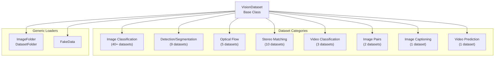
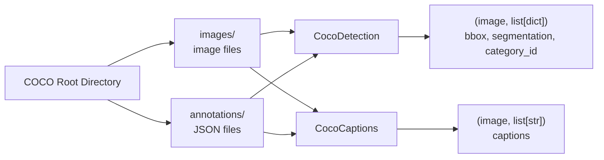
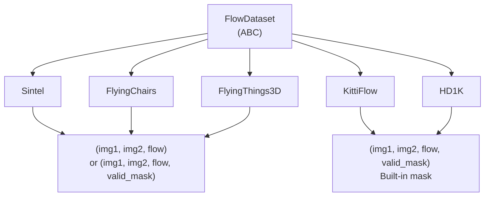
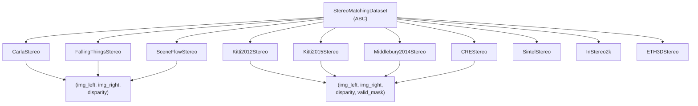
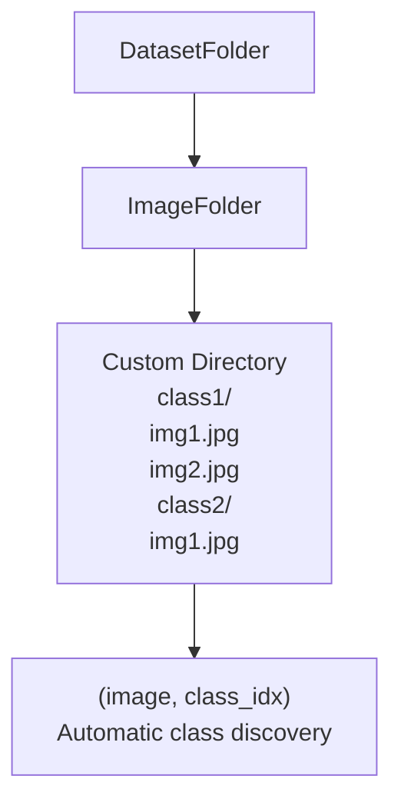

<!-- source: DeepWiki mcp.deepwiki.com · repo pytorch/vision · page 4.2 Available Datasets · fetched 2026-10-21 -->

# Available Datasets

<details>
<summary>Relevant source files</summary>

The following files were used as context for generating this wiki page:

- [docs/source/datasets.rst](docs/source/datasets.rst)
- [test/datasets_utils.py](test/datasets_utils.py)
- [test/test_datasets.py](test/test_datasets.py)
- [torchvision/datasets/__init__.py](torchvision/datasets/__init__.py)
- [torchvision/datasets/_optical_flow.py](torchvision/datasets/_optical_flow.py)
- [torchvision/datasets/_stereo_matching.py](torchvision/datasets/_stereo_matching.py)
- [torchvision/datasets/inaturalist.py](torchvision/datasets/inaturalist.py)
- [torchvision/datasets/places365.py](torchvision/datasets/places365.py)

</details>


This page catalogs the datasets provided by TorchVision, organized by computer vision task. Each dataset is a subclass of `VisionDataset` (see [Dataset Architecture](#4.1)) and can be used directly with PyTorch's `DataLoader`. The page documents dataset-specific parameters, available splits, and configuration options.

For information about the underlying architecture, download utilities, and testing infrastructure, see [Dataset Architecture](#4.1).

## Dataset Organization

TorchVision provides 70+ built-in datasets spanning multiple computer vision tasks. All datasets follow common patterns defined in `VisionDataset` and support standard parameters like `transform`, `target_transform`, and `download`.



**Sources:** [torchvision/datasets/__init__.py:1-148](), [docs/source/datasets.rst:1-193]()

## Image Classification Datasets

Image classification datasets return `(image, label)` tuples where `image` is a `PIL.Image.Image` (or `torch.Tensor` with compatible loaders) and `label` is an integer class index.

### Dataset Matrix

| Dataset | Classes | Train Samples | Test Samples | Common Splits | Special Features |
|---------|---------|---------------|--------------|---------------|------------------|
| **MNIST** | 10 | 60,000 | 10,000 | train, test | Handwritten digits |
| **FashionMNIST** | 10 | 60,000 | 10,000 | train, test | Fashion items |
| **KMNIST** | 10 | 60,000 | 10,000 | train, test | Japanese characters |
| **EMNIST** | 47-62* | varies | varies | byclass, bymerge, balanced, letters, digits, mnist | Extended MNIST |
| **QMNIST** | 10 | 60,000 | 10,000 | train, test, nist | Reconstructed MNIST |
| **CIFAR10** | 10 | 50,000 | 10,000 | train, test | 32×32 color images |
| **CIFAR100** | 100 | 50,000 | 10,000 | train, test | 100 fine classes |
| **STL10** | 10 | 5,000 | 8,000 | train, test, unlabeled, train+unlabeled | 96×96 images, folds support |
| **SVHN** | 10 | 73,257 | 26,032 | train, test, extra | Street View House Numbers |
| **ImageNet** | 1,000 | ~1.28M | 50,000 | train, val | Large-scale benchmark |
| **Imagenette** | 10 | ~9,469 | ~3,925 | train, val | ImageNet subset |
| **Caltech101** | 101 | ~3,060 | ~6,085 | train, test | Annotations available |
| **Caltech256** | 257 | ~30,607 | - | train | More classes than 101 |
| **Places365** | 365 | ~1.8M | 36,500 | train-standard, train-challenge, val, test | Scene recognition |
| **SUN397** | 397 | varies | varies | - | Scene understanding |
| **Food101** | 101 | 75,750 | 25,250 | train, test | Food images |
| **Flowers102** | 102 | varies | varies | train, val, test | Flower species |
| **OxfordIIITPet** | 37 | 3,680 | 3,669 | trainval, test | Pet breeds, segmentation |
| **StanfordCars** | 196 | 8,144 | 8,041 | train, test | Car models |
| **FGVCAircraft** | 100 | 6,667 | 3,333 | train, val, trainval, test | Aircraft variants |
| **DTD** | 47 | 3,760 | 1,880 | train, val, test | Texture classification |
| **Country211** | 211 | 31,650 | 21,100 | train, valid, test | Country recognition |
| **EuroSAT** | 10 | 27,000 | - | train | Satellite imagery |
| **GTSRB** | 43 | 39,209 | 12,630 | train, test | Traffic signs |
| **FER2013** | 8 | 28,709 | 3,589 | train, test | Facial expressions |
| **RenderedSST2** | 2 | 6,920 | 1,821 | train, val, test | Sentiment text images |
| **INaturalist** | 5,089-10,000* | varies | varies | train, val | Biodiversity, hierarchical |
| **PCAM** | 2 | 262,144 | 32,768 | train, val, test | Histopathology patches |

*Number of classes varies by configuration

**Sources:** [docs/source/datasets.rst:39-84](), [test/test_datasets.py:31-511]()

### Common Parameters

All image classification datasets support:

- **`root`** (str or Path): Root directory where dataset exists or will be downloaded
- **`train`** (bool): Load training set (True) or test set (False) - for datasets with this split pattern
- **`split`** (str): Dataset split name - varies by dataset (e.g., "train", "val", "test")
- **`transform`** (callable, optional): Transform applied to images
- **`target_transform`** (callable, optional): Transform applied to labels  
- **`download`** (bool): If True, download dataset if not present
- **`loader`** (callable, optional): Custom image loader (default: PIL, can use `torchvision.io.decode_image`)

### Special Dataset Configurations

#### CelebA
```python
# Multiple target types can be combined
dataset = CelebA(
    root="./data",
    split="train",  # train, valid, test, all
    target_type=["attr", "identity", "bbox", "landmarks"],  # Can be list
    download=True
)
```
Returns: `(image, target)` where target type depends on `target_type` parameter:
- `"attr"`: 40 binary attributes as `torch.Tensor`
- `"identity"`: Celebrity ID as `int`
- `"bbox"`: Bounding box as `torch.Tensor` (4 values)
- `"landmarks"`: Facial landmarks as `torch.Tensor` (10 values)

**Sources:** [test/test_datasets.py:513-663]()

#### INaturalist
```python
# Hierarchical classification with multiple target levels
dataset = INaturalist(
    root="./data",
    version="2021_train",  # 2017, 2018, 2019, 2021_train, 2021_train_mini, 2021_valid
    target_type=["full", "kingdom", "phylum", "class", "order", "family", "genus"],
    download=True
)
```
For 2021 versions, supports hierarchical target types. For 2017-2019, supports `"full"` and `"super"`.

**Sources:** [torchvision/datasets/inaturalist.py:1-246]()

#### Places365
```python
# Scene recognition with size variants
dataset = Places365(
    root="./data",
    split="train-standard",  # train-standard, train-challenge, val, test
    small=True,  # True: 256x256, False: high-res
    download=True
)
```

**Sources:** [torchvision/datasets/places365.py:1-177]()

#### STL10
```python
# Supports fold-based training
dataset = STL10(
    root="./data",
    split="train",  # train, test, unlabeled, train+unlabeled
    folds=0,  # 0-9 for fold selection, None for all folds
    download=True
)
```
Unlabeled split returns label `-1` for all samples.

**Sources:** [test/test_datasets.py:31-113]()

## Detection and Segmentation Datasets

These datasets return images with annotations for object detection, instance segmentation, or semantic segmentation tasks.

### Dataset Comparison

| Dataset | Task | Annotations | Splits | Special Features |
|---------|------|-------------|--------|------------------|
| **CocoDetection** | Object Detection | Bounding boxes, segmentation masks | N/A (user-specified) | COCO JSON format |
| **CocoCaptions** | Image Captioning | Text captions | N/A (user-specified) | 5 captions per image |
| **VOCDetection** | Object Detection | XML annotations | train, val, trainval, test | 20 object categories |
| **VOCSegmentation** | Semantic Segmentation | PNG masks | train, val, trainval, test | 20 classes + background |
| **Cityscapes** | Semantic/Instance Seg | Multiple formats | train, val, test, train_extra | Urban scenes, fine/coarse |
| **WIDERFace** | Face Detection | Bounding boxes | train, val, test | Face detection benchmark |
| **Kitti** | Multi-task | 3D boxes, segmentation | train, test | Autonomous driving |
| **SBDataset** | Semantic Segmentation | Boundaries | train, val | Semantic Boundaries |
| **OxfordIIITPet** | Classification + Seg | Breeds, segmentation | trainval, test | Pet breeds |

**Sources:** [docs/source/datasets.rst:85-101]()

### COCO Datasets



```python
# CocoDetection requires explicit paths
dataset = CocoDetection(
    root="./data/coco/images/train2017",
    annFile="./data/coco/annotations/instances_train2017.json"
)
# Returns: (image, list of annotation dicts)
# Each dict: {image_id, id, bbox, segmentation, category_id, area, iscrowd}
```

**Sources:** [test/test_datasets.py:782-911](), [torchvision/datasets/__init__.py:19]()

### VOC Datasets

```python
# VOCDetection returns parsed XML annotations
dataset = VOCDetection(
    root="./data",
    year="2012",  # 2007-2012
    image_set="train",  # train, val, trainval, test (test only for 2007)
    download=True
)
# Returns: (image, dict with parsed XML annotation)

# VOCSegmentation returns segmentation masks
dataset = VOCSegmentation(
    root="./data",
    year="2012",
    image_set="train",
    download=True
)
# Returns: (image, segmentation_mask as PIL.Image)
```

**Sources:** [test/test_datasets.py:665-780]()

### Cityscapes

```python
# Multiple target types for urban scene understanding
dataset = Cityscapes(
    root="./data",
    split="train",  # train, test, val
    mode="fine",  # fine, coarse (coarse has train_extra split)
    target_type="instance",  # instance, semantic, polygon, color, or list
    transform=None
)
```

Target types:
- `"instance"`: Instance-level segmentation IDs
- `"semantic"`: Semantic class IDs  
- `"polygon"`: Polygon annotations (dict)
- `"color"`: Color-coded segmentation
- List of above for multiple targets simultaneously

**Sources:** [test/test_datasets.py:274-402]()

### WIDERFace

```python
dataset = WIDERFace(
    root="./data",
    split="train",  # train, val, test
    transform=None
)
# Returns: (image, dict with bbox info) for train/val
#          (image, None) for test
```

**Sources:** [test/test_datasets.py:214-272]()

## Optical Flow Datasets

Optical flow datasets return pairs of consecutive images along with the flow field between them. All inherit from `FlowDataset` base class.



**Sources:** [torchvision/datasets/_optical_flow.py:21-27]()

### Optical Flow Dataset Details

| Dataset | Resolution | Split Support | Built-in Mask | Flow Format | Special Parameters |
|---------|------------|---------------|---------------|-------------|-------------------|
| **Sintel** | 1024×436 | train, test | No | .flo | `pass_name`: clean, final, both |
| **KittiFlow** | 1242×375 | train, test | Yes (PNG) | 16-bit PNG | - |
| **FlyingChairs** | 512×384 | train, val | No | .flo | Requires train_val.txt |
| **FlyingThings3D** | 960×540 | train, test | No | .pfm | `pass_name`: clean, final, both<br/>`camera`: left, right, both<br/>`direction`: into_future, into_past |
| **HD1K** | 2560×1080 | train, test | Yes (PNG) | 16-bit PNG | 36 sequences |

### Common Parameters

```python
# Standard optical flow dataset initialization
dataset = Sintel(
    root="./data",
    split="train",  # train, test
    pass_name="clean",  # clean, final, both
    transforms=None,  # Applied to (img1, img2, flow, valid_mask)
    loader=default_loader  # or torchvision.io.decode_image
)
```

All optical flow datasets return:
- **Without built-in mask**: `(img1, img2, flow)` where flow is `np.ndarray` of shape `(2, H, W)`
- **With built-in mask or transform-generated mask**: `(img1, img2, flow, valid_mask)` where valid_mask is `np.ndarray` of shape `(H, W)`

**Sources:** [torchvision/datasets/_optical_flow.py:30-86]()

### FlyingThings3D Configuration

```python
# Most flexible optical flow dataset
dataset = FlyingThings3D(
    root="./data",
    split="train",  # train, test
    pass_name="clean",  # clean, final, both
    camera="left",  # left, right, both
    transforms=None
)
```

Combines multiple rendering passes and camera views, multiplying available samples. Uses PFM format for flow.

**Sources:** [torchvision/datasets/_optical_flow.py:317-417]()

## Stereo Matching Datasets

Stereo matching datasets provide left and right image pairs with disparity maps. All inherit from `StereoMatchingDataset` base class.



**Sources:** [torchvision/datasets/_stereo_matching.py:20-136](), [torchvision/datasets/__init__.py:2-13]()

### Stereo Dataset Matrix

| Dataset | Split Support | Built-in Mask | Disparity Format | Special Parameters | Resolution |
|---------|---------------|---------------|------------------|-------------------|------------|
| **Kitti2012Stereo** | train, test | Yes | PNG | - | ~1242×375 |
| **Kitti2015Stereo** | train, test | Yes | PNG | - | ~1242×375 |
| **Middlebury2014Stereo** | train, test, additional | Yes (train/add) | PFM | `calibration`: perfect, imperfect, both<br/>`use_ambient_views`: bool | Varies |
| **CarlaStereo** | train only | No | PFM | - | 960×540 |
| **CREStereo** | train only | No | PNG | Synthetic, 4 subdirs | Varies |
| **FallingThingsStereo** | train only | No | Depth PNG | `variant`: single, mixed, both | 640×480 |
| **SceneFlowStereo** | train only | No | PFM | `variant`: FlyingThings3D, Monkaa, Driving<br/>`pass_name`: clean, final, both | 960×540 |
| **SintelStereo** | train, test | No | PFM | `pass_name`: clean, final, both | 1024×436 |
| **InStereo2k** | train, test | Yes (train) | PFM | - | Varies |
| **ETH3DStereo** | train, test | Yes (train) | PFM | - | Varies |

### Common Usage Patterns

```python
# KITTI datasets with built-in valid masks
dataset = Kitti2015Stereo(
    root="./data",
    split="train",  # train, test
    transforms=None
)
# Returns: (img_left, img_right, disparity, valid_mask)
# disparity: np.ndarray (1, H, W), valid_mask: np.ndarray (H, W)

# Middlebury with calibration options
dataset = Middlebury2014Stereo(
    root="./data",
    split="train",  # train, test, additional
    calibration="perfect",  # perfect, imperfect, both, None (for test)
    use_ambient_views=True,  # Randomly use different exposures
    transforms=None,
    download=True
)

# SceneFlow variants
dataset = SceneFlowStereo(
    root="./data",
    variant="FlyingThings3D",  # FlyingThings3D, Monkaa, Driving
    pass_name="clean",  # clean, final, both
    transforms=None
)
```

**Sources:** [torchvision/datasets/_stereo_matching.py:202-373](), [torchvision/datasets/_stereo_matching.py:375-629](), [torchvision/datasets/_stereo_matching.py:823-971]()

### FallingThingsStereo Disparity Computation

This dataset requires special handling as it stores depth maps instead of disparity:

```python
dataset = FallingThingsStereo(
    root="./data",
    variant="single",  # single, mixed, both
    transforms=None
)
# Automatically converts depth to disparity using camera intrinsics
# Formula: disparity = (baseline * focal * pixel_constant) / depth
```

**Sources:** [torchvision/datasets/_stereo_matching.py:719-821]()

## Video Classification Datasets

Video datasets return video clips with audio and labels for action recognition tasks.

| Dataset | Classes | Clips | Splits | FPS | Special Parameters |
|---------|---------|-------|--------|-----|-------------------|
| **UCF101** | 101 | ~13,320 | fold 1-3 × train/test | varies | `fold`: 1, 2, 3<br/>`train`: bool<br/>`frames_per_clip`<br/>`step_between_clips` |
| **HMDB51** | 51 | ~7,000 | fold 1-3 × train/test | varies | Same as UCF101 |
| **Kinetics** | 400/600/700 | varies | train, val | varies | `num_classes`: 400, 600, 700<br/>`frames_per_clip`<br/>`frame_rate` |

### Common Parameters

```python
dataset = UCF101(
    root="./data/UCF101/videos",
    annotation_path="./data/UCF101/annotations",
    frames_per_clip=16,
    step_between_clips=1,
    fold=1,  # 1, 2, 3
    train=True,
    transform=None,
    output_format="TCHW"  # TCHW or THWC
)
# Returns: (video, audio, label)
# video: torch.Tensor (T, C, H, W) or (T, H, W, C)
# audio: torch.Tensor
# label: int
```

**Sources:** [test/test_datasets.py:913-1000](), [test/datasets_utils.py:667-722]()

## Image Pairs and Specialized Datasets

### Image Pair Datasets

| Dataset | Purpose | Returns | Splits |
|---------|---------|---------|--------|
| **LFWPairs** | Face verification | (img1, img2, is_same_person) | 10-fold split |
| **LFWPeople** | Face recognition | (img, person_id) | 10-fold split |
| **PhotoTour** | Image patch matching | (patch1, patch2, matches) | liberty, notredame, yosemite |

```python
# LFW for face verification
dataset = LFWPairs(
    root="./data",
    split="train",  # train, test (10-fold cross-validation)
    image_set="funneled",  # funneled, deepfunneled, original
    transform=None,
    download=True
)

# PhotoTour for patch matching
dataset = PhotoTour(
    root="./data",
    name="liberty",  # liberty, notredame, yosemite
    train=True,
    transform=None,
    download=True
)
```

**Sources:** [docs/source/datasets.rst:133-142]()

### Other Specialized Datasets

| Dataset | Type | Purpose | Special Features |
|---------|------|---------|------------------|
| **Omniglot** | Classification | Character recognition | 1,623 characters, few-shot learning |
| **SEMEION** | Classification | Handwritten digits | 1,593 samples, 256 features |
| **USPS** | Classification | Handwritten digits | 9,298 samples, 16×16 |
| **SBU** | Captioning | Photo descriptions | Flickr photos with captions |
| **Flickr8k/30k** | Captioning | Image captions | Multiple captions per image |
| **LSUN** | Classification | Scene categories | Large-scale, multiple categories |
| **MovingMNIST** | Video Prediction | Digit trajectories | Synthetic video sequences |
| **CLEVRClassification** | Classification | Visual reasoning | Synthetic 3D scenes |

**Sources:** [docs/source/datasets.rst:39-171]()

## Generic Dataset Loaders

For custom datasets, TorchVision provides generic loaders that follow standard directory structures.



### ImageFolder

```python
# Automatically creates dataset from directory structure
dataset = ImageFolder(
    root="./data/my_images",
    transform=transforms.Compose([...]),
    loader=default_loader,  # or torchvision.io.decode_image
    is_valid_file=None  # Optional filter function
)

# Directory structure:
# root/dog/xxx.png
# root/dog/xxy.png
# root/cat/123.png
# root/cat/nsdf3.png

# Automatically infers:
# classes = ['cat', 'dog']
# class_to_idx = {'cat': 0, 'dog': 1}
```

**Sources:** [torchvision/datasets/__init__.py:28]()

### DatasetFolder

More flexible than `ImageFolder`, supports arbitrary file extensions:

```python
from torchvision.datasets import DatasetFolder

def npy_loader(path):
    return np.load(path)

dataset = DatasetFolder(
    root="./data/features",
    loader=npy_loader,
    extensions=('.npy',),
    transform=None
)
```

**Sources:** [torchvision/datasets/__init__.py:28]()

### FakeData

Useful for testing pipelines without downloading real data:

```python
dataset = FakeData(
    size=1000,  # Number of fake samples
    image_size=(3, 224, 224),
    num_classes=10,
    transform=None
)
# Generates random images and labels
```

**Sources:** [docs/source/datasets.rst:55]()

## Dataset-Specific Directory Structures

### Expected Directory Layouts

Different datasets expect specific directory structures. Below are common examples:

**COCO:**
```
root/
    images/
        train2017/
            000000000001.jpg
            ...
        val2017/
            000000000001.jpg
            ...
    annotations/
        instances_train2017.json
        instances_val2017.json
        captions_train2017.json
```

**ImageNet:**
```
root/
    train/
        n01440764/
            n01440764_10026.JPEG
            ...
        n01443537/
            ...
    val/
        n01440764/
            ILSVRC2012_val_00000293.JPEG
            ...
    meta.bin
```

**Cityscapes:**
```
root/
    leftImg8bit/
        train/
            aachen/
                aachen_000000_000019_leftImg8bit.png
                ...
        val/
        test/
    gtFine/
        train/
            aachen/
                aachen_000000_000019_gtFine_instanceIds.png
                aachen_000000_000019_gtFine_labelIds.png
                aachen_000000_000019_gtFine_color.png
                aachen_000000_000019_gtFine_polygons.json
        val/
        test/
```

**Optical Flow (Sintel):**
```
root/
    Sintel/
        training/
            clean/
                alley_1/
                    frame_0001.png
                    ...
            final/
                alley_1/
                    ...
            flow/
                alley_1/
                    frame_0001.flo
                    ...
        testing/
            clean/
            final/
```

**Sources:** [test/test_datasets.py:782-823](), [test/test_datasets.py:404-440](), [test/test_datasets.py:274-370]()

## Download Behavior and Multi-Process Safety

All datasets with `download=True` will:
1. Check if data exists using `_check_exists()` or `check_integrity()`
2. Download required files using `download_url()` or `download_and_extract_archive()`
3. Extract archives automatically
4. Verify integrity with MD5 checksums where available

**⚠️ Important:** Download logic is **not multi-process safe**. In distributed training:

```python
# Correct approach for distributed training
if rank == 0:
    # Download on main process only
    dummy = MyDataset(root="./data", download=True)
    
dist.barrier()  # Wait for download to complete

# All processes can now load
dataset = MyDataset(root="./data", download=False)
```

**Sources:** [docs/source/datasets.rst:30-37](), [torchvision/datasets/vision.py]()

## Transforms v2 Integration

Datasets can be wrapped for seamless use with transforms v2 (see [Transforms v2](#2.2)):

```python
from torchvision.datasets import wrap_dataset_for_transforms_v2
from torchvision.transforms import v2

# For detection datasets with target_keys support
dataset = CocoDetection(root="...", annFile="...")
wrapped = wrap_dataset_for_transforms_v2(dataset, target_keys="all")

# Now outputs tv_tensors types
image, targets = wrapped[0]
# image: tv_tensors.Image
# targets["boxes"]: tv_tensors.BoundingBoxes
# targets["masks"]: tv_tensors.Mask
# targets["labels"]: torch.Tensor
```

Supported datasets with `target_keys` parameter:
- `CocoDetection`
- `VOCDetection`
- `Kitti`
- `WIDERFace`

**Sources:** [torchvision/datasets/__init__.py:137-147](), [test/datasets_utils.py:576-607]()

---

