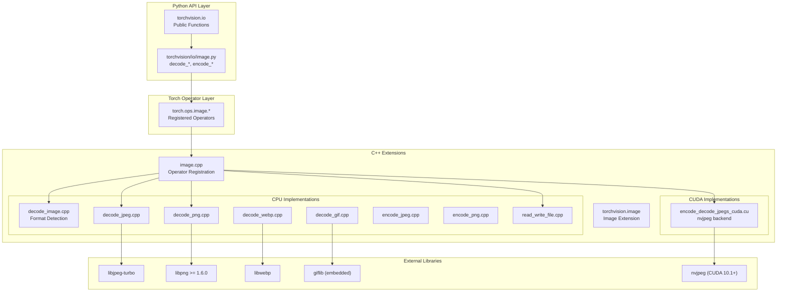
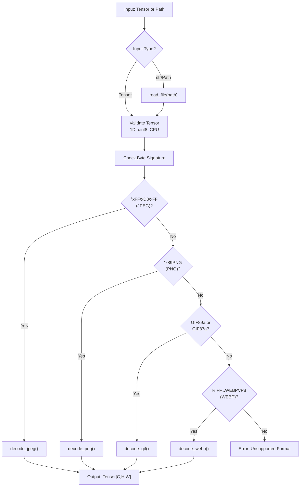
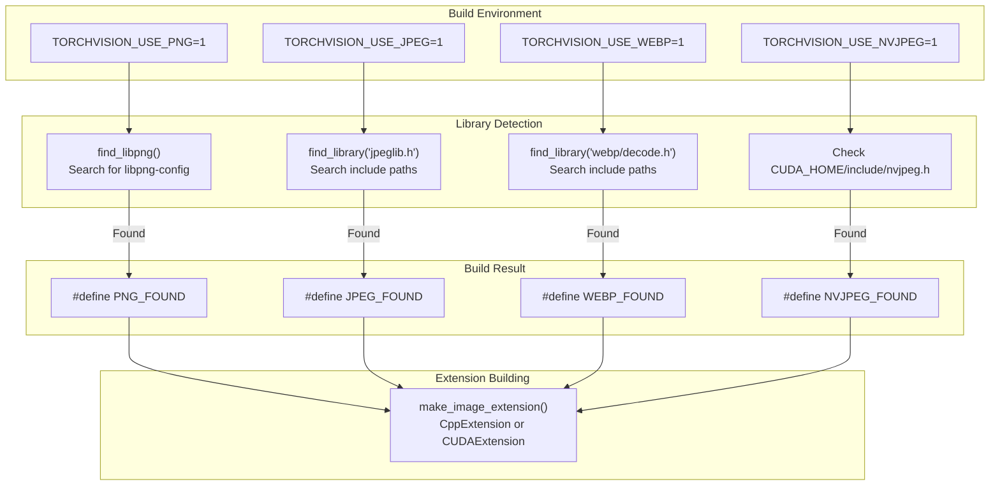
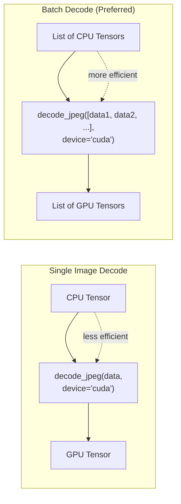

<!-- source: DeepWiki mcp.deepwiki.com · repo pytorch/vision · page 5 I/O Operations · fetched 2026-10-21 -->

# I/O Operations

<details>
<summary>Relevant source files</summary>

The following files were used as context for generating this wiki page:

- [CMakeLists.txt](CMakeLists.txt)
- [docs/source/io.rst](docs/source/io.rst)
- [setup.py](setup.py)
- [test/test_image.py](test/test_image.py)
- [torchvision/csrc/io/image/cpu/decode_image.cpp](torchvision/csrc/io/image/cpu/decode_image.cpp)
- [torchvision/csrc/io/image/image.cpp](torchvision/csrc/io/image/image.cpp)
- [torchvision/csrc/io/image/image.h](torchvision/csrc/io/image/image.h)
- [torchvision/io/__init__.py](torchvision/io/__init__.py)
- [torchvision/io/image.py](torchvision/io/image.py)

</details>


## Purpose and Scope

The `torchvision.io` module provides efficient image and video I/O capabilities implemented through C++ extensions for performance-critical operations. This page covers image decoding, encoding, and file operations. For video I/O details, see [Video I/O](#5.2). For dataset integration patterns, see [Dataset Architecture](#4.1).

## System Architecture



**Architecture Overview**: The I/O system consists of a thin Python API layer that delegates to C++ operators registered via PyTorch's operator registration system. The C++ layer interfaces with external codec libraries (libjpeg-turbo, libpng, libwebp, nvjpeg) for actual encoding/decoding work.

Sources: [torchvision/io/image.py:1-512](), [torchvision/csrc/io/image/image.cpp:8-26](), [torchvision/csrc/io/image/image.h:1-12]()

## Core File Operations

### read_file() and write_file()

Low-level utilities for raw byte I/O, returning or accepting 1D uint8 tensors:

| Function | Signature | Purpose |
|----------|-----------|---------|
| `read_file(path)` | `str → Tensor[N]` | Read entire file as uint8 tensor |
| `write_file(filename, data)` | `(str, Tensor[N]) → None` | Write uint8 tensor to file |

Both functions support `pathlib.Path` objects and non-ASCII filenames. Under the hood, they call `torch.ops.image.read_file()` and `torch.ops.image.write_file()` which are implemented in C++.

Sources: [torchvision/io/image.py:52-78](), [torchvision/csrc/io/image/cpu/read_write_file.cpp]()

## Image Decoding

### Format Auto-Detection: decode_image()



**Format Detection Logic**: The `decode_image()` function examines byte signatures at the start of the encoded data to determine format. It checks signatures in order: JPEG, PNG, GIF, WEBP. This happens in the C++ implementation for efficiency.

**Note**: AVIF and HEIC formats are not auto-detected and must be decoded using `decode_avif()` or `decode_heic()` directly.

Sources: [torchvision/csrc/io/image/cpu/decode_image.cpp:11-61](), [torchvision/io/image.py:281-326]()

### ImageReadMode Enum

The `ImageReadMode` enum controls output color space conversion during decoding:

| Mode | Value | Description | Supported Formats |
|------|-------|-------------|-------------------|
| `UNCHANGED` | 0 | Load without conversion | All |
| `GRAY` | 1 | Convert to grayscale | JPEG, PNG |
| `GRAY_ALPHA` | 2 | Grayscale with alpha channel | PNG |
| `RGB` | 3 | Convert to RGB | All |
| `RGB_ALPHA` | 4 | RGB with alpha channel | PNG, WEBP, AVIF, HEIC |
| `RGBA` | 4 | Alias for `RGB_ALPHA` | PNG, WEBP, AVIF, HEIC |

**Usage**: Can pass as enum member or string: `mode=ImageReadMode.RGB` or `mode="RGB"`.

Sources: [torchvision/io/image.py:22-50]()

### Format-Specific Decoders

#### decode_jpeg()

```python
decode_jpeg(
    input: Union[Tensor, List[Tensor]],
    mode: ImageReadMode = UNCHANGED,
    device: Union[str, torch.device] = "cpu",
    apply_exif_orientation: bool = False
) -> Union[Tensor, List[Tensor]]
```

**Key Features**:
- **CPU Backend**: Uses libjpeg-turbo (if available) or standard libjpeg
- **CUDA Backend**: Uses nvjpeg for GPU acceleration (CUDA 10.1+)
- **Batch Processing**: Accepts list of tensors for efficient batch decoding on CUDA
- **EXIF Support**: Can apply EXIF orientation transformations (CPU only)
- **Thread-Safe**: CUDA implementation uses explicit locking

**Input Requirements**: 
- Tensors must be 1D uint8 on CPU (even when `device="cuda"`)
- For batch mode, all tensors must be on CPU

**CUDA Considerations**:
- Memory leak exists in nvjpeg for CUDA < 11.6 (use 11.6+ in production)
- Batch decoding is significantly more efficient than individual calls
- Device parameter controls output device, but input must always be CPU

Sources: [torchvision/io/image.py:156-224](), [test/test_image.py:408-435]()

#### decode_png()

```python
decode_png(
    input: Tensor,
    mode: ImageReadMode = UNCHANGED,
    apply_exif_orientation: bool = False
) -> Tensor
```

**Key Features**:
- **16-bit Support**: Returns uint16 tensor for 16-bit PNG images
- **Alpha Channel**: Supports GRAY_ALPHA and RGB_ALPHA modes
- **EXIF Support**: Can apply EXIF orientation transformations
- **Interlaced PNG**: Correctly handles interlaced images

**16-bit Handling**: For 16-bit images, use `transforms.v2.functional.to_dtype()` with `scale=True` to convert to uint8 or float, as uint16 support is limited in PyTorch.

Sources: [torchvision/io/image.py:81-114](), [test/test_image.py:196-228]()

#### decode_webp(), decode_gif()

```python
decode_webp(input: Tensor, mode: ImageReadMode = UNCHANGED) -> Tensor
decode_gif(input: Tensor) -> Tensor
```

**WEBP**: Supports RGB and RGB_ALPHA modes. Uses libwebp for decoding.

**GIF**: Returns shape `[C, H, W]` for single-frame GIFs or `[N, C, H, W]` for animated GIFs. Always outputs RGB. Uses embedded giflib implementation (not dependent on system library).

Sources: [torchvision/io/image.py:340-383](), [test/test_image.py:849-897]()

#### decode_avif(), decode_heic()

```python
decode_avif(input: Tensor, mode: ImageReadMode = UNCHANGED) -> Tensor
decode_heic(input: Tensor, mode: ImageReadMode = UNCHANGED) -> Tensor
```

**Special Requirements**:
- Requires separate package: `pip install torchvision-extra-decoders`
- Linux only
- Released under LGPL license
- Dynamically loaded via `torch.ops.extra_decoders_ns.*`

**16-bit Support**: Both formats can return uint16 tensors for high bit-depth images. Use dtype conversion as with PNG.

**Limitations**:
- Not supported by `decode_image()` (must call directly)
- Not TorchScript compatible currently
- Raises error on non-Linux platforms

Sources: [torchvision/io/image.py:440-511](), [torchvision/io/image.py:405-437]()

### EXIF Orientation Handling

For JPEG and PNG images, EXIF orientation metadata can be automatically applied:

```python
img = decode_image(data, apply_exif_orientation=True)
```

The decoder reads the EXIF orientation tag (0x0112) and applies appropriate transformations (rotation, mirroring) to match the intended display orientation. This matches the behavior of PIL's `ImageOps.exif_transpose()`.

**Supported Orientations**: Values 0-8, where 1 is normal and 0 is treated as 1.

Sources: [torchvision/io/image.py:103-104](), [test/test_image.py:118-154]()

## Image Encoding

### encode_jpeg() and write_jpeg()

```python
encode_jpeg(
    input: Union[Tensor, List[Tensor]],
    quality: int = 75
) -> Union[Tensor, List[Tensor]]

write_jpeg(input: Tensor, filename: str, quality: int = 75) -> None
```

**Key Features**:
- **Quality Parameter**: Integer 1-100 (higher = better quality, larger file)
- **CPU Backend**: Uses libjpeg-turbo
- **CUDA Backend**: Uses nvjpeg for GPU encoding
- **Batch Processing**: Accepts list of tensors for efficient batch encoding on CUDA

**Input Requirements**:
| Constraint | CPU | CUDA |
|------------|-----|------|
| Shape | `[C, H, W]` | `[C, H, W]` |
| Dtype | uint8 | uint8 |
| Channels | 1 or 3 | 3 only |
| Device | CPU | CUDA |

**Batch Encoding**: For CUDA tensors, passing a list is more efficient:
```python
encoded_list = encode_jpeg([img1_cuda, img2_cuda, img3_cuda], quality=90)
```

All tensors in the batch must be on the same CUDA device.

Sources: [torchvision/io/image.py:227-278](), [test/test_image.py:557-625]()

### encode_png() and write_png()

```python
encode_png(input: Tensor, compression_level: int = 6) -> Tensor
write_png(input: Tensor, filename: str, compression_level: int = 6) -> None
```

**Key Features**:
- **Compression Level**: Integer 0-9 (0 = no compression, 9 = maximum)
- **CPU Only**: No CUDA acceleration available
- **Alpha Support**: Automatically detects 1-channel (grayscale) or 3-channel (RGB)

**Input Requirements**:
- Shape: `[C, H, W]` where C ∈ {1, 3}
- Dtype: uint8
- Device: CPU

Sources: [torchvision/io/image.py:117-153](), [test/test_image.py:242-269]()

## Build System and Format Support

### Conditional Compilation

Image format support is determined at build time through environment variables and library detection:



**Build Configuration**: The `setup.py` script controls format support through environment variables (default all enabled). If a library is not found, a warning is issued and the format is disabled.

Sources: [setup.py:21-24](), [setup.py:288-374]()

### Library Search Strategy

The `find_library()` function searches for headers in this order:

1. **`TORCHVISION_INCLUDE`** environment variable paths
2. **Conda environments**: `$BUILD_PREFIX/include` or `$CONDA_PREFIX/include` (Windows: `Library/include`)
3. **System paths**: `/usr/include`, `/usr/local/include` (Linux), `/opt/homebrew/include` (macOS)

For **libpng** specifically, the `find_libpng()` function uses `libpng-config` utility:
- Extracts version: requires >= 1.6.0
- Gets include dir: from `libpng-config --I_opts`
- Gets library dir: from `libpng-config --libdir`
- On Windows, uses `pngfix` utility instead

Sources: [setup.py:205-239](), [setup.py:242-286]()

### CMake Build Alternative

The CMake build system provides similar options:

| CMake Option | Default | Description |
|--------------|---------|-------------|
| `WITH_PNG` | ON | Enable PNG support |
| `WITH_JPEG` | ON | Enable JPEG support |
| `WITH_WEBP` | OFF | Enable WEBP support |
| `WITH_CUDA` | OFF | Enable CUDA extensions |
| `WITH_MPS` | OFF | Enable MPS (Apple Silicon) support |

Sources: [CMakeLists.txt:6-13](), [CMakeLists.txt:29-42]()

### Format-Specific Build Details

**GIF Support**: Always enabled. Uses embedded giflib source in `torchvision/csrc/io/image/cpu/giflib/*.c`, eliminating external dependency.

**AVIF/HEIC Support**: Not built into torchvision. Requires separate `torchvision-extra-decoders` package, which:
- Must be installed separately via pip
- Linux only (other platforms get dummy 0.0.0.dev version)
- Uses separate namespace: `torch.ops.extra_decoders_ns`
- Released under LGPL license (torchvision is BSD)

**NVJPEG Support**: Only available when:
- `TORCHVISION_USE_NVJPEG=1` (default)
- CUDA is available: `torch.cuda.is_available()` or `FORCE_CUDA=1`
- `CUDA_HOME` is set and contains `include/nvjpeg.h`
- Results in building with `CUDAExtension` instead of `CppExtension`

Sources: [setup.py:298](), [setup.py:353-364](), [torchvision/io/image.py:408-437]()

## Performance and Thread Safety

### CUDA Acceleration



**Batch Processing Benefits**:
- Single nvjpeg context initialization
- Reduced Python-C++ call overhead
- Better GPU utilization
- Automatic thread synchronization

**Thread Safety**: The CUDA implementation uses explicit locking (`std::lock_guard`) to ensure thread-safe operation. Multiple threads can safely call CUDA decode/encode functions concurrently.

**Device Management**: Functions preserve the current CUDA device and stream:
```python
current_device = torch.cuda.current_device()
img = decode_jpeg(data, device="cuda:1")  # Temporarily switches to device 1
assert torch.cuda.current_device() == current_device  # Restored
```

Sources: [torchvision/io/image.py:167-170](), [test/test_image.py:444-460](), [test/test_image.py:693-710]()

### Memory and Performance Considerations

**CUDA Memory Leak**: nvjpeg in CUDA versions < 11.6 has a known memory leak. The warning states:
> "There is a memory leak in the nvjpeg library for CUDA versions < 11.6. Make sure to rely on CUDA 11.6 or above before using device='cuda'."

**16-bit PNG Performance**: 16-bit PNG images are decoded to uint16 tensors. Since PyTorch operations on uint16 are limited, convert to uint8 or float32:
```python
img_uint16 = decode_png(data)  # Returns uint16
img_float = F.to_dtype(img_uint16, torch.float32, scale=True)
```

**Color Space Conversion**: All color space conversions specified by `ImageReadMode` happen in the native decoder (C++ layer), avoiding Python overhead.

Sources: [torchvision/io/image.py:186-188](), [torchvision/io/image.py:89-95]()

## Testing and Validation

### Test Coverage

The test suite (`test/test_image.py`) validates:

| Test Category | Coverage |
|---------------|----------|
| **Format Compatibility** | Comparison against PIL/Pillow for JPEG, PNG |
| **EXIF Handling** | All 8 orientation values + invalid EXIF data |
| **Error Cases** | Damaged JPEG, truncated files, invalid parameters |
| **CUDA Operations** | Thread safety, batch processing, device management |
| **Edge Cases** | 1-bit PNG, interlaced PNG, 16-bit PNG, CMYK JPEG |
| **Encoding Fidelity** | Round-trip encode/decode with quality comparison |

### Test Utilities

**Image Loading**:
- `get_images(directory, img_ext)`: Iterator over test images by extension
- `pil_read_image(img_path)`: Load image via PIL for comparison
- `normalize_dimensions(img_pil)`: Convert HWC to CHW layout

**Test ID Generation**:
- `_get_safe_image_name(name)`: Extracts filename from path for pytest IDs, avoiding machine-specific paths in test names

### Validation Strategy

**Accuracy Validation**: Decoders are tested against PIL/Pillow with tolerance for implementation differences:
```python
abs_mean_diff = (img_tv - img_pil).abs().mean().item()
assert abs_mean_diff < 2  # Allow up to 2 in uint8 range
```

**Error Handling Tests**: Verify appropriate errors for:
- Damaged/corrupted images
- Invalid parameters (quality out of range, wrong dtype)
- Unsupported operations (grayscale CUDA JPEG encoding)

Sources: [test/test_image.py:52-116](), [test/test_image.py:157-178]()

## API Reference

### Decoding Functions

| Function | Input | Output | Device | Modes | Special Features |
|----------|-------|--------|--------|-------|------------------|
| `decode_image()` | `Tensor\|str` | `Tensor[C,H,W]` | CPU | All | Auto format detection |
| `decode_jpeg()` | `Tensor\|List[Tensor]` | `Tensor\|List[Tensor]` | CPU, CUDA | UNCHANGED, GRAY, RGB | Batch mode, EXIF |
| `decode_png()` | `Tensor` | `Tensor[C,H,W]` | CPU | All + GRAY_ALPHA | uint16 support, EXIF |
| `decode_webp()` | `Tensor` | `Tensor[C,H,W]` | CPU | UNCHANGED, RGB, RGB_ALPHA | - |
| `decode_gif()` | `Tensor` | `Tensor[N,C,H,W]` | CPU | RGB (fixed) | Multi-frame |
| `decode_avif()` | `Tensor` | `Tensor[C,H,W]` | CPU | UNCHANGED, RGB, RGB_ALPHA | Requires extra package, uint16 |
| `decode_heic()` | `Tensor` | `Tensor[C,H,W]` | CPU | UNCHANGED, RGB, RGB_ALPHA | Requires extra package, uint16 |
| `read_image()` | `str` | `Tensor[C,H,W]` | CPU | All | **[OBSOLETE]** Use decode_image |

### Encoding Functions

| Function | Input | Output | Device | Channels | Quality/Compression |
|----------|-------|--------|--------|----------|---------------------|
| `encode_jpeg()` | `Tensor\|List[Tensor]` | `Tensor\|List[Tensor]` | CPU, CUDA | 1 or 3 (CPU), 3 (CUDA) | quality: 1-100 |
| `encode_png()` | `Tensor` | `Tensor` | CPU | 1 or 3 | compression_level: 0-9 |
| `write_jpeg()` | `Tensor` | None | CPU, CUDA | 1 or 3 (CPU), 3 (CUDA) | quality: 1-100 |
| `write_png()` | `Tensor` | None | CPU | 1 or 3 | compression_level: 0-9 |

### File I/O Functions

| Function | Signature | Description |
|----------|-----------|-------------|
| `read_file(path)` | `str → Tensor[N]` | Read file bytes as uint8 tensor |
| `write_file(filename, data)` | `(str, Tensor[N]) → None` | Write uint8 tensor to file |

Sources: [torchvision/io/__init__.py:18-73](), [torchvision/io/image.py:52-511]()

---

