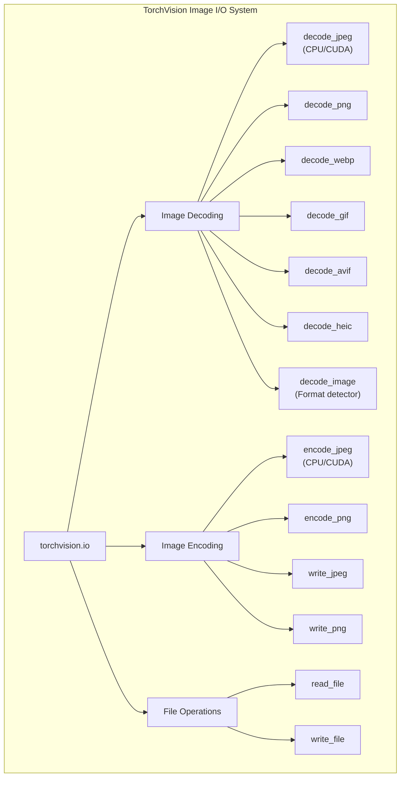
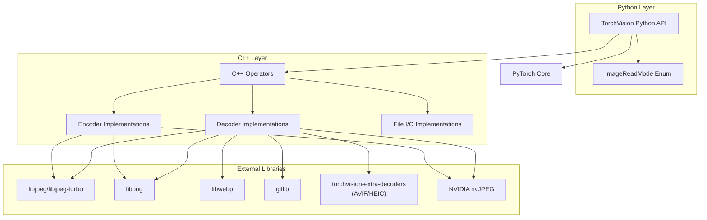
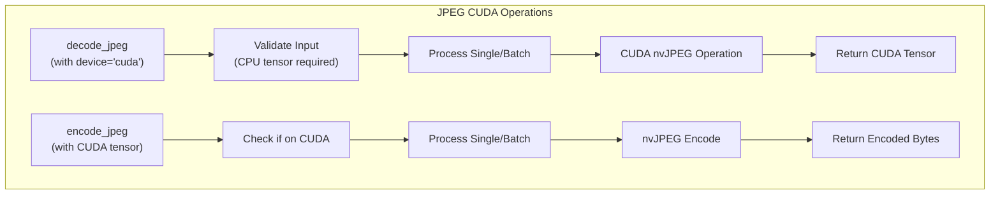

<!-- source: DeepWiki mcp.deepwiki.com · repo pytorch/vision · page 5.1 Image I/O · fetched 2026-10-21 -->

# Image I/O

<details>
<summary>Relevant source files</summary>

The following files were used as context for generating this wiki page:

- [CMakeLists.txt](CMakeLists.txt)
- [docs/source/io.rst](docs/source/io.rst)
- [setup.py](setup.py)
- [test/test_image.py](test/test_image.py)
- [torchvision/csrc/io/image/cpu/decode_image.cpp](torchvision/csrc/io/image/cpu/decode_image.cpp)
- [torchvision/csrc/io/image/image.cpp](torchvision/csrc/io/image/image.cpp)
- [torchvision/csrc/io/image/image.h](torchvision/csrc/io/image/image.h)
- [torchvision/io/__init__.py](torchvision/io/__init__.py)
- [torchvision/io/image.py](torchvision/io/image.py)

</details>


This document covers the image input/output (I/O) capabilities of TorchVision, focusing on reading and writing image files in various formats. For information about video I/O, see [Video I/O](#5.2).

## Overview

TorchVision's Image I/O module provides efficient utilities for decoding and encoding images directly into PyTorch tensors, bypassing the need for intermediate conversions through PIL or other libraries. It supports multiple image formats and offers both CPU and GPU acceleration for certain operations.



Sources: [torchvision/io/image.py:1-512](), [torchvision/io/__init__.py:1-74]()

## Image Format Support

TorchVision supports the following image formats for reading and writing:

| Format | Read Support | Write Support | GPU Acceleration | Notes |
|--------|--------------|---------------|------------------|-------|
| JPEG   | ✓            | ✓             | ✓ (NVIDIA GPUs) | Full support |
| PNG    | ✓            | ✓             | ✗                | Supports 8-bit and 16-bit images |
| WEBP   | ✓            | ✗             | ✗                | Read-only |
| GIF    | ✓            | ✗             | ✗                | Read-only |
| AVIF   | ✓            | ✗             | ✗                | Requires extra decoder package, Linux only |
| HEIC   | ✓            | ✗             | ✗                | Requires extra decoder package, Linux only |

Sources: [torchvision/io/image.py:80-512](), [setup.py:19-24]()

## Architecture

The Image I/O system combines Python and C++ components, with the Python layer providing a user-friendly API and the C++ layer handling the actual encoding/decoding through libraries like libjpeg, libpng, and libwebp.



Sources: [torchvision/csrc/io/image/image.h:1-12](), [torchvision/csrc/io/image/image.cpp:1-30](), [setup.py:277-363]()

## Core Components

### ImageReadMode

The `ImageReadMode` enum defines different modes for image decoding:

```python
class ImageReadMode(Enum):
    UNCHANGED = 0  # loads the image as-is
    GRAY = 1       # converts to grayscale
    GRAY_ALPHA = 2 # grayscale with transparency
    RGB = 3        # converts to RGB
    RGB_ALPHA = 4  # RGB with transparency
    RGBA = RGB_ALPHA  # Alias for convenience
```

This enumeration allows you to control how the image is decoded, similar to PIL's conversion modes.

Sources: [torchvision/io/image.py:22-49]()

### File I/O Functions

Basic functions for reading and writing raw data:

- `read_file(path)`: Reads file contents as a uint8 tensor
- `write_file(filename, data)`: Writes a uint8 tensor to a file

Sources: [torchvision/io/image.py:52-78]()

### Image Decoding

#### Main Entry Point

The primary function for image decoding is `decode_image()`, which automatically detects the image format:

```python
decode_image(input, mode=ImageReadMode.UNCHANGED, apply_exif_orientation=False)
```

Sources: [torchvision/io/image.py:281-325](), [torchvision/csrc/io/image/cpu/decode_image.cpp:1-64]()

#### Format-Specific Decoders

For more control or when working with specific formats, you can use format-specific decoders:

- `decode_jpeg(input, mode=ImageReadMode.UNCHANGED, device="cpu", apply_exif_orientation=False)`
- `decode_png(input, mode=ImageReadMode.UNCHANGED, apply_exif_orientation=False)`
- `decode_webp(input, mode=ImageReadMode.UNCHANGED)`
- `decode_gif(input)`
- `decode_avif(input, mode=ImageReadMode.UNCHANGED)` (requires extra package)
- `decode_heic(input, mode=ImageReadMode.UNCHANGED)` (requires extra package)

JPEG decoding supports GPU acceleration via the `device` parameter, which can significantly speed up batch processing.

Sources: [torchvision/io/image.py:81-511]()

### Image Encoding

TorchVision supports encoding images to JPEG and PNG formats:

- `encode_jpeg(input, quality=75)`: Encodes tensor to JPEG bytes
- `encode_png(input, compression_level=6)`: Encodes tensor to PNG bytes
- `write_jpeg(input, filename, quality=75)`: Saves tensor as JPEG file
- `write_png(input, filename, compression_level=6)`: Saves tensor as PNG file

JPEG encoding also supports GPU acceleration when the input tensor is on a CUDA device.

Sources: [torchvision/io/image.py:117-278]()

## Usage Examples

### Basic Image Decoding

```python
from torchvision.io import decode_image, read_file

# Decode from file path
img = decode_image("path/to/image.jpg", mode="RGB")

# Or from raw bytes
data = read_file("path/to/image.jpg")
img = decode_image(data, mode="RGB")
```

### CUDA-Accelerated JPEG Processing

```python
from torchvision.io import decode_jpeg, encode_jpeg

# Decode JPEG on GPU
img = decode_jpeg(data, device="cuda")

# Process on GPU...
processed_img = some_processing(img)

# Encode back to JPEG on GPU
encoded_data = encode_jpeg(processed_img, quality=90)
```

### Batch Processing

```python
from torchvision.io import decode_jpeg, encode_jpeg

# Batch decode multiple JPEGs on GPU (more efficient than individual calls)
decoded_images = decode_jpeg([data1, data2, data3], device="cuda")

# Process images...

# Batch encode
encoded_images = encode_jpeg(processed_images, quality=90)
```

## Build and Configuration Options

TorchVision's image I/O capabilities depend on several external libraries that can be enabled or disabled at build time through environment variables:

| Environment Variable | Default | Purpose |
|----------------------|---------|---------|
| `TORCHVISION_USE_PNG` | 1 | Enable PNG support |
| `TORCHVISION_USE_JPEG` | 1 | Enable JPEG support |
| `TORCHVISION_USE_WEBP` | 1 | Enable WebP support |
| `TORCHVISION_USE_NVJPEG` | 1 | Enable NVIDIA GPU JPEG support |

Sources: [setup.py:17-36](), [CMakeLists.txt:7-16](), [setup.py:277-363]()

## Implementation Details

### Format Detection

The `decode_image` function determines the format by examining the file signatures (magic bytes) at the beginning of the file:

| Format | Signature |
|--------|-----------|
| JPEG | `"\xFF\xD8\xFF"` |
| PNG | `"\211PNG"` |
| GIF | `"GIF89a"` or `"GIF87a"` |
| WebP | `"RIFF"` + 4 bytes + `"WEBPVP8"` |

Sources: [torchvision/csrc/io/image/cpu/decode_image.cpp:11-61]()

### CUDA Support

JPEG encoding and decoding use NVIDIA's nvJPEG library when executed on CUDA devices, providing significant performance improvements for batch processing. The implementation includes safety features like proper stream synchronization and error checking.



Sources: [torchvision/io/image.py:156-260](), [test/test_image.py:407-709]()

### AVIF and HEIC Support

Support for AVIF and HEIC formats requires the separate `torchvision-extra-decoders` package due to licensing considerations. These formats are only supported on Linux and are considered a beta feature.

```python
# To enable AVIF/HEIC support
# pip install torchvision-extra-decoders
from torchvision.io import decode_avif, decode_heic

avif_img = decode_avif(avif_data)
heic_img = decode_heic(heic_data)
```

Sources: [torchvision/io/image.py:404-511]()

## Performance Considerations

1. **Use GPU acceleration for JPEG** when processing multiple images, as batch processing on CUDA is significantly faster.

2. **Avoid repeated encoding/decoding** when possible to reduce latency.

3. **16-bit PNG handling**: When working with 16-bit PNGs, the decoded tensor will be uint16. Since PyTorch has limited uint16 support, consider converting:
   ```python
   from torchvision.transforms.v2.functional import to_dtype
   
   # Convert uint16 image to float with proper scaling
   float_img = to_dtype(uint16_img, torch.float32, scale=True)
   ```

4. **Reuse memory buffers** for repeatedly processing images of the same size to reduce memory allocations.

Sources: [torchvision/io/image.py:87-114](), [test/test_image.py:208-216]()

---

