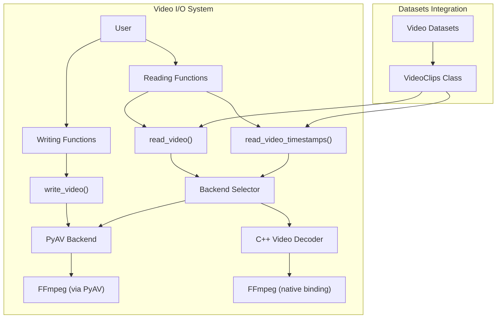
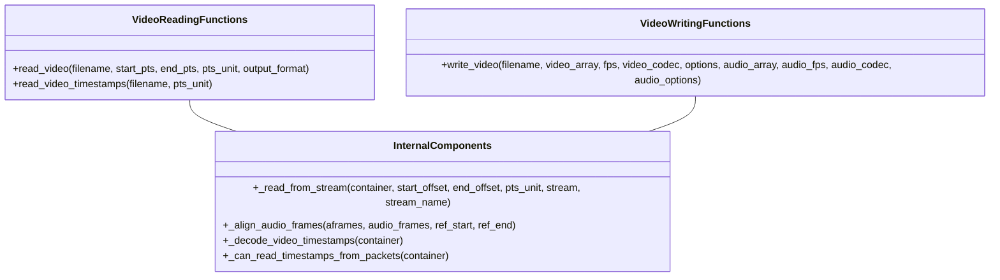
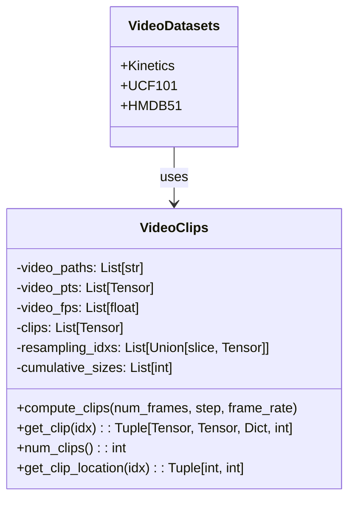
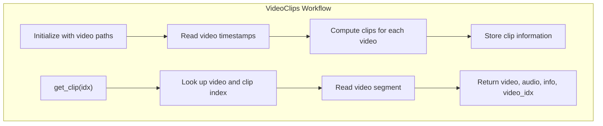
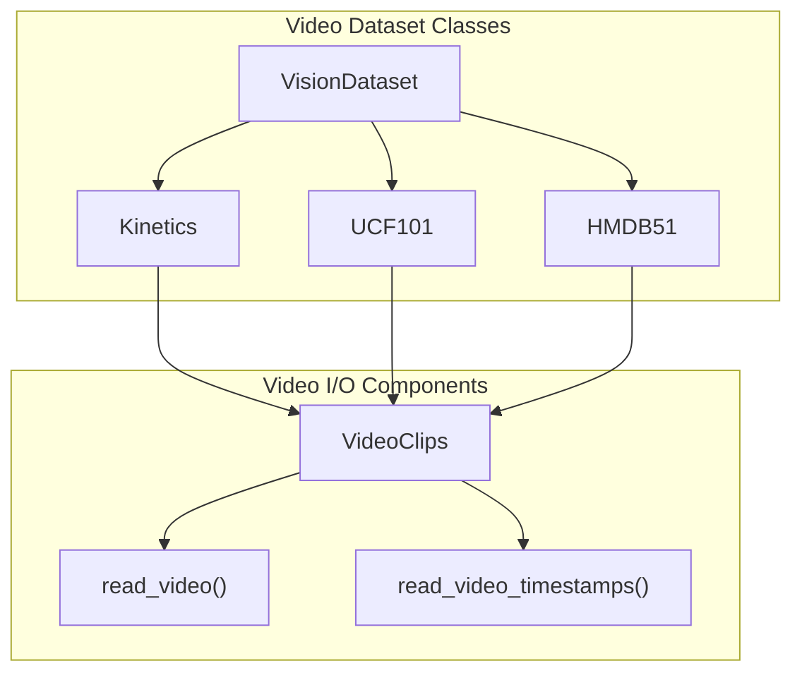

<!-- source: DeepWiki mcp.deepwiki.com · repo pytorch/vision · page 5.2 Video I/O · fetched 2026-10-21 -->

# Video I/O

<details>
<summary>Relevant source files</summary>

The following files were used as context for generating this wiki page:

- [CMakeLists.txt](CMakeLists.txt)
- [docs/source/io.rst](docs/source/io.rst)
- [setup.py](setup.py)
- [test/test_image.py](test/test_image.py)
- [torchvision/csrc/io/image/cpu/decode_image.cpp](torchvision/csrc/io/image/cpu/decode_image.cpp)
- [torchvision/csrc/io/image/image.cpp](torchvision/csrc/io/image/image.cpp)
- [torchvision/csrc/io/image/image.h](torchvision/csrc/io/image/image.h)
- [torchvision/io/__init__.py](torchvision/io/__init__.py)
- [torchvision/io/image.py](torchvision/io/image.py)

</details>


The Video I/O module in TorchVision provides functionality for reading, writing, and processing video data. This page documents the core video I/O capabilities, which include reading video frames and audio from files, writing video data to files, and handling video timestamps. For information about image I/O, see [Image I/O](#5.1).

> **Important:** As indicated in the code, all video decoding and encoding capabilities in TorchVision are deprecated from version 0.22 and will be removed in version 0.24. Users are recommended to migrate to [TorchCodec](https://github.com/pytorch/torchcodec), where future decoding/encoding capabilities will be consolidated.

## System Architecture

The Video I/O system in TorchVision consists of several components that work together to provide video processing capabilities.



The system primarily uses two backends:
1. **PyAV**: Python bindings for FFmpeg
2. **C++ Video Decoder**: A native decoder implementation

Sources: [torchvision/io/video.py:12-51](). [torchvision/io/_video_opt.py:12-19]()

## Core Components

### Video Reading and Writing



| Function | Purpose |
|----------|---------|
| `read_video` | Reads video and audio frames from a file |
| `read_video_timestamps` | Retrieves presentation timestamps for video frames |
| `write_video` | Writes video and optional audio data to a file |

Sources: [torchvision/io/video.py:58-468]()

### Video Clips Management

The `VideoClips` class handles the organization of video data into clips of fixed size. It's heavily used by dataset classes like Kinetics, UCF101, and HMDB51.



Sources: [torchvision/datasets/video_utils.py:73-420]()

## Reading Videos

The primary function for reading video data is `read_video()`:

```python
def read_video(
    filename: str,
    start_pts: Union[float, Fraction] = 0,
    end_pts: Optional[Union[float, Fraction]] = None,
    pts_unit: str = "pts",
    output_format: str = "THWC",
) -> Tuple[torch.Tensor, torch.Tensor, Dict[str, Any]]
```

This function:
1. Reads video and audio frames from the specified file
2. Allows reading a subset of the video by specifying start and end points
3. Returns video frames, audio frames, and metadata

Parameters:
- `filename`: Path to the video file
- `start_pts`/`end_pts`: Start and end presentation timestamps
- `pts_unit`: Unit for timestamps ("pts" or "sec")
- `output_format`: Format of output video tensor ("THWC" or "TCHW")

Returns:
- `vframes`: A tensor containing video frames with shape [T, H, W, C] or [T, C, H, W]
- `aframes`: A tensor containing audio frames with shape [K, L]
- `info`: Metadata including video_fps and audio_fps

Similarly, `read_video_timestamps()` function retrieves timestamps without decoding the actual frame data:

```python
def read_video_timestamps(
    filename: str,
    pts_unit: str = "pts"
) -> Tuple[List[int], Optional[float]]
```

This function returns a list of timestamps for all frames in the video, along with the video frame rate.

Sources: [torchvision/io/video.py:274-392](), [torchvision/io/video.py:412-468]()

## Writing Videos

Videos can be written using the `write_video()` function:

```python
def write_video(
    filename: str,
    video_array: torch.Tensor,
    fps: float,
    video_codec: str = "libx264",
    options: Optional[Dict[str, Any]] = None,
    audio_array: Optional[torch.Tensor] = None,
    audio_fps: Optional[float] = None,
    audio_codec: Optional[str] = None,
    audio_options: Optional[Dict[str, Any]] = None,
) -> None
```

This function:
1. Writes a 4D tensor of video frames to a file
2. Optionally includes audio data
3. Supports various video and audio codecs and encoding options

Parameters:
- `filename`: Output file path
- `video_array`: Tensor of shape [T, H, W, C] containing frames
- `fps`: Video frames per second
- `video_codec`: The codec to use (e.g., "libx264", "h264")
- `options`: Dictionary of codec-specific options
- `audio_array`: Optional tensor containing audio data
- `audio_fps`: Audio sample rate
- `audio_codec`: Audio codec to use
- `audio_options`: Dictionary of audio codec options

Sources: [torchvision/io/video.py:58-177]()

## VideoClips System

The `VideoClips` class provides a way to manage clips from multiple videos. It's primarily used by video datasets to handle fixed-size clips for training/evaluation.



Key methods:
- `compute_clips()`: Organizes videos into clips of specific size
- `get_clip()`: Retrieves a specific clip
- `get_clip_location()`: Maps a flat index to video/clip indices
- `compute_clips_for_video()`: Computes clips for a single video

Sources: [torchvision/datasets/video_utils.py:73-420]()

## Video Backends

TorchVision supports two video decoding backends:

1. **PyAV Backend**: Uses the PyAV library, which provides Python bindings for FFmpeg
2. **C++ Video Decoder**: A native implementation that directly uses FFmpeg

The backend can be selected using:

```python
from torchvision import set_video_backend
set_video_backend("pyav")  # or "video_reader" for the C++ backend
```

The PyAV backend is used by default if available, otherwise the system falls back to the C++ decoder.

Sources: [torchvision/io/video.py:12-51](), [torchvision/io/_video_opt.py:12-19]()

## Integration with Datasets

Video I/O and the `VideoClips` class are integrated with several video datasets in TorchVision:



These datasets use `VideoClips` to:
1. Manage video data as fixed-size clips
2. Handle pre-processing and clip sampling for training/testing
3. Provide a uniform interface for accessing video data regardless of dataset

Sources: [torchvision/datasets/kinetics.py:22-237](), [torchvision/datasets/ucf101.py:12-132](), [torchvision/datasets/hmdb51.py:13-153]()

## Internal Video Processing

Beyond the public APIs, the Video I/O system includes several internal functions for video processing:

| Internal Function | Purpose |
|-------------------|---------|
| `_read_from_stream` | Reads frames from a specific stream in a container |
| `_align_audio_frames` | Aligns audio frames to video frames |
| `_decode_video_timestamps` | Decodes timestamps for video frames |
| `_probe_video_from_file` | Extracts metadata from a video file |
| `_read_video_from_file` | Low-level function for reading video data |

Sources: [torchvision/io/video.py:179-256](), [torchvision/io/_video_opt.py:125-219]()

## Example Usage

### Reading a Video

```python
import torch
import torchvision

# Read all frames from a video file
video_tensor, audio_tensor, info = torchvision.io.read_video("video.mp4", pts_unit="sec")

# Read a specific segment of the video
video_tensor, audio_tensor, info = torchvision.io.read_video(
    "video.mp4", 
    start_pts=10.5,  # start at 10.5 seconds
    end_pts=20.0,    # end at 20 seconds
    pts_unit="sec"
)

print(f"Video shape: {video_tensor.shape}")  # [T, H, W, C]
print(f"Audio shape: {audio_tensor.shape}")  # [C, L]
print(f"Video FPS: {info['video_fps']}")
```

### Writing a Video

```python
import torch
import torchvision

# Create a sample video tensor (T=100 frames, H=720, W=1280, C=3 channels)
video_tensor = torch.randint(0, 256, (100, 720, 1280, 3), dtype=torch.uint8)

# Write video to file
torchvision.io.write_video(
    "output.mp4",
    video_tensor,
    fps=30,
    video_codec="libx264",
    options={"crf": "18"}  # Constant Rate Factor - lower means better quality
)
```

### Working with VideoClips

```python
from torchvision.datasets.video_utils import VideoClips

# Create a VideoClips object
video_paths = ["video1.mp4", "video2.mp4", "video3.mp4"]
video_clips = VideoClips(
    video_paths,
    frames_per_clip=16,   # each clip has 16 frames
    step_between_clips=8,  # start a new clip every 8 frames
    frame_rate=30         # resample videos to 30 fps
)

# Get number of clips
num_clips = video_clips.num_clips()
print(f"Total number of clips: {num_clips}")

# Get a specific clip
clip_idx = 5
video, audio, info, video_idx = video_clips.get_clip(clip_idx)
print(f"Clip shape: {video.shape}")
print(f"From video: {video_paths[video_idx]}")
```

## Performance Considerations

1. **Memory Usage**: Video decoding can be memory-intensive. When processing large videos, consider reading in smaller chunks.

2. **GPU Acceleration**: The current video I/O system does not use GPU acceleration for decoding/encoding. Operations are performed on CPU.

3. **Parallel Processing**: When creating a `VideoClips` object, the `num_workers` parameter can be increased to parallelize timestamp reading.

4. **Pre-computed Metadata**: `VideoClips` supports caching metadata to avoid recomputing it when recreating the object.

Sources: [torchvision/datasets/video_utils.py:131-135](), [test/test_io.py:64-77]()

---

