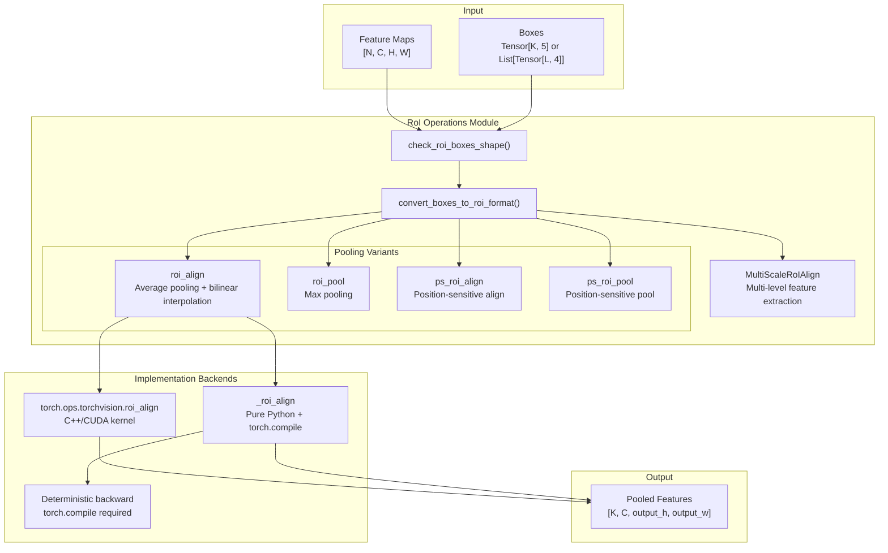
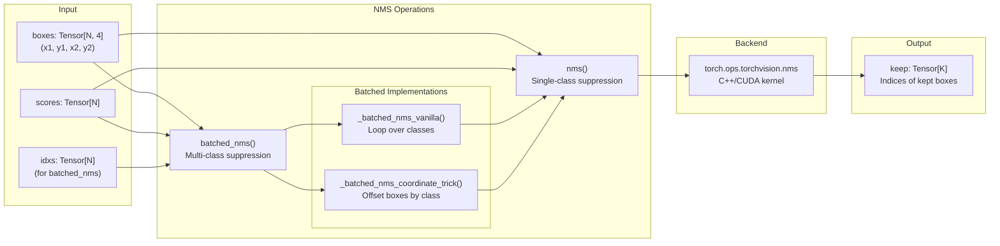
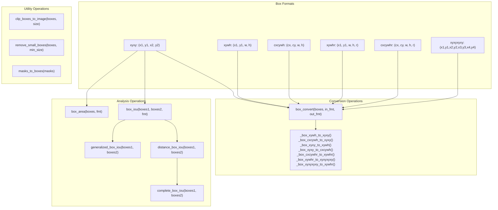
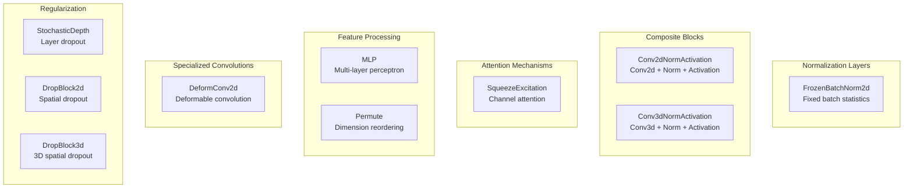
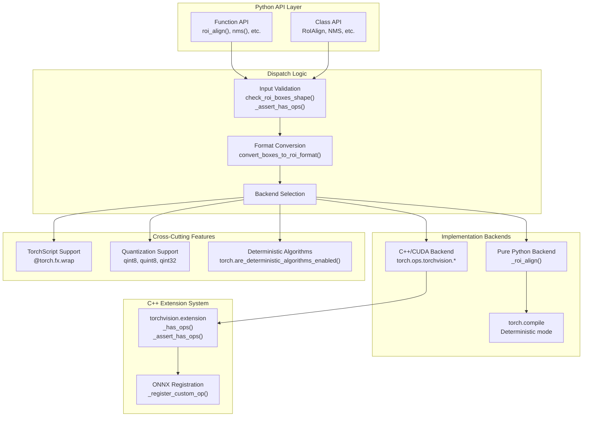
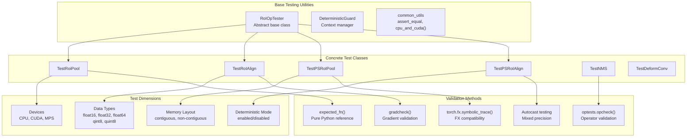

<!-- source: DeepWiki mcp.deepwiki.com · repo pytorch/vision · page 6 Operators · fetched 2026-10-21 -->

# Operators

<details>
<summary>Relevant source files</summary>

The following files were used as context for generating this wiki page:

- [docs/source/ops.rst](docs/source/ops.rst)
- [test/test_ops.py](test/test_ops.py)
- [torchvision/ops/__init__.py](torchvision/ops/__init__.py)
- [torchvision/ops/_utils.py](torchvision/ops/_utils.py)
- [torchvision/ops/boxes.py](torchvision/ops/boxes.py)
- [torchvision/ops/deform_conv.py](torchvision/ops/deform_conv.py)
- [torchvision/ops/drop_block.py](torchvision/ops/drop_block.py)
- [torchvision/ops/misc.py](torchvision/ops/misc.py)
- [torchvision/ops/ps_roi_align.py](torchvision/ops/ps_roi_align.py)
- [torchvision/ops/ps_roi_pool.py](torchvision/ops/ps_roi_pool.py)
- [torchvision/ops/roi_align.py](torchvision/ops/roi_align.py)
- [torchvision/ops/roi_pool.py](torchvision/ops/roi_pool.py)
- [torchvision/ops/stochastic_depth.py](torchvision/ops/stochastic_depth.py)

</details>


## Purpose and Scope

The `torchvision.ops` module provides specialized operators, losses, and layers for computer vision tasks, with particular emphasis on object detection and segmentation. These operators implement computationally intensive operations with optimized C++/CUDA backends while maintaining full TorchScript compatibility.

For information about detection models that use these operators, see [Detection and Segmentation Models](#3.2). For visualization utilities that work with operator outputs, see [Visualization Utilities](#7.1).

**Sources:** [torchvision/ops/__init__.py:1-74](), [docs/source/ops.rst:1-104]()

## Operator Categories

The `torchvision.ops` module organizes functionality into three primary categories:

| Category | Purpose | Key Operators |
|----------|---------|---------------|
| **Detection/Segmentation** | RoI operations, NMS, feature pyramids | `roi_align`, `roi_pool`, `ps_roi_align`, `ps_roi_pool`, `nms`, `batched_nms`, `MultiScaleRoIAlign`, `FeaturePyramidNetwork` |
| **Box Operations** | Bounding box utilities, IoU calculations | `box_iou`, `box_convert`, `box_area`, `clip_boxes_to_image`, `remove_small_boxes`, `masks_to_boxes`, `generalized_box_iou`, `distance_box_iou`, `complete_box_iou` |
| **Layer Components** | Neural network building blocks | `FrozenBatchNorm2d`, `Conv2dNormActivation`, `SqueezeExcitation`, `MLP`, `DeformConv2d`, `StochasticDepth`, `DropBlock2d`, `DropBlock3d` |

All operators support native TorchScript compilation and are designed for production deployment.

**Sources:** [torchvision/ops/__init__.py:33-73](), [docs/source/ops.rst:14-104]()

## Detection and Segmentation Operators

### RoI (Region of Interest) Operations

RoI operators extract fixed-size feature maps from regions defined by bounding boxes. These are fundamental to two-stage detection architectures like Faster R-CNN and Mask R-CNN.



**Sources:** [torchvision/ops/roi_align.py:1-295](), [torchvision/ops/roi_pool.py:1-73](), [torchvision/ops/_utils.py:18-38]()

#### RoI Align

`roi_align` performs Region of Interest Align with average pooling and bilinear interpolation, as described in Mask R-CNN. It provides sub-pixel accuracy by avoiding quantization in the RoI boundaries.

**Function Signature:**
```python
roi_align(
    input: Tensor,                          # [N, C, H, W]
    boxes: Union[Tensor, List[Tensor]],     # [K, 5] or List[[L, 4]]
    output_size: BroadcastingList2[int],    # (height, width)
    spatial_scale: float = 1.0,
    sampling_ratio: int = -1,
    aligned: bool = False
) -> Tensor                                  # [K, C, output_h, output_w]
```

**Key Parameters:**
- `spatial_scale`: Maps box coordinates to input coordinates (e.g., 0.5 if boxes are on 224x224 but input is 112x112)
- `sampling_ratio`: Number of sampling points per bin. If -1, uses adaptive sampling (`ceil(roi_width / output_width)`)
- `aligned`: If `True`, shifts box coordinates by -0.5 for better pixel alignment (Detectron2 version)

**Implementation Paths:**

The operator has multiple implementation paths selected at runtime:

1. **C++/CUDA Backend** (default): `torch.ops.torchvision.roi_align` - optimized kernel implementation
2. **Pure Python + torch.compile** (deterministic mode): `_roi_align` function at [torchvision/ops/roi_align.py:115-200]()
   - Used when `torch.are_deterministic_algorithms_enabled()` and device is CUDA/MPS/XPU
   - Lazily compiled with `@lazy_compile(dynamic=True)` decorator
   - Provides deterministic backward pass

**Quantization Support:**

RoI Align supports quantized tensors (qint8, quint8, qint32) with the constraint that batch size must be 1:

```python
# From test_ops.py
qx = torch.quantize_per_tensor(x, scale=scale, zero_point=zero_point, dtype=qdtype)
qy = ops.roi_align(qx, qrois, output_size=pool_size, ...)
```

**Sources:** [torchvision/ops/roi_align.py:204-295](), [test/test_ops.py:407-617]()

#### RoI Pool

`roi_pool` performs Region of Interest Pool with max pooling, as described in Fast R-CNN. Unlike RoI Align, it quantizes coordinates to integer boundaries.

**Function Signature:**
```python
roi_pool(
    input: Tensor,                          # [N, C, H, W]
    boxes: Union[Tensor, List[Tensor]],     # [K, 5] or List[[L, 4]]
    output_size: BroadcastingList2[int],    # (height, width)
    spatial_scale: float = 1.0
) -> Tensor                                  # [K, C, output_h, output_w]
```

The implementation uses C++/CUDA backend exclusively: `torch.ops.torchvision.roi_pool` returns a tuple `(output, argmax)`, but only the output is returned to users.

**Sources:** [torchvision/ops/roi_pool.py:14-73](), [test/test_ops.py:276-322]()

#### Position-Sensitive RoI Operations

`ps_roi_align` and `ps_roi_pool` implement position-sensitive variants described in R-FCN and Light-Head R-CNN. These operations split the input channels into position-specific feature maps.

**Key Difference:** Output channels are reduced by a factor of `output_size[0] * output_size[1]`. For example, with `output_size=(7,7)` and 49 input channels, you get 1 output channel.

```python
# Input: [N, C * pool_h * pool_w, H, W]
# Output: [K, C, pool_h, pool_w]
ps_roi_align(input, boxes, output_size=7, ...)  # C_out = C_in / 49
```

**Sources:** [torchvision/ops/ps_roi_align.py:12-91](), [torchvision/ops/ps_roi_pool.py:12-71]()

#### MultiScaleRoIAlign

`MultiScaleRoIAlign` pools features from multiple feature pyramid levels based on RoI size, as used in Feature Pyramid Networks (FPN).

**Class Structure:**
```python
class MultiScaleRoIAlign(nn.Module):
    def __init__(
        self,
        featmap_names: List[str],      # Feature map keys, e.g., ["0", "1", "2", "3"]
        output_size: int,               # Output spatial size
        sampling_ratio: int             # Sampling ratio for roi_align
    )
    
    def forward(
        self, 
        x: Dict[str, Tensor],           # Feature pyramid dict
        boxes: List[Tensor],            # Boxes per image
        image_shapes: List[Tuple[int, int]]  # Original image sizes
    ) -> Tensor
```

The operator automatically selects the appropriate pyramid level for each RoI based on its size using the formula:
```
level = floor(4 + log2(sqrt(box_area) / 224))
```

**Sources:** [torchvision/ops/poolers.py:1-250](), [test/test_ops.py:713-742]()

### NMS (Non-Maximum Suppression)

NMS operations suppress overlapping bounding boxes to produce final detections.



**Sources:** [torchvision/ops/boxes.py:20-121](), [test/test_ops.py:744-928]()

#### NMS

`nms` removes lower-scoring boxes with IoU greater than `iou_threshold` relative to higher-scoring boxes.

**Function Signature:**
```python
nms(
    boxes: Tensor,      # [N, 4] in (x1, y1, x2, y2) format
    scores: Tensor,     # [N]
    iou_threshold: float
) -> Tensor             # [K] indices sorted by descending score
```

**Quantization Support:** NMS supports quantized inputs (quint8, qint8, qint32):

```python
qboxes = torch.quantize_per_tensor(boxes, scale=scale, zero_point=zero_point, dtype=torch.quint8)
qscores = torch.quantize_per_tensor(scores, scale=scale, zero_point=zero_point, dtype=torch.quint8)
keep = ops.nms(qboxes, qscores, iou_threshold)
```

**Non-determinism:** When multiple boxes have identical scores and satisfy the IoU criterion, the selected box is not guaranteed to be the same across CPU/GPU runs.

**Sources:** [torchvision/ops/boxes.py:20-48](), [test/test_ops.py:744-870]()

#### Batched NMS

`batched_nms` applies NMS per category, ensuring boxes from different classes don't suppress each other.

**Function Signature:**
```python
batched_nms(
    boxes: Tensor,      # [N, 4]
    scores: Tensor,     # [N]
    idxs: Tensor,       # [N] category indices
    iou_threshold: float
) -> Tensor             # [K] indices
```

**Implementation Strategy Selection:**

The function automatically chooses between two implementations based on the number of boxes:

| Condition | Implementation | Method |
|-----------|---------------|---------|
| `boxes.numel() <= 4000` (CPU)<br/>`boxes.numel() <= 100000` (CUDA) | `_batched_nms_coordinate_trick` | Offsets boxes by class: `boxes_for_nms = boxes + class_id * (max_coordinate + 1)` |
| Otherwise | `_batched_nms_vanilla` | Loops over unique classes, applies NMS to each |

The coordinate trick is faster but can cause numerical issues with very large coordinates. The vanilla version is more robust for large datasets.

**Sources:** [torchvision/ops/boxes.py:51-121](), [test/test_ops.py:894-919]()

## Box Operations

Box operations provide utilities for manipulating and analyzing bounding boxes across different formats.



**Sources:** [torchvision/ops/boxes.py:1-521](), [torchvision/ops/_box_convert.py:1-200]()

### Box Format Conversion

`box_convert` transforms boxes between different coordinate representations:

| Format | Description | Dimensions |
|--------|-------------|------------|
| `xyxy` | Top-left and bottom-right corners | `[..., 4]` |
| `xywh` | Top-left corner, width, height | `[..., 4]` |
| `cxcywh` | Center point, width, height | `[..., 4]` |
| `xywhr` | Top-left, width, height, rotation | `[..., 5]` |
| `cxcywhr` | Center, width, height, rotation | `[..., 5]` |
| `xyxyxyxy` | Four corners (rotated boxes) | `[..., 8]` |

**Example:**
```python
boxes_xyxy = torch.tensor([[0, 0, 10, 10], [5, 5, 15, 15]])
boxes_cxcywh = ops.box_convert(boxes_xyxy, in_fmt='xyxy', out_fmt='cxcywh')
# Result: [[5, 5, 10, 10], [10, 10, 10, 10]]
```

The implementation uses a dispatch table of internal conversion functions like `_box_xyxy_to_cxcywh()` at [torchvision/ops/_box_convert.py:1-150](). For rotated boxes, conversions may chain through multiple intermediate formats.

**Sources:** [torchvision/ops/boxes.py:185-271](), [torchvision/ops/_box_convert.py:1-200]()

### IoU Computation

#### Standard IoU

`box_iou` computes pairwise Intersection over Union between two sets of boxes:

```python
box_iou(
    boxes1: Tensor,  # [..., N, 4]
    boxes2: Tensor,  # [..., M, 4]
    fmt: str = 'xyxy'  # Format of input boxes
) -> Tensor          # [..., N, M]
```

The implementation at [torchvision/ops/boxes.py:308-342]() uses `_box_inter_union` to compute intersection and union areas efficiently, supporting `xyxy`, `xywh`, and `cxcywh` formats directly without conversion.

**Sources:** [torchvision/ops/boxes.py:344-371]()

#### Generalized IoU (GIoU)

`generalized_box_iou` extends standard IoU by penalizing the area of the smallest enclosing box:

```
GIoU = IoU - (Area_enclosing - Union) / Area_enclosing
```

This provides meaningful gradients even when boxes don't overlap (standard IoU gradient is zero).

**Sources:** [torchvision/ops/boxes.py:374-402]()

#### Distance IoU (DIoU)

`distance_box_iou` penalizes the distance between box centers:

```
DIoU = IoU - (center_distance² / diagonal_distance²)
```

**Sources:** [torchvision/ops/boxes.py:437-460](), [torchvision/ops/boxes.py:462-481]()

#### Complete IoU (CIoU)

`complete_box_iou` adds an aspect ratio consistency term to DIoU:

```
CIoU = DIoU - α * v
where v = (4/π²) * (arctan(w₁/h₁) - arctan(w₂/h₂))²
```

**Sources:** [torchvision/ops/boxes.py:404-435]()

### Utility Functions

#### clip_boxes_to_image

Clamps box coordinates to stay within image boundaries:

```python
clip_boxes_to_image(
    boxes: Tensor,              # [..., 4] in (x1, y1, x2, y2)
    size: Tuple[int, int]       # (height, width)
) -> Tensor                     # [..., 4] clipped boxes
```

The implementation at [torchvision/ops/boxes.py:149-183]() handles TorchScript tracing mode specially by using `torch.max`/`torch.min` instead of `clamp`.

**Sources:** [torchvision/ops/boxes.py:149-183]()

#### remove_small_boxes

Filters out boxes with sides smaller than `min_size`:

```python
remove_small_boxes(
    boxes: Tensor,    # [..., 4] in (x1, y1, x2, y2)
    min_size: float
) -> Tensor           # [K] indices of kept boxes
```

**Sources:** [torchvision/ops/boxes.py:123-147]()

#### masks_to_boxes

Computes tight bounding boxes around binary masks:

```python
masks_to_boxes(
    masks: Tensor     # [N, H, W]
) -> Tensor           # [N, 4] in (x1, y1, x2, y2)
```

The implementation at [torchvision/ops/boxes.py:483-521]() iterates over masks, finding min/max coordinates of non-zero pixels. For degenerate masks (single row/column), output may have `x1 == x2` or `y1 == y2`.

**Sources:** [torchvision/ops/boxes.py:483-521]()

## Layer Components

The `torchvision.ops` module provides reusable building blocks for neural network architectures.



**Sources:** [torchvision/ops/misc.py:1-322](), [torchvision/ops/deform_conv.py:1-196](), [torchvision/ops/stochastic_depth.py:1-67](), [torchvision/ops/drop_block.py:1-162]()

### FrozenBatchNorm2d

`FrozenBatchNorm2d` is a BatchNorm2d variant with fixed statistics and affine parameters, commonly used in detection models to prevent running mean/variance updates during fine-tuning.

**Class Structure:**
```python
class FrozenBatchNorm2d(nn.Module):
    def __init__(self, num_features: int, eps: float = 1e-5)
    
    # Buffers (non-trainable):
    # - weight: [num_features]
    # - bias: [num_features]  
    # - running_mean: [num_features]
    # - running_var: [num_features]
```

The forward pass at [torchvision/ops/misc.py:54-63]() computes:
```
scale = weight * (running_var + eps).rsqrt()
output = input * scale + (bias - running_mean * scale)
```

**Sources:** [torchvision/ops/misc.py:14-67]()

### ConvNormActivation Blocks

`Conv2dNormActivation` and `Conv3dNormActivation` combine convolution, normalization, and activation into a single sequential block.

**Class Structure:**
```python
class Conv2dNormActivation(nn.Sequential):
    def __init__(
        self,
        in_channels: int,
        out_channels: int,
        kernel_size: Union[int, Tuple[int, int]] = 3,
        stride: Union[int, Tuple[int, int]] = 1,
        padding: Optional[Union[int, Tuple[int, int], str]] = None,  # Auto-calculated if None
        groups: int = 1,
        norm_layer: Optional[Callable] = nn.BatchNorm2d,
        activation_layer: Optional[Callable] = nn.ReLU,
        dilation: Union[int, Tuple[int, int]] = 1,
        inplace: Optional[bool] = True,
        bias: Optional[bool] = None  # Auto: True if norm_layer is None
    )
```

The implementation at [torchvision/ops/misc.py:69-174]() automatically calculates padding to preserve spatial dimensions when not specified:
```python
padding = (kernel_size - 1) // 2 * dilation
```

These blocks are used extensively in modern architectures like EfficientNet, MobileNet, and RegNet.

**Sources:** [torchvision/ops/misc.py:69-223]()

### SqueezeExcitation

`SqueezeExcitation` implements the SE block from SENet, which adaptively recalibrates channel-wise feature responses:

```python
class SqueezeExcitation(nn.Module):
    def __init__(
        self,
        input_channels: int,
        squeeze_channels: int,
        activation: Callable = nn.ReLU,      # δ activation
        scale_activation: Callable = nn.Sigmoid  # σ activation
    )
```

The forward pass at [torchvision/ops/misc.py:252-261]() follows the pattern:
```
scale = avgpool(input)  # Global pooling
scale = fc1(scale)       # Squeeze
scale = activation(scale)
scale = fc2(scale)       # Excitation
scale = scale_activation(scale)
output = input * scale   # Channel-wise multiplication
```

**Sources:** [torchvision/ops/misc.py:225-262]()

### MLP

`MLP` implements a multi-layer perceptron with configurable normalization, activation, and dropout:

```python
class MLP(nn.Sequential):
    def __init__(
        self,
        in_channels: int,
        hidden_channels: List[int],          # Layer dimensions
        norm_layer: Optional[Callable] = None,
        activation_layer: Optional[Callable] = nn.ReLU,
        inplace: Optional[bool] = None,
        bias: bool = True,
        dropout: float = 0.0
    )
```

The implementation at [torchvision/ops/misc.py:264-307]() constructs layers as:
```
[Linear -> Norm -> Activation -> Dropout] × (N-1) -> Linear -> Dropout
```

Used in Vision Transformer (ViT) and other attention-based architectures.

**Sources:** [torchvision/ops/misc.py:264-307]()

### DeformConv2d

`DeformConv2d` implements Deformable Convolution v2, which learns spatial sampling locations through offset and mask parameters:

```python
class DeformConv2d(nn.Module):
    def __init__(
        self,
        in_channels: int,
        out_channels: int,
        kernel_size: int,
        stride: int = 1,
        padding: int = 0,
        dilation: int = 1,
        groups: int = 1,
        bias: bool = True
    )
    
    def forward(
        self,
        input: Tensor,     # [B, in_channels, H, W]
        offset: Tensor,    # [B, 2*offset_groups*K*K, H_out, W_out]
        mask: Optional[Tensor] = None  # [B, offset_groups*K*K, H_out, W_out]
    ) -> Tensor            # [B, out_channels, H_out, W_out]
```

The functional interface `deform_conv2d` at [torchvision/ops/deform_conv.py:14-108]() delegates to the C++/CUDA kernel:
```python
torch.ops.torchvision.deform_conv2d(
    input, weight, offset, mask, bias,
    stride_h, stride_w, pad_h, pad_w, 
    dil_h, dil_w, n_weight_grps, n_offset_grps, use_mask
)
```

**Key Parameters:**
- `offset`: Learned 2D offsets for each kernel position
- `mask`: Optional modulation masks (Deformable ConvNets v2)
- `n_offset_grps`: Computed as `offset.shape[1] // (2 * kernel_h * kernel_w)`

**Sources:** [torchvision/ops/deform_conv.py:1-196](), [test/test_ops.py:930-1050]()

### StochasticDepth

`StochasticDepth` implements layer dropout from "Deep Networks with Stochastic Depth", randomly dropping entire layers during training:

```python
class StochasticDepth(nn.Module):
    def __init__(self, p: float, mode: str)  # mode: "batch" or "row"
    
stochastic_depth(
    input: Tensor,
    p: float,           # Drop probability
    mode: str,          # "batch": drop entire batch, "row": drop rows independently
    training: bool = True
) -> Tensor
```

Implementation at [torchvision/ops/stochastic_depth.py:8-45]():
- In "batch" mode: all samples dropped together
- In "row" mode: each sample dropped independently
- Scales surviving values by `1 / (1 - p)` to maintain expected output

Used in EfficientNet and other deep residual networks.

**Sources:** [torchvision/ops/stochastic_depth.py:1-67](), [test/test_ops.py:78-96]()

### DropBlock

`DropBlock2d` and `DropBlock3d` implement structured dropout that zeros out contiguous spatial regions:

```python
class DropBlock2d(nn.Module):
    def __init__(
        self,
        p: float,           # Drop probability
        block_size: int,    # Must be odd
        inplace: bool = False,
        eps: float = 1e-6
    )

drop_block2d(
    input: Tensor,      # [N, C, H, W]
    p: float,
    block_size: int,
    inplace: bool = False,
    eps: float = 1e-6,
    training: bool = True
) -> Tensor             # [N, C, H, W]
```

The implementation at [torchvision/ops/drop_block.py:9-56]() computes dropout probability using:
```python
gamma = (p * H * W) / (block_size² * (H - block_size + 1) * (W - block_size + 1))
```

Then applies max pooling to expand sampled locations into blocks, and normalizes the output.

**Sources:** [torchvision/ops/drop_block.py:1-162](), [test/test_ops.py:88-96]()

## Implementation Architecture

The operators module employs a layered architecture with multiple backend implementations for different execution contexts.



**Sources:** [torchvision/ops/roi_align.py:1-295](), [torchvision/extension.py:1-150](), [torchvision/ops/_register_onnx_ops.py:1-200]()

### Backend Selection Strategy

The operator implementations use conditional dispatch based on runtime conditions:

1. **TorchScript/Tracing Mode**: Always use C++/CUDA backend
   ```python
   if torch.jit.is_scripting() or torch.jit.is_tracing():
       return torch.ops.torchvision.roi_align(...)
   ```

2. **Deterministic Mode (roi_align only)**: Use pure Python + torch.compile
   ```python
   if (torch.are_deterministic_algorithms_enabled() 
       and (input.is_cuda or input.is_mps or input.is_xpu)
       and is_compile_supported(input.device.type)):
       return _roi_align(...)  # Pure Python implementation
   ```

3. **Default**: Use C++/CUDA backend with `_assert_has_ops()` check

**Sources:** [torchvision/ops/roi_align.py:244-260]()

### Lazy Compilation for Deterministic Operations

The pure Python `_roi_align` implementation uses a lazy compilation pattern to avoid importing dynamo until first use:

```python
@lazy_compile(dynamic=True)
def _roi_align(input, rois, spatial_scale, pooled_height, pooled_width, sampling_ratio, aligned):
    # Pure Python implementation with torch operations
    # Compiled with torch.compile on first call
    ...
```

The `@lazy_compile` decorator at [torchvision/ops/roi_align.py:16-31]() wraps the function so that on first invocation, it replaces itself with a compiled version:

```python
def compile_hook(*args, **kwargs):
    compiled_fn = torch.compile(fn, **compile_kwargs)
    globals()[fn.__name__] = functools.wraps(fn)(compiled_fn)
    return compiled_fn(*args, **kwargs)
```

This provides deterministic backward passes while maintaining acceptable memory usage.

**Sources:** [torchvision/ops/roi_align.py:16-31](), [torchvision/ops/roi_align.py:114-200]()

### Extension System

The C++ extension system is managed through `torchvision.extension`:

```python
from torchvision.extension import _assert_has_ops, _has_ops

# Check if ops are available
if not _has_ops():
    raise RuntimeError("torchvision C++ extensions not available")

# Assert ops are available (throws if not)
_assert_has_ops()
```

ONNX operator registration is handled by `_register_custom_op()` called in [torchvision/ops/__init__.py:30](). This registers symbolic functions for ONNX export of custom operators.

**Sources:** [torchvision/extension.py:1-150](), [torchvision/ops/__init__.py:1-30](), [torchvision/ops/_register_onnx_ops.py:1-200]()

### TorchScript and FX Support

All operators support TorchScript compilation and FX tracing:

1. **FX Wrapping**: Functions decorated with `@torch.fx.wrap` are treated as leaf nodes:
   ```python
   @torch.fx.wrap
   def roi_align(input, boxes, ...):
       ...
   ```

2. **Type Annotations**: JIT-compatible type hints using `torch.jit.annotations.BroadcastingList2`:
   ```python
   def roi_align(
       input: Tensor,
       boxes: Union[Tensor, List[Tensor]],
       output_size: BroadcastingList2[int],  # JIT-compatible
       ...
   ) -> Tensor:
   ```

3. **Scripting Guards**: Conditional logic for scripting/tracing mode:
   ```python
   if not torch.jit.is_scripting() and not torch.jit.is_tracing():
       _log_api_usage_once(roi_align)  # Skip logging in JIT mode
   ```

**Sources:** [torchvision/ops/roi_align.py:204-261](), [test/test_ops.py:162-188]()

## Testing Infrastructure

The operators module includes extensive testing infrastructure for validating correctness across platforms and data types.



**Sources:** [test/test_ops.py:1-1500](), [test/common_utils.py:1-500]()

### RoIOpTester Abstract Base Class

`RoIOpTester` provides a standardized testing framework for RoI operations with shared test methods:

**Class Structure:**
```python
class RoIOpTester(ABC):
    dtype = torch.float64
    mps_dtype = torch.float32
    mps_backward_atol = 2e-2
    
    @abstractmethod
    def fn(*args, **kwargs): pass
    
    @abstractmethod
    def make_obj(*args, **kwargs): pass
    
    @abstractmethod
    def get_script_fn(*args, **kwargs): pass
    
    @abstractmethod
    def expected_fn(*args, **kwargs): pass
```

**Key Test Methods:**

1. **test_forward()** at [test/test_ops.py:123-160]():
   - Tests across devices (CPU, CUDA, MPS)
   - Tests contiguous and non-contiguous tensors
   - Tests multiple dtypes (float16, float32, float64)
   - Validates against pure Python reference implementation
   - Adjusts tolerances based on dtype (1e-5 for float, 4e-3 for half, 5e-3 for bfloat16)

2. **test_backward()** at [test/test_ops.py:189-214]():
   - Uses `torch.autograd.gradcheck` for gradient validation
   - Tests both scripted and eager versions
   - Adjusts tolerance for MPS backend (2e-2 vs 1e-5)

3. **test_torch_fx_trace()** at [test/test_ops.py:170-188]():
   - Validates FX symbolic tracing compatibility
   - Compares traced vs original outputs

4. **test_is_leaf_node()** at [test/test_ops.py:162-169]():
   - Ensures operators appear as leaf nodes in FX graphs
   - Validates graph structure has correct number of inputs

**Sources:** [test/test_ops.py:107-274]()

### DeterministicGuard Context Manager

`DeterministicGuard` provides context management for testing deterministic algorithm modes:

```python
class DeterministicGuard:
    def __init__(self, deterministic: bool, *, warn_only: bool = False):
        self.deterministic = deterministic
        self.warn_only = warn_only
    
    def __enter__(self):
        self.deterministic_restore = torch.are_deterministic_algorithms_enabled()
        self.warn_only_restore = torch.is_deterministic_algorithms_warn_only_enabled()
        torch.use_deterministic_algorithms(self.deterministic, warn_only=self.warn_only)
    
    def __exit__(self, exception_type, exception_value, traceback):
        torch.use_deterministic_algorithms(self.deterministic_restore, 
                                           warn_only=self.warn_only_restore)
```

Usage in tests:
```python
with DeterministicGuard(deterministic=True):
    y = ops.roi_align(x, rois, pool_h, pool_w, ...)
```

**Sources:** [test/test_ops.py:34-46]()

### Reference Implementation Testing

Each RoI operation provides a pure Python reference implementation in `expected_fn()`:

**Example for RoI Pool** at [test/test_ops.py:288-314]():
```python
def expected_fn(self, x, rois, pool_h, pool_w, spatial_scale=1, ...):
    n_channels = x.size(1)
    y = torch.zeros(rois.size(0), n_channels, pool_h, pool_w, ...)
    
    for roi_idx, roi in enumerate(rois):
        batch_idx = int(roi[0])
        # Extract RoI region
        roi_x = x[batch_idx, :, i_begin:i_end+1, j_begin:j_end+1]
        
        # Compute pooling bins
        bin_h = roi_h / pool_h
        bin_w = roi_w / pool_w
        
        for i in range(pool_h):
            for j in range(pool_w):
                # Get bin region and compute max
                bin_x = roi_x[:, get_slice(i, bin_h), get_slice(j, bin_w)]
                y[roi_idx, :, i, j] = bin_x.max(dim=1)[0]
    
    return y
```

These reference implementations use only basic PyTorch operations to provide ground truth for validating optimized C++/CUDA kernels.

**Sources:** [test/test_ops.py:288-470]()

### Quantization Testing

Quantized operator testing validates that quantized versions produce similar results to float versions:

**Example for qroialign** at [test/test_ops.py:546-604]():
```python
def test_qroialign(self, aligned, scale, zero_point, qdtype):
    x = torch.randint(50, 100, size=(num_imgs, n_channels, img_size, img_size)).to(dtype)
    qx = torch.quantize_per_tensor(x, scale=scale, zero_point=zero_point, dtype=qdtype)
    
    y = ops.roi_align(x, rois, ...)  # Float version
    qy = ops.roi_align(qx, qrois, ...)  # Quantized version
    
    # Compare after quantizing float output
    quantized_float_y = torch.quantize_per_tensor(y, scale=scale, zero_point=zero_point, dtype=qdtype)
    
    # Allow up to 5% of values to differ by scale amount
    # (due to rounding differences in quantization)
    diff_idx = torch.where(qy != quantized_float_y)
    assert diff_idx[0].numel() / qy.numel() < 0.05
```

**Sources:** [test/test_ops.py:546-613]()

### Operator Check Tests

The `optests` framework validates that operators satisfy PyTorch's operator requirements:

```python
# Generated tests for all ops
optests.generate_opcheck_tests(
    testcase=TestNMS,
    namespaces=["torchvision"],
    failures_dict_path="optests_failures_dict.json",
    additional_decorators=[],
    test_utils=["test_schema", "test_autograd_registration", 
                "test_faketensor", "test_aot_dispatch_dynamic"]
)
```

Manual opcheck for RoI operations at [test/test_ops.py:688-711]():
```python
@pytest.mark.parametrize("op", (
    torch.ops.torchvision.roi_pool,
    torch.ops.torchvision.roi_align,
    torch.ops.torchvision.ps_roi_pool,
    torch.ops.torchvision.ps_roi_align,
))
def test_roi_opcheck(op, dtype, device, requires_grad):
    optests.opcheck(op, args=(x,), kwargs=kwargs)
```

This validates schema correctness, autograd registration, fake tensor support, and AOT dispatch compatibility.

**Sources:** [test/test_ops.py:676-928]()

### Multi-Platform Testing Pattern

Tests use parameterization to cover multiple execution contexts:

```python
@pytest.mark.parametrize("device", cpu_and_cuda_and_mps())
@pytest.mark.parametrize("contiguous", (True, False))
@pytest.mark.parametrize("x_dtype", (torch.float16, torch.float32, torch.float64))
@pytest.mark.parametrize("deterministic", (True, False))
def test_forward(self, device, contiguous, x_dtype, deterministic):
    if device == "mps" and x_dtype is torch.float64:
        pytest.skip("MPS does not support float64")
    
    if deterministic and device == "cpu":
        pytest.skip("cpu is always deterministic, don't retest")
    
    # Create test data with specified layout
    x = torch.rand(2, n_channels, 10, 10, dtype=x_dtype, device=device)
    if not contiguous:
        x = x.permute(0, 1, 3, 2)  # Make non-contiguous
    
    # Run test with deterministic guard
    with DeterministicGuard(deterministic):
        y = self.fn(x, rois, ...)
```

This pattern ensures operators work correctly across:
- Devices: CPU, CUDA, MPS
- Memory layouts: contiguous and non-contiguous
- Data types: float16, float32, float64, bfloat16
- Execution modes: deterministic and non-deterministic

**Sources:** [test/test_ops.py:475-538]()

---

