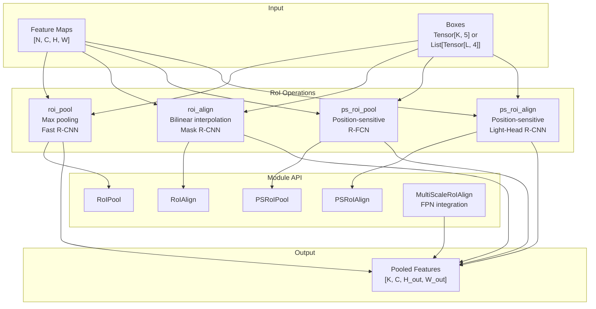
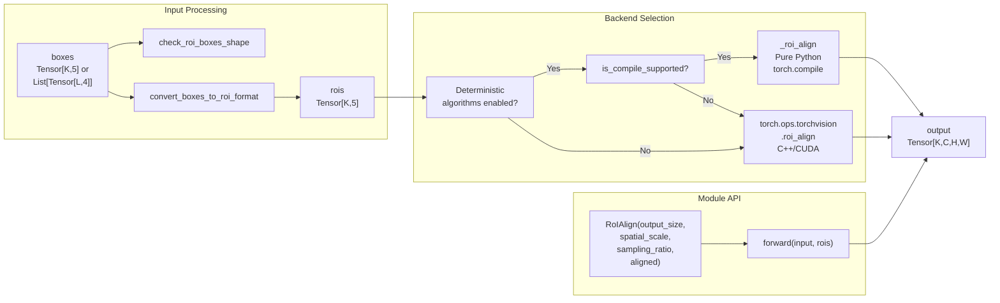
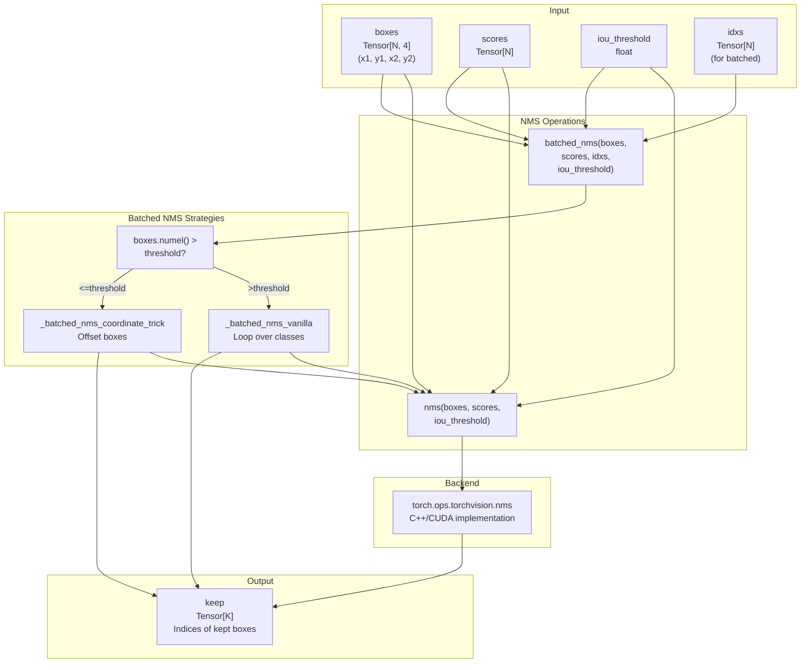
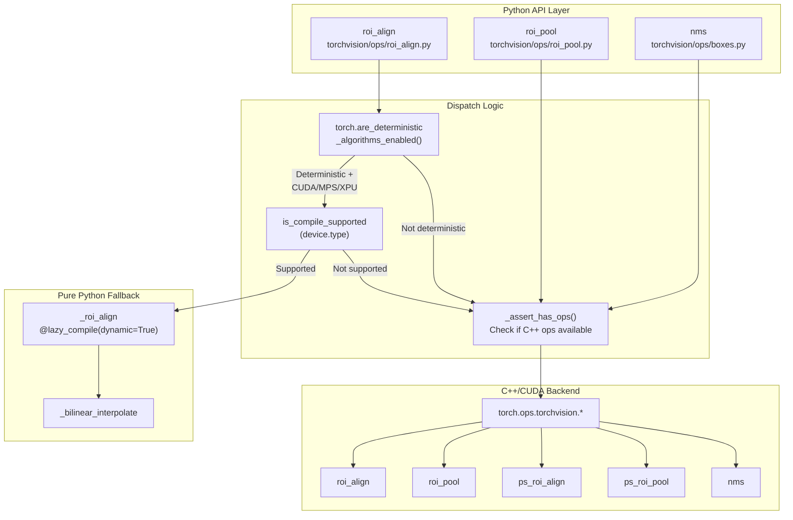
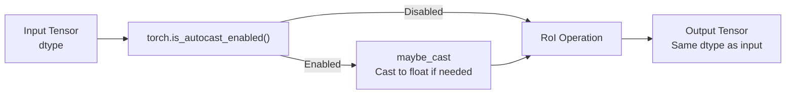
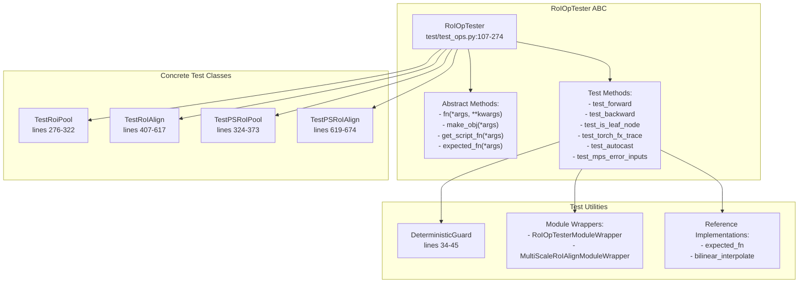
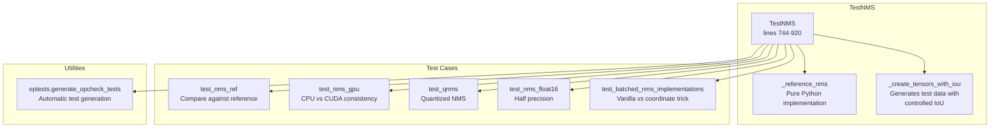

<!-- source: DeepWiki mcp.deepwiki.com · repo pytorch/vision · page 6.1 Detection Operators · fetched 2026-10-21 -->

# Detection Operators

<details>
<summary>Relevant source files</summary>

The following files were used as context for generating this wiki page:

- [docs/source/ops.rst](docs/source/ops.rst)
- [test/test_ops.py](test/test_ops.py)
- [torchvision/ops/__init__.py](torchvision/ops/__init__.py)
- [torchvision/ops/_utils.py](torchvision/ops/_utils.py)
- [torchvision/ops/boxes.py](torchvision/ops/boxes.py)
- [torchvision/ops/deform_conv.py](torchvision/ops/deform_conv.py)
- [torchvision/ops/drop_block.py](torchvision/ops/drop_block.py)
- [torchvision/ops/misc.py](torchvision/ops/misc.py)
- [torchvision/ops/ps_roi_align.py](torchvision/ops/ps_roi_align.py)
- [torchvision/ops/ps_roi_pool.py](torchvision/ops/ps_roi_pool.py)
- [torchvision/ops/roi_align.py](torchvision/ops/roi_align.py)
- [torchvision/ops/roi_pool.py](torchvision/ops/roi_pool.py)
- [torchvision/ops/stochastic_depth.py](torchvision/ops/stochastic_depth.py)

</details>


## Purpose and Scope

This page documents the detection-specific operators in `torchvision.ops` that are essential for object detection and instance segmentation models. These operators perform Region of Interest (RoI) operations and Non-Maximum Suppression (NMS) for post-processing detection outputs.

**Scope of this page:**
- RoI pooling and alignment operators (`roi_pool`, `roi_align`, `ps_roi_pool`, `ps_roi_align`, `MultiScaleRoIAlign`)
- NMS operations (`nms`, `batched_nms`)
- Implementation architecture (C++/CUDA backends, pure Python fallbacks)
- Testing infrastructure for detection operators

**Related pages:**
- For bounding box utility functions (box_iou, clip_boxes_to_image, etc.), see [Box Operations](#6.2)
- For neural network building blocks (FrozenBatchNorm2d, SqueezeExcitation, etc.), see [Layer Components](#6.3)
- For detection model architectures that use these operators, see [Detection and Segmentation Models](#3.2)

## RoI Operations

Region of Interest (RoI) operations extract fixed-size feature maps from regions defined by bounding boxes. TorchVision provides four variants of RoI operations, each with both functional and module-based APIs.

### Operation Overview



**Sources:** [torchvision/ops/__init__.py:1-73](), [docs/source/ops.rst:14-40]()

### roi_align and RoIAlign

The `roi_align` function performs RoI Align with average pooling, as described in Mask R-CNN. It uses bilinear interpolation to sample feature values at non-integer positions, avoiding quantization errors present in RoI Pool.

**Key parameters:**
- `output_size`: Size of pooled output (height, width)
- `spatial_scale`: Factor mapping box coordinates to feature map coordinates
- `sampling_ratio`: Number of sampling points per bin (adaptive if ≤ 0)
- `aligned`: Whether to apply -0.5 pixel shift (Detectron2 alignment)



**Sources:** [torchvision/ops/roi_align.py:204-261](), [torchvision/ops/roi_align.py:263-294]()

#### Pure Python Implementation

The pure Python implementation (`_roi_align`) is used when deterministic algorithms are enabled on CUDA/MPS/XPU devices. It is wrapped with `torch.compile` for performance.

**Implementation details:**
1. **Bilinear interpolation:** [torchvision/ops/roi_align.py:35-96]() implements bilinear sampling
2. **Adaptive sampling:** When `sampling_ratio <= 0`, computes `ceil(roi_width / output_width)` samples
3. **Masking:** For adaptive sampling, creates masks to handle data-dependent sample counts
4. **Offset handling:** Applies 0.5 pixel shift when `aligned=True` (Detectron2 mode)

**Sources:** [torchvision/ops/roi_align.py:114-201](), [torchvision/ops/roi_align.py:16-31]()

### roi_pool and RoIPool

The `roi_pool` function performs RoI pooling with max pooling as described in Fast R-CNN. It divides each RoI into bins and applies max pooling within each bin.

**Key parameters:**
- `output_size`: Size of pooled output (height, width)
- `spatial_scale`: Factor mapping box coordinates to feature map coordinates

The implementation always uses the C++/CUDA backend via `torch.ops.torchvision.roi_pool`.

**Sources:** [torchvision/ops/roi_pool.py:14-53](), [torchvision/ops/roi_pool.py:56-72]()

### ps_roi_align and PSRoIAlign

Position-Sensitive RoI Align operator mentioned in Light-Head R-CNN. Unlike standard RoI operations that pool from all channels, PS RoI Align splits the input channels into position-sensitive score maps.

**Channel splitting:** Input channels must satisfy `C % (output_size[0] * output_size[1]) == 0`. The output has `C / (output_size[0] * output_size[1])` channels.

**Sources:** [torchvision/ops/ps_roi_align.py:11-59](), [torchvision/ops/ps_roi_align.py:62-90]()

### ps_roi_pool and PSRoIPool

Position-Sensitive RoI Pool operator described in R-FCN. Similar to PS RoI Align but uses average pooling instead of bilinear interpolation.

**Sources:** [torchvision/ops/ps_roi_pool.py:12-52](), [torchvision/ops/ps_roi_pool.py:54-70]()

### MultiScaleRoIAlign

`MultiScaleRoIAlign` integrates RoI Align with Feature Pyramid Networks (FPN). It automatically selects the appropriate feature level based on RoI size.

**Level assignment:** Uses the formula `k = k_0 + log2(sqrt(w * h) / 224)` where `k_0 = 4` to assign RoIs to pyramid levels.

**Sources:** [test/test_ops.py:713-742]()

## NMS Operations

Non-Maximum Suppression (NMS) removes redundant bounding boxes by iteratively discarding boxes with high IoU overlap with higher-scoring boxes.

### Architecture



**Sources:** [torchvision/ops/boxes.py:20-48](), [torchvision/ops/boxes.py:51-121]()

### nms

The `nms` function performs standard NMS on a set of boxes and scores.

**Implementation:** Calls `torch.ops.torchvision.nms` which is implemented in C++/CUDA for efficiency.

**Quantized support:** Accepts quantized tensors (qint8, quint8, qint32) for integer inference.

**Non-determinism:** When multiple boxes have identical scores and satisfy the IoU criterion, the selected box is not guaranteed to be the same between CPU and GPU.

**Sources:** [torchvision/ops/boxes.py:20-48]()

### batched_nms

The `batched_nms` function performs NMS independently per category. Boxes from different categories never suppress each other.

**Two implementations:**

| Implementation | Condition | Strategy |
|---------------|-----------|----------|
| `_batched_nms_coordinate_trick` | `boxes.numel() <= 4000` (CPU) or `<= 100000` (GPU) | Add large offsets to boxes based on category ID, then call standard NMS |
| `_batched_nms_vanilla` | `boxes.numel() > threshold` | Loop over unique category IDs and call NMS for each class |

**Coordinate trick:** Computes `offsets = idxs * (max_coordinate + 1)` and adds to box coordinates, ensuring boxes from different classes don't overlap.

**Sources:** [torchvision/ops/boxes.py:51-121]()

## Implementation Architecture

### Backend Selection and C++ Extensions



**Sources:** [torchvision/ops/roi_align.py:251-260](), [torchvision/extension.py]()

### Deterministic Algorithms

RoI Align has a deterministic pure Python implementation that is used when `torch.use_deterministic_algorithms(True)` is set and the device is CUDA, MPS, or XPU.

**Activation conditions:**
1. `torch.are_deterministic_algorithms_enabled()` returns `True`
2. Input is on CUDA, MPS, or XPU device
3. `is_compile_supported(device.type)` returns `True`
4. TorchVision C++ ops are not available OR above conditions are met

**Performance:** The pure Python implementation is wrapped with `@lazy_compile(dynamic=True)` to compile on first use, providing acceptable performance while ensuring determinism.

**Sources:** [torchvision/ops/roi_align.py:114-201](), [test/test_ops.py:479-538]()

### Autocast Support

All RoI operations support automatic mixed precision (AMP) training:



**Casting logic:** [torchvision/ops/roi_align.py:101-105]() ensures tensors are cast to `float32` during autocast, but the output preserves the original dtype.

**Sources:** [test/test_ops.py:234-236](), [test/test_ops.py:499-508](), [test/test_ops.py:858-860]()

## Testing Infrastructure

### RoIOpTester Pattern

The `RoIOpTester` abstract base class defines a comprehensive testing pattern for all RoI operations.



**Sources:** [test/test_ops.py:107-274](), [test/test_ops.py:34-45]()

### Test Coverage

The testing infrastructure validates multiple aspects of each operator:

| Test Type | Purpose | Key Features |
|-----------|---------|--------------|
| `test_forward` | Output correctness | Compares against pure Python reference implementation; tests multiple dtypes (float16, float32, float64); tests contiguous and non-contiguous tensors |
| `test_backward` | Gradient correctness | Uses `torch.autograd.gradcheck`; tests deterministic and non-deterministic modes; validates against scripted versions |
| `test_autocast` | Mixed precision | Tests float16 and bfloat16; validates CPU and CUDA autocast contexts |
| `test_is_leaf_node` | FX tracing | Ensures operator appears as single node in traced graph |
| `test_torch_fx_trace` | TorchScript compatibility | Validates symbolic tracing produces correct outputs |

**Parameterization:** Tests use `pytest.mark.parametrize` to cover combinations of devices (CPU, CUDA, MPS), dtypes, contiguity, and determinism settings.

**Sources:** [test/test_ops.py:112-236](), [test/test_ops.py:189-213]()

### DeterministicGuard

The `DeterministicGuard` context manager temporarily sets deterministic algorithm mode for testing:

```python
with DeterministicGuard(deterministic=True):
    output = roi_align(input, rois, ...)
```

It automatically restores the previous setting on exit, ensuring test isolation.

**Sources:** [test/test_ops.py:34-45]()

### Reference Implementations

Each test class provides a pure Python reference implementation in its `expected_fn` method:

- **RoI Pool:** [test/test_ops.py:288-314]() implements max pooling with explicit binning
- **RoI Align:** [test/test_ops.py:425-470]() implements bilinear interpolation with sampling
- **PS RoI Pool:** [test/test_ops.py:338-369]() implements position-sensitive average pooling
- **PS RoI Align:** [test/test_ops.py:633-670]() implements position-sensitive interpolation

These reference implementations serve as ground truth for validating the C++/CUDA backends.

**Sources:** [test/test_ops.py:288-314](), [test/test_ops.py:425-470](), [test/test_ops.py:375-404]()

### NMS Testing

NMS operations have dedicated test infrastructure:



**Key test patterns:**

1. **Reference comparison:** [test/test_ops.py:789-795]() compares C++ implementation against pure Python NMS
2. **Cross-device validation:** [test/test_ops.py:838-852]() ensures CPU and GPU produce identical results (accounting for score ties)
3. **Batched NMS validation:** [test/test_ops.py:896-918]() ensures vanilla and coordinate trick implementations yield identical results
4. **Quantized testing:** [test/test_ops.py:810-827]() validates quantized inference path

**Sources:** [test/test_ops.py:744-920](), [test/test_ops.py:921-927]()

## Box Format Utilities

Detection operators expect boxes in specific formats. The `_utils` module provides conversion helpers:

**Functions:**
- `convert_boxes_to_roi_format`: Converts `List[Tensor[L, 4]]` to `Tensor[K, 5]` by prepending batch indices
- `check_roi_boxes_shape`: Validates box tensor shapes before processing

**Format requirements:**
- `Tensor[K, 5]`: First column is batch index, remaining columns are `(x1, y1, x2, y2)`
- `List[Tensor[L, 4]]`: Each tensor corresponds to one batch element with format `(x1, y1, x2, y2)`

**Sources:** [torchvision/ops/_utils.py:7-38]()

---

