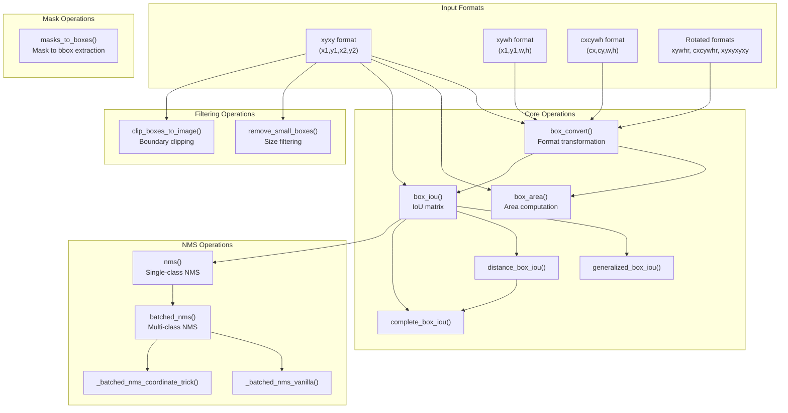
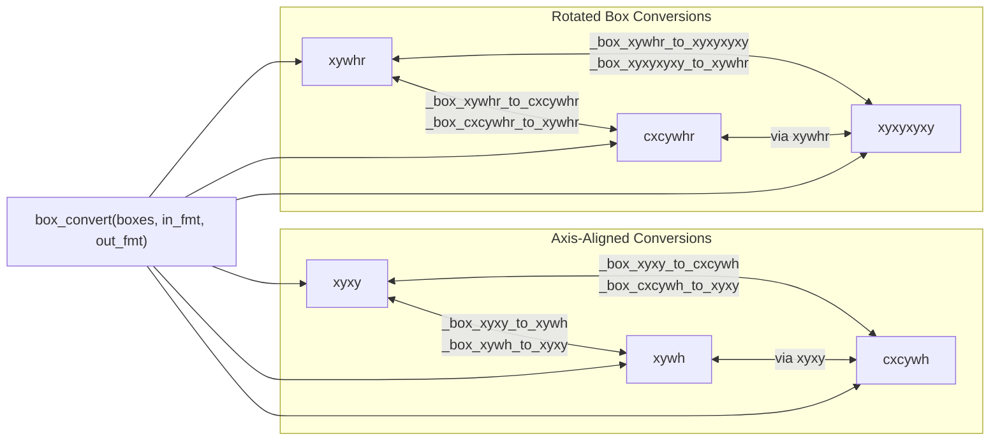
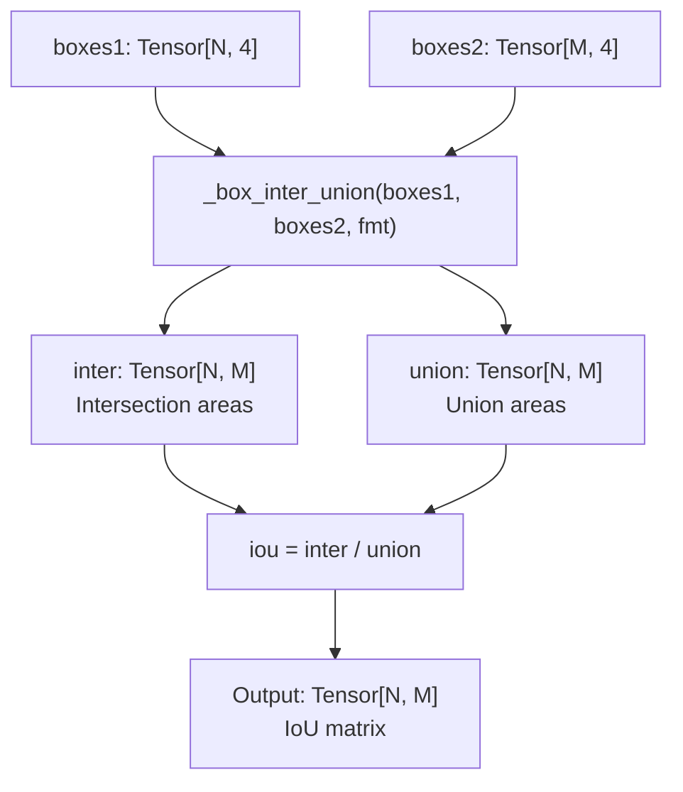
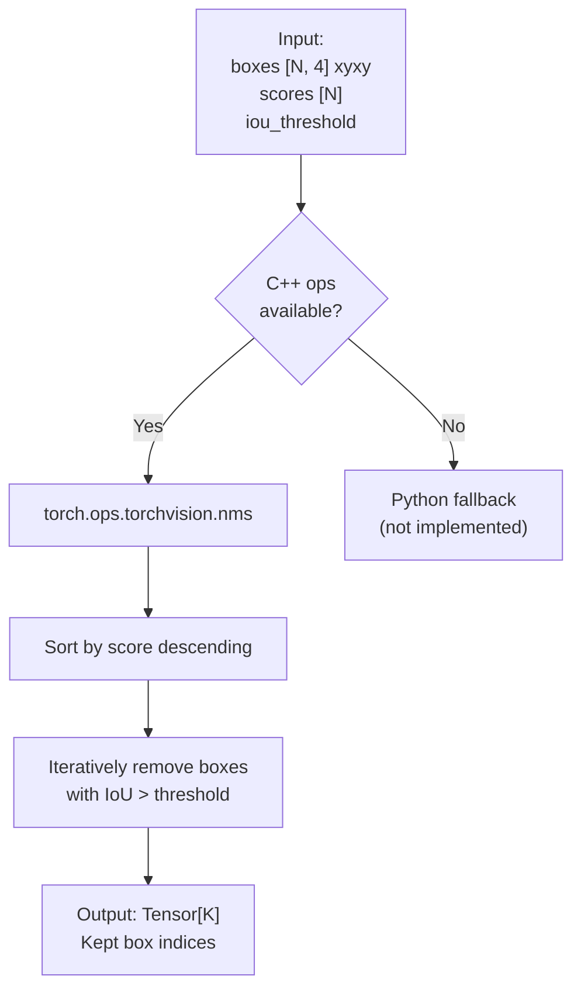
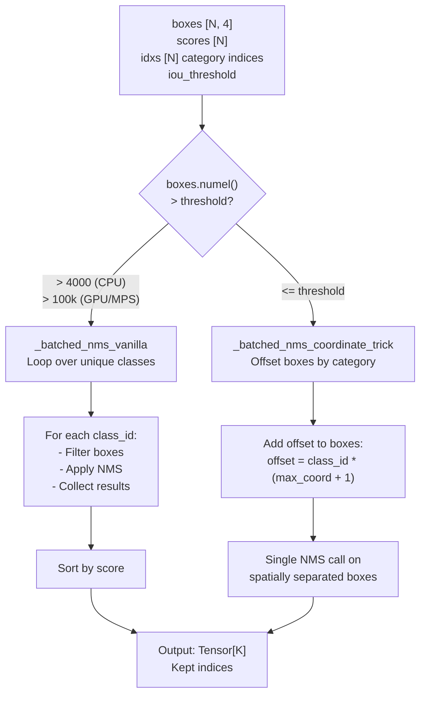
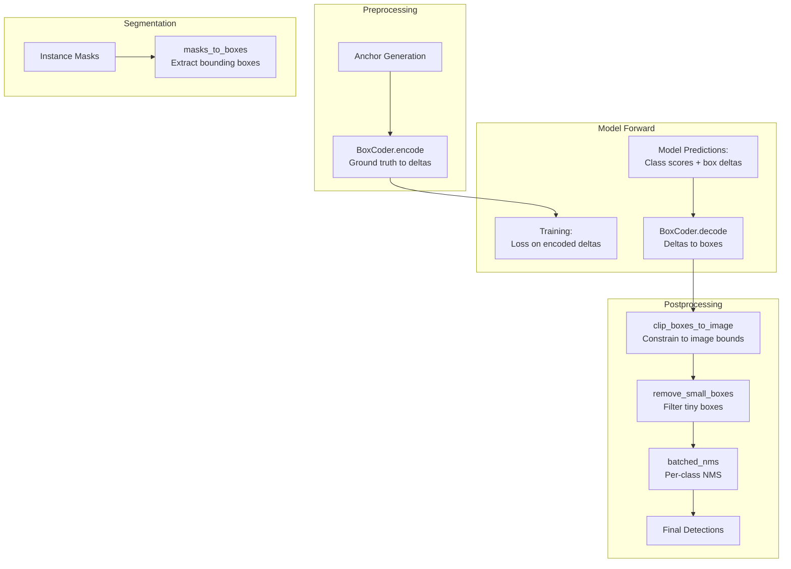

<!-- source: DeepWiki mcp.deepwiki.com · repo pytorch/vision · page 6.2 Box Operations · fetched 2026-10-21 -->

# Box Operations

<details>
<summary>Relevant source files</summary>

The following files were used as context for generating this wiki page:

- [docs/source/ops.rst](docs/source/ops.rst)
- [test/test_ops.py](test/test_ops.py)
- [torchvision/ops/__init__.py](torchvision/ops/__init__.py)
- [torchvision/ops/_utils.py](torchvision/ops/_utils.py)
- [torchvision/ops/boxes.py](torchvision/ops/boxes.py)
- [torchvision/ops/deform_conv.py](torchvision/ops/deform_conv.py)
- [torchvision/ops/drop_block.py](torchvision/ops/drop_block.py)
- [torchvision/ops/misc.py](torchvision/ops/misc.py)
- [torchvision/ops/ps_roi_align.py](torchvision/ops/ps_roi_align.py)
- [torchvision/ops/ps_roi_pool.py](torchvision/ops/ps_roi_pool.py)
- [torchvision/ops/roi_align.py](torchvision/ops/roi_align.py)
- [torchvision/ops/roi_pool.py](torchvision/ops/roi_pool.py)
- [torchvision/ops/stochastic_depth.py](torchvision/ops/stochastic_depth.py)

</details>


This page documents bounding box utility functions in `torchvision.ops`. These operations perform format conversions, IoU calculations, filtering, and non-maximum suppression (NMS) on bounding boxes represented as tensors.

For RoI-based operations like `roi_align` and `roi_pool`, see [Detection Operators](#6.1). For loss functions based on box IoU, see the Losses section in the API documentation.

**Scope**: This page covers the functions in [torchvision/ops/boxes.py]() and the `BoxCoder` class used in detection models.

Sources: [torchvision/ops/__init__.py:2-14](), [docs/source/ops.rst:43-59]()

## Overview of Box Operations

The box operations module provides utilities organized into six functional categories:

| Category | Functions | Purpose |
|----------|-----------|---------|
| Format Conversion | `box_convert` | Convert between `xyxy`, `xywh`, `cxcywh`, `xywhr`, `cxcywhr`, `xyxyxyxy` formats |
| Area Calculation | `box_area` | Compute box areas from multiple formats |
| IoU Computation | `box_iou`, `generalized_box_iou`, `distance_box_iou`, `complete_box_iou` | Calculate intersection-over-union and variants |
| Box Filtering | `remove_small_boxes`, `clip_boxes_to_image` | Filter or constrain boxes based on size/image bounds |
| NMS Operations | `nms`, `batched_nms` | Non-maximum suppression for duplicate removal |
| Mask Conversion | `masks_to_boxes` | Extract bounding boxes from segmentation masks |



Sources: [torchvision/ops/boxes.py:1-521]()

## Box Format Conversions

### Supported Formats

The `box_convert` function supports six bounding box representations:

**Standard Formats (4 coordinates):**
- **`xyxy`**: Corner format `(x1, y1, x2, y2)` where `(x1, y1)` is top-left and `(x2, y2)` is bottom-right. This is the default format for most torchvision operations.
- **`xywh`**: Corner-width-height format `(x1, y1, w, h)` where `(x1, y1)` is top-left.
- **`cxcywh`**: Center format `(cx, cy, w, h)` where `(cx, cy)` is the box center.

**Rotated Box Formats:**
- **`xywhr`**: `(x1, y1, w, h, r)` where `r` is rotation angle in degrees counter-clockwise from the box center.
- **`cxcywhr`**: `(cx, cy, w, h, r)` with center coordinates.
- **`xyxyxyxy`**: Quadrilateral format `(x1, y1, x2, y2, x3, y3, x4, y4)` representing four corners (top-left, top-right, bottom-right, bottom-left).



### Implementation Details

The conversion logic is implemented in [torchvision/ops/boxes.py:185-270]():

```python
# Example conversions handled
if e == ("xywh", "xyxy"):
    boxes = _box_xywh_to_xyxy(boxes)
elif e == ("xyxy", "cxcywh"):
    boxes = _box_xyxy_to_cxcywh(boxes)
# ... etc for all format pairs
```

The internal conversion functions are defined in [torchvision/ops/_box_convert.py]() and handle the mathematical transformations between coordinate systems. Multi-step conversions are performed by chaining through intermediate formats (e.g., `xywh` → `xyxy` → `cxcywh`).

Sources: [torchvision/ops/boxes.py:185-270](), [torchvision/ops/_box_convert.py:8-16]()

## Area Calculation

The `box_area` function computes box areas supporting multiple input formats:

| Format | Area Calculation | Input Shape |
|--------|------------------|-------------|
| `xyxy` | `(x2 - x1) * (y2 - y1)` | `[..., 4]` |
| `xywh` | `w * h` | `[..., 4]` |
| `cxcywh` | `w * h` | `[..., 4]` |

```python
# Usage example
boxes_xyxy = torch.tensor([[0, 0, 10, 10], [5, 5, 15, 15]])
areas = box_area(boxes_xyxy, fmt="xyxy")  # Returns [100, 100]
```

The function uses `_upcast` [torchvision/ops/_utils.py:72-77]() to prevent numerical overflow by promoting to `float32`/`float64` for floating-point tensors or `int32`/`int64` for integer tensors before multiplication.

Sources: [torchvision/ops/boxes.py:273-303]()

## Intersection over Union (IoU) Variants

### Standard IoU

The `box_iou` function computes the pairwise IoU matrix between two sets of boxes:



The computation in [torchvision/ops/boxes.py:308-341]() handles three formats:

1. **`xyxy`**: Direct min/max on coordinates
2. **`xywh`**: Converts to corners as `(x1, y1)` and `(x1+w, y1+h)`
3. **`cxcywh`**: Converts to corners as `(cx-w/2, cy-h/2)` and `(cx+w/2, cy+h/2)`

Sources: [torchvision/ops/boxes.py:344-370](), [torchvision/ops/boxes.py:308-341]()

### Generalized IoU (GIoU)

Generalized IoU adds a penalty term for the area between the union and the smallest enclosing box:

```
GIoU = IoU - (area_enclosing - area_union) / area_enclosing
```

Implementation in [torchvision/ops/boxes.py:374-401]() computes:
- Standard IoU via `_box_inter_union`
- Minimum enclosing box corners `lti` (left-top-inner) and `rbi` (right-bottom-inner)
- Enclosing area `areai`
- Returns `iou - (areai - union) / areai`

Sources: [torchvision/ops/boxes.py:374-401]()

### Distance IoU (DIoU)

Distance IoU penalizes the normalized distance between box centers:

```
DIoU = IoU - (center_distance² / diagonal_distance²)
```

The `distance_box_iou` function [torchvision/ops/boxes.py:437-459]() and helper `_box_diou_iou` [torchvision/ops/boxes.py:462-480]() compute:
- Centers: `(x_p, y_p) = ((x1+x2)/2, (y1+y2)/2)`
- Diagonal distance of enclosing box
- Squared center distance between box pairs

Sources: [torchvision/ops/boxes.py:437-459](), [torchvision/ops/boxes.py:462-480]()

### Complete IoU (CIoU)

Complete IoU extends DIoU with an aspect ratio consistency term:

```
CIoU = DIoU - α * v
where v = (4/π²) * (arctan(w_gt/h_gt) - arctan(w_pred/h_pred))²
      α = v / (1 - IoU + v + ε)
```

Implementation in [torchvision/ops/boxes.py:404-434]() adds the aspect ratio penalty to DIoU, with `α` computed using `torch.no_grad()` to prevent gradient flow through this term.

Sources: [torchvision/ops/boxes.py:404-434]()

## Box Filtering and Clipping

### Remove Small Boxes

The `remove_small_boxes` function filters boxes whose width or height is below a threshold:

```python
ws, hs = boxes[..., 2] - boxes[..., 0], boxes[..., 3] - boxes[..., 1]
keep = (ws >= min_size) & (hs >= min_size)
```

Returns indices of boxes that satisfy the size constraint [torchvision/ops/boxes.py:123-146]().

For sanitizing `tv_tensors.BoundingBoxes` objects in transforms, use `transforms.v2.SanitizeBoundingBoxes` instead.

Sources: [torchvision/ops/boxes.py:123-146]()

### Clip Boxes to Image

The `clip_boxes_to_image` function constrains box coordinates to image boundaries:

```python
boxes_x = boxes[..., 0::2].clamp(min=0, max=width)
boxes_y = boxes[..., 1::2].clamp(min=0, max=height)
```

Implementation in [torchvision/ops/boxes.py:149-182]() handles:
- Separate clamping for x and y coordinates
- TorchScript-compatible path using `torch.min`/`torch.max` for tracing
- Eager mode path using `.clamp()` for efficiency

For clipping `tv_tensors.BoundingBoxes` in transforms, use `transforms.v2.ClampBoundingBoxes`.

Sources: [torchvision/ops/boxes.py:149-182]()

## Non-Maximum Suppression (NMS)

### Single-Class NMS

The `nms` function performs standard NMS on a single set of boxes:



Algorithm [torchvision/ops/boxes.py:20-48]():
1. Sort boxes by descending score
2. Keep highest-scoring box
3. Remove all boxes with `IoU(box, highest_box) > iou_threshold`
4. Repeat on remaining boxes

**Note**: When multiple boxes have identical scores and satisfy the IoU criterion, the selection order is non-deterministic between CPU and GPU.

Sources: [torchvision/ops/boxes.py:20-48]()

### Batched NMS

The `batched_nms` function applies NMS independently per category:



**Two Implementation Strategies** [torchvision/ops/boxes.py:51-120]():

1. **Coordinate Trick** (`_batched_nms_coordinate_trick`): Adds large offsets to boxes based on category ID, ensuring boxes from different categories don't overlap spatially. Single NMS call processes all boxes.

2. **Vanilla** (`_batched_nms_vanilla`): Explicitly loops over unique category IDs, applies NMS to each category independently, then combines results. Used for large box counts where memory usage of the coordinate trick becomes problematic.

Threshold selection [torchvision/ops/boxes.py:80]():
- CPU: Switch at 4,000 boxes
- GPU/MPS: Switch at 100,000 boxes

Sources: [torchvision/ops/boxes.py:51-120]()

### Quantized NMS Support

Both `nms` and `batched_nms` support quantized tensors (`qint8`, `quint8`, `qint32`). The C++ implementation dequantizes internally and performs operations in floating-point.

Test coverage in [test/test_ops.py:807-828]() validates that quantized and dequantized versions produce identical results.

Sources: [test/test_ops.py:807-828]()

## BoxCoder System

The `BoxCoder` class (used in detection models but not directly exported from `torchvision.ops`) encodes/decodes bounding box predictions as offsets from anchor boxes.

### Encoding Process

```
Δx = (gt_x - anchor_x) / anchor_w
Δy = (gt_y - anchor_y) / anchor_h
Δw = log(gt_w / anchor_w)
Δh = log(gt_h / anchor_h)
```

### Decoding Process

```
pred_x = Δx * anchor_w + anchor_x
pred_y = Δy * anchor_h + anchor_y
pred_w = exp(Δw) * anchor_w
pred_h = exp(Δh) * anchor_h
```

This encoding makes the regression task easier by predicting relative offsets rather than absolute coordinates. Used extensively in:
- [torchvision/models/detection/rpn.py]() - Region Proposal Network
- [torchvision/models/detection/roi_heads.py]() - RoI head predictions
- [torchvision/models/detection/anchor_utils.py]() - Anchor generation

Sources: [torchvision/models/detection/]()

## Mask-to-Box Conversion

The `masks_to_boxes` function extracts bounding boxes from binary masks:

```python
def masks_to_boxes(masks: Tensor) -> Tensor:
    # masks: [N, H, W]
    # Returns: [N, 4] in xyxy format
    
    for mask in masks:
        y, x = torch.where(mask != 0)
        bbox = [x.min(), y.min(), x.max(), y.max()]
```

Implementation details [torchvision/ops/boxes.py:483-520]():
- Iterates over each mask in the batch
- Uses `torch.where` to find non-zero pixel coordinates
- Computes min/max over x and y coordinates
- Returns `xyxy` format boxes

**Degenerate cases**: If a mask is a single row or column, the output may have `x1 = x2` or `y1 = y2`.

Sources: [torchvision/ops/boxes.py:483-520]()

## Testing Infrastructure

Box operations are extensively tested in [test/test_ops.py](). Key test patterns:

### NMS Testing

**Reference Implementation** [test/test_ops.py:745-767]():
- Pure Python NMS for validation
- Used to verify CPU and GPU implementations match expected behavior

**IoU Threshold Testing** [test/test_ops.py:769-795]():
- `_create_tensors_with_iou` generates boxes with controlled IoU values
- Tests with thresholds 0.2, 0.5, 0.8 across multiple random seeds

**Cross-Platform Validation** [test/test_ops.py:829-892]():
- CPU vs CUDA vs MPS consistency checks
- Handling of duplicate scores
- Float16, Float32, Float64 dtype support
- Autocast compatibility

### Batched NMS Testing

**Implementation Equivalence** [test/test_ops.py:894-918]():
- Validates `_batched_nms_vanilla` and `_batched_nms_coordinate_trick` produce identical results
- Tests with random box configurations across 10 seeds

### Quantization Testing

**Quantized NMS** [test/test_ops.py:807-828]():
- Compares quantized vs float NMS results
- Tests multiple scales and zero-points
- Validates output indices match between versions

Sources: [test/test_ops.py:744-928]()

## Integration with Detection Pipeline

Box operations integrate into the detection pipeline at multiple stages:



**Usage in Detection Models**:
- [torchvision/models/detection/roi_heads.py]() - Box head prediction and refinement
- [torchvision/models/detection/rpn.py]() - Region proposal generation and filtering
- [torchvision/models/detection/transform.py]() - Preprocessing with `clip_boxes_to_image`

**Related Transforms**:
- `transforms.v2.SanitizeBoundingBoxes` - Wraps `remove_small_boxes` and filtering logic
- `transforms.v2.ClampBoundingBoxes` - Wraps `clip_boxes_to_image` for `tv_tensors.BoundingBoxes`
- `transforms.v2.ConvertBoundingBoxFormat` - Wraps `box_convert` for format changes

Sources: [torchvision/models/detection/roi_heads.py](), [torchvision/models/detection/rpn.py]()

## Performance Considerations

### Numerical Precision

- **Upcasting**: [torchvision/ops/_utils.py:72-77]() prevents overflow in area/intersection calculations by promoting to higher precision
- **Epsilon Values**: IoU variants use `eps=1e-7` to prevent division by zero
- **Autocast Support**: All operations support mixed precision training via `torch.cuda.amp.autocast()`

### Batched NMS Optimization

The automatic switching between vanilla and coordinate trick implementations [torchvision/ops/boxes.py:80]() is based on empirical benchmarks:
- GitHub issue [#1311](https://github.com/pytorch/vision/issues/1311#issuecomment-781329339)
- Pull request [#8925](https://github.com/pytorch/vision/pull/8925)

For small-to-medium box counts, the coordinate trick is faster due to single NMS call overhead. For large counts, vanilla approach has better memory efficiency.

### C++ Extensions

Critical path operations implemented in C++/CUDA:
- [csrc/ops/nms.cpp]() - NMS implementation
- [csrc/ops/cuda/nms_kernel.cu]() - CUDA-accelerated NMS

When C++ extensions are unavailable, operations fall back to pure Python implementations or raise errors.

Sources: [torchvision/ops/boxes.py:47-48](), [torchvision/extension.py]()

---

