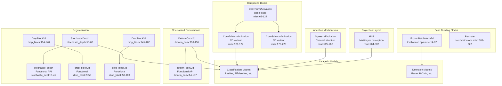
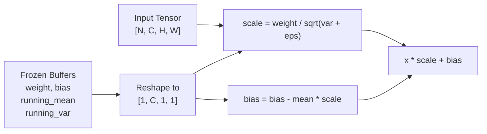
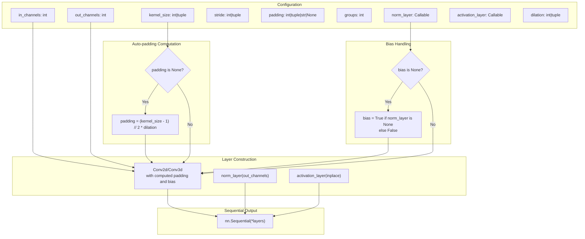
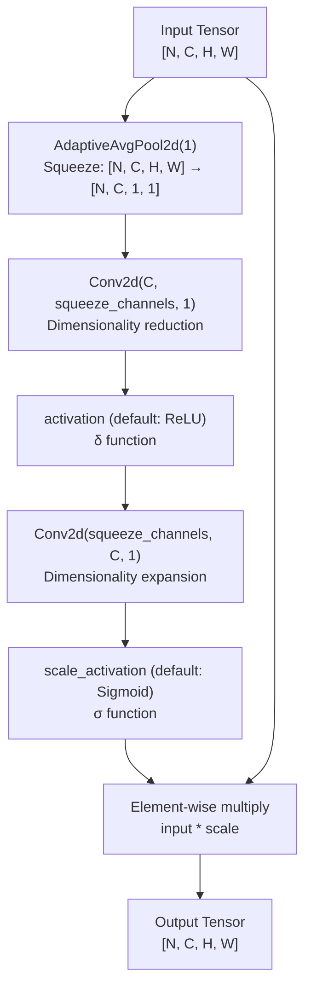
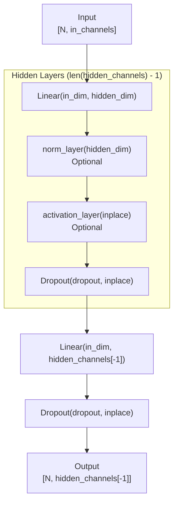
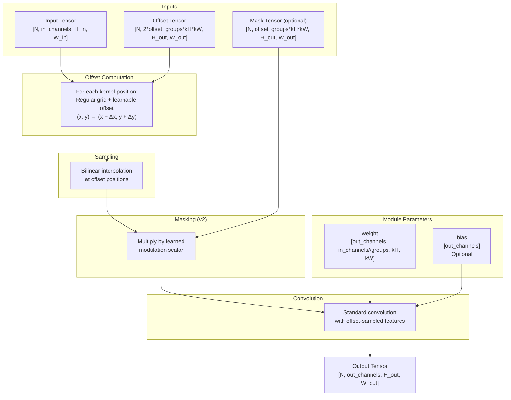
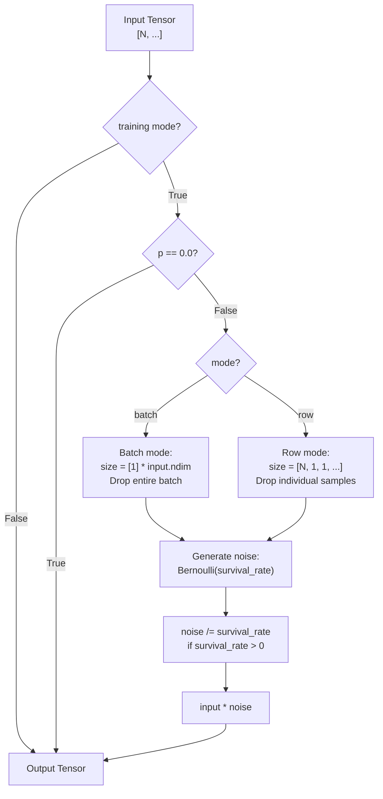
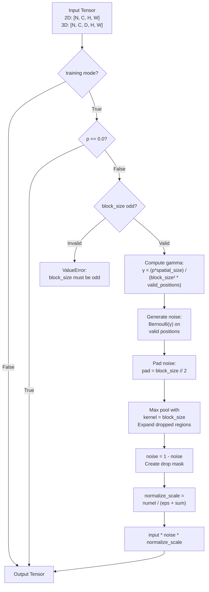
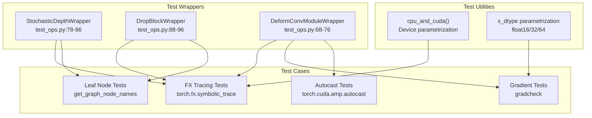

<!-- source: DeepWiki mcp.deepwiki.com · repo pytorch/vision · page 6.3 Layer Components · fetched 2026-10-21 -->

# Layer Components

<details>
<summary>Relevant source files</summary>

The following files were used as context for generating this wiki page:

- [docs/source/ops.rst](docs/source/ops.rst)
- [test/test_ops.py](test/test_ops.py)
- [torchvision/ops/__init__.py](torchvision/ops/__init__.py)
- [torchvision/ops/_utils.py](torchvision/ops/_utils.py)
- [torchvision/ops/boxes.py](torchvision/ops/boxes.py)
- [torchvision/ops/deform_conv.py](torchvision/ops/deform_conv.py)
- [torchvision/ops/drop_block.py](torchvision/ops/drop_block.py)
- [torchvision/ops/misc.py](torchvision/ops/misc.py)
- [torchvision/ops/ps_roi_align.py](torchvision/ops/ps_roi_align.py)
- [torchvision/ops/ps_roi_pool.py](torchvision/ops/ps_roi_pool.py)
- [torchvision/ops/roi_align.py](torchvision/ops/roi_align.py)
- [torchvision/ops/roi_pool.py](torchvision/ops/roi_pool.py)
- [torchvision/ops/stochastic_depth.py](torchvision/ops/stochastic_depth.py)

</details>


## Purpose and Scope

This page documents the neural network layer components provided by `torchvision.ops`. These are reusable building blocks commonly used in modern computer vision architectures, including normalization layers, convolution blocks, attention mechanisms, regularization techniques, and specialized operations.

For detection-specific operators like RoI pooling and NMS, see [Detection Operators](#6.1). For bounding box utilities, see [Box Operations](#6.2). For how these components are used in pre-built architectures, see [Classification Models](#3.1) and [Detection and Segmentation Models](#3.2).

Sources: [torchvision/ops/__init__.py:1-74](), [docs/source/ops.rst:76-104]()

## Component Categories

The layer components in `torchvision.ops` fall into seven functional categories:

| Category | Components | Primary Use Cases |
|----------|-----------|-------------------|
| **Normalization** | `FrozenBatchNorm2d` | Object detection backbones, fine-tuning |
| **Convolution Blocks** | `ConvNormActivation`, `Conv2dNormActivation`, `Conv3dNormActivation` | Standardized conv-norm-activation sequences |
| **Attention** | `SqueezeExcitation` | Channel attention in CNNs |
| **Projection** | `MLP` | Transformer feed-forward, classifier heads |
| **Specialized Convolution** | `DeformConv2d` | Deformable receptive fields |
| **Regularization** | `StochasticDepth`, `DropBlock2d`, `DropBlock3d` | Training regularization |
| **Utilities** | `Permute` | Dimension reordering |

Sources: [torchvision/ops/__init__.py:22-28](), [torchvision/ops/misc.py:14-322]()

## Architecture Overview



**Diagram: Layer Component Hierarchy and Usage**

The components follow a dual-API pattern: most regularization and specialized operations provide both a module class (`nn.Module`) and a functional interface. The convolution block family uses inheritance for 2D/3D variants.

Sources: [torchvision/ops/misc.py:14-322](), [torchvision/ops/deform_conv.py:14-196](), [torchvision/ops/stochastic_depth.py:8-67](), [torchvision/ops/drop_block.py:9-162]()

## Normalization Layers

### FrozenBatchNorm2d

`FrozenBatchNorm2d` implements batch normalization with fixed (frozen) statistics and affine parameters. This is commonly used in object detection models where the batch size is small and updating batch statistics would be unstable.



**Diagram: FrozenBatchNorm2d Forward Pass**

**Key characteristics:**
- All parameters registered as buffers (non-trainable)
- Statistics never updated during training or inference
- Used in detection backbones to avoid batch size dependency
- Handles `num_batches_tracked` key in state dict loading for compatibility

**Implementation details:**
- Forward pass at [torchvision/ops/misc.py:54-63]()
- Reshaping applied to enable broadcasting: `weight.reshape(1, -1, 1, 1)`
- Scale computation: `w * (rv + eps).rsqrt()` where `rv` is running variance
- Output: `x * scale + bias`

Sources: [torchvision/ops/misc.py:14-67]()

## Convolution Blocks

### ConvNormActivation Family

These classes provide standardized conv-norm-activation building blocks that reduce boilerplate code in model architectures.



**Diagram: ConvNormActivation Construction Logic**

**Variants:**
- `ConvNormActivation`: Base class (warns if used directly) at [torchvision/ops/misc.py:69-124]()
- `Conv2dNormActivation`: 2D specialization using `torch.nn.Conv2d` at [torchvision/ops/misc.py:126-174]()
- `Conv3dNormActivation`: 3D specialization using `torch.nn.Conv3d` at [torchvision/ops/misc.py:176-223]()

**Configuration defaults:**
- `kernel_size=3`, `stride=1`
- `padding=None` (auto-computed as `(kernel_size - 1) // 2 * dilation`)
- `groups=1` (standard convolution)
- `norm_layer=torch.nn.BatchNorm2d` (or `BatchNorm3d` for 3D)
- `activation_layer=torch.nn.ReLU`
- `dilation=1`
- `inplace=True` for activation
- `bias=None` (set to `False` if norm layer present, `True` otherwise)

**Padding computation for multi-dimensional kernels:**
```python
# From misc.py:90-93
_conv_dim = len(kernel_size) if isinstance(kernel_size, Sequence) else len(dilation)
kernel_size = _make_ntuple(kernel_size, _conv_dim)
dilation = _make_ntuple(dilation, _conv_dim)
padding = tuple((kernel_size[i] - 1) // 2 * dilation[i] for i in range(_conv_dim))
```

Sources: [torchvision/ops/misc.py:69-223]()

## Attention Mechanisms

### SqueezeExcitation

The Squeeze-and-Excitation block implements channel attention from the SENet paper, recalibrating channel-wise feature responses.



**Diagram: SqueezeExcitation Architecture**

**Implementation details:**
- Squeeze step: Global average pooling via `AdaptiveAvgPool2d(1)` at [torchvision/ops/misc.py:246]()
- Excitation: Two `1x1` convolutions with activation in between
- First FC reduces channels: `input_channels → squeeze_channels`
- Second FC restores channels: `squeeze_channels → input_channels`
- Scale activation (default `Sigmoid`) produces channel weights in `[0, 1]`
- Output: Element-wise multiplication of input with scale

**Parameters:**
- `input_channels`: Number of input channels
- `squeeze_channels`: Bottleneck dimension (typically `input_channels // reduction_ratio`)
- `activation`: Inner activation function (δ), default `torch.nn.ReLU`
- `scale_activation`: Output activation function (σ), default `torch.nn.Sigmoid`

**Usage pattern in models:**
- Inserted after convolution blocks in architectures like EfficientNet, MobileNetV3
- Typically placed before residual addition in residual blocks
- Squeeze ratio commonly set to 4 or 16

Sources: [torchvision/ops/misc.py:225-262]()

## Projection Layers

### MLP

The `MLP` class implements a configurable multi-layer perceptron with optional normalization and dropout.



**Diagram: MLP Layer Structure**

**Layer construction logic at [torchvision/ops/misc.py:292-303]():**
- For each hidden dimension except the last:
  - Add `Linear(in_dim, hidden_dim)`
  - Add `norm_layer(hidden_dim)` if provided
  - Add `activation_layer(**params)`
  - Add `Dropout(dropout, **params)`
- Final layer:
  - Add `Linear(in_dim, hidden_channels[-1])`
  - Add `Dropout(dropout, **params)`

**Parameters:**
- `in_channels`: Input dimension
- `hidden_channels`: List of hidden dimensions (final element is output dimension)
- `norm_layer`: Optional normalization (e.g., `LayerNorm`), default `None`
- `activation_layer`: Activation function, default `torch.nn.ReLU`
- `inplace`: Whether to use inplace operations, default `None`
- `bias`: Whether to use bias in linear layers, default `True`
- `dropout`: Dropout probability, default `0.0`

**Example configuration:**
```python
# Two hidden layers (256, 128) with output 10
mlp = MLP(in_channels=512, hidden_channels=[256, 128, 10], 
          norm_layer=nn.LayerNorm, dropout=0.1)
# Creates: Linear(512→256) → LayerNorm → ReLU → Dropout →
#          Linear(256→128) → LayerNorm → ReLU → Dropout →
#          Linear(128→10) → Dropout
```

Sources: [torchvision/ops/misc.py:264-307]()

## Specialized Convolutions

### DeformConv2d

Deformable convolution adds learnable spatial offsets to the regular grid sampling locations in standard convolution, enabling adaptive receptive fields.



**Diagram: DeformConv2d Forward Pass**

**Deformable Convolution versions:**
- **v1** (no mask): Described in "Deformable Convolutional Networks" at [torchvision/ops/deform_conv.py:28-30]()
- **v2** (with mask): Described in "Deformable ConvNets v2: More Deformable, Better Results" at [torchvision/ops/deform_conv.py:25-27]()

**Offset tensor format:**
- Shape: `[batch_size, 2 * offset_groups * kernel_height * kernel_width, out_height, out_width]`
- For each kernel position `(i, j)`, contains `(Δx, Δy)` offset
- Number of offset groups: `n_offset_grps = offset.shape[1] // (2 * kH * kW)` at [torchvision/ops/deform_conv.py:82]()

**Mask tensor format (v2 only):**
- Shape: `[batch_size, offset_groups * kernel_height * kernel_width, out_height, out_width]`
- Modulation scalars applied after offset sampling
- If `None`, falls back to v1 behavior

**Module class (`DeformConv2d`) at [torchvision/ops/deform_conv.py:110-196]():**
- Manages `weight` and `bias` parameters
- Forward signature: `forward(input, offset, mask=None)`
- Delegates to functional API `deform_conv2d`
- Parameter initialization: Kaiming uniform for weights at [torchvision/ops/deform_conv.py:154]()

**Functional API (`deform_conv2d`) at [torchvision/ops/deform_conv.py:14-107]():**
- Computes weight groups and offset groups
- Validates offset shape compatibility at [torchvision/ops/deform_conv.py:85-90]()
- Calls C++/CUDA implementation: `torch.ops.torchvision.deform_conv2d` at [torchvision/ops/deform_conv.py:92-107]()

**Testing:**
- Test class: `TestDeformConv` at [test/test_ops.py:930-1089]()
- Wrapper for FX tracing: `DeformConvModuleWrapper` at [test/test_ops.py:68-76]()
- Tests include forward pass, backward pass, and autocast support

Sources: [torchvision/ops/deform_conv.py:14-196](), [test/test_ops.py:68-76,930-1089]()

## Regularization Layers

### StochasticDepth

Stochastic Depth implements the regularization technique from "Deep Networks with Stochastic Depth", randomly dropping residual branches during training.



**Diagram: StochasticDepth Forward Logic**

**Modes at [torchvision/ops/stochastic_depth.py:18-20]():**
- `"batch"`: Zeroes entire input batch with probability `p`
- `"row"`: Independently drops each sample in batch with probability `p`

**Key implementation details:**
- Survival rate: `1.0 - p` at [torchvision/ops/stochastic_depth.py:35]()
- Noise tensor shape for batch mode: `[1] * input.ndim` at [torchvision/ops/stochastic_depth.py:39]()
- Noise tensor shape for row mode: `[input.shape[0]] + [1] * (input.ndim - 1)` at [torchvision/ops/stochastic_depth.py:37]()
- Bernoulli sampling: `noise.bernoulli_(survival_rate)` at [torchvision/ops/stochastic_depth.py:41]()
- Scaling preserves expected value: `noise.div_(survival_rate)` at [torchvision/ops/stochastic_depth.py:43]()

**Module class (`StochasticDepth`) at [torchvision/ops/stochastic_depth.py:50-67]():**
- Parameters: `p` (drop probability), `mode` (batch or row)
- Forward respects `self.training` flag automatically

**Functional API (`stochastic_depth`) at [torchvision/ops/stochastic_depth.py:8-45]():**
- Explicit `training` parameter for finer control
- Wrapped with `@torch.fx.wrap` for FX graph compatibility at [torchvision/ops/stochastic_depth.py:47]()

**Testing:**
- Test wrapper: `StochasticDepthWrapper` at [test/test_ops.py:78-86]()
- Tests verify FX tracing and leaf node behavior

Sources: [torchvision/ops/stochastic_depth.py:8-67](), [test/test_ops.py:78-86]()

### DropBlock

DropBlock implements structured dropout that drops contiguous regions rather than independent elements, improving regularization for convolutional networks.



**Diagram: DropBlock Forward Pass**

**2D variant (`drop_block2d`) at [torchvision/ops/drop_block.py:9-56]():**
- Input shape: `[N, C, H, W]`
- Block size validation: Must be odd at [torchvision/ops/drop_block.py:39-40]()
- Gamma computation at [torchvision/ops/drop_block.py:43]()):
  ```python
  gamma = (p * H * W) / ((block_size**2) * ((H - block_size + 1) * (W - block_size + 1)))
  ```
- Noise shape: `[N, C, H - block_size + 1, W - block_size + 1]`
- Padding applied: `[block_size // 2] * 4` at [torchvision/ops/drop_block.py:47]()
- Max pooling: `kernel_size=(block_size, block_size), padding=block_size // 2` at [torchvision/ops/drop_block.py:48]()

**3D variant (`drop_block3d`) at [torchvision/ops/drop_block.py:58-109]():**
- Input shape: `[N, C, D, H, W]`
- Similar logic extended to 3D spatial dimensions
- Gamma computation at [torchvision/ops/drop_block.py:92]()):
  ```python
  gamma = (p * D * H * W) / ((block_size**3) * ((D - block_size + 1) * (H - block_size + 1) * (W - block_size + 1)))
  ```
- Padding applied: `[block_size // 2] * 6`

**Key differences from standard Dropout:**
- Drops contiguous blocks rather than independent elements
- More effective for convolutional networks where nearby activations are correlated
- Normalization factor ensures expected sum is preserved: `normalize_scale = noise.numel() / (eps + noise.sum())` at [torchvision/ops/drop_block.py:50,103]()

**Module classes:**
- `DropBlock2d` at [torchvision/ops/drop_block.py:114-140](): Wraps `drop_block2d`
- `DropBlock3d` at [torchvision/ops/drop_block.py:145-162](): Wraps `drop_block3d`, inherits from `DropBlock2d`

**FX compatibility:**
- Both functional variants wrapped with `@torch.fx.wrap` at [torchvision/ops/drop_block.py:111,142]()

**Testing:**
- Test wrapper: `DropBlockWrapper` at [test/test_ops.py:88-96]()
- Tests verify FX tracing compatibility

Sources: [torchvision/ops/drop_block.py:9-162](), [test/test_ops.py:88-96]()

## Utility Layers

### Permute

The `Permute` module performs dimension permutation, wrapping `torch.permute` in an `nn.Module` for use in sequential containers.

**Implementation at [torchvision/ops/misc.py:309-322]():**

```python
class Permute(torch.nn.Module):
    def __init__(self, dims: list[int]):
        super().__init__()
        self.dims = dims

    def forward(self, x: Tensor) -> Tensor:
        return torch.permute(x, self.dims)
```

**Usage pattern:**
- Common in vision transformers to rearrange dimensions
- Example: Converting from `[N, H, W, C]` to `[N, C, H, W]` with `Permute([0, 3, 1, 2])`
- Enables dimension reordering within `nn.Sequential` pipelines

Sources: [torchvision/ops/misc.py:309-322]()

## Testing Infrastructure

The layer components use specialized test patterns to verify correctness, gradient computation, and framework compatibility.



**Diagram: Testing Infrastructure for Layer Components**

**Module wrappers for FX tracing:**
- Each wrapper implements `n_inputs` attribute indicating number of forward arguments
- Used with `get_graph_node_names()` to verify proper FX tracing behavior
- Wrappers at [test/test_ops.py:78-96]()

**DeformConv testing (`TestDeformConv`) at [test/test_ops.py:930-1089]():**
- Forward pass tests with expected output comparison
- Backward gradient checks using `gradcheck` with various dtypes
- Autocast tests for CUDA amp
- Tests CPU, CUDA, and MPS devices where supported
- Contiguous and non-contiguous tensor tests

**StochasticDepth and DropBlock testing:**
- FX symbolic tracing validation
- Leaf node verification (appears as single node in FX graph)
- Both wrapped with `@torch.fx.wrap` for proper graph capture

**Common test patterns:**
- Device parametrization: `@pytest.mark.parametrize("device", cpu_and_cuda())`
- Dtype parametrization: float16, float32, float64
- Contiguous vs non-contiguous memory layout testing
- Seed-based randomness for reproducible tests

Sources: [test/test_ops.py:68-96,930-1089]()

## Integration with Model Architectures

These layer components are extensively used throughout TorchVision's model architectures:

| Component | Used In | Purpose |
|-----------|---------|---------|
| `Conv2dNormActivation` | ResNet, MobileNet, EfficientNet | Standard convolution blocks |
| `SqueezeExcitation` | EfficientNet, MobileNetV3 | Channel attention |
| `StochasticDepth` | EfficientNet, Swin Transformer, Vision Transformer | Drop path regularization |
| `FrozenBatchNorm2d` | Faster R-CNN, Mask R-CNN | Detection backbone normalization |
| `MLP` | Vision Transformer, Swin Transformer | Feed-forward networks |
| `DeformConv2d` | Deformable DETR (prototype) | Adaptive receptive fields |
| `DropBlock2d` | Various architectures | Structured regularization |

**Example usage pattern in ResNet-style blocks:**

```python
# Typical usage of Conv2dNormActivation
layer = Conv2dNormActivation(
    in_channels=64,
    out_channels=128,
    kernel_size=3,
    stride=2,  # Downsampling
    norm_layer=nn.BatchNorm2d,
    activation_layer=nn.ReLU
)

# Equivalent to:
# nn.Sequential(
#     nn.Conv2d(64, 128, 3, stride=2, padding=1, bias=False),
#     nn.BatchNorm2d(128),
#     nn.ReLU(inplace=True)
# )
```

For detailed usage in specific architectures, see [Classification Models](#3.1) and [Detection and Segmentation Models](#3.2).

Sources: [torchvision/ops/misc.py:69-223](), [docs/source/ops.rst:76-104]()

---

