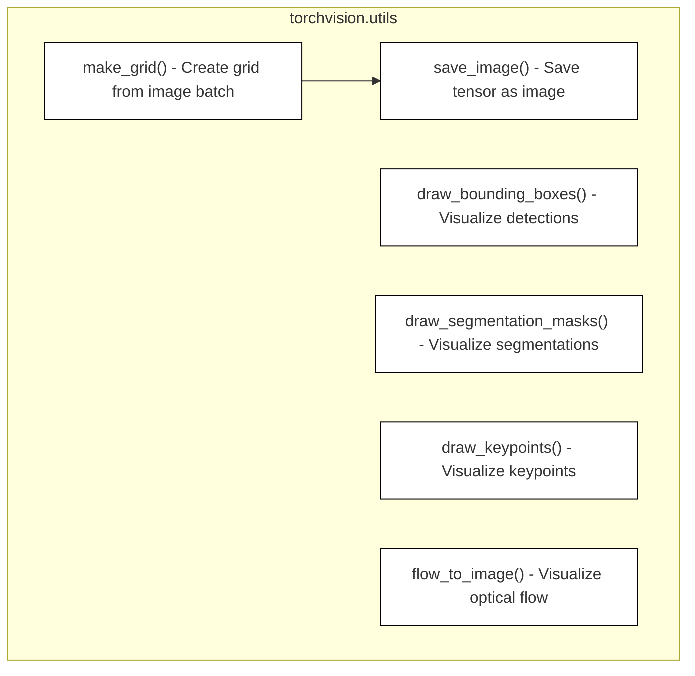
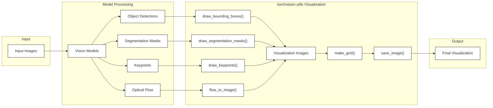
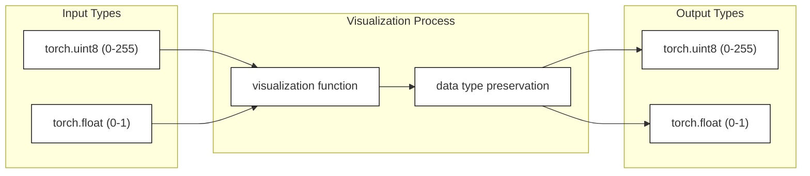

<!-- source: DeepWiki mcp.deepwiki.com · repo pytorch/vision · page 7 Utilities · fetched 2026-10-21 -->

# Utilities

<details>
<summary>Relevant source files</summary>

The following files were used as context for generating this wiki page:

- [docs/source/utils.rst](docs/source/utils.rst)
- [test/assets/expected_flow.pt](test/assets/expected_flow.pt)
- [test/assets/fakedata/draw_boxes_different_label_background_colors.png](test/assets/fakedata/draw_boxes_different_label_background_colors.png)
- [test/assets/fakedata/draw_boxes_different_label_colors.png](test/assets/fakedata/draw_boxes_different_label_colors.png)
- [test/assets/fakedata/draw_boxes_different_label_fill_colors.png](test/assets/fakedata/draw_boxes_different_label_fill_colors.png)
- [test/assets/fakedata/draw_boxes_util.png](test/assets/fakedata/draw_boxes_util.png)
- [test/assets/fakedata/draw_keypoint_vanilla.png](test/assets/fakedata/draw_keypoint_vanilla.png)
- [test/assets/fakedata/draw_rotated_boxes_fill.png](test/assets/fakedata/draw_rotated_boxes_fill.png)
- [test/test_utils.py](test/test_utils.py)
- [torchvision/utils.py](torchvision/utils.py)

</details>


The `torchvision.utils` module provides a collection of utility functions for visualizing images and computer vision results. These utilities focus on common visualization tasks such as creating image grids, drawing bounding boxes, displaying segmentation masks, visualizing keypoints, and converting optical flow to images.

## Overview of Visualization Utilities

The utilities module offers functions to help visualize various aspects of computer vision workflows:



Sources: [torchvision/utils.py:14-21]()

## Function Reference

### Image Grid and Saving

#### `make_grid`

Creates a grid of images from a batch of images for visualization purposes.

**Signature:**
```python
@torch.no_grad()
def make_grid(
    tensor: Union[torch.Tensor, List[torch.Tensor]],
    nrow: int = 8,
    padding: int = 2,
    normalize: bool = False,
    value_range: Optional[Tuple[int, int]] = None,
    scale_each: bool = False,
    pad_value: float = 0.0,
) -> torch.Tensor
```

**Parameters:**
- `tensor`: 4D mini-batch Tensor of shape (B x C x H x W) or a list of images
- `nrow`: Number of images displayed in each row
- `padding`: Amount of padding between images
- `normalize`: If True, shifts the image to the range (0, 1)
- `value_range`: Tuple (min, max) for normalization
- `scale_each`: If True, scales each image in the batch independently
- `pad_value`: Value for padded pixels

**Returns:**
- A tensor containing a grid of images

Sources: [torchvision/utils.py:24-123]()

#### `save_image`

Saves a given tensor as an image file.

**Signature:**
```python
@torch.no_grad()
def save_image(
    tensor: Union[torch.Tensor, List[torch.Tensor]],
    fp: Union[str, pathlib.Path, BinaryIO],
    format: Optional[str] = None,
    **kwargs,
) -> None
```

**Parameters:**
- `tensor`: Image to be saved
- `fp`: A filename or file object
- `format`: Image format (if omitted, determined from filename)
- `**kwargs`: Additional arguments passed to `make_grid`

Sources: [torchvision/utils.py:126-151]()

### Object Visualization Functions

#### `draw_bounding_boxes`

Draws bounding boxes on given RGB images.

**Signature:**
```python
@torch.no_grad()
def draw_bounding_boxes(
    image: torch.Tensor,
    boxes: torch.Tensor,
    labels: Optional[List[str]] = None,
    colors: Optional[Union[List[Union[str, Tuple[int, int, int]]], str, Tuple[int, int, int]]] = None,
    fill: Optional[bool] = False,
    width: int = 1,
    font: Optional[str] = None,
    font_size: Optional[int] = None,
    label_colors: Optional[Union[List[Union[str, Tuple[int, int, int]]], str, Tuple[int, int, int]]] = None,
    fill_labels: bool = False,
) -> torch.Tensor
```

**Parameters:**
- `image`: Image tensor of shape (C, H, W)
- `boxes`: Bounding box coordinates in (xmin, ymin, xmax, ymax) format
- `labels`: Labels for each box
- `colors`: Box colors (string, RGB tuple, or list)
- `fill`: Whether to fill the boxes
- `width`: Line width
- `font` and `font_size`: Text font settings
- `label_colors`: Colors for the label text
- `fill_labels`: Whether to fill label backgrounds

**Returns:**
- Image tensor with drawn boxes

Sources: [torchvision/utils.py:154-276]()

#### `draw_segmentation_masks`

Draws segmentation masks on a given RGB image.

**Signature:**
```python
@torch.no_grad()
def draw_segmentation_masks(
    image: torch.Tensor,
    masks: torch.Tensor,
    alpha: float = 0.8,
    colors: Optional[Union[List[Union[str, Tuple[int, int, int]]], str, Tuple[int, int, int]]] = None,
) -> torch.Tensor
```

**Parameters:**
- `image`: Image tensor of shape (3, H, W)
- `masks`: Mask tensor of shape (num_masks, H, W) or (H, W)
- `alpha`: Transparency value (0-1)
- `colors`: Mask colors (string, RGB tuple, or list)

**Returns:**
- Image tensor with drawn masks

Sources: [torchvision/utils.py:279-346]()

#### `draw_keypoints`

Draws keypoints on a given RGB image.

**Signature:**
```python
@torch.no_grad()
def draw_keypoints(
    image: torch.Tensor,
    keypoints: torch.Tensor,
    connectivity: Optional[List[Tuple[int, int]]] = None,
    colors: Optional[Union[str, Tuple[int, int, int]]] = None,
    radius: int = 2,
    width: int = 3,
    visibility: Optional[torch.Tensor] = None,
) -> torch.Tensor
```

**Parameters:**
- `image`: Image tensor of shape (3, H, W)
- `keypoints`: Tensor of shape (num_instances, K, 2) for K keypoints
- `connectivity`: List of keypoint pairs to connect
- `colors`: Color for points and connections
- `radius`: Keypoint radius
- `width`: Line width for connections
- `visibility`: Visibility flag for each keypoint

**Returns:**
- Image tensor with drawn keypoints

Sources: [torchvision/utils.py:349-463]()

#### `flow_to_image`

Converts an optical flow tensor to an RGB image for visualization.

**Signature:**
```python
@torch.no_grad()
def flow_to_image(flow: torch.Tensor) -> torch.Tensor
```

**Parameters:**
- `flow`: Flow tensor of shape (N, 2, H, W) or (2, H, W)

**Returns:**
- RGB image tensor representing the flow

Sources: [torchvision/utils.py:467-498]()

## Visualization Pipeline

The following diagram illustrates how the utility functions fit into a typical computer vision workflow:



Sources: [torchvision/utils.py:24-151](), [torchvision/utils.py:154-498]()

## Internal Helper Functions

The utilities module uses several internal helper functions:

| Function | Purpose |
|----------|---------|
| `_parse_colors()` | Parses color specifications from strings, tuples, or lists |
| `_generate_color_palette()` | Generates color palettes for visualization |
| `_make_colorwheel()` | Creates a colorwheel for optical flow visualization |
| `_normalized_flow_to_image()` | Converts normalized flow to an RGB image |
| `_log_api_usage_once()` | Records API usage for analytics |
| `_make_ntuple()` | Converts input to n-tuples |

Sources: [torchvision/utils.py:536-544](), [torchvision/utils.py:583-674]()

## Color Handling

The visualization functions support multiple color formats:

1. Color strings: e.g., `"red"`, `"blue"`, `"#FF00FF"`
2. RGB tuples: e.g., `(255, 0, 0)`, `(0, 0, 255)`
3. Lists of colors for multiple objects
4. Auto-generated colors when `colors=None`

The color parsing is handled by the `_parse_colors()` function, which ensures consistent color handling across all visualization functions.

Sources: [torchvision/utils.py:588-632]()

## Data Type Handling

The visualization functions support both floating-point (range 0-1) and integer (range 0-255) image tensors. The functions automatically detect the input type and handle it appropriately, preserving the original data type in the output.



Sources: [torchvision/utils.py:203-210](), [torchvision/utils.py:309-311]()

## Common Usage Patterns

### Visualizing Batches of Images

```python
# Create a grid from a batch of images
grid = torchvision.utils.make_grid(batch_tensor, nrow=4, padding=2)

# Save the grid to a file
torchvision.utils.save_image(grid, "batch_visualization.png")
```

### Visualizing Object Detection Results

```python
# Draw bounding boxes on an image
result = torchvision.utils.draw_bounding_boxes(
    image, 
    boxes,
    labels=class_names,
    colors="red",
    width=2
)

# Save the result
torchvision.utils.save_image(result, "detection_result.png")
```

### Visualizing Segmentation Results

```python
# Draw segmentation masks on an image
result = torchvision.utils.draw_segmentation_masks(
    image,
    masks,
    alpha=0.7,
    colors=["blue", "green", "red"]
)

# Save the result
torchvision.utils.save_image(result, "segmentation_result.png")
```

### Visualizing Keypoints

```python
# Draw keypoints on an image
result = torchvision.utils.draw_keypoints(
    image,
    keypoints,
    connectivity=[(0, 1), (1, 2)],  # Connect points 0-1 and 1-2
    colors="yellow",
    radius=3,
    width=2
)

# Save the result
torchvision.utils.save_image(result, "keypoints_result.png")
```

### Visualizing Optical Flow

```python
# Convert flow to an RGB image
flow_img = torchvision.utils.flow_to_image(flow_tensor)

# Save the result
torchvision.utils.save_image(flow_img, "flow_visualization.png")
```

Sources: [torchvision/utils.py:24-123](), [torchvision/utils.py:126-151](), [torchvision/utils.py:154-498]()

## Notes on Performance and Compatibility

1. All visualization functions use the `@torch.no_grad()` decorator to ensure they don't affect the computational graph or consume unnecessary memory.
2. The functions support both CPU and CUDA tensors.
3. For best performance with large batches, consider processing smaller chunks at a time.
4. The visualization functions are not designed for training loops but for visualization after inference or during debugging.

Sources: [torchvision/utils.py:24](), [torchvision/utils.py:126](), [torchvision/utils.py:154](), [torchvision/utils.py:279](), [torchvision/utils.py:349](), [torchvision/utils.py:467]()

---

