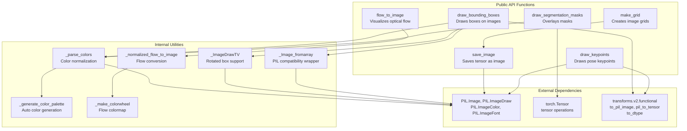
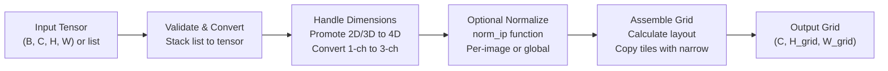
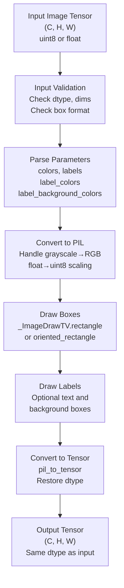
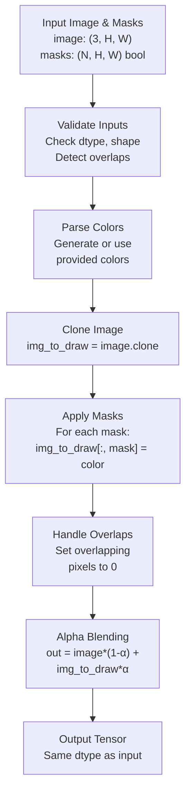
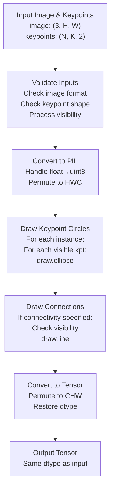
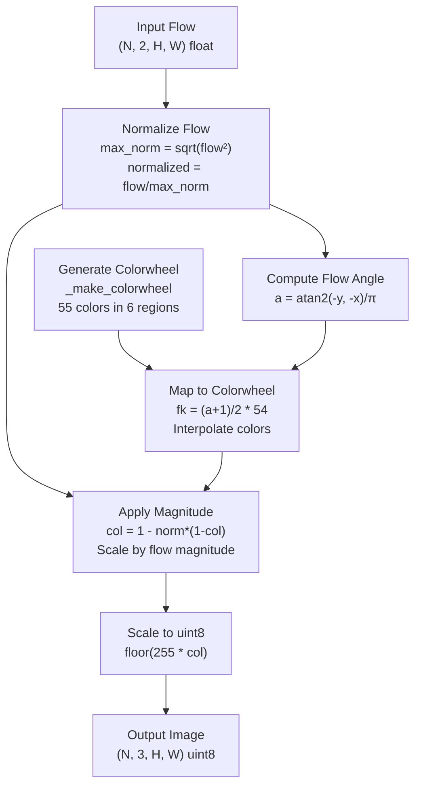
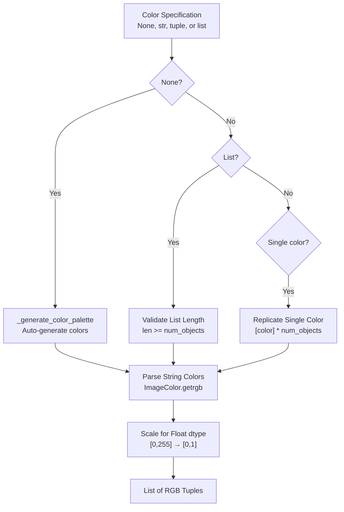
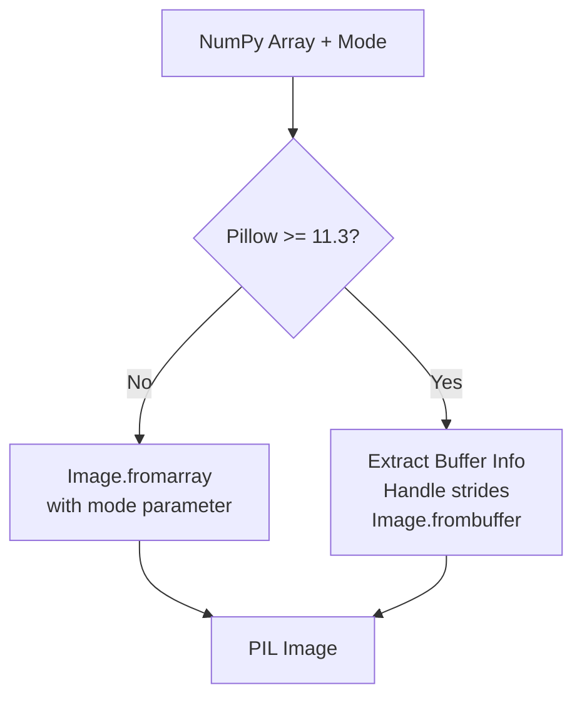

<!-- source: DeepWiki mcp.deepwiki.com · repo pytorch/vision · page 7.1 Visualization Utilities · fetched 2026-10-21 -->

# Visualization Utilities

<details>
<summary>Relevant source files</summary>

The following files were used as context for generating this wiki page:

- [docs/source/utils.rst](docs/source/utils.rst)
- [test/assets/expected_flow.pt](test/assets/expected_flow.pt)
- [test/assets/fakedata/draw_boxes_different_label_background_colors.png](test/assets/fakedata/draw_boxes_different_label_background_colors.png)
- [test/assets/fakedata/draw_boxes_different_label_colors.png](test/assets/fakedata/draw_boxes_different_label_colors.png)
- [test/assets/fakedata/draw_boxes_different_label_fill_colors.png](test/assets/fakedata/draw_boxes_different_label_fill_colors.png)
- [test/assets/fakedata/draw_boxes_util.png](test/assets/fakedata/draw_boxes_util.png)
- [test/assets/fakedata/draw_keypoint_vanilla.png](test/assets/fakedata/draw_keypoint_vanilla.png)
- [test/assets/fakedata/draw_rotated_boxes_fill.png](test/assets/fakedata/draw_rotated_boxes_fill.png)
- [test/test_utils.py](test/test_utils.py)
- [torchvision/utils.py](torchvision/utils.py)

</details>


This page documents the `torchvision.utils` module, which provides utilities for visualizing computer vision data and model outputs. The module includes functions for creating image grids, drawing bounding boxes, rendering segmentation masks, visualizing keypoints, and converting optical flow to color representations. These utilities bridge the gap between tensor-based model outputs and human-interpretable visualizations.

For information about transforms that preprocess data, see [Transforms](#2). For model architectures that produce the data these utilities visualize, see [Models](#3).

**Sources:** [torchvision/utils.py:1-808](), [docs/source/utils.rst:1-21]()

## Overview of Utility Functions

The module exposes six primary functions through its public API, along with several internal utilities for color handling, PIL integration, and image conversions.



**Sources:** [torchvision/utils.py:13-21](), [torchvision/utils.py:24-808]()

## Image Grid Creation and Saving

The `make_grid` and `save_image` functions handle batch visualization by arranging multiple images into a grid layout.

### make_grid Function

The `make_grid` function accepts either a 4D tensor of shape `(B, C, H, W)` or a list of tensors, and arranges them into a 2D grid. It supports normalization, padding, and scaling operations.

| Parameter | Type | Default | Description |
|-----------|------|---------|-------------|
| `tensor` | `Tensor` or `list[Tensor]` | Required | Input images |
| `nrow` | `int` | 8 | Number of images per row |
| `padding` | `int` | 2 | Padding between images in pixels |
| `normalize` | `bool` | False | Normalize to [0, 1] range |
| `value_range` | `tuple[int, int]` or `None` | None | Min/max for normalization |
| `scale_each` | `bool` | False | Normalize each image independently |
| `pad_value` | `float` | 0.0 | Value for padded pixels |

**Implementation Details:**

The function performs several preprocessing steps before creating the grid:

1. **Input validation and conversion** [torchvision/utils.py:57-67](): Converts list of tensors to 4D batch tensor
2. **Dimension handling** [torchvision/utils.py:69-77](): Promotes 2D/3D tensors to 4D, converts single-channel to 3-channel
3. **Normalization** [torchvision/utils.py:79-98](): Optionally normalizes values using `norm_ip` helper function
4. **Grid assembly** [torchvision/utils.py:105-122](): Uses `Tensor.narrow()` and `Tensor.copy_()` to arrange images



**Sources:** [torchvision/utils.py:24-123](), [test/test_utils.py:42-72]()

### save_image Function

The `save_image` function is a convenience wrapper that calls `make_grid` and saves the result to disk using PIL.

```python
# Workflow in save_image:
# 1. Call make_grid with kwargs
# 2. Scale to [0, 255] and convert to uint8
# 3. Convert to PIL Image
# 4. Save using PIL's save method
```

The scaling operation [torchvision/utils.py:279]() uses `mul(255).add_(0.5).clamp_(0, 255)` to round to nearest integer, followed by permutation to HWC format for PIL compatibility.

**Sources:** [torchvision/utils.py:256-281](), [test/test_utils.py:75-112]()

## Bounding Box Visualization

The `draw_bounding_boxes` function renders bounding boxes on RGB images with optional labels, supporting both axis-aligned (4-coordinate) and oriented (8-coordinate) boxes.

### Box Formats and Validation

| Box Format | Shape | Description | Coordinates |
|------------|-------|-------------|-------------|
| Axis-aligned | `(N, 4)` | Standard bounding boxes | `(xmin, ymin, xmax, ymax)` |
| Oriented | `(N, 8)` | Rotated rectangles | `(x1, y1, x2, y2, x3, y3, x4, y4)` |

The function validates that axis-aligned boxes satisfy `xmin < xmax` and `ymin < ymax` [torchvision/utils.py:344-347](), suggesting the use of `torchvision.ops.box_convert` for format conversion if needed.

### Drawing Pipeline



**Sources:** [torchvision/utils.py:284-414](), [test/test_utils.py:114-306]()

### Custom ImageDraw Extension

The `_ImageDrawTV` class [torchvision/utils.py:126-174]() extends `PIL.ImageDraw.ImageDraw` to support rotated bounding boxes:

- **oriented_rectangle method** [torchvision/utils.py:131-139](): Draws 8-coordinate boxes using `dashed_line` for first edge and solid lines for remaining edges
- **dashed_line method** [torchvision/utils.py:141-174](): Renders dashed lines for the first edge of rotated boxes to distinguish orientation

**Fill Mode:** When `fill=True`, boxes are drawn in RGBA mode with alpha channel set to 100 [torchvision/utils.py:391-399](), creating semi-transparent fill.

### Label Rendering

Labels can be customized with separate colors for text and background [torchvision/utils.py:363-371]():

- **label_colors:** Text color for each label (defaults to box color or black if `fill_labels=True`)
- **label_background_colors:** Background fill color (only used when `fill_labels=True`)
- **fill_labels:** Boolean flag to enable label background boxes [torchvision/utils.py:404-409]()

The function uses `ImageDraw.textbbox` to measure text dimensions before drawing the background rectangle with appropriate margins.

**Sources:** [torchvision/utils.py:126-174](), [torchvision/utils.py:396-409](), [test/test_utils.py:138-193]()

## Segmentation Mask Visualization

The `draw_segmentation_masks` function overlays boolean masks on RGB images with configurable transparency and colors.

### Mask Handling

| Input Shape | Interpretation | Processing |
|-------------|----------------|------------|
| `(H, W)` | Single mask | Promoted to `(1, H, W)` |
| `(N, H, W)` | N masks | Used directly |

The function requires masks to be of `dtype=torch.bool` [torchvision/utils.py:456]() and validates that image and mask dimensions match [torchvision/utils.py:458-459]().

### Overlay Algorithm



**Key Implementation Details:**

1. **Color application** [torchvision/utils.py:476-477](): Uses advanced indexing `img_to_draw[:, mask] = color[:, None]` to paint each mask
2. **Overlap detection** [torchvision/utils.py:462](): Computes `masks.sum(dim=0) > 1` to find overlapping pixels
3. **Overlap handling** [torchvision/utils.py:479](): Sets overlapping regions to black (0)
4. **Alpha blending** [torchvision/utils.py:481](): Applies formula `image * (1 - alpha) + img_to_draw * alpha`

The function preserves the input dtype through the entire pipeline, working with both `uint8` and float tensors [torchvision/utils.py:468-483]().

**Sources:** [torchvision/utils.py:417-483](), [test/test_utils.py:308-427]()

## Keypoint Visualization

The `draw_keypoints` function renders pose estimation keypoints with optional skeletal connections and visibility filtering.

### Keypoint Data Structure

The function accepts keypoints in shape `(num_instances, K, 2)` where:
- `num_instances`: Number of detected objects/poses
- `K`: Number of keypoints per instance (e.g., 17 for COCO pose)
- `2`: (x, y) coordinates

### Visibility Handling

Visibility can be specified as a tensor of shape `(num_instances, K)` with dtype `bool` or castable to bool [torchvision/utils.py:544-557]():

- `True`: Keypoint is visible and should be drawn
- `False`: Keypoint is invisible; neither the point nor connections involving it are drawn

The function automatically handles 3D visibility tensors of shape `(num_instances, K, 1)` by squeezing the last dimension [torchvision/utils.py:547-550]().

### Connectivity Specification

The `connectivity` parameter defines skeletal structure as a list of tuples `[(idx1, idx2), ...]` [torchvision/utils.py:490](), where each tuple specifies two keypoint indices to connect with a line. Connections are only drawn if both keypoints are visible [torchvision/utils.py:582-594]().



**Drawing Parameters:**

| Parameter | Type | Default | Description |
|-----------|------|---------|-------------|
| `colors` | `str` or `tuple` | None | Color for keypoints and lines |
| `radius` | `int` | 2 | Radius of keypoint circles |
| `width` | `int` | 3 | Width of connection lines |
| `visibility` | `Tensor` or `None` | None | Visibility mask (all visible if None) |
| `connectivity` | `list[tuple[int, int]]` or `None` | None | Skeletal connections |

The function draws keypoints as filled ellipses [torchvision/utils.py:575-579]() using coordinates `(x-r, y-r, x+r, y+r)` where `r` is the radius.

**Sources:** [torchvision/utils.py:486-599](), [test/test_utils.py:430-601]()

## Optical Flow Visualization

The `flow_to_image` function converts optical flow fields to color-coded images using a perceptually-motivated color wheel.

### Flow Tensor Format

| Input Shape | Description | Output Shape |
|-------------|-------------|--------------|
| `(2, H, W)` | Single flow field | `(3, H, W)` |
| `(N, 2, H, W)` | Batch of flow fields | `(N, 3, H, W)` |

The function requires `dtype=torch.float` [torchvision/utils.py:616-617]() and validates that the second dimension is 2 (for x and y components) [torchvision/utils.py:623-624]().

### Flow-to-Color Mapping

The visualization algorithm [torchvision/utils.py:602-668]() follows the method from Baker et al., "A Database and Evaluation Methodology for Optical Flow" (ICCV 2007):



### Colorwheel Structure

The colorwheel [torchvision/utils.py:670-714]() consists of 55 colors divided into 6 regions representing different flow directions:

| Region | Colors | Direction | Hue Transition |
|--------|--------|-----------|----------------|
| RY | 15 | Red → Yellow | East |
| YG | 6 | Yellow → Green | Northeast |
| GC | 4 | Green → Cyan | North |
| CB | 11 | Cyan → Blue | Northwest |
| BM | 13 | Blue → Magenta | West |
| MR | 6 | Magenta → Red | Southwest |

The color at each pixel encodes flow direction through hue and flow magnitude through saturation [torchvision/utils.py:637-667]().

**Sources:** [torchvision/utils.py:602-714](), [test/test_utils.py:603-638]()

## Color Parsing and Generation

The color handling system normalizes diverse color specifications into a consistent format for use by drawing functions.

### Color Input Formats

The `_parse_colors` function [torchvision/utils.py:722-766]() accepts:

1. **None:** Triggers automatic palette generation using `_generate_color_palette`
2. **String:** Named color (e.g., "red") or hex color (e.g., "#FF00FF")
3. **RGB Tuple:** 3-tuple of integers (e.g., `(255, 0, 0)`)
4. **List:** List of strings or tuples (one per object)



### Automatic Palette Generation

The `_generate_color_palette` function [torchvision/utils.py:717-719]() generates distinguishable colors using a deterministic algorithm:

```python
palette = torch.tensor([2**25 - 1, 2**15 - 1, 2**21 - 1])
colors = [(i * palette) % 255 for i in range(num_objects)]
```

This creates colors by multiplying the palette vector by index `i` and taking modulo 255, producing visually distinct colors for neighboring indices.

### Float Dtype Handling

When `dtype.is_floating_point` is True [torchvision/utils.py:764-765](), colors are scaled from `[0, 255]` to `[0, 1]` by dividing each component by 255. This ensures compatibility with float tensors used by `draw_segmentation_masks`.

**Sources:** [torchvision/utils.py:717-766](), [test/test_utils.py:235-241](), [test/test_utils.py:308-360]()

## PIL Integration and Compatibility

The module bridges PyTorch tensors and PIL images through several conversion utilities and compatibility wrappers.

### Image Fromarray Wrapper

The `_Image_fromarray` function [torchvision/utils.py:177-253]() wraps `PIL.Image.fromarray` to handle a breaking change in Pillow 11.3 where the `mode` parameter behavior changed:

**Old behavior (Pillow < 11.3):** The mode parameter controls how PIL interprets the data, forcing conversion to the specified mode.

**New behavior (Pillow >= 11.3):** The mode parameter is deprecated; PIL infers mode from data shape and dtype.

The wrapper detects Pillow version [torchvision/utils.py:189-193]() and uses `Image.frombuffer` for Pillow >= 11.3 [torchvision/utils.py:195-251]() to preserve the old conversion behavior that TorchVision relies on.



### Dtype Conversion Pipeline

All drawing functions follow a consistent dtype handling pattern:

1. **Store original dtype** [torchvision/utils.py:384](): `original_dtype = image.dtype`
2. **Convert float to uint8** [torchvision/utils.py:385-386](): `image = to_dtype(image, dtype=torch.uint8, scale=True)` if float
3. **Convert to PIL** [torchvision/utils.py:388](): `img_to_draw = to_pil_image(image)`
4. **Perform PIL drawing operations**
5. **Convert back to tensor** [torchvision/utils.py:411](): `out = pil_to_tensor(img_to_draw)`
6. **Restore original dtype** [torchvision/utils.py:412-413](): `out = to_dtype(out, dtype=original_dtype, scale=True)` if float

This ensures that functions work transparently with both `torch.uint8` tensors in `[0, 255]` and float tensors in `[0, 1]`, with appropriate scaling applied during conversions.

**Sources:** [torchvision/utils.py:177-253](), [torchvision/utils.py:384-413](), [test/test_utils.py:218-232](), [test/test_utils.py:363-380](), [test/test_utils.py:555-568]()

## Testing Infrastructure

The test suite in `test/test_utils.py` validates functionality through:

### Golden File Testing

Reference images stored in `test/assets/fakedata/` are used to verify pixel-perfect rendering:

- **draw_boxes_util.png** [test/assets/fakedata/draw_boxes_util.png](): Baseline for filled boxes with labels
- **draw_boxes_vanilla.png**: Unfilled boxes with white color
- **draw_rotated_boxes.png**, **draw_rotated_boxes_fill.png**: Oriented box rendering
- **draw_boxes_different_label_colors.png**, etc.: Label color variations
- **draw_keypoint_vanilla.png**: Keypoint connectivity
- **expected_flow.pt**: Optical flow visualization

Tests compare rendered output against these references [test/test_utils.py:122-130](), skipping validation for older Pillow versions where rendering differs [test/test_utils.py:127-130]().

### Property-Based Testing

Tests verify invariants across parameter combinations:

- **make_grid in-place modification** [test/test_utils.py:42-53](): Ensures input tensors are not modified
- **Dtype preservation** [test/test_utils.py:218-232](): Validates uint8 and float paths produce equivalent results
- **Device compatibility** [test/test_utils.py:320-360](): Tests CPU and CUDA execution for segmentation masks
- **Edge cases** [test/test_utils.py:299-305](): Validates behavior with empty boxes/masks

### Error Validation

Comprehensive error checking tests [test/test_utils.py:269-289](), [test/test_utils.py:383-417](), [test/test_utils.py:571-600]() verify that appropriate exceptions are raised for:

- Invalid input types (non-tensors)
- Invalid dtypes (e.g., int64 instead of uint8/float)
- Dimension mismatches
- Out-of-range values (e.g., `xmin > xmax`)
- Insufficient colors for number of objects

**Sources:** [test/test_utils.py:1-643](), [test/assets/fakedata/]()

---

