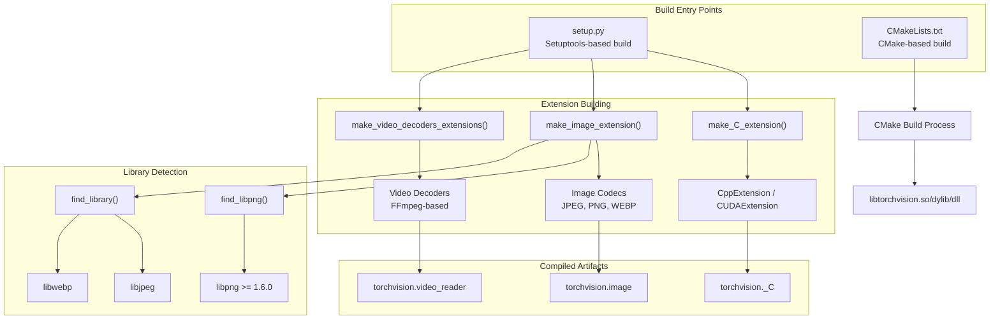
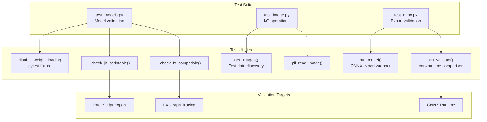
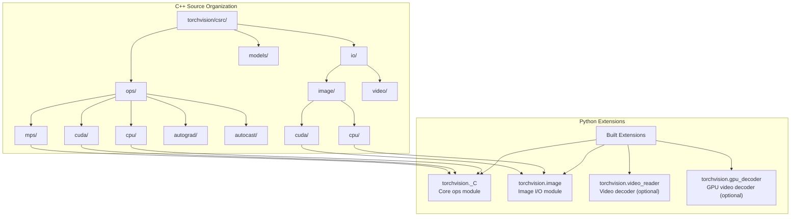
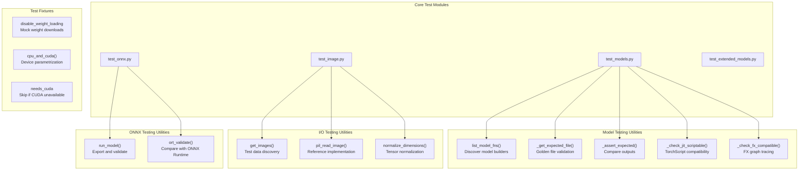
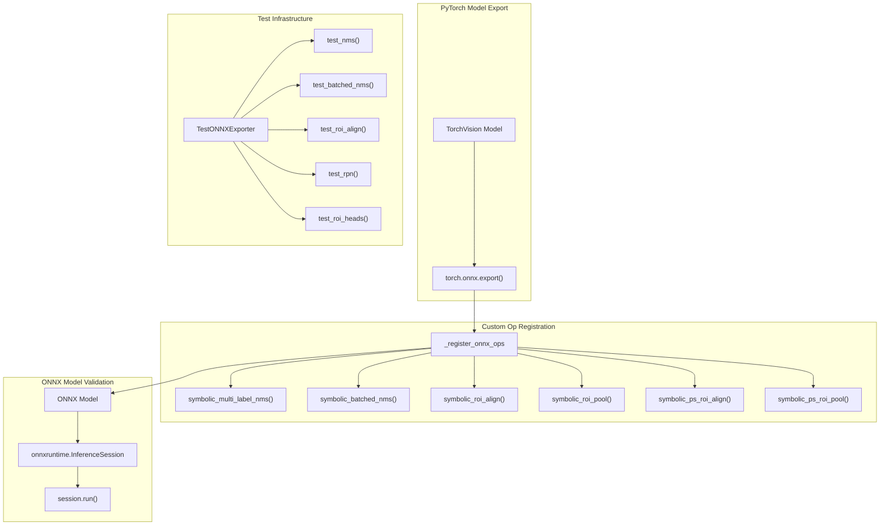

<!-- source: DeepWiki mcp.deepwiki.com · repo pytorch/vision · page 8 Building and Development · fetched 2026-10-21 -->

# Building and Development

<details>
<summary>Relevant source files</summary>

The following files were used as context for generating this wiki page:

- [CMakeLists.txt](CMakeLists.txt)
- [docs/source/io.rst](docs/source/io.rst)
- [docs/source/models.rst](docs/source/models.rst)
- [hubconf.py](hubconf.py)
- [references/classification/README.md](references/classification/README.md)
- [setup.py](setup.py)
- [test/common_extended_utils.py](test/common_extended_utils.py)
- [test/expect/ModelTester.test_vit_h_14_expect.pkl](test/expect/ModelTester.test_vit_h_14_expect.pkl)
- [test/test_extended_models.py](test/test_extended_models.py)
- [test/test_image.py](test/test_image.py)
- [test/test_models.py](test/test_models.py)
- [test/test_models_detection_utils.py](test/test_models_detection_utils.py)
- [test/test_onnx.py](test/test_onnx.py)
- [torchvision/csrc/io/image/cpu/decode_image.cpp](torchvision/csrc/io/image/cpu/decode_image.cpp)
- [torchvision/csrc/io/image/image.cpp](torchvision/csrc/io/image/image.cpp)
- [torchvision/csrc/io/image/image.h](torchvision/csrc/io/image/image.h)
- [torchvision/io/__init__.py](torchvision/io/__init__.py)
- [torchvision/io/image.py](torchvision/io/image.py)
- [torchvision/models/__init__.py](torchvision/models/__init__.py)
- [torchvision/models/_api.py](torchvision/models/_api.py)
- [torchvision/models/detection/_utils.py](torchvision/models/detection/_utils.py)
- [torchvision/models/detection/generalized_rcnn.py](torchvision/models/detection/generalized_rcnn.py)
- [torchvision/models/detection/image_list.py](torchvision/models/detection/image_list.py)
- [torchvision/models/detection/roi_heads.py](torchvision/models/detection/roi_heads.py)
- [torchvision/models/detection/rpn.py](torchvision/models/detection/rpn.py)
- [torchvision/models/detection/transform.py](torchvision/models/detection/transform.py)
- [torchvision/ops/_register_onnx_ops.py](torchvision/ops/_register_onnx_ops.py)
- [torchvision/ops/feature_pyramid_network.py](torchvision/ops/feature_pyramid_network.py)
- [torchvision/ops/poolers.py](torchvision/ops/poolers.py)

</details>


This page provides an overview of TorchVision's build system, testing infrastructure, and interoperability features for developers and advanced users. It covers the essential components needed to build TorchVision from source, validate functionality, and ensure compatibility with export frameworks like ONNX.

For detailed information on specific topics, see:
- [Build System](#8.1) - Setup, compilation, and extension building
- [Testing Infrastructure](#8.2) - Test patterns, fixtures, and validation
- [ONNX Export and Interoperability](#8.3) - Export support and compatibility

## System Architecture

TorchVision's build and development infrastructure consists of three major components:

**Build System Architecture**



Sources: [setup.py:1-584](), [CMakeLists.txt:1-174]()

**Testing and Validation Flow**



Sources: [test/test_models.py:1-1200](), [test/test_image.py:1-1200](), [test/test_onnx.py:1-600]()

## Build System Overview

TorchVision provides two build systems: `setup.py` (setuptools) and `CMakeLists.txt` (CMake). The setuptools build is the primary method for Python package installation, while CMake is used for standalone C++ library builds and CI environments.

### Build Configuration

The build system is controlled by environment variables that determine which features are compiled:

| Environment Variable | Purpose | Default |
|---------------------|---------|---------|
| `FORCE_CUDA` | Enable CUDA compilation even if not auto-detected | `0` |
| `FORCE_MPS` | Enable MPS (Apple Metal) support | `0` |
| `TORCHVISION_USE_PNG` | Build with PNG support | `1` |
| `TORCHVISION_USE_JPEG` | Build with JPEG support | `1` |
| `TORCHVISION_USE_WEBP` | Build with WEBP support | `1` |
| `TORCHVISION_USE_NVJPEG` | Build with CUDA JPEG decoder | `1` |
| `TORCHVISION_USE_VIDEO_CODEC` | Build GPU video decoder | `0` |
| `TORCHVISION_USE_FFMPEG` | Build CPU video decoder | `0` |

**Extension Module Structure**



The `make_C_extension()` function at [setup.py:158-203]() builds the core operations extension, while `make_image_extension()` at [setup.py:288-374]() builds the image I/O extension with codec support.

For detailed build instructions and troubleshooting, see [Build System](#8.1).

Sources: [setup.py:18-62](), [setup.py:158-203](), [setup.py:288-374](), [CMakeLists.txt:1-174]()

## Testing Infrastructure Overview

TorchVision employs a multi-layered testing strategy covering unit tests, integration tests, and interoperability validation. The test suite validates models, transforms, datasets, I/O operations, and custom operators across CPU, CUDA, and MPS backends.

### Test Organization

**Key Test Modules and Utilities**



The `disable_weight_loading` fixture at [test/test_models.py:69-112]() patches weight loading functions to speed up tests. The `_check_jit_scriptable()` helper at [test/test_models.py:158-190]() validates TorchScript export and re-import behavior.

### Model Testing Patterns

Model tests follow a consistent pattern defined in `test_classification_model()` at [test/test_models.py:677-716]():

1. **Output validation**: Compare model output against golden files using `_assert_expected()`
2. **TorchScript export**: Validate scripting with `_check_jit_scriptable()`
3. **FX graph tracing**: Validate symbolic tracing with `_check_fx_compatible()`
4. **Gradient computation**: Verify input backpropagation with `_check_input_backprop()`
5. **Autocast testing**: Test mixed precision on CUDA devices

Detection models use specialized patterns at [test/test_models.py:785-884]() that handle variable-sized outputs and NMS instability.

For comprehensive testing patterns and fixtures, see [Testing Infrastructure](#8.2).

Sources: [test/test_models.py:69-112](), [test/test_models.py:158-190](), [test/test_models.py:677-716](), [test/test_models.py:785-884](), [test/test_image.py:52-71](), [test/test_onnx.py:21-89]()

## Interoperability and Export

TorchVision models and operators support multiple export formats and execution environments to enable deployment in production systems.

### ONNX Export Support

TorchVision registers custom ONNX symbolic functions for operators not natively supported by PyTorch's ONNX exporter. The registration system is implemented in `torchvision.ops._register_onnx_ops`.

**ONNX Export Architecture**



The `symbolic_multi_label_nms()` function at [torchvision/ops/_register_onnx_ops.py:13-30]() converts `ops.nms()` calls to ONNX's `NonMaxSuppression` operator. The `TestONNXExporter` class at [test/test_onnx.py:21-89]() validates export correctness by comparing PyTorch and ONNX Runtime outputs.

### TorchScript Compatibility

Models are validated for TorchScript compatibility using `torch.jit.script()` and `torch.jit.trace()`. The `_check_jit_scriptable()` helper at [test/test_models.py:158-190]() ensures that scripted models:
- Produce identical outputs to eager mode
- Can be saved and loaded without data loss
- Maintain numerical accuracy within tolerances

### FX Graph Tracing

TorchVision models support symbolic tracing with `torch.fx.symbolic_trace()` for graph-level optimization. The `_check_fx_compatible()` function at [test/test_models.py:192-199]() validates that traced models produce correct outputs.

For detailed ONNX export patterns and validation techniques, see [ONNX Export and Interoperability](#8.3).

Sources: [torchvision/ops/_register_onnx_ops.py:1-120](), [test/test_onnx.py:21-89](), [test/test_models.py:158-190](), [test/test_models.py:192-199]()

## Documentation

TorchVision documentation is built using Sphinx and includes API references, guides, and tutorials.

### Building Documentation

To build the documentation locally:

```bash
cd docs
pip install -r requirements.txt
make html
```

The generated HTML files will be in the `docs/build/html` directory.

### Documentation Workflow

The documentation build process:
1. Sets up the environment
2. Installs documentation requirements
3. Builds HTML documentation
4. For specific branches/tags, deploys to GitHub Pages

Sources: [.github/workflows/docs.yml:1-134]()

## Code Quality and Linting

TorchVision maintains code quality through:

### Python Linting

```bash
# Install pre-commit hooks
pip install pre-commit
pre-commit install

# Run linting on all files
pre-commit run --all-files
```

### Type Checking

```bash
pip install mypy==1.13.0
mypy --config-file mypy.ini
```

Sources: [.github/workflows/lint.yml:1-101]()

## Continuous Integration

TorchVision uses GitHub Actions for CI/CD, with workflows for:

| Workflow | Purpose | Trigger |
|----------|---------|---------|
| Tests | Run unit tests on all platforms | PRs, pushes to main/nightly |
| Build Linux/Windows/M1/AArch64 Wheels | Build distribution wheels | PRs, releases, pushes to main/nightly |
| CMake | Build with CMake | PRs, pushes to main/nightly |
| Docs | Build documentation | PRs, pushes to main/nightly, tags |
| Lint | Code quality | PRs, pushes to main/nightly |

The test matrix covers:
- Python versions: 3.9, 3.10, 3.11, 3.12
- Platforms: Linux, Windows, macOS
- Compute: CPU, CUDA, MPS (Apple)

Sources: [.github/workflows/tests.yml:1-184](), [.github/workflows/build-cmake.yml:1-87]()

## External Decoder Support

TorchVision supports additional image formats through the `torchvision-extra-decoders` package:

```bash
# Install extra decoders
pip install torchvision-extra-decoders
```

This adds support for:
- AVIF format
- HEIC/HEIF format

The package is installed automatically during development setup.

Sources: [.github/scripts/setup-env.sh:101-110](), [test/smoke_test.py:24-66]()

## Contributing Guidelines

When contributing to TorchVision:

1. **Fork and branch**: Create a branch for your feature/bugfix
2. **Write tests**: Ensure your changes include tests
3. **Run tests**: Make sure all tests pass
4. **Follow code style**: Use pre-commit hooks to maintain code quality
5. **Submit PR**: Provide clear description of your changes

Before submitting a pull request:
- Ensure code passes linting checks
- Verify that your changes don't break existing functionality
- Update documentation if you changed APIs or behavior
- Add appropriate type annotations

For more detailed guidelines, refer to the [Overview](#1) page.

---

