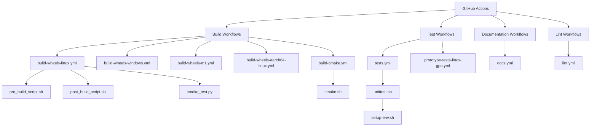
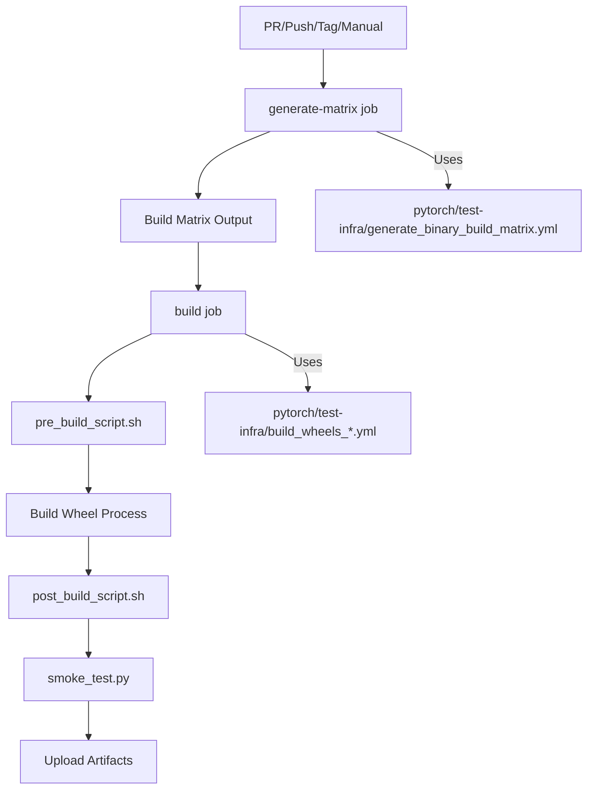

<!-- source: DeepWiki mcp.deepwiki.com · repo pytorch/vision · page 8.1 Build System · fetched 2026-10-21 -->

# Build System

<details>
<summary>Relevant source files</summary>

The following files were used as context for generating this wiki page:

- [CMakeLists.txt](CMakeLists.txt)
- [docs/source/io.rst](docs/source/io.rst)
- [setup.py](setup.py)
- [test/test_image.py](test/test_image.py)
- [torchvision/csrc/io/image/cpu/decode_image.cpp](torchvision/csrc/io/image/cpu/decode_image.cpp)
- [torchvision/csrc/io/image/image.cpp](torchvision/csrc/io/image/image.cpp)
- [torchvision/csrc/io/image/image.h](torchvision/csrc/io/image/image.h)
- [torchvision/io/__init__.py](torchvision/io/__init__.py)
- [torchvision/io/image.py](torchvision/io/image.py)

</details>


## Purpose and Scope
This document describes the build system for TorchVision, which handles compilation, packaging, testing, and deployment across multiple platforms, Python versions, and CUDA configurations. The build system is primarily implemented as a set of GitHub Actions workflows that manage continuous integration and deployment.

For information about the testing infrastructure specifically, see [Testing](#8.2). For details on documentation generation, see [Documentation](#8.3).

## Architecture
The build system consists of several interconnected GitHub Action workflows, each responsible for different aspects of the build process:



Sources: [.github/workflows/build-wheels-linux.yml](), [.github/workflows/build-wheels-windows.yml](), [.github/workflows/build-wheels-m1.yml](), [.github/workflows/build-wheels-aarch64-linux.yml](), [.github/workflows/build-cmake.yml](), [.github/workflows/tests.yml](), [.github/workflows/prototype-tests-linux-gpu.yml](), [.github/workflows/docs.yml](), [.github/workflows/lint.yml]()

## CI/CD Triggers
The build system workflows are triggered by several events:

| Trigger | Description | Applied To |
|---------|-------------|------------|
| Pull Request | Any PR against the repository | All workflows |
| Push | Commits to `nightly`, `main`, or `release/*` branches | All workflows |
| Tag | Release tags matching `v[0-9]+.[0-9]+.[0-9]+-rc[0-9]+` | Wheel building workflows |
| Manual | Manual workflow dispatch | All workflows |

Sources: [.github/workflows/build-wheels-linux.yml:3-14](), [.github/workflows/build-wheels-windows.yml:3-14](), [.github/workflows/build-wheels-m1.yml:3-14](), [.github/workflows/build-wheels-aarch64-linux.yml:3-14](), [.github/workflows/build-cmake.yml:3-10](), [.github/workflows/tests.yml:3-10](), [.github/workflows/docs.yml:3-13](), [.github/workflows/lint.yml:3-10]()

## Wheel Building Process
TorchVision wheels are built using a structured process that leverages PyTorch's test-infra repository:



### Build Matrix Generation
Each wheel building workflow starts with the `generate-matrix` job that calls `pytorch/test-infra/.github/workflows/generate_binary_build_matrix.yml`. This creates a matrix of build configurations including:

- Python versions (3.8, 3.9, 3.10, 3.11, 3.12)
- Platform architectures (x86_64, arm64, etc.)
- CUDA versions (when applicable)
- Other hardware acceleration options (XPU, etc.)

### Platform-Specific Builds
TorchVision builds wheels for multiple platforms:

| Platform | Workflow | Architecture |
|----------|----------|--------------|
| Linux | build-wheels-linux.yml | x86_64 |
| Windows | build-wheels-windows.yml | x86_64 |
| macOS M1 | build-wheels-m1.yml | arm64 |
| Linux AArch64 | build-wheels-aarch64-linux.yml | aarch64 |

Each platform uses a specific workflow from the PyTorch test-infra repository that handles the actual building process with the provided build matrix.

### Build Process Steps
Each wheel build follows these general steps:

1. **Pre-build script** (`packaging/pre_build_script.sh`): Sets up the environment and dependencies
2. **Wheel building**: Executed by the platform-specific workflow
3. **Post-build script**: 
   - Linux/macOS: `packaging/post_build_script.sh`
   - Windows: Also runs `python packaging/wheel/relocate.py`
4. **Smoke test**: `test/smoke_test.py` verifies the built wheel works correctly

Sources: [.github/workflows/build-wheels-linux.yml:21-52](), [.github/workflows/build-wheels-windows.yml:21-54](), [.github/workflows/build-wheels-m1.yml:21-52](), [.github/workflows/build-wheels-aarch64-linux.yml:21-55]()

## CMake Build Process
In addition to Python wheels, TorchVision supports building with CMake for C++ applications. This is tested through the `.github/workflows/build-cmake.yml` workflow.

### Platforms and Configurations
The CMake build is tested across:

| Platform | Configuration | Runner |
|----------|---------------|--------|
| Linux | CPU | linux.12xlarge |
| Linux | CUDA 11.8 | linux.g5.4xlarge.nvidia.gpu |
| macOS | CPU (M1) | macos-m1-stable |
| Windows | CPU | windows.4xlarge |
| Windows | CUDA 11.8 | windows.g5.4xlarge.nvidia.gpu |

### Build Process
The CMake build process is handled by `.github/scripts/cmake.sh`, which:
1. Sets up the environment with Python 3.9
2. Configures the build for the specific platform (Linux/macOS/Windows)
3. Sets GPU architecture type (CPU/CUDA) and version if applicable
4. Executes the build

Sources: [.github/workflows/build-cmake.yml:13-87]()

## Testing Infrastructure
The testing infrastructure is defined in `.github/workflows/tests.yml` and ensures TorchVision works correctly across platforms.

### Test Matrix
Tests are run on a comprehensive matrix of configurations:

| Platform | Python Versions | GPU Support |
|----------|----------------|-------------|
| Linux | 3.9, 3.10, 3.11, 3.12 | CPU and CUDA 11.8 |
| macOS M1 | 3.9, 3.10, 3.12 | CPU only |
| Windows | 3.9, 3.10, 3.11, 3.12 | CPU only |

### Test Execution
Tests are executed using `.github/scripts/unittest.sh`, which performs the following steps:

1. Sets up the environment using `.github/scripts/setup-env.sh`
2. Installs testing utilities: pytest < 8, pytest-mock, pytest-cov, expecttest
3. Runs `test/smoke_test.py` for basic functionality verification
4. Runs pytest with specific exclusions:
   ```bash
   pytest --ignore-glob="*test_video*" --ignore-glob="*test_onnx*" --junit-xml="${RUNNER_TEST_RESULTS_DIR}/test-results.xml" -v --durations=25 -k "not TestFxFeatureExtraction"
   ```

### Extended Tests
Additional tests are executed when a PR has the `run-extended` label. These extended tests:

1. Pre-download model weights using `scripts/download_model_urls.py`
2. Run extended test files with the environment variable `PYTORCH_TEST_WITH_EXTENDED=1`

Sources: [.github/workflows/tests.yml:13-184](), [.github/scripts/unittest.sh:1-19](), [scripts/download_model_urls.py]()

## Linting Workflow
The linting workflow ensures code quality and adherence to project standards.

### Python Source Code and Configurations
Python code is linted using pre-commit hooks that run various formatters and checkers:

```bash
pre-commit run --all-files
```

### Type Checking
Python type annotations are checked using mypy 1.13.0 with the configuration from `mypy.ini`:

```bash
mypy --install-types --non-interactive --config-file mypy.ini
```

Sources: [.github/workflows/lint.yml:13-100]()

## Documentation Workflow
The documentation workflow builds and deploys TorchVision documentation.

### Building Documentation
Documentation is built using Sphinx with the following process:

1. Set up a Python 3.10 environment
2. Install documentation requirements from `docs/requirements.txt`
3. Build HTML documentation with `make html`
4. Copy the built documentation to an artifact directory

### Deploying Documentation
Documentation deployment varies based on the trigger:

| Trigger | Deployment Location |
|---------|---------------------|
| PR | Temporary preview in S3 bucket |
| Push to `main` | Main documentation site (`main` folder and `_static`) |
| Tag (release) | Version-specific folder (e.g., `0.15`) |

Sources: [.github/workflows/docs.yml:16-134]()

## Building TorchVision Locally

### Building Python Package
To build the TorchVision Python package locally:

1. Clone the repository:
   ```bash
   git clone https://github.com/pytorch/vision.git
   cd vision
   ```

2. Install dependencies:
   ```bash
   pip install -r requirements.txt
   ```

3. Build the package:
   ```bash
   python setup.py install
   ```

   Or in development mode:
   ```bash
   python setup.py develop
   ```

### Building with CMake
To build TorchVision with CMake:

1. Ensure CMake is installed
2. Configure the build:
   ```bash
   mkdir build
   cd build
   cmake ..
   ```
3. Build the project:
   ```bash
   make
   ```

Sources: Based on common Python and CMake build patterns reflected in the workflow files.

## Conclusion
The TorchVision build system is a comprehensive set of GitHub Actions workflows that ensure consistent building, testing, and deployment across multiple platforms, Python versions, and hardware acceleration options. This robust infrastructure enables reliable development and distribution of the TorchVision library.

---

