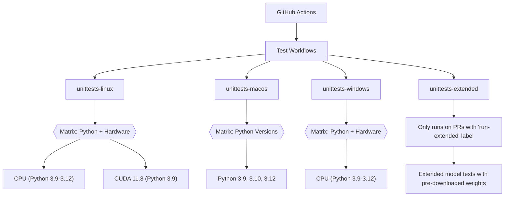
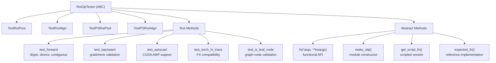
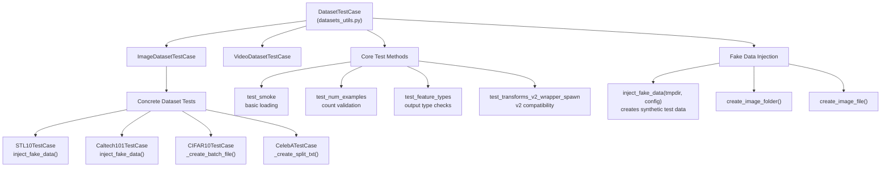
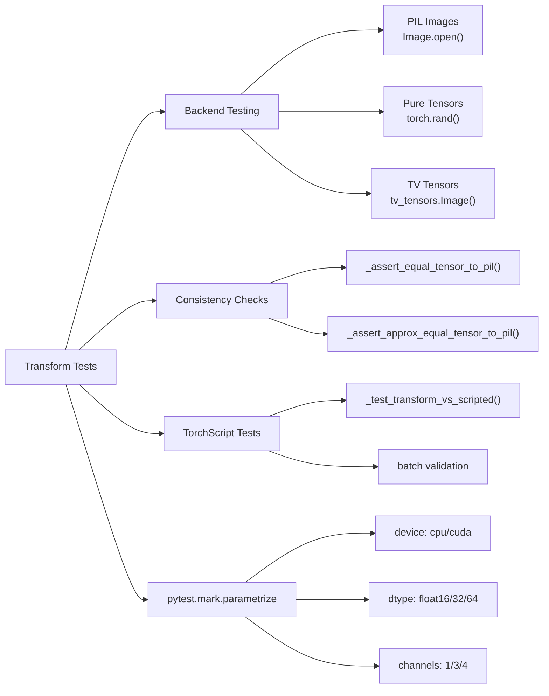
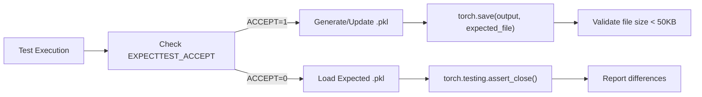
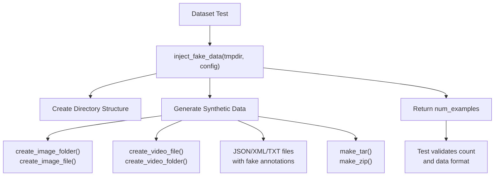

<!-- source: DeepWiki mcp.deepwiki.com · repo pytorch/vision · page 8.2 Testing Infrastructure · fetched 2026-10-21 -->

# Testing

<details>
<summary>Relevant source files</summary>

The following files were used as context for generating this wiki page:

- [docs/source/datasets.rst](docs/source/datasets.rst)
- [docs/source/models.rst](docs/source/models.rst)
- [docs/source/ops.rst](docs/source/ops.rst)
- [hubconf.py](hubconf.py)
- [references/classification/README.md](references/classification/README.md)
- [test/common_extended_utils.py](test/common_extended_utils.py)
- [test/datasets_utils.py](test/datasets_utils.py)
- [test/expect/ModelTester.test_vit_h_14_expect.pkl](test/expect/ModelTester.test_vit_h_14_expect.pkl)
- [test/test_datasets.py](test/test_datasets.py)
- [test/test_extended_models.py](test/test_extended_models.py)
- [test/test_functional_tensor.py](test/test_functional_tensor.py)
- [test/test_models.py](test/test_models.py)
- [test/test_ops.py](test/test_ops.py)
- [test/test_transforms.py](test/test_transforms.py)
- [test/test_transforms_tensor.py](test/test_transforms_tensor.py)
- [torchvision/datasets/__init__.py](torchvision/datasets/__init__.py)
- [torchvision/datasets/_optical_flow.py](torchvision/datasets/_optical_flow.py)
- [torchvision/datasets/_stereo_matching.py](torchvision/datasets/_stereo_matching.py)
- [torchvision/datasets/inaturalist.py](torchvision/datasets/inaturalist.py)
- [torchvision/datasets/places365.py](torchvision/datasets/places365.py)
- [torchvision/models/__init__.py](torchvision/models/__init__.py)
- [torchvision/models/_api.py](torchvision/models/_api.py)
- [torchvision/ops/__init__.py](torchvision/ops/__init__.py)
- [torchvision/ops/_utils.py](torchvision/ops/_utils.py)
- [torchvision/ops/boxes.py](torchvision/ops/boxes.py)
- [torchvision/ops/deform_conv.py](torchvision/ops/deform_conv.py)
- [torchvision/ops/drop_block.py](torchvision/ops/drop_block.py)
- [torchvision/ops/misc.py](torchvision/ops/misc.py)
- [torchvision/ops/ps_roi_align.py](torchvision/ops/ps_roi_align.py)
- [torchvision/ops/ps_roi_pool.py](torchvision/ops/ps_roi_pool.py)
- [torchvision/ops/roi_align.py](torchvision/ops/roi_align.py)
- [torchvision/ops/roi_pool.py](torchvision/ops/roi_pool.py)
- [torchvision/ops/stochastic_depth.py](torchvision/ops/stochastic_depth.py)
- [torchvision/transforms/autoaugment.py](torchvision/transforms/autoaugment.py)
- [torchvision/transforms/functional.py](torchvision/transforms/functional.py)
- [torchvision/transforms/transforms.py](torchvision/transforms/transforms.py)

</details>


This page documents the testing infrastructure of PyTorch Vision (torchvision) and provides guidance on how to run tests and add new ones. For build system information, see [Build System](#8.1).

## Overview

TorchVision employs a comprehensive testing infrastructure to ensure functionality, reliability, and performance across various platforms, Python versions, and hardware configurations. Tests are organized into different categories and are run through both local development workflows and continuous integration pipelines.

```mermaid
graph TD
    TestInfra["TorchVision Testing Infrastructure"] --> UnitTests["Unit Tests"]
    TestInfra --> SmokeTests["Smoke Tests"]
    TestInfra --> ReferenceTests["Reference Implementation Tests"]
    TestInfra --> CITests["CI/CD Pipeline"]
    
    UnitTests --> ModelTests["Model Tests"]
    UnitTests --> TransformTests["Transform Tests"]
    UnitTests --> DatasetTests["Dataset Tests"]
    UnitTests --> IOTests["I/O Tests"]
    UnitTests --> OperatorTests["Operator Tests"]
    
    SmokeTests --> BasicChecks["Basic Functionality Checks"]
    SmokeTests --> ModelInference["Model Inference Check"]
    SmokeTests --> IOOperations["I/O Operations Check"]
    
    CITests --> HardwareTests["Hardware Tests"]
    HardwareTests --> CPUTests["CPU Tests"]
    HardwareTests --> CUDATests["CUDA Tests"]
    HardwareTests --> MPSTests["MPS Tests"]
    
    CITests --> PlatformTests["Platform Tests"]
    PlatformTests --> LinuxTests["Linux Tests"]
    PlatformTests --> MacOSTests["macOS Tests"]
    PlatformTests --> WindowsTests["Windows Tests"]
    
    CITests --> PythonVersions["Python Versions"]
    PythonVersions --> Python39["Python 3.9"]
    PythonVersions --> Python310["Python 3.10"]
    PythonVersions --> Python311["Python 3.11"]
    PythonVersions --> Python312["Python 3.12"]
```



Sources: [.github/workflows/tests.yml:1-147](), [test/smoke_test.py:1-146]()

## Test Categories

TorchVision tests are organized into several main categories:

### Unit Tests

Unit tests verify the functionality of individual components. These tests aim to ensure that each component works correctly in isolation.

### Smoke Tests

Smoke tests perform quick, basic checks to verify essential functionality. The main smoke test file (`test/smoke_test.py`) validates:

1. Core torchvision operations
2. Image reading and decoding
3. Model inference with ResNet50
4. CUDA support when available
5. MPS (Metal Performance Shaders) support on macOS when available

```python
# Key functionality tested in smoke tests:
smoke_test_torchvision()  # Tests if core torchvision operations work
smoke_test_torchvision_read_decode()  # Tests image I/O
smoke_test_torchvision_resnet50_classify()  # Tests model inference
smoke_test_torchvision_decode_jpeg()  # Tests JPEG decoding
smoke_test_compile()  # Tests torch.compile with torchvision models (on CUDA)
```

Sources: [test/smoke_test.py:17-143]()

### Reference Implementation Tests

The reference implementations (`references/`) include training and evaluation scripts that serve as examples and are also tested to ensure they work correctly.

## CI/CD Testing Infrastructure

TorchVision uses GitHub Actions for continuous integration testing across multiple environments.



Sources: [.github/workflows/tests.yml:13-184]()

### Test Matrix

The CI/CD pipeline runs tests across a comprehensive matrix of environments:

| Platform | Python Versions | Hardware |
|----------|----------------|----------|
| Linux    | 3.9, 3.10, 3.11, 3.12 | CPU, CUDA 11.8 (only 3.9) |
| macOS    | 3.9, 3.10, 3.12 | CPU (M1) |
| Windows  | 3.9, 3.10, 3.11, 3.12 | CPU |

Sources: [.github/workflows/tests.yml:14-91]()

## Running Tests

### Environment Setup

Before running tests, you need to set up the proper environment. The repository provides a setup script:

```bash
# For Linux/macOS
source .github/scripts/setup-env.sh

# For Windows (in PowerShell)
& .\.github\scripts\setup-env.ps1
```

This script creates a Conda environment with all necessary dependencies.

Sources: [.github/scripts/setup-env.sh:1-116]()

### Running Tests Locally

Tests use the pytest framework. Here are common commands for running tests:

```bash
# Run all tests
pytest

# Run specific test files
pytest test/test_models.py

# Run a specific test
pytest test/test_models.py::test_resnet

# Run tests matching a pattern
pytest -xvs test/test_models.py -k "resnet"

# Run tests on GPU (if available)
pytest test/test_models.py::test_resnet_cuda
```

### Extended Tests

Some tests require downloading pre-trained model weights and can take longer to run. These are part of the "extended" test suite and are enabled by setting an environment variable:

```bash
export PYTORCH_TEST_WITH_EXTENDED=1
pytest test/test_extended_*.py
```

Sources: [.github/workflows/tests.yml:147-184]()

## Testing Patterns

TorchVision uses specialized testing patterns to ensure comprehensive coverage across different subsystems.

### RoIOpTester: Testing Detection Operators

The `RoIOpTester` class provides a standardized framework for testing Region of Interest (RoI) operations like `roi_align`, `roi_pool`, `ps_roi_align`, and `ps_roi_pool`.

**RoIOpTester Testing Pattern**


**Key Testing Features:**

| Test Method | Purpose | Parametrization |
|-------------|---------|-----------------|
| `test_forward` | Validates forward pass correctness | device (cpu/cuda/mps), dtype (float16/32/64), contiguous (True/False) |
| `test_backward` | Validates gradients via `gradcheck` | seed (0-9), device, contiguous, deterministic flag |
| `test_autocast` | Tests CUDA automatic mixed precision | dtype combinations for input and rois |
| `test_torch_fx_trace` | Tests FX symbolic tracing | device |
| `test_is_leaf_node` | Validates graph node structure | device |

**Example Implementation Pattern:**

Each concrete test class must implement:
- `fn()`: The functional API to test (e.g., `ops.roi_pool`)
- `make_obj()`: Module constructor (e.g., `ops.RoIPool`)
- `get_script_fn()`: Returns a JIT-scripted version
- `expected_fn()`: Pure Python reference implementation

Sources: [test/test_ops.py:107-274](), [test/test_ops.py:276-322]()

### DatasetTestCase: Testing Dataset Loaders

The `DatasetTestCase` and `ImageDatasetTestCase` classes in `test/datasets_utils.py` provide infrastructure for testing dataset loaders without requiring actual dataset downloads.

**Dataset Testing Architecture**


**Fake Data Injection Pattern:**

Each dataset test case implements `inject_fake_data()` to create minimal synthetic data:

```python
def inject_fake_data(self, tmpdir, config):
    # Create directory structure
    root = pathlib.Path(tmpdir) / "dataset_name"
    os.makedirs(root)
    
    # Generate synthetic images/annotations
    create_image_folder(root, name="train", num_examples=10)
    create_annotation_file(root, "annotations.json")
    
    # Return expected number of samples
    return num_samples
```

**Key Testing Utilities:**

| Utility Function | Purpose | Location |
|-----------------|---------|----------|
| `inject_fake_data()` | Creates synthetic dataset | Implemented per dataset |
| `create_image_folder()` | Generates folder of test images | [test/datasets_utils.py]() |
| `create_image_file()` | Creates individual test image | [test/datasets_utils.py]() |
| `check_transforms_v2_wrapper_spawn()` | Validates v2 transform compatibility | [test/datasets_utils.py]() |

Sources: [test/datasets_utils.py:38-53](), [test/test_datasets.py:31-113](), [test/test_datasets.py:115-192]()

### Model Testing Patterns

Model tests use several specialized patterns to ensure correctness and compatibility.

**Model Testing Infrastructure**

```mermaid
graph TB
    ModelTests["Model Tests<br/>(test_models.py)"]
    
    ModelTests --> GoldenFiles["Golden File Validation"]
    GoldenFiles --> _get_expected_file["_get_expected_file(name)<br/>test/expect/*.pkl"]
    GoldenFiles --> _assert_expected["_assert_expected(output, name)<br/>tolerance checking"]
    GoldenFiles --> ACCEPT["EXPECTTEST_ACCEPT=1<br/>update reference"]
    
    ModelTests --> Scriptability["Scriptability Tests"]
    Scriptability --> _check_jit_scriptable["_check_jit_scriptable(nn_module, args)"]
    Scriptability --> script_model_unwrapper["script_model_unwrapper<br/>dict of unwrap functions"]
    Scriptability --> export_import_copy["save/load TorchScript"]
    
    ModelTests --> FXCompatibility["FX Compatibility"]
    FXCompatibility --> _check_fx_compatible["_check_fx_compatible(model, inputs)"]
    FXCompatibility --> symbolic_trace["torch.fx.symbolic_trace()"]
    
    ModelTests --> GradientChecks["Gradient Validation"]
    GradientChecks --> _check_input_backprop["_check_input_backprop(model, inputs)"]
    GradientChecks --> requires_grad["inputs.requires_grad_(True)"]
    
    ModelTests --> WeightManagement["Weight Management"]
    WeightManagement --> disable_weight_loading["disable_weight_loading fixture<br/>mocks load_state_dict"]
    WeightManagement --> _get_image["_get_image(real_image=True)<br/>GRACE_HOPPER asset"]
```


**Golden File Validation:**

Golden files store expected model outputs for regression testing:

```python
# Generate/update expected outputs
EXPECTTEST_ACCEPT=1 pytest test/test_models.py -k resnet50

# Validate against expected outputs
pytest test/test_models.py -k resnet50
```

Expected files are stored in `test/expect/ModelTester.test_*.pkl` with tolerance checking for floating-point comparisons.

**Key Testing Functions:**

| Function | Purpose | Usage |
|----------|---------|-------|
| `_assert_expected()` | Compare output to golden file | Model output validation |
| `_check_jit_scriptable()` | Test TorchScript compatibility | Ensure model is scriptable |
| `_check_fx_compatible()` | Test FX graph tracing | Validate symbolic traceability |
| `_check_input_backprop()` | Verify gradient flow | Ensure gradients propagate |
| `disable_weight_loading` | Mock weight loading | Speed up tests |

**Special Model Configurations:**

The `_model_params` dictionary defines special configurations for specific models:

```python
_model_params = {
    "inception_v3": {"input_shape": (1, 3, 299, 299)},
    "retinanet_resnet50_fpn": {
        "num_classes": 20,
        "score_thresh": 0.01,
        "real_image": True,  # Uses actual image for testing
    },
    # ... more configurations
}
```

Sources: [test/test_models.py:114-156](), [test/test_models.py:158-190](), [test/test_models.py:192-199](), [test/test_models.py:289-373]()

### Transform Tests

Transform tests validate behavior across different input types and backends.

**Transform Test Matrix**


**Testing Patterns:**

1. **Cross-Backend Validation:** Tests verify that transforms produce consistent results across PIL, Tensor, and TV Tensor backends
2. **Batch vs Single:** Ensures batch processing matches individual processing
3. **Scripted vs Eager:** Validates TorchScript compatibility
4. **Parametrization:** Tests run across multiple device/dtype/channel combinations

Sources: [test/test_transforms.py:42-154](), [test/test_functional_tensor.py:36-52](), [test/test_transforms_tensor.py:31-93]()

## Test Utilities

### Common Test Utilities

The `test/common_utils.py` module provides utilities used across test files:

| Utility | Purpose |
|---------|---------|
| `cpu_and_cuda()` | Parametrize tests for CPU and CUDA devices |
| `cpu_and_cuda_and_mps()` | Include MPS device in parametrization |
| `needs_cuda` | Skip decorator for CUDA-only tests |
| `needs_mps` | Skip decorator for MPS-only tests |
| `assert_equal()` | Tensor equality with tolerance |
| `freeze_rng_state()` | Context manager for reproducible RNG |
| `set_rng_seed()` | Set all random seeds (torch, numpy, random) |

### DeterministicGuard

The `DeterministicGuard` context manager enables testing of deterministic algorithm paths:

```python
class DeterministicGuard:
    def __init__(self, deterministic, *, warn_only=False):
        self.deterministic = deterministic
        self.warn_only = warn_only
    
    def __enter__(self):
        self.deterministic_restore = torch.are_deterministic_algorithms_enabled()
        torch.use_deterministic_algorithms(self.deterministic, warn_only=self.warn_only)
    
    def __exit__(self, exception_type, exception_value, traceback):
        torch.use_deterministic_algorithms(self.deterministic_restore)
```

**Usage in RoI operation tests:**

```python
with DeterministicGuard(deterministic=True):
    y = ops.roi_align(x, rois, output_size, spatial_scale, sampling_ratio)
```

This ensures that operations like `roi_align` use deterministic code paths when available.

Sources: [test/test_ops.py:34-46](), [test/test_ops.py:151-152]()

### Golden File Validation

Model tests use golden files to detect regressions:

**Golden File Workflow:**


**File Naming Convention:**
- Location: `test/expect/`
- Pattern: `ModelTester.test_{model_name}_expect.pkl`
- Example: `test/expect/ModelTester.test_resnet50_expect.pkl`

**Updating Golden Files:**

```bash
# Update all golden files
EXPECTTEST_ACCEPT=1 pytest test/test_models.py

# Update specific model
EXPECTTEST_ACCEPT=1 pytest test/test_models.py -k resnet50
```

Sources: [test/test_models.py:114-156]()

## Cross-Backend and Cross-Device Testing

### Device Parametrization

Tests use pytest parametrization to run across devices:

```python
@pytest.mark.parametrize("device", cpu_and_cuda())
def test_roi_align_forward(self, device):
    x = torch.rand(2, 64, 10, 10, device=device)
    rois = torch.tensor([[0, 0, 0, 9, 9]], device=device)
    output = ops.roi_align(x, rois, output_size=5)
```

**Device Testing Matrix:**

| Test Decorator | Devices Tested | Skip Condition |
|----------------|----------------|----------------|
| `@pytest.mark.parametrize("device", cpu_and_cuda())` | CPU, CUDA | Skips CUDA if unavailable |
| `@pytest.mark.parametrize("device", cpu_and_cuda_and_mps())` | CPU, CUDA, MPS | Skips unavailable devices |
| `@needs_cuda` | CUDA only | Skips if CUDA unavailable |
| `@needs_mps` | MPS only | Skips if MPS unavailable |

### Dtype Testing

Operations are tested with multiple dtypes:

```python
@pytest.mark.parametrize("x_dtype", (torch.float16, torch.float32, torch.float64))
@pytest.mark.parametrize("rois_dtype", (torch.float, torch.half))
def test_forward(self, device, x_dtype, rois_dtype):
    # Test with different dtype combinations
```

**Common dtype combinations:**
- `float16` (half precision): Tests AMP compatibility
- `float32` (single precision): Standard testing
- `float64` (double precision): High-precision gradient checks

**Special handling:**
- MPS backend doesn't support `float64`
- CPU doesn't support `float16` efficiently
- Different tolerances based on dtype

Sources: [test/test_ops.py:112-159](), [test/test_ops.py:234-236]()

### Autocast Testing

CUDA automatic mixed precision (AMP) is tested explicitly:

```python
@needs_cuda
@pytest.mark.parametrize("x_dtype", (torch.float, torch.half))
@pytest.mark.parametrize("rois_dtype", (torch.float, torch.half))
def test_autocast(self, x_dtype, rois_dtype):
    with torch.cuda.amp.autocast():
        self.test_forward(torch.device("cuda"), x_dtype=x_dtype, rois_dtype=rois_dtype)
```

This ensures operations work correctly within autocast context managers.

Sources: [test/test_ops.py:234-236]()

## Fake Data Injection for Datasets

Dataset tests avoid downloading real datasets by injecting synthetic data:

**Fake Data Injection Pattern:**


**Example Implementation (STL10):**

```python
class STL10TestCase(datasets_utils.ImageDatasetTestCase):
    DATASET_CLASS = datasets.STL10
    
    def inject_fake_data(self, tmpdir, config):
        root_folder = os.path.join(tmpdir, "stl10_binary")
        os.mkdir(root_folder)
        
        # Create fake binary files
        self._make_train_files(root_folder)
        self._make_test_files(root_folder)
        self._make_class_names_file(root_folder)
        
        return num_images  # Expected sample count
```

**Utilities for Fake Data:**

| Utility | Purpose |
|---------|---------|
| `create_image_folder()` | Generate multiple test images in a directory |
| `create_image_file()` | Create single test image (RGB noise) |
| `create_video_file()` | Generate test video file |
| `create_image_or_video_tensor()` | Create random tensor data |
| `make_tar()` / `make_zip()` | Create compressed archives |
| `create_random_string()` | Generate random text for annotations |

Sources: [test/test_datasets.py:31-113](), [test/datasets_utils.py:38-53]()

## Writing New Tests

When writing new tests for TorchVision, follow the established patterns.

### Adding a New Dataset Test

1. **Create Test Case Class:**

```python
class MyDatasetTestCase(datasets_utils.ImageDatasetTestCase):
    DATASET_CLASS = datasets.MyDataset
    ADDITIONAL_CONFIGS = combinations_grid(split=("train", "test"))
    
    def inject_fake_data(self, tmpdir, config):
        root = pathlib.Path(tmpdir) / "my_dataset"
        os.makedirs(root)
        
        # Create fake data structure
        datasets_utils.create_image_folder(
            root, name="images", num_examples=10
        )
        
        # Create annotations
        with open(root / "annotations.json", "w") as f:
            json.dump({"samples": []}, f)
        
        return 10  # number of samples
```

2. **Test automatically inherits:** `test_smoke`, `test_num_examples`, `test_feature_types`

Sources: [test/test_datasets.py:31-113](), [test/datasets_utils.py:230-387]()

### Adding a New RoI Operator Test

1. **Subclass RoIOpTester:**

```python
class TestMyRoiOp(RoIOpTester):
    def fn(self, x, rois, pool_h, pool_w, spatial_scale=1, **kwargs):
        return ops.my_roi_op(x, rois, (pool_h, pool_w), spatial_scale)
    
    def make_obj(self, pool_h=5, pool_w=5, spatial_scale=1, wrap=False):
        obj = ops.MyRoiOp((pool_h, pool_w), spatial_scale)
        return RoIOpTesterModuleWrapper(obj) if wrap else obj
    
    def get_script_fn(self, rois, pool_size):
        scripted = torch.jit.script(ops.my_roi_op)
        return lambda x: scripted(x, rois, pool_size)
    
    def expected_fn(self, x, rois, pool_h, pool_w, spatial_scale=1, **kwargs):
        # Pure Python reference implementation
        return reference_implementation(x, rois, pool_h, pool_w)
```

2. **Inherited tests run automatically:** forward/backward/autocast/TorchScript/FX

Sources: [test/test_ops.py:276-322]()

### Adding a New Model Test

1. **Define Model Configuration (if needed):**

```python
_model_params = {
    "my_model": {
        "input_shape": (1, 3, 224, 224),
        "num_classes": 1000,
    },
}
```

2. **Test with Standard Pattern:**

```python
def test_my_model(disable_weight_loading):
    model = models.my_model()
    model.eval()
    
    x = _get_image((1, 3, 224, 224), real_image=False, device="cpu")
    
    with torch.no_grad(), freeze_rng_state():
        output = model(x)
    
    # Validate against golden file
    _assert_expected(output, "my_model", rtol=1e-5, atol=1e-5)
    
    # Test scriptability
    _check_jit_scriptable(model, (x,))
    
    # Test FX compatibility
    _check_fx_compatible(model, x)
```

Sources: [test/test_models.py:69-112](), [test/test_models.py:483-503]()

### Testing Transform Behavior

1. **Test Functional API:**

```python
@pytest.mark.parametrize("device", cpu_and_cuda())
def test_my_transform_functional(device):
    img_tensor, pil_img = _create_data(height=10, width=10, device=device)
    
    # Test functional API
    transformed_tensor = F.my_transform(img_tensor, param=value)
    transformed_pil = F.my_transform(pil_img, param=value)
    
    # Verify consistency
    _assert_equal_tensor_to_pil(transformed_tensor, transformed_pil)
```

2. **Test Class API:**

```python
@pytest.mark.parametrize("device", cpu_and_cuda())
def test_my_transform_class(device):
    transform = transforms.MyTransform(param=value)
    scripted = torch.jit.script(transform)
    
    tensor, pil_img = _create_data(26, 34, device=device)
    
    # Compare eager and scripted
    torch.manual_seed(12)
    out_eager = transform(tensor)
    torch.manual_seed(12)
    out_scripted = scripted(tensor)
    
    assert_equal(out_eager, out_scripted)
```

Sources: [test/test_functional_tensor.py:54-64](), [test/test_transforms_tensor.py:66-93]()

### Gradient Checking

Use `torch.autograd.gradcheck` for numerical gradient validation:

```python
@pytest.mark.parametrize("device", cpu_and_cuda())
def test_backward(self, device):
    x = torch.rand(1, 8, 5, 5, dtype=torch.float64, device=device, requires_grad=True)
    rois = torch.tensor([[0, 0, 0, 4, 4]], dtype=torch.float64, device=device)
    
    def func(z):
        return ops.my_op(z, rois, output_size=3)
    
    gradcheck(func, (x,), atol=1e-05)
```

**Key points:**
- Use `dtype=torch.float64` for gradient checking
- Set `requires_grad=True` on inputs
- Use small input sizes for performance

Sources: [test/test_ops.py:189-213]()

## Debugging Failed Tests

When a test fails in CI, follow these steps to debug:

1. **Check the CI logs**: The log will show the specific test failure and traceback.
2. **Reproduce locally**: Set up the same environment and run the specific failing test.
3. **Use increased verbosity**: Add `-vvs` to the pytest command for more detailed output.
4. **Isolate the failure**: Use pytest's `-k` flag to run only the failing test.

## Conclusion

The testing infrastructure of TorchVision ensures the library's quality across different platforms, Python versions, and hardware configurations. By understanding how to run and write tests, contributors can help maintain the library's reliability and functionality.

---

