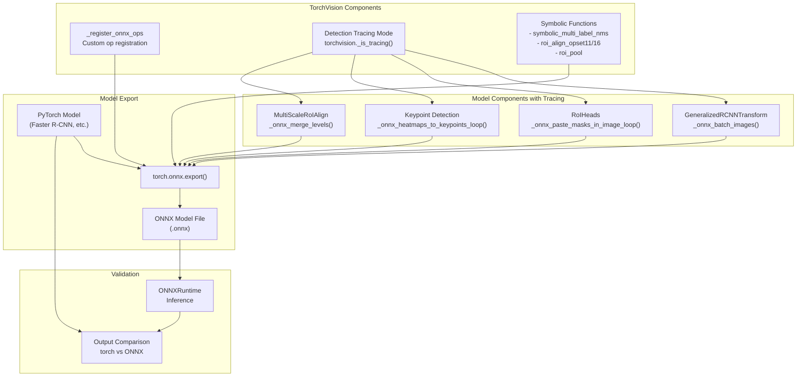
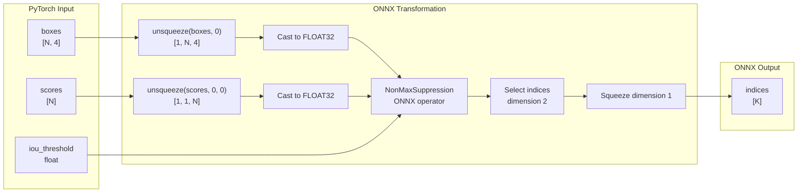
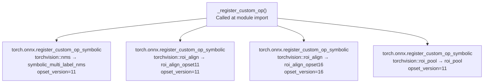
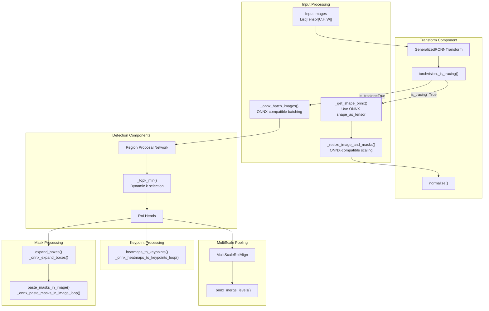
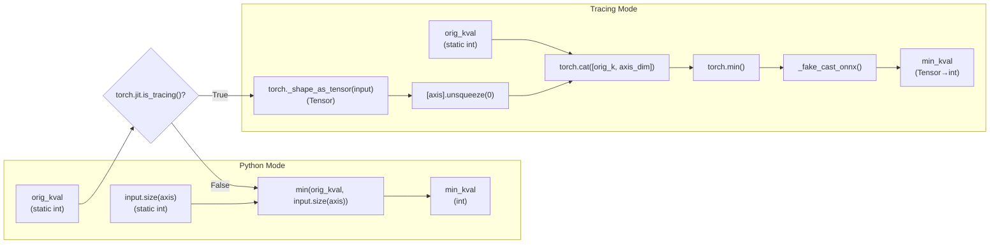
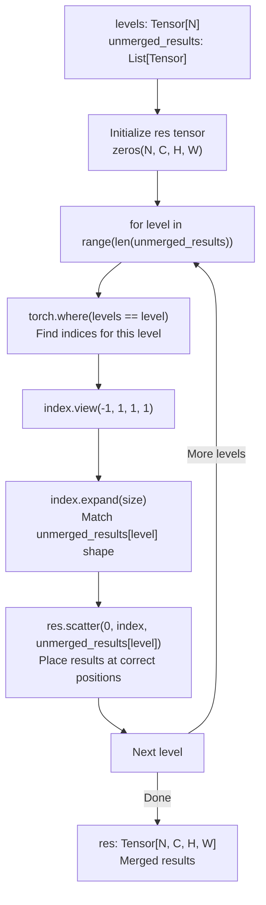
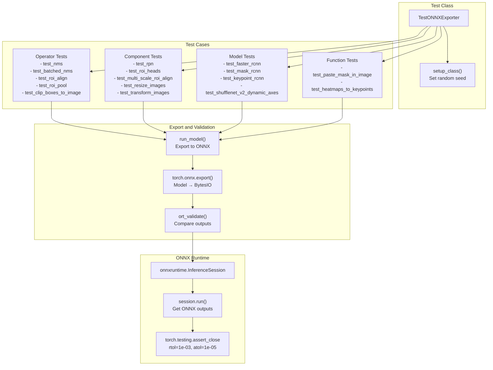
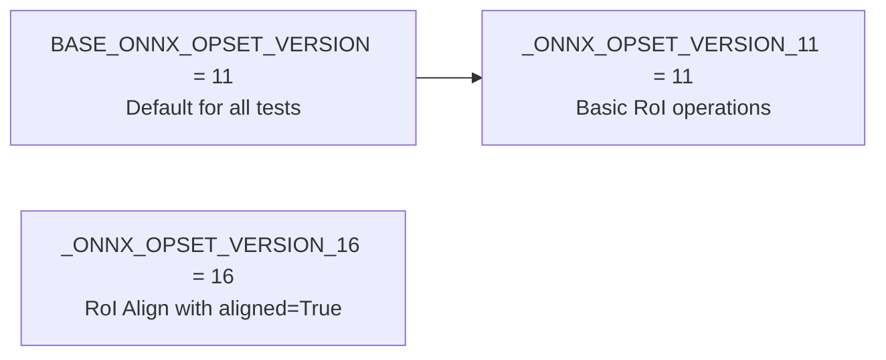

<!-- source: DeepWiki mcp.deepwiki.com · repo pytorch/vision · page 8.3 ONNX Export and Interoperability · fetched 2026-10-21 -->

# ONNX Export and Interoperability

<details>
<summary>Relevant source files</summary>

The following files were used as context for generating this wiki page:

- [test/test_models_detection_utils.py](test/test_models_detection_utils.py)
- [test/test_onnx.py](test/test_onnx.py)
- [torchvision/models/detection/_utils.py](torchvision/models/detection/_utils.py)
- [torchvision/models/detection/generalized_rcnn.py](torchvision/models/detection/generalized_rcnn.py)
- [torchvision/models/detection/image_list.py](torchvision/models/detection/image_list.py)
- [torchvision/models/detection/roi_heads.py](torchvision/models/detection/roi_heads.py)
- [torchvision/models/detection/rpn.py](torchvision/models/detection/rpn.py)
- [torchvision/models/detection/transform.py](torchvision/models/detection/transform.py)
- [torchvision/ops/_register_onnx_ops.py](torchvision/ops/_register_onnx_ops.py)
- [torchvision/ops/feature_pyramid_network.py](torchvision/ops/feature_pyramid_network.py)
- [torchvision/ops/poolers.py](torchvision/ops/poolers.py)

</details>


## Purpose and Scope

This document describes TorchVision's support for exporting models to the ONNX (Open Neural Network Exchange) format, enabling interoperability with other deep learning frameworks and inference runtimes. It covers:

- Custom symbolic function registration for TorchVision operators
- ONNX-specific implementations for detection models and transforms
- Testing and validation patterns for ONNX exports
- Opset version compatibility and dynamic axes support

For general model architecture information, see [Models](#3). For detection pipeline details, see [Detection and Segmentation Models](#3.2). For building and compilation, see [Build System](#8.1).

**Sources:** [test/test_onnx.py:1-583](), [torchvision/ops/_register_onnx_ops.py:1-108]()

---

## Overview of ONNX Export Support

TorchVision provides comprehensive ONNX export support through three main mechanisms:

1. **Custom Operator Registration**: TorchVision operators (NMS, RoI Align, RoI Pool) are registered with custom ONNX symbolic functions
2. **Tracing-Mode Adaptations**: Detection models and transforms include alternative implementations that are ONNX-compatible
3. **Validation Infrastructure**: Comprehensive test suite using `onnxruntime` to verify exported models

### ONNX Export Flow



**Sources:** [test/test_onnx.py:21-89](), [torchvision/ops/_register_onnx_ops.py:103-108]()

---

## Custom Operator Registration

TorchVision registers custom symbolic functions for operators that don't have direct ONNX equivalents. This registration happens through the `_register_onnx_ops` module, which maps TorchVision C++ operators to ONNX graph operations.

### Registered Operators and Opset Versions

| Operator | PyTorch Op | ONNX Symbolic Function | Opset Versions |
|----------|-----------|------------------------|----------------|
| NMS | `torchvision::nms` | `symbolic_multi_label_nms` | 11+ |
| RoI Align | `torchvision::roi_align` | `roi_align_opset11` | 11 |
| RoI Align (aligned) | `torchvision::roi_align` | `roi_align_opset16` | 16+ |
| RoI Pool | `torchvision::roi_pool` | `roi_pool` | 11+ |

**Sources:** [torchvision/ops/_register_onnx_ops.py:8-11](), [torchvision/ops/_register_onnx_ops.py:103-108]()

### NMS Symbolic Function

The `symbolic_multi_label_nms` function converts PyTorch's NMS operation to ONNX's `NonMaxSuppression` operator:



**Sources:** [torchvision/ops/_register_onnx_ops.py:13-31]()

### RoI Align Symbolic Functions

RoI Align has two implementations supporting different ONNX opset versions:

**Opset 11** (`roi_align_opset11`):
- Does not support `aligned=True` parameter
- Uses `output_half_pixel` coordinate transformation mode
- Warns if `aligned=True` is requested

**Opset 16** (`roi_align_opset16`):
- Supports `aligned` parameter properly
- Uses `half_pixel` mode when `aligned=True`
- Uses `output_half_pixel` mode when `aligned=False`

Both implementations process the input RoIs by:
1. Extracting batch indices from the first column
2. Selecting spatial coordinates (columns 1-4)
3. Handling negative sampling_ratio values (converting to 0)

**Sources:** [torchvision/ops/_register_onnx_ops.py:33-93]()

### Registration Implementation



**Sources:** [torchvision/ops/_register_onnx_ops.py:103-108]()

---

## Detection Model Export

Detection models (Faster R-CNN, Mask R-CNN, Keypoint R-CNN) require special handling for ONNX export due to their complex multi-stage architectures. TorchVision provides ONNX-compatible implementations for all critical components.

### Tracing Mode Detection

Models detect ONNX tracing mode using two primary methods:

1. **`torchvision._is_tracing()`**: Used in most TorchVision-specific code
2. **`torch._C._get_tracing_state()`**: Direct PyTorch API check

When tracing is detected, alternative code paths are executed that produce ONNX-compatible operations.

**Sources:** [torchvision/models/detection/transform.py:32-33](), [torchvision/models/detection/roi_heads.py:259-271]()

### Detection Pipeline ONNX Adaptations



**Sources:** [torchvision/models/detection/transform.py:12-23](), [torchvision/models/detection/roi_heads.py:168-234]()

### Transform Layer Adaptations

The `GeneralizedRCNNTransform` class includes several ONNX-specific implementations:

#### Shape Extraction
```
_get_shape_onnx(image: Tensor) -> Tensor
```
Uses ONNX's `shape_as_tensor` operator instead of direct shape access, returning the last two dimensions (H, W).

#### Type Casting
```
_fake_cast_onnx(v: Tensor) -> float
```
Provides type hints for JIT compilation while passing through tensor values unchanged during ONNX export.

#### Batch Image Construction
```
_onnx_batch_images(images: List[Tensor], size_divisible: int = 32) -> Tensor
```
ONNX-compatible implementation that:
1. Computes maximum size across all dimensions using `torch.stack` and `torch.max`
2. Rounds up to nearest multiple of `size_divisible`
3. Pads images using `torch.nn.functional.pad` instead of tensor indexing

**Sources:** [torchvision/models/detection/transform.py:12-23](), [torchvision/models/detection/transform.py:208-229]()

### RoI Heads ONNX Implementations

#### Mask Post-Processing

The mask processing pipeline has ONNX-specific implementations marked with `@torch.jit._script_if_tracing`:

**`_onnx_paste_mask_in_image()`**: Processes a single mask
- Avoids dynamic slicing which ONNX doesn't support well
- Uses explicit zero tensors for padding
- Employs `torch.cat` for concatenation instead of indexing

**`_onnx_paste_masks_in_image_loop()`**: Processes all masks in a loop
- Explicitly iterates over masks (ONNX doesn't support list comprehensions)
- Uses `torch.cat` to accumulate results
- Marked with `@torch.jit._script_if_tracing` decorator

**Sources:** [torchvision/models/detection/roi_heads.py:431-493]()

#### Keypoint Detection

Keypoint detection has specialized ONNX implementations:

**`_onnx_heatmaps_to_keypoints()`**: Converts heatmaps to keypoint coordinates for a single RoI
- Uses `torch.scalar_tensor` for dynamic values
- Employs explicit tensor operations instead of Python indexing
- Handles type conversions explicitly

**`_onnx_heatmaps_to_keypoints_loop()`**: Processes all RoIs
- Explicitly loops through RoIs
- Accumulates results using `torch.cat`
- Marked with `@torch.jit._script_if_tracing`

**Sources:** [torchvision/models/detection/roi_heads.py:168-234](), [torchvision/models/detection/roi_heads.py:237-298]()

#### Box Operations

**`_onnx_expand_boxes()`**: Expands boxes by a scale factor
- Avoids in-place operations
- Uses explicit tensor stacking instead of indexing
- Ensures all intermediate values are tensors

**Sources:** [torchvision/models/detection/roi_heads.py:348-363]()

### Dynamic Operations

The `_topk_min()` function in detection utilities handles dynamic k-value selection:



This ensures that operations like `topk` receive appropriate k-values that don't exceed tensor dimensions, even when dimensions are dynamic.

**Sources:** [torchvision/models/detection/_utils.py:483-512]()

---

## MultiScaleRoIAlign ONNX Support

The `MultiScaleRoIAlign` operator requires special handling for ONNX export because it merges results from multiple feature pyramid levels.

### Level Merging Problem

In normal PyTorch execution, results are directly indexed into output tensors:
```python
result[idx_in_level] = result_idx_in_level
```

This pattern is not supported by ONNX tracing, which requires explicit operations.

### ONNX-Compatible Solution

The `_onnx_merge_levels()` function implements level merging using ONNX-supported operations:



The function is marked with `@torch.jit.unused` because it's only used during ONNX tracing, not in TorchScript execution.

**Sources:** [torchvision/ops/poolers.py:13-33](), [torchvision/ops/poolers.py:212-226]()

---

## Testing and Validation

TorchVision's ONNX export testing infrastructure validates that exported models produce identical outputs to PyTorch models.

### Test Infrastructure Overview



**Sources:** [test/test_onnx.py:21-89]()

### Export and Validation Flow

The `run_model()` method handles the complete export and validation process:

**Export Phase**:
1. Set model to evaluation mode
2. Export first input to ONNX BytesIO buffer
3. Support for dict inputs (detection models)
4. Configure constant folding, dynamic axes, and opset version

**Validation Phase**:
1. Run PyTorch model on all test inputs
2. Flatten outputs for comparison
3. Convert tensors to numpy arrays
4. Create ONNX Runtime inference session
5. Run ONNX model with same inputs
6. Compare outputs with tolerances (rtol=1e-03, atol=1e-05)

**Sources:** [test/test_onnx.py:26-89]()

### Dynamic Axes Support

Tests demonstrate dynamic axes support for variable-sized inputs:

| Test | Dynamic Axes | Purpose |
|------|-------------|---------|
| `test_clip_boxes_to_image` | `{"size": [0, 1]}` | Variable image sizes |
| `test_rpn` | All inputs `[0, 1, 2, 3]` | Variable batch size and feature map sizes |
| `test_faster_rcnn` | `{"images_tensors": [0, 1, 2]}` | Variable image dimensions |
| `test_shufflenet_v2_dynamic_axes` | `{"input_images": {0: "batch_size"}}` | Named batch dimension |

**Sources:** [test/test_onnx.py:115-128](), [test/test_onnx.py:318-330](), [test/test_onnx.py:425-448]()

### Detection Model Test Patterns

Detection model tests verify export under various conditions:

**Faster R-CNN Tests**:
- Real images of different sizes
- Dummy images (uniform values)
- Images with no detections
- Dynamic image dimensions

**Mask R-CNN Tests**:
- Multiple output names: `["boxes", "labels", "scores", "masks"]`
- Dynamic axes for all outputs
- Mask dimension handling

**Keypoint R-CNN Tests**:
- Multiple outputs: `["outputs1", "outputs2", "outputs3", "outputs4"]`
- Keypoint coordinate handling

**Sources:** [test/test_onnx.py:425-448](), [test/test_onnx.py:481-516](), [test/test_onnx.py:543-565]()

### Component-Level Tests

Individual detection components are tested in isolation:

**RPN Test** (`test_rpn`):
- Wraps RPN in a test module
- Uses `ImageList` for input formatting
- Tests with multiple feature map sizes
- All inputs have dynamic axes

**RoI Heads Test** (`test_roi_heads`):
- Combines Transform, RPN, and RoI Heads
- Tests complete detection pipeline except backbone
- Includes post-processing step

**MultiScaleRoIAlign Test** (`test_multi_scale_roi_align`):
- Tests multi-level feature pooling
- Uses OrderedDict for features
- Verifies level-based routing

**Sources:** [test/test_onnx.py:297-330](), [test/test_onnx.py:368-405](), [test/test_onnx.py:332-366]()

### Tracing Comparison Tests

Some tests explicitly verify that traced functions behave identically:

**`test_paste_mask_in_image`**:
- Compares `paste_masks_in_image()` with traced version
- Tests with multiple mask/box configurations
- Verifies identical outputs

**`test_heatmaps_to_keypoints`**:
- Compares `heatmaps_to_keypoints()` with traced version  
- Tests with different heatmap dimensions
- Verifies both output tensors (coordinates and scores)

**Sources:** [test/test_onnx.py:453-479](), [test/test_onnx.py:521-541]()

---

## Opset Version Support

TorchVision supports multiple ONNX opset versions to balance compatibility and feature availability.

### Opset Version Constants



The base opset version is 11, which provides all essential operations. Opset 16 is required for specific features.

**Sources:** [torchvision/ops/_register_onnx_ops.py:8-11]()

### Feature Support by Opset

| Feature | Opset 11 | Opset 16 | Notes |
|---------|----------|----------|-------|
| NMS | ✓ | ✓ | `NonMaxSuppression` operator |
| RoI Align | ✓ | ✓ | Basic functionality |
| RoI Align `aligned=True` | ✗ | ✓ | Requires `coordinate_transformation_mode` |
| RoI Pool | ✓ | ✓ | `MaxRoiPool` operator |
| Dynamic Shapes | ✓ | ✓ | Via `torch._shape_as_tensor` |

### Opset-Specific RoI Align

**Opset 11 Implementation**:
```
coordinate_transformation_mode: "output_half_pixel" (default)
```

**Opset 16 Implementation**:
```
coordinate_transformation_mode: 
  - "half_pixel" if aligned=True
  - "output_half_pixel" if aligned=False
```

Tests explicitly specify opset version when testing opset 16 features:

```python
supported_onnx_version = _register_onnx_ops._ONNX_OPSET_VERSION_16
self.run_model(model, [(x, single_roi)], opset_version=supported_onnx_version)
```

**Sources:** [torchvision/ops/_register_onnx_ops.py:54-93](), [test/test_onnx.py:141-167]()

---

## Common Patterns and Best Practices

### Pattern 1: Tracing Mode Detection

**Usage**: Detect when model is being exported to ONNX

**Implementation**:
```python
if torchvision._is_tracing():
    # ONNX-compatible code path
    return self._onnx_batch_images(images, size_divisible)
else:
    # Standard PyTorch code path
    return self.standard_batch_images(images)
```

**Locations**: [torchvision/models/detection/transform.py:238-241](), [torchvision/models/detection/roi_heads.py:259-271]()

### Pattern 2: Alternative Implementation Decorator

**Usage**: Provide function that only executes during tracing

**Implementation**:
```python
@torch.jit._script_if_tracing
def _onnx_heatmaps_to_keypoints_loop(maps, rois, ...):
    # ONNX-compatible loop-based implementation
    pass
```

**Purpose**: 
- Avoids list comprehensions (not ONNX-compatible)
- Uses explicit loops and tensor operations
- Marked for TorchScript compilation during tracing

**Locations**: [torchvision/models/detection/roi_heads.py:219-234](), [torchvision/models/detection/roi_heads.py:467-474]()

### Pattern 3: Unused in TorchScript Decorator

**Usage**: Mark functions only used during ONNX export

**Implementation**:
```python
@torch.jit.unused
def _onnx_merge_levels(levels, unmerged_results):
    # ONNX-specific merging logic
    pass
```

**Purpose**: 
- Function is ignored during TorchScript compilation
- Only called when `torchvision._is_tracing()` is True
- Avoids JIT compilation errors for ONNX-only code

**Locations**: [torchvision/ops/poolers.py:17-33](), [torchvision/models/detection/transform.py:12-16]()

### Pattern 4: Shape as Tensor

**Usage**: Get tensor dimensions as a tensor (required for dynamic ONNX graphs)

**Implementation**:
```python
from torch.onnx import operators
shape_tensor = operators.shape_as_tensor(image)[-2:]
```

**Purpose**:
- Creates ONNX `Shape` operator in the graph
- Enables dynamic dimension handling
- Required for variable-sized inputs

**Locations**: [torchvision/models/detection/transform.py:13-16](), [torchvision/models/detection/_utils.py:509]()

### Pattern 5: Explicit Type Casting

**Usage**: Ensure proper types for ONNX operators

**Implementation**:
```python
boxes_cast = g.op("Cast", boxes, to_i=torch.onnx.TensorProtoDataType.FLOAT)
indices = g.op("Cast", indices, to_i=torch.onnx.TensorProtoDataType.INT64)
```

**Purpose**:
- ONNX operators have strict type requirements
- Explicit casting avoids type mismatch errors
- Common for NMS and RoI operations

**Locations**: [torchvision/ops/_register_onnx_ops.py:21-27](), [torchvision/ops/_register_onnx_ops.py:34-37]()

### Pattern 6: Fake Cast for JIT

**Usage**: Provide type hints without actual casting during tracing

**Implementation**:
```python
@torch.jit.unused
def _fake_cast_onnx(v: Tensor) -> float:
    return v  # Type annotation for JIT, no actual cast
```

**Purpose**:
- Satisfies JIT type checker
- Returns tensor as-is during ONNX export
- Avoids unnecessary conversions

**Locations**: [torchvision/models/detection/transform.py:19-22](), [torchvision/models/detection/_utils.py:483-485]()

### Pattern 7: Scalar Tensor Creation

**Usage**: Create scalar tensors in ONNX-compatible way

**Implementation**:
```python
num_keypoints = torch.scalar_tensor(maps.size(1), dtype=torch.int64)
```

**Purpose**:
- Creates a 0-dimensional tensor (scalar)
- ONNX requires tensor operations, not Python scalars
- Necessary for dynamic computation

**Locations**: [torchvision/models/detection/roi_heads.py:171]()

### Pattern 8: Explicit Loops Instead of Comprehensions

**Usage**: Replace list comprehensions with explicit loops for ONNX

**Standard PyTorch**:
```python
results = [process(m, b) for m, b in zip(masks, boxes)]
```

**ONNX-Compatible**:
```python
results = torch.zeros(...)
for i in range(len(masks)):
    result = process(masks[i], boxes[i])
    results = torch.cat((results, result))
return results
```

**Locations**: [torchvision/models/detection/roi_heads.py:467-474](), [torchvision/ops/poolers.py:18-33]()

### Testing Best Practices

1. **Multiple Input Sizes**: Test with varied dimensions to verify dynamic axes
2. **Edge Cases**: Include empty detections, dummy images
3. **Component Isolation**: Test individual components before full models
4. **Tolerance Levels**: Use rtol=1e-03, atol=1e-05 for numerical comparison
5. **Opset Specification**: Explicitly set opset version for version-specific features

**Sources**: [test/test_onnx.py:26-89](), [test/test_onnx.py:425-565]()

---

**Page Sources Summary:**
- [test/test_onnx.py:1-583]()
- [torchvision/ops/_register_onnx_ops.py:1-108]()
- [torchvision/models/detection/transform.py:1-320]()
- [torchvision/models/detection/roi_heads.py:1-757]()
- [torchvision/models/detection/_utils.py:1-540]()
- [torchvision/ops/poolers.py:1-328]()
- [torchvision/models/detection/rpn.py:1-388]()
- [torchvision/models/detection/generalized_rcnn.py:1-134]()