# Page: Overview

# Overview

<details>
<summary>Relevant source files</summary>

The following files were used as context for generating this wiki page:

- [CMakeLists.txt](CMakeLists.txt)
- [docs/source/datasets.rst](docs/source/datasets.rst)
- [docs/source/io.rst](docs/source/io.rst)
- [docs/source/models.rst](docs/source/models.rst)
- [hubconf.py](hubconf.py)
- [references/classification/README.md](references/classification/README.md)
- [setup.py](setup.py)
- [test/assets/fakedata/draw_rotated_boxes.png](test/assets/fakedata/draw_rotated_boxes.png)
- [test/common_extended_utils.py](test/common_extended_utils.py)
- [test/common_utils.py](test/common_utils.py)
- [test/datasets_utils.py](test/datasets_utils.py)
- [test/expect/ModelTester.test_vit_h_14_expect.pkl](test/expect/ModelTester.test_vit_h_14_expect.pkl)
- [test/test_datasets.py](test/test_datasets.py)
- [test/test_extended_models.py](test/test_extended_models.py)
- [test/test_functional_tensor.py](test/test_functional_tensor.py)
- [test/test_image.py](test/test_image.py)
- [test/test_models.py](test/test_models.py)
- [test/test_transforms.py](test/test_transforms.py)
- [test/test_transforms_tensor.py](test/test_transforms_tensor.py)
- [test/test_transforms_v2.py](test/test_transforms_v2.py)
- [test/test_transforms_v2_utils.py](test/test_transforms_v2_utils.py)
- [test/test_tv_tensors.py](test/test_tv_tensors.py)
- [torchvision/csrc/io/image/cpu/decode_image.cpp](torchvision/csrc/io/image/cpu/decode_image.cpp)
- [torchvision/csrc/io/image/image.cpp](torchvision/csrc/io/image/image.cpp)
- [torchvision/csrc/io/image/image.h](torchvision/csrc/io/image/image.h)
- [torchvision/datasets/__init__.py](torchvision/datasets/__init__.py)
- [torchvision/datasets/_optical_flow.py](torchvision/datasets/_optical_flow.py)
- [torchvision/datasets/_stereo_matching.py](torchvision/datasets/_stereo_matching.py)
- [torchvision/datasets/inaturalist.py](torchvision/datasets/inaturalist.py)
- [torchvision/datasets/places365.py](torchvision/datasets/places365.py)
- [torchvision/io/__init__.py](torchvision/io/__init__.py)
- [torchvision/io/image.py](torchvision/io/image.py)
- [torchvision/models/__init__.py](torchvision/models/__init__.py)
- [torchvision/models/_api.py](torchvision/models/_api.py)
- [torchvision/ops/_box_convert.py](torchvision/ops/_box_convert.py)
- [torchvision/transforms/autoaugment.py](torchvision/transforms/autoaugment.py)
- [torchvision/transforms/functional.py](torchvision/transforms/functional.py)
- [torchvision/transforms/transforms.py](torchvision/transforms/transforms.py)
- [torchvision/transforms/v2/_geometry.py](torchvision/transforms/v2/_geometry.py)
- [torchvision/transforms/v2/functional/_geometry.py](torchvision/transforms/v2/functional/_geometry.py)
- [torchvision/transforms/v2/functional/_meta.py](torchvision/transforms/v2/functional/_meta.py)
- [torchvision/transforms/v2/functional/_utils.py](torchvision/transforms/v2/functional/_utils.py)
- [torchvision/tv_tensors/__init__.py](torchvision/tv_tensors/__init__.py)
- [torchvision/tv_tensors/_bounding_boxes.py](torchvision/tv_tensors/_bounding_boxes.py)

</details>


TorchVision is a computer vision library for PyTorch that provides fundamental building blocks for image and video processing tasks. This document covers the library's architecture, major components, and how they integrate to support computer vision workflows.

**Scope**: This page introduces TorchVision's overall structure and component interactions. For detailed information on specific subsystems, see:
- Image and video transformations: [Transforms](#2)
- Pre-trained neural network architectures: [Models](#3)
- Dataset loaders and utilities: [Datasets](#4)
- Image/video reading and writing: [I/O Operations](#5)
- Computer vision operators: [Operators](#6)

## Purpose and Design

TorchVision provides three primary capabilities:

1. **Data Processing**: Transform and augment images/videos for training and inference
2. **Pre-trained Models**: Access to state-of-the-art architectures with standardized weight management
3. **Dataset Integration**: Loaders for standard computer vision datasets with built-in downloading and preprocessing

The library is designed around PyTorch's tensor operations and integrates seamlessly with `torch.utils.data.DataLoader` for efficient data loading pipelines.

Sources: [torchvision/transforms/transforms.py:1-57](), [torchvision/models/__init__.py:1-14](), [torchvision/datasets/__init__.py:1-148]()

## Core Architecture

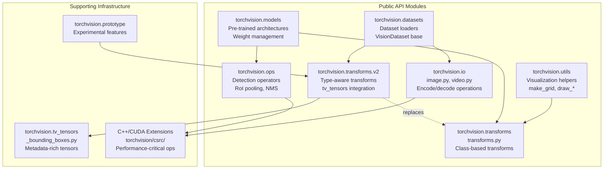

**Core Architecture Diagram**: Shows the seven main public modules and their relationships. Solid arrows indicate dependencies; dashed arrows indicate evolutionary relationships.

Sources: [torchvision/transforms/transforms.py:1-60](), [torchvision/transforms/v2/__init__.py](), [torchvision/models/__init__.py:1-14](), [torchvision/datasets/__init__.py:1-148](), [torchvision/io/__init__.py:1-58](), [torchvision/ops/__init__.py]()

## Module Overview

### Transform System

The transform system provides data augmentation and preprocessing capabilities through two APIs:

| Component | Module Path | Purpose |
|-----------|-------------|---------|
| **v1 Transforms** | `torchvision.transforms` | Legacy PIL/Tensor transforms with type dispatch |
| **v2 Transforms** | `torchvision.transforms.v2` | Type-aware transforms with kernel registry |
| **Functional API** | `torchvision.transforms.functional` | Stateless transform functions |
| **TV Tensors** | `torchvision.tv_tensors` | Metadata-preserving tensor subclasses |

**Key Classes**:
- `Compose`: Sequential transform application [torchvision/transforms/transforms.py:60-104]()
- `RandomHorizontalFlip`, `Resize`, `Normalize`: Common v1 transforms [torchvision/transforms/transforms.py:697-757]()
- Transform v2 variants with type awareness [torchvision/transforms/v2/_geometry.py]()

Sources: [torchvision/transforms/transforms.py:1-104](), [torchvision/transforms/functional.py:1-51](), [torchvision/tv_tensors/_tv_tensor.py]()

### Models System

Pre-trained model architectures organized by task:

| Task Category | Module | Example Models |
|---------------|--------|----------------|
| Classification | `torchvision.models` | ResNet, VGG, EfficientNet, ViT |
| Detection | `torchvision.models.detection` | Faster R-CNN, RetinaNet, FCOS |
| Segmentation | `torchvision.models.segmentation` | FCN, DeepLabV3, LRASPP |
| Video | `torchvision.models.video` | R3D, MC3, MViT |
| Optical Flow | `torchvision.models.optical_flow` | RAFT |

**Weight Management**: Each model has a `WeightsEnum` class (e.g., `ResNet50_Weights`) containing versioned weight sets with metadata including accuracy metrics, preprocessing transforms, and training details.

Sources: [torchvision/models/__init__.py:1-14](), [torchvision/models/_api.py:1-100](), [hubconf.py:1-50]()

### Datasets System

Built-in dataset loaders with automatic downloading:

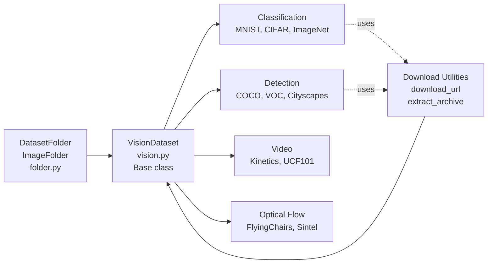

**Dataset Base Class**: All datasets inherit from `VisionDataset` which provides standard `__getitem__` and `__len__` interfaces compatible with PyTorch's DataLoader.

Sources: [torchvision/datasets/__init__.py:1-148](), [torchvision/datasets/vision.py](), [torchvision/datasets/folder.py]()

### I/O Operations

Efficient image and video encoding/decoding through C++ extensions:

**Image I/O Functions**:
- `read_image(path)`: Read and decode image files [torchvision/io/image.py:52-300]()
- `decode_jpeg(data, mode)`: JPEG decoding with CPU/CUDA support
- `decode_png(data, mode)`: PNG decoding
- `encode_jpeg(input, quality)`: JPEG encoding
- Format auto-detection via `decode_image(data)`

**Video I/O**: Functions for reading/writing video files (deprecated in favor of TorchCodec).

Sources: [torchvision/io/image.py:1-300](), [torchvision/io/__init__.py:1-58](), [torchvision/io/video.py]()

### Operators

Computer vision operations optimized with C++/CUDA:

**Detection Operators**:
- `nms`, `batched_nms`: Non-maximum suppression
- `roi_align`, `roi_pool`: Region of interest pooling
- `MultiScaleRoIAlign`: Multi-scale feature extraction

**Box Operations**:
- `box_iou`, `box_convert`: Bounding box utilities
- `clip_boxes`, `remove_small_boxes`: Box filtering
- `BoxCoder`: Encode/decode box deltas

**Layer Components**:
- `FrozenBatchNorm2d`: Batch normalization with frozen statistics
- `DeformConv2d`: Deformable convolutions
- `SqueezeExcitation`: Channel attention mechanism

Sources: [torchvision/ops/__init__.py](), [torchvision/ops/boxes.py](), [torchvision/ops/roi_align.py]()

## Data Pipeline Flow

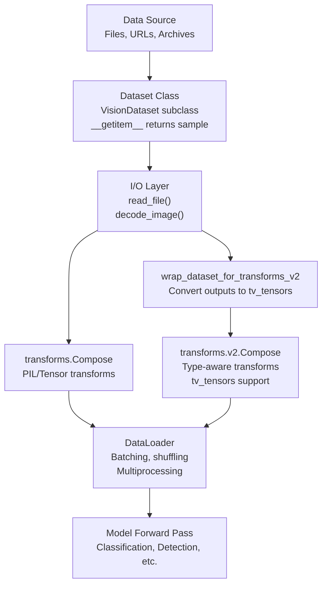

**Typical Usage Pattern**:

1. **Dataset Instantiation**: Create dataset with `root` directory and optional `download=True`
2. **Transform Application**: Apply preprocessing via `transform` parameter
3. **DataLoader Integration**: Wrap in `DataLoader` for batching and parallel loading
4. **Model Inference/Training**: Pass batched data to model

Sources: [torchvision/datasets/vision.py](), [torchvision/tv_tensors/_dataset_wrapper.py](), [test/test_datasets.py:1-50]()

## Build System and Extensions

TorchVision includes C++/CUDA extensions for performance-critical operations:

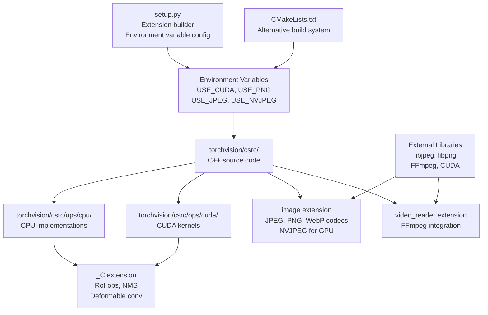

**Build Configuration**:

| Environment Variable | Default | Purpose |
|---------------------|---------|---------|
| `USE_CUDA` | Auto-detect | Enable CUDA operations |
| `USE_PNG` | `1` | Enable PNG codec support |
| `USE_JPEG` | `1` | Enable JPEG codec support |
| `USE_NVJPEG` | `1` | Enable NVJPEG GPU decoder |
| `FORCE_CUDA` | `0` | Force CUDA build |

**Extension Modules**:
- `torchvision._C`: Core operators (NMS, RoI operations) [setup.py:158-203]()
- `torchvision.image`: Image codecs with optional GPU support [setup.py:288-374]()
- `torchvision.video_reader`: CPU video decoder (FFmpeg-based) [setup.py:436-476]()

Sources: [setup.py:1-550](), [CMakeLists.txt:1-100](), [torchvision/csrc/]()

## Integration with PyTorch Ecosystem

### DataLoader Integration

TorchVision datasets implement `torch.utils.data.Dataset` interface:

```python
# All datasets provide __len__ and __getitem__
dataset = torchvision.datasets.CIFAR10(root='./data', train=True, download=True, transform=transform)
loader = torch.utils.data.DataLoader(dataset, batch_size=32, shuffle=True, num_workers=4)
```

Sources: [torchvision/datasets/vision.py](), [test/test_datasets.py:14-30]()

### TorchScript Compatibility

Most transforms and models support TorchScript compilation:

```python
# Transforms can be scripted
scripted_transform = torch.jit.script(transforms.Normalize(mean=[0.5], std=[0.5]))

# Models support scripting and tracing
model = torchvision.models.resnet50(weights=ResNet50_Weights.DEFAULT)
scripted_model = torch.jit.script(model)
```

Sources: [test/test_models.py:158-190](), [test/test_transforms.py:44-53]()

### ONNX Export Support

Detection models include custom ONNX symbolic functions for export compatibility:

- Custom operators registered via `_register_onnx_ops` mechanism
- Symbolic functions for `nms`, `roi_align`, `roi_pool` operations
- Model-specific export handling in detection module

Sources: [torchvision/onnx/](), test files referencing ONNX export

## File Organization

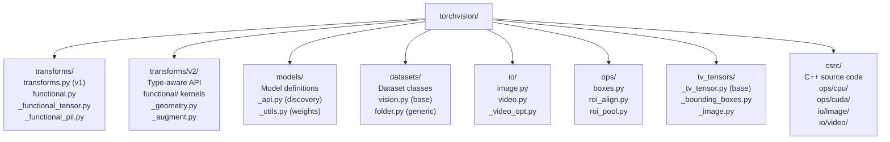

**Key Implementation Files**:

| File | Purpose | Lines of Code |
|------|---------|---------------|
| `transforms/transforms.py` | v1 transform classes | ~1500 |
| `transforms/functional.py` | Transform functional API | ~1200 |
| `transforms/v2/functional/_geometry.py` | v2 geometry kernels | ~2500 |
| `models/_api.py` | Model discovery/registration | ~300 |
| `io/image.py` | Image I/O interface | ~300 |
| `ops/boxes.py` | Bounding box operations | ~500 |
| `csrc/ops/` | C++/CUDA implementations | ~10000+ |

Sources: [torchvision/transforms/transforms.py:1-1500](), [torchvision/transforms/functional.py:1-1200](), [torchvision/models/_api.py:1-300]()

## Testing Infrastructure

TorchVision includes comprehensive testing with specialized utilities:

- **Transform Testing**: Cross-backend validation (PIL vs Tensor), gradient checks, scriptability
- **Model Testing**: Forward pass validation, TorchScript compatibility, FX tracing
- **Dataset Testing**: Fake data injection, integrity checking, v2 wrapper validation
- **Ops Testing**: CPU vs CUDA consistency, deterministic algorithms, gradient checks

**Test Utilities**: `common_utils.py` provides fixtures for device parametrization, RNG state management, and assertion helpers.

Sources: [test/common_utils.py:1-400](), [test/datasets_utils.py:1-200](), [test/test_transforms_v2.py:1-100]()

---

# Page: Transforms

# Transforms

<details>
<summary>Relevant source files</summary>

The following files were used as context for generating this wiki page:

- [test/assets/fakedata/draw_rotated_boxes.png](test/assets/fakedata/draw_rotated_boxes.png)
- [test/common_utils.py](test/common_utils.py)
- [test/test_functional_tensor.py](test/test_functional_tensor.py)
- [test/test_prototype_transforms.py](test/test_prototype_transforms.py)
- [test/test_transforms.py](test/test_transforms.py)
- [test/test_transforms_tensor.py](test/test_transforms_tensor.py)
- [test/test_transforms_v2.py](test/test_transforms_v2.py)
- [test/test_transforms_v2_utils.py](test/test_transforms_v2_utils.py)
- [test/test_tv_tensors.py](test/test_tv_tensors.py)
- [torchvision/ops/_box_convert.py](torchvision/ops/_box_convert.py)
- [torchvision/prototype/transforms/__init__.py](torchvision/prototype/transforms/__init__.py)
- [torchvision/prototype/transforms/_augment.py](torchvision/prototype/transforms/_augment.py)
- [torchvision/prototype/transforms/_geometry.py](torchvision/prototype/transforms/_geometry.py)
- [torchvision/prototype/transforms/_misc.py](torchvision/prototype/transforms/_misc.py)
- [torchvision/transforms/autoaugment.py](torchvision/transforms/autoaugment.py)
- [torchvision/transforms/functional.py](torchvision/transforms/functional.py)
- [torchvision/transforms/transforms.py](torchvision/transforms/transforms.py)
- [torchvision/transforms/v2/_geometry.py](torchvision/transforms/v2/_geometry.py)
- [torchvision/transforms/v2/functional/_geometry.py](torchvision/transforms/v2/functional/_geometry.py)
- [torchvision/transforms/v2/functional/_meta.py](torchvision/transforms/v2/functional/_meta.py)
- [torchvision/transforms/v2/functional/_utils.py](torchvision/transforms/v2/functional/_utils.py)
- [torchvision/tv_tensors/__init__.py](torchvision/tv_tensors/__init__.py)
- [torchvision/tv_tensors/_bounding_boxes.py](torchvision/tv_tensors/_bounding_boxes.py)

</details>


## Purpose and Scope

The Transforms system provides image augmentation and preprocessing operations for computer vision tasks. This page covers the architecture and APIs for applying transformations to images, videos, bounding boxes, masks, and other vision data types. 

For information about pre-trained model architectures, see [Models](#3). For dataset loading and integration with transforms, see [Datasets](#4). For prototype/experimental features, see [Prototype Transforms](#2.3).

The system has evolved through two major API versions:
- **v1 (Legacy)**: Simple class-based and functional APIs with PIL/Tensor backend dispatch
- **v2 (Modern)**: Type-aware transformations with kernel registry and metadata preservation via `tv_tensors`

## System Architecture

The transforms system consists of three primary components: the v1 legacy API, the v2 modern API with kernel dispatch, and the tv_tensors metadata system.

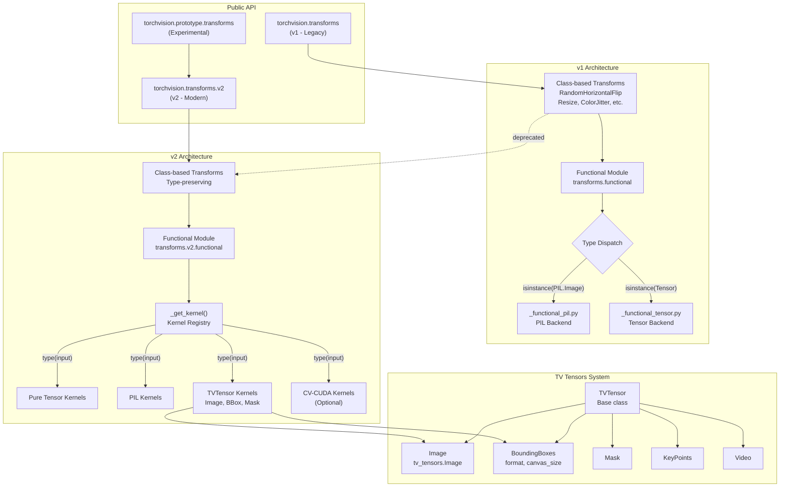

**Sources:** [torchvision/transforms/transforms.py:1-2500](), [torchvision/transforms/functional.py:1-1500](), [torchvision/transforms/v2/functional/_geometry.py:1-200](), [torchvision/transforms/v2/functional/_utils.py:1-200]()

## Core Transform Classes

The transforms module provides both class-based and functional interfaces. The class-based transforms are stateful and can be composed together, while functional transforms are stateless operations.

### Class-Based Transform Hierarchy

```mermaid
graph TB
    TRANSFORM["Transform<br/>(v2 base class)"]
    TORCH_MODULE["torch.nn.Module<br/>(v1 base class)"]
    
    subgraph "Geometric Transforms"
        RESIZE["Resize"]
        CROP["RandomCrop"]
        HFLIP["RandomHorizontalFlip"]
        VFLIP["RandomVerticalFlip"]
        ROTATE["RandomRotation"]
        AFFINE["RandomAffine"]
        PERSPECTIVE["RandomPerspective"]
    end
    
    subgraph "Color Transforms"
        JITTER["ColorJitter"]
        GRAYSCALE["RandomGrayscale"]
        POSTERIZE["RandomPosterize"]
        SOLARIZE["RandomSolarize"]
        AUTOCONTRAST["RandomAutocontrast"]
        EQUALIZE["RandomEqualize"]
    end
    
    subgraph "Augmentation Policies"
        AUTOAUGMENT["AutoAugment"]
        RANDAUGMENT["RandAugment"]
        TRIVIALAUGMENT["TrivialAugmentWide"]
        AUGMIX["AugMix"]
    end
    
    subgraph "Utility Transforms"
        COMPOSE["Compose"]
        TOTENSOR["ToTensor"]
        PILTOTENSOR["PILToTensor"]
        NORMALIZE["Normalize"]
        CONVERT_DTYPE["ConvertImageDtype"]
    end
    
    TRANSFORM --> RESIZE
    TRANSFORM --> CROP
    TRANSFORM --> HFLIP
    TRANSFORM --> VFLIP
    
    TORCH_MODULE --> JITTER
    TORCH_MODULE --> NORMALIZE
    
    AUTOAUGMENT --> RANDAUGMENT
```

**Sources:** [torchvision/transforms/transforms.py:60-1500](), [torchvision/transforms/v2/_geometry.py:1-2000](), [torchvision/transforms/autoaugment.py:1-600]()

## Transform v1 (Legacy API)

### Dispatch Mechanism

The v1 API uses a simple type-based dispatch to route operations to either PIL or tensor implementations:

| Input Type | Dispatch Target | Implementation File |
|------------|-----------------|---------------------|
| `PIL.Image.Image` | PIL backend | `_functional_pil.py` |
| `torch.Tensor` | Tensor backend | `_functional_tensor.py` |
| `accimage.Image` | AccImage backend | Special handling in functional |

The dispatch logic occurs in [torchvision/transforms/functional.py:66-480](), where functions like `resize()`, `crop()`, and `pad()` check the input type and call the appropriate backend:

```python
def resize(img, size, interpolation, max_size, antialias):
    if not isinstance(img, torch.Tensor):
        # PIL path
        return F_pil.resize(img, size=output_size, interpolation=pil_interpolation)
    # Tensor path
    return F_t.resize(img, size=output_size, interpolation=interpolation.value, antialias=antialias)
```

**Sources:** [torchvision/transforms/functional.py:387-480](), [torchvision/transforms/_functional_pil.py:1-500](), [torchvision/transforms/_functional_tensor.py:1-1000]()

### Common v1 Transforms

The following table lists key v1 transform classes:

| Transform Class | Purpose | Key Parameters | Functional Equivalent |
|----------------|---------|----------------|----------------------|
| `ToTensor` | Convert PIL/ndarray to float tensor [0,1] | None | `F.to_tensor()` |
| `PILToTensor` | Convert PIL to tensor (no scaling) | None | `F.pil_to_tensor()` |
| `ToPILImage` | Convert tensor/ndarray to PIL | `mode` | `F.to_pil_image()` |
| `Normalize` | Normalize with mean/std | `mean`, `std`, `inplace` | `F.normalize()` |
| `Resize` | Resize to given size | `size`, `interpolation`, `max_size`, `antialias` | `F.resize()` |
| `CenterCrop` | Crop at center | `size` | `F.center_crop()` |
| `RandomCrop` | Random crop | `size`, `padding`, `pad_if_needed` | `F.crop()` |
| `RandomHorizontalFlip` | Random horizontal flip | `p` | `F.hflip()` |
| `RandomVerticalFlip` | Random vertical flip | `p` | `F.vflip()` |
| `ColorJitter` | Random brightness, contrast, saturation, hue | `brightness`, `contrast`, `saturation`, `hue` | Multiple functionals |
| `RandomRotation` | Random rotation | `degrees`, `interpolation`, `expand`, `center`, `fill` | `F.rotate()` |
| `RandomAffine` | Random affine transformation | `degrees`, `translate`, `scale`, `shear` | `F.affine()` |
| `Compose` | Compose transforms sequentially | `transforms` | N/A |
| `Lambda` | Apply custom function | `lambd` | N/A |

**Sources:** [torchvision/transforms/transforms.py:60-1500]()

## Transform v2 (Modern API)

The v2 API introduces a sophisticated kernel registry system that enables type-aware transformations and metadata preservation.

### Kernel Registry Architecture

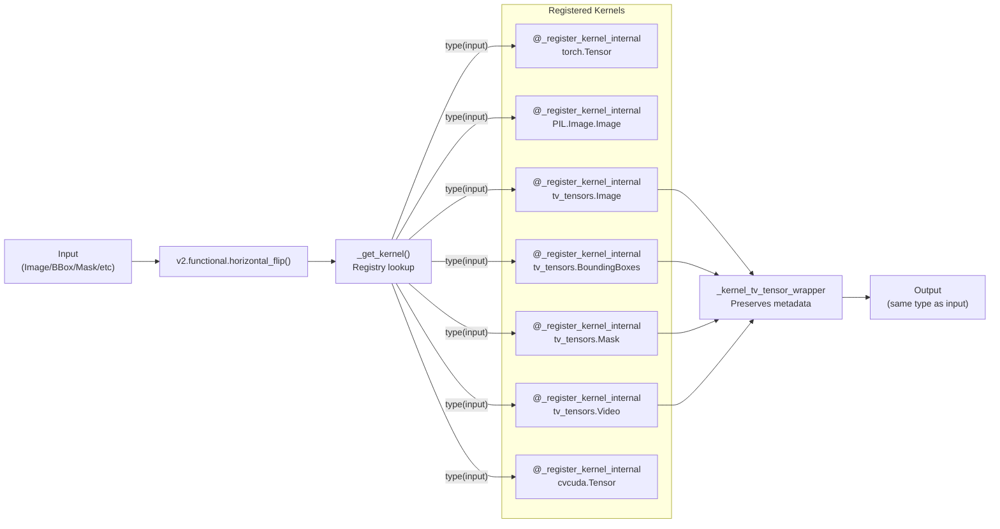

The kernel registration mechanism in [torchvision/transforms/v2/functional/_utils.py:16-60]() works as follows:

1. **Registration**: Kernels are registered using the `@_register_kernel_internal()` decorator
2. **Lookup**: `_get_kernel(functional, type(input))` retrieves the appropriate kernel
3. **Wrapping**: TV tensor kernels are wrapped to preserve metadata via `_kernel_tv_tensor_wrapper()`
4. **Dispatch**: The kernel is called with the input converted to a pure tensor

**Sources:** [torchvision/transforms/v2/functional/_utils.py:1-150](), [torchvision/transforms/v2/functional/_geometry.py:54-150]()

### Transform v2 vs v1 Comparison

| Aspect | v1 (Legacy) | v2 (Modern) |
|--------|-------------|-------------|
| Input types | PIL, Tensor | PIL, Tensor, tv_tensors |
| Type preservation | No | Yes (via `tv_tensors.wrap()`) |
| Metadata handling | Lost | Preserved (format, canvas_size, etc.) |
| Kernel dispatch | Simple isinstance check | Registry with MRO lookup |
| Bounding box support | No native support | Full support with format conversion |
| Video support | Limited | First-class support |
| Extensibility | Hard to extend | Easy via kernel registration |
| TorchScript support | Partial | Enhanced |
| Backend options | PIL, Tensor | PIL, Tensor, CV-CUDA |

**Sources:** [torchvision/transforms/functional.py:387-600](), [torchvision/transforms/v2/functional/_geometry.py:54-200]()

### Key v2 Functionals by Category

**Geometric Transformations:**
- `horizontal_flip()` - [torchvision/transforms/v2/functional/_geometry.py:54-148]()
- `vertical_flip()` - [torchvision/transforms/v2/functional/_geometry.py:150-200]()
- `resize()` - [torchvision/transforms/v2/functional/_geometry.py:200-500]()
- `rotate()` - [torchvision/transforms/v2/functional/_geometry.py:500-800]()
- `affine()` - [torchvision/transforms/v2/functional/_geometry.py:800-1200]()
- `perspective()` - [torchvision/transforms/v2/functional/_geometry.py:1200-1500]()
- `crop()` - Crop operations
- `pad()` - Padding operations

**Metadata Operations:**
- `get_dimensions()` - [torchvision/transforms/v2/functional/_meta.py:22-52]()
- `get_size()` - [torchvision/transforms/v2/functional/_meta.py:90-130]()
- `get_num_channels()` - [torchvision/transforms/v2/functional/_meta.py:54-88]()
- `convert_bounding_box_format()` - Format conversion
- `clamp_bounding_boxes()` - Clamp to canvas

**Sources:** [torchvision/transforms/v2/functional/_geometry.py:1-2000](), [torchvision/transforms/v2/functional/_meta.py:1-400]()

## TV Tensors System

TV Tensors are metadata-rich tensor subclasses that preserve semantic information through transformations.

### TVTensor Hierarchy

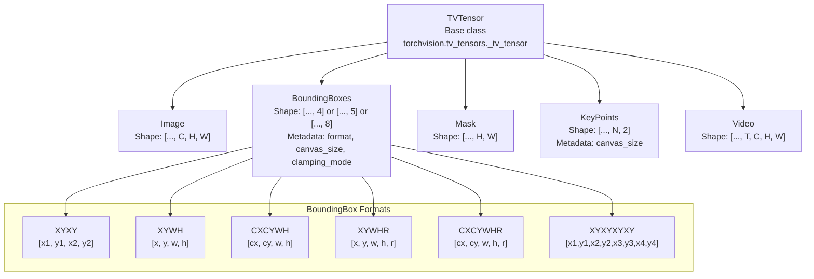

### BoundingBoxes Metadata

The `BoundingBoxes` class stores critical metadata:

| Attribute | Type | Purpose | Example |
|-----------|------|---------|---------|
| `format` | `BoundingBoxFormat` | Coordinate format | `BoundingBoxFormat.XYXY` |
| `canvas_size` | `tuple[int, int]` | Image dimensions (H, W) | `(480, 640)` |
| `clamping_mode` | `str` or `None` | How to handle out-of-bounds | `"soft"`, `"hard"`, `None` |

Format conversions are handled by `convert_bounding_box_format()` which understands all six formats defined in [torchvision/tv_tensors/_bounding_boxes.py:14-56]():

- `XYXY`: Top-left and bottom-right corners
- `XYWH`: Top-left corner, width, height
- `CXCYWH`: Center, width, height
- `XYWHR`: Top-left corner, width, height, rotation angle (degrees)
- `CXCYWHR`: Center, width, height, rotation angle (degrees)
- `XYXYXYXY`: Four corners (for rotated boxes)

**Sources:** [torchvision/tv_tensors/_bounding_boxes.py:1-200](), [torchvision/tv_tensors/_tv_tensor.py:1-300](), [torchvision/tv_tensors/__init__.py:1-50]()

### Metadata Preservation Pattern

The `tv_tensors.wrap()` function preserves metadata through transformations:

```python
# In kernel implementation
def horizontal_flip_bounding_boxes_dispatch(inpt: tv_tensors.BoundingBoxes):
    output = horizontal_flip_bounding_boxes(
        inpt.as_subclass(torch.Tensor),  # Convert to pure tensor
        format=inpt.format,               # Extract metadata
        canvas_size=inpt.canvas_size
    )
    return tv_tensors.wrap(output, like=inpt)  # Restore metadata
```

This pattern is used throughout [torchvision/transforms/v2/functional/_geometry.py:96-143]().

**Sources:** [torchvision/tv_tensors/__init__.py:16-50](), [torchvision/transforms/v2/functional/_utils.py:20-36]()

## Prototype Transforms

Experimental transforms are located in `torchvision.prototype.transforms` and provide advanced functionality not yet stabilized in the main API.

### Prototype Transform Catalog

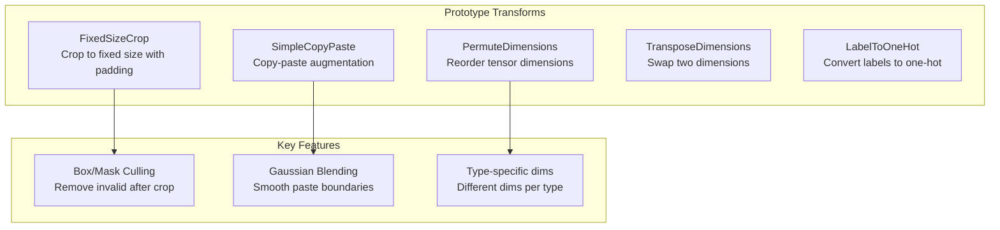

### FixedSizeCrop

Located in [torchvision/prototype/transforms/_geometry.py:22-136](), `FixedSizeCrop` crops images to a fixed size and handles undersized images by padding:

**Key Features:**
- Crops to `(crop_height, crop_width)` if image is larger
- Pads with `padding_mode` if image is smaller
- Automatically culls invalid bounding boxes (width or height ≤ 0)
- Preserves labels/masks for valid boxes only

**Validity Check:** After cropping, boxes are checked via format conversion to XYWH and testing if `height_and_width > 0` ([lines 88-93]()).

### SimpleCopyPaste

Located in [torchvision/prototype/transforms/_augment.py:15-160](), this implements copy-paste augmentation for object detection:

**Algorithm:**
1. Extract images and targets (boxes, masks, labels) from batch
2. Randomly select objects from paste image
3. Resize if source and paste have different sizes
4. Create alpha mask from paste masks (with optional Gaussian blur)
5. Blend images: `output = image * (1 - alpha) + paste_image * alpha`
6. Merge masks, boxes, and labels
7. Remove degenerate boxes

**Sources:** [torchvision/prototype/transforms/_augment.py:1-160](), [torchvision/prototype/transforms/_geometry.py:1-136](), [torchvision/prototype/transforms/_misc.py:1-70]()

## AutoAugment Policies

AutoAugment and related policies provide learned augmentation strategies.

### Policy Architecture

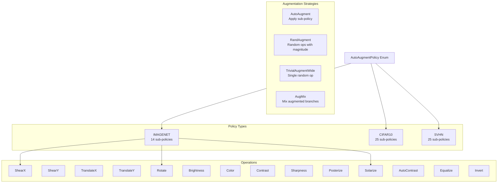

### Operation Implementation

All operations are dispatched through `_apply_op()` in [torchvision/transforms/autoaugment.py:13-150]():

| Operation | Implementation | Parameters |
|-----------|---------------|------------|
| ShearX/Y | `F.affine()` with shear | `magnitude` → arctan(magnitude) |
| TranslateX/Y | `F.affine()` with translate | `magnitude` in pixels |
| Rotate | `F.affine()` with angle | `magnitude` in degrees |
| Brightness | `F.adjust_brightness()` | `magnitude` as factor |
| Color | `F.adjust_saturation()` | `magnitude` as factor |
| Contrast | `F.adjust_contrast()` | `magnitude` as factor |
| Sharpness | `F.adjust_sharpness()` | `magnitude` as factor |
| Posterize | `F.posterize()` | `magnitude` as bits |
| Solarize | `F.solarize()` | `magnitude` as threshold |
| AutoContrast | `F.autocontrast()` | No magnitude |
| Equalize | `F.equalize()` | No magnitude |
| Invert | `F.invert()` | No magnitude |

**Sources:** [torchvision/transforms/autoaugment.py:1-600]()

## Transform Composition and Utilities

### Compose

The `Compose` class chains transforms sequentially:

```python
transforms.Compose([
    transforms.Resize(256),
    transforms.CenterCrop(224),
    transforms.ToTensor(),
    transforms.Normalize(mean=[0.485, 0.456, 0.406], std=[0.229, 0.224, 0.225])
])
```

Implementation in [torchvision/transforms/transforms.py:60-104]() simply iterates through transforms.

### RandomApply, RandomChoice, RandomOrder

| Transform | Behavior | Key Parameter |
|-----------|----------|---------------|
| `RandomApply` | Apply list of transforms with probability `p` | `p` (float) |
| `RandomChoice` | Apply single randomly chosen transform | `p` (optional weights) |
| `RandomOrder` | Apply transforms in random order | None |

**Sources:** [torchvision/transforms/transforms.py:518-587]()

### Type Conversion Utilities

| Function | Input | Output | Purpose |
|----------|-------|--------|---------|
| `to_tensor()` | PIL/ndarray (uint8) | float32 Tensor [0,1] | Convert and scale |
| `pil_to_tensor()` | PIL | uint8 Tensor | Convert without scaling |
| `to_pil_image()` | Tensor/ndarray | PIL Image | Convert to PIL |
| `convert_image_dtype()` | Tensor | Tensor (new dtype) | Change dtype with scaling |

Channel ordering:
- PIL/ndarray: `(H, W, C)`
- Tensor: `(C, H, W)`

**Sources:** [torchvision/transforms/functional.py:127-324]()

## Testing Infrastructure

The transforms system has comprehensive testing across multiple dimensions:

### Test Coverage Matrix

| Test Type | v1 Coverage | v2 Coverage | Key Files |
|-----------|-------------|-------------|-----------|
| Functional ops | ✓ | ✓ | `test_functional_tensor.py` |
| Class transforms | ✓ | ✓ | `test_transforms.py`, `test_transforms_v2.py` |
| Type preservation | - | ✓ | `test_transforms_v2.py` |
| Kernel dispatch | - | ✓ | `test_transforms_v2.py` |
| Scripting | ✓ | ✓ | Both test files |
| Batched inputs | ✓ | ✓ | Both test files |
| PIL vs Tensor | ✓ | ✓ | `test_functional_tensor.py` |
| Device (CPU/CUDA) | ✓ | ✓ | Parametrized tests |
| Prototype transforms | - | ✓ | `test_prototype_transforms.py` |

### Test Utilities

Helper functions from [test/common_utils.py:1-550]():

- `make_image()` - Create test images
- `make_bounding_boxes()` - Create test bounding boxes
- `make_keypoints()` - Create test keypoints
- `make_detection_masks()` - Create test masks
- `assert_close()` - Compare outputs with tolerance
- `freeze_rng_state()` - Reproducible randomness

### Validation Patterns

Key validation patterns in [test/test_transforms_v2.py:164-424]():

1. **Kernel checks**: `check_kernel()` validates:
   - No in-place operations (`input._version` unchanged)
   - Output dtype matches input dtype
   - Output device matches input device
   - CUDA vs CPU consistency
   - Scripted vs eager consistency
   - Batched vs unbatched consistency

2. **Functional checks**: `check_functional()` validates:
   - Raises TypeError on unknown input
   - API usage logging
   - Output type matches input type
   - BoundingBox format preservation

3. **Transform checks**: `check_transform()` validates:
   - Pickleable
   - Output type matches input type
   - v1 compatibility (if `_v1_transform_cls` defined)
   - Sample input handling

**Sources:** [test/test_transforms_v2.py:164-424](), [test/common_utils.py:227-423]()

## Interpolation Modes

All resize, rotate, and affine operations support configurable interpolation:

| Mode | v1 Enum | PIL Constant | Use Case |
|------|---------|--------------|----------|
| NEAREST | `InterpolationMode.NEAREST` | 0 | Fast, blocky |
| NEAREST_EXACT | `InterpolationMode.NEAREST_EXACT` | 0 | PyTorch exact semantics |
| BILINEAR | `InterpolationMode.BILINEAR` | 2 | Good quality/speed |
| BICUBIC | `InterpolationMode.BICUBIC` | 3 | High quality |
| BOX | `InterpolationMode.BOX` | 4 | PIL only |
| HAMMING | `InterpolationMode.HAMMING` | 5 | PIL only |
| LANCZOS | `InterpolationMode.LANCZOS` | 1 | Highest quality |

The `InterpolationMode` enum is defined in [torchvision/transforms/functional.py:23-37]() and mapping to PIL constants in [lines 53-61]().

**Sources:** [torchvision/transforms/functional.py:23-61](), [torchvision/transforms/v2/functional/_geometry.py:43-52]()

---

# Page: Transforms v1

# Transforms v1

<details>
<summary>Relevant source files</summary>

The following files were used as context for generating this wiki page:

- [test/test_functional_tensor.py](test/test_functional_tensor.py)
- [test/test_transforms.py](test/test_transforms.py)
- [test/test_transforms_tensor.py](test/test_transforms_tensor.py)
- [torchvision/transforms/autoaugment.py](torchvision/transforms/autoaugment.py)
- [torchvision/transforms/functional.py](torchvision/transforms/functional.py)
- [torchvision/transforms/transforms.py](torchvision/transforms/transforms.py)

</details>


## Purpose and Scope

Transforms v1 is the legacy image transformation API in torchvision, providing a dual interface for image preprocessing and augmentation. This system operates on both PIL Images and PyTorch Tensors, dispatching operations to appropriate backend implementations. While still maintained, it has been superseded by transforms v2 for advanced use cases requiring type-aware transformations and metadata preservation. For the modern API with support for bounding boxes, masks, and videos, see [Transforms v2](#2.2).

This document covers:
- The class-based and functional transform APIs
- Type-based dispatch mechanism to PIL and Tensor backends
- Common transformation operations (geometric, photometric, composition)
- AutoAugment policy implementations

Sources: [torchvision/transforms/transforms.py:1-57](), [torchvision/transforms/functional.py:1-20]()

## Architecture Overview

The transforms v1 system consists of three layers: a user-facing class-based API, a functional API with type dispatch, and backend-specific implementations.

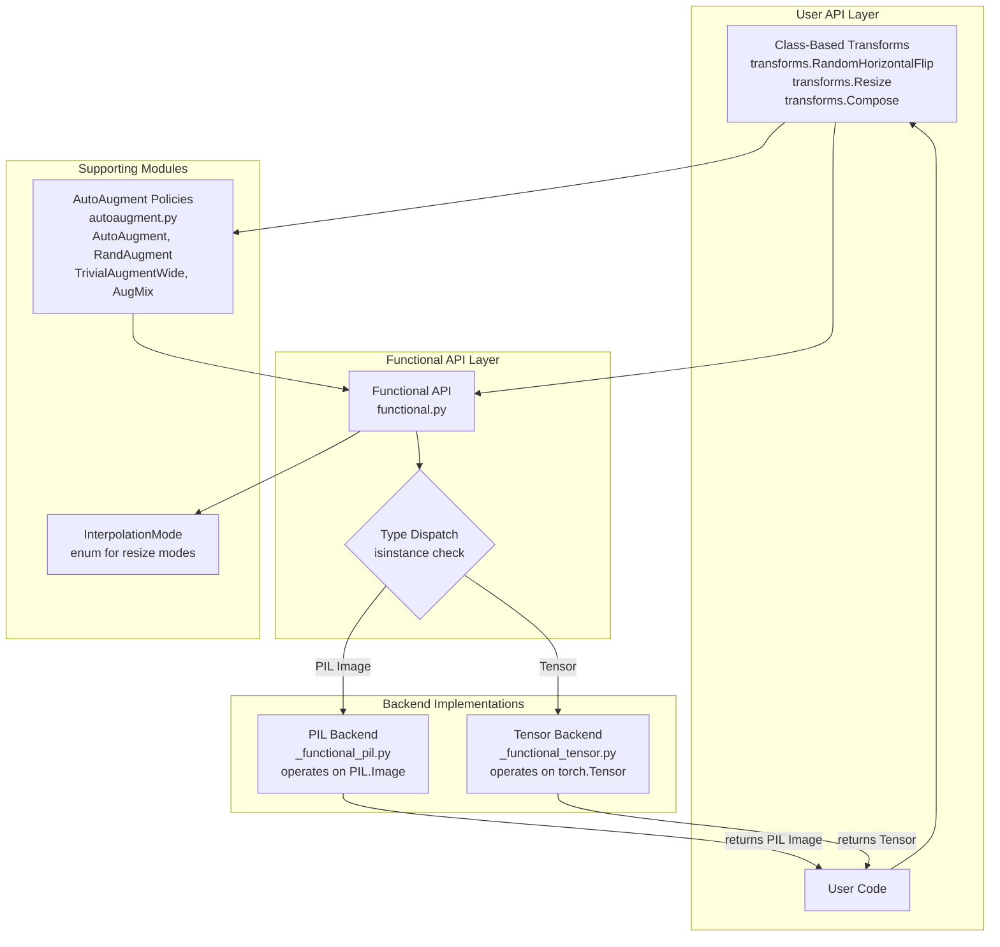

**Dispatch Logic**: The functional API in [torchvision/transforms/functional.py]() checks the input type using `isinstance(img, torch.Tensor)` and routes to the appropriate backend. This allows the same function signature to support both PIL Images and PyTorch Tensors transparently.

Sources: [torchvision/transforms/functional.py:63-98](), [torchvision/transforms/transforms.py:1-105]()

## Class-Based Transforms API

The class-based API provides callable transform objects that can be composed into pipelines. Each transform is a class that implements `__call__` and optionally `forward` for `torch.nn.Module` subclasses.

### Transform Categories

| Category | Transforms | Description |
|----------|-----------|-------------|
| **Conversion** | `ToTensor`, `PILToTensor`, `ToPILImage`, `ConvertImageDtype` | Convert between PIL Images, Tensors, and dtypes |
| **Geometric** | `Resize`, `CenterCrop`, `RandomCrop`, `RandomResizedCrop`, `Pad`, `RandomHorizontalFlip`, `RandomVerticalFlip`, `RandomRotation`, `RandomAffine`, `RandomPerspective`, `FiveCrop`, `TenCrop` | Spatial transformations |
| **Photometric** | `ColorJitter`, `Grayscale`, `RandomGrayscale`, `GaussianBlur`, `RandomInvert`, `RandomPosterize`, `RandomSolarize`, `RandomAdjustSharpness`, `RandomAutocontrast`, `RandomEqualize` | Color and intensity transformations |
| **Normalization** | `Normalize`, `LinearTransformation` | Statistical normalization |
| **Augmentation** | `RandomErasing`, `AutoAugment`, `RandAugment`, `TrivialAugmentWide`, `AugMix`, `ElasticTransform` | Advanced augmentation strategies |
| **Composition** | `Compose`, `RandomApply`, `RandomChoice`, `RandomOrder`, `Lambda` | Transform pipeline utilities |

### Base Transform Pattern

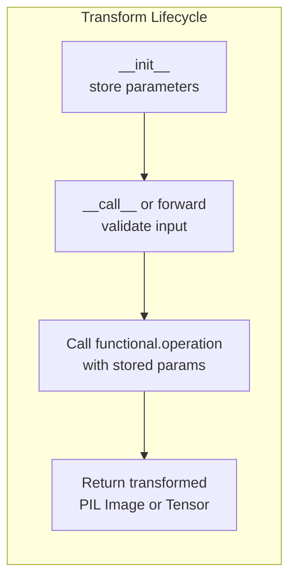

Most transforms follow this pattern from [torchvision/transforms/transforms.py:291-367]():

1. **Initialization**: Store transformation parameters (e.g., `size`, `interpolation`, `fill`)
2. **Call/Forward**: Validate input and delegate to functional API
3. **Return**: Preserve input type (PIL Image returns PIL Image, Tensor returns Tensor)

Sources: [torchvision/transforms/transforms.py:20-57](), [torchvision/transforms/transforms.py:107-289]()

## Functional API and Dispatch Mechanism

The functional API provides stateless transformation functions that dispatch to backend implementations based on input type. This design enables the class-based API to remain backend-agnostic.

### Dispatch Pattern

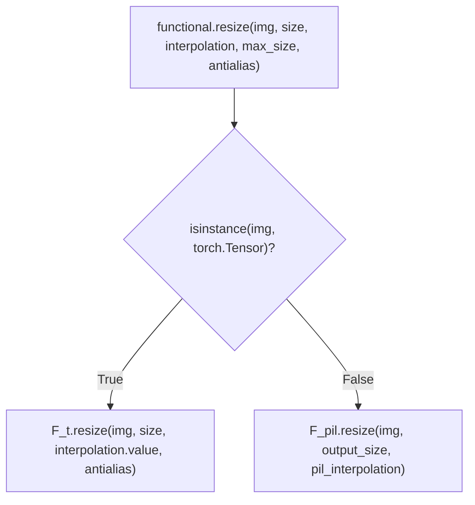

**Example**: The `resize` function in [torchvision/transforms/functional.py:387-479]() demonstrates the dispatch pattern:

```python
def resize(img, size, interpolation, max_size, antialias):
    # ... validation and size computation ...
    if not isinstance(img, torch.Tensor):
        # PIL path: convert interpolation enum to PIL constant
        pil_interpolation = pil_modes_mapping[interpolation]
        return F_pil.resize(img, size=output_size, interpolation=pil_interpolation)
    # Tensor path: use native tensor operations
    return F_t.resize(img, size=output_size, interpolation=interpolation.value, antialias=antialias)
```

### Key Functional Operations

| Function | Purpose | Dispatches To |
|----------|---------|---------------|
| `to_tensor` | Convert PIL/ndarray to Tensor, scale [0,255]→[0.0,1.0] | PIL only (no dispatch) |
| `pil_to_tensor` | Convert PIL to Tensor without scaling | PIL only |
| `to_pil_image` | Convert Tensor/ndarray to PIL Image | Manual conversion |
| `normalize` | Statistical normalization with mean/std | Tensor only |
| `resize` | Resize image to target size | Both backends |
| `crop` | Crop rectangular region | Both backends |
| `hflip`, `vflip` | Horizontal/vertical flip | Both backends |
| `rotate` | Rotate by angle with interpolation | Both backends |
| `affine` | Apply affine transformation | Both backends |
| `adjust_brightness`, `adjust_contrast`, etc. | Photometric adjustments | Both backends |

Sources: [torchvision/transforms/functional.py:127-243](), [torchvision/transforms/functional.py:387-754]()

## Backend Implementations

The backend implementations in `_functional_pil.py` and `_functional_tensor.py` provide the actual transformation logic for their respective input types.

### PIL Backend (`_functional_pil.py`)

- Operates on `PIL.Image.Image` objects
- Uses PIL's built-in transformation methods
- Handles color mode conversions (RGB, L, LA, RGBA, etc.)
- Example: `resize` uses `PIL.Image.resize()` with Pillow interpolation constants

### Tensor Backend (`_functional_tensor.py`)

- Operates on `torch.Tensor` objects with shape `[C, H, W]` or `[..., C, H, W]`
- Implements transformations using PyTorch operations
- Supports batched operations (leading dimensions preserved)
- Supports GPU acceleration
- Example: `resize` uses `torch.nn.functional.interpolate()`

### Backend Compatibility

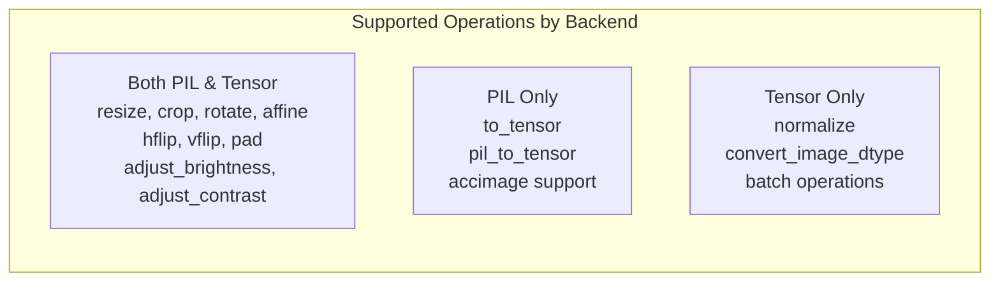

**Note**: The tensor backend generally provides better performance and GPU support, while the PIL backend may have slightly different numerical results due to implementation differences.

Sources: [torchvision/transforms/functional.py:63-115](), [test/test_functional_tensor.py:36-52]()

## Common Transform Operations

### Geometric Transforms

**Resize**: Resizes image to target size while optionally preserving aspect ratio.

Key parameters from [torchvision/transforms/transforms.py:291-367]():
- `size`: int (smaller edge) or `(h, w)` tuple
- `max_size`: Optional maximum for longer edge when `size` is int
- `interpolation`: `InterpolationMode` enum (NEAREST, BILINEAR, BICUBIC)
- `antialias`: Enable antialiasing for tensor backend (default True in v0.17+)

**RandomCrop**: Extracts random crops from images with optional padding.

From [torchvision/transforms/transforms.py:589-695]():
- Uses `get_params` static method to generate random crop coordinates
- Supports `pad_if_needed` to ensure minimum image size
- Padding modes: constant, edge, reflect, symmetric

**RandomResizedCrop**: Combines random crop with resize for training data augmentation.

From [test/test_transforms.py:309-334]():
- Samples crop with random scale and aspect ratio
- Common for training classification models (e.g., ImageNet preprocessing)

### Photometric Transforms

**ColorJitter**: Randomly changes brightness, contrast, saturation, and hue.

Parameters from [torchvision/transforms/transforms.py:1196-1382]():
- Each parameter can be float (symmetric range) or tuple (min, max)
- Operations applied in random order
- Example: `brightness=0.2` allows adjustment in range [0.8, 1.2]

**AutoAugment Family**: Policy-based augmentation strategies.

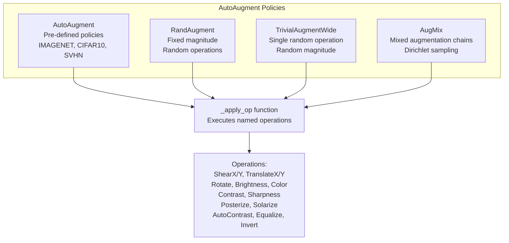

Sources: [torchvision/transforms/autoaugment.py:1-91](), [torchvision/transforms/autoaugment.py:104-285]()

### Conversion Transforms

**ToTensor**: Converts PIL Image or ndarray to float Tensor with value scaling.

From [torchvision/transforms/transforms.py:107-141]():
- Converts `[H, W, C]` layout to `[C, H, W]`
- Scales uint8 values from [0, 255] to [0.0, 1.0]
- Uses `torch.get_default_dtype()` for output dtype
- Note: Not suitable for target masks (use `PILToTensor` instead)

**PILToTensor**: Converts PIL Image to Tensor without value scaling.

From [torchvision/transforms/transforms.py:143-178]():
- Preserves original dtype and value range
- Performs deep copy of underlying array
- Appropriate for masks, labels, and other discrete data

**ConvertImageDtype**: Converts Tensor dtype with appropriate value scaling.

From [torchvision/transforms/transforms.py:180-207]():
- Scales values when converting between int/float types
- Example: uint8 [0, 255] → float32 [0.0, 1.0]
- Raises error for unsafe conversions (e.g., float32 → int32)

Sources: [torchvision/transforms/functional.py:127-244](), [test/test_transforms.py:42-154]()

## AutoAugment Policies

AutoAugment and related methods implement learned augmentation strategies from research papers. These transforms combine multiple operations with learned or stochastic parameters.

### Policy Structure

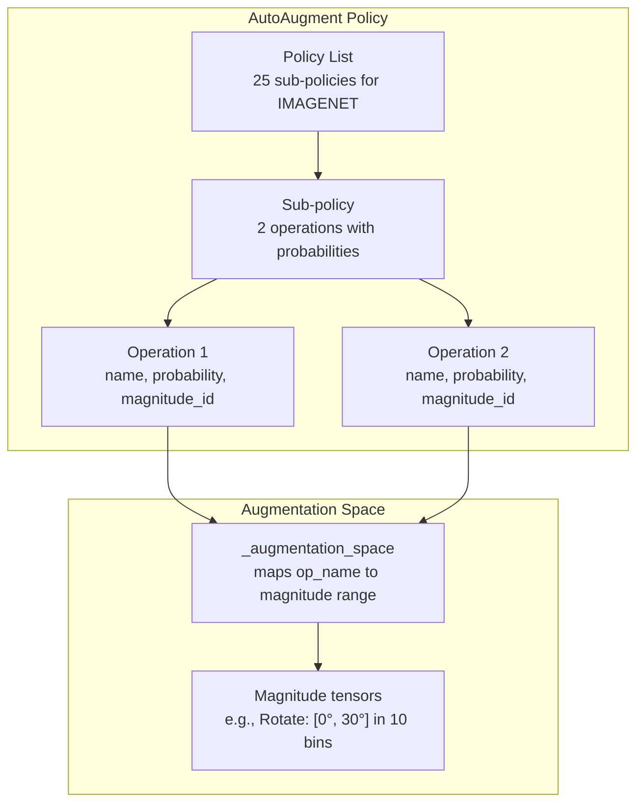

### Implementation Details

**AutoAugment** [torchvision/transforms/autoaugment.py:104-285]():
- Three pre-defined policies: IMAGENET, CIFAR10, SVHN
- Each policy has 25 sub-policies with 2 operations each
- Operations have associated probability and discrete magnitude level
- Example sub-policy: `(("Posterize", 0.4, 8), ("Rotate", 0.6, 9))`

**RandAugment** [torchvision/transforms/autoaugment.py:287-378]():
- Simplified approach with fixed magnitude across operations
- Parameters: `num_ops` (operations per image), `magnitude` (0-30 scale)
- Randomly selects operations from augmentation space
- More efficient than AutoAugment (no policy search needed)

**TrivialAugmentWide** [torchvision/transforms/autoaugment.py:380-463]():
- Simplest approach: single random operation per image
- Randomly samples both operation and magnitude
- Wider magnitude ranges than RandAugment
- Surprisingly effective despite simplicity

**AugMix** [torchvision/transforms/autoaugment.py:466-616]():
- Creates multiple augmentation chains
- Mixes original and augmented images using Dirichlet distribution
- Parameters: `severity`, `mixture_width`, `chain_depth`, `alpha`
- Improves robustness and uncertainty estimation

### Operation Space

The `_apply_op` function [torchvision/transforms/autoaugment.py:13-90]() implements the following operations:

| Operation | Description | Magnitude Range |
|-----------|-------------|-----------------|
| ShearX/Y | Shear transformation | 0.0 to 0.3 (AutoAugment) or 0.99 (TrivialAugment) |
| TranslateX/Y | Pixel translation | Image-size dependent |
| Rotate | Rotation angle | 0° to 30° (AutoAugment) or 135° (TrivialAugment) |
| Brightness | Brightness adjustment | 0.0 to 0.9 additive |
| Color | Saturation adjustment | 0.0 to 0.9 additive |
| Contrast | Contrast adjustment | 0.0 to 0.9 additive |
| Sharpness | Sharpness adjustment | 0.0 to 0.9 additive |
| Posterize | Bit reduction | 4-8 bits |
| Solarize | Invert above threshold | 0-255 threshold |
| AutoContrast | Normalize histogram | No magnitude |
| Equalize | Equalize histogram | No magnitude |
| Invert | Invert colors | No magnitude |

Sources: [torchvision/transforms/autoaugment.py:13-90](), [torchvision/transforms/autoaugment.py:223-240]()

## Compose and Transform Composition

The `Compose` transform chains multiple transforms into a sequential pipeline.

### Basic Composition

From [torchvision/transforms/transforms.py:60-105]():

```python
transforms.Compose([
    transforms.RandomResizedCrop(224),
    transforms.RandomHorizontalFlip(),
    transforms.ToTensor(),
    transforms.Normalize((0.485, 0.456, 0.406), (0.229, 0.224, 0.225))
])
```

**Implementation**: Compose stores a list of transforms and applies them sequentially in `__call__`. Each transform's output becomes the next transform's input.

### Advanced Composition Transforms

**RandomApply** [torchvision/transforms/transforms.py:518-559]():
- Applies a list of transforms with probability `p`
- If not applied, returns input unchanged
- Can be scripted using `torch.nn.ModuleList`

**RandomChoice** [torchvision/transforms/transforms.py:572-587]():
- Randomly selects one transform from a list
- Optional probability weights for each transform
- Useful for mutually exclusive augmentations

**RandomOrder** [torchvision/transforms/transforms.py:561-570]():
- Applies transforms in random order
- Shuffles transform list for each image
- Not TorchScript compatible

**Lambda** [torchvision/transforms/transforms.py:473-491]():
- Wraps arbitrary callable as transform
- Useful for custom operations
- Not TorchScript compatible

Sources: [torchvision/transforms/transforms.py:60-105](), [torchvision/transforms/transforms.py:493-587]()

## TorchScript Support

Many v1 transforms support TorchScript compilation for deployment, though with limitations.

### TorchScript-Compatible Transforms

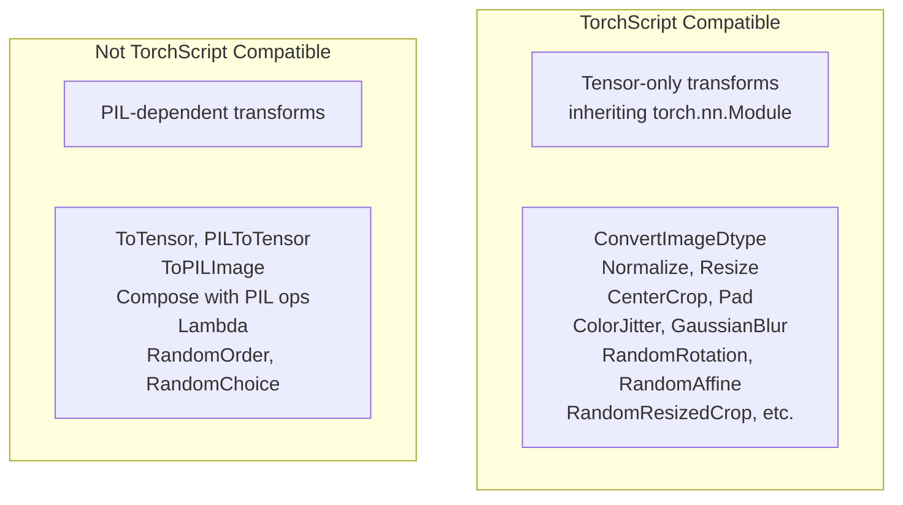

### Usage Pattern

From [torchvision/transforms/transforms.py:75-85]():

```python
# For TorchScript, use torch.nn.Sequential instead of Compose
transforms = torch.nn.Sequential(
    transforms.CenterCrop(10),
    transforms.Normalize((0.485, 0.456, 0.406), (0.229, 0.224, 0.225)),
)
scripted_transforms = torch.jit.script(transforms)
```

**Requirements** [test/test_transforms_tensor.py:31-52]():
1. Only operate on Tensors (no PIL Images)
2. Avoid `lambda` functions
3. Use `torch.nn.ModuleList` for containers
4. Handle int parameters as sequences in TorchScript mode (e.g., `size=[32]` instead of `size=32`)

**Testing**: The test suite [test/test_transforms_tensor.py]() extensively validates TorchScript equivalence by comparing scripted and non-scripted transform outputs.

Sources: [torchvision/transforms/transforms.py:75-85](), [test/test_transforms_tensor.py:31-93]()

## Interpolation Modes

The `InterpolationMode` enum defines interpolation methods for geometric transforms.

### Available Modes

From [torchvision/transforms/functional.py:23-37]():

| Mode | Description | Tensor Support | PIL Support |
|------|-------------|----------------|-------------|
| `NEAREST` | Nearest neighbor | ✓ | ✓ |
| `NEAREST_EXACT` | Exact nearest (pixel center) | ✓ | ✓ |
| `BILINEAR` | Bilinear interpolation | ✓ | ✓ |
| `BICUBIC` | Bicubic interpolation | ✓ | ✓ |
| `BOX` | Box filter | ✗ | ✓ |
| `HAMMING` | Hamming window | ✗ | ✓ |
| `LANCZOS` | Lanczos resampling | ✗ | ✓ |

**Legacy Support**: Integer constants (0, 1, 2, 3, 4, 5) from PIL are converted to InterpolationMode using `_interpolation_modes_from_int` [torchvision/transforms/functional.py:41-50]().

**Antialias Parameter**: For tensor backend with BILINEAR or BICUBIC, the `antialias` parameter controls antialiasing during downsampling. Default changed from `None` to `True` in v0.17 for consistency [torchvision/transforms/transforms.py:318-335]().

Sources: [torchvision/transforms/functional.py:23-61](), [test/test_functional_tensor.py:447-499]()

---

# Page: Transforms v2

# Transforms v2

<details>
<summary>Relevant source files</summary>

The following files were used as context for generating this wiki page:

- [test/assets/fakedata/draw_rotated_boxes.png](test/assets/fakedata/draw_rotated_boxes.png)
- [test/common_utils.py](test/common_utils.py)
- [test/test_transforms_v2.py](test/test_transforms_v2.py)
- [test/test_transforms_v2_utils.py](test/test_transforms_v2_utils.py)
- [test/test_tv_tensors.py](test/test_tv_tensors.py)
- [torchvision/ops/_box_convert.py](torchvision/ops/_box_convert.py)
- [torchvision/transforms/v2/_geometry.py](torchvision/transforms/v2/_geometry.py)
- [torchvision/transforms/v2/functional/_geometry.py](torchvision/transforms/v2/functional/_geometry.py)
- [torchvision/transforms/v2/functional/_meta.py](torchvision/transforms/v2/functional/_meta.py)
- [torchvision/transforms/v2/functional/_utils.py](torchvision/transforms/v2/functional/_utils.py)
- [torchvision/tv_tensors/__init__.py](torchvision/tv_tensors/__init__.py)
- [torchvision/tv_tensors/_bounding_boxes.py](torchvision/tv_tensors/_bounding_boxes.py)

</details>


## Purpose and Scope

Transforms v2 is a modern, type-aware transformation system that extends the legacy transforms API with support for metadata-rich tensor types. Unlike v1 transforms that primarily handle PIL images and plain tensors, v2 provides seamless transformation of detection and segmentation data structures while preserving critical metadata such as bounding box formats, canvas sizes, and coordinate systems.

For information about the legacy transforms API, see [2.1](#2.1). For details on the tv_tensors system that underpins v2, see [2.4](#2.4). For experimental transforms, see [2.3](#2.3).

Sources: [torchvision/transforms/v2/__init__.py:1-50](), Diagram 2 from high-level architecture

## Architecture Overview

The transforms v2 system is built around three core architectural components: a kernel dispatch registry, type-aware transform classes, and functional implementations for each supported input type.

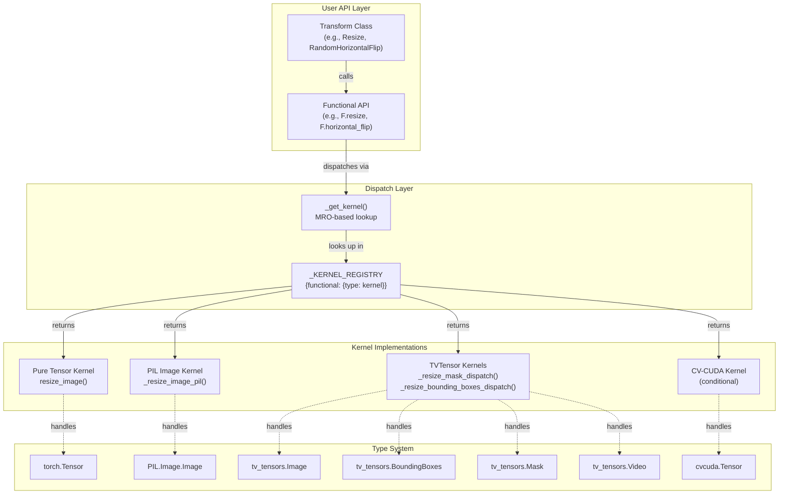

Sources: [torchvision/transforms/v2/functional/_utils.py:16-120](), [torchvision/transforms/v2/functional/_geometry.py:54-82](), [torchvision/transforms/v2/_geometry.py:36-76]()

### Transform Execution Flow

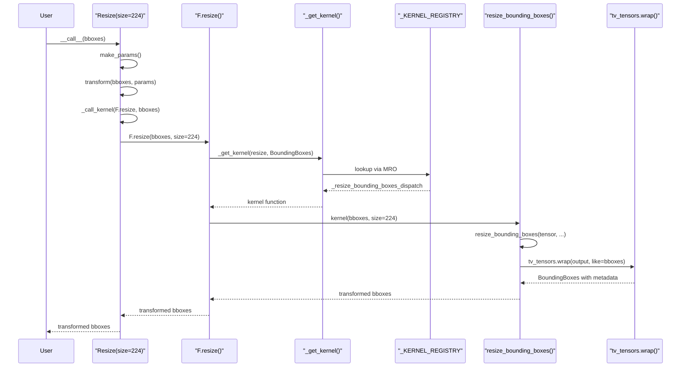

Sources: [torchvision/transforms/v2/_transform.py:1-100](), [torchvision/transforms/v2/functional/_geometry.py:265-280](), [test/test_transforms_v2.py:406-423]()

## Kernel Registry System

The kernel registry is the central mechanism for type-aware dispatch in transforms v2. It maps each functional operation to a dictionary of type-specific kernel implementations.

### Registration Mechanism

Kernels are registered using the `@_register_kernel_internal` decorator, which associates a kernel implementation with a specific input type:

```mermaid
graph LR
    subgraph "Registration Process"
        Decorator["@_register_kernel_internal<br/>(functional, input_type)"]
        KernelFunc["Kernel Implementation<br/>horizontal_flip_image()"]
        Registry["_KERNEL_REGISTRY<br/>{horizontal_flip: {...}}"]
    end
    
    subgraph "Registered Mappings"
        TorchMapping["torch.Tensor → horizontal_flip_image"]
        PILMapping["PIL.Image.Image → _horizontal_flip_image_pil"]
        ImageMapping["tv_tensors.Image → horizontal_flip_image"]
        MaskMapping["tv_tensors.Mask → horizontal_flip_mask"]
        BBoxMapping["tv_tensors.BoundingBoxes → _horizontal_flip_bounding_boxes_dispatch"]
        CVCUDAMapping["cvcuda.Tensor → _horizontal_flip_image_cvcuda"]
    end
    
    Decorator -->|"registers"| KernelFunc
    KernelFunc -->|"stored in"| Registry
    Registry -->|"contains"| TorchMapping
    Registry -->|"contains"| PILMapping
    Registry -->|"contains"| ImageMapping
    Registry -->|"contains"| MaskMapping
    Registry -->|"contains"| BBoxMapping
    Registry -->|"contains"| CVCUDAMapping
```

The registry is implemented as a nested dictionary structure:

| Component | Type | Description |
|-----------|------|-------------|
| `_KERNEL_REGISTRY` | `dict[Callable, dict[type, Callable]]` | Top-level registry mapping functionals to type dictionaries |
| First key | `Callable` | Functional operation (e.g., `horizontal_flip`) |
| Second key | `type` | Input type (e.g., `torch.Tensor`, `tv_tensors.Image`) |
| Value | `Callable` | Type-specific kernel implementation |

Sources: [torchvision/transforms/v2/functional/_utils.py:16-52](), [torchvision/transforms/v2/functional/_geometry.py:65-100]()

### MRO-Based Dispatch

The `_get_kernel()` function traverses the Method Resolution Order (MRO) of the input type to find the most specific registered kernel:

```mermaid
graph TB
    Input["Input: tv_tensors.BoundingBoxes"]
    GetKernel["_get_kernel(functional, BoundingBoxes)"]
    MRO["MRO Traversal:<br/>BoundingBoxes → TVTensor → Tensor"]
    
    CheckBBox{"BoundingBoxes<br/>in registry?"}
    CheckTVTensor{"TVTensor<br/>in registry?"}
    StopAtTVTensor["Stop: Don't dispatch<br/>to pure Tensor kernels"]
    ReturnKernel["Return BoundingBoxes<br/>kernel"]
    RaiseError["Raise TypeError:<br/>No kernel found"]
    
    Input --> GetKernel
    GetKernel --> MRO
    MRO --> CheckBBox
    CheckBBox -->|"Yes"| ReturnKernel
    CheckBBox -->|"No"| CheckTVTensor
    CheckTVTensor -->|"Yes (parent class)"| StopAtTVTensor
    StopAtTVTensor --> RaiseError
```

The MRO traversal explicitly stops at `tv_tensors.TVTensor` to prevent user-defined TVTensor subclasses from inadvertently dispatching to pure tensor kernels, which would lose metadata.

Sources: [torchvision/transforms/v2/functional/_utils.py:99-119](), [test/test_transforms_v2.py:206-224]()

### TVTensor Kernel Wrapper

TVTensor kernels are automatically wrapped with `_kernel_tv_tensor_wrapper()` to handle metadata preservation:

```mermaid
graph LR
    subgraph "Without Wrapper (Pure Tensor)"
        Input1["BoundingBoxes<br/>format=XYXY<br/>canvas_size=(224,224)"]
        Kernel1["resize_bounding_boxes<br/>(pure tensor logic)"]
        Output1["torch.Tensor<br/>(metadata lost)"]
        Input1 --> Kernel1 --> Output1
    end
    
    subgraph "With Wrapper (TVTensor)"
        Input2["BoundingBoxes<br/>format=XYXY<br/>canvas_size=(224,224)"]
        AsSubclass["as_subclass(torch.Tensor)"]
        Kernel2["resize_bounding_boxes<br/>(pure tensor logic)"]
        Wrap["tv_tensors.wrap(output, like=input)"]
        Output2["BoundingBoxes<br/>format=XYXY<br/>canvas_size=(448,448)"]
        Input2 --> AsSubclass --> Kernel2 --> Wrap --> Output2
    end
```

Sources: [torchvision/transforms/v2/functional/_utils.py:20-36](), [torchvision/transforms/v2/functional/_geometry.py:419-425](), [torchvision/tv_tensors/__init__.py:16-40]()

## Supported Input Types

Transforms v2 supports six primary input types, each with specialized kernel implementations:

| Input Type | Class | Metadata | Primary Use Case |
|------------|-------|----------|------------------|
| Pure Tensor | `torch.Tensor` | None | Raw image data, generic tensors |
| PIL Image | `PIL.Image.Image` | Mode (RGB, L, etc.) | Legacy PIL workflows |
| Image | `tv_tensors.Image` | None | Type-safe image representation |
| Video | `tv_tensors.Video` | None | Video frame sequences |
| Mask | `tv_tensors.Mask` | None | Segmentation masks |
| BoundingBoxes | `tv_tensors.BoundingBoxes` | `format`, `canvas_size`, `clamping_mode` | Object detection |
| KeyPoints | `tv_tensors.KeyPoints` | `canvas_size` | Keypoint detection |
| CV-CUDA Tensor | `cvcuda.Tensor` | Layout (NHWC) | GPU-accelerated processing |

Sources: [torchvision/transforms/v2/functional/_utils.py:12-14](), [torchvision/tv_tensors/__init__.py:1-40](), [torchvision/transforms/v2/functional/_geometry.py:38-82]()

### Type-Specific Behaviors

Different input types require different kernel implementations due to their underlying representations:

```mermaid
graph TB
    subgraph "horizontal_flip Implementation Variants"
        TensorImpl["horizontal_flip_image<br/>image.flip(-1)"]
        PILImpl["_horizontal_flip_image_pil<br/>_FP.hflip(image)"]
        BBoxImpl["horizontal_flip_bounding_boxes<br/>Mirror coordinates<br/>Format-aware logic"]
        KeyPointsImpl["horizontal_flip_keypoints<br/>keypoints[..., 0] = canvas_size[1] - 1 - keypoints[..., 0]"]
        CVCUDAImpl["_horizontal_flip_image_cvcuda<br/>cvcuda.flip(image, flipCode=1)"]
    end
    
    TensorInput["torch.Tensor"] --> TensorImpl
    PILInput["PIL.Image.Image"] --> PILImpl
    BBoxInput["tv_tensors.BoundingBoxes"] --> BBoxImpl
    KeyPointsInput["tv_tensors.KeyPoints"] --> KeyPointsImpl
    CVCUDAInput["cvcuda.Tensor"] --> CVCUDAImpl
```

For geometric transforms like `horizontal_flip`, the coordinate transformation logic differs by format:

| Format | Coordinate Transformation |
|--------|---------------------------|
| `XYXY` | `x' = canvas_size[1] - x`, swap x1 and x2 |
| `XYWH` | `x' = canvas_size[1] - x - width` |
| `CXCYWH` | `cx' = canvas_size[1] - cx` |
| `XYXYXYXY` | `x' = canvas_size[1] - x` for all 4 x-coordinates |
| `XYWHR` / `CXCYWHR` | Transform center point, negate angle |

Sources: [torchvision/transforms/v2/functional/_geometry.py:102-143](), [test/test_transforms_v2.py:501-641]()

## Transform Classes

All v2 transforms inherit from the `Transform` base class, which provides the infrastructure for parameter generation, kernel dispatching, and sample handling.

```mermaid
graph TB
    Transform["Transform (Base)"]
    RandomApply["_RandomApplyTransform"]
    
    Resize["Resize"]
    CenterCrop["CenterCrop"]
    Pad["Pad"]
    RandomCrop["RandomResizedCrop"]
    
    RandomHFlip["RandomHorizontalFlip"]
    RandomVFlip["RandomVerticalFlip"]
    RandomRotation["RandomRotation"]
    RandomAffine["RandomAffine"]
    
    Transform --> Resize
    Transform --> CenterCrop
    Transform --> Pad
    Transform --> RandomCrop
    
    Transform --> RandomApply
    RandomApply --> RandomHFlip
    RandomApply --> RandomVFlip
    RandomApply --> RandomRotation
    RandomApply --> RandomAffine
```

### Core Transform Methods

Each transform implements these key methods:

| Method | Purpose | Required |
|--------|---------|----------|
| `__init__()` | Store transform parameters | Yes |
| `make_params()` | Generate random parameters per sample | For random transforms |
| `transform()` | Apply transformation to single input | Yes |
| `_call_kernel()` | Dispatch to appropriate kernel | Yes (inherited) |
| `check_inputs()` | Validate input compatibility | Optional |

Sources: [torchvision/transforms/v2/_transform.py:1-150](), [torchvision/transforms/v2/_geometry.py:36-177]()

### Example: Resize Transform

The `Resize` transform demonstrates the standard pattern:

```mermaid
graph LR
    Init["__init__<br/>Store size, interpolation,<br/>max_size, antialias"]
    Transform["transform()<br/>Call _call_kernel"]
    CallKernel["_call_kernel<br/>(F.resize, inpt, ...)"]
    Functional["F.resize()"]
    Kernel["resize_image() or<br/>resize_bounding_boxes() or<br/>..."]
    
    Init --> Transform
    Transform --> CallKernel
    CallKernel --> Functional
    Functional --> Kernel
```

The `Resize` class stores parameters and delegates to the functional API:

- **Parameters**: `size` (int, sequence, or None), `interpolation`, `max_size`, `antialias`
- **Supported inputs**: All image-like types, bounding boxes, masks, keypoints, videos
- **Behavior**: Resizes to specified size, optionally constraining longer edge with `max_size`
- **Kernel dispatch**: Different kernels for images, masks, bounding boxes, and keypoints

Sources: [torchvision/transforms/v2/_geometry.py:78-177](), [torchvision/transforms/v2/functional/_geometry.py:265-603]()

### Sample Input Handling

Transforms can process complex nested structures (dicts, lists, tuples) containing multiple input types:

```mermaid
graph TB
    Sample["Sample (dict)"]
    Image["'image': tv_tensors.Image"]
    BBox["'boxes': tv_tensors.BoundingBoxes"]
    Labels["'labels': torch.Tensor"]
    
    Transform["transform(sample)"]
    TreeFlatten["tree_flatten(sample)"]
    NeedsList["_needs_transform_list()"]
    
    TransformImage["Transform image"]
    TransformBBox["Transform boxes"]
    PassLabels["Pass through labels"]
    
    TreeUnflatten["tree_unflatten(output)"]
    Output["Transformed Sample"]
    
    Sample --> Image
    Sample --> BBox
    Sample --> Labels
    
    Sample --> Transform
    Transform --> TreeFlatten
    TreeFlatten --> NeedsList
    
    NeedsList --> TransformImage
    NeedsList --> TransformBBox
    NeedsList --> PassLabels
    
    TransformImage --> TreeUnflatten
    TransformBBox --> TreeUnflatten
    PassLabels --> TreeUnflatten
    
    TreeUnflatten --> Output
```

The `_needs_transform_list()` method determines which inputs should be transformed:

| Input Type | Transformed? |
|------------|--------------|
| `tv_tensors.Image` | ✓ |
| `tv_tensors.Video` | ✓ |
| `tv_tensors.BoundingBoxes` | ✓ |
| `tv_tensors.Mask` | ✓ |
| `tv_tensors.KeyPoints` | ✓ |
| `PIL.Image.Image` | ✓ |
| Pure `torch.Tensor` | ✓ |
| `cvcuda.Tensor` | ✓ (if available) |
| `int`, `float`, `str`, `Path` | ✗ (pass through) |

Sources: [test/test_transforms_v2.py:356-404](), [torchvision/transforms/v2/_transform.py:1-100]()

## Functional API

The functional API provides direct access to transformation operations without instantiating transform classes. Each functional operation follows a consistent pattern:

```mermaid
graph LR
    subgraph "Functional Call"
        FuncCall["F.horizontal_flip(inpt)"]
        LogUsage["_log_api_usage_once()"]
        GetKernel["_get_kernel(horizontal_flip, type(inpt))"]
        Kernel["Kernel implementation"]
        FuncCall --> LogUsage
        LogUsage --> GetKernel
        GetKernel --> Kernel
    end
    
    subgraph "Available Functionals"
        Geometry["F.resize<br/>F.horizontal_flip<br/>F.vertical_flip<br/>F.rotate<br/>F.affine<br/>F.perspective"]
        Color["F.adjust_brightness<br/>F.adjust_contrast<br/>F.adjust_saturation<br/>F.adjust_hue"]
        Conversion["F.to_dtype<br/>F.to_pil_image<br/>F.to_image"]
        Meta["F.get_size<br/>F.get_dimensions<br/>F.get_num_channels"]
    end
```

### Functional-Kernel Correspondence

Each transform class has a corresponding functional operation:

| Transform Class | Functional | Primary Kernels |
|-----------------|------------|-----------------|
| `Resize` | `F.resize` | `resize_image`, `resize_bounding_boxes`, `resize_keypoints`, `resize_mask` |
| `RandomHorizontalFlip` | `F.horizontal_flip` | `horizontal_flip_image`, `horizontal_flip_bounding_boxes`, `horizontal_flip_keypoints` |
| `CenterCrop` | `F.center_crop` | `center_crop_image`, `center_crop_bounding_boxes` |
| `Pad` | `F.pad` | `pad_image`, `pad_bounding_boxes` |
| `RandomAffine` | `F.affine` | `affine_image`, `affine_bounding_boxes`, `affine_keypoints` |

Sources: [torchvision/transforms/v2/functional/__init__.py:1-100](), [torchvision/transforms/v2/functional/_geometry.py:54-280]()

### Direct Functional Usage

Functionals can be used directly for imperative-style transformations:

```python
# Functional API usage (from test examples)
import torchvision.transforms.v2.functional as F

# Single operation
output = F.resize(image, size=[224, 224], antialias=True)

# Chained operations
output = F.horizontal_flip(image)
output = F.adjust_brightness(output, brightness_factor=1.2)
output = F.to_pil_image(output)
```

Sources: [test/test_transforms_v2.py:817-828](), [torchvision/transforms/v2/functional/_geometry.py:265-280]()

## Metadata Preservation

A key feature of transforms v2 is automatic preservation of metadata through transformation pipelines. This is critical for detection and segmentation tasks where coordinate systems and format information must remain consistent.

### BoundingBoxes Metadata Flow

```mermaid
graph TB
    subgraph "Input"
        InputBBox["BoundingBoxes<br/>data: [[10, 20, 100, 150]]<br/>format: XYXY<br/>canvas_size: (224, 224)<br/>clamping_mode: 'soft'"]
    end
    
    subgraph "Transform Application"
        AsSubclass["as_subclass(torch.Tensor)<br/>Strip TVTensor type"]
        Kernel["resize_bounding_boxes()<br/>Scale coordinates<br/>Update canvas_size"]
        Wrap["tv_tensors.wrap()<br/>Restore TVTensor type"]
    end
    
    subgraph "Output"
        OutputBBox["BoundingBoxes<br/>data: [[20, 40, 200, 300]]<br/>format: XYXY (preserved)<br/>canvas_size: (448, 448) (updated)<br/>clamping_mode: 'soft' (preserved)"]
    end
    
    InputBBox --> AsSubclass
    AsSubclass --> Kernel
    Kernel --> Wrap
    Wrap --> OutputBBox
```

The metadata preservation mechanism works as follows:

1. **Extraction**: Input TVTensor is converted to plain tensor via `as_subclass(torch.Tensor)`
2. **Transformation**: Pure tensor logic operates on data without metadata overhead
3. **Restoration**: `tv_tensors.wrap(output, like=input)` reconstructs TVTensor with updated metadata

Sources: [torchvision/transforms/v2/functional/_utils.py:20-36](), [torchvision/transforms/v2/functional/_geometry.py:579-592](), [torchvision/tv_tensors/__init__.py:16-40]()

### Metadata Update Strategies

Different metadata fields follow different update strategies during transformations:

| Metadata | Transform Type | Update Strategy |
|----------|----------------|-----------------|
| `format` | All geometric | **Preserved** (except `ConvertBoundingBoxFormat`) |
| `canvas_size` | Resize, Crop | **Updated** to new image dimensions |
| `canvas_size` | Flip, Rotate | **Preserved** (dimensions don't change) |
| `clamping_mode` | All | **Preserved** |
| KeyPoints `canvas_size` | Resize, Crop | **Updated** to match transformed image |

### Format-Aware Transformations

Bounding box transformations must account for the coordinate format:

```mermaid
graph TB
    Input["Input: BoundingBoxes<br/>format can be XYXY, XYWH, CXCYWH,<br/>XYXYXYXY, XYWHR, CXCYWHR"]
    
    CheckRotated{"Is format<br/>rotated?"}
    
    StandardPath["Standard Path:<br/>Apply affine to 4 corners<br/>(x1,y1) (x2,y1) (x1,y2) (x2,y2)<br/>Compute AABB"]
    
    RotatedPath["Rotated Path:<br/>Convert to XYXYXYXY<br/>Apply affine to 4 corners<br/>Reconstruct parallelogram<br/>Convert back to original format"]
    
    Output["Output: BoundingBoxes<br/>Same format as input<br/>Updated coordinates"]
    
    Input --> CheckRotated
    CheckRotated -->|"No"| StandardPath
    CheckRotated -->|"Yes"| RotatedPath
    StandardPath --> Output
    RotatedPath --> Output
```

Sources: [torchvision/transforms/v2/functional/_geometry.py:523-592](), [torchvision/tv_tensors/_bounding_boxes.py:14-60](), [test/test_transforms_v2.py:501-641]()

### Clamping Modes

The `clamping_mode` parameter controls how bounding boxes are handled when they extend beyond canvas boundaries:

| Mode | Behavior |
|------|----------|
| `"soft"` | Clamp coordinates to canvas bounds, potentially changing box aspect ratio |
| `"hard"` | For rotated boxes: find largest inscribed box within canvas that preserves angle |
| `None` | No clamping applied; boxes may extend beyond canvas |

Sources: [torchvision/tv_tensors/_bounding_boxes.py:59-98](), [torchvision/transforms/v2/functional/_meta.py:368-521]()

## V1 Compatibility

Transforms v2 maintains compatibility with the v1 API through the `_v1_transform_cls` attribute and shared `get_params` implementations.

### Compatibility Bridge

```mermaid
graph LR
    subgraph "V2 Transform"
        V2Class["Resize (v2)<br/>torchvision.transforms.v2"]
        V2GetParams["get_params<br/>(if defined)"]
        V2Transform["transform()<br/>Uses F.resize"]
    end
    
    subgraph "V1 Transform"
        V1Attr["_v1_transform_cls<br/>= transforms.Resize"]
        V1Class["Resize (v1)<br/>torchvision.transforms"]
        V1GetParams["get_params<br/>(same instance)"]
    end
    
    subgraph "Testing"
        TestV1Compat["_check_transform_v1_compatibility<br/>Compare v1 and v2 outputs"]
    end
    
    V2Class -->|"references"| V1Attr
    V1Attr --> V1Class
    V2GetParams -.->|"is"| V1GetParams
    
    TestV1Compat -->|"extracts params"| V2Class
    TestV1Compat -->|"creates"| V1Class
    TestV1Compat -->|"compares outputs"| V2Class
```

### Shared Parameter Generation

For transforms with random behavior, v2 classes reuse v1's `get_params` method:

```python
# Example from RandomAffine (conceptual)
class RandomAffine(Transform):
    _v1_transform_cls = _transforms.RandomAffine
    
    # This is the actual v1 get_params method, not a copy
    get_params = _transforms.RandomAffine.get_params
```

This ensures:
- Identical random parameter generation between v1 and v2
- Single source of truth for parameter logic
- Backward compatibility for users migrating from v1

Sources: [test/test_transforms_v2.py:258-286](), [torchvision/transforms/v2/_geometry.py:36-76]()

### Parameter Extraction for V1

The `_extract_params_for_v1_transform()` method converts v2 parameters to v1-compatible format:

```mermaid
graph TB
    V2Params["V2 Transform Parameters<br/>May include type-specific fill values,<br/>complex padding modes"]
    
    Extract["_extract_params_for_v1_transform()"]
    
    CheckFill{"fill is<br/>dict or<br/>complex?"}
    
    RaiseError["Raise ValueError:<br/>Can only script scalar fill"]
    
    V1Params["V1-Compatible Parameters<br/>Scalar fill values only"]
    
    V2Params --> Extract
    Extract --> CheckFill
    CheckFill -->|"Yes"| RaiseError
    CheckFill -->|"No"| V1Params
```

Sources: [torchvision/transforms/v2/_geometry.py:468-474]()

### Testing Strategy

V1 compatibility is validated through automated testing:

| Test | Purpose |
|------|---------|
| `_check_transform_v1_compatibility` | Ensures v1 and v2 produce identical outputs for same inputs |
| `get_params` identity check | Verifies v2 uses actual v1 `get_params`, not a copy |
| Scriptability check | Confirms v1 transform can be TorchScript compiled |

Sources: [test/test_transforms_v2.py:258-286](), [test/test_transforms_v2.py:406-423]()

## CV-CUDA Integration

Transforms v2 provides experimental support for NVIDIA CV-CUDA, enabling GPU-accelerated image processing operations on `cvcuda.Tensor` inputs.

### Conditional Registration

```mermaid
graph TB
    Import["Import Check"]
    Available{"_is_cvcuda_available()"}
    
    Register["Register CV-CUDA Kernels<br/>_register_kernel_internal<br/>(func, cvcuda.Tensor)"]
    
    Skip["Skip Registration<br/>CV-CUDA not available"]
    
    Kernels["CV-CUDA Kernel Functions<br/>_horizontal_flip_image_cvcuda<br/>_vertical_flip_image_cvcuda<br/>_resize_image_cvcuda"]
    
    Import --> Available
    Available -->|"True"| Register
    Available -->|"False"| Skip
    Register --> Kernels
```

CV-CUDA kernels are conditionally registered at module import time:

```python
# Pattern used in functional/_geometry.py
CVCUDA_AVAILABLE = _is_cvcuda_available()

if CVCUDA_AVAILABLE:
    _register_kernel_internal(horizontal_flip, _import_cvcuda().Tensor)(
        _horizontal_flip_image_cvcuda
    )
```

Sources: [torchvision/transforms/v2/functional/_geometry.py:38-82](), [torchvision/transforms/v2/functional/_utils.py:145-180]()

### Layout Considerations

CV-CUDA tensors use NHWC (batch, height, width, channels) layout, different from PyTorch's NCHW:

| Operation | PyTorch Layout | CV-CUDA Layout |
|-----------|----------------|----------------|
| `get_size()` | `shape[-2:]` | `shape[-3:-1]` |
| Channel dimension | `shape[-3]` | `shape[-1]` |
| Batch dimension | `shape[:-3]` | `shape[0]` |

Sources: [torchvision/transforms/v2/functional/_meta.py:117-129](), [common_utils.py:294-306]()

### Transform Class Support

Transform classes opt-in to CV-CUDA support by extending `_transformed_types`:

```python
# Example from RandomHorizontalFlip
class RandomHorizontalFlip(_RandomApplyTransform):
    if CVCUDA_AVAILABLE:
        _transformed_types = _RandomApplyTransform._transformed_types + (_is_cvcuda_tensor,)
```

This allows the transform to identify and process CV-CUDA tensors in sample dictionaries.

Sources: [torchvision/transforms/v2/_geometry.py:48-54](), [torchvision/transforms/v2/_transform.py:1-100]()

---

# Page: Prototype Transforms

# Prototype Transforms

<details>
<summary>Relevant source files</summary>

The following files were used as context for generating this wiki page:

- [test/test_prototype_transforms.py](test/test_prototype_transforms.py)
- [torchvision/prototype/transforms/__init__.py](torchvision/prototype/transforms/__init__.py)
- [torchvision/prototype/transforms/_augment.py](torchvision/prototype/transforms/_augment.py)
- [torchvision/prototype/transforms/_geometry.py](torchvision/prototype/transforms/_geometry.py)
- [torchvision/prototype/transforms/_misc.py](torchvision/prototype/transforms/_misc.py)

</details>


## Purpose and Scope

This document describes the `torchvision.prototype.transforms` module, which provides experimental transforms that extend the transforms.v2 API. These transforms are designed for advanced use cases in object detection, instance segmentation, and specialized data preprocessing workflows. They are considered experimental and may change or be promoted to the stable API in future releases.

For information about the stable transforms system, see [Transforms v2](#2.2). For the legacy transforms API, see [Transforms v1](#2.1). For the TV Tensors system that these transforms operate on, see [TV Tensors](#2.4).

**Sources:** [torchvision/prototype/transforms/__init__.py:1-7](), [test/test_prototype_transforms.py:1-430]()

## Module Organization

The prototype transforms module is organized into several focused submodules, each containing transforms for specific purposes:

```mermaid
graph TB
    PROTO["torchvision.prototype.transforms<br/>__init__.py"]
    
    GEOMETRY["_geometry.py<br/>Geometry Transforms"]
    AUGMENT["_augment.py<br/>Augmentation Transforms"]
    MISC["_misc.py<br/>Dimension Manipulation"]
    TYPE_CONV["_type_conversion.py<br/>Type Conversion"]
    PRESETS["_presets.py<br/>Task-Specific Presets"]
    
    PROTO --> GEOMETRY
    PROTO --> AUGMENT
    PROTO --> MISC
    PROTO --> TYPE_CONV
    PROTO --> PRESETS
    
    GEOMETRY --> FIXED_SIZE["FixedSizeCrop"]
    AUGMENT --> COPY_PASTE["SimpleCopyPaste"]
    MISC --> PERMUTE["PermuteDimensions"]
    MISC --> TRANSPOSE["TransposeDimensions"]
    TYPE_CONV --> LABEL_OH["LabelToOneHot"]
    PRESETS --> STEREO["StereoMatching"]
    
    V2["torchvision.transforms.v2.Transform<br/>Base Class"]
    TV_TENSORS["torchvision.tv_tensors<br/>Image, BoundingBoxes, Mask"]
    PROTO_TV["torchvision.prototype.tv_tensors<br/>Label, OneHotLabel"]
    
    V2 -.inherits.-> FIXED_SIZE
    V2 -.inherits.-> COPY_PASTE
    V2 -.inherits.-> PERMUTE
    V2 -.inherits.-> TRANSPOSE
    V2 -.inherits.-> LABEL_OH
    
    FIXED_SIZE --> TV_TENSORS
    COPY_PASTE --> TV_TENSORS
    COPY_PASTE --> PROTO_TV
    FIXED_SIZE --> PROTO_TV
    LABEL_OH --> PROTO_TV
```

**Sources:** [torchvision/prototype/transforms/__init__.py:1-7]()

## Design Patterns

All prototype transforms inherit from `torchvision.transforms.v2.Transform` and follow the v2 transform architecture with type-aware kernel dispatch. They implement the standard transform interface:

| Method | Purpose | Required |
|--------|---------|----------|
| `__init__()` | Configure transform parameters | Yes |
| `check_inputs()` | Validate input types and combinations | Optional |
| `make_params()` | Generate random parameters from input | Optional |
| `transform()` | Apply transformation to single input | Yes |
| `forward()` | Process structured input (may be overridden) | Optional |

Unlike stable v2 transforms, prototype transforms often have more specialized requirements and may impose stricter constraints on input structure. For example, `SimpleCopyPaste` requires batch inputs with matching numbers of images, bounding boxes, masks, and labels.

**Sources:** [torchvision/prototype/transforms/_geometry.py:22-136](), [torchvision/prototype/transforms/_augment.py:15-206]()

## FixedSizeCrop

`FixedSizeCrop` performs spatial cropping to a fixed output size, with automatic padding if the input is smaller than the target size. This transform is commonly used in detection pipelines where consistent output dimensions are required.

### Algorithm Flow

```mermaid
graph TB
    INPUT["Input: Image, BoundingBoxes,<br/>Masks, Labels"]
    CHECK["check_inputs()<br/>Validate presence of Image/Video<br/>If BoundingBoxes present, require Labels"]
    MAKE_PARAMS["make_params()<br/>Calculate crop region"]
    
    QUERY_SIZE["query_size(flat_inputs)<br/>Get (height, width)"]
    CALC_CROP["Calculate crop dimensions:<br/>new_height = min(height, crop_height)<br/>new_width = min(width, crop_width)"]
    RANDOM_OFFSET["Random offset:<br/>top = rand() * (height - crop_height)<br/>left = rand() * (width - crop_width)"]
    
    BBOX_CHECK{"BoundingBoxes<br/>present?"}
    CROP_BBOX["F.crop_bounding_boxes()<br/>F.clamp_bounding_boxes()"]
    CALC_VALID["Calculate is_valid:<br/>Filter boxes with height/width > 0"]
    
    CALC_PAD["Calculate padding:<br/>pad_bottom = max(crop_height - new_height, 0)<br/>pad_right = max(crop_width - new_width, 0)"]
    
    TRANSFORM["transform()<br/>Apply to each input"]
    
    CROP_STEP{"needs_crop?"}
    CROP_APPLY["F.crop(inpt, top, left,<br/>height, width)"]
    
    CULL_STEP{"is_valid<br/>available?"}
    CULL_APPLY["Cull invalid items:<br/>inpt[is_valid]"]
    
    PAD_STEP{"needs_pad?"}
    PAD_APPLY["F.pad(inpt, padding,<br/>fill, padding_mode)"]
    
    OUTPUT["Output: Transformed data<br/>with fixed size"]
    
    INPUT --> CHECK
    CHECK --> MAKE_PARAMS
    MAKE_PARAMS --> QUERY_SIZE
    QUERY_SIZE --> CALC_CROP
    CALC_CROP --> RANDOM_OFFSET
    RANDOM_OFFSET --> BBOX_CHECK
    
    BBOX_CHECK -->|Yes| CROP_BBOX
    CROP_BBOX --> CALC_VALID
    CALC_VALID --> CALC_PAD
    BBOX_CHECK -->|No| CALC_PAD
    
    CALC_PAD --> TRANSFORM
    
    TRANSFORM --> CROP_STEP
    CROP_STEP -->|Yes| CROP_APPLY
    CROP_STEP -->|No| CULL_STEP
    CROP_APPLY --> CULL_STEP
    
    CULL_STEP -->|Yes| CULL_APPLY
    CULL_STEP -->|No| PAD_STEP
    CULL_APPLY --> PAD_STEP
    
    PAD_STEP -->|Yes| PAD_APPLY
    PAD_STEP -->|No| OUTPUT
    PAD_APPLY --> OUTPUT
```

### Implementation Details

The transform operates in three stages:

1. **Cropping Stage** ([torchvision/prototype/transforms/_geometry.py:112-120]()):
   - If input is larger than target size, randomly crops to `(new_height, new_width)`
   - Random offset is calculated using `torch.rand(1)` for reproducibility

2. **Culling Stage** ([torchvision/prototype/transforms/_geometry.py:122-129]()):
   - For `BoundingBoxes`, `Mask`, and `Label`/`OneHotLabel` types, removes invalid instances
   - Validity is determined by checking if bounding boxes have positive height/width after cropping
   - Uses `is_valid` boolean tensor generated in `make_params()`

3. **Padding Stage** ([torchvision/prototype/transforms/_geometry.py:131-133]()):
   - If input is smaller than target size, pads to reach `(crop_height, crop_width)`
   - Respects fill values and padding mode (constant, reflect, replicate, circular)

### Key Features

| Feature | Implementation |
|---------|----------------|
| **Input Validation** | Requires Image/Video tensor; if BoundingBoxes present, must have Label/OneHotLabel ([torchvision/prototype/transforms/_geometry.py:39-55]()) |
| **Bounding Box Clamping** | Automatically clamps boxes to valid canvas after crop ([torchvision/prototype/transforms/_geometry.py:87]()) |
| **Degenerate Box Removal** | Filters out boxes with zero or negative dimensions ([torchvision/prototype/transforms/_geometry.py:88-91]()) |
| **Type Preservation** | Uses `tv_tensors.wrap()` to maintain metadata ([torchvision/prototype/transforms/_geometry.py:124-129]()) |
| **Fill Value Customization** | Supports per-type fill values via dict ([torchvision/prototype/transforms/_geometry.py:26]()) |

**Sources:** [torchvision/prototype/transforms/_geometry.py:22-136](), [test/test_prototype_transforms.py:161-257]()

## SimpleCopyPaste

`SimpleCopyPaste` implements the copy-paste augmentation technique for instance segmentation and object detection. This transform pastes objects from one image onto another using instance masks, with optional Gaussian blending.

### Algorithm Overview

```mermaid
graph TB
    INPUT["Input: Batch of<br/>(Images, BoundingBoxes, Masks, Labels)"]
    
    EXTRACT["_extract_image_targets()<br/>Separate images from targets"]
    
    ROLL["Create shifted batch:<br/>paste_images = images[-1:] + images[:-1]<br/>paste_targets = targets[-1:] + targets[:-1]"]
    
    LOOP_START["For each (image, target,<br/>paste_image, paste_target):"]
    
    SELECT["Random selection:<br/>random_selection = randint(0, num_masks)<br/>random_selection = unique(random_selection)"]
    
    COPY_PASTE["_copy_paste()"]
    
    RESIZE_CHECK{"Image sizes<br/>match?"}
    RESIZE["F.resize() paste data<br/>to match source size"]
    
    ALPHA_MASK["Create alpha mask:<br/>paste_alpha_mask = paste_masks.sum(dim=0) > 0"]
    
    BLEND_CHECK{"blending<br/>enabled?"}
    BLUR["F.gaussian_blur()<br/>kernel=[5,5], sigma=[2.0]"]
    
    PASTE_IMG["Blend images:<br/>image * ~alpha + paste_image * alpha"]
    
    PASTE_MASK["Blend masks:<br/>masks * ~alpha<br/>Remove all-zero masks"]
    
    BBOX_RECONSTRUCT["masks_to_boxes()<br/>Reconstruct boxes from masks<br/>Add +1 to x2y2 for exclusive coords"]
    
    CONCAT["Concatenate:<br/>masks, boxes, labels"]
    
    DEGENERATE["Remove degenerate boxes:<br/>Filter boxes where x2 <= x1 or y2 <= y1"]
    
    INSERT["_insert_outputs()<br/>Restore structure"]
    
    OUTPUT["Output: Augmented batch"]
    
    INPUT --> EXTRACT
    EXTRACT --> ROLL
    ROLL --> LOOP_START
    LOOP_START --> SELECT
    SELECT --> COPY_PASTE
    COPY_PASTE --> RESIZE_CHECK
    
    RESIZE_CHECK -->|No| RESIZE
    RESIZE_CHECK -->|Yes| ALPHA_MASK
    RESIZE --> ALPHA_MASK
    
    ALPHA_MASK --> BLEND_CHECK
    BLEND_CHECK -->|Yes| BLUR
    BLEND_CHECK -->|No| PASTE_IMG
    BLUR --> PASTE_IMG
    
    PASTE_IMG --> PASTE_MASK
    PASTE_MASK --> BBOX_RECONSTRUCT
    BBOX_RECONSTRUCT --> CONCAT
    CONCAT --> DEGENERATE
    DEGENERATE --> INSERT
    INSERT --> OUTPUT
```

### Data Flow

The transform processes inputs through three main phases:

1. **Extraction Phase** ([torchvision/prototype/transforms/_augment.py:105-133]()):
   - Flattens input structure and groups by type: `images`, `bboxes`, `masks`, `labels`
   - Validates equal counts of each type
   - Converts PIL images to tensors using `F.to_image()`

2. **Copy-Paste Phase** ([torchvision/prototype/transforms/_augment.py:27-103]()):
   - Creates alpha mask from paste masks: areas where any mask is present
   - Optionally blurs alpha mask with Gaussian kernel for smoother blending
   - Blends images: `image * (1 - alpha) + paste_image * alpha`
   - Removes source masks that are fully occluded
   - Reconstructs bounding boxes from masks using `masks_to_boxes()`
   - Adds +1 to x2/y2 coordinates (masks_to_boxes produces inclusive coords, but format expects exclusive)

3. **Insertion Phase** ([torchvision/prototype/transforms/_augment.py:135-161]()):
   - Restores outputs to original input structure
   - Preserves types: converts back to PIL if needed, wraps tv_tensors

### Configuration

| Parameter | Type | Default | Purpose |
|-----------|------|---------|---------|
| `blending` | `bool` | `True` | Enable Gaussian blur on alpha mask for smooth blending |
| `resize_interpolation` | `InterpolationMode` | `BILINEAR` | Interpolation mode when resizing paste data |
| `antialias` | `Optional[bool]` | `None` | Antialiasing for resize operation |

### Batch Processing Pattern

The transform operates on batch inputs by rolling the list:

```
Original:      [img0, img1, img2, img3]
Paste source:  [img1, img2, img3, img0]
```

This creates a shifted pairing where each image receives paste objects from the next image in the batch, with the last image using the first as source.

**Sources:** [torchvision/prototype/transforms/_augment.py:15-206](), [test/test_prototype_transforms.py:42-159]()

## Dimension Manipulation Transforms

The prototype module includes two transforms for reordering tensor dimensions: `PermuteDimensions` and `TransposeDimensions`. These are useful for adapting data to different layout conventions (e.g., channels-first vs channels-last).

### Type-Specific Dimension Handling

```mermaid
graph TB
    INPUT["Input Sample:<br/>Mixed types"]
    
    TRANSFORM["PermuteDimensions or<br/>TransposeDimensions"]
    
    CHECK_TYPE{"Input Type"}
    
    PURE_TENSOR["torch.Tensor<br/>(pure, not subclass)"]
    IMAGE["tv_tensors.Image"]
    VIDEO["tv_tensors.Video"]
    OTHER["Other types<br/>(BoundingBoxes, str, int, etc)"]
    
    GET_DIMS["Get dims for type:<br/>dims[type(inpt)]"]
    
    CHECK_NONE{"dims is None?"}
    
    UNWRAP["Return inpt.as_subclass(torch.Tensor)<br/>Strip metadata, keep data"]
    
    PERMUTE["Apply permute() or transpose()<br/>Return plain torch.Tensor"]
    
    PASSTHROUGH["Return unchanged"]
    
    OUTPUT["Output Sample:<br/>Transformed"]
    
    INPUT --> TRANSFORM
    TRANSFORM --> CHECK_TYPE
    
    CHECK_TYPE -->|"pure"| PURE_TENSOR
    CHECK_TYPE -->|"Image"| IMAGE
    CHECK_TYPE -->|"Video"| VIDEO
    CHECK_TYPE -->|"other"| OTHER
    
    PURE_TENSOR --> GET_DIMS
    IMAGE --> GET_DIMS
    VIDEO --> GET_DIMS
    OTHER --> PASSTHROUGH
    
    GET_DIMS --> CHECK_NONE
    CHECK_NONE -->|Yes| UNWRAP
    CHECK_NONE -->|No| PERMUTE
    
    UNWRAP --> OUTPUT
    PERMUTE --> OUTPUT
    PASSTHROUGH --> OUTPUT
```

### PermuteDimensions

Reorders all dimensions according to a specified permutation:

```python
# Example: Convert CHW to HWC
transform = PermuteDimensions(dims=(1, 2, 0))
# or per-type:
transform = PermuteDimensions(dims={
    Image: (1, 2, 0),  # CHW -> HWC
    Video: (0, 2, 3, 1),  # TCHW -> THWC
})
```

**Implementation:** [torchvision/prototype/transforms/_misc.py:28-48]()

Key behaviors:
- If `dims` is a sequence, applies to all transformed types uniformly
- If `dims` is a dict, applies type-specific permutations
- If `dims[type] is None`, unwraps tv_tensor to plain tensor without permuting
- Always returns plain `torch.Tensor`, not tv_tensor subclasses

### TransposeDimensions

Swaps two dimensions:

```python
# Example: Swap last two dimensions
transform = TransposeDimensions(dims=(-1, -2))
# or per-type:
transform = TransposeDimensions(dims={
    Image: (1, 2),  # Swap height and width
    Video: None,  # No transformation
})
```

**Implementation:** [torchvision/prototype/transforms/_misc.py:50-69]()

Operates identically to `PermuteDimensions` but uses `transpose()` instead of `permute()`.

### Plain Tensor Warning

Both transforms issue a warning if `torch.Tensor` is specified in the dims dict alongside `Image` or `Video`:

```
UserWarning: Note that a plain `torch.Tensor` will *not* be transformed 
by this (or any other transformation) in case a `tv_tensors.Image` or 
`tv_tensors.Video` is present in the input.
```

This is because the v2 transform system treats pure tensors as images when an `Image` tv_tensor is present, preventing type-specific behavior.

**Sources:** [torchvision/prototype/transforms/_misc.py:1-70](), [test/test_prototype_transforms.py:270-363]()

## LabelToOneHot

`LabelToOneHot` converts `Label` tv_tensors to `OneHotLabel` tv_tensors, preserving category information:

```mermaid
graph LR
    LABEL["Label<br/>tensor([0, 1, 2, 1])<br/>categories=['apple', 'pear', 'pineapple']"]
    
    TRANSFORM["LabelToOneHot<br/>_transform()"]
    
    ONEHOT["OneHotLabel<br/>tensor([[1,0,0],<br/>[0,1,0],<br/>[0,0,1],<br/>[0,1,0]])<br/>categories=['apple', 'pear', 'pineapple']"]
    
    LABEL --> TRANSFORM
    TRANSFORM --> ONEHOT
```

The transform uses `torch.nn.functional.one_hot()` internally and preserves the `categories` attribute from the input `Label`. This is commonly used before loss functions that expect one-hot encoded targets.

**Sources:** [test/test_prototype_transforms.py:259-268]()

## Relationship to Detection References

`FixedSizeCrop` in the prototype module is compatible with the reference implementation used in torchvision's detection training scripts. The test suite validates equivalence:

```mermaid
graph TB
    TEST["test_fixed_sized_crop_against_detection_reference"]
    
    GEN["Generate test data:<br/>PIL Image, Tensor, TVTensor variants"]
    
    PROTO["torchvision.prototype.transforms.FixedSizeCrop"]
    REF["references/detection/transforms.FixedSizeCrop"]
    
    SEED1["torch.manual_seed(12)<br/>Apply prototype transform"]
    SEED2["torch.manual_seed(12)<br/>Apply reference transform"]
    
    COMPARE["assert_equal()<br/>Outputs match"]
    
    TEST --> GEN
    GEN --> PROTO
    GEN --> REF
    
    PROTO --> SEED1
    REF --> SEED2
    
    SEED1 --> COMPARE
    SEED2 --> COMPARE
```

This ensures that models trained with reference scripts can use the prototype transform as a drop-in replacement.

**Sources:** [test/test_prototype_transforms.py:386-430]()

## Comparison with Stable Transforms

| Feature | Stable v2 Transforms | Prototype Transforms |
|---------|---------------------|----------------------|
| **API Stability** | Guaranteed backward compatibility | Experimental, may change |
| **Type Requirements** | Flexible, works with any inputs | Often requires specific type combinations |
| **Batch Operations** | Single-sample focused | Some support batch processing (SimpleCopyPaste) |
| **Input Validation** | Minimal | Strict validation via `check_inputs()` |
| **Use Cases** | General preprocessing | Specialized detection/segmentation workflows |
| **Documentation** | Comprehensive | Limited, implementation-focused |

Prototype transforms may be promoted to the stable v2 API after maturation and community feedback. Users should import from `torchvision.prototype.transforms` and expect potential breaking changes.

**Sources:** [torchvision/prototype/transforms/_geometry.py:22-55](), [torchvision/prototype/transforms/_augment.py:105-127]()

---

# Page: TV Tensors

# TV Tensors

<details>
<summary>Relevant source files</summary>

The following files were used as context for generating this wiki page:

- [test/assets/fakedata/draw_rotated_boxes.png](test/assets/fakedata/draw_rotated_boxes.png)
- [test/common_utils.py](test/common_utils.py)
- [test/test_transforms_v2.py](test/test_transforms_v2.py)
- [test/test_transforms_v2_utils.py](test/test_transforms_v2_utils.py)
- [test/test_tv_tensors.py](test/test_tv_tensors.py)
- [torchvision/ops/_box_convert.py](torchvision/ops/_box_convert.py)
- [torchvision/transforms/v2/_geometry.py](torchvision/transforms/v2/_geometry.py)
- [torchvision/transforms/v2/functional/_geometry.py](torchvision/transforms/v2/functional/_geometry.py)
- [torchvision/transforms/v2/functional/_meta.py](torchvision/transforms/v2/functional/_meta.py)
- [torchvision/transforms/v2/functional/_utils.py](torchvision/transforms/v2/functional/_utils.py)
- [torchvision/tv_tensors/__init__.py](torchvision/tv_tensors/__init__.py)
- [torchvision/tv_tensors/_bounding_boxes.py](torchvision/tv_tensors/_bounding_boxes.py)

</details>


## Purpose and Scope

TV Tensors (short for TorchVision Tensors) are specialized `torch.Tensor` subclasses that carry metadata about computer vision data types. They enable type-aware transformations in the transforms v2 API by attaching semantic information to tensors, such as bounding box formats, canvas sizes, and clamping modes. This metadata is automatically preserved through transformation pipelines, eliminating the need for manual parameter tracking.

This page covers the tv_tensor type system, metadata handling, wrapping/unwrapping patterns, and the kernel dispatch mechanism. For information about how transforms use tv_tensors, see [Transforms v2](#2.2). For prototype features, see [Prototype Transforms](#2.3).

**Sources:** [torchvision/tv_tensors/__init__.py:1-40]()

---

## TV Tensor Class Hierarchy

```mermaid
graph TB
    Tensor["torch.Tensor<br/>PyTorch base tensor"]
    TVTensor["TVTensor<br/>Abstract base class<br/>torchvision/tv_tensors/_tv_tensor.py"]
    Image["Image<br/>Shape: [..., C, H, W]<br/>Color image data"]
    Video["Video<br/>Shape: [..., T, C, H, W]<br/>Video frame sequence"]
    Mask["Mask<br/>Shape: [..., H, W] or [..., N, H, W]<br/>Segmentation masks"]
    BoundingBoxes["BoundingBoxes<br/>Shape: [..., 4] or [..., 5] or [..., 8]<br/>Metadata: format, canvas_size, clamping_mode"]
    KeyPoints["KeyPoints<br/>Shape: [..., 2]<br/>Metadata: canvas_size"]
    
    Tensor --> TVTensor
    TVTensor --> Image
    TVTensor --> Video
    TVTensor --> Mask
    TVTensor --> BoundingBoxes
    TVTensor --> KeyPoints
    
    style TVTensor fill:#f9f9f9
    style BoundingBoxes fill:#f9f9f9
    style KeyPoints fill:#f9f9f9
```

**TV Tensor Type System**

All tv_tensor types inherit from `TVTensor`, which itself inherits from `torch.Tensor`. This hierarchy allows tv_tensors to behave as normal tensors while carrying additional metadata.

**Sources:** [torchvision/tv_tensors/__init__.py:1-40](), [torchvision/tv_tensors/_tv_tensor.py:1-50](), [torchvision/tv_tensors/_bounding_boxes.py:63-94]()

---

## TVTensor Base Class

The `TVTensor` class is the abstract base class for all tv_tensor types. It provides:

- Subclassing of `torch.Tensor` with metadata preservation
- `_wrap()` classmethod for internal construction
- `__torch_function__` override for metadata propagation
- `_wrap_output()` for restoring metadata after operations

**Key Characteristics:**
- TV tensors are actual `torch.Tensor` instances (not wrappers)
- Share the same underlying data pointer as their base tensor
- Override `__torch_function__` to intercept operations
- Automatically preserve type and metadata through most operations

**Sources:** [torchvision/tv_tensors/_tv_tensor.py:1-100](), [test/test_tv_tensors.py:150-155]()

---

## Image and Video

### Image

`Image` is a tv_tensor for image data with shape `[..., C, H, W]`.

**Constructor:**
```python
tv_tensors.Image(data, dtype=None, device=None, requires_grad=None)
```

**Usage:**
- Wraps RGB, grayscale, or multi-channel image tensors
- Can be constructed from `torch.Tensor` or `PIL.Image`
- No additional metadata beyond tensor properties

### Video

`Video` is a tv_tensor for video data with shape `[..., T, C, H, W]`, where `T` is the number of frames.

**Constructor:**
```python
tv_tensors.Video(data, dtype=None, device=None, requires_grad=None)
```

**Usage:**
- Extends Image with a temporal dimension
- Shares most functionality with Image
- Transforms treat Video similar to batched Images

**Sources:** [torchvision/tv_tensors/_image.py:1-50](), [torchvision/tv_tensors/_video.py:1-50](), [test/test_tv_tensors.py:26-31]()

---

## BoundingBoxes

`BoundingBoxes` is the most complex tv_tensor type, storing bounding box coordinates with associated metadata.

### Metadata

| Attribute | Type | Description |
|-----------|------|-------------|
| `format` | `BoundingBoxFormat` | Coordinate encoding (XYXY, XYWH, CXCYWH, etc.) |
| `canvas_size` | `tuple[int, int]` | (height, width) of the associated image |
| `clamping_mode` | `str or None` | "soft", "hard", or None - controls box clamping behavior |

### Constructor

```python
tv_tensors.BoundingBoxes(
    data,
    format: BoundingBoxFormat | str,
    canvas_size: tuple[int, int],
    clamping_mode: str | None = "soft",
    dtype=None,
    device=None,
    requires_grad=None
)
```

### Shape Constraints

- Unrotated boxes (XYXY, XYWH, CXCYWH): `[..., 4]`
- Rotated boxes (XYWHR, CXCYWHR): `[..., 5]`
- Rotated boxes (XYXYXYXY): `[..., 8]`
- Automatically unsqueezes 1D tensors to 2D

### Rotated Bounding Boxes (BETA)

Rotated bounding box support was introduced in TorchVision 0.23 and requires floating-point tensors. Three rotated formats are supported:
- `XYWHR`: (x, y, width, height, rotation_degrees)
- `CXCYWHR`: (center_x, center_y, width, height, rotation_degrees)
- `XYXYXYXY`: (x1, y1, x2, y2, x3, y3, x4, y4) - four corner points

**Sources:** [torchvision/tv_tensors/_bounding_boxes.py:63-171](), [test/test_tv_tensors.py:40-103]()

---

## KeyPoints

`KeyPoints` stores 2D coordinate points with a canvas size reference.

### Metadata

| Attribute | Type | Description |
|-----------|------|-------------|
| `canvas_size` | `tuple[int, int]` | (height, width) of the associated image |

### Constructor

```python
tv_tensors.KeyPoints(
    data,
    canvas_size: tuple[int, int],
    dtype=None,
    device=None,
    requires_grad=None
)
```

### Shape Constraints

- Must have shape `[..., 2]` where the last dimension is (x, y) coordinates
- Raises `ValueError` if shape constraint is violated

**Sources:** [torchvision/tv_tensors/_keypoints.py:1-50](), [test/test_tv_tensors.py:111-122]()

---

## Mask

`Mask` represents segmentation masks with two interpretations:

### Detection Masks
Shape: `[..., N, H, W]` - N boolean masks, one per detected object

### Segmentation Masks  
Shape: `[..., H, W]` - Single mask where pixel values encode categories

### Constructor

```python
tv_tensors.Mask(
    data,
    dtype=None,
    device=None,
    requires_grad=None
)
```

**Sources:** [torchvision/tv_tensors/_mask.py:1-50](), [test/test_tv_tensors.py:33-38]()

---

## Bounding Box Formats

```mermaid
graph LR
    subgraph "Unrotated Formats (4 values)"
        XYXY["XYXY<br/>(x1, y1, x2, y2)<br/>Top-left and bottom-right corners"]
        XYWH["XYWH<br/>(x, y, w, h)<br/>Top-left corner + dimensions"]
        CXCYWH["CXCYWH<br/>(cx, cy, w, h)<br/>Center + dimensions"]
    end
    
    subgraph "Rotated Formats (5 or 8 values)"
        XYWHR["XYWHR<br/>(x, y, w, h, r)<br/>Top-left + dims + rotation"]
        CXCYWHR["CXCYWHR<br/>(cx, cy, w, h, r)<br/>Center + dims + rotation"]
        XYXYXYXY["XYXYXYXY<br/>(x1,y1,x2,y2,x3,y3,x4,y4)<br/>Four corner points"]
    end
    
    XYXY <--> XYWH
    XYWH <--> CXCYWH
    XYXY <--> CXCYWH
    
    XYWHR <--> CXCYWHR
    XYWHR <--> XYXYXYXY
    CXCYWHR <--> XYXYXYXY
```

**Bounding Box Format Conversions**

### Format Details

| Format | Values | Description | Dtype Support |
|--------|--------|-------------|---------------|
| `XYXY` | 4 | (x1, y1, x2, y2) - opposite corners | int or float |
| `XYWH` | 4 | (x, y, w, h) - corner + size | int or float |
| `CXCYWH` | 4 | (cx, cy, w, h) - center + size | int or float |
| `XYWHR` | 5 | (x, y, w, h, r°) - corner + size + rotation | float only |
| `CXCYWHR` | 5 | (cx, cy, w, h, r°) - center + size + rotation | float only |
| `XYXYXYXY` | 8 | (x1, y1, x2, y2, x3, y3, x4, y4) - four corners | float only |

### Format Conversion

Conversions are handled by `convert_bounding_box_format()`:

```python
# Functional API
output = F.convert_bounding_box_format(
    bboxes,
    old_format=BoundingBoxFormat.XYXY,
    new_format=BoundingBoxFormat.CXCYWH,
    inplace=False
)

# For BoundingBoxes tv_tensor, old_format is inferred
output = F.convert_bounding_box_format(
    bboxes,  # BoundingBoxes with format attribute
    new_format=BoundingBoxFormat.CXCYWH
)
```

**Important Constraints:**
- Cannot convert between rotated and unrotated formats
- Rotated formats require floating-point tensors
- Use `is_rotated_bounding_format()` to check format type

**Sources:** [torchvision/tv_tensors/_bounding_boxes.py:14-57](), [torchvision/transforms/v2/functional/_meta.py:167-327](), [torchvision/ops/_box_convert.py:1-208]()

---

## Clamping Modes

Bounding boxes may extend beyond canvas boundaries after transformations. The `clamping_mode` attribute controls this behavior:

| Mode | Behavior |
|------|----------|
| `"soft"` | Clamp box coordinates to canvas boundaries. For rotated boxes, finds the smallest angle-preserving box that encloses the intersection of the box and canvas. |
| `"hard"` | More aggressive clamping. For rotated boxes, finds the largest angle-preserving box enclosed within both the original box and canvas. |
| `None` | No clamping applied. Boxes can extend beyond canvas. |

**Default:** `"soft"` - balances between preserving box content and staying within bounds.

**Sources:** [torchvision/tv_tensors/_bounding_boxes.py:86-88](), [torchvision/transforms/v2/functional/_meta.py:368-495]()

---

## Metadata Preservation Through Operations

```mermaid
graph TB
    Input["BoundingBoxes Input<br/>format=XYXY<br/>canvas_size=(224, 224)<br/>clamping_mode='soft'"]
    
    Op1["resize()<br/>Kernel dispatches to<br/>resize_bounding_boxes()"]
    
    Kernel["resize_bounding_boxes()<br/>1. Scale coordinates<br/>2. Update canvas_size<br/>3. Preserve format & clamping_mode"]
    
    Wrapper["_resize_bounding_boxes_dispatch()<br/>Wraps output with tv_tensors.wrap()"]
    
    Output["BoundingBoxes Output<br/>format=XYXY (preserved)<br/>canvas_size=(448, 448) (updated)<br/>clamping_mode='soft' (preserved)"]
    
    Input --> Op1
    Op1 --> Kernel
    Kernel --> Wrapper
    Wrapper --> Output
```

**Metadata Flow in Transform Pipeline**

### Preservation Mechanism

1. **Kernel Dispatch:** Transform functionals use `_get_kernel()` to find the appropriate kernel based on input type
2. **Pure Tensor Processing:** Kernels receive `tensor.as_subclass(torch.Tensor)` to avoid `__torch_function__` overhead
3. **Metadata Wrapping:** After kernel execution, `tv_tensors.wrap(output, like=input)` restores metadata
4. **Selective Updates:** Some metadata (like `canvas_size`) may be updated by the kernel

### Automatic vs. Manual Updates

**Automatically Preserved:**
- `format` (BoundingBoxes)
- `clamping_mode` (BoundingBoxes)
- `canvas_size` (for operations that don't change dimensions)

**Updated by Kernels:**
- `canvas_size` (resize, crop, pad operations)

**Sources:** [torchvision/transforms/v2/functional/_utils.py:20-51](), [torchvision/transforms/v2/functional/_geometry.py:579-591]()

---

## Wrapping and Unwrapping Patterns

### Creating TV Tensors

```python
# From raw data
bbox = tv_tensors.BoundingBoxes(
    [[0, 0, 100, 100], [50, 50, 150, 150]],
    format="XYXY",
    canvas_size=(224, 224)
)

# From existing tensor
tensor = torch.tensor([[0, 0, 100, 100]])
bbox = tv_tensors.BoundingBoxes(
    tensor,
    format="XYXY", 
    canvas_size=(224, 224)
)
```

### Unwrapping to Pure Tensors

```python
# Get underlying tensor
pure_tensor = bbox.as_subclass(torch.Tensor)

# Operations on pure_tensor don't preserve metadata
scaled = pure_tensor * 2.0  # Returns torch.Tensor, not BoundingBoxes
```

### Re-wrapping

```python
# After operation, re-wrap to restore metadata
output = some_operation(bbox.as_subclass(torch.Tensor))
wrapped = tv_tensors.wrap(output, like=bbox)
# wrapped is BoundingBoxes with same format, canvas_size, clamping_mode
```

### The wrap() Function

```python
def wrap(wrappee, *, like, **kwargs):
    """Convert tensor to same TVTensor subclass as 'like'."""
```

**Behavior by Type:**

| `like` Type | Additional `kwargs` | Result |
|-------------|-------------------|--------|
| `BoundingBoxes` | `format`, `canvas_size`, `clamping_mode` (optional) | `BoundingBoxes` with metadata from `like` or `kwargs` |
| `KeyPoints` | `canvas_size` (optional) | `KeyPoints` with `canvas_size` from `like` or `kwargs` |
| Other TVTensor | None | Same subclass as `like` |

**Sources:** [torchvision/tv_tensors/__init__.py:16-40](), [test/test_tv_tensors.py:324-334]()

---

## Kernel Dispatch System

```mermaid
graph TB
    Functional["F.resize(inpt, size, ...)<br/>User calls functional"]
    
    GetKernel["_get_kernel(resize, type(inpt))<br/>Lookup kernel for input type"]
    
    Registry["_KERNEL_REGISTRY<br/>{resize: {<br/>  torch.Tensor: resize_image,<br/>  tv_tensors.Image: resize_image,<br/>  tv_tensors.BoundingBoxes: _resize_bounding_boxes_dispatch,<br/>  tv_tensors.KeyPoints: _resize_keypoints_dispatch,<br/>  PIL.Image.Image: _resize_image_pil,<br/>  ...<br/>}}"]
    
    MRO["Walk type.__mro__<br/>to find registered kernel"]
    
    Kernel["Matched Kernel<br/>e.g., _resize_bounding_boxes_dispatch()"]
    
    Wrapper["Kernel wrapper calls:<br/>1. inpt.as_subclass(torch.Tensor)<br/>2. resize_bounding_boxes(tensor, ...)<br/>3. tv_tensors.wrap(output, like=inpt)"]
    
    Output["Returns TVTensor<br/>with preserved metadata"]
    
    Functional --> GetKernel
    GetKernel --> Registry
    Registry --> MRO
    MRO --> Kernel
    Kernel --> Wrapper
    Wrapper --> Output
```

**Transform Kernel Dispatch Mechanism**

### Registration

Kernels are registered using `_register_kernel_internal()`:

```python
@_register_kernel_internal(resize, tv_tensors.BoundingBoxes, tv_tensor_wrapper=False)
def _resize_bounding_boxes_dispatch(
    inpt: tv_tensors.BoundingBoxes, 
    size: Optional[list[int]], 
    max_size: Optional[int] = None, 
    **kwargs: Any
) -> tv_tensors.BoundingBoxes:
    output, canvas_size = resize_bounding_boxes(
        inpt.as_subclass(torch.Tensor),
        format=inpt.format,
        canvas_size=inpt.canvas_size,
        size=size,
        max_size=max_size,
        clamping_mode=inpt.clamping_mode,
    )
    return tv_tensors.wrap(output, like=inpt, canvas_size=canvas_size)
```

### Dispatch Logic

1. **Kernel Lookup:** `_get_kernel(functional, input_type)` searches `_KERNEL_REGISTRY`
2. **MRO Traversal:** Walks `input_type.__mro__` to find the first registered type
3. **Stops at TVTensor:** Won't fall through to `torch.Tensor` for custom tv_tensors
4. **Error on Missing:** Raises `TypeError` if no kernel found

### Wrapper Modes

The `tv_tensor_wrapper` parameter controls automatic wrapping:

- `tv_tensor_wrapper=True` (default): Automatically applies `_kernel_tv_tensor_wrapper`
- `tv_tensor_wrapper=False`: Kernel manually handles wrapping (used when updating metadata)

**Sources:** [torchvision/transforms/v2/functional/_utils.py:38-120](), [torchvision/transforms/v2/functional/_geometry.py:579-591]()

---

## Return Type Control

The `set_return_type()` context manager controls whether operations return tv_tensors or pure tensors.

### API

```python
tv_tensors.set_return_type(mode: str)
```

**Modes:**
- `"TVTensor"`: Operations return tv_tensor instances (default for transforms v2)
- `"Tensor"`: Operations return pure `torch.Tensor` instances

### Usage

```python
bbox = tv_tensors.BoundingBoxes([[0, 0, 100, 100]], format="XYXY", canvas_size=(224, 224))

# Default: returns BoundingBoxes
with tv_tensors.set_return_type("TVTensor"):
    output = bbox * 2
    assert isinstance(output, tv_tensors.BoundingBoxes)

# Returns pure tensor
with tv_tensors.set_return_type("Tensor"):
    output = bbox * 2
    assert type(output) is torch.Tensor
```

### Scope

This setting affects:
- Arithmetic operations (`+`, `-`, `*`, `/`)
- Torch functions that go through `__torch_function__`
- Does NOT affect transform functional/kernel outputs (they always preserve type)

**Sources:** [torchvision/tv_tensors/_torch_function_helpers.py:1-100](), [test/test_tv_tensors.py:172-285]()

---

## Common Utility Functions

### get_size()

Returns `[height, width]` for any tv_tensor type.

```python
size = F.get_size(image)  # [H, W]
size = F.get_size(bounding_boxes)  # bounding_boxes.canvas_size as list
```

### get_dimensions()

Returns `[channels, height, width]` for Image/Video.

```python
dims = F.get_dimensions(image)  # [C, H, W]
```

### is_pure_tensor()

Checks if input is a pure `torch.Tensor` (not a tv_tensor).

```python
from torchvision.transforms.v2.functional._utils import is_pure_tensor

is_pure_tensor(torch.rand(3, 224, 224))  # True
is_pure_tensor(tv_tensors.Image(torch.rand(3, 224, 224)))  # False
```

**Sources:** [torchvision/transforms/v2/functional/_meta.py:22-149](), [torchvision/transforms/v2/functional/_utils.py:12-14]()

---

## Testing Utilities

Test helpers for creating tv_tensors are provided in `common_utils.py`:

```python
from common_utils import (
    make_image,           # Create Image tv_tensor
    make_bounding_boxes,  # Create BoundingBoxes with format
    make_keypoints,       # Create KeyPoints
    make_detection_masks, # Create detection Mask (N, H, W)
    make_segmentation_mask, # Create segmentation Mask (H, W)
    make_video,          # Create Video tv_tensor
)

# Example usage
image = make_image(size=(224, 224), color_space="RGB", device="cuda")
bbox = make_bounding_boxes(
    canvas_size=(224, 224),
    format=tv_tensors.BoundingBoxFormat.XYXY,
    num_boxes=5
)
```

**Sources:** [test/common_utils.py:386-521]()

---

# Page: Models

# Models

<details>
<summary>Relevant source files</summary>

The following files were used as context for generating this wiki page:

- [docs/source/models.rst](docs/source/models.rst)
- [hubconf.py](hubconf.py)
- [references/classification/README.md](references/classification/README.md)
- [test/common_extended_utils.py](test/common_extended_utils.py)
- [test/expect/ModelTester.test_vit_h_14_expect.pkl](test/expect/ModelTester.test_vit_h_14_expect.pkl)
- [test/test_extended_models.py](test/test_extended_models.py)
- [test/test_models.py](test/test_models.py)
- [test/test_models_detection_utils.py](test/test_models_detection_utils.py)
- [test/test_onnx.py](test/test_onnx.py)
- [torchvision/models/__init__.py](torchvision/models/__init__.py)
- [torchvision/models/_api.py](torchvision/models/_api.py)
- [torchvision/models/alexnet.py](torchvision/models/alexnet.py)
- [torchvision/models/densenet.py](torchvision/models/densenet.py)
- [torchvision/models/detection/_utils.py](torchvision/models/detection/_utils.py)
- [torchvision/models/detection/generalized_rcnn.py](torchvision/models/detection/generalized_rcnn.py)
- [torchvision/models/detection/image_list.py](torchvision/models/detection/image_list.py)
- [torchvision/models/detection/roi_heads.py](torchvision/models/detection/roi_heads.py)
- [torchvision/models/detection/rpn.py](torchvision/models/detection/rpn.py)
- [torchvision/models/detection/transform.py](torchvision/models/detection/transform.py)
- [torchvision/models/googlenet.py](torchvision/models/googlenet.py)
- [torchvision/models/inception.py](torchvision/models/inception.py)
- [torchvision/models/mnasnet.py](torchvision/models/mnasnet.py)
- [torchvision/models/resnet.py](torchvision/models/resnet.py)
- [torchvision/models/shufflenetv2.py](torchvision/models/shufflenetv2.py)
- [torchvision/models/squeezenet.py](torchvision/models/squeezenet.py)
- [torchvision/models/vgg.py](torchvision/models/vgg.py)
- [torchvision/ops/_register_onnx_ops.py](torchvision/ops/_register_onnx_ops.py)
- [torchvision/ops/feature_pyramid_network.py](torchvision/ops/feature_pyramid_network.py)
- [torchvision/ops/poolers.py](torchvision/ops/poolers.py)

</details>


This page provides an overview of the pre-trained neural network models available in TorchVision. The library offers a wide variety of models addressing different computer vision tasks, including image classification, object detection, semantic segmentation, instance segmentation, video classification, and optical flow estimation.

For information about transforms used with these models, see [Transforms](#2).

## Model Architecture and Organization

The models in TorchVision are organized by task type, with each model having both an architecture definition and available pre-trained weights.

```mermaid
graph TD
    subgraph "TorchVision Models System"
        Models["torchvision.models"] --> Classification["Classification Models"]
        Models --> Detection["Detection Models"]
        Models --> Segmentation["Segmentation Models"]
        Models --> Video["Video Models"]
        Models --> OpticalFlow["Optical Flow Models"]
        Models --> Quantization["Quantized Models"]
        
        Classification --> ClassificationArchitectures["Architecture Definitions:
        AlexNet, ResNet, VGG, etc."]
        Classification --> ClassificationWeights["Pre-trained Weights:
        ResNet50_Weights, VGG16_Weights, etc."]
        
        Detection --> DetectionArchitectures["Architecture Definitions:
        FasterRCNN, SSD, FCOS, etc."]
        Detection --> DetectionWeights["Pre-trained Weights:
        FasterRCNN_ResNet50_FPN_Weights, etc."]
        
        Models --> WeightsSystem["Weights System:
        WeightsEnum, Weights"]
        Models --> ModelAPI["Model API:
        get_model, get_model_weights"]
    end
```

Sources: 
- [torchvision/models/__init__.py:1-24](torchvision/models/__init__.py:1-24)
- [docs/source/models.rst:1-194](docs/source/models.rst:1-194)

## Model Weights System

TorchVision offers a weights system that provides pre-trained weights for models. The system is organized around two key classes:

- `Weights`: A dataclass containing URL, transforms, and metadata for pre-trained weights
- `WeightsEnum`: An enumeration of available weight options for a model

```mermaid
classDiagram
    class Weights {
        +url: str
        +transforms: Callable
        +meta: Dict[str, Any]
        +get_state_dict(progress, check_hash)
    }
    
    class WeightsEnum {
        +verify(obj)
        +DEFAULT
        +IMAGENET1K_V1
        +IMAGENET1K_V2
        +...
    }
    
    WeightsEnum o-- Weights : contains
    
    class ResNet50_Weights {
        +IMAGENET1K_V1
        +IMAGENET1K_V2
        +DEFAULT
    }
    
    WeightsEnum <|-- ResNet50_Weights : inherits
```

Sources:
- [torchvision/models/_api.py:17-78](torchvision/models/_api.py:17-78)
- [docs/source/models.rst:36-82](docs/source/models.rst:36-82)

### Multi-weight Support API

As of TorchVision v0.13, models support multiple weights options through a consistent API:

```python
# Example: different ways to initialize a ResNet50 model with weights
from torchvision.models import resnet50, ResNet50_Weights

# Load specific weights version
model = resnet50(weights=ResNet50_Weights.IMAGENET1K_V1)  # Old weights (76.13% accuracy)
model = resnet50(weights=ResNet50_Weights.IMAGENET1K_V2)  # New weights (80.86% accuracy)

# Load best available weights
model = resnet50(weights=ResNet50_Weights.DEFAULT)

# String-based initialization also works
model = resnet50(weights="IMAGENET1K_V2")

# No pre-trained weights
model = resnet50(weights=None)
```

Sources:
- [docs/source/models.rst:36-82](docs/source/models.rst:36-82)
- [torchvision/models/resnet.py:304-397](torchvision/models/resnet.py:304-397)

## Using Models

### Initialization and Inference

To use a pre-trained model, you typically follow these steps:

1. Initialize the model with the desired weights
2. Apply the appropriate transforms for preprocessing
3. Run inference on the input data

```python
# Example of using a pre-trained ResNet50 model
from torchvision.models import resnet50, ResNet50_Weights

# Step 1: Initialize model with best available weights
weights = ResNet50_Weights.DEFAULT
model = resnet50(weights=weights)
model.eval()  # Set to evaluation mode

# Step 2: Initialize the preprocessing transforms
preprocess = weights.transforms()

# Step 3: Apply transforms and perform inference
img_transformed = preprocess(img)
predictions = model(img_transformed)
```

Sources:
- [docs/source/models.rst:84-122](docs/source/models.rst:84-122)
- [docs/source/models.rst:229-254](docs/source/models.rst:229-254)

### Model Discovery API

As of v0.14, TorchVision allows listing and retrieving models by name:

```python
# List available models
from torchvision.models import list_models, get_model, get_model_weights

all_models = list_models()
classification_models = list_models(module=torchvision.models)

# Initialize models
model1 = get_model("mobilenet_v3_large", weights=None)
model2 = get_model("resnet50", weights="DEFAULT")

# Get weights enumeration
weights_enum = get_model_weights("resnet50")
```

Sources:
- [docs/source/models.rst:123-161](docs/source/models.rst:123-161)
- [torchvision/models/_api.py:159-265](torchvision/models/_api.py:159-265)

### Using Models from Hub

Most pre-trained models can be loaded directly via PyTorch Hub:

```python
import torch

# Load model with weights
model = torch.hub.load("pytorch/vision", "resnet50", weights="IMAGENET1K_V2")

# Get available weights
weights = torch.hub.load(
    "pytorch/vision",
    "get_weight",
    weights="ResNet50_Weights.IMAGENET1K_V2"
)
```

Sources:
- [docs/source/models.rst:162-193](docs/source/models.rst:162-193)

## Model Categories

### Classification Models

TorchVision provides a wide range of classification models that have been pre-trained on ImageNet:

| Model Family | Variants | Description |
|--------------|----------|-------------|
| ResNet | resnet18, resnet34, resnet50, resnet101, resnet152 | Deep residual networks with skip connections |
| VGG | vgg11, vgg13, vgg16, vgg19 (with and without batch norm) | Deep convolutional networks with increasing depth |
| DenseNet | densenet121, densenet169, densenet201, densenet161 | Networks with dense connections between layers |
| Inception | inception_v3 | Network with inception modules for multi-scale processing |
| MobileNet | mobilenet_v2, mobilenet_v3_small, mobilenet_v3_large | Lightweight networks optimized for mobile devices |
| EfficientNet | efficientnet_b0 to efficientnet_b7, efficientnet_v2_s/m/l | Scalable networks balancing depth, width, and resolution |
| ViT | vit_b_16, vit_b_32, vit_l_16, vit_l_32, vit_h_14 | Vision Transformer models |
| ConvNeXt | convnext_tiny, convnext_small, convnext_base, convnext_large | Modern convolutional networks |
| Swin | swin_t, swin_s, swin_b, swin_v2_t, swin_v2_s, swin_v2_b | Hierarchical Transformer with shifted windows |

Classification models follow a standard structure, typically consisting of feature extraction followed by a classifier:

```mermaid
graph LR
    Input["Input Image"] --> Features["Feature Extraction Layers"]
    Features --> GAP["Global Average Pooling"]
    GAP --> FC["Fully Connected Layer"]
    FC --> Output["Classification Output"]

    subgraph "ResNet Example"
        ResInput["Input"] --> Conv1["Conv1"]
        Conv1 --> BN1["BatchNorm1"]
        BN1 --> ReLU1["ReLU"]
        ReLU1 --> MaxPool["MaxPool"]
        MaxPool --> Layer1["Layer1 (BasicBlock/Bottleneck)"]
        Layer1 --> Layer2["Layer2"]
        Layer2 --> Layer3["Layer3"]
        Layer3 --> Layer4["Layer4"]
        Layer4 --> AvgPool["AvgPool"]
        AvgPool --> FCLayer["FC Layer"]
    end
```

Sources:
- [docs/source/models.rst:195-283](docs/source/models.rst:195-283)
- [torchvision/models/resnet.py:166-286](torchvision/models/resnet.py:166-286)
- [references/classification/README.md:1-212](references/classification/README.md:1-212)

### Quantized Models

TorchVision also provides quantized versions of several classification models for more efficient inference:

```python
from torchvision.models.quantization import resnet50, ResNet50_QuantizedWeights

# Initialize quantized model
weights = ResNet50_QuantizedWeights.DEFAULT
model = resnet50(weights=weights, quantize=True)
```

Supported architectures include quantized versions of ResNet, MobileNetV2, MobileNetV3, GoogleNet, Inception, ShuffleNetV2, and more.

Sources:
- [docs/source/models.rst:265-321](docs/source/models.rst:265-321)
- [references/classification/README.md:282-368](references/classification/README.md:282-368)

### Detection Models

Object detection models locate and classify objects within an image. TorchVision provides several architectures:

| Model | Description |
|-------|-------------|
| Faster R-CNN | Two-stage detector with region proposal network |
| Mask R-CNN | Extends Faster R-CNN with instance segmentation |
| RetinaNet | One-stage detector with focal loss for handling class imbalance |
| SSD | Single Shot MultiBox Detector, a one-stage detector |
| FCOS | Fully Convolutional One-Stage detector without anchors |
| Keypoint R-CNN | Extension of Faster R-CNN for person keypoint detection |

The detection models share a common structure, usually consisting of a backbone, feature pyramid network (for some models), and task-specific heads:

```mermaid
graph TD
    Input["Input Image"] --> Backbone["Backbone Network (e.g., ResNet)"]
    Backbone --> FPN["Feature Pyramid Network"]
    
    FPN --> RPN["Region Proposal Network"]
    RPN --> Proposals["Region Proposals"]
    
    FPN --> RoIAlign["RoI Align"]
    Proposals --> RoIAlign
    
    RoIAlign --> BoxHead["Box Head"]
    BoxHead --> BoxOutputs["Box Predictions"]
    
    subgraph "Mask R-CNN"
        RoIAlign --> MaskHead["Mask Head"]
        MaskHead --> MaskOutputs["Mask Predictions"]
    end
    
    subgraph "Keypoint R-CNN"
        RoIAlign --> KeypointHead["Keypoint Head"]
        KeypointHead --> KeypointOutputs["Keypoint Predictions"]
    end
```

Sources:
- [docs/source/models.rst:382-481](docs/source/models.rst:382-481)
- [test/test_models.py:382-447](test/test_models.py:382-447)

### Segmentation Models

Semantic segmentation models classify each pixel in an image:

| Model | Description |
|-------|-------------|
| FCN | Fully Convolutional Network with a ResNet backbone |
| DeepLabV3 | Advanced segmentation model with atrous convolutions |
| LRASPP | Lightweight Reduced Atrous Spatial Pyramid Pooling |

```mermaid
graph TD
    Input["Input Image"] --> Backbone["Backbone (e.g., ResNet)"]
    Backbone --> SegmentationHead["Segmentation Head"]
    SegmentationHead --> OutputMask["Pixel-wise Classification"]
```

Sources:
- [docs/source/models.rst:323-380](docs/source/models.rst:323-380)

### Video Models

Video classification models process sequences of frames:

| Model | Description |
|-------|-------------|
| 3D ResNet | 3D extension of ResNet for video |
| MC3 | Mixed 2D and 3D convolutions |
| R2+1D | Factorized 3D convolutions |
| MViT | Multiscale Vision Transformer for video |
| Video Swin | Swin Transformer adapted for video |
| S3D | Separable 3D CNN |

```mermaid
graph LR
    Input["Input Video Clip"] --> TemporalModel["Temporal Processing Network"]
    TemporalModel --> PoolingLayer["Temporal Pooling"]
    PoolingLayer --> Classifier["Classifier"]
    Classifier --> Output["Classification Output"]
```

Sources:
- [docs/source/models.rst:508-565](docs/source/models.rst:508-565)

### Optical Flow Models

Optical flow models estimate pixel motion between frames:

| Model | Description |
|-------|-------------|
| RAFT | Recurrent All-Pairs Field Transforms for optical flow |

Sources:
- [docs/source/models.rst:567-577](docs/source/models.rst:567-577)

## Model Implementation Details

### The ResNet Example

ResNet is a good example of how models are implemented in TorchVision. The architecture is defined in `torchvision/models/resnet.py` and consists of:

1. A base `ResNet` class implementing the network architecture
2. Building block classes (`BasicBlock` and `Bottleneck`)
3. Factory functions for specific variants (e.g., `resnet18()`, `resnet50()`)
4. Weight enum classes for pre-trained weights

```mermaid
graph TD
    subgraph "ResNet Implementation"
        ResNetClass["class ResNet"] --- BasicBlock["class BasicBlock"]
        ResNetClass --- Bottleneck["class Bottleneck"]
        
        Factory["Factory Functions
        resnet18(), resnet50(), etc."] --- _resnet["_resnet() helper"]
        
        WeightEnums["Weight Enums
        ResNet18_Weights
        ResNet50_Weights, etc."] --- Weights["class Weights"]
        
        Factory --- ResNetClass
        Factory --- WeightEnums
    end
```

The `ResNet` class defines the model architecture, the `BasicBlock` and `Bottleneck` classes define residual blocks, and factory functions like `resnet50()` create specific model variants with optional pre-trained weights.

Sources:
- [torchvision/models/resnet.py:59-140](torchvision/models/resnet.py:59-140)
- [torchvision/models/resnet.py:166-286](torchvision/models/resnet.py:166-286)
- [torchvision/models/resnet.py:288-755](torchvision/models/resnet.py:288-755)

### Model Registration and Legacy Interface

Models are registered using the `@register_model()` decorator and handle backward compatibility with the legacy interface using `@handle_legacy_interface`:

```python
@register_model()
@handle_legacy_interface(weights=("pretrained", ResNet50_Weights.IMAGENET1K_V1))
def resnet50(*, weights: Optional[ResNet50_Weights] = None, progress: bool = True, **kwargs: Any) -> ResNet:
    """ResNet-50 from 'Deep Residual Learning for Image Recognition'"""
    weights = ResNet50_Weights.verify(weights)
    return _resnet(Bottleneck, [3, 4, 6, 3], weights, progress, **kwargs)
```

Sources:
- [torchvision/models/resnet.py:734-755](torchvision/models/resnet.py:734-755)

## Testing Models

TorchVision includes extensive tests for all models:

1. Basic functional tests ensure models can be instantiated and run
2. JIT scripting tests verify models work with TorchScript
3. Weight loading tests check pre-trained weights
4. Numerical consistency tests validate outputs

The test framework provides utilities for:
- Loading models with or without pre-trained weights
- Testing classification, detection, and segmentation models
- Verifying quantized models

Sources:
- [test/test_models.py:1-114](test/test_models.py:1-114)
- [test/test_models.py:673-781](test/test_models.py:673-781)
- [test/test_models.py:782-884](test/test_models.py:782-884)

## Model Weights Management

The weights system in TorchVision is designed to provide consistent access to pre-trained weights. Each model has one or more associated `WeightsEnum` classes:

```python
class ResNet50_Weights(WeightsEnum):
    IMAGENET1K_V1 = Weights(
        url="https://download.pytorch.org/models/resnet50-0676ba61.pth",
        transforms=partial(ImageClassification, crop_size=224),
        meta={
            "num_params": 25557032,
            "categories": _IMAGENET_CATEGORIES,
            "_metrics": {"ImageNet-1K": {"acc@1": 76.130, "acc@5": 92.862}},
            # other metadata...
        }
    )
    IMAGENET1K_V2 = Weights(/* improved weights */)
    DEFAULT = IMAGENET1K_V2
```

Each weight option includes:
- Download URL for the weight file
- Preprocessing transforms needed for that model
- Metadata about the model (parameters, accuracy, etc.)

Sources:
- [torchvision/models/resnet.py:304-396](torchvision/models/resnet.py:304-396)
- [torchvision/models/_api.py:21-78](torchvision/models/_api.py:21-78)

## Summary

The Models component of TorchVision provides an extensive collection of pre-trained models for computer vision tasks. With a consistent API for weights management, model discovery, and usage patterns, it simplifies the application of state-of-the-art computer vision models to various problems.

For new pre-trained models or task types, check the PyTorch Hub or the latest TorchVision release notes, as the model collection is continually expanding.

---

# Page: Classification Models

# Classification Models

<details>
<summary>Relevant source files</summary>

The following files were used as context for generating this wiki page:

- [docs/source/models.rst](docs/source/models.rst)
- [hubconf.py](hubconf.py)
- [references/classification/README.md](references/classification/README.md)
- [test/common_extended_utils.py](test/common_extended_utils.py)
- [test/expect/ModelTester.test_vit_h_14_expect.pkl](test/expect/ModelTester.test_vit_h_14_expect.pkl)
- [test/test_extended_models.py](test/test_extended_models.py)
- [test/test_models.py](test/test_models.py)
- [torchvision/models/__init__.py](torchvision/models/__init__.py)
- [torchvision/models/_api.py](torchvision/models/_api.py)
- [torchvision/models/alexnet.py](torchvision/models/alexnet.py)
- [torchvision/models/densenet.py](torchvision/models/densenet.py)
- [torchvision/models/googlenet.py](torchvision/models/googlenet.py)
- [torchvision/models/inception.py](torchvision/models/inception.py)
- [torchvision/models/mnasnet.py](torchvision/models/mnasnet.py)
- [torchvision/models/resnet.py](torchvision/models/resnet.py)
- [torchvision/models/shufflenetv2.py](torchvision/models/shufflenetv2.py)
- [torchvision/models/squeezenet.py](torchvision/models/squeezenet.py)
- [torchvision/models/vgg.py](torchvision/models/vgg.py)

</details>


This document provides comprehensive documentation of the image classification models available in TorchVision. Classification models are neural networks designed to assign input images to one of many predefined categories or classes. TorchVision offers a wide range of pre-implemented architectures with pre-trained weights, making them ready for both direct use and fine-tuning. For detection models, see [Detection Models](#3.2).

## Overview of Classification Models System

The classification models in TorchVision follow a consistent API design while implementing various popular architectures from the research literature. All models are implemented as PyTorch `nn.Module` subclasses and share a similar interface pattern, enabling easy interchangeability.

```mermaid
flowchart TD
    subgraph "TorchVision Classification Models"
        ModelRegistry["Model Registry"]
        WeightsSystem["Weights System"]
        BaseImplementations["Base Implementations"]
        
        ModelRegistry -->|"registers"| ClassificationModels
        WeightsSystem -->|"provides weights for"| ClassificationModels
        BaseImplementations -->|"implements"| ClassificationModels
        
        ClassificationModels -->|"includes"| SimpleModels["Simple Models (AlexNet, VGG)"]
        ClassificationModels -->|"includes"| ResidualModels["Residual Models (ResNet, ResNeXt)"]
        ClassificationModels -->|"includes"| InceptionModels["Inception Models (GoogLeNet, Inception)"]
        ClassificationModels -->|"includes"| EfficientModels["Efficient Models (MobileNet, ShuffleNet)"]
        ClassificationModels -->|"includes"| DenseModels["Dense Models (DenseNet)"]
        ClassificationModels -->|"includes"| CompactModels["Compact Models (SqueezeNet, MNASNet)"]
        ClassificationModels -->|"includes"| AttentionModels["Attention Models (Vision Transformer)"]
    end
```

Sources:
- [torchvision/models/__init__.py]()
- [docs/source/models.rst]()

## Model Architecture

Classification models in TorchVision share a common structure despite their architectural differences. A typical classification model consists of:

1. **Feature extraction layers** - A series of convolutional layers that extract hierarchical features
2. **Global pooling** - Usually adaptive average pooling to a fixed size
3. **Classifier head** - Fully connected layers that predict class probabilities

```mermaid
flowchart LR
    Input["Input Image\n(B, 3, H, W)"] --> Features["Feature Extraction\n(Conv Layers)"]
    Features --> Pooling["Global Pooling\n(Adaptive AvgPool)"]
    Pooling --> Flattening["Flatten"]
    Flattening --> Classifier["Classifier\n(FC Layers)"]
    Classifier --> Output["Output\n(B, num_classes)"]
```

Sources:
- [torchvision/models/resnet.py:166-285]()
- [torchvision/models/vgg.py:35-70]()

### Common Implementation Pattern

Most classification models in TorchVision follow this implementation pattern:

1. A model class (e.g., `ResNet`, `VGG`) that defines the architecture
2. A weight enum class (e.g., `ResNet50_Weights`) that contains pre-trained weight options
3. A builder function (e.g., `resnet50()`) that constructs the model and loads weights

```mermaid
classDiagram
    class nn.Module {
        +forward()
    }
    
    class WeightsEnum {
        +IMAGENET1K_V1
        +IMAGENET1K_V2
        +DEFAULT
        +verify()
    }
    
    class Weights {
        +url: str
        +transforms: Callable
        +meta: Dict
        +get_state_dict()
    }
    
    class ModelClass {
        +features
        +classifier
        +forward()
    }
    
    class ModelWeights {
        +IMAGENET1K_V1
        +IMAGENET1K_V2
        +DEFAULT
    }
    
    nn.Module <|-- ModelClass
    WeightsEnum <|-- ModelWeights
    Weights --* ModelWeights
    
    ModelClass <-- ModelBuilder: "creates"
    ModelWeights <-- ModelBuilder: "applies weights"
```

Sources:
- [torchvision/models/_api.py:20-142]()
- [torchvision/models/resnet.py:288-303]()

## Available Classification Models

TorchVision provides a comprehensive selection of classification models:

| Model Family | Available Variants | Key Features |
|--------------|-------------------|-------------|
| ResNet | ResNet18/34/50/101/152, ResNeXt, Wide ResNet | Residual connections, bottleneck blocks |
| DenseNet | DenseNet121/169/201/161 | Dense connectivity pattern, feature reuse |
| VGG | VGG11/13/16/19 (with/without BN) | Simple stacked convolutional layers |
| Inception | Inception v3 | Parallel convolutional blocks with varying kernel sizes |
| GoogLeNet | GoogLeNet | Inception modules, auxiliary classifiers |
| AlexNet | AlexNet | Early CNN architecture with stacked conv layers |
| MobileNet | v2, v3 (small/large) | Depthwise separable convolutions for efficiency |
| EfficientNet | B0-B7, v2 (S/M/L) | Compound scaling method, inverted residual blocks |
| ShuffleNet | v2 with various channel multipliers | Channel shuffle operation |
| SqueezeNet | 1.0, 1.1 | Fire modules, reduced parameters |
| MNASNet | Various width multipliers | Mobile neural architecture search |
| Vision Transformer | Various configurations | Self-attention mechanisms |
| ConvNeXt | Tiny, Small, Base, Large | Modern ConvNet design |
| RegNet | Various configurations | Systematically designed ConvNets |
| Swin Transformer | Various configurations | Hierarchical vision transformer |

Sources:
- [docs/source/models.rst:197-256]()
- [references/classification/README.md]()
- [hubconf.py]()

### Architecture Example: ResNet

ResNet is a fundamental architecture that introduced residual connections to enable training of very deep networks.

```mermaid
flowchart TD
    subgraph "ResNet Architecture"
        Input["Input Image"] --> Conv1["Conv1 (7×7)"]
        Conv1 --> MaxPool["MaxPool"]
        
        subgraph "Layer1 (BasicBlock/Bottleneck × N)"
            MaxPool --> L1["ResNet Block"]
            L1 --> L1Out["Layer1 Output"]
        end
        
        subgraph "Layer2 (BasicBlock/Bottleneck × N)"
            L1Out --> L2["ResNet Block with Stride 2"]
            L2 --> L2Out["Layer2 Output"]
        end
        
        subgraph "Layer3 (BasicBlock/Bottleneck × N)"
            L2Out --> L3["ResNet Block with Stride 2"]
            L3 --> L3Out["Layer3 Output"]
        end
        
        subgraph "Layer4 (BasicBlock/Bottleneck × N)"
            L3Out --> L4["ResNet Block with Stride 2"]
            L4 --> L4Out["Layer4 Output"]
        end
        
        L4Out --> AvgPool["Global Average Pooling"]
        AvgPool --> FC["Fully Connected"]
        FC --> Output["Class Probabilities"]
    end
```

Sources:
- [torchvision/models/resnet.py:166-285]()
- [torchvision/models/resnet.py:59-106]()
- [torchvision/models/resnet.py:108-163]()

### Architecture Example: DenseNet

DenseNet connects each layer to every other layer in a feed-forward fashion, improving feature reuse and gradient flow.

```mermaid
flowchart TD
    subgraph "DenseNet Architecture"
        Input["Input Image"] --> Conv1["First Convolution"]
        Conv1 --> Pool1["MaxPool"]
        
        subgraph "Dense Block 1"
            Pool1 --> DB1_L1["Layer 1"]
            DB1_L1 --> DB1_L2["Layer 2"]
            DB1_L1 -->|"Feature Reuse"| DB1_L2
            DB1_L2 --> DB1_L3["Layer 3"]
            DB1_L1 -->|"Feature Reuse"| DB1_L3
            DB1_L2 -->|"Feature Reuse"| DB1_L3
            DB1_L3 --> DB1_Out["Dense Block 1 Output"]
        end
        
        DB1_Out --> Trans1["Transition Layer 1"]
        
        subgraph "Dense Block 2"
            Trans1 --> DB2_L1["Layer 1"]
            DB2_L1 --> DB2_L2["Layer 2"]
            DB2_L1 -->|"Feature Reuse"| DB2_L2
            DB2_L2 --> DB2_Out["Dense Block 2 Output"]
        end
        
        DB2_Out --> Trans2["Transition Layer 2"]
        Trans2 --> MoreBlocks["More Dense Blocks..."]
        MoreBlocks --> BN["Batch Norm"]
        BN --> ReLU["ReLU"]
        ReLU --> AvgPool["Global Average Pooling"]
        AvgPool --> Linear["Linear Classifier"]
        Linear --> Output["Class Probabilities"]
    end
```

Sources:
- [torchvision/models/densenet.py:136-218]()
- [torchvision/models/densenet.py:31-93]()
- [torchvision/models/densenet.py:96-125]()
- [torchvision/models/densenet.py:127-133]()

## Model Weights System

TorchVision provides a sophisticated weights system that manages pre-trained model weights, transforms for preprocessing, and metadata.

```mermaid
classDiagram
    class Weights {
        +url: str
        +transforms: Callable
        +meta: Dict
        +get_state_dict()
    }
    
    class WeightsEnum {
        +IMAGENET1K_V1
        +IMAGENET1K_V2
        +DEFAULT
        +verify()
    }
    
    class ResNet50_Weights {
        +IMAGENET1K_V1
        +IMAGENET1K_V2
        +DEFAULT
    }
    
    WeightsEnum <|-- ResNet50_Weights
    Weights --* ResNet50_Weights: contains
    
    note for ResNet50_Weights "Each version has different\naccuracy and preprocessing"
```

### Weight Variants and Metadata

Each model typically offers multiple weight variants with different training regimes, accuracies, and preprocessing requirements:

1. **IMAGENET1K_V1**: Original weights trained on ImageNet
2. **IMAGENET1K_V2**: Improved training recipe weights
3. **DEFAULT**: Typically points to the best available weights

The metadata for each weight includes:
- Categories (class names)
- Model parameters count
- Performance metrics (accuracy)
- Training recipe references
- Input size requirements

Sources:
- [torchvision/models/_api.py:20-142]()
- [torchvision/models/resnet.py:306-397]()
- [docs/source/models.rst:35-62]()

## Using Classification Models

### Loading and Initializing Models

There are several ways to initialize classification models:

```python
# Method 1: Using DEFAULT weights (recommended)
import torchvision.models as models
model = models.resnet50(weights=models.ResNet50_Weights.DEFAULT)

# Method 2: Specifying a specific weight version
model = models.resnet50(weights=models.ResNet50_Weights.IMAGENET1K_V2)

# Method 3: Using string shorthand
model = models.resnet50(weights="IMAGENET1K_V2")

# Method 4: Without pre-trained weights
model = models.resnet50(weights=None)
```

### Image Transformation and Inference

Each pre-trained model requires specific image preprocessing:

```python
# Get the appropriate transforms
weights = models.ResNet50_Weights.DEFAULT
preprocess = weights.transforms()

# Apply transforms and run inference
transformed_img = preprocess(img)
model.eval()
prediction = model(transformed_img.unsqueeze(0))
```

Sources:
- [docs/source/models.rst:84-106]()
- [docs/source/models.rst:232-253]()

## Model Selection Considerations

When choosing a classification model, consider these factors:

| Factor | Description |
|--------|-------------|
| Accuracy | Higher accuracy models typically have more parameters |
| Model Size | Parameter count affects memory requirements |
| Inference Speed | Computational complexity affects throughput |
| Device Constraints | Some models are optimized for mobile/edge deployment |
| Fine-tuning Needs | Larger models may perform better when fine-tuned |

### Performance Comparison

The table below provides an approximate comparison of key classification models:

| Model | Parameters (M) | Top-1 Accuracy (%) | Relative Speed |
|-------|----------------|-------------------|----------------|
| AlexNet | 61.1 | 56.5 | Fast |
| VGG16 | 138.4 | 71.6 | Slow |
| ResNet50 | 25.6 | 80.9 | Medium |
| DenseNet121 | 8.0 | 74.4 | Medium |
| MobileNetV3 Large | 5.5 | 75.2 | Very Fast |
| EfficientNet-B0 | 5.3 | 77.1 | Fast |
| ViT-B/16 | 86.6 | 81.1 | Medium |

Sources:
- [docs/source/models.rst:262-263]()
- [test/test_models.py:374-396]()
- [references/classification/README.md]()

## Quantized Models

TorchVision also provides quantized versions of many classification models, which use 8-bit integer (INT8) representation to reduce model size and improve inference speed with minimal accuracy loss.

```mermaid
flowchart LR
    subgraph "Quantization Workflow"
        FP32["Full Precision Model\n(FP32)"] --> PT["Post-Training\nQuantization"]
        FP32 --> QAT["Quantization-Aware\nTraining"]
        PT --> INT8["Quantized Model\n(INT8)"]
        QAT --> INT8
        INT8 --> Deploy["Deployment\n(CPU/Mobile)"]
    end
```

Available quantized models include:
- Quantized ResNet
- Quantized MobileNetV2/V3
- Quantized GoogLeNet
- Quantized ShuffleNetV2

Sources:
- [docs/source/models.rst:270-321]()
- [references/classification/README.md:283-368]()
- [test/test_models.py:953-1009]()

## Training and Fine-tuning

TorchVision provides training recipes for all classification models. These recipes are documented in the reference code and include:

1. **Training parameters**: Learning rates, weight decay, momentum
2. **Data augmentation**: Transforms applied during training
3. **Training schedules**: Epochs, learning rate scheduling
4. **Regularization techniques**: Dropout, label smoothing, mixup

For example, the default training parameters for many models are:
- Batch size: 32
- Epochs: 90
- Learning rate: 0.1
- Momentum: 0.9
- Weight decay: 1e-4

Sources:
- [references/classification/README.md:9-18]()
- [references/classification/README.md:49-54]()

## Best Practices

### Evaluation Mode

Always set models to evaluation mode before inference:

```python
model.eval()  # Important for models with BatchNorm or Dropout
```

### Preprocessing

Use the model's own transforms to ensure correct preprocessing:

```python
preprocess = weights.transforms()
```

### Hardware Considerations

- For faster inference on CPU, consider quantized models
- For mobile deployment, prioritize MobileNet, ShuffleNet, or EfficientNet
- For maximum accuracy on GPU, larger models like ResNet-101 or ViT are suitable

Sources:
- [docs/source/models.rst:108-112]()
- [docs/source/models.rst:232-253]()
- [references/classification/README.md:272-279]()

## Extending and Customizing Models

The models can be extended by:

1. **Modifying the classifier head**: Replace the final fully connected layer
2. **Feature extraction**: Remove the classifier to use as a backbone
3. **Adding custom layers**: Wrap the model in a new module

Example of modifying the classifier head:

```python
model = models.resnet50(weights=models.ResNet50_Weights.DEFAULT)
num_features = model.fc.in_features
model.fc = nn.Linear(num_features, num_custom_classes)
```

Sources:
- [torchvision/models/resnet.py:166-285]()
- [test/test_models.py:570-587]()

---

# Page: Detection and Segmentation Models

# Detection Models

<details>
<summary>Relevant source files</summary>

The following files were used as context for generating this wiki page:

- [docs/source/ops.rst](docs/source/ops.rst)
- [test/test_models_detection_utils.py](test/test_models_detection_utils.py)
- [test/test_onnx.py](test/test_onnx.py)
- [test/test_ops.py](test/test_ops.py)
- [torchvision/models/detection/_utils.py](torchvision/models/detection/_utils.py)
- [torchvision/models/detection/generalized_rcnn.py](torchvision/models/detection/generalized_rcnn.py)
- [torchvision/models/detection/image_list.py](torchvision/models/detection/image_list.py)
- [torchvision/models/detection/roi_heads.py](torchvision/models/detection/roi_heads.py)
- [torchvision/models/detection/rpn.py](torchvision/models/detection/rpn.py)
- [torchvision/models/detection/transform.py](torchvision/models/detection/transform.py)
- [torchvision/ops/__init__.py](torchvision/ops/__init__.py)
- [torchvision/ops/_register_onnx_ops.py](torchvision/ops/_register_onnx_ops.py)
- [torchvision/ops/_utils.py](torchvision/ops/_utils.py)
- [torchvision/ops/boxes.py](torchvision/ops/boxes.py)
- [torchvision/ops/deform_conv.py](torchvision/ops/deform_conv.py)
- [torchvision/ops/drop_block.py](torchvision/ops/drop_block.py)
- [torchvision/ops/feature_pyramid_network.py](torchvision/ops/feature_pyramid_network.py)
- [torchvision/ops/misc.py](torchvision/ops/misc.py)
- [torchvision/ops/poolers.py](torchvision/ops/poolers.py)
- [torchvision/ops/ps_roi_align.py](torchvision/ops/ps_roi_align.py)
- [torchvision/ops/ps_roi_pool.py](torchvision/ops/ps_roi_pool.py)
- [torchvision/ops/roi_align.py](torchvision/ops/roi_align.py)
- [torchvision/ops/roi_pool.py](torchvision/ops/roi_pool.py)
- [torchvision/ops/stochastic_depth.py](torchvision/ops/stochastic_depth.py)

</details>


This document provides a technical overview of the object detection models available in TorchVision. These models can identify and locate objects in images by predicting bounding boxes and class labels. Some models also provide additional functionality like segmentation masks or keypoints. For image classification models, see [Classification Models](#3.1).

## Architecture Overview

TorchVision contains several state-of-the-art object detection architectures, which can be categorized into two main types:

- **Two-stage detectors**: Models that first generate region proposals and then classify/refine them (Faster R-CNN family)
- **One-stage detectors**: Models that directly predict bounding boxes and classes in a single step (RetinaNet, SSD, FCOS)

Most detection models in TorchVision implement the Generalized R-CNN framework, which consists of these main components:

```mermaid
graph TD
    Input["Input Images"] --> Transform["GeneralizedRCNNTransform"]
    Transform --> Backbone["Backbone Network"]
    Backbone --> FPN["Feature Pyramid Network"]
    
    subgraph "Two-Stage Detectors"
        FPN --> RPN["Region Proposal Network"]
        RPN --> Proposals["Region Proposals"]
        FPN --> ROIPooling["ROI Align/Pooling"]
        Proposals --> ROIPooling
        ROIPooling --> ROIHeads["ROI Heads"]
        ROIHeads --> BoxHead["Box Head"]
        ROIHeads --> OptionalHeads["Optional Heads (Mask/Keypoint)"]
        BoxHead --> BBoxes["Bounding Boxes"]
        BoxHead --> Labels["Class Labels"]
        OptionalHeads --> Additional["Additional Outputs"]
    end
    
    subgraph "One-Stage Detectors"
        FPN --> PredictionHeads["Prediction Heads"]
        PredictionHeads --> ClassHead["Classification Head"]
        PredictionHeads --> RegHead["Regression Head"]
        ClassHead --> OneStageLabels["Class Labels"]
        RegHead --> OneStageBBoxes["Bounding Boxes"]
    end
```

Sources: 
- [torchvision/models/detection/generalized_rcnn.py:15-49]()
- [torchvision/models/detection/transform.py:86-285]()
- [torchvision/models/detection/faster_rcnn.py:43-284]()
- [torchvision/models/detection/retinanet.py:323-504]()
- [torchvision/models/detection/ssd.py:57-105]()

## Available Models

### Two-Stage Detectors

#### Faster R-CNN

Faster R-CNN is a two-stage detector that first proposes regions of interest using a Region Proposal Network (RPN), then classifies and refines the bounding boxes for these regions.

```python
from torchvision.models.detection import fasterrcnn_resnet50_fpn, FasterRCNN_ResNet50_FPN_Weights

# Load pre-trained model
model = fasterrcnn_resnet50_fpn(weights=FasterRCNN_ResNet50_FPN_Weights.DEFAULT)
model.eval()
```

Key variants available:
- `fasterrcnn_resnet50_fpn`: Standard implementation with ResNet-50 backbone and FPN
- `fasterrcnn_resnet50_fpn_v2`: Enhanced implementation with better accuracy
- `fasterrcnn_mobilenet_v3_large_fpn`: Mobile-friendly version with MobileNetV3 backbone
- `fasterrcnn_mobilenet_v3_large_320_fpn`: Lower-resolution mobile version

Sources:
- [torchvision/models/detection/faster_rcnn.py:43-284]()
- [torchvision/models/detection/faster_rcnn.py:466-581]()

#### Mask R-CNN

Mask R-CNN extends Faster R-CNN by adding a branch for predicting segmentation masks. It shares the backbone and RPN with Faster R-CNN but adds a mask prediction head.

```python
from torchvision.models.detection import maskrcnn_resnet50_fpn, MaskRCNN_ResNet50_FPN_Weights

# Load pre-trained model
model = maskrcnn_resnet50_fpn(weights=MaskRCNN_ResNet50_FPN_Weights.DEFAULT)
model.eval()
```

Key variants available:
- `maskrcnn_resnet50_fpn`: Standard implementation with ResNet-50 backbone and FPN
- `maskrcnn_resnet50_fpn_v2`: Enhanced implementation with better accuracy

Sources:
- [torchvision/models/detection/mask_rcnn.py:27-268]()
- [torchvision/models/detection/mask_rcnn.py:411-511]()

#### Keypoint R-CNN

Keypoint R-CNN extends Faster R-CNN to detect human keypoints (joints and landmarks). It's particularly useful for human pose estimation.

```python
from torchvision.models.detection import keypointrcnn_resnet50_fpn, KeypointRCNN_ResNet50_FPN_Weights

# Load pre-trained model
model = keypointrcnn_resnet50_fpn(weights=KeypointRCNN_ResNet50_FPN_Weights.DEFAULT)
model.eval()
```

Sources:
- [torchvision/models/detection/keypoint_rcnn.py:25-270]()
- [torchvision/models/detection/keypoint_rcnn.py:372-473]()

### One-Stage Detectors

#### RetinaNet

RetinaNet is a one-stage detector that addresses class imbalance using focal loss. It consists of a backbone with FPN and two task-specific subnetworks for classification and bounding box regression.

```python
from torchvision.models.detection import retinanet_resnet50_fpn, RetinaNet_ResNet50_FPN_Weights

# Load pre-trained model
model = retinanet_resnet50_fpn(weights=RetinaNet_ResNet50_FPN_Weights.DEFAULT)
model.eval()
```

Key variants available:
- `retinanet_resnet50_fpn`: Standard implementation with ResNet-50 backbone and FPN
- `retinanet_resnet50_fpn_v2`: Enhanced implementation with better accuracy

Sources:
- [torchvision/models/detection/retinanet.py:323-592]()
- [torchvision/models/detection/retinanet.py:595-702]()

#### SSD (Single Shot Detector)

SSD (Single Shot Detector) is a one-stage detector that predicts bounding boxes and class probabilities directly from feature maps at multiple scales.

```python
from torchvision.models.detection import ssd300_vgg16, SSD300_VGG16_Weights

# Load pre-trained model
model = ssd300_vgg16(weights=SSD300_VGG16_Weights.DEFAULT)
model.eval()
```

TorchVision also includes SSDLite, a mobile-friendly version of SSD that uses depthwise separable convolutions:

```python
from torchvision.models.detection import ssdlite320_mobilenet_v3_large, SSDLite320_MobileNet_V3_Large_Weights

# Load pre-trained model
model = ssdlite320_mobilenet_v3_large(weights=SSDLite320_MobileNet_V3_Large_Weights.DEFAULT)
model.eval()
```

Sources:
- [torchvision/models/detection/ssd.py:57-105]()
- [torchvision/models/detection/ssdlite.py:29-113]()

#### FCOS (Fully Convolutional One-Stage)

FCOS is an anchor-free, one-stage detector that directly predicts class probabilities and bounding box coordinates at each location on the feature maps.

```python
from torchvision.models.detection import fcos_resnet50_fpn, FCOS_ResNet50_FPN_Weights

# Load pre-trained model
model = fcos_resnet50_fpn(weights=FCOS_ResNet50_FPN_Weights.DEFAULT)
model.eval()
```

Sources:
- [torchvision/models/detection/fcos.py:31-590]()

## Common Components

### Data Handling and Transformation

```mermaid
graph TD
    InputImages["List of Input Images"] --> ImageNormalization["Image Normalization (mean, std)"]
    ImageNormalization --> ImageResizing["Image Resizing (min_size, max_size)"]
    ImageResizing --> BatchImages["Batch Images (pad to same size)"]
    BatchImages --> ImageList["ImageList Structure"]
    ImageList --> BackboneInput["Input to Backbone"]
    
    subgraph "GeneralizedRCNNTransform"
        ImageNormalization
        ImageResizing
        BatchImages
        ImageList
    end
```

The `GeneralizedRCNNTransform` class handles preprocessing of input images, including normalization and resizing, returning an `ImageList` structure that preserves original image size information.

Sources:
- [torchvision/models/detection/transform.py:86-285]()
- [torchvision/models/detection/image_list.py:7-25]()

### Backbone Networks

The backbone network extracts features from the input image. Common backbones include:

- ResNet (usually ResNet-50) with Feature Pyramid Network (FPN)
- MobileNetV3 with FPN for mobile applications

The `_resnet_fpn_extractor` function creates a feature pyramid network on top of a ResNet backbone:

```mermaid
graph TD
    Input["Input Image"] --> ResNetBackbone["ResNet Backbone"]
    ResNetBackbone -->|"layer1"| FPN["Feature Pyramid Network"]
    ResNetBackbone -->|"layer2"| FPN
    ResNetBackbone -->|"layer3"| FPN
    ResNetBackbone -->|"layer4"| FPN
    FPN --> P2["P2 (1/4 scale)"]
    FPN --> P3["P3 (1/8 scale)"]
    FPN --> P4["P4 (1/16 scale)"]
    FPN --> P5["P5 (1/32 scale)"]
    FPN --> P6["P6 (1/64 scale) (optional)"]
```

Sources:
- [torchvision/models/detection/backbone_utils.py:13-59]()
- [torchvision/models/detection/backbone_utils.py:118-150]()
- [torchvision/ops/feature_pyramid_network.py:36-123]()

### Region Proposal Network (RPN)

For two-stage detectors, the Region Proposal Network generates region proposals from feature maps:

```mermaid
graph TD
    Features["Feature Maps"] --> RPNHead["RPN Head"]
    RPNHead --> ObjectnessScores["Objectness Scores"]
    RPNHead --> BBoxDeltas["BBox Regression Deltas"]
    
    AnchorGenerator["Anchor Generator"] --> Anchors["Anchors"]
    ImageSizes["Image Sizes"] --> AnchorGenerator
    
    Anchors --> Proposals["Generate Proposals"]
    ObjectnessScores --> Proposals
    BBoxDeltas --> Proposals
    
    Proposals --> NMS["Non-Maximum Suppression"]
    NMS --> FilteredProposals["Filtered Proposals"]
```

Sources:
- [torchvision/models/detection/rpn.py:15-78]()
- [torchvision/models/detection/rpn.py:113-388]()
- [torchvision/models/detection/anchor_utils.py:10-133]()

### ROI Heads

ROI Heads process the region proposals to produce the final detections:

```mermaid
graph TD
    Proposals["Region Proposals"] --> BoxROIPool["Box ROI Pool"]
    Features["Feature Maps"] --> BoxROIPool
    BoxROIPool --> BoxHead["Box Head"]
    BoxHead --> BoxPredictor["Box Predictor"]
    BoxPredictor --> ClassLogits["Class Logits"]
    BoxPredictor --> BBoxReg["BBox Regression"]
    
    subgraph "Optional Heads"
        Proposals --> MaskROIPool["Mask ROI Pool"]
        Features --> MaskROIPool
        MaskROIPool --> MaskHead["Mask Head"]
        MaskHead --> MaskPredictor["Mask Predictor"]
        
        Proposals --> KeypointROIPool["Keypoint ROI Pool"]
        Features --> KeypointROIPool
        KeypointROIPool --> KeypointHead["Keypoint Head"]
        KeypointHead --> KeypointPredictor["Keypoint Predictor"]
    end
```

Sources:
- [torchvision/models/detection/roi_heads.py:11-49]()
- [torchvision/ops/poolers.py:13-134]()

## Model Forward Pass

```mermaid
sequenceDiagram
    participant Input as Input Images
    participant Transform as GeneralizedRCNNTransform
    participant Backbone as Backbone Network
    participant RPN as Region Proposal Network
    participant ROI as ROI Processing
    participant Output as Detection Output
    
    Input->>Transform: Raw images
    Transform->>Backbone: Normalized, resized images
    Backbone->>RPN: Feature maps
    RPN->>ROI: Region proposals
    Backbone->>ROI: Feature maps
    ROI->>Output: Final detections
    
    Note over Output: {"boxes": Tensor, "labels": Tensor, "scores": Tensor}
    Note over Output: Optional: "masks": Tensor, "keypoints": Tensor
```

During training, the model expects both images and targets (ground truth boxes and labels) and returns a dictionary of losses. During inference, it only requires images and returns a list of predictions, one per input image.

Sources:
- [torchvision/models/detection/generalized_rcnn.py:15-49]()
- [torchvision/models/detection/faster_rcnn.py:43-284]()

## Usage Examples

### Basic Inference

```python
import torch
from torchvision.models.detection import fasterrcnn_resnet50_fpn, FasterRCNN_ResNet50_FPN_Weights
from torchvision.transforms._presets import ObjectDetection

# Load pre-trained model
weights = FasterRCNN_ResNet50_FPN_Weights.DEFAULT
model = fasterrcnn_resnet50_fpn(weights=weights)
model.eval()

# Get the transforms
preprocess = weights.transforms()

# Preprocess image
image = preprocess(image)

# Make prediction
with torch.no_grad():
    prediction = model([image])[0]

# Access predictions
boxes = prediction["boxes"]
labels = prediction["labels"]
scores = prediction["scores"]
```

### Training on Custom Data

```python
# Initialize model
model = fasterrcnn_resnet50_fpn(weights=FasterRCNN_ResNet50_FPN_Weights.DEFAULT)
model.train()

# Optimizer
params = [p for p in model.parameters() if p.requires_grad]
optimizer = torch.optim.SGD(params, lr=0.005, momentum=0.9, weight_decay=0.0005)

# Training loop
for images, targets in data_loader:
    # Forward pass
    loss_dict = model(images, targets)
    losses = sum(loss for loss in loss_dict.values())
    
    # Backward pass
    optimizer.zero_grad()
    losses.backward()
    optimizer.step()
```

Sources:
- [test/test_onnx.py:425-448]()
- [references/detection/README.md:23-28]()

## Advanced Topics

### ONNX Export

Detection models can be exported to ONNX format for deployment:

```python
import torch
from torchvision.models.detection import fasterrcnn_resnet50_fpn

model = fasterrcnn_resnet50_fpn(pretrained=True)
model.eval()

dummy_input = [torch.rand(3, 300, 400)]
torch.onnx.export(model, dummy_input, "faster_rcnn.onnx", opset_version=11)
```

Sources:
- [test/test_onnx.py:425-448]()
- [torchvision/ops/_register_onnx_ops.py:13-90]()

### Box Coding

Two box coding methods are available:
- `BoxCoder`: Standard box coder used by R-CNN models
- `BoxLinearCoder`: Linear box coder used by FCOS

Sources:
- [torchvision/models/detection/_utils.py:74-224]()
- [torchvision/models/detection/_utils.py:227-317]()

### Anchor Generation

Anchor boxes are used as reference points for predicting the final bounding boxes. The `AnchorGenerator` class generates these anchors with different sizes and aspect ratios.

Sources:
- [torchvision/models/detection/anchor_utils.py:10-133]()
- [test/test_models_detection_anchor_utils.py:9-33]()

### Model Performance

The table below shows the performance metrics of the detection models on COCO validation set:

| Model | Backbone | mAP | Additional Outputs |
|-------|----------|-----|-------------------|
| Faster R-CNN | ResNet-50-FPN | 37.0 | - |
| Faster R-CNN v2 | ResNet-50-FPN | 46.7 | - |
| Mask R-CNN | ResNet-50-FPN | 37.9 | Masks (AP: 34.6) |
| Mask R-CNN v2 | ResNet-50-FPN | 47.4 | Masks (AP: 41.8) |
| Keypoint R-CNN | ResNet-50-FPN | 54.6 | Keypoints (AP: 65.0) |
| RetinaNet | ResNet-50-FPN | 36.4 | - |
| RetinaNet v2 | ResNet-50-FPN | 41.5 | - |
| SSD300 | VGG16 | 25.1 | - |
| SSDLite | MobileNetV3-Large | 21.3 | - |
| FCOS | ResNet-50-FPN | 39.2 | - |

Sources:
- [torchvision/models/detection/faster_rcnn.py:381-399]()
- [torchvision/models/detection/mask_rcnn.py:362-403]()
- [torchvision/models/detection/keypoint_rcnn.py:319-359]()

## Extending Detection Models

TorchVision's detection models are designed to be easily extended and customized. Here are common customization points:

1. **Custom Backbone**: Replace the default backbone with a custom one
2. **Custom Anchor Generator**: Modify the anchor sizes and aspect ratios
3. **Custom Heads**: Replace or modify detection/segmentation heads
4. **Custom Transforms**: Change the preprocessing transformations

Example of creating a custom Faster R-CNN model with a MobileNetV2 backbone:

```python
import torch
import torchvision
from torchvision.models.detection import FasterRCNN
from torchvision.models.detection.rpn import AnchorGenerator

# Load a pre-trained MobileNetV2 and use it as backbone
backbone = torchvision.models.mobilenet_v2(pretrained=True).features
backbone.out_channels = 1280  # Set output channels for FPN

# Create anchor generator with custom sizes and aspect ratios
anchor_generator = AnchorGenerator(
    sizes=((32, 64, 128, 256, 512),),
    aspect_ratios=((0.5, 1.0, 2.0),)
)

# Create ROI pooler
roi_pooler = torchvision.ops.MultiScaleRoIAlign(
    featmap_names=['0'],
    output_size=7,
    sampling_ratio=2
)

# Create the Faster R-CNN model
model = FasterRCNN(
    backbone=backbone,
    num_classes=91,  # COCO classes + background
    rpn_anchor_generator=anchor_generator,
    box_roi_pool=roi_pooler
)
```

Sources:
- [torchvision/models/detection/faster_rcnn.py:124-165]()
- [torchvision/models/detection/mask_rcnn.py:117-162]()
- [torchvision/models/detection/keypoint_rcnn.py:116-162]()

---

# Page: Model Weights System

# Model Weights System

<details>
<summary>Relevant source files</summary>

The following files were used as context for generating this wiki page:

- [docs/source/models.rst](docs/source/models.rst)
- [hubconf.py](hubconf.py)
- [references/classification/README.md](references/classification/README.md)
- [test/common_extended_utils.py](test/common_extended_utils.py)
- [test/expect/ModelTester.test_vit_h_14_expect.pkl](test/expect/ModelTester.test_vit_h_14_expect.pkl)
- [test/test_extended_models.py](test/test_extended_models.py)
- [test/test_models.py](test/test_models.py)
- [torchvision/models/__init__.py](torchvision/models/__init__.py)
- [torchvision/models/_api.py](torchvision/models/_api.py)

</details>


This document describes the weights system in TorchVision, which provides standardized access to pre-trained model weights. The weights system offers a consistent interface for loading pre-trained models, accessing metadata, and applying appropriate transforms across all model types (classification, detection, segmentation, etc.). For information about specific model architectures, see the respective model pages in section [Models](#3).

## 1. Overview

TorchVision's model weights system serves several key purposes:

1. Providing a standardized way to access pre-trained weights
2. Attaching appropriate transforms to each set of weights
3. Storing metadata about weights (like accuracy, training recipe, etc.)
4. Versioning different weight sets for the same model architecture

The system uses an enum-based approach where each model has its own `WeightsEnum` that contains all available pre-trained weights with their metadata and transforms.

```mermaid
graph TD
    subgraph "Model Weights System Architecture"
        A["WeightsEnum Class"] --> B["Weights Data Class"]
        B --> C["URL"]
        B --> D["Transforms"]
        B --> E["Metadata"]
        
        A --> F["DEFAULT weights"]
        A --> G["Version 1 weights"]
        A --> H["Version 2 weights"]
        
        I["Weight Functions"] --> J["get_weight()"]
        I --> K["get_model_weights()"]
        I --> L["list_models()"]
    end
```

Sources: [torchvision/models/_api.py:68-106](torchvision/models/_api.py:68-106), [torchvision/models/_api.py:20-66](torchvision/models/_api.py:20-66)

## 2. Core Components

### 2.1 The `Weights` Class

The `Weights` class is a data class that groups important attributes associated with pre-trained weights:

```mermaid
classDiagram
    class Weights {
        +url: str
        +transforms: Callable
        +meta: Dict[str, Any]
        +__eq__(other): bool
    }
```

- **`url`**: Location where the weights are stored
- **`transforms`**: A callable that constructs preprocessing method or validation transforms
- **`meta`**: Dictionary storing metadata about the weights (e.g., accuracy, number of parameters, classes)

Sources: [torchvision/models/_api.py:20-66](torchvision/models/_api.py:20-66)

### 2.2 The `WeightsEnum` Class

The `WeightsEnum` class is the parent class of all model weights, inheriting from Python's `Enum`. Each model has its own `WeightsEnum` subclass, such as `ResNet50_Weights`.

```mermaid
classDiagram
    class WeightsEnum {
        +value: Weights
        +verify(obj): Any
        +get_state_dict(*args, **kwargs): Mapping[str, Any]
        +url
        +transforms
        +meta
    }
```

Key methods and properties:
- **`verify(obj)`**: Verifies that the provided object is a valid weight value
- **`get_state_dict()`**: Loads the state dictionary from the URL
- **`url`**, **`transforms`**, **`meta`**: Properties that access the corresponding fields in the weights value

Sources: [torchvision/models/_api.py:68-106](torchvision/models/_api.py:68-106)

## 3. Using Pre-trained Weights

### 3.1 Initializing Models with Weights

There are several ways to initialize a model with pre-trained weights:

```python
# Using the weights enum directly
model = resnet50(weights=ResNet50_Weights.IMAGENET1K_V2)

# Using string representation
model = resnet50(weights="IMAGENET1K_V2")

# Using the DEFAULT weights (currently IMAGENET1K_V2)
model = resnet50(weights=ResNet50_Weights.DEFAULT)

# No weights - random initialization
model = resnet50(weights=None)
```

The `weights` parameter has replaced the deprecated `pretrained` parameter from earlier versions.

Sources: [docs/source/models.rst:36-62](docs/source/models.rst:36-62), [docs/source/models.rst:63-82](docs/source/models.rst:63-82)

### 3.2 Using Weight Transforms

Each weight set comes with appropriate preprocessing transforms necessary for the model:

```python
# Initialize the weights
weights = ResNet50_Weights.DEFAULT
# Get the preprocessing transforms
preprocess = weights.transforms()
# Apply transforms to your input
img_transformed = preprocess(img)
```

These transforms ensure that inputs to the model are preprocessed in the same way as during training.

Sources: [docs/source/models.rst:84-107](docs/source/models.rst:84-107)

### 3.3 Accessing Weight Metadata

Weights contain metadata that provides important information about the model:

```python
weights = ResNet50_Weights.IMAGENET1K_V2
# Access class names
class_names = weights.meta["categories"]
# Access other metadata like accuracy
accuracy = weights.meta["acc@1"]
```

Common metadata fields include:
- `categories`: Class names for classification models
- `acc@1`, `acc@5`: Top-1 and Top-5 accuracy
- `recipe`: Training recipe or method
- `num_params`: Number of parameters in the model

Sources: [docs/source/models.rst:256](docs/source/models.rst:256), [references/classification/train.py:248-254](references/classification/train.py:248-254)

## 4. Weight System Architecture

The weights system integrates with the model loading and creation process:

```mermaid
graph TD
    subgraph "Model Creation Flow"
        A["User Code"] --> B["get_model()"]
        B --> C["get_model_builder()"]
        C --> D["Model Constructor"]
        B --> E["get_weight()"]
        E --> F["WeightsEnum"]
        F --> G["Weights Value"]
        G --> H["get_state_dict()"]
        H --> I["load_state_dict_from_url()"]
        I --> J["State Dict"]
        
        D --> K["Model Instance"]
        J --> K
        
        K --> L["Final Model"]
        G --> M["transforms()"]
        M --> N["Preprocessing"]
    end
```

Sources: [torchvision/models/_api.py:190-271](torchvision/models/_api.py:190-271), [torchvision/models/_api.py:108-187](torchvision/models/_api.py:108-187)

## 5. Creating and Training Models with Weights

### 5.1 Loading Weights During Training

When fine-tuning a model or resuming training, weights can be loaded explicitly:

```python
# Create model with pre-trained weights
model = torchvision.models.get_model(args.model, weights=args.weights, num_classes=num_classes)

# Load custom weights from checkpoint
if args.resume:
    checkpoint = torch.load(args.resume, map_location="cpu", weights_only=True)
    model_without_ddp.load_state_dict(checkpoint["model"])
```

Sources: [references/classification/train.py:248-249](references/classification/train.py:248-249), [references/classification/train.py:341-351](references/classification/train.py:341-351)

### 5.2 Saving Models for Weights Creation

During training, models are saved as checkpoints:

```python
checkpoint = {
    "model": model_without_ddp.state_dict(),
    "optimizer": optimizer.state_dict(),
    "lr_scheduler": lr_scheduler.state_dict(),
    "epoch": epoch,
    "args": args,
}
utils.save_on_master(checkpoint, os.path.join(args.output_dir, f"model_{epoch}.pth"))
```

These checkpoints can be used to create new weights entries.

Sources: [references/classification/train.py:374-386](references/classification/train.py:374-386), [references/detection/train.py:312-321](references/detection/train.py:312-321)

### 5.3 Creating Custom Weight Enums

To create a custom weights entry, you would:

1. Create a new `Weights` instance
2. Add it to a custom `WeightsEnum`
3. Register it with your model

```python
class MyModelWeights(WeightsEnum):
    CUSTOM_WEIGHTS = Weights(
        url="https://path/to/weights.pth",
        transforms=lambda: my_transforms(),
        meta={
            "acc@1": 76.0,
            "categories": ["class1", "class2", ...],
        }
    )
    DEFAULT = CUSTOM_WEIGHTS
```

Sources: [torchvision/models/_api.py:68-106](torchvision/models/_api.py:68-106)

## 6. Weight Utility Functions

TorchVision provides several utility functions for working with weights:

| Function | Purpose |
|----------|---------|
| `get_weight(name)` | Gets a weights enum value by its full name (e.g., "ResNet50_Weights.IMAGENET1K_V1") |
| `get_model_weights(name)` | Returns the weights enum class associated with a model |
| `get_model(name, **config)` | Creates a model by name with optional weights configuration |
| `list_models(module)` | Lists available models in a module |

Sources: [torchvision/models/_api.py:108-142](torchvision/models/_api.py:108-142), [torchvision/models/_api.py:144-187](torchvision/models/_api.py:144-187), [torchvision/models/_api.py:206-243](torchvision/models/_api.py:206-243), [torchvision/models/_api.py:246-271](torchvision/models/_api.py:246-271)

## 7. Using Weights Across Different Model Types

Each model type (classification, detection, segmentation, etc.) has its own weight system, but they all follow the same pattern:

```mermaid
graph TD
    subgraph "Weight System Across Model Types"
        A["Classification Models"] --> B["ResNet50_Weights"]
        A --> C["VGG16_Weights"]
        
        D["Detection Models"] --> E["FasterRCNN_ResNet50_FPN_Weights"]
        D --> F["RetinaNet_ResNet50_FPN_Weights"]
        
        G["Segmentation Models"] --> H["FCN_ResNet50_Weights"]
        G --> I["DeepLabV3_ResNet50_Weights"]
        
        J["Video Models"] --> K["R3D_18_Weights"]
        
        L["DEFAULT Convention"] --> B
        L --> E
        L --> H
        L --> K
    end
```

All model types follow the same pattern:
1. Each has a `WeightsEnum` class specific to the model
2. All provide a `DEFAULT` weight entry for the best available weights
3. All include metadata specific to their task (e.g., class names, accuracy metrics)
4. All provide appropriate transforms for preprocessing

Sources: [docs/source/models.rst:195-256](docs/source/models.rst:195-256), [docs/source/models.rst:323-372](docs/source/models.rst:323-372), [docs/source/models.rst:384-499](docs/source/models.rst:384-499), [docs/source/models.rst:508-557](docs/source/models.rst:508-557)

## 8. Testing and Validation

When testing models with weights, you can verify correctness by checking against expected outputs or by comparing with reference models:

```python
# Create model with default weights
weights = ResNet50_Weights.DEFAULT
model = resnet50(weights=weights)
model.eval()

# Apply appropriate transforms
preprocess = weights.transforms()
batch = preprocess(img).unsqueeze(0)

# Run inference and check output
prediction = model(batch)
```

The weights system includes tools to validate outputs against expected values for regression testing.

Sources: [test/test_models.py:67-78](test/test_models.py:67-78), [test/test_models.py:673-716](test/test_models.py:673-716)

## 9. Loading Models from Hub

Most pre-trained models can be accessed directly via PyTorch Hub:

```python
import torch

# Load model with specific weights
model = torch.hub.load("pytorch/vision", "resnet50", weights="IMAGENET1K_V2")

# Get weights enum first then load model
weights = torch.hub.load(
    "pytorch/vision",
    "get_weight",
    weights="ResNet50_Weights.IMAGENET1K_V2",
)
model = torch.hub.load("pytorch/vision", "resnet50", weights=weights)
```

This provides a way to use TorchVision models without directly installing TorchVision.

Sources: [docs/source/models.rst:162-193](docs/source/models.rst:162-193)

## 10. Best Practices

1. **Always use the transforms associated with weights**: Each weight has specific preprocessing requirements
2. **Use `DEFAULT` for the best performance**: The `DEFAULT` weight is always pointed to the best performing weight set
3. **Access metadata through the weights**: Model metadata is available through the weights object
4. **Use `model.eval()` before inference**: Many models have different behaviors in training and evaluation modes
5. **Create custom weight enums for your own models**: Follow the pattern to ensure consistency

Sources: [docs/source/models.rst:84-122](docs/source/models.rst:84-122)

---

# Page: Datasets

# Datasets

<details>
<summary>Relevant source files</summary>

The following files were used as context for generating this wiki page:

- [docs/source/datasets.rst](docs/source/datasets.rst)
- [test/datasets_utils.py](test/datasets_utils.py)
- [test/test_datasets.py](test/test_datasets.py)
- [test/test_datasets_utils.py](test/test_datasets_utils.py)
- [torchvision/datasets/__init__.py](torchvision/datasets/__init__.py)
- [torchvision/datasets/_optical_flow.py](torchvision/datasets/_optical_flow.py)
- [torchvision/datasets/_stereo_matching.py](torchvision/datasets/_stereo_matching.py)
- [torchvision/datasets/caltech.py](torchvision/datasets/caltech.py)
- [torchvision/datasets/celeba.py](torchvision/datasets/celeba.py)
- [torchvision/datasets/cifar.py](torchvision/datasets/cifar.py)
- [torchvision/datasets/coco.py](torchvision/datasets/coco.py)
- [torchvision/datasets/folder.py](torchvision/datasets/folder.py)
- [torchvision/datasets/inaturalist.py](torchvision/datasets/inaturalist.py)
- [torchvision/datasets/lsun.py](torchvision/datasets/lsun.py)
- [torchvision/datasets/mnist.py](torchvision/datasets/mnist.py)
- [torchvision/datasets/omniglot.py](torchvision/datasets/omniglot.py)
- [torchvision/datasets/phototour.py](torchvision/datasets/phototour.py)
- [torchvision/datasets/places365.py](torchvision/datasets/places365.py)
- [torchvision/datasets/semeion.py](torchvision/datasets/semeion.py)
- [torchvision/datasets/stl10.py](torchvision/datasets/stl10.py)
- [torchvision/datasets/svhn.py](torchvision/datasets/svhn.py)
- [torchvision/datasets/usps.py](torchvision/datasets/usps.py)
- [torchvision/datasets/utils.py](torchvision/datasets/utils.py)
- [torchvision/datasets/widerface.py](torchvision/datasets/widerface.py)
- [torchvision/transforms/_functional_pil.py](torchvision/transforms/_functional_pil.py)

</details>


The TorchVision datasets module provides a unified interface for loading standard computer vision datasets. All datasets inherit from `VisionDataset`, which extends PyTorch's `Dataset` class, enabling seamless integration with `DataLoader` for batching and parallel loading. The module includes utilities for downloading, extracting, and verifying dataset files.

## System Overview

The datasets system consists of three main components: the `VisionDataset` base class, download/extraction utilities, and task-specific dataset implementations.

**High-Level Dataset System Architecture**

```mermaid
graph TB
    subgraph "User Interface"
        User["User Code"]
        DL["torch.utils.data.DataLoader"]
    end
    
    subgraph "TorchVision Datasets"
        VD["VisionDataset"]
        DF["DatasetFolder"]
        IF["ImageFolder"]
        
        MNIST["MNIST"]
        CIFAR["CIFAR10/CIFAR100"]
        COCO["CocoDetection/CocoCaptions"]
        ImageNet["ImageNet"]
        VOC["VOCDetection/VOCSegmentation"]
    end
    
    subgraph "Utilities torchvision.datasets.utils"
        DU["download_url"]
        DFGD["download_file_from_google_drive"]
        EA["extract_archive"]
        CI["check_integrity"]
        VI["verify_str_arg"]
    end
    
    subgraph "PyTorch Core"
        Dataset["torch.utils.data.Dataset"]
    end
    
    Dataset --> VD
    VD --> DF
    VD --> MNIST
    VD --> CIFAR
    VD --> COCO
    VD --> ImageNet
    VD --> VOC
    DF --> IF
    
    MNIST -.uses.-> DU
    MNIST -.uses.-> EA
    MNIST -.uses.-> CI
    CIFAR -.uses.-> DU
    CIFAR -.uses.-> EA
    COCO -.uses.-> VI
    
    User --> MNIST
    User --> CIFAR
    User --> COCO
    User --> IF
    User --> DL
    DL --> VD
```

Sources: [torchvision/datasets/__init__.py:1-148](), [torchvision/datasets/utils.py:1-469](), [torchvision/datasets/folder.py:1-338]()

## VisionDataset Base Class

`VisionDataset` is the base class for all TorchVision datasets. It extends `torch.utils.data.Dataset` and provides standardized handling of transformations.

**VisionDataset Class Structure**

```mermaid
classDiagram
    class Dataset {
        <<PyTorch>>
        +__getitem__(index)
        +__len__()
    }
    
    class VisionDataset {
        +root: str
        +transforms: Optional[Callable]
        +transform: Optional[Callable]
        +target_transform: Optional[Callable]
        +__init__(root, transforms, transform, target_transform)
        +__getitem__(index): Tuple
        +__len__(): int
    }
    
    class DatasetFolder {
        +classes: List[str]
        +class_to_idx: Dict[str, int]
        +samples: List[Tuple[str, int]]
        +targets: List[int]
        +loader: Callable
        +extensions: Optional[Tuple]
        +find_classes(directory): Tuple
        +make_dataset(directory, class_to_idx): List
    }
    
    class ImageFolder {
        +imgs: List[Tuple[str, int]]
    }
    
    class MNIST {
        +train: bool
        +data: Tensor
        +targets: Tensor
        +classes: List[str]
        +class_to_idx: Dict
        +download(): None
        +_check_exists(): bool
        +_load_data(): Tuple
    }
    
    class CIFAR10 {
        +train: bool
        +data: ndarray
        +targets: List
        +classes: List[str]
        +class_to_idx: Dict
        +download(): None
        +_check_integrity(): bool
        +_load_meta(): None
    }
    
    class CocoDetection {
        +coco: COCO
        +ids: List[int]
        +_load_image(id): Image
        +_load_target(id): List
    }
    
    Dataset <|-- VisionDataset
    VisionDataset <|-- DatasetFolder
    DatasetFolder <|-- ImageFolder
    VisionDataset <|-- MNIST
    VisionDataset <|-- CIFAR10
    VisionDataset <|-- CocoDetection
```

The `VisionDataset` constructor accepts:
- `root`: Root directory where dataset files are stored
- `transforms`: Function applied to both input and target (for detection/segmentation datasets)
- `transform`: Function applied only to input samples
- `target_transform`: Function applied only to targets

Sources: [torchvision/datasets/folder.py:109-254](), [torchvision/datasets/mnist.py:20-202](), [torchvision/datasets/cifar.py:13-144](), [torchvision/datasets/coco.py:10-64]()

## Download and Extraction Utilities

The `torchvision.datasets.utils` module provides utilities for downloading, extracting, and verifying dataset files. These utilities are used internally by dataset classes but can also be used independently.

**Key Utility Functions**

| Function | Purpose | Key Parameters |
|----------|---------|----------------|
| `download_url` | Download file from URL | `url`, `root`, `filename`, `md5` |
| `download_file_from_google_drive` | Download from Google Drive | `file_id`, `root`, `filename`, `md5` |
| `extract_archive` | Extract compressed archives | `from_path`, `to_path`, `remove_finished` |
| `download_and_extract_archive` | Download and extract in one step | `url`, `download_root`, `extract_root` |
| `check_integrity` | Verify file integrity using MD5 | `fpath`, `md5` |
| `check_md5` | Compute and verify MD5 checksum | `fpath`, `md5` |
| `verify_str_arg` | Validate string arguments | `value`, `arg`, `valid_values` |

Sources: [torchvision/datasets/utils.py:87-427]()

**File Type Detection and Extraction**

The utilities automatically detect and handle various archive formats:

```mermaid
graph TB
    File["Input File"] --> Detect["_detect_file_type"]
    Detect --> CheckSuffix{Check Suffix}
    
    CheckSuffix -->|".tar, .tar.gz, .tgz"| TarExtract["_extract_tar"]
    CheckSuffix -->|".zip"| ZipExtract["_extract_zip"]
    CheckSuffix -->|".gz, .bz2, .xz"| Decompress["_decompress"]
    CheckSuffix -->|".tbz, .tbz2"| Alias["Resolve alias to .tar.bz2"]
    
    Alias --> TarExtract
    
    TarExtract --> Output["Extracted Files"]
    ZipExtract --> Output
    Decompress --> Output
```

Supported formats include: `.tar`, `.tar.gz`, `.tgz`, `.tar.bz2`, `.tbz`, `.tbz2`, `.tar.xz`, `.zip`, `.gz`, `.bz2`, `.xz`

Sources: [torchvision/datasets/utils.py:209-391]()

**Download and Integrity Check Flow**

```mermaid
sequenceDiagram
    participant DS as Dataset
    participant Utils as datasets.utils
    participant FS as File System
    participant Net as Network
    
    DS->>Utils: download_url(url, root, filename, md5)
    Utils->>FS: check_integrity(fpath, md5)
    
    alt File exists and valid
        FS-->>Utils: True
        Utils-->>DS: Return (no download)
    else File missing or corrupted
        FS-->>Utils: False
        Utils->>Utils: _get_redirect_url(url)
        Utils->>Utils: _get_google_drive_file_id(url)
        
        alt Google Drive URL
            Utils->>Net: download_file_from_google_drive()
        else Regular URL
            Utils->>Net: _urlretrieve(url, fpath)
        end
        
        Net-->>Utils: Downloaded file
        Utils->>FS: check_integrity(fpath, md5)
        
        alt MD5 valid
            FS-->>Utils: True
            Utils-->>DS: Success
        else MD5 invalid
            FS-->>Utils: False
            Utils-->>DS: RuntimeError("File corrupted")
        end
    end
```

Sources: [torchvision/datasets/utils.py:87-207]()

## Dataset Structure Patterns

TorchVision provides two generic dataset classes for common folder structures: `DatasetFolder` and `ImageFolder`.

**DatasetFolder Pattern**

`DatasetFolder` is a generic data loader for datasets organized in the following structure:

```
root/class_x/xxx.ext
root/class_x/xxy.ext
root/class_y/123.ext
root/class_y/nsdf3.ext
```

Key components:
- `find_classes(directory)`: Discovers class folders and creates class-to-index mapping
- `make_dataset(directory, class_to_idx)`: Generates list of `(sample_path, class_index)` tuples
- `loader`: Callable function to load a sample given its path

Sources: [torchvision/datasets/folder.py:109-254]()

**ImageFolder Pattern**

`ImageFolder` extends `DatasetFolder` specifically for image data, using `default_loader` which automatically selects between PIL and accimage backends based on configuration.

```python
# ImageFolder usage example
from torchvision.datasets import ImageFolder
import torchvision.transforms as transforms

transform = transforms.Compose([
    transforms.Resize(256),
    transforms.CenterCrop(224),
    transforms.ToTensor(),
])

dataset = ImageFolder(root='path/to/data', transform=transform)
# Automatically creates classes from folder names
# dataset.classes -> ['class_a', 'class_b', ...]
# dataset.class_to_idx -> {'class_a': 0, 'class_b': 1, ...}
```

Supported image extensions: `.jpg`, `.jpeg`, `.png`, `.ppm`, `.bmp`, `.pgm`, `.tif`, `.tiff`, `.webp`

Sources: [torchvision/datasets/folder.py:257-338](), [torchvision/datasets/folder.py:36-107]()

## Integration with DataLoader

TorchVision datasets are fully compatible with PyTorch's `DataLoader` for efficient batching, shuffling, and parallel data loading.

**Dataset to DataLoader Pipeline**

```mermaid
sequenceDiagram
    participant User
    participant DS as VisionDataset
    participant DL as DataLoader
    participant Worker as Worker Process
    participant TF as Transforms
    
    User->>DS: dataset = MNIST(root, download=True, transform=transform)
    activate DS
    DS->>DS: _check_exists() or download()
    DS->>DS: Load metadata/indices
    DS-->>User: Dataset instance
    deactivate DS
    
    User->>DL: DataLoader(dataset, batch_size=32, num_workers=4)
    
    loop Each epoch
        DL->>DL: Shuffle indices (if shuffle=True)
        
        loop Each batch
            DL->>Worker: Send batch indices
            
            par Parallel Loading
                Worker->>DS: __getitem__(idx1)
                DS->>DS: Load sample
                DS->>TF: Apply transform
                TF-->>DS: Transformed sample
                DS-->>Worker: Return sample
            and
                Worker->>DS: __getitem__(idx2)
                DS->>DS: Load sample
                DS->>TF: Apply transform
                TF-->>DS: Transformed sample
                DS-->>Worker: Return sample
            end
            
            Worker->>DL: Return batch samples
            DL->>DL: Collate samples into batch
            DL-->>User: Batched tensors
        end
    end
```

Sources: [torchvision/datasets/mnist.py:131-154](), [torchvision/datasets/cifar.py:104-127]()

**Multi-Process Loading Considerations**

When using `num_workers > 0`, dataset initialization should handle:
- Download logic should be triggered before creating DataLoader to avoid race conditions
- File I/O operations in `__getitem__` should be thread-safe
- Random number generators should be seeded per worker for reproducibility

Sources: [docs/source/datasets.rst:30-37]()

## Transform Integration

TorchVision datasets support three types of transformations: input transforms, target transforms, and combined transforms.

**Transform Application Patterns**

Most datasets follow this pattern in `__getitem__`:

```python
def __getitem__(self, index: int) -> Tuple[Any, Any]:
    # Load raw data
    img, target = self.data[index], self.targets[index]
    img = Image.fromarray(img)  # Convert to PIL Image
    
    # Apply transforms
    if self.transform is not None:
        img = self.transform(img)
    
    if self.target_transform is not None:
        target = self.target_transform(target)
    
    return img, target
```

Sources: [torchvision/datasets/mnist.py:131-151](), [torchvision/datasets/cifar.py:104-124]()

**Detection/Segmentation Datasets**

Detection and segmentation datasets use a `transforms` parameter that applies to both image and target together:

```python
def __getitem__(self, index: int) -> Tuple[Any, Any]:
    img = self._load_image(id)
    target = self._load_target(id)
    
    # Both image and target transformed together
    if self.transforms is not None:
        img, target = self.transforms(img, target)
    
    return img, target
```

This is critical for tasks where the transformation must be consistent between image and annotations (e.g., cropping must apply to both bounding boxes and image).

Sources: [torchvision/datasets/coco.py:48-60]()

**Transforms v2 Wrapper**

For compatibility with transforms v2, datasets can be wrapped using `wrap_dataset_for_transforms_v2`:

```python
from torchvision.datasets import wrap_dataset_for_transforms_v2, CocoDetection

dataset = CocoDetection(root='path/to/coco', annFile='annotations.json')
wrapped = wrap_dataset_for_transforms_v2(dataset, target_keys='all')
```

This wrapper converts dataset outputs to `tv_tensors` types for type-aware transformations.

Sources: [torchvision/datasets/__init__.py:137-147]()

## Common Dataset Patterns

**Initialization and Download Pattern**

Most datasets follow this initialization pattern:

```python
def __init__(self, root, train=True, transform=None, 
             target_transform=None, download=False):
    super().__init__(root, transform=transform, 
                     target_transform=target_transform)
    
    self.train = train
    
    if download:
        self.download()
    
    if not self._check_exists():
        raise RuntimeError("Dataset not found. Use download=True")
    
    self.data, self.targets = self._load_data()
```

Sources: [torchvision/datasets/mnist.py:84-105](), [torchvision/datasets/cifar.py:52-93]()

**Data Loading Strategies**

| Strategy | Datasets | Implementation |
|----------|----------|----------------|
| Fully in-memory | MNIST, CIFAR10/100, SVHN | Load all data during `__init__`, return from memory in `__getitem__` |
| Lazy loading | ImageNet, COCO, Places365 | Store file paths during `__init__`, load from disk in `__getitem__` |
| Hybrid | STL10, CelebA | Load metadata and indices during `__init__`, load images on-demand |

Sources: [torchvision/datasets/mnist.py:122-129](), [torchvision/datasets/folder.py:236-251](), [torchvision/datasets/stl10.py:65-85]()

**Dataset Metadata Pattern**

Datasets commonly expose these attributes:
- `classes`: List of class names
- `class_to_idx`: Dictionary mapping class names to indices
- `samples` or `data`: Collection of data samples
- `targets`: List of target labels

Sources: [torchvision/datasets/folder.py:161-164](), [torchvision/datasets/mnist.py:51-62](), [torchvision/datasets/cifar.py:46-50]()

## Testing Infrastructure

TorchVision provides a comprehensive testing framework for datasets in the test suite.

**DatasetTestCase Base Class**

The `DatasetTestCase` class provides a standardized testing framework:

```python
class DatasetTestCase(unittest.TestCase):
    DATASET_CLASS = None  # Set to dataset class being tested
    FEATURE_TYPES = None  # Expected types of returned data
    DEFAULT_CONFIG = None  # Default configuration parameters
    ADDITIONAL_CONFIGS = None  # Additional test configurations
    
    def inject_fake_data(self, tmpdir, config):
        # Create minimal fake data for testing
        pass
    
    def create_dataset(self, config=None):
        # Create dataset with patched download/extract
        pass
```

Key features:
- `inject_fake_data()`: Creates minimal synthetic data for testing without downloading
- Automatic patching of download/extract functions during tests
- Configuration-based testing for multiple dataset splits/options
- Verification of integrity checks, transform application, and feature types

Sources: [test/datasets_utils.py:180-521]()

**Testing Utilities**

| Utility | Purpose |
|---------|---------|
| `create_image_file` | Generate synthetic image files |
| `create_video_file` | Generate synthetic video files |
| `create_image_folder` | Create folder structure with fake images |
| `make_tar` / `make_zip` | Create archive files for testing |
| `LazyImporter` | Import optional dependencies only when needed |

Sources: [test/datasets_utils.py:38-53]()

## Dataset Compatibility with Transforms v2

Recent versions of TorchVision introduce a wrapper for datasets to make them compatible with the new transforms v2 API:

```python
from torchvision.datasets import wrap_dataset_for_transforms_v2

# Create wrapped dataset that works with transforms v2
dataset = MNIST('./data', train=True, download=True)
wrapped_dataset = wrap_dataset_for_transforms_v2(dataset)
```

This is particularly useful for datasets that need to handle complex transformations of images and masks/bounding boxes together.

Sources: [torchvision/datasets/__init__.py:141-145](), [docs/source/datasets.rst:185-192]()

## Conclusion

The TorchVision datasets module provides a comprehensive collection of computer vision datasets with a consistent interface, making it easy to use with PyTorch's data loading utilities. The common patterns across datasets allow for quick adaptation from one dataset to another. The datasets support automatic downloading and are designed to work seamlessly with TorchVision's transformation pipeline for efficient data preprocessing.

For more detailed information about specific dataset architectures, refer to [Dataset Architecture](#4.1). For a comprehensive list of available datasets and their specific features, see [Available Datasets](#4.2).

---

# Page: Dataset Architecture

# Dataset Architecture

<details>
<summary>Relevant source files</summary>

The following files were used as context for generating this wiki page:

- [docs/source/datasets.rst](docs/source/datasets.rst)
- [test/datasets_utils.py](test/datasets_utils.py)
- [test/test_datasets.py](test/test_datasets.py)
- [test/test_datasets_utils.py](test/test_datasets_utils.py)
- [torchvision/datasets/__init__.py](torchvision/datasets/__init__.py)
- [torchvision/datasets/_optical_flow.py](torchvision/datasets/_optical_flow.py)
- [torchvision/datasets/_stereo_matching.py](torchvision/datasets/_stereo_matching.py)
- [torchvision/datasets/caltech.py](torchvision/datasets/caltech.py)
- [torchvision/datasets/celeba.py](torchvision/datasets/celeba.py)
- [torchvision/datasets/cifar.py](torchvision/datasets/cifar.py)
- [torchvision/datasets/coco.py](torchvision/datasets/coco.py)
- [torchvision/datasets/folder.py](torchvision/datasets/folder.py)
- [torchvision/datasets/inaturalist.py](torchvision/datasets/inaturalist.py)
- [torchvision/datasets/lsun.py](torchvision/datasets/lsun.py)
- [torchvision/datasets/mnist.py](torchvision/datasets/mnist.py)
- [torchvision/datasets/omniglot.py](torchvision/datasets/omniglot.py)
- [torchvision/datasets/phototour.py](torchvision/datasets/phototour.py)
- [torchvision/datasets/places365.py](torchvision/datasets/places365.py)
- [torchvision/datasets/semeion.py](torchvision/datasets/semeion.py)
- [torchvision/datasets/stl10.py](torchvision/datasets/stl10.py)
- [torchvision/datasets/svhn.py](torchvision/datasets/svhn.py)
- [torchvision/datasets/usps.py](torchvision/datasets/usps.py)
- [torchvision/datasets/utils.py](torchvision/datasets/utils.py)
- [torchvision/datasets/widerface.py](torchvision/datasets/widerface.py)
- [torchvision/transforms/_functional_pil.py](torchvision/transforms/_functional_pil.py)

</details>


This document explains the architectural design and structure of the dataset system in TorchVision. It covers the foundational classes, inheritance hierarchy, and patterns used for implementing vision datasets. For information about specific available datasets, see [Available Datasets](#4.2).

## Core Architecture Overview

The TorchVision dataset architecture is built on `VisionDataset` as the base class, with utility functions in `torchvision.datasets.utils` providing common operations like download, extraction, and integrity checking. The architecture supports both generic folder-based datasets and specialized implementations for specific computer vision tasks.

### Class Hierarchy

```mermaid
graph TD
    Dataset["torch.utils.data.Dataset"]
    VisionDataset["VisionDataset<br/>torchvision/datasets/vision.py"]
    DatasetFolder["DatasetFolder<br/>torchvision/datasets/folder.py"]
    ImageFolder["ImageFolder<br/>torchvision/datasets/folder.py"]
    
    MNIST["MNIST<br/>torchvision/datasets/mnist.py"]
    CIFAR10["CIFAR10<br/>torchvision/datasets/cifar.py"]
    STL10["STL10<br/>torchvision/datasets/stl10.py"]
    CelebA["CelebA<br/>torchvision/datasets/celeba.py"]
    
    CocoDetection["CocoDetection<br/>torchvision/datasets/coco.py"]
    Cityscapes["Cityscapes<br/>torchvision/datasets/cityscapes.py"]
    
    FlowDataset["FlowDataset<br/>torchvision/datasets/_optical_flow.py"]
    Sintel["Sintel"]
    KittiFlow["KittiFlow"]
    
    StereoMatchingDataset["StereoMatchingDataset<br/>torchvision/datasets/_stereo_matching.py"]
    
    Dataset --> VisionDataset
    VisionDataset --> DatasetFolder
    DatasetFolder --> ImageFolder
    VisionDataset --> MNIST
    VisionDataset --> CIFAR10
    VisionDataset --> STL10
    VisionDataset --> CelebA
    VisionDataset --> CocoDetection
    VisionDataset --> Cityscapes
    VisionDataset --> FlowDataset
    VisionDataset --> StereoMatchingDataset
    FlowDataset --> Sintel
    FlowDataset --> KittiFlow
```

Sources: [torchvision/datasets/__init__.py:1-148](), [torchvision/datasets/folder.py:109-337](), [torchvision/datasets/_optical_flow.py:30-86](), [torchvision/datasets/_stereo_matching.py:25-54]()

## Base Classes

The dataset architecture is built on a foundation of base classes that provide common functionality and interfaces.

### VisionDataset Base Class

`VisionDataset` is the abstract base class defined in [torchvision/datasets/vision.py]() that all TorchVision datasets inherit from. It extends `torch.utils.data.Dataset` with vision-specific functionality.

**Key Attributes:**
- `root`: Root directory path for the dataset (type: `str`)
- `transform`: Optional callable to transform input data
- `target_transform`: Optional callable to transform targets
- `transforms`: Optional callable for joint transformations

**Core Methods:**
The class itself does not implement `__getitem__` or `__len__` - these must be provided by subclasses. It provides:
- `__init__(root, transforms=None, transform=None, target_transform=None)`: Constructor that stores paths and transforms
- `__repr__()`: String representation showing class name and root directory
- `_format_transform_repr(transform, head)`: Helper for formatting transform representation

**Transform Priority:**
If both `transforms` and individual `transform`/`target_transform` are specified, `transforms` takes precedence. This allows for backward compatibility while supporting the newer transforms v2 API.

Sources: [torchvision/datasets/vision.py]() (inferred from usage patterns in [torchvision/datasets/mnist.py:84-92](), [torchvision/datasets/cifar.py:52-61]())

## DatasetFolder and ImageFolder

`DatasetFolder` and `ImageFolder` provide generic dataset classes for folder-organized data, commonly used for custom datasets.

### DatasetFolder

Defined in [torchvision/datasets/folder.py:109-255](), `DatasetFolder` loads data from a directory structure where subfolders represent classes:

```
root/
├── class_a/
│   ├── sample_1.ext
│   ├── sample_2.ext
│   └── ...
├── class_b/
│   ├── sample_1.ext
│   └── ...
└── class_c/
    └── ...
```

**Constructor Parameters:**
- `root`: Root directory path
- `loader`: Function to load a sample given its path
- `extensions`: Tuple of valid file extensions (e.g., `('.jpg', '.png')`)
- `transform`, `target_transform`: Transform functions
- `is_valid_file`: Optional function to check file validity (alternative to `extensions`)
- `allow_empty`: Whether to allow classes with no valid files (default: `False`)

**Key Methods:**
- `find_classes(directory)`: Returns `(classes, class_to_idx)` by scanning subdirectories
- `make_dataset(directory, class_to_idx, extensions, is_valid_file)`: Returns list of `(path, class_index)` tuples

**Attributes Set:**
- `classes`: List of class names (sorted alphabetically)
- `class_to_idx`: Dict mapping class name to index
- `samples`: List of `(path, class_index)` tuples
- `targets`: List of class indices for each sample

**Helper Functions:**

`find_classes(directory)` in [torchvision/datasets/folder.py:36-46]() discovers classes:
```python
classes = sorted(entry.name for entry in os.scandir(directory) if entry.is_dir())
class_to_idx = {cls_name: i for i, cls_name in enumerate(classes)}
```

`make_dataset()` in [torchvision/datasets/folder.py:49-106]() walks the directory tree to build the sample list, filtering by extensions or `is_valid_file`.

Sources: [torchvision/datasets/folder.py:109-255](), [torchvision/datasets/folder.py:36-106]()

### ImageFolder

Defined in [torchvision/datasets/folder.py:287-337](), `ImageFolder` is a specialized `DatasetFolder` for images:

**Differences from DatasetFolder:**
- Uses `default_loader` (PIL-based) by default
- Pre-configured with `IMG_EXTENSIONS`: `('.jpg', '.jpeg', '.png', '.ppm', '.bmp', '.pgm', '.tif', '.tiff', '.webp')`
- Provides `imgs` attribute as alias for `samples`

**Default Loaders:**

`pil_loader(path)` in [torchvision/datasets/folder.py:260-264](): Opens image with PIL and converts to RGB

`default_loader(path)` in [torchvision/datasets/folder.py:278-284](): Checks `torchvision.get_image_backend()` to choose between PIL and accimage

**Usage Example:**
```python
from torchvision.datasets import ImageFolder
import torchvision.transforms as transforms

dataset = ImageFolder(
    root='/path/to/imagefolder',
    transform=transforms.Compose([
        transforms.Resize(256),
        transforms.ToTensor(),
    ])
)
# Automatically discovers classes from subdirectories
# dataset.classes == ['class_a', 'class_b', 'class_c']
# dataset[0] returns (transformed_image, class_index)
```

Sources: [torchvision/datasets/folder.py:287-337](), [torchvision/datasets/folder.py:260-284]()

## Utility Functions

The `torchvision.datasets.utils` module provides essential utilities for dataset implementation. These functions handle downloading, extracting, and verifying dataset files.

### Download Functions

**`download_url(url, root, filename=None, md5=None, max_redirect_hops=3)`**

Downloads a file from a URL with integrity verification.
- Supports automatic redirect following (up to `max_redirect_hops`)
- Detects Google Drive URLs and routes to `download_file_from_google_drive`
- Falls back from HTTPS to HTTP if connection fails
- Verifies downloaded file using MD5 checksum if provided

**`download_file_from_google_drive(file_id, root, filename=None, md5=None)`**

Downloads files from Google Drive using the `gdown` library. Requires `gdown` to be installed.

**`download_and_extract_archive(url, download_root, extract_root=None, filename=None, md5=None, remove_finished=False)`**

Convenience function combining download and extraction.

Sources: [torchvision/datasets/utils.py:87-138](), [torchvision/datasets/utils.py:172-207](), [torchvision/datasets/utils.py:374-391]()

### Integrity Checking

**`check_integrity(fpath, md5=None)`**

Verifies file existence and optional MD5 checksum.
- Returns `False` if file doesn't exist
- Returns `True` if file exists and no MD5 provided
- Returns result of `check_md5(fpath, md5)` if MD5 provided

**`check_md5(fpath, md5, chunk_size=1024*1024)`**

Computes and verifies MD5 checksum of a file.
- Uses `hashlib.md5(usedforsecurity=False)` for FIPS compliance
- Processes file in chunks to handle large files efficiently

Sources: [torchvision/datasets/utils.py:50-56](), [torchvision/datasets/utils.py:35-47]()

### Archive Extraction

**`extract_archive(from_path, to_path=None, remove_finished=False)`**

Automatically detects archive type and extracts contents.
- Supports: `.tar`, `.tar.gz`, `.tgz`, `.tar.bz2`, `.tbz`, `.tar.xz`, `.zip`
- Also handles compressed files: `.gz`, `.bz2`, `.xz`
- Uses `_detect_file_type()` to identify format from file extension
- Dispatches to appropriate extractor: `_extract_tar()` or `_extract_zip()`

**`_detect_file_type(file)`**

Returns tuple of `(suffix, archive_type, compression)` by analyzing file suffixes.

Sources: [torchvision/datasets/utils.py:326-371](), [torchvision/datasets/utils.py:247-288]()

### File System Utilities

**`list_dir(root, prefix=False)`**

Lists directories at the given root, optionally with full paths.

**`list_files(root, suffix, prefix=False)`**

Lists files with specific suffix at the given root.

**`verify_str_arg(value, arg=None, valid_values=None, custom_msg=None)`**

Validates string arguments against a set of valid values, raising `ValueError` if invalid.

Sources: [torchvision/datasets/utils.py:140-169](), [torchvision/datasets/utils.py:401-426]()

## Dataset Implementation Pattern

Most dataset implementations follow a standard pattern using these utilities:

```mermaid
graph TD
    Init["__init__(..., download=False)"]
    CheckExists["_check_exists()"]
    CheckIntegrity["_check_integrity()<br/>using check_integrity()"]
    Download["download()<br/>using download_url()<br/>or download_and_extract_archive()"]
    LoadData["Load metadata and data files"]
    
    Init --> CheckExists
    CheckExists -->|False + download=True| Download
    CheckExists -->|False + download=False| Error["Raise RuntimeError"]
    CheckExists -->|True| CheckIntegrity
    CheckIntegrity -->|True| LoadData
    CheckIntegrity -->|False + download=True| Download
    CheckIntegrity -->|False + download=False| Error
    Download --> LoadData
    
    GetItem["__getitem__(index)<br/>1. Load sample<br/>2. Apply self.transform<br/>3. Apply self.target_transform<br/>4. Return (data, target)"]
    Len["__len__()<br/>Return len(self.data)"]
    
    LoadData --> GetItem
    LoadData --> Len
```

**Example: MNIST Implementation**

The MNIST dataset demonstrates this pattern in [torchvision/datasets/mnist.py:84-202]():
- `__init__`: Checks for legacy cached data, optionally downloads, then loads data
- `_check_exists()`: Verifies raw data files exist
- `download()`: Downloads from multiple mirrors with fallback, uses `download_and_extract_archive()`
- `_load_data()`: Reads binary files into tensors
- `__getitem__`: Converts tensor to PIL Image, applies transforms, returns `(img, target)`

Sources: [torchvision/datasets/mnist.py:84-202](), [torchvision/datasets/cifar.py:52-144](), [torchvision/datasets/stl10.py:47-175]()

## Dataset Categories

The TorchVision library includes datasets for various computer vision tasks:

### Classification Datasets

These datasets return `(image, class_index)` pairs:
- `MNIST`, `FashionMNIST`, `KMNIST`: Variations of the MNIST dataset
- `CIFAR10`, `CIFAR100`: Small-image classification datasets
- `ImageNet`: Large-scale image classification
- `STL10`, `SVHN`, `Caltech101/256`: Other common classification datasets

### Detection and Segmentation Datasets

These datasets return more complex annotations:
- `CocoDetection`: Returns `(image, annotations)` where annotations include bounding boxes
- `VOCDetection`: Provides XML annotations for object detection
- `Cityscapes`: Urban scene understanding with pixel-level segmentation

### Video Datasets

These datasets handle temporal data:
- `Kinetics`: Large-scale action recognition dataset
- `UCF101`: Human action recognition
- `HMDB51`: Human motion database

### Specialized Task Datasets

TorchVision also includes datasets for specific vision tasks:
- **Optical Flow**: `FlyingChairs`, `Sintel`, `KittiFlow`
- **Stereo Matching**: `Kitti2012Stereo`, `Middlebury2014Stereo`
- **Image Captioning**: `CocoCaptions`

Sources: [torchvision/datasets/__init__.py:1-59](), [docs/source/datasets.rst:40-171]()

## Data Flow and Processing

The typical data flow through a TorchVision dataset follows this pattern:

```mermaid
graph LR
    Raw["Raw Data Files"] --> Load["Load Data"]
    Load --> Process["Process/Decode"]
    Process --> Cache["Cache (optional)"]
    Cache --> Access["Access via __getitem__"]
    Access --> Transform["Apply transforms"]
    Transform --> Return["Return processed sample"]
```

Key aspects of the processing pipeline:

1. **Data Loading**: Reading raw data from disk, often using specialized formats
2. **Preprocessing**: Converting to a standardized format (typically PIL Image or tensor)
3. **Caching**: Some datasets cache processed data to improve access speed
4. **Transform Application**: Applying user-specified transforms to inputs and targets
5. **Sample Construction**: Building the final sample tuple to return

Sources: [torchvision/datasets/mnist.py:131-151](), [torchvision/datasets/cifar.py:104-124]()

## Common Dataset Operations

### Transforms

Datasets in TorchVision typically accept transform functions through their constructor:

- `transform`: Applied to input data (e.g., images)
- `target_transform`: Applied to target data (e.g., class labels)
- Some datasets support a `transforms` parameter for joint transforms

Example implementation pattern:
```python
def __getitem__(self, index):
    img, target = self.data[index], self.targets[index]
    
    # Convert to standard format (e.g., PIL Image)
    img = Image.fromarray(img)
    
    # Apply transforms
    if self.transform is not None:
        img = self.transform(img)
    if self.target_transform is not None:
        target = self.target_transform(target)
    
    return img, target
```

### Download and Integrity Checking

Many datasets include functionality to automatically download the dataset files:

```mermaid
graph TD
    Start["Check if files exist"] -->|Missing| Download["Download files"]
    Download --> Extract["Extract archives"]
    Extract --> Verify["Verify integrity (MD5)"]
    Start -->|Exists| Verify
    Verify -->|Invalid| Download
    Verify -->|Valid| Done["Proceed with dataset creation"]
```

This functionality is implemented using utility functions from `torchvision.datasets.utils`:
- `download_url`: Downloads a file from a URL
- `download_and_extract_archive`: Downloads and extracts an archive
- `check_integrity`: Verifies a file using its MD5 hash

Sources: [torchvision/datasets/utils.py:90-140](), [torchvision/datasets/mnist.py:174-197]()

## Dataset Customization

### Creating Custom Datasets

Users can create custom datasets by subclassing `VisionDataset` or one of its derivatives:

1. **Directly from VisionDataset**:
   ```python
   class CustomDataset(VisionDataset):
       def __init__(self, root, transform=None, target_transform=None):
           super().__init__(root, transform=transform, 
                           target_transform=target_transform)
           # Load or prepare data here
           
       def __getitem__(self, index):
           # Return data and target
           
       def __len__(self):
           # Return dataset size
   ```

2. **Using DatasetFolder/ImageFolder**:
   For data organized in folders by class, users can simply use these classes directly or customize them slightly.

### Transforms v2 Integration

TorchVision provides a `wrap_dataset_for_transforms_v2` function to adapt existing datasets to work with the transforms v2 API, which supports more complex data types like bounding boxes and masks:

```python
from torchvision.datasets import CIFAR10, wrap_dataset_for_transforms_v2
dataset = CIFAR10(root="./data", train=True)
dataset = wrap_dataset_for_transforms_v2(dataset)
```

Sources: [torchvision/datasets/__init__.py:137-146]()

## Testing Infrastructure

TorchVision provides a sophisticated testing framework in [test/datasets_utils.py]() for validating dataset implementations through fake data injection.

### Test Case Hierarchy

```mermaid
graph TD
    unittest["unittest.TestCase"]
    DatasetTestCase["DatasetTestCase<br/>test/datasets_utils.py:180-520"]
    ImageDatasetTestCase["ImageDatasetTestCase<br/>test/datasets_utils.py"]
    VideoDatasetTestCase["VideoDatasetTestCase<br/>test/datasets_utils.py"]
    
    STL10TestCase["STL10TestCase<br/>test/test_datasets.py:31"]
    CIFAR10TestCase["CIFAR10TestCase<br/>test/test_datasets.py:442"]
    CocoDetectionTestCase["CocoDetectionTestCase<br/>test/test_datasets.py:782"]
    
    unittest --> DatasetTestCase
    DatasetTestCase --> ImageDatasetTestCase
    DatasetTestCase --> VideoDatasetTestCase
    ImageDatasetTestCase --> STL10TestCase
    ImageDatasetTestCase --> CIFAR10TestCase
    ImageDatasetTestCase --> CocoDetectionTestCase
```

Sources: [test/datasets_utils.py:180-520](), [test/test_datasets.py:31-113](), [test/test_datasets.py:442-497]()

### DatasetTestCase Base Class

The `DatasetTestCase` class in [test/datasets_utils.py:180-520]() provides the core testing framework with automatic test discovery and fake data injection.

**Required Class Attributes:**
- `DATASET_CLASS`: The dataset class to test (e.g., `datasets.MNIST`)
- `FEATURE_TYPES`: Sequence of expected types returned by `__getitem__` (e.g., `(PIL.Image.Image, int)`)

**Optional Class Attributes:**
- `DEFAULT_CONFIG`: Default parameters for dataset constructor (excluding transforms)
- `ADDITIONAL_CONFIGS`: List of config dicts to test multiple configurations
- `REQUIRED_PACKAGES`: Packages needed for the dataset (tests skipped if missing)

**Key Methods:**

`inject_fake_data(tmpdir, config)` - **Must be overridden**
- Creates minimal fake data resembling the raw dataset structure
- Returns either `int` (number of examples) or `dict` with `'num_examples'` key
- Example: Creating binary files for STL10, pickle files for CIFAR10

`dataset_args(tmpdir, config)` - **May be overridden**
- Returns positional arguments for dataset constructor
- Default: `(tmpdir,)` for datasets with only `root` parameter

`create_dataset(config=None, inject_fake_data=True, patch_checks=None, **kwargs)` - **Context manager**
- Creates temporary directory
- Injects fake data if requested
- Patches download/extract functions to prevent real downloads
- Optionally patches integrity checks
- Yields `(dataset, info)` tuple

**Automatic Tests:**
The base class automatically runs these tests for all configurations:
1. `test_not_found_or_corrupted`: Verifies error handling for missing data
2. `test_transforms`: Checks that transforms are properly applied
3. `test_feature_types`: Validates return types match `FEATURE_TYPES`
4. `test_num_examples`: Confirms dataset length matches injected data count

Sources: [test/datasets_utils.py:180-520]()

### Fake Data Injection Pattern

Datasets use `inject_fake_data()` to create minimal test data. The pattern varies by dataset type:

**STL10 Example** ([test/test_datasets.py:84-92]()):
```python
def inject_fake_data(self, tmpdir, config):
    root_folder = os.path.join(tmpdir, "stl10_binary")
    os.mkdir(root_folder)
    
    num_images_in_split = self._make_train_files(root_folder)
    num_images_in_split.update(self._make_test_files(root_folder))
    self._make_class_names_file(root_folder)
    
    return sum(num_images_in_split[part] for part in config["split"].split("+"))
```

Creates binary files matching STL10's raw format using helper methods like `_make_image_file()` and `_make_label_file()`.

**CIFAR10 Example** ([test/test_datasets.py:456-470]()):
```python
def inject_fake_data(self, tmpdir, config):
    tmpdir = pathlib.Path(tmpdir) / self._VERSION_CONFIG["base_folder"]
    os.makedirs(tmpdir)
    
    num_images_per_file = 1
    for name in itertools.chain(self._VERSION_CONFIG["train_files"], 
                                 self._VERSION_CONFIG["test_files"]):
        self._create_batch_file(tmpdir, name, num_images_per_file)
    
    categories = self._create_meta_file(tmpdir)
    
    return dict(
        num_examples=num_images_per_file * len(...),
        categories=categories,
    )
```

Creates pickled batch files with numpy arrays matching CIFAR10's structure.

Sources: [test/test_datasets.py:84-92](), [test/test_datasets.py:456-490]()

### Helper Utilities for Test Data

**`create_image_or_video_tensor(size)`** in [test/datasets_utils.py]()
- Creates random uint8 tensor for fake image/video data

**`create_image_file(root, name, size=None, num_channels=3, extension=".jpg")`**
- Generates and saves a fake image file

**`create_image_folder(root, name, file_name_fn, num_examples, size=None)`**
- Creates a folder with multiple fake images
- Used extensively in detection/segmentation dataset tests

**`create_video_file(...)` and `create_video_folder(...)`**
- Similar utilities for video datasets

Sources: [test/datasets_utils.py]() (function definitions around lines 600-800)

### Download and Check Patching

During testing, the framework patches download and integrity check functions to prevent actual downloads:

**Patched Functions:**
- `download_url`
- `download_file_from_google_drive`
- `extract_archive`
- `download_and_extract_archive`
- `check_md5`
- `check_integrity`

Implementation in [test/datasets_utils.py:505-520]():
```python
def _patch_download_extract(self):
    module = inspect.getmodule(self.DATASET_CLASS).__name__
    return {unittest.mock.patch(f"{module}.{function}") 
            for function in self._DOWNLOAD_EXTRACT_FUNCTIONS}

def _patch_checks(self):
    module = inspect.getmodule(self.DATASET_CLASS).__name__
    return {unittest.mock.patch(f"{module}.{function}", return_value=True) 
            for function in self._CHECK_FUNCTIONS}
```

This allows tests to run without network access and ensures they work with only the injected fake data.

Sources: [test/datasets_utils.py:273-283](), [test/datasets_utils.py:505-520]()

### Writing Tests for a New Dataset

To add tests for a new dataset:

1. **Create test case class:**
```python
class MyDatasetTestCase(datasets_utils.ImageDatasetTestCase):
    DATASET_CLASS = datasets.MyDataset
    FEATURE_TYPES = (PIL.Image.Image, int)  # or appropriate types
```

2. **Implement `inject_fake_data`:**
```python
def inject_fake_data(self, tmpdir, config):
    # Create directory structure
    data_dir = os.path.join(tmpdir, "mydataset")
    os.makedirs(data_dir)
    
    # Create fake files matching raw dataset format
    # ...
    
    return num_examples
```

3. **Add dataset-specific tests (optional):**
```python
def test_specific_feature(self):
    with self.create_dataset() as (dataset, info):
        # Test dataset-specific behavior
        assert some_property
```

4. **Configure splits/variants (if applicable):**
```python
ADDITIONAL_CONFIGS = combinations_grid(
    split=("train", "test"),
    version=("v1", "v2"),
)
```

The framework automatically discovers and runs all test methods.

Sources: [test/test_datasets.py:31-113]() (STL10 example), [test/datasets_utils.py:180-244]()

## Conclusion

The TorchVision dataset architecture provides a flexible and extensible framework for working with computer vision datasets. The base classes like `VisionDataset` and `DatasetFolder` establish common patterns, while specialized implementations handle the unique requirements of different data types and tasks. This design allows for easy integration with PyTorch's data loading pipeline and supports a wide range of computer vision applications.

---

# Page: Available Datasets

# Available Datasets

<details>
<summary>Relevant source files</summary>

The following files were used as context for generating this wiki page:

- [docs/source/datasets.rst](docs/source/datasets.rst)
- [test/datasets_utils.py](test/datasets_utils.py)
- [test/test_datasets.py](test/test_datasets.py)
- [torchvision/datasets/__init__.py](torchvision/datasets/__init__.py)
- [torchvision/datasets/_optical_flow.py](torchvision/datasets/_optical_flow.py)
- [torchvision/datasets/_stereo_matching.py](torchvision/datasets/_stereo_matching.py)
- [torchvision/datasets/inaturalist.py](torchvision/datasets/inaturalist.py)
- [torchvision/datasets/places365.py](torchvision/datasets/places365.py)

</details>


This page catalogs the datasets provided by TorchVision, organized by computer vision task. Each dataset is a subclass of `VisionDataset` (see [Dataset Architecture](#4.1)) and can be used directly with PyTorch's `DataLoader`. The page documents dataset-specific parameters, available splits, and configuration options.

For information about the underlying architecture, download utilities, and testing infrastructure, see [Dataset Architecture](#4.1).

## Dataset Organization

TorchVision provides 70+ built-in datasets spanning multiple computer vision tasks. All datasets follow common patterns defined in `VisionDataset` and support standard parameters like `transform`, `target_transform`, and `download`.

```mermaid
graph TB
    subgraph "Dataset Categories"
        IMG_CLASS["Image Classification<br/>(40+ datasets)"]
        DETECTION["Detection/Segmentation<br/>(9 datasets)"]
        OPTICAL["Optical Flow<br/>(5 datasets)"]
        STEREO["Stereo Matching<br/>(10 datasets)"]
        VIDEO["Video Classification<br/>(3 datasets)"]
        PAIRS["Image Pairs<br/>(2 datasets)"]
        CAPTION["Image Captioning<br/>(1 dataset)"]
        VID_PRED["Video Prediction<br/>(1 dataset)"]
    end
    
    subgraph "Generic Loaders"
        FOLDER["ImageFolder<br/>DatasetFolder"]
        FAKE["FakeData"]
    end
    
    VISION_DS["VisionDataset<br/>Base Class"]
    
    VISION_DS --> IMG_CLASS
    VISION_DS --> DETECTION
    VISION_DS --> OPTICAL
    VISION_DS --> STEREO
    VISION_DS --> VIDEO
    VISION_DS --> PAIRS
    VISION_DS --> CAPTION
    VISION_DS --> VID_PRED
    VISION_DS --> FOLDER
    VISION_DS --> FAKE
```

**Sources:** [torchvision/datasets/__init__.py:1-148](), [docs/source/datasets.rst:1-193]()

## Image Classification Datasets

Image classification datasets return `(image, label)` tuples where `image` is a `PIL.Image.Image` (or `torch.Tensor` with compatible loaders) and `label` is an integer class index.

### Dataset Matrix

| Dataset | Classes | Train Samples | Test Samples | Common Splits | Special Features |
|---------|---------|---------------|--------------|---------------|------------------|
| **MNIST** | 10 | 60,000 | 10,000 | train, test | Handwritten digits |
| **FashionMNIST** | 10 | 60,000 | 10,000 | train, test | Fashion items |
| **KMNIST** | 10 | 60,000 | 10,000 | train, test | Japanese characters |
| **EMNIST** | 47-62* | varies | varies | byclass, bymerge, balanced, letters, digits, mnist | Extended MNIST |
| **QMNIST** | 10 | 60,000 | 10,000 | train, test, nist | Reconstructed MNIST |
| **CIFAR10** | 10 | 50,000 | 10,000 | train, test | 32×32 color images |
| **CIFAR100** | 100 | 50,000 | 10,000 | train, test | 100 fine classes |
| **STL10** | 10 | 5,000 | 8,000 | train, test, unlabeled, train+unlabeled | 96×96 images, folds support |
| **SVHN** | 10 | 73,257 | 26,032 | train, test, extra | Street View House Numbers |
| **ImageNet** | 1,000 | ~1.28M | 50,000 | train, val | Large-scale benchmark |
| **Imagenette** | 10 | ~9,469 | ~3,925 | train, val | ImageNet subset |
| **Caltech101** | 101 | ~3,060 | ~6,085 | train, test | Annotations available |
| **Caltech256** | 257 | ~30,607 | - | train | More classes than 101 |
| **Places365** | 365 | ~1.8M | 36,500 | train-standard, train-challenge, val, test | Scene recognition |
| **SUN397** | 397 | varies | varies | - | Scene understanding |
| **Food101** | 101 | 75,750 | 25,250 | train, test | Food images |
| **Flowers102** | 102 | varies | varies | train, val, test | Flower species |
| **OxfordIIITPet** | 37 | 3,680 | 3,669 | trainval, test | Pet breeds, segmentation |
| **StanfordCars** | 196 | 8,144 | 8,041 | train, test | Car models |
| **FGVCAircraft** | 100 | 6,667 | 3,333 | train, val, trainval, test | Aircraft variants |
| **DTD** | 47 | 3,760 | 1,880 | train, val, test | Texture classification |
| **Country211** | 211 | 31,650 | 21,100 | train, valid, test | Country recognition |
| **EuroSAT** | 10 | 27,000 | - | train | Satellite imagery |
| **GTSRB** | 43 | 39,209 | 12,630 | train, test | Traffic signs |
| **FER2013** | 8 | 28,709 | 3,589 | train, test | Facial expressions |
| **RenderedSST2** | 2 | 6,920 | 1,821 | train, val, test | Sentiment text images |
| **INaturalist** | 5,089-10,000* | varies | varies | train, val | Biodiversity, hierarchical |
| **PCAM** | 2 | 262,144 | 32,768 | train, val, test | Histopathology patches |

*Number of classes varies by configuration

**Sources:** [docs/source/datasets.rst:39-84](), [test/test_datasets.py:31-511]()

### Common Parameters

All image classification datasets support:

- **`root`** (str or Path): Root directory where dataset exists or will be downloaded
- **`train`** (bool): Load training set (True) or test set (False) - for datasets with this split pattern
- **`split`** (str): Dataset split name - varies by dataset (e.g., "train", "val", "test")
- **`transform`** (callable, optional): Transform applied to images
- **`target_transform`** (callable, optional): Transform applied to labels  
- **`download`** (bool): If True, download dataset if not present
- **`loader`** (callable, optional): Custom image loader (default: PIL, can use `torchvision.io.decode_image`)

### Special Dataset Configurations

#### CelebA
```python
# Multiple target types can be combined
dataset = CelebA(
    root="./data",
    split="train",  # train, valid, test, all
    target_type=["attr", "identity", "bbox", "landmarks"],  # Can be list
    download=True
)
```
Returns: `(image, target)` where target type depends on `target_type` parameter:
- `"attr"`: 40 binary attributes as `torch.Tensor`
- `"identity"`: Celebrity ID as `int`
- `"bbox"`: Bounding box as `torch.Tensor` (4 values)
- `"landmarks"`: Facial landmarks as `torch.Tensor` (10 values)

**Sources:** [test/test_datasets.py:513-663]()

#### INaturalist
```python
# Hierarchical classification with multiple target levels
dataset = INaturalist(
    root="./data",
    version="2021_train",  # 2017, 2018, 2019, 2021_train, 2021_train_mini, 2021_valid
    target_type=["full", "kingdom", "phylum", "class", "order", "family", "genus"],
    download=True
)
```
For 2021 versions, supports hierarchical target types. For 2017-2019, supports `"full"` and `"super"`.

**Sources:** [torchvision/datasets/inaturalist.py:1-246]()

#### Places365
```python
# Scene recognition with size variants
dataset = Places365(
    root="./data",
    split="train-standard",  # train-standard, train-challenge, val, test
    small=True,  # True: 256x256, False: high-res
    download=True
)
```

**Sources:** [torchvision/datasets/places365.py:1-177]()

#### STL10
```python
# Supports fold-based training
dataset = STL10(
    root="./data",
    split="train",  # train, test, unlabeled, train+unlabeled
    folds=0,  # 0-9 for fold selection, None for all folds
    download=True
)
```
Unlabeled split returns label `-1` for all samples.

**Sources:** [test/test_datasets.py:31-113]()

## Detection and Segmentation Datasets

These datasets return images with annotations for object detection, instance segmentation, or semantic segmentation tasks.

### Dataset Comparison

| Dataset | Task | Annotations | Splits | Special Features |
|---------|------|-------------|--------|------------------|
| **CocoDetection** | Object Detection | Bounding boxes, segmentation masks | N/A (user-specified) | COCO JSON format |
| **CocoCaptions** | Image Captioning | Text captions | N/A (user-specified) | 5 captions per image |
| **VOCDetection** | Object Detection | XML annotations | train, val, trainval, test | 20 object categories |
| **VOCSegmentation** | Semantic Segmentation | PNG masks | train, val, trainval, test | 20 classes + background |
| **Cityscapes** | Semantic/Instance Seg | Multiple formats | train, val, test, train_extra | Urban scenes, fine/coarse |
| **WIDERFace** | Face Detection | Bounding boxes | train, val, test | Face detection benchmark |
| **Kitti** | Multi-task | 3D boxes, segmentation | train, test | Autonomous driving |
| **SBDataset** | Semantic Segmentation | Boundaries | train, val | Semantic Boundaries |
| **OxfordIIITPet** | Classification + Seg | Breeds, segmentation | trainval, test | Pet breeds |

**Sources:** [docs/source/datasets.rst:85-101]()

### COCO Datasets

```mermaid
graph LR
    ROOT["COCO Root Directory"]
    IMG_DIR["images/<br/>image files"]
    ANN_DIR["annotations/<br/>JSON files"]
    
    COCO_DET["CocoDetection"]
    COCO_CAP["CocoCaptions"]
    
    ROOT --> IMG_DIR
    ROOT --> ANN_DIR
    
    IMG_DIR --> COCO_DET
    IMG_DIR --> COCO_CAP
    ANN_DIR --> COCO_DET
    ANN_DIR --> COCO_CAP
    
    COCO_DET --> DET_OUT["(image, list[dict])<br/>bbox, segmentation, category_id"]
    COCO_CAP --> CAP_OUT["(image, list[str])<br/>captions"]
```

```python
# CocoDetection requires explicit paths
dataset = CocoDetection(
    root="./data/coco/images/train2017",
    annFile="./data/coco/annotations/instances_train2017.json"
)
# Returns: (image, list of annotation dicts)
# Each dict: {image_id, id, bbox, segmentation, category_id, area, iscrowd}
```

**Sources:** [test/test_datasets.py:782-911](), [torchvision/datasets/__init__.py:19]()

### VOC Datasets

```python
# VOCDetection returns parsed XML annotations
dataset = VOCDetection(
    root="./data",
    year="2012",  # 2007-2012
    image_set="train",  # train, val, trainval, test (test only for 2007)
    download=True
)
# Returns: (image, dict with parsed XML annotation)

# VOCSegmentation returns segmentation masks
dataset = VOCSegmentation(
    root="./data",
    year="2012",
    image_set="train",
    download=True
)
# Returns: (image, segmentation_mask as PIL.Image)
```

**Sources:** [test/test_datasets.py:665-780]()

### Cityscapes

```python
# Multiple target types for urban scene understanding
dataset = Cityscapes(
    root="./data",
    split="train",  # train, test, val
    mode="fine",  # fine, coarse (coarse has train_extra split)
    target_type="instance",  # instance, semantic, polygon, color, or list
    transform=None
)
```

Target types:
- `"instance"`: Instance-level segmentation IDs
- `"semantic"`: Semantic class IDs  
- `"polygon"`: Polygon annotations (dict)
- `"color"`: Color-coded segmentation
- List of above for multiple targets simultaneously

**Sources:** [test/test_datasets.py:274-402]()

### WIDERFace

```python
dataset = WIDERFace(
    root="./data",
    split="train",  # train, val, test
    transform=None
)
# Returns: (image, dict with bbox info) for train/val
#          (image, None) for test
```

**Sources:** [test/test_datasets.py:214-272]()

## Optical Flow Datasets

Optical flow datasets return pairs of consecutive images along with the flow field between them. All inherit from `FlowDataset` base class.

```mermaid
graph TB
    FLOW_BASE["FlowDataset<br/>(ABC)"]
    
    SINTEL["Sintel"]
    KITTI_FLOW["KittiFlow"]
    FLYING_CHAIRS["FlyingChairs"]
    FLYING_THINGS["FlyingThings3D"]
    HD1K["HD1K"]
    
    FLOW_BASE --> SINTEL
    FLOW_BASE --> KITTI_FLOW
    FLOW_BASE --> FLYING_CHAIRS
    FLOW_BASE --> FLYING_THINGS
    FLOW_BASE --> HD1K
    
    SINTEL --> OUT1["(img1, img2, flow)<br/>or (img1, img2, flow, valid_mask)"]
    KITTI_FLOW --> OUT2["(img1, img2, flow, valid_mask)<br/>Built-in mask"]
    FLYING_CHAIRS --> OUT1
    FLYING_THINGS --> OUT1
    HD1K --> OUT2
```

**Sources:** [torchvision/datasets/_optical_flow.py:21-27]()

### Optical Flow Dataset Details

| Dataset | Resolution | Split Support | Built-in Mask | Flow Format | Special Parameters |
|---------|------------|---------------|---------------|-------------|-------------------|
| **Sintel** | 1024×436 | train, test | No | .flo | `pass_name`: clean, final, both |
| **KittiFlow** | 1242×375 | train, test | Yes (PNG) | 16-bit PNG | - |
| **FlyingChairs** | 512×384 | train, val | No | .flo | Requires train_val.txt |
| **FlyingThings3D** | 960×540 | train, test | No | .pfm | `pass_name`: clean, final, both<br/>`camera`: left, right, both<br/>`direction`: into_future, into_past |
| **HD1K** | 2560×1080 | train, test | Yes (PNG) | 16-bit PNG | 36 sequences |

### Common Parameters

```python
# Standard optical flow dataset initialization
dataset = Sintel(
    root="./data",
    split="train",  # train, test
    pass_name="clean",  # clean, final, both
    transforms=None,  # Applied to (img1, img2, flow, valid_mask)
    loader=default_loader  # or torchvision.io.decode_image
)
```

All optical flow datasets return:
- **Without built-in mask**: `(img1, img2, flow)` where flow is `np.ndarray` of shape `(2, H, W)`
- **With built-in mask or transform-generated mask**: `(img1, img2, flow, valid_mask)` where valid_mask is `np.ndarray` of shape `(H, W)`

**Sources:** [torchvision/datasets/_optical_flow.py:30-86]()

### FlyingThings3D Configuration

```python
# Most flexible optical flow dataset
dataset = FlyingThings3D(
    root="./data",
    split="train",  # train, test
    pass_name="clean",  # clean, final, both
    camera="left",  # left, right, both
    transforms=None
)
```

Combines multiple rendering passes and camera views, multiplying available samples. Uses PFM format for flow.

**Sources:** [torchvision/datasets/_optical_flow.py:317-417]()

## Stereo Matching Datasets

Stereo matching datasets provide left and right image pairs with disparity maps. All inherit from `StereoMatchingDataset` base class.

```mermaid
graph TB
    STEREO_BASE["StereoMatchingDataset<br/>(ABC)"]
    
    CARLA["CarlaStereo"]
    KITTI12["Kitti2012Stereo"]
    KITTI15["Kitti2015Stereo"]
    MIDDLE["Middlebury2014Stereo"]
    CRE["CREStereo"]
    FALLING["FallingThingsStereo"]
    SCENE["SceneFlowStereo"]
    SINTEL_S["SintelStereo"]
    INSTEREO["InStereo2k"]
    ETH3D["ETH3DStereo"]
    
    STEREO_BASE --> CARLA
    STEREO_BASE --> KITTI12
    STEREO_BASE --> KITTI15
    STEREO_BASE --> MIDDLE
    STEREO_BASE --> CRE
    STEREO_BASE --> FALLING
    STEREO_BASE --> SCENE
    STEREO_BASE --> SINTEL_S
    STEREO_BASE --> INSTEREO
    STEREO_BASE --> ETH3D
    
    KITTI12 --> MASK_OUT["(img_left, img_right,<br/>disparity, valid_mask)"]
    KITTI15 --> MASK_OUT
    MIDDLE --> MASK_OUT
    CRE --> MASK_OUT
    
    CARLA --> NO_MASK["(img_left, img_right,<br/>disparity)"]
    FALLING --> NO_MASK
    SCENE --> NO_MASK
```

**Sources:** [torchvision/datasets/_stereo_matching.py:20-136](), [torchvision/datasets/__init__.py:2-13]()

### Stereo Dataset Matrix

| Dataset | Split Support | Built-in Mask | Disparity Format | Special Parameters | Resolution |
|---------|---------------|---------------|------------------|-------------------|------------|
| **Kitti2012Stereo** | train, test | Yes | PNG | - | ~1242×375 |
| **Kitti2015Stereo** | train, test | Yes | PNG | - | ~1242×375 |
| **Middlebury2014Stereo** | train, test, additional | Yes (train/add) | PFM | `calibration`: perfect, imperfect, both<br/>`use_ambient_views`: bool | Varies |
| **CarlaStereo** | train only | No | PFM | - | 960×540 |
| **CREStereo** | train only | No | PNG | Synthetic, 4 subdirs | Varies |
| **FallingThingsStereo** | train only | No | Depth PNG | `variant`: single, mixed, both | 640×480 |
| **SceneFlowStereo** | train only | No | PFM | `variant`: FlyingThings3D, Monkaa, Driving<br/>`pass_name`: clean, final, both | 960×540 |
| **SintelStereo** | train, test | No | PFM | `pass_name`: clean, final, both | 1024×436 |
| **InStereo2k** | train, test | Yes (train) | PFM | - | Varies |
| **ETH3DStereo** | train, test | Yes (train) | PFM | - | Varies |

### Common Usage Patterns

```python
# KITTI datasets with built-in valid masks
dataset = Kitti2015Stereo(
    root="./data",
    split="train",  # train, test
    transforms=None
)
# Returns: (img_left, img_right, disparity, valid_mask)
# disparity: np.ndarray (1, H, W), valid_mask: np.ndarray (H, W)

# Middlebury with calibration options
dataset = Middlebury2014Stereo(
    root="./data",
    split="train",  # train, test, additional
    calibration="perfect",  # perfect, imperfect, both, None (for test)
    use_ambient_views=True,  # Randomly use different exposures
    transforms=None,
    download=True
)

# SceneFlow variants
dataset = SceneFlowStereo(
    root="./data",
    variant="FlyingThings3D",  # FlyingThings3D, Monkaa, Driving
    pass_name="clean",  # clean, final, both
    transforms=None
)
```

**Sources:** [torchvision/datasets/_stereo_matching.py:202-373](), [torchvision/datasets/_stereo_matching.py:375-629](), [torchvision/datasets/_stereo_matching.py:823-971]()

### FallingThingsStereo Disparity Computation

This dataset requires special handling as it stores depth maps instead of disparity:

```python
dataset = FallingThingsStereo(
    root="./data",
    variant="single",  # single, mixed, both
    transforms=None
)
# Automatically converts depth to disparity using camera intrinsics
# Formula: disparity = (baseline * focal * pixel_constant) / depth
```

**Sources:** [torchvision/datasets/_stereo_matching.py:719-821]()

## Video Classification Datasets

Video datasets return video clips with audio and labels for action recognition tasks.

| Dataset | Classes | Clips | Splits | FPS | Special Parameters |
|---------|---------|-------|--------|-----|-------------------|
| **UCF101** | 101 | ~13,320 | fold 1-3 × train/test | varies | `fold`: 1, 2, 3<br/>`train`: bool<br/>`frames_per_clip`<br/>`step_between_clips` |
| **HMDB51** | 51 | ~7,000 | fold 1-3 × train/test | varies | Same as UCF101 |
| **Kinetics** | 400/600/700 | varies | train, val | varies | `num_classes`: 400, 600, 700<br/>`frames_per_clip`<br/>`frame_rate` |

### Common Parameters

```python
dataset = UCF101(
    root="./data/UCF101/videos",
    annotation_path="./data/UCF101/annotations",
    frames_per_clip=16,
    step_between_clips=1,
    fold=1,  # 1, 2, 3
    train=True,
    transform=None,
    output_format="TCHW"  # TCHW or THWC
)
# Returns: (video, audio, label)
# video: torch.Tensor (T, C, H, W) or (T, H, W, C)
# audio: torch.Tensor
# label: int
```

**Sources:** [test/test_datasets.py:913-1000](), [test/datasets_utils.py:667-722]()

## Image Pairs and Specialized Datasets

### Image Pair Datasets

| Dataset | Purpose | Returns | Splits |
|---------|---------|---------|--------|
| **LFWPairs** | Face verification | (img1, img2, is_same_person) | 10-fold split |
| **LFWPeople** | Face recognition | (img, person_id) | 10-fold split |
| **PhotoTour** | Image patch matching | (patch1, patch2, matches) | liberty, notredame, yosemite |

```python
# LFW for face verification
dataset = LFWPairs(
    root="./data",
    split="train",  # train, test (10-fold cross-validation)
    image_set="funneled",  # funneled, deepfunneled, original
    transform=None,
    download=True
)

# PhotoTour for patch matching
dataset = PhotoTour(
    root="./data",
    name="liberty",  # liberty, notredame, yosemite
    train=True,
    transform=None,
    download=True
)
```

**Sources:** [docs/source/datasets.rst:133-142]()

### Other Specialized Datasets

| Dataset | Type | Purpose | Special Features |
|---------|------|---------|------------------|
| **Omniglot** | Classification | Character recognition | 1,623 characters, few-shot learning |
| **SEMEION** | Classification | Handwritten digits | 1,593 samples, 256 features |
| **USPS** | Classification | Handwritten digits | 9,298 samples, 16×16 |
| **SBU** | Captioning | Photo descriptions | Flickr photos with captions |
| **Flickr8k/30k** | Captioning | Image captions | Multiple captions per image |
| **LSUN** | Classification | Scene categories | Large-scale, multiple categories |
| **MovingMNIST** | Video Prediction | Digit trajectories | Synthetic video sequences |
| **CLEVRClassification** | Classification | Visual reasoning | Synthetic 3D scenes |

**Sources:** [docs/source/datasets.rst:39-171]()

## Generic Dataset Loaders

For custom datasets, TorchVision provides generic loaders that follow standard directory structures.

```mermaid
graph TB
    FOLDER_BASE["DatasetFolder"]
    IMG_FOLDER["ImageFolder"]
    
    FOLDER_BASE --> IMG_FOLDER
    
    CUSTOM_DIR["Custom Directory<br/>class1/<br/>  img1.jpg<br/>  img2.jpg<br/>class2/<br/>  img1.jpg"]
    
    IMG_FOLDER --> CUSTOM_DIR
    
    CUSTOM_DIR --> OUTPUT["(image, class_idx)<br/>Automatic class discovery"]
```

### ImageFolder

```python
# Automatically creates dataset from directory structure
dataset = ImageFolder(
    root="./data/my_images",
    transform=transforms.Compose([...]),
    loader=default_loader,  # or torchvision.io.decode_image
    is_valid_file=None  # Optional filter function
)

# Directory structure:
# root/dog/xxx.png
# root/dog/xxy.png
# root/cat/123.png
# root/cat/nsdf3.png

# Automatically infers:
# classes = ['cat', 'dog']
# class_to_idx = {'cat': 0, 'dog': 1}
```

**Sources:** [torchvision/datasets/__init__.py:28]()

### DatasetFolder

More flexible than `ImageFolder`, supports arbitrary file extensions:

```python
from torchvision.datasets import DatasetFolder

def npy_loader(path):
    return np.load(path)

dataset = DatasetFolder(
    root="./data/features",
    loader=npy_loader,
    extensions=('.npy',),
    transform=None
)
```

**Sources:** [torchvision/datasets/__init__.py:28]()

### FakeData

Useful for testing pipelines without downloading real data:

```python
dataset = FakeData(
    size=1000,  # Number of fake samples
    image_size=(3, 224, 224),
    num_classes=10,
    transform=None
)
# Generates random images and labels
```

**Sources:** [docs/source/datasets.rst:55]()

## Dataset-Specific Directory Structures

### Expected Directory Layouts

Different datasets expect specific directory structures. Below are common examples:

**COCO:**
```
root/
    images/
        train2017/
            000000000001.jpg
            ...
        val2017/
            000000000001.jpg
            ...
    annotations/
        instances_train2017.json
        instances_val2017.json
        captions_train2017.json
```

**ImageNet:**
```
root/
    train/
        n01440764/
            n01440764_10026.JPEG
            ...
        n01443537/
            ...
    val/
        n01440764/
            ILSVRC2012_val_00000293.JPEG
            ...
    meta.bin
```

**Cityscapes:**
```
root/
    leftImg8bit/
        train/
            aachen/
                aachen_000000_000019_leftImg8bit.png
                ...
        val/
        test/
    gtFine/
        train/
            aachen/
                aachen_000000_000019_gtFine_instanceIds.png
                aachen_000000_000019_gtFine_labelIds.png
                aachen_000000_000019_gtFine_color.png
                aachen_000000_000019_gtFine_polygons.json
        val/
        test/
```

**Optical Flow (Sintel):**
```
root/
    Sintel/
        training/
            clean/
                alley_1/
                    frame_0001.png
                    ...
            final/
                alley_1/
                    ...
            flow/
                alley_1/
                    frame_0001.flo
                    ...
        testing/
            clean/
            final/
```

**Sources:** [test/test_datasets.py:782-823](), [test/test_datasets.py:404-440](), [test/test_datasets.py:274-370]()

## Download Behavior and Multi-Process Safety

All datasets with `download=True` will:
1. Check if data exists using `_check_exists()` or `check_integrity()`
2. Download required files using `download_url()` or `download_and_extract_archive()`
3. Extract archives automatically
4. Verify integrity with MD5 checksums where available

**⚠️ Important:** Download logic is **not multi-process safe**. In distributed training:

```python
# Correct approach for distributed training
if rank == 0:
    # Download on main process only
    dummy = MyDataset(root="./data", download=True)
    
dist.barrier()  # Wait for download to complete

# All processes can now load
dataset = MyDataset(root="./data", download=False)
```

**Sources:** [docs/source/datasets.rst:30-37](), [torchvision/datasets/vision.py]()

## Transforms v2 Integration

Datasets can be wrapped for seamless use with transforms v2 (see [Transforms v2](#2.2)):

```python
from torchvision.datasets import wrap_dataset_for_transforms_v2
from torchvision.transforms import v2

# For detection datasets with target_keys support
dataset = CocoDetection(root="...", annFile="...")
wrapped = wrap_dataset_for_transforms_v2(dataset, target_keys="all")

# Now outputs tv_tensors types
image, targets = wrapped[0]
# image: tv_tensors.Image
# targets["boxes"]: tv_tensors.BoundingBoxes
# targets["masks"]: tv_tensors.Mask
# targets["labels"]: torch.Tensor
```

Supported datasets with `target_keys` parameter:
- `CocoDetection`
- `VOCDetection`
- `Kitti`
- `WIDERFace`

**Sources:** [torchvision/datasets/__init__.py:137-147](), [test/datasets_utils.py:576-607]()

---

# Page: I/O Operations

# I/O Operations

<details>
<summary>Relevant source files</summary>

The following files were used as context for generating this wiki page:

- [CMakeLists.txt](CMakeLists.txt)
- [docs/source/io.rst](docs/source/io.rst)
- [setup.py](setup.py)
- [test/test_image.py](test/test_image.py)
- [torchvision/csrc/io/image/cpu/decode_image.cpp](torchvision/csrc/io/image/cpu/decode_image.cpp)
- [torchvision/csrc/io/image/image.cpp](torchvision/csrc/io/image/image.cpp)
- [torchvision/csrc/io/image/image.h](torchvision/csrc/io/image/image.h)
- [torchvision/io/__init__.py](torchvision/io/__init__.py)
- [torchvision/io/image.py](torchvision/io/image.py)

</details>


## Purpose and Scope

The `torchvision.io` module provides efficient image and video I/O capabilities implemented through C++ extensions for performance-critical operations. This page covers image decoding, encoding, and file operations. For video I/O details, see [Video I/O](#5.2). For dataset integration patterns, see [Dataset Architecture](#4.1).

## System Architecture

```mermaid
graph TB
    subgraph "Python API Layer"
        PUBLIC["torchvision.io<br/>Public Functions"]
        IMAGE_PY["torchvision/io/image.py<br/>decode_*, encode_*"]
    end
    
    subgraph "Torch Operator Layer"
        OPS["torch.ops.image.*<br/>Registered Operators"]
    end
    
    subgraph "C++ Extensions"
        IMAGE_EXT["torchvision.image<br/>Image Extension"]
        IMAGE_CPP["image.cpp<br/>Operator Registration"]
        
        subgraph "CPU Implementations"
            DECODE_IMG["decode_image.cpp<br/>Format Detection"]
            DECODE_JPEG["decode_jpeg.cpp"]
            DECODE_PNG["decode_png.cpp"]
            DECODE_WEBP["decode_webp.cpp"]
            DECODE_GIF["decode_gif.cpp"]
            ENCODE_JPEG["encode_jpeg.cpp"]
            ENCODE_PNG["encode_png.cpp"]
            FILE_IO["read_write_file.cpp"]
        end
        
        subgraph "CUDA Implementations"
            CUDA_JPEG["encode_decode_jpegs_cuda.cu<br/>nvjpeg backend"]
        end
    end
    
    subgraph "External Libraries"
        LIBJPEG["libjpeg-turbo"]
        LIBPNG["libpng >= 1.6.0"]
        LIBWEBP["libwebp"]
        GIFLIB["giflib (embedded)"]
        NVJPEG["nvjpeg (CUDA 10.1+)"]
    end
    
    PUBLIC --> IMAGE_PY
    IMAGE_PY --> OPS
    OPS --> IMAGE_CPP
    IMAGE_CPP --> DECODE_IMG
    IMAGE_CPP --> DECODE_JPEG
    IMAGE_CPP --> DECODE_PNG
    IMAGE_CPP --> FILE_IO
    IMAGE_CPP --> CUDA_JPEG
    
    DECODE_JPEG --> LIBJPEG
    DECODE_PNG --> LIBPNG
    DECODE_WEBP --> LIBWEBP
    DECODE_GIF --> GIFLIB
    CUDA_JPEG --> NVJPEG
```

**Architecture Overview**: The I/O system consists of a thin Python API layer that delegates to C++ operators registered via PyTorch's operator registration system. The C++ layer interfaces with external codec libraries (libjpeg-turbo, libpng, libwebp, nvjpeg) for actual encoding/decoding work.

Sources: [torchvision/io/image.py:1-512](), [torchvision/csrc/io/image/image.cpp:8-26](), [torchvision/csrc/io/image/image.h:1-12]()

## Core File Operations

### read_file() and write_file()

Low-level utilities for raw byte I/O, returning or accepting 1D uint8 tensors:

| Function | Signature | Purpose |
|----------|-----------|---------|
| `read_file(path)` | `str → Tensor[N]` | Read entire file as uint8 tensor |
| `write_file(filename, data)` | `(str, Tensor[N]) → None` | Write uint8 tensor to file |

Both functions support `pathlib.Path` objects and non-ASCII filenames. Under the hood, they call `torch.ops.image.read_file()` and `torch.ops.image.write_file()` which are implemented in C++.

Sources: [torchvision/io/image.py:52-78](), [torchvision/csrc/io/image/cpu/read_write_file.cpp]()

## Image Decoding

### Format Auto-Detection: decode_image()

```mermaid
graph TD
    INPUT["Input: Tensor or Path"] --> CHECK_TYPE{Input Type?}
    CHECK_TYPE -->|str/Path| READ["read_file(path)"]
    CHECK_TYPE -->|Tensor| VALIDATE["Validate Tensor<br/>1D, uint8, CPU"]
    READ --> VALIDATE
    
    VALIDATE --> SIG_CHECK["Check Byte Signature"]
    
    SIG_CHECK --> JPEG_SIG{"\xFF\xD8\xFF<br/>(JPEG)?"}
    JPEG_SIG -->|Yes| JPEG["decode_jpeg()"]
    
    JPEG_SIG -->|No| PNG_SIG{"\x89PNG<br/>(PNG)?"}
    PNG_SIG -->|Yes| PNG["decode_png()"]
    
    PNG_SIG -->|No| GIF_SIG{"GIF89a or<br/>GIF87a?"}
    GIF_SIG -->|Yes| GIF["decode_gif()"]
    
    GIF_SIG -->|No| WEBP_SIG{"RIFF...WEBPVP8<br/>(WEBP)?"}
    WEBP_SIG -->|Yes| WEBP["decode_webp()"]
    
    WEBP_SIG -->|No| ERROR["Error: Unsupported Format"]
    
    JPEG --> OUTPUT["Output: Tensor[C,H,W]"]
    PNG --> OUTPUT
    GIF --> OUTPUT
    WEBP --> OUTPUT
```

**Format Detection Logic**: The `decode_image()` function examines byte signatures at the start of the encoded data to determine format. It checks signatures in order: JPEG, PNG, GIF, WEBP. This happens in the C++ implementation for efficiency.

**Note**: AVIF and HEIC formats are not auto-detected and must be decoded using `decode_avif()` or `decode_heic()` directly.

Sources: [torchvision/csrc/io/image/cpu/decode_image.cpp:11-61](), [torchvision/io/image.py:281-326]()

### ImageReadMode Enum

The `ImageReadMode` enum controls output color space conversion during decoding:

| Mode | Value | Description | Supported Formats |
|------|-------|-------------|-------------------|
| `UNCHANGED` | 0 | Load without conversion | All |
| `GRAY` | 1 | Convert to grayscale | JPEG, PNG |
| `GRAY_ALPHA` | 2 | Grayscale with alpha channel | PNG |
| `RGB` | 3 | Convert to RGB | All |
| `RGB_ALPHA` | 4 | RGB with alpha channel | PNG, WEBP, AVIF, HEIC |
| `RGBA` | 4 | Alias for `RGB_ALPHA` | PNG, WEBP, AVIF, HEIC |

**Usage**: Can pass as enum member or string: `mode=ImageReadMode.RGB` or `mode="RGB"`.

Sources: [torchvision/io/image.py:22-50]()

### Format-Specific Decoders

#### decode_jpeg()

```python
decode_jpeg(
    input: Union[Tensor, List[Tensor]],
    mode: ImageReadMode = UNCHANGED,
    device: Union[str, torch.device] = "cpu",
    apply_exif_orientation: bool = False
) -> Union[Tensor, List[Tensor]]
```

**Key Features**:
- **CPU Backend**: Uses libjpeg-turbo (if available) or standard libjpeg
- **CUDA Backend**: Uses nvjpeg for GPU acceleration (CUDA 10.1+)
- **Batch Processing**: Accepts list of tensors for efficient batch decoding on CUDA
- **EXIF Support**: Can apply EXIF orientation transformations (CPU only)
- **Thread-Safe**: CUDA implementation uses explicit locking

**Input Requirements**: 
- Tensors must be 1D uint8 on CPU (even when `device="cuda"`)
- For batch mode, all tensors must be on CPU

**CUDA Considerations**:
- Memory leak exists in nvjpeg for CUDA < 11.6 (use 11.6+ in production)
- Batch decoding is significantly more efficient than individual calls
- Device parameter controls output device, but input must always be CPU

Sources: [torchvision/io/image.py:156-224](), [test/test_image.py:408-435]()

#### decode_png()

```python
decode_png(
    input: Tensor,
    mode: ImageReadMode = UNCHANGED,
    apply_exif_orientation: bool = False
) -> Tensor
```

**Key Features**:
- **16-bit Support**: Returns uint16 tensor for 16-bit PNG images
- **Alpha Channel**: Supports GRAY_ALPHA and RGB_ALPHA modes
- **EXIF Support**: Can apply EXIF orientation transformations
- **Interlaced PNG**: Correctly handles interlaced images

**16-bit Handling**: For 16-bit images, use `transforms.v2.functional.to_dtype()` with `scale=True` to convert to uint8 or float, as uint16 support is limited in PyTorch.

Sources: [torchvision/io/image.py:81-114](), [test/test_image.py:196-228]()

#### decode_webp(), decode_gif()

```python
decode_webp(input: Tensor, mode: ImageReadMode = UNCHANGED) -> Tensor
decode_gif(input: Tensor) -> Tensor
```

**WEBP**: Supports RGB and RGB_ALPHA modes. Uses libwebp for decoding.

**GIF**: Returns shape `[C, H, W]` for single-frame GIFs or `[N, C, H, W]` for animated GIFs. Always outputs RGB. Uses embedded giflib implementation (not dependent on system library).

Sources: [torchvision/io/image.py:340-383](), [test/test_image.py:849-897]()

#### decode_avif(), decode_heic()

```python
decode_avif(input: Tensor, mode: ImageReadMode = UNCHANGED) -> Tensor
decode_heic(input: Tensor, mode: ImageReadMode = UNCHANGED) -> Tensor
```

**Special Requirements**:
- Requires separate package: `pip install torchvision-extra-decoders`
- Linux only
- Released under LGPL license
- Dynamically loaded via `torch.ops.extra_decoders_ns.*`

**16-bit Support**: Both formats can return uint16 tensors for high bit-depth images. Use dtype conversion as with PNG.

**Limitations**:
- Not supported by `decode_image()` (must call directly)
- Not TorchScript compatible currently
- Raises error on non-Linux platforms

Sources: [torchvision/io/image.py:440-511](), [torchvision/io/image.py:405-437]()

### EXIF Orientation Handling

For JPEG and PNG images, EXIF orientation metadata can be automatically applied:

```python
img = decode_image(data, apply_exif_orientation=True)
```

The decoder reads the EXIF orientation tag (0x0112) and applies appropriate transformations (rotation, mirroring) to match the intended display orientation. This matches the behavior of PIL's `ImageOps.exif_transpose()`.

**Supported Orientations**: Values 0-8, where 1 is normal and 0 is treated as 1.

Sources: [torchvision/io/image.py:103-104](), [test/test_image.py:118-154]()

## Image Encoding

### encode_jpeg() and write_jpeg()

```python
encode_jpeg(
    input: Union[Tensor, List[Tensor]],
    quality: int = 75
) -> Union[Tensor, List[Tensor]]

write_jpeg(input: Tensor, filename: str, quality: int = 75) -> None
```

**Key Features**:
- **Quality Parameter**: Integer 1-100 (higher = better quality, larger file)
- **CPU Backend**: Uses libjpeg-turbo
- **CUDA Backend**: Uses nvjpeg for GPU encoding
- **Batch Processing**: Accepts list of tensors for efficient batch encoding on CUDA

**Input Requirements**:
| Constraint | CPU | CUDA |
|------------|-----|------|
| Shape | `[C, H, W]` | `[C, H, W]` |
| Dtype | uint8 | uint8 |
| Channels | 1 or 3 | 3 only |
| Device | CPU | CUDA |

**Batch Encoding**: For CUDA tensors, passing a list is more efficient:
```python
encoded_list = encode_jpeg([img1_cuda, img2_cuda, img3_cuda], quality=90)
```

All tensors in the batch must be on the same CUDA device.

Sources: [torchvision/io/image.py:227-278](), [test/test_image.py:557-625]()

### encode_png() and write_png()

```python
encode_png(input: Tensor, compression_level: int = 6) -> Tensor
write_png(input: Tensor, filename: str, compression_level: int = 6) -> None
```

**Key Features**:
- **Compression Level**: Integer 0-9 (0 = no compression, 9 = maximum)
- **CPU Only**: No CUDA acceleration available
- **Alpha Support**: Automatically detects 1-channel (grayscale) or 3-channel (RGB)

**Input Requirements**:
- Shape: `[C, H, W]` where C ∈ {1, 3}
- Dtype: uint8
- Device: CPU

Sources: [torchvision/io/image.py:117-153](), [test/test_image.py:242-269]()

## Build System and Format Support

### Conditional Compilation

Image format support is determined at build time through environment variables and library detection:

```mermaid
graph TB
    subgraph "Build Environment"
        ENV_PNG["TORCHVISION_USE_PNG=1"]
        ENV_JPEG["TORCHVISION_USE_JPEG=1"]
        ENV_WEBP["TORCHVISION_USE_WEBP=1"]
        ENV_NVJPEG["TORCHVISION_USE_NVJPEG=1"]
    end
    
    subgraph "Library Detection"
        FIND_PNG["find_libpng()<br/>Search for libpng-config"]
        FIND_JPEG["find_library('jpeglib.h')<br/>Search include paths"]
        FIND_WEBP["find_library('webp/decode.h')<br/>Search include paths"]
        FIND_NVJPEG["Check CUDA_HOME/include/nvjpeg.h"]
    end
    
    subgraph "Build Result"
        DEF_PNG["#define PNG_FOUND"]
        DEF_JPEG["#define JPEG_FOUND"]
        DEF_WEBP["#define WEBP_FOUND"]
        DEF_NVJPEG["#define NVJPEG_FOUND"]
    end
    
    subgraph "Extension Building"
        MAKE_IMAGE["make_image_extension()<br/>CppExtension or CUDAExtension"]
    end
    
    ENV_PNG --> FIND_PNG
    ENV_JPEG --> FIND_JPEG
    ENV_WEBP --> FIND_WEBP
    ENV_NVJPEG --> FIND_NVJPEG
    
    FIND_PNG -->|Found| DEF_PNG
    FIND_JPEG -->|Found| DEF_JPEG
    FIND_WEBP -->|Found| DEF_WEBP
    FIND_NVJPEG -->|Found| DEF_NVJPEG
    
    DEF_PNG --> MAKE_IMAGE
    DEF_JPEG --> MAKE_IMAGE
    DEF_WEBP --> MAKE_IMAGE
    DEF_NVJPEG --> MAKE_IMAGE
```

**Build Configuration**: The `setup.py` script controls format support through environment variables (default all enabled). If a library is not found, a warning is issued and the format is disabled.

Sources: [setup.py:21-24](), [setup.py:288-374]()

### Library Search Strategy

The `find_library()` function searches for headers in this order:

1. **`TORCHVISION_INCLUDE`** environment variable paths
2. **Conda environments**: `$BUILD_PREFIX/include` or `$CONDA_PREFIX/include` (Windows: `Library/include`)
3. **System paths**: `/usr/include`, `/usr/local/include` (Linux), `/opt/homebrew/include` (macOS)

For **libpng** specifically, the `find_libpng()` function uses `libpng-config` utility:
- Extracts version: requires >= 1.6.0
- Gets include dir: from `libpng-config --I_opts`
- Gets library dir: from `libpng-config --libdir`
- On Windows, uses `pngfix` utility instead

Sources: [setup.py:205-239](), [setup.py:242-286]()

### CMake Build Alternative

The CMake build system provides similar options:

| CMake Option | Default | Description |
|--------------|---------|-------------|
| `WITH_PNG` | ON | Enable PNG support |
| `WITH_JPEG` | ON | Enable JPEG support |
| `WITH_WEBP` | OFF | Enable WEBP support |
| `WITH_CUDA` | OFF | Enable CUDA extensions |
| `WITH_MPS` | OFF | Enable MPS (Apple Silicon) support |

Sources: [CMakeLists.txt:6-13](), [CMakeLists.txt:29-42]()

### Format-Specific Build Details

**GIF Support**: Always enabled. Uses embedded giflib source in `torchvision/csrc/io/image/cpu/giflib/*.c`, eliminating external dependency.

**AVIF/HEIC Support**: Not built into torchvision. Requires separate `torchvision-extra-decoders` package, which:
- Must be installed separately via pip
- Linux only (other platforms get dummy 0.0.0.dev version)
- Uses separate namespace: `torch.ops.extra_decoders_ns`
- Released under LGPL license (torchvision is BSD)

**NVJPEG Support**: Only available when:
- `TORCHVISION_USE_NVJPEG=1` (default)
- CUDA is available: `torch.cuda.is_available()` or `FORCE_CUDA=1`
- `CUDA_HOME` is set and contains `include/nvjpeg.h`
- Results in building with `CUDAExtension` instead of `CppExtension`

Sources: [setup.py:298](), [setup.py:353-364](), [torchvision/io/image.py:408-437]()

## Performance and Thread Safety

### CUDA Acceleration

```mermaid
graph LR
    subgraph "Single Image Decode"
        SINGLE_IN["CPU Tensor"] --> DECODE_SINGLE["decode_jpeg(data,<br/>device='cuda')"]
        DECODE_SINGLE --> SINGLE_OUT["GPU Tensor"]
    end
    
    subgraph "Batch Decode (Preferred)"
        BATCH_IN["List of CPU Tensors"] --> DECODE_BATCH["decode_jpeg([data1, data2, ...],<br/>device='cuda')"]
        DECODE_BATCH --> BATCH_OUT["List of GPU Tensors"]
    end
    
    SINGLE_IN -.less efficient.-> DECODE_SINGLE
    BATCH_IN -.more efficient.-> DECODE_BATCH
```

**Batch Processing Benefits**:
- Single nvjpeg context initialization
- Reduced Python-C++ call overhead
- Better GPU utilization
- Automatic thread synchronization

**Thread Safety**: The CUDA implementation uses explicit locking (`std::lock_guard`) to ensure thread-safe operation. Multiple threads can safely call CUDA decode/encode functions concurrently.

**Device Management**: Functions preserve the current CUDA device and stream:
```python
current_device = torch.cuda.current_device()
img = decode_jpeg(data, device="cuda:1")  # Temporarily switches to device 1
assert torch.cuda.current_device() == current_device  # Restored
```

Sources: [torchvision/io/image.py:167-170](), [test/test_image.py:444-460](), [test/test_image.py:693-710]()

### Memory and Performance Considerations

**CUDA Memory Leak**: nvjpeg in CUDA versions < 11.6 has a known memory leak. The warning states:
> "There is a memory leak in the nvjpeg library for CUDA versions < 11.6. Make sure to rely on CUDA 11.6 or above before using device='cuda'."

**16-bit PNG Performance**: 16-bit PNG images are decoded to uint16 tensors. Since PyTorch operations on uint16 are limited, convert to uint8 or float32:
```python
img_uint16 = decode_png(data)  # Returns uint16
img_float = F.to_dtype(img_uint16, torch.float32, scale=True)
```

**Color Space Conversion**: All color space conversions specified by `ImageReadMode` happen in the native decoder (C++ layer), avoiding Python overhead.

Sources: [torchvision/io/image.py:186-188](), [torchvision/io/image.py:89-95]()

## Testing and Validation

### Test Coverage

The test suite (`test/test_image.py`) validates:

| Test Category | Coverage |
|---------------|----------|
| **Format Compatibility** | Comparison against PIL/Pillow for JPEG, PNG |
| **EXIF Handling** | All 8 orientation values + invalid EXIF data |
| **Error Cases** | Damaged JPEG, truncated files, invalid parameters |
| **CUDA Operations** | Thread safety, batch processing, device management |
| **Edge Cases** | 1-bit PNG, interlaced PNG, 16-bit PNG, CMYK JPEG |
| **Encoding Fidelity** | Round-trip encode/decode with quality comparison |

### Test Utilities

**Image Loading**:
- `get_images(directory, img_ext)`: Iterator over test images by extension
- `pil_read_image(img_path)`: Load image via PIL for comparison
- `normalize_dimensions(img_pil)`: Convert HWC to CHW layout

**Test ID Generation**:
- `_get_safe_image_name(name)`: Extracts filename from path for pytest IDs, avoiding machine-specific paths in test names

### Validation Strategy

**Accuracy Validation**: Decoders are tested against PIL/Pillow with tolerance for implementation differences:
```python
abs_mean_diff = (img_tv - img_pil).abs().mean().item()
assert abs_mean_diff < 2  # Allow up to 2 in uint8 range
```

**Error Handling Tests**: Verify appropriate errors for:
- Damaged/corrupted images
- Invalid parameters (quality out of range, wrong dtype)
- Unsupported operations (grayscale CUDA JPEG encoding)

Sources: [test/test_image.py:52-116](), [test/test_image.py:157-178]()

## API Reference

### Decoding Functions

| Function | Input | Output | Device | Modes | Special Features |
|----------|-------|--------|--------|-------|------------------|
| `decode_image()` | `Tensor\|str` | `Tensor[C,H,W]` | CPU | All | Auto format detection |
| `decode_jpeg()` | `Tensor\|List[Tensor]` | `Tensor\|List[Tensor]` | CPU, CUDA | UNCHANGED, GRAY, RGB | Batch mode, EXIF |
| `decode_png()` | `Tensor` | `Tensor[C,H,W]` | CPU | All + GRAY_ALPHA | uint16 support, EXIF |
| `decode_webp()` | `Tensor` | `Tensor[C,H,W]` | CPU | UNCHANGED, RGB, RGB_ALPHA | - |
| `decode_gif()` | `Tensor` | `Tensor[N,C,H,W]` | CPU | RGB (fixed) | Multi-frame |
| `decode_avif()` | `Tensor` | `Tensor[C,H,W]` | CPU | UNCHANGED, RGB, RGB_ALPHA | Requires extra package, uint16 |
| `decode_heic()` | `Tensor` | `Tensor[C,H,W]` | CPU | UNCHANGED, RGB, RGB_ALPHA | Requires extra package, uint16 |
| `read_image()` | `str` | `Tensor[C,H,W]` | CPU | All | **[OBSOLETE]** Use decode_image |

### Encoding Functions

| Function | Input | Output | Device | Channels | Quality/Compression |
|----------|-------|--------|--------|----------|---------------------|
| `encode_jpeg()` | `Tensor\|List[Tensor]` | `Tensor\|List[Tensor]` | CPU, CUDA | 1 or 3 (CPU), 3 (CUDA) | quality: 1-100 |
| `encode_png()` | `Tensor` | `Tensor` | CPU | 1 or 3 | compression_level: 0-9 |
| `write_jpeg()` | `Tensor` | None | CPU, CUDA | 1 or 3 (CPU), 3 (CUDA) | quality: 1-100 |
| `write_png()` | `Tensor` | None | CPU | 1 or 3 | compression_level: 0-9 |

### File I/O Functions

| Function | Signature | Description |
|----------|-----------|-------------|
| `read_file(path)` | `str → Tensor[N]` | Read file bytes as uint8 tensor |
| `write_file(filename, data)` | `(str, Tensor[N]) → None` | Write uint8 tensor to file |

Sources: [torchvision/io/__init__.py:18-73](), [torchvision/io/image.py:52-511]()

---

# Page: Image I/O

# Image I/O

<details>
<summary>Relevant source files</summary>

The following files were used as context for generating this wiki page:

- [CMakeLists.txt](CMakeLists.txt)
- [docs/source/io.rst](docs/source/io.rst)
- [setup.py](setup.py)
- [test/test_image.py](test/test_image.py)
- [torchvision/csrc/io/image/cpu/decode_image.cpp](torchvision/csrc/io/image/cpu/decode_image.cpp)
- [torchvision/csrc/io/image/image.cpp](torchvision/csrc/io/image/image.cpp)
- [torchvision/csrc/io/image/image.h](torchvision/csrc/io/image/image.h)
- [torchvision/io/__init__.py](torchvision/io/__init__.py)
- [torchvision/io/image.py](torchvision/io/image.py)

</details>


This document covers the image input/output (I/O) capabilities of TorchVision, focusing on reading and writing image files in various formats. For information about video I/O, see [Video I/O](#5.2).

## Overview

TorchVision's Image I/O module provides efficient utilities for decoding and encoding images directly into PyTorch tensors, bypassing the need for intermediate conversions through PIL or other libraries. It supports multiple image formats and offers both CPU and GPU acceleration for certain operations.

```mermaid
graph TD
    subgraph "TorchVision Image I/O System"
        IO["torchvision.io"]
        decode["Image Decoding"]
        encode["Image Encoding"]
        file_ops["File Operations"]
        
        IO --> decode
        IO --> encode
        IO --> file_ops
        
        decode --> dec_jpeg["decode_jpeg\n(CPU/CUDA)"]
        decode --> dec_png["decode_png"]
        decode --> dec_webp["decode_webp"]
        decode --> dec_gif["decode_gif"]
        decode --> dec_avif["decode_avif"]
        decode --> dec_heic["decode_heic"]
        decode --> dec_image["decode_image\n(Format detector)"]
        
        encode --> enc_jpeg["encode_jpeg\n(CPU/CUDA)"]
        encode --> enc_png["encode_png"]
        encode --> write_jpeg["write_jpeg"]
        encode --> write_png["write_png"]
        
        file_ops --> read_file["read_file"]
        file_ops --> write_file["write_file"]
    end
```

Sources: [torchvision/io/image.py:1-512](), [torchvision/io/__init__.py:1-74]()

## Image Format Support

TorchVision supports the following image formats for reading and writing:

| Format | Read Support | Write Support | GPU Acceleration | Notes |
|--------|--------------|---------------|------------------|-------|
| JPEG   | ✓            | ✓             | ✓ (NVIDIA GPUs) | Full support |
| PNG    | ✓            | ✓             | ✗                | Supports 8-bit and 16-bit images |
| WEBP   | ✓            | ✗             | ✗                | Read-only |
| GIF    | ✓            | ✗             | ✗                | Read-only |
| AVIF   | ✓            | ✗             | ✗                | Requires extra decoder package, Linux only |
| HEIC   | ✓            | ✗             | ✗                | Requires extra decoder package, Linux only |

Sources: [torchvision/io/image.py:80-512](), [setup.py:19-24]()

## Architecture

The Image I/O system combines Python and C++ components, with the Python layer providing a user-friendly API and the C++ layer handling the actual encoding/decoding through libraries like libjpeg, libpng, and libwebp.

```mermaid
graph TD
    subgraph "Python Layer"
        py_api["TorchVision Python API"]
        enums["ImageReadMode Enum"]
    end
    
    subgraph "C++ Layer"
        cpp_ops["C++ Operators"]
        decode_impl["Decoder Implementations"]
        encode_impl["Encoder Implementations"]
        file_impl["File I/O Implementations"]
    end
    
    subgraph "External Libraries"
        libjpeg["libjpeg/libjpeg-turbo"]
        libpng["libpng"]
        libwebp["libwebp"]
        giflib["giflib"]
        extra_decoders["torchvision-extra-decoders\n(AVIF/HEIC)"]
        cuda_lib["NVIDIA nvJPEG"]
    end
    
    py_api --> enums
    py_api --> cpp_ops
    
    cpp_ops --> decode_impl
    cpp_ops --> encode_impl
    cpp_ops --> file_impl
    
    decode_impl --> libjpeg
    decode_impl --> libpng
    decode_impl --> libwebp
    decode_impl --> giflib
    decode_impl --> extra_decoders
    decode_impl --> cuda_lib
    
    encode_impl --> libjpeg
    encode_impl --> libpng
    encode_impl --> cuda_lib
    
    py_api --> torch["PyTorch Core"]
```

Sources: [torchvision/csrc/io/image/image.h:1-12](), [torchvision/csrc/io/image/image.cpp:1-30](), [setup.py:277-363]()

## Core Components

### ImageReadMode

The `ImageReadMode` enum defines different modes for image decoding:

```python
class ImageReadMode(Enum):
    UNCHANGED = 0  # loads the image as-is
    GRAY = 1       # converts to grayscale
    GRAY_ALPHA = 2 # grayscale with transparency
    RGB = 3        # converts to RGB
    RGB_ALPHA = 4  # RGB with transparency
    RGBA = RGB_ALPHA  # Alias for convenience
```

This enumeration allows you to control how the image is decoded, similar to PIL's conversion modes.

Sources: [torchvision/io/image.py:22-49]()

### File I/O Functions

Basic functions for reading and writing raw data:

- `read_file(path)`: Reads file contents as a uint8 tensor
- `write_file(filename, data)`: Writes a uint8 tensor to a file

Sources: [torchvision/io/image.py:52-78]()

### Image Decoding

#### Main Entry Point

The primary function for image decoding is `decode_image()`, which automatically detects the image format:

```python
decode_image(input, mode=ImageReadMode.UNCHANGED, apply_exif_orientation=False)
```

Sources: [torchvision/io/image.py:281-325](), [torchvision/csrc/io/image/cpu/decode_image.cpp:1-64]()

#### Format-Specific Decoders

For more control or when working with specific formats, you can use format-specific decoders:

- `decode_jpeg(input, mode=ImageReadMode.UNCHANGED, device="cpu", apply_exif_orientation=False)`
- `decode_png(input, mode=ImageReadMode.UNCHANGED, apply_exif_orientation=False)`
- `decode_webp(input, mode=ImageReadMode.UNCHANGED)`
- `decode_gif(input)`
- `decode_avif(input, mode=ImageReadMode.UNCHANGED)` (requires extra package)
- `decode_heic(input, mode=ImageReadMode.UNCHANGED)` (requires extra package)

JPEG decoding supports GPU acceleration via the `device` parameter, which can significantly speed up batch processing.

Sources: [torchvision/io/image.py:81-511]()

### Image Encoding

TorchVision supports encoding images to JPEG and PNG formats:

- `encode_jpeg(input, quality=75)`: Encodes tensor to JPEG bytes
- `encode_png(input, compression_level=6)`: Encodes tensor to PNG bytes
- `write_jpeg(input, filename, quality=75)`: Saves tensor as JPEG file
- `write_png(input, filename, compression_level=6)`: Saves tensor as PNG file

JPEG encoding also supports GPU acceleration when the input tensor is on a CUDA device.

Sources: [torchvision/io/image.py:117-278]()

## Usage Examples

### Basic Image Decoding

```python
from torchvision.io import decode_image, read_file

# Decode from file path
img = decode_image("path/to/image.jpg", mode="RGB")

# Or from raw bytes
data = read_file("path/to/image.jpg")
img = decode_image(data, mode="RGB")
```

### CUDA-Accelerated JPEG Processing

```python
from torchvision.io import decode_jpeg, encode_jpeg

# Decode JPEG on GPU
img = decode_jpeg(data, device="cuda")

# Process on GPU...
processed_img = some_processing(img)

# Encode back to JPEG on GPU
encoded_data = encode_jpeg(processed_img, quality=90)
```

### Batch Processing

```python
from torchvision.io import decode_jpeg, encode_jpeg

# Batch decode multiple JPEGs on GPU (more efficient than individual calls)
decoded_images = decode_jpeg([data1, data2, data3], device="cuda")

# Process images...

# Batch encode
encoded_images = encode_jpeg(processed_images, quality=90)
```

## Build and Configuration Options

TorchVision's image I/O capabilities depend on several external libraries that can be enabled or disabled at build time through environment variables:

| Environment Variable | Default | Purpose |
|----------------------|---------|---------|
| `TORCHVISION_USE_PNG` | 1 | Enable PNG support |
| `TORCHVISION_USE_JPEG` | 1 | Enable JPEG support |
| `TORCHVISION_USE_WEBP` | 1 | Enable WebP support |
| `TORCHVISION_USE_NVJPEG` | 1 | Enable NVIDIA GPU JPEG support |

Sources: [setup.py:17-36](), [CMakeLists.txt:7-16](), [setup.py:277-363]()

## Implementation Details

### Format Detection

The `decode_image` function determines the format by examining the file signatures (magic bytes) at the beginning of the file:

| Format | Signature |
|--------|-----------|
| JPEG | `"\xFF\xD8\xFF"` |
| PNG | `"\211PNG"` |
| GIF | `"GIF89a"` or `"GIF87a"` |
| WebP | `"RIFF"` + 4 bytes + `"WEBPVP8"` |

Sources: [torchvision/csrc/io/image/cpu/decode_image.cpp:11-61]()

### CUDA Support

JPEG encoding and decoding use NVIDIA's nvJPEG library when executed on CUDA devices, providing significant performance improvements for batch processing. The implementation includes safety features like proper stream synchronization and error checking.

```mermaid
graph TD
    subgraph "JPEG CUDA Operations"
        decode["decode_jpeg\n(with device='cuda')"]
        encode["encode_jpeg\n(with CUDA tensor)"]
        
        decode --> check_input["Validate Input\n(CPU tensor required)"]
        check_input --> batch_proc["Process Single/Batch"]
        batch_proc --> cuda_op["CUDA nvJPEG Operation"]
        cuda_op --> return_tensor["Return CUDA Tensor"]
        
        encode --> check_cuda["Check if on CUDA"]
        check_cuda --> batch_enc["Process Single/Batch"]
        batch_enc --> nvjpeg_enc["nvJPEG Encode"]
        nvjpeg_enc --> return_bytes["Return Encoded Bytes"]
    end
```

Sources: [torchvision/io/image.py:156-260](), [test/test_image.py:407-709]()

### AVIF and HEIC Support

Support for AVIF and HEIC formats requires the separate `torchvision-extra-decoders` package due to licensing considerations. These formats are only supported on Linux and are considered a beta feature.

```python
# To enable AVIF/HEIC support
# pip install torchvision-extra-decoders
from torchvision.io import decode_avif, decode_heic

avif_img = decode_avif(avif_data)
heic_img = decode_heic(heic_data)
```

Sources: [torchvision/io/image.py:404-511]()

## Performance Considerations

1. **Use GPU acceleration for JPEG** when processing multiple images, as batch processing on CUDA is significantly faster.

2. **Avoid repeated encoding/decoding** when possible to reduce latency.

3. **16-bit PNG handling**: When working with 16-bit PNGs, the decoded tensor will be uint16. Since PyTorch has limited uint16 support, consider converting:
   ```python
   from torchvision.transforms.v2.functional import to_dtype
   
   # Convert uint16 image to float with proper scaling
   float_img = to_dtype(uint16_img, torch.float32, scale=True)
   ```

4. **Reuse memory buffers** for repeatedly processing images of the same size to reduce memory allocations.

Sources: [torchvision/io/image.py:87-114](), [test/test_image.py:208-216]()

---

# Page: Video I/O

# Video I/O

<details>
<summary>Relevant source files</summary>

The following files were used as context for generating this wiki page:

- [CMakeLists.txt](CMakeLists.txt)
- [docs/source/io.rst](docs/source/io.rst)
- [setup.py](setup.py)
- [test/test_image.py](test/test_image.py)
- [torchvision/csrc/io/image/cpu/decode_image.cpp](torchvision/csrc/io/image/cpu/decode_image.cpp)
- [torchvision/csrc/io/image/image.cpp](torchvision/csrc/io/image/image.cpp)
- [torchvision/csrc/io/image/image.h](torchvision/csrc/io/image/image.h)
- [torchvision/io/__init__.py](torchvision/io/__init__.py)
- [torchvision/io/image.py](torchvision/io/image.py)

</details>


The Video I/O module in TorchVision provides functionality for reading, writing, and processing video data. This page documents the core video I/O capabilities, which include reading video frames and audio from files, writing video data to files, and handling video timestamps. For information about image I/O, see [Image I/O](#5.1).

> **Important:** As indicated in the code, all video decoding and encoding capabilities in TorchVision are deprecated from version 0.22 and will be removed in version 0.24. Users are recommended to migrate to [TorchCodec](https://github.com/pytorch/torchcodec), where future decoding/encoding capabilities will be consolidated.

## System Architecture

The Video I/O system in TorchVision consists of several components that work together to provide video processing capabilities.

```mermaid
graph TD
    subgraph "Video I/O System"
        User --> ReadFunctions["Reading Functions"]
        User --> WriteFunctions["Writing Functions"]
        
        ReadFunctions --> read_video["read_video()"]
        ReadFunctions --> read_video_timestamps["read_video_timestamps()"]
        WriteFunctions --> write_video["write_video()"]
        
        read_video --> Backend["Backend Selector"]
        read_video_timestamps --> Backend
        write_video --> PyAV["PyAV Backend"]
        
        Backend --> PyAV
        Backend --> CPUDecoder["C++ Video Decoder"]
        
        PyAV --> FFmpegAV["FFmpeg (via PyAV)"]
        CPUDecoder --> FFmpegNative["FFmpeg (native binding)"]
    end
    
    subgraph "Datasets Integration"
        VideoDatasets["Video Datasets"] --> VideoClips["VideoClips Class"]
        VideoClips --> read_video
        VideoClips --> read_video_timestamps
    end
```

The system primarily uses two backends:
1. **PyAV**: Python bindings for FFmpeg
2. **C++ Video Decoder**: A native decoder implementation

Sources: [torchvision/io/video.py:12-51](). [torchvision/io/_video_opt.py:12-19]()

## Core Components

### Video Reading and Writing

```mermaid
classDiagram
    class VideoReadingFunctions{
        +read_video(filename, start_pts, end_pts, pts_unit, output_format)
        +read_video_timestamps(filename, pts_unit)
    }
    
    class VideoWritingFunctions{
        +write_video(filename, video_array, fps, video_codec, options, audio_array, audio_fps, audio_codec, audio_options)
    }
    
    class InternalComponents{
        +_read_from_stream(container, start_offset, end_offset, pts_unit, stream, stream_name)
        +_align_audio_frames(aframes, audio_frames, ref_start, ref_end)
        +_decode_video_timestamps(container)
        +_can_read_timestamps_from_packets(container)
    }
    
    VideoReadingFunctions -- InternalComponents
    VideoWritingFunctions -- InternalComponents
```

| Function | Purpose |
|----------|---------|
| `read_video` | Reads video and audio frames from a file |
| `read_video_timestamps` | Retrieves presentation timestamps for video frames |
| `write_video` | Writes video and optional audio data to a file |

Sources: [torchvision/io/video.py:58-468]()

### Video Clips Management

The `VideoClips` class handles the organization of video data into clips of fixed size. It's heavily used by dataset classes like Kinetics, UCF101, and HMDB51.

```mermaid
classDiagram
    class VideoClips{
        -video_paths: List[str]
        -video_pts: List[Tensor]
        -video_fps: List[float]
        -clips: List[Tensor]
        -resampling_idxs: List[Union[slice, Tensor]]
        -cumulative_sizes: List[int]
        +compute_clips(num_frames, step, frame_rate)
        +get_clip(idx): Tuple[Tensor, Tensor, Dict, int]
        +num_clips(): int
        +get_clip_location(idx): Tuple[int, int]
    }
    
    class VideoDatasets{
        +Kinetics
        +UCF101
        +HMDB51
    }
    
    VideoDatasets --> VideoClips: uses
```

Sources: [torchvision/datasets/video_utils.py:73-420]()

## Reading Videos

The primary function for reading video data is `read_video()`:

```python
def read_video(
    filename: str,
    start_pts: Union[float, Fraction] = 0,
    end_pts: Optional[Union[float, Fraction]] = None,
    pts_unit: str = "pts",
    output_format: str = "THWC",
) -> Tuple[torch.Tensor, torch.Tensor, Dict[str, Any]]
```

This function:
1. Reads video and audio frames from the specified file
2. Allows reading a subset of the video by specifying start and end points
3. Returns video frames, audio frames, and metadata

Parameters:
- `filename`: Path to the video file
- `start_pts`/`end_pts`: Start and end presentation timestamps
- `pts_unit`: Unit for timestamps ("pts" or "sec")
- `output_format`: Format of output video tensor ("THWC" or "TCHW")

Returns:
- `vframes`: A tensor containing video frames with shape [T, H, W, C] or [T, C, H, W]
- `aframes`: A tensor containing audio frames with shape [K, L]
- `info`: Metadata including video_fps and audio_fps

Similarly, `read_video_timestamps()` function retrieves timestamps without decoding the actual frame data:

```python
def read_video_timestamps(
    filename: str,
    pts_unit: str = "pts"
) -> Tuple[List[int], Optional[float]]
```

This function returns a list of timestamps for all frames in the video, along with the video frame rate.

Sources: [torchvision/io/video.py:274-392](), [torchvision/io/video.py:412-468]()

## Writing Videos

Videos can be written using the `write_video()` function:

```python
def write_video(
    filename: str,
    video_array: torch.Tensor,
    fps: float,
    video_codec: str = "libx264",
    options: Optional[Dict[str, Any]] = None,
    audio_array: Optional[torch.Tensor] = None,
    audio_fps: Optional[float] = None,
    audio_codec: Optional[str] = None,
    audio_options: Optional[Dict[str, Any]] = None,
) -> None
```

This function:
1. Writes a 4D tensor of video frames to a file
2. Optionally includes audio data
3. Supports various video and audio codecs and encoding options

Parameters:
- `filename`: Output file path
- `video_array`: Tensor of shape [T, H, W, C] containing frames
- `fps`: Video frames per second
- `video_codec`: The codec to use (e.g., "libx264", "h264")
- `options`: Dictionary of codec-specific options
- `audio_array`: Optional tensor containing audio data
- `audio_fps`: Audio sample rate
- `audio_codec`: Audio codec to use
- `audio_options`: Dictionary of audio codec options

Sources: [torchvision/io/video.py:58-177]()

## VideoClips System

The `VideoClips` class provides a way to manage clips from multiple videos. It's primarily used by video datasets to handle fixed-size clips for training/evaluation.

```mermaid
graph TD
    subgraph "VideoClips Workflow"
        Init["Initialize with video paths"] --> ReadPTS["Read video timestamps"]
        ReadPTS --> ComputeClips["Compute clips for each video"]
        ComputeClips --> StoreClips["Store clip information"]
        
        GetClip["get_clip(idx)"] --> LocationLookup["Look up video and clip index"]
        LocationLookup --> ReadVideo["Read video segment"]
        ReadVideo --> ReturnData["Return video, audio, info, video_idx"]
    end
```

Key methods:
- `compute_clips()`: Organizes videos into clips of specific size
- `get_clip()`: Retrieves a specific clip
- `get_clip_location()`: Maps a flat index to video/clip indices
- `compute_clips_for_video()`: Computes clips for a single video

Sources: [torchvision/datasets/video_utils.py:73-420]()

## Video Backends

TorchVision supports two video decoding backends:

1. **PyAV Backend**: Uses the PyAV library, which provides Python bindings for FFmpeg
2. **C++ Video Decoder**: A native implementation that directly uses FFmpeg

The backend can be selected using:

```python
from torchvision import set_video_backend
set_video_backend("pyav")  # or "video_reader" for the C++ backend
```

The PyAV backend is used by default if available, otherwise the system falls back to the C++ decoder.

Sources: [torchvision/io/video.py:12-51](), [torchvision/io/_video_opt.py:12-19]()

## Integration with Datasets

Video I/O and the `VideoClips` class are integrated with several video datasets in TorchVision:

```mermaid
graph TD
    subgraph "Video Dataset Classes"
        VisionDataset["VisionDataset"] --> Kinetics["Kinetics"]
        VisionDataset --> UCF101["UCF101"]
        VisionDataset --> HMDB51["HMDB51"]
    end
    
    subgraph "Video I/O Components"
        VideoClips["VideoClips"]
        read_video["read_video()"]
        read_video_timestamps["read_video_timestamps()"]
    end
    
    Kinetics --> VideoClips
    UCF101 --> VideoClips
    HMDB51 --> VideoClips
    
    VideoClips --> read_video
    VideoClips --> read_video_timestamps
```

These datasets use `VideoClips` to:
1. Manage video data as fixed-size clips
2. Handle pre-processing and clip sampling for training/testing
3. Provide a uniform interface for accessing video data regardless of dataset

Sources: [torchvision/datasets/kinetics.py:22-237](), [torchvision/datasets/ucf101.py:12-132](), [torchvision/datasets/hmdb51.py:13-153]()

## Internal Video Processing

Beyond the public APIs, the Video I/O system includes several internal functions for video processing:

| Internal Function | Purpose |
|-------------------|---------|
| `_read_from_stream` | Reads frames from a specific stream in a container |
| `_align_audio_frames` | Aligns audio frames to video frames |
| `_decode_video_timestamps` | Decodes timestamps for video frames |
| `_probe_video_from_file` | Extracts metadata from a video file |
| `_read_video_from_file` | Low-level function for reading video data |

Sources: [torchvision/io/video.py:179-256](), [torchvision/io/_video_opt.py:125-219]()

## Example Usage

### Reading a Video

```python
import torch
import torchvision

# Read all frames from a video file
video_tensor, audio_tensor, info = torchvision.io.read_video("video.mp4", pts_unit="sec")

# Read a specific segment of the video
video_tensor, audio_tensor, info = torchvision.io.read_video(
    "video.mp4", 
    start_pts=10.5,  # start at 10.5 seconds
    end_pts=20.0,    # end at 20 seconds
    pts_unit="sec"
)

print(f"Video shape: {video_tensor.shape}")  # [T, H, W, C]
print(f"Audio shape: {audio_tensor.shape}")  # [C, L]
print(f"Video FPS: {info['video_fps']}")
```

### Writing a Video

```python
import torch
import torchvision

# Create a sample video tensor (T=100 frames, H=720, W=1280, C=3 channels)
video_tensor = torch.randint(0, 256, (100, 720, 1280, 3), dtype=torch.uint8)

# Write video to file
torchvision.io.write_video(
    "output.mp4",
    video_tensor,
    fps=30,
    video_codec="libx264",
    options={"crf": "18"}  # Constant Rate Factor - lower means better quality
)
```

### Working with VideoClips

```python
from torchvision.datasets.video_utils import VideoClips

# Create a VideoClips object
video_paths = ["video1.mp4", "video2.mp4", "video3.mp4"]
video_clips = VideoClips(
    video_paths,
    frames_per_clip=16,   # each clip has 16 frames
    step_between_clips=8,  # start a new clip every 8 frames
    frame_rate=30         # resample videos to 30 fps
)

# Get number of clips
num_clips = video_clips.num_clips()
print(f"Total number of clips: {num_clips}")

# Get a specific clip
clip_idx = 5
video, audio, info, video_idx = video_clips.get_clip(clip_idx)
print(f"Clip shape: {video.shape}")
print(f"From video: {video_paths[video_idx]}")
```

## Performance Considerations

1. **Memory Usage**: Video decoding can be memory-intensive. When processing large videos, consider reading in smaller chunks.

2. **GPU Acceleration**: The current video I/O system does not use GPU acceleration for decoding/encoding. Operations are performed on CPU.

3. **Parallel Processing**: When creating a `VideoClips` object, the `num_workers` parameter can be increased to parallelize timestamp reading.

4. **Pre-computed Metadata**: `VideoClips` supports caching metadata to avoid recomputing it when recreating the object.

Sources: [torchvision/datasets/video_utils.py:131-135](), [test/test_io.py:64-77]()

---

# Page: Operators

# Operators

<details>
<summary>Relevant source files</summary>

The following files were used as context for generating this wiki page:

- [docs/source/ops.rst](docs/source/ops.rst)
- [test/test_ops.py](test/test_ops.py)
- [torchvision/ops/__init__.py](torchvision/ops/__init__.py)
- [torchvision/ops/_utils.py](torchvision/ops/_utils.py)
- [torchvision/ops/boxes.py](torchvision/ops/boxes.py)
- [torchvision/ops/deform_conv.py](torchvision/ops/deform_conv.py)
- [torchvision/ops/drop_block.py](torchvision/ops/drop_block.py)
- [torchvision/ops/misc.py](torchvision/ops/misc.py)
- [torchvision/ops/ps_roi_align.py](torchvision/ops/ps_roi_align.py)
- [torchvision/ops/ps_roi_pool.py](torchvision/ops/ps_roi_pool.py)
- [torchvision/ops/roi_align.py](torchvision/ops/roi_align.py)
- [torchvision/ops/roi_pool.py](torchvision/ops/roi_pool.py)
- [torchvision/ops/stochastic_depth.py](torchvision/ops/stochastic_depth.py)

</details>


## Purpose and Scope

The `torchvision.ops` module provides specialized operators, losses, and layers for computer vision tasks, with particular emphasis on object detection and segmentation. These operators implement computationally intensive operations with optimized C++/CUDA backends while maintaining full TorchScript compatibility.

For information about detection models that use these operators, see [Detection and Segmentation Models](#3.2). For visualization utilities that work with operator outputs, see [Visualization Utilities](#7.1).

**Sources:** [torchvision/ops/__init__.py:1-74](), [docs/source/ops.rst:1-104]()

## Operator Categories

The `torchvision.ops` module organizes functionality into three primary categories:

| Category | Purpose | Key Operators |
|----------|---------|---------------|
| **Detection/Segmentation** | RoI operations, NMS, feature pyramids | `roi_align`, `roi_pool`, `ps_roi_align`, `ps_roi_pool`, `nms`, `batched_nms`, `MultiScaleRoIAlign`, `FeaturePyramidNetwork` |
| **Box Operations** | Bounding box utilities, IoU calculations | `box_iou`, `box_convert`, `box_area`, `clip_boxes_to_image`, `remove_small_boxes`, `masks_to_boxes`, `generalized_box_iou`, `distance_box_iou`, `complete_box_iou` |
| **Layer Components** | Neural network building blocks | `FrozenBatchNorm2d`, `Conv2dNormActivation`, `SqueezeExcitation`, `MLP`, `DeformConv2d`, `StochasticDepth`, `DropBlock2d`, `DropBlock3d` |

All operators support native TorchScript compilation and are designed for production deployment.

**Sources:** [torchvision/ops/__init__.py:33-73](), [docs/source/ops.rst:14-104]()

## Detection and Segmentation Operators

### RoI (Region of Interest) Operations

RoI operators extract fixed-size feature maps from regions defined by bounding boxes. These are fundamental to two-stage detection architectures like Faster R-CNN and Mask R-CNN.

```mermaid
graph TB
    subgraph "Input"
        FMAPS["Feature Maps<br/>[N, C, H, W]"]
        BOXES["Boxes<br/>Tensor[K, 5] or List[Tensor[L, 4]]"]
    end
    
    subgraph "RoI Operations Module"
        CHECK["check_roi_boxes_shape()"]
        CONVERT["convert_boxes_to_roi_format()"]
        
        subgraph "Pooling Variants"
            ROI_ALIGN["roi_align<br/>Average pooling + bilinear interpolation"]
            ROI_POOL["roi_pool<br/>Max pooling"]
            PS_ROI_ALIGN["ps_roi_align<br/>Position-sensitive align"]
            PS_ROI_POOL["ps_roi_pool<br/>Position-sensitive pool"]
        end
        
        MULTI["MultiScaleRoIAlign<br/>Multi-level feature extraction"]
    end
    
    subgraph "Implementation Backends"
        CPP["torch.ops.torchvision.roi_align<br/>C++/CUDA kernel"]
        PYTHON["_roi_align<br/>Pure Python + torch.compile"]
        DETERMINISTIC["Deterministic backward<br/>torch.compile required"]
    end
    
    subgraph "Output"
        POOLED["Pooled Features<br/>[K, C, output_h, output_w]"]
    end
    
    FMAPS --> CHECK
    BOXES --> CHECK
    CHECK --> CONVERT
    CONVERT --> ROI_ALIGN
    CONVERT --> ROI_POOL
    CONVERT --> PS_ROI_ALIGN
    CONVERT --> PS_ROI_POOL
    CONVERT --> MULTI
    
    ROI_ALIGN --> CPP
    ROI_ALIGN --> PYTHON
    PYTHON --> DETERMINISTIC
    
    CPP --> POOLED
    PYTHON --> POOLED
```

**Sources:** [torchvision/ops/roi_align.py:1-295](), [torchvision/ops/roi_pool.py:1-73](), [torchvision/ops/_utils.py:18-38]()

#### RoI Align

`roi_align` performs Region of Interest Align with average pooling and bilinear interpolation, as described in Mask R-CNN. It provides sub-pixel accuracy by avoiding quantization in the RoI boundaries.

**Function Signature:**
```python
roi_align(
    input: Tensor,                          # [N, C, H, W]
    boxes: Union[Tensor, List[Tensor]],     # [K, 5] or List[[L, 4]]
    output_size: BroadcastingList2[int],    # (height, width)
    spatial_scale: float = 1.0,
    sampling_ratio: int = -1,
    aligned: bool = False
) -> Tensor                                  # [K, C, output_h, output_w]
```

**Key Parameters:**
- `spatial_scale`: Maps box coordinates to input coordinates (e.g., 0.5 if boxes are on 224x224 but input is 112x112)
- `sampling_ratio`: Number of sampling points per bin. If -1, uses adaptive sampling (`ceil(roi_width / output_width)`)
- `aligned`: If `True`, shifts box coordinates by -0.5 for better pixel alignment (Detectron2 version)

**Implementation Paths:**

The operator has multiple implementation paths selected at runtime:

1. **C++/CUDA Backend** (default): `torch.ops.torchvision.roi_align` - optimized kernel implementation
2. **Pure Python + torch.compile** (deterministic mode): `_roi_align` function at [torchvision/ops/roi_align.py:115-200]()
   - Used when `torch.are_deterministic_algorithms_enabled()` and device is CUDA/MPS/XPU
   - Lazily compiled with `@lazy_compile(dynamic=True)` decorator
   - Provides deterministic backward pass

**Quantization Support:**

RoI Align supports quantized tensors (qint8, quint8, qint32) with the constraint that batch size must be 1:

```python
# From test_ops.py
qx = torch.quantize_per_tensor(x, scale=scale, zero_point=zero_point, dtype=qdtype)
qy = ops.roi_align(qx, qrois, output_size=pool_size, ...)
```

**Sources:** [torchvision/ops/roi_align.py:204-295](), [test/test_ops.py:407-617]()

#### RoI Pool

`roi_pool` performs Region of Interest Pool with max pooling, as described in Fast R-CNN. Unlike RoI Align, it quantizes coordinates to integer boundaries.

**Function Signature:**
```python
roi_pool(
    input: Tensor,                          # [N, C, H, W]
    boxes: Union[Tensor, List[Tensor]],     # [K, 5] or List[[L, 4]]
    output_size: BroadcastingList2[int],    # (height, width)
    spatial_scale: float = 1.0
) -> Tensor                                  # [K, C, output_h, output_w]
```

The implementation uses C++/CUDA backend exclusively: `torch.ops.torchvision.roi_pool` returns a tuple `(output, argmax)`, but only the output is returned to users.

**Sources:** [torchvision/ops/roi_pool.py:14-73](), [test/test_ops.py:276-322]()

#### Position-Sensitive RoI Operations

`ps_roi_align` and `ps_roi_pool` implement position-sensitive variants described in R-FCN and Light-Head R-CNN. These operations split the input channels into position-specific feature maps.

**Key Difference:** Output channels are reduced by a factor of `output_size[0] * output_size[1]`. For example, with `output_size=(7,7)` and 49 input channels, you get 1 output channel.

```python
# Input: [N, C * pool_h * pool_w, H, W]
# Output: [K, C, pool_h, pool_w]
ps_roi_align(input, boxes, output_size=7, ...)  # C_out = C_in / 49
```

**Sources:** [torchvision/ops/ps_roi_align.py:12-91](), [torchvision/ops/ps_roi_pool.py:12-71]()

#### MultiScaleRoIAlign

`MultiScaleRoIAlign` pools features from multiple feature pyramid levels based on RoI size, as used in Feature Pyramid Networks (FPN).

**Class Structure:**
```python
class MultiScaleRoIAlign(nn.Module):
    def __init__(
        self,
        featmap_names: List[str],      # Feature map keys, e.g., ["0", "1", "2", "3"]
        output_size: int,               # Output spatial size
        sampling_ratio: int             # Sampling ratio for roi_align
    )
    
    def forward(
        self, 
        x: Dict[str, Tensor],           # Feature pyramid dict
        boxes: List[Tensor],            # Boxes per image
        image_shapes: List[Tuple[int, int]]  # Original image sizes
    ) -> Tensor
```

The operator automatically selects the appropriate pyramid level for each RoI based on its size using the formula:
```
level = floor(4 + log2(sqrt(box_area) / 224))
```

**Sources:** [torchvision/ops/poolers.py:1-250](), [test/test_ops.py:713-742]()

### NMS (Non-Maximum Suppression)

NMS operations suppress overlapping bounding boxes to produce final detections.

```mermaid
graph LR
    subgraph "Input"
        BOXES["boxes: Tensor[N, 4]<br/>(x1, y1, x2, y2)"]
        SCORES["scores: Tensor[N]"]
        IDXS["idxs: Tensor[N]<br/>(for batched_nms)"]
    end
    
    subgraph "NMS Operations"
        NMS["nms()<br/>Single-class suppression"]
        BATCHED["batched_nms()<br/>Multi-class suppression"]
        
        subgraph "Batched Implementations"
            VANILLA["_batched_nms_vanilla()<br/>Loop over classes"]
            TRICK["_batched_nms_coordinate_trick()<br/>Offset boxes by class"]
        end
    end
    
    subgraph "Backend"
        OPS["torch.ops.torchvision.nms<br/>C++/CUDA kernel"]
    end
    
    subgraph "Output"
        KEEP["keep: Tensor[K]<br/>Indices of kept boxes"]
    end
    
    BOXES --> NMS
    SCORES --> NMS
    BOXES --> BATCHED
    SCORES --> BATCHED
    IDXS --> BATCHED
    
    NMS --> OPS
    BATCHED --> VANILLA
    BATCHED --> TRICK
    VANILLA --> NMS
    TRICK --> NMS
    
    OPS --> KEEP
```

**Sources:** [torchvision/ops/boxes.py:20-121](), [test/test_ops.py:744-928]()

#### NMS

`nms` removes lower-scoring boxes with IoU greater than `iou_threshold` relative to higher-scoring boxes.

**Function Signature:**
```python
nms(
    boxes: Tensor,      # [N, 4] in (x1, y1, x2, y2) format
    scores: Tensor,     # [N]
    iou_threshold: float
) -> Tensor             # [K] indices sorted by descending score
```

**Quantization Support:** NMS supports quantized inputs (quint8, qint8, qint32):

```python
qboxes = torch.quantize_per_tensor(boxes, scale=scale, zero_point=zero_point, dtype=torch.quint8)
qscores = torch.quantize_per_tensor(scores, scale=scale, zero_point=zero_point, dtype=torch.quint8)
keep = ops.nms(qboxes, qscores, iou_threshold)
```

**Non-determinism:** When multiple boxes have identical scores and satisfy the IoU criterion, the selected box is not guaranteed to be the same across CPU/GPU runs.

**Sources:** [torchvision/ops/boxes.py:20-48](), [test/test_ops.py:744-870]()

#### Batched NMS

`batched_nms` applies NMS per category, ensuring boxes from different classes don't suppress each other.

**Function Signature:**
```python
batched_nms(
    boxes: Tensor,      # [N, 4]
    scores: Tensor,     # [N]
    idxs: Tensor,       # [N] category indices
    iou_threshold: float
) -> Tensor             # [K] indices
```

**Implementation Strategy Selection:**

The function automatically chooses between two implementations based on the number of boxes:

| Condition | Implementation | Method |
|-----------|---------------|---------|
| `boxes.numel() <= 4000` (CPU)<br/>`boxes.numel() <= 100000` (CUDA) | `_batched_nms_coordinate_trick` | Offsets boxes by class: `boxes_for_nms = boxes + class_id * (max_coordinate + 1)` |
| Otherwise | `_batched_nms_vanilla` | Loops over unique classes, applies NMS to each |

The coordinate trick is faster but can cause numerical issues with very large coordinates. The vanilla version is more robust for large datasets.

**Sources:** [torchvision/ops/boxes.py:51-121](), [test/test_ops.py:894-919]()

## Box Operations

Box operations provide utilities for manipulating and analyzing bounding boxes across different formats.

```mermaid
graph TB
    subgraph "Box Formats"
        XYXY["xyxy: (x1, y1, x2, y2)"]
        XYWH["xywh: (x1, y1, w, h)"]
        CXCYWH["cxcywh: (cx, cy, w, h)"]
        XYWHR["xywhr: (x1, y1, w, h, r)"]
        CXCYWHR["cxcywhr: (cx, cy, w, h, r)"]
        XYXYXYXY["xyxyxyxy: (x1,y1,x2,y2,x3,y3,x4,y4)"]
    end
    
    subgraph "Conversion Operations"
        CONVERT["box_convert(boxes, in_fmt, out_fmt)"]
        INTERNAL["_box_xywh_to_xyxy()<br/>_box_cxcywh_to_xyxy()<br/>_box_xyxy_to_xywh()<br/>_box_xyxy_to_cxcywh()<br/>_box_cxcywhr_to_xywhr()<br/>_box_xywhr_to_xyxyxyxy()<br/>_box_xyxyxyxy_to_xywhr()"]
    end
    
    subgraph "Analysis Operations"
        AREA["box_area(boxes, fmt)"]
        IOU["box_iou(boxes1, boxes2, fmt)"]
        GIOU["generalized_box_iou(boxes1, boxes2)"]
        DIOU["distance_box_iou(boxes1, boxes2)"]
        CIOU["complete_box_iou(boxes1, boxes2)"]
    end
    
    subgraph "Utility Operations"
        CLIP["clip_boxes_to_image(boxes, size)"]
        REMOVE["remove_small_boxes(boxes, min_size)"]
        MASKS["masks_to_boxes(masks)"]
    end
    
    XYXY --> CONVERT
    XYWH --> CONVERT
    CXCYWH --> CONVERT
    XYWHR --> CONVERT
    CXCYWHR --> CONVERT
    XYXYXYXY --> CONVERT
    
    CONVERT --> INTERNAL
    XYXY --> AREA
    XYXY --> IOU
    IOU --> GIOU
    IOU --> DIOU
    DIOU --> CIOU
```

**Sources:** [torchvision/ops/boxes.py:1-521](), [torchvision/ops/_box_convert.py:1-200]()

### Box Format Conversion

`box_convert` transforms boxes between different coordinate representations:

| Format | Description | Dimensions |
|--------|-------------|------------|
| `xyxy` | Top-left and bottom-right corners | `[..., 4]` |
| `xywh` | Top-left corner, width, height | `[..., 4]` |
| `cxcywh` | Center point, width, height | `[..., 4]` |
| `xywhr` | Top-left, width, height, rotation | `[..., 5]` |
| `cxcywhr` | Center, width, height, rotation | `[..., 5]` |
| `xyxyxyxy` | Four corners (rotated boxes) | `[..., 8]` |

**Example:**
```python
boxes_xyxy = torch.tensor([[0, 0, 10, 10], [5, 5, 15, 15]])
boxes_cxcywh = ops.box_convert(boxes_xyxy, in_fmt='xyxy', out_fmt='cxcywh')
# Result: [[5, 5, 10, 10], [10, 10, 10, 10]]
```

The implementation uses a dispatch table of internal conversion functions like `_box_xyxy_to_cxcywh()` at [torchvision/ops/_box_convert.py:1-150](). For rotated boxes, conversions may chain through multiple intermediate formats.

**Sources:** [torchvision/ops/boxes.py:185-271](), [torchvision/ops/_box_convert.py:1-200]()

### IoU Computation

#### Standard IoU

`box_iou` computes pairwise Intersection over Union between two sets of boxes:

```python
box_iou(
    boxes1: Tensor,  # [..., N, 4]
    boxes2: Tensor,  # [..., M, 4]
    fmt: str = 'xyxy'  # Format of input boxes
) -> Tensor          # [..., N, M]
```

The implementation at [torchvision/ops/boxes.py:308-342]() uses `_box_inter_union` to compute intersection and union areas efficiently, supporting `xyxy`, `xywh`, and `cxcywh` formats directly without conversion.

**Sources:** [torchvision/ops/boxes.py:344-371]()

#### Generalized IoU (GIoU)

`generalized_box_iou` extends standard IoU by penalizing the area of the smallest enclosing box:

```
GIoU = IoU - (Area_enclosing - Union) / Area_enclosing
```

This provides meaningful gradients even when boxes don't overlap (standard IoU gradient is zero).

**Sources:** [torchvision/ops/boxes.py:374-402]()

#### Distance IoU (DIoU)

`distance_box_iou` penalizes the distance between box centers:

```
DIoU = IoU - (center_distance² / diagonal_distance²)
```

**Sources:** [torchvision/ops/boxes.py:437-460](), [torchvision/ops/boxes.py:462-481]()

#### Complete IoU (CIoU)

`complete_box_iou` adds an aspect ratio consistency term to DIoU:

```
CIoU = DIoU - α * v
where v = (4/π²) * (arctan(w₁/h₁) - arctan(w₂/h₂))²
```

**Sources:** [torchvision/ops/boxes.py:404-435]()

### Utility Functions

#### clip_boxes_to_image

Clamps box coordinates to stay within image boundaries:

```python
clip_boxes_to_image(
    boxes: Tensor,              # [..., 4] in (x1, y1, x2, y2)
    size: Tuple[int, int]       # (height, width)
) -> Tensor                     # [..., 4] clipped boxes
```

The implementation at [torchvision/ops/boxes.py:149-183]() handles TorchScript tracing mode specially by using `torch.max`/`torch.min` instead of `clamp`.

**Sources:** [torchvision/ops/boxes.py:149-183]()

#### remove_small_boxes

Filters out boxes with sides smaller than `min_size`:

```python
remove_small_boxes(
    boxes: Tensor,    # [..., 4] in (x1, y1, x2, y2)
    min_size: float
) -> Tensor           # [K] indices of kept boxes
```

**Sources:** [torchvision/ops/boxes.py:123-147]()

#### masks_to_boxes

Computes tight bounding boxes around binary masks:

```python
masks_to_boxes(
    masks: Tensor     # [N, H, W]
) -> Tensor           # [N, 4] in (x1, y1, x2, y2)
```

The implementation at [torchvision/ops/boxes.py:483-521]() iterates over masks, finding min/max coordinates of non-zero pixels. For degenerate masks (single row/column), output may have `x1 == x2` or `y1 == y2`.

**Sources:** [torchvision/ops/boxes.py:483-521]()

## Layer Components

The `torchvision.ops` module provides reusable building blocks for neural network architectures.

```mermaid
graph TB
    subgraph "Normalization Layers"
        FBN["FrozenBatchNorm2d<br/>Fixed batch statistics"]
    end
    
    subgraph "Composite Blocks"
        CNA2D["Conv2dNormActivation<br/>Conv2d + Norm + Activation"]
        CNA3D["Conv3dNormActivation<br/>Conv3d + Norm + Activation"]
    end
    
    subgraph "Attention Mechanisms"
        SE["SqueezeExcitation<br/>Channel attention"]
    end
    
    subgraph "Feature Processing"
        MLP_BLOCK["MLP<br/>Multi-layer perceptron"]
        PERMUTE["Permute<br/>Dimension reordering"]
    end
    
    subgraph "Specialized Convolutions"
        DEFORM["DeformConv2d<br/>Deformable convolution"]
    end
    
    subgraph "Regularization"
        SD["StochasticDepth<br/>Layer dropout"]
        DB2D["DropBlock2d<br/>Spatial dropout"]
        DB3D["DropBlock3d<br/>3D spatial dropout"]
    end
```

**Sources:** [torchvision/ops/misc.py:1-322](), [torchvision/ops/deform_conv.py:1-196](), [torchvision/ops/stochastic_depth.py:1-67](), [torchvision/ops/drop_block.py:1-162]()

### FrozenBatchNorm2d

`FrozenBatchNorm2d` is a BatchNorm2d variant with fixed statistics and affine parameters, commonly used in detection models to prevent running mean/variance updates during fine-tuning.

**Class Structure:**
```python
class FrozenBatchNorm2d(nn.Module):
    def __init__(self, num_features: int, eps: float = 1e-5)
    
    # Buffers (non-trainable):
    # - weight: [num_features]
    # - bias: [num_features]  
    # - running_mean: [num_features]
    # - running_var: [num_features]
```

The forward pass at [torchvision/ops/misc.py:54-63]() computes:
```
scale = weight * (running_var + eps).rsqrt()
output = input * scale + (bias - running_mean * scale)
```

**Sources:** [torchvision/ops/misc.py:14-67]()

### ConvNormActivation Blocks

`Conv2dNormActivation` and `Conv3dNormActivation` combine convolution, normalization, and activation into a single sequential block.

**Class Structure:**
```python
class Conv2dNormActivation(nn.Sequential):
    def __init__(
        self,
        in_channels: int,
        out_channels: int,
        kernel_size: Union[int, Tuple[int, int]] = 3,
        stride: Union[int, Tuple[int, int]] = 1,
        padding: Optional[Union[int, Tuple[int, int], str]] = None,  # Auto-calculated if None
        groups: int = 1,
        norm_layer: Optional[Callable] = nn.BatchNorm2d,
        activation_layer: Optional[Callable] = nn.ReLU,
        dilation: Union[int, Tuple[int, int]] = 1,
        inplace: Optional[bool] = True,
        bias: Optional[bool] = None  # Auto: True if norm_layer is None
    )
```

The implementation at [torchvision/ops/misc.py:69-174]() automatically calculates padding to preserve spatial dimensions when not specified:
```python
padding = (kernel_size - 1) // 2 * dilation
```

These blocks are used extensively in modern architectures like EfficientNet, MobileNet, and RegNet.

**Sources:** [torchvision/ops/misc.py:69-223]()

### SqueezeExcitation

`SqueezeExcitation` implements the SE block from SENet, which adaptively recalibrates channel-wise feature responses:

```python
class SqueezeExcitation(nn.Module):
    def __init__(
        self,
        input_channels: int,
        squeeze_channels: int,
        activation: Callable = nn.ReLU,      # δ activation
        scale_activation: Callable = nn.Sigmoid  # σ activation
    )
```

The forward pass at [torchvision/ops/misc.py:252-261]() follows the pattern:
```
scale = avgpool(input)  # Global pooling
scale = fc1(scale)       # Squeeze
scale = activation(scale)
scale = fc2(scale)       # Excitation
scale = scale_activation(scale)
output = input * scale   # Channel-wise multiplication
```

**Sources:** [torchvision/ops/misc.py:225-262]()

### MLP

`MLP` implements a multi-layer perceptron with configurable normalization, activation, and dropout:

```python
class MLP(nn.Sequential):
    def __init__(
        self,
        in_channels: int,
        hidden_channels: List[int],          # Layer dimensions
        norm_layer: Optional[Callable] = None,
        activation_layer: Optional[Callable] = nn.ReLU,
        inplace: Optional[bool] = None,
        bias: bool = True,
        dropout: float = 0.0
    )
```

The implementation at [torchvision/ops/misc.py:264-307]() constructs layers as:
```
[Linear -> Norm -> Activation -> Dropout] × (N-1) -> Linear -> Dropout
```

Used in Vision Transformer (ViT) and other attention-based architectures.

**Sources:** [torchvision/ops/misc.py:264-307]()

### DeformConv2d

`DeformConv2d` implements Deformable Convolution v2, which learns spatial sampling locations through offset and mask parameters:

```python
class DeformConv2d(nn.Module):
    def __init__(
        self,
        in_channels: int,
        out_channels: int,
        kernel_size: int,
        stride: int = 1,
        padding: int = 0,
        dilation: int = 1,
        groups: int = 1,
        bias: bool = True
    )
    
    def forward(
        self,
        input: Tensor,     # [B, in_channels, H, W]
        offset: Tensor,    # [B, 2*offset_groups*K*K, H_out, W_out]
        mask: Optional[Tensor] = None  # [B, offset_groups*K*K, H_out, W_out]
    ) -> Tensor            # [B, out_channels, H_out, W_out]
```

The functional interface `deform_conv2d` at [torchvision/ops/deform_conv.py:14-108]() delegates to the C++/CUDA kernel:
```python
torch.ops.torchvision.deform_conv2d(
    input, weight, offset, mask, bias,
    stride_h, stride_w, pad_h, pad_w, 
    dil_h, dil_w, n_weight_grps, n_offset_grps, use_mask
)
```

**Key Parameters:**
- `offset`: Learned 2D offsets for each kernel position
- `mask`: Optional modulation masks (Deformable ConvNets v2)
- `n_offset_grps`: Computed as `offset.shape[1] // (2 * kernel_h * kernel_w)`

**Sources:** [torchvision/ops/deform_conv.py:1-196](), [test/test_ops.py:930-1050]()

### StochasticDepth

`StochasticDepth` implements layer dropout from "Deep Networks with Stochastic Depth", randomly dropping entire layers during training:

```python
class StochasticDepth(nn.Module):
    def __init__(self, p: float, mode: str)  # mode: "batch" or "row"
    
stochastic_depth(
    input: Tensor,
    p: float,           # Drop probability
    mode: str,          # "batch": drop entire batch, "row": drop rows independently
    training: bool = True
) -> Tensor
```

Implementation at [torchvision/ops/stochastic_depth.py:8-45]():
- In "batch" mode: all samples dropped together
- In "row" mode: each sample dropped independently
- Scales surviving values by `1 / (1 - p)` to maintain expected output

Used in EfficientNet and other deep residual networks.

**Sources:** [torchvision/ops/stochastic_depth.py:1-67](), [test/test_ops.py:78-96]()

### DropBlock

`DropBlock2d` and `DropBlock3d` implement structured dropout that zeros out contiguous spatial regions:

```python
class DropBlock2d(nn.Module):
    def __init__(
        self,
        p: float,           # Drop probability
        block_size: int,    # Must be odd
        inplace: bool = False,
        eps: float = 1e-6
    )

drop_block2d(
    input: Tensor,      # [N, C, H, W]
    p: float,
    block_size: int,
    inplace: bool = False,
    eps: float = 1e-6,
    training: bool = True
) -> Tensor             # [N, C, H, W]
```

The implementation at [torchvision/ops/drop_block.py:9-56]() computes dropout probability using:
```python
gamma = (p * H * W) / (block_size² * (H - block_size + 1) * (W - block_size + 1))
```

Then applies max pooling to expand sampled locations into blocks, and normalizes the output.

**Sources:** [torchvision/ops/drop_block.py:1-162](), [test/test_ops.py:88-96]()

## Implementation Architecture

The operators module employs a layered architecture with multiple backend implementations for different execution contexts.

```mermaid
graph TB
    subgraph "Python API Layer"
        FUNC["Function API<br/>roi_align(), nms(), etc."]
        CLASS["Class API<br/>RoIAlign, NMS, etc."]
    end
    
    subgraph "Dispatch Logic"
        CHECKS["Input Validation<br/>check_roi_boxes_shape()<br/>_assert_has_ops()"]
        CONVERT["Format Conversion<br/>convert_boxes_to_roi_format()"]
        SELECT["Backend Selection"]
    end
    
    subgraph "Implementation Backends"
        CPP["C++/CUDA Backend<br/>torch.ops.torchvision.*"]
        PYTHON["Pure Python Backend<br/>_roi_align()"]
        COMPILE["torch.compile<br/>Deterministic mode"]
    end
    
    subgraph "C++ Extension System"
        OPS_EXT["torchvision.extension<br/>_has_ops()<br/>_assert_has_ops()"]
        REGISTER["ONNX Registration<br/>_register_custom_op()"]
    end
    
    subgraph "Cross-Cutting Features"
        TS["TorchScript Support<br/>@torch.fx.wrap"]
        QUANT["Quantization Support<br/>qint8, quint8, qint32"]
        DET["Deterministic Algorithms<br/>torch.are_deterministic_algorithms_enabled()"]
    end
    
    FUNC --> CHECKS
    CLASS --> CHECKS
    CHECKS --> CONVERT
    CONVERT --> SELECT
    
    SELECT --> CPP
    SELECT --> PYTHON
    PYTHON --> COMPILE
    
    CPP --> OPS_EXT
    OPS_EXT --> REGISTER
    
    SELECT --> TS
    SELECT --> QUANT
    SELECT --> DET
```

**Sources:** [torchvision/ops/roi_align.py:1-295](), [torchvision/extension.py:1-150](), [torchvision/ops/_register_onnx_ops.py:1-200]()

### Backend Selection Strategy

The operator implementations use conditional dispatch based on runtime conditions:

1. **TorchScript/Tracing Mode**: Always use C++/CUDA backend
   ```python
   if torch.jit.is_scripting() or torch.jit.is_tracing():
       return torch.ops.torchvision.roi_align(...)
   ```

2. **Deterministic Mode (roi_align only)**: Use pure Python + torch.compile
   ```python
   if (torch.are_deterministic_algorithms_enabled() 
       and (input.is_cuda or input.is_mps or input.is_xpu)
       and is_compile_supported(input.device.type)):
       return _roi_align(...)  # Pure Python implementation
   ```

3. **Default**: Use C++/CUDA backend with `_assert_has_ops()` check

**Sources:** [torchvision/ops/roi_align.py:244-260]()

### Lazy Compilation for Deterministic Operations

The pure Python `_roi_align` implementation uses a lazy compilation pattern to avoid importing dynamo until first use:

```python
@lazy_compile(dynamic=True)
def _roi_align(input, rois, spatial_scale, pooled_height, pooled_width, sampling_ratio, aligned):
    # Pure Python implementation with torch operations
    # Compiled with torch.compile on first call
    ...
```

The `@lazy_compile` decorator at [torchvision/ops/roi_align.py:16-31]() wraps the function so that on first invocation, it replaces itself with a compiled version:

```python
def compile_hook(*args, **kwargs):
    compiled_fn = torch.compile(fn, **compile_kwargs)
    globals()[fn.__name__] = functools.wraps(fn)(compiled_fn)
    return compiled_fn(*args, **kwargs)
```

This provides deterministic backward passes while maintaining acceptable memory usage.

**Sources:** [torchvision/ops/roi_align.py:16-31](), [torchvision/ops/roi_align.py:114-200]()

### Extension System

The C++ extension system is managed through `torchvision.extension`:

```python
from torchvision.extension import _assert_has_ops, _has_ops

# Check if ops are available
if not _has_ops():
    raise RuntimeError("torchvision C++ extensions not available")

# Assert ops are available (throws if not)
_assert_has_ops()
```

ONNX operator registration is handled by `_register_custom_op()` called in [torchvision/ops/__init__.py:30](). This registers symbolic functions for ONNX export of custom operators.

**Sources:** [torchvision/extension.py:1-150](), [torchvision/ops/__init__.py:1-30](), [torchvision/ops/_register_onnx_ops.py:1-200]()

### TorchScript and FX Support

All operators support TorchScript compilation and FX tracing:

1. **FX Wrapping**: Functions decorated with `@torch.fx.wrap` are treated as leaf nodes:
   ```python
   @torch.fx.wrap
   def roi_align(input, boxes, ...):
       ...
   ```

2. **Type Annotations**: JIT-compatible type hints using `torch.jit.annotations.BroadcastingList2`:
   ```python
   def roi_align(
       input: Tensor,
       boxes: Union[Tensor, List[Tensor]],
       output_size: BroadcastingList2[int],  # JIT-compatible
       ...
   ) -> Tensor:
   ```

3. **Scripting Guards**: Conditional logic for scripting/tracing mode:
   ```python
   if not torch.jit.is_scripting() and not torch.jit.is_tracing():
       _log_api_usage_once(roi_align)  # Skip logging in JIT mode
   ```

**Sources:** [torchvision/ops/roi_align.py:204-261](), [test/test_ops.py:162-188]()

## Testing Infrastructure

The operators module includes extensive testing infrastructure for validating correctness across platforms and data types.

```mermaid
graph TB
    subgraph "Base Testing Utilities"
        ROI_TESTER["RoIOpTester<br/>Abstract base class"]
        DET_GUARD["DeterministicGuard<br/>Context manager"]
        COMMON["common_utils<br/>assert_equal, cpu_and_cuda()"]
    end
    
    subgraph "Concrete Test Classes"
        TEST_ROI_POOL["TestRoiPool"]
        TEST_ROI_ALIGN["TestRoIAlign"]
        TEST_PS_ROI_POOL["TestPSRoIPool"]
        TEST_PS_ROI_ALIGN["TestPSRoIAlign"]
        TEST_NMS["TestNMS"]
        TEST_DEFORM["TestDeformConv"]
    end
    
    subgraph "Test Dimensions"
        DEVICES["Devices<br/>CPU, CUDA, MPS"]
        DTYPES["Data Types<br/>float16, float32, float64<br/>qint8, quint8"]
        CONTIGUOUS["Memory Layout<br/>contiguous, non-contiguous"]
        DETERMINISTIC["Deterministic Mode<br/>enabled/disabled"]
    end
    
    subgraph "Validation Methods"
        EXPECTED["expected_fn()<br/>Pure Python reference"]
        GRADCHECK["gradcheck()<br/>Gradient validation"]
        FX_TRACE["torch.fx.symbolic_trace()<br/>FX compatibility"]
        AUTOCAST["Autocast testing<br/>Mixed precision"]
        OPCHECK["optests.opcheck()<br/>Operator validation"]
    end
    
    ROI_TESTER --> TEST_ROI_POOL
    ROI_TESTER --> TEST_ROI_ALIGN
    ROI_TESTER --> TEST_PS_ROI_POOL
    ROI_TESTER --> TEST_PS_ROI_ALIGN
    
    TEST_ROI_POOL --> DEVICES
    TEST_ROI_ALIGN --> DTYPES
    TEST_PS_ROI_POOL --> CONTIGUOUS
    TEST_PS_ROI_ALIGN --> DETERMINISTIC
    
    TEST_ROI_POOL --> EXPECTED
    TEST_ROI_ALIGN --> GRADCHECK
    TEST_PS_ROI_POOL --> FX_TRACE
    TEST_PS_ROI_ALIGN --> AUTOCAST
    TEST_NMS --> OPCHECK
```

**Sources:** [test/test_ops.py:1-1500](), [test/common_utils.py:1-500]()

### RoIOpTester Abstract Base Class

`RoIOpTester` provides a standardized testing framework for RoI operations with shared test methods:

**Class Structure:**
```python
class RoIOpTester(ABC):
    dtype = torch.float64
    mps_dtype = torch.float32
    mps_backward_atol = 2e-2
    
    @abstractmethod
    def fn(*args, **kwargs): pass
    
    @abstractmethod
    def make_obj(*args, **kwargs): pass
    
    @abstractmethod
    def get_script_fn(*args, **kwargs): pass
    
    @abstractmethod
    def expected_fn(*args, **kwargs): pass
```

**Key Test Methods:**

1. **test_forward()** at [test/test_ops.py:123-160]():
   - Tests across devices (CPU, CUDA, MPS)
   - Tests contiguous and non-contiguous tensors
   - Tests multiple dtypes (float16, float32, float64)
   - Validates against pure Python reference implementation
   - Adjusts tolerances based on dtype (1e-5 for float, 4e-3 for half, 5e-3 for bfloat16)

2. **test_backward()** at [test/test_ops.py:189-214]():
   - Uses `torch.autograd.gradcheck` for gradient validation
   - Tests both scripted and eager versions
   - Adjusts tolerance for MPS backend (2e-2 vs 1e-5)

3. **test_torch_fx_trace()** at [test/test_ops.py:170-188]():
   - Validates FX symbolic tracing compatibility
   - Compares traced vs original outputs

4. **test_is_leaf_node()** at [test/test_ops.py:162-169]():
   - Ensures operators appear as leaf nodes in FX graphs
   - Validates graph structure has correct number of inputs

**Sources:** [test/test_ops.py:107-274]()

### DeterministicGuard Context Manager

`DeterministicGuard` provides context management for testing deterministic algorithm modes:

```python
class DeterministicGuard:
    def __init__(self, deterministic: bool, *, warn_only: bool = False):
        self.deterministic = deterministic
        self.warn_only = warn_only
    
    def __enter__(self):
        self.deterministic_restore = torch.are_deterministic_algorithms_enabled()
        self.warn_only_restore = torch.is_deterministic_algorithms_warn_only_enabled()
        torch.use_deterministic_algorithms(self.deterministic, warn_only=self.warn_only)
    
    def __exit__(self, exception_type, exception_value, traceback):
        torch.use_deterministic_algorithms(self.deterministic_restore, 
                                           warn_only=self.warn_only_restore)
```

Usage in tests:
```python
with DeterministicGuard(deterministic=True):
    y = ops.roi_align(x, rois, pool_h, pool_w, ...)
```

**Sources:** [test/test_ops.py:34-46]()

### Reference Implementation Testing

Each RoI operation provides a pure Python reference implementation in `expected_fn()`:

**Example for RoI Pool** at [test/test_ops.py:288-314]():
```python
def expected_fn(self, x, rois, pool_h, pool_w, spatial_scale=1, ...):
    n_channels = x.size(1)
    y = torch.zeros(rois.size(0), n_channels, pool_h, pool_w, ...)
    
    for roi_idx, roi in enumerate(rois):
        batch_idx = int(roi[0])
        # Extract RoI region
        roi_x = x[batch_idx, :, i_begin:i_end+1, j_begin:j_end+1]
        
        # Compute pooling bins
        bin_h = roi_h / pool_h
        bin_w = roi_w / pool_w
        
        for i in range(pool_h):
            for j in range(pool_w):
                # Get bin region and compute max
                bin_x = roi_x[:, get_slice(i, bin_h), get_slice(j, bin_w)]
                y[roi_idx, :, i, j] = bin_x.max(dim=1)[0]
    
    return y
```

These reference implementations use only basic PyTorch operations to provide ground truth for validating optimized C++/CUDA kernels.

**Sources:** [test/test_ops.py:288-470]()

### Quantization Testing

Quantized operator testing validates that quantized versions produce similar results to float versions:

**Example for qroialign** at [test/test_ops.py:546-604]():
```python
def test_qroialign(self, aligned, scale, zero_point, qdtype):
    x = torch.randint(50, 100, size=(num_imgs, n_channels, img_size, img_size)).to(dtype)
    qx = torch.quantize_per_tensor(x, scale=scale, zero_point=zero_point, dtype=qdtype)
    
    y = ops.roi_align(x, rois, ...)  # Float version
    qy = ops.roi_align(qx, qrois, ...)  # Quantized version
    
    # Compare after quantizing float output
    quantized_float_y = torch.quantize_per_tensor(y, scale=scale, zero_point=zero_point, dtype=qdtype)
    
    # Allow up to 5% of values to differ by scale amount
    # (due to rounding differences in quantization)
    diff_idx = torch.where(qy != quantized_float_y)
    assert diff_idx[0].numel() / qy.numel() < 0.05
```

**Sources:** [test/test_ops.py:546-613]()

### Operator Check Tests

The `optests` framework validates that operators satisfy PyTorch's operator requirements:

```python
# Generated tests for all ops
optests.generate_opcheck_tests(
    testcase=TestNMS,
    namespaces=["torchvision"],
    failures_dict_path="optests_failures_dict.json",
    additional_decorators=[],
    test_utils=["test_schema", "test_autograd_registration", 
                "test_faketensor", "test_aot_dispatch_dynamic"]
)
```

Manual opcheck for RoI operations at [test/test_ops.py:688-711]():
```python
@pytest.mark.parametrize("op", (
    torch.ops.torchvision.roi_pool,
    torch.ops.torchvision.roi_align,
    torch.ops.torchvision.ps_roi_pool,
    torch.ops.torchvision.ps_roi_align,
))
def test_roi_opcheck(op, dtype, device, requires_grad):
    optests.opcheck(op, args=(x,), kwargs=kwargs)
```

This validates schema correctness, autograd registration, fake tensor support, and AOT dispatch compatibility.

**Sources:** [test/test_ops.py:676-928]()

### Multi-Platform Testing Pattern

Tests use parameterization to cover multiple execution contexts:

```python
@pytest.mark.parametrize("device", cpu_and_cuda_and_mps())
@pytest.mark.parametrize("contiguous", (True, False))
@pytest.mark.parametrize("x_dtype", (torch.float16, torch.float32, torch.float64))
@pytest.mark.parametrize("deterministic", (True, False))
def test_forward(self, device, contiguous, x_dtype, deterministic):
    if device == "mps" and x_dtype is torch.float64:
        pytest.skip("MPS does not support float64")
    
    if deterministic and device == "cpu":
        pytest.skip("cpu is always deterministic, don't retest")
    
    # Create test data with specified layout
    x = torch.rand(2, n_channels, 10, 10, dtype=x_dtype, device=device)
    if not contiguous:
        x = x.permute(0, 1, 3, 2)  # Make non-contiguous
    
    # Run test with deterministic guard
    with DeterministicGuard(deterministic):
        y = self.fn(x, rois, ...)
```

This pattern ensures operators work correctly across:
- Devices: CPU, CUDA, MPS
- Memory layouts: contiguous and non-contiguous
- Data types: float16, float32, float64, bfloat16
- Execution modes: deterministic and non-deterministic

**Sources:** [test/test_ops.py:475-538]()

---

# Page: Detection Operators

# Detection Operators

<details>
<summary>Relevant source files</summary>

The following files were used as context for generating this wiki page:

- [docs/source/ops.rst](docs/source/ops.rst)
- [test/test_ops.py](test/test_ops.py)
- [torchvision/ops/__init__.py](torchvision/ops/__init__.py)
- [torchvision/ops/_utils.py](torchvision/ops/_utils.py)
- [torchvision/ops/boxes.py](torchvision/ops/boxes.py)
- [torchvision/ops/deform_conv.py](torchvision/ops/deform_conv.py)
- [torchvision/ops/drop_block.py](torchvision/ops/drop_block.py)
- [torchvision/ops/misc.py](torchvision/ops/misc.py)
- [torchvision/ops/ps_roi_align.py](torchvision/ops/ps_roi_align.py)
- [torchvision/ops/ps_roi_pool.py](torchvision/ops/ps_roi_pool.py)
- [torchvision/ops/roi_align.py](torchvision/ops/roi_align.py)
- [torchvision/ops/roi_pool.py](torchvision/ops/roi_pool.py)
- [torchvision/ops/stochastic_depth.py](torchvision/ops/stochastic_depth.py)

</details>


## Purpose and Scope

This page documents the detection-specific operators in `torchvision.ops` that are essential for object detection and instance segmentation models. These operators perform Region of Interest (RoI) operations and Non-Maximum Suppression (NMS) for post-processing detection outputs.

**Scope of this page:**
- RoI pooling and alignment operators (`roi_pool`, `roi_align`, `ps_roi_pool`, `ps_roi_align`, `MultiScaleRoIAlign`)
- NMS operations (`nms`, `batched_nms`)
- Implementation architecture (C++/CUDA backends, pure Python fallbacks)
- Testing infrastructure for detection operators

**Related pages:**
- For bounding box utility functions (box_iou, clip_boxes_to_image, etc.), see [Box Operations](#6.2)
- For neural network building blocks (FrozenBatchNorm2d, SqueezeExcitation, etc.), see [Layer Components](#6.3)
- For detection model architectures that use these operators, see [Detection and Segmentation Models](#3.2)

## RoI Operations

Region of Interest (RoI) operations extract fixed-size feature maps from regions defined by bounding boxes. TorchVision provides four variants of RoI operations, each with both functional and module-based APIs.

### Operation Overview

```mermaid
graph TB
    subgraph "Input"
        FEATURES["Feature Maps<br/>[N, C, H, W]"]
        BOXES["Boxes<br/>Tensor[K, 5] or<br/>List[Tensor[L, 4]]"]
    end
    
    subgraph "RoI Operations"
        ROI_POOL["roi_pool<br/>Max pooling<br/>Fast R-CNN"]
        ROI_ALIGN["roi_align<br/>Bilinear interpolation<br/>Mask R-CNN"]
        PS_ROI_POOL["ps_roi_pool<br/>Position-sensitive<br/>R-FCN"]
        PS_ROI_ALIGN["ps_roi_align<br/>Position-sensitive<br/>Light-Head R-CNN"]
    end
    
    subgraph "Module API"
        ROIPOOL_MOD["RoIPool"]
        ROIALIGN_MOD["RoIAlign"]
        PSROIPOOL_MOD["PSRoIPool"]
        PSROIALIGN_MOD["PSRoIAlign"]
        MULTISCALE["MultiScaleRoIAlign<br/>FPN integration"]
    end
    
    subgraph "Output"
        POOLED["Pooled Features<br/>[K, C, H_out, W_out]"]
    end
    
    FEATURES --> ROI_POOL
    FEATURES --> ROI_ALIGN
    FEATURES --> PS_ROI_POOL
    FEATURES --> PS_ROI_ALIGN
    BOXES --> ROI_POOL
    BOXES --> ROI_ALIGN
    BOXES --> PS_ROI_POOL
    BOXES --> PS_ROI_ALIGN
    
    ROI_POOL --> ROIPOOL_MOD
    ROI_ALIGN --> ROIALIGN_MOD
    PS_ROI_POOL --> PSROIPOOL_MOD
    PS_ROI_ALIGN --> PSROIALIGN_MOD
    
    ROI_POOL --> POOLED
    ROI_ALIGN --> POOLED
    PS_ROI_POOL --> POOLED
    PS_ROI_ALIGN --> POOLED
    MULTISCALE --> POOLED
```

**Sources:** [torchvision/ops/__init__.py:1-73](), [docs/source/ops.rst:14-40]()

### roi_align and RoIAlign

The `roi_align` function performs RoI Align with average pooling, as described in Mask R-CNN. It uses bilinear interpolation to sample feature values at non-integer positions, avoiding quantization errors present in RoI Pool.

**Key parameters:**
- `output_size`: Size of pooled output (height, width)
- `spatial_scale`: Factor mapping box coordinates to feature map coordinates
- `sampling_ratio`: Number of sampling points per bin (adaptive if ≤ 0)
- `aligned`: Whether to apply -0.5 pixel shift (Detectron2 alignment)

```mermaid
graph LR
    subgraph "Input Processing"
        BOXES_IN["boxes<br/>Tensor[K,5] or<br/>List[Tensor[L,4]]"]
        CHECK["check_roi_boxes_shape"]
        CONVERT["convert_boxes_to_roi_format"]
        ROIS["rois<br/>Tensor[K,5]"]
        
        BOXES_IN --> CHECK
        BOXES_IN --> CONVERT
        CONVERT --> ROIS
    end
    
    subgraph "Backend Selection"
        COND["Deterministic<br/>algorithms enabled?"]
        COMPILE_CHECK["is_compile_supported?"]
        PURE_PYTHON["_roi_align<br/>Pure Python<br/>torch.compile"]
        CPP_CUDA["torch.ops.torchvision<br/>.roi_align<br/>C++/CUDA"]
        
        ROIS --> COND
        COND -->|Yes| COMPILE_CHECK
        COMPILE_CHECK -->|Yes| PURE_PYTHON
        COMPILE_CHECK -->|No| CPP_CUDA
        COND -->|No| CPP_CUDA
    end
    
    subgraph "Module API"
        MOD["RoIAlign(output_size,<br/>spatial_scale,<br/>sampling_ratio,<br/>aligned)"]
        FORWARD["forward(input, rois)"]
        
        MOD --> FORWARD
    end
    
    PURE_PYTHON --> OUTPUT["output<br/>Tensor[K,C,H,W]"]
    CPP_CUDA --> OUTPUT
    FORWARD --> OUTPUT
```

**Sources:** [torchvision/ops/roi_align.py:204-261](), [torchvision/ops/roi_align.py:263-294]()

#### Pure Python Implementation

The pure Python implementation (`_roi_align`) is used when deterministic algorithms are enabled on CUDA/MPS/XPU devices. It is wrapped with `torch.compile` for performance.

**Implementation details:**
1. **Bilinear interpolation:** [torchvision/ops/roi_align.py:35-96]() implements bilinear sampling
2. **Adaptive sampling:** When `sampling_ratio <= 0`, computes `ceil(roi_width / output_width)` samples
3. **Masking:** For adaptive sampling, creates masks to handle data-dependent sample counts
4. **Offset handling:** Applies 0.5 pixel shift when `aligned=True` (Detectron2 mode)

**Sources:** [torchvision/ops/roi_align.py:114-201](), [torchvision/ops/roi_align.py:16-31]()

### roi_pool and RoIPool

The `roi_pool` function performs RoI pooling with max pooling as described in Fast R-CNN. It divides each RoI into bins and applies max pooling within each bin.

**Key parameters:**
- `output_size`: Size of pooled output (height, width)
- `spatial_scale`: Factor mapping box coordinates to feature map coordinates

The implementation always uses the C++/CUDA backend via `torch.ops.torchvision.roi_pool`.

**Sources:** [torchvision/ops/roi_pool.py:14-53](), [torchvision/ops/roi_pool.py:56-72]()

### ps_roi_align and PSRoIAlign

Position-Sensitive RoI Align operator mentioned in Light-Head R-CNN. Unlike standard RoI operations that pool from all channels, PS RoI Align splits the input channels into position-sensitive score maps.

**Channel splitting:** Input channels must satisfy `C % (output_size[0] * output_size[1]) == 0`. The output has `C / (output_size[0] * output_size[1])` channels.

**Sources:** [torchvision/ops/ps_roi_align.py:11-59](), [torchvision/ops/ps_roi_align.py:62-90]()

### ps_roi_pool and PSRoIPool

Position-Sensitive RoI Pool operator described in R-FCN. Similar to PS RoI Align but uses average pooling instead of bilinear interpolation.

**Sources:** [torchvision/ops/ps_roi_pool.py:12-52](), [torchvision/ops/ps_roi_pool.py:54-70]()

### MultiScaleRoIAlign

`MultiScaleRoIAlign` integrates RoI Align with Feature Pyramid Networks (FPN). It automatically selects the appropriate feature level based on RoI size.

**Level assignment:** Uses the formula `k = k_0 + log2(sqrt(w * h) / 224)` where `k_0 = 4` to assign RoIs to pyramid levels.

**Sources:** [test/test_ops.py:713-742]()

## NMS Operations

Non-Maximum Suppression (NMS) removes redundant bounding boxes by iteratively discarding boxes with high IoU overlap with higher-scoring boxes.

### Architecture

```mermaid
graph TB
    subgraph "Input"
        BOXES["boxes<br/>Tensor[N, 4]<br/>(x1, y1, x2, y2)"]
        SCORES["scores<br/>Tensor[N]"]
        IOU_THRESH["iou_threshold<br/>float"]
        IDXS["idxs<br/>Tensor[N]<br/>(for batched)"]
    end
    
    subgraph "NMS Operations"
        NMS["nms(boxes, scores,<br/>iou_threshold)"]
        BATCHED_NMS["batched_nms(boxes,<br/>scores, idxs,<br/>iou_threshold)"]
    end
    
    subgraph "Batched NMS Strategies"
        SIZE_CHECK["boxes.numel() ><br/>threshold?"]
        VANILLA["_batched_nms_vanilla<br/>Loop over classes"]
        TRICK["_batched_nms_coordinate_trick<br/>Offset boxes"]
        
        BATCHED_NMS --> SIZE_CHECK
        SIZE_CHECK -->|">threshold"| VANILLA
        SIZE_CHECK -->|"<=threshold"| TRICK
    end
    
    subgraph "Backend"
        CPP_NMS["torch.ops.torchvision.nms<br/>C++/CUDA implementation"]
        NMS --> CPP_NMS
        VANILLA --> NMS
        TRICK --> NMS
    end
    
    subgraph "Output"
        KEEP["keep<br/>Tensor[K]<br/>Indices of kept boxes"]
    end
    
    BOXES --> NMS
    SCORES --> NMS
    IOU_THRESH --> NMS
    BOXES --> BATCHED_NMS
    SCORES --> BATCHED_NMS
    IOU_THRESH --> BATCHED_NMS
    IDXS --> BATCHED_NMS
    
    CPP_NMS --> KEEP
    VANILLA --> KEEP
    TRICK --> KEEP
```

**Sources:** [torchvision/ops/boxes.py:20-48](), [torchvision/ops/boxes.py:51-121]()

### nms

The `nms` function performs standard NMS on a set of boxes and scores.

**Implementation:** Calls `torch.ops.torchvision.nms` which is implemented in C++/CUDA for efficiency.

**Quantized support:** Accepts quantized tensors (qint8, quint8, qint32) for integer inference.

**Non-determinism:** When multiple boxes have identical scores and satisfy the IoU criterion, the selected box is not guaranteed to be the same between CPU and GPU.

**Sources:** [torchvision/ops/boxes.py:20-48]()

### batched_nms

The `batched_nms` function performs NMS independently per category. Boxes from different categories never suppress each other.

**Two implementations:**

| Implementation | Condition | Strategy |
|---------------|-----------|----------|
| `_batched_nms_coordinate_trick` | `boxes.numel() <= 4000` (CPU) or `<= 100000` (GPU) | Add large offsets to boxes based on category ID, then call standard NMS |
| `_batched_nms_vanilla` | `boxes.numel() > threshold` | Loop over unique category IDs and call NMS for each class |

**Coordinate trick:** Computes `offsets = idxs * (max_coordinate + 1)` and adds to box coordinates, ensuring boxes from different classes don't overlap.

**Sources:** [torchvision/ops/boxes.py:51-121]()

## Implementation Architecture

### Backend Selection and C++ Extensions

```mermaid
graph TB
    subgraph "Python API Layer"
        PY_ROIALIGN["roi_align<br/>torchvision/ops/roi_align.py"]
        PY_ROIPOOL["roi_pool<br/>torchvision/ops/roi_pool.py"]
        PY_NMS["nms<br/>torchvision/ops/boxes.py"]
    end
    
    subgraph "Dispatch Logic"
        CHECK_OPS["_assert_has_ops()<br/>Check if C++ ops available"]
        DETERM_CHECK["torch.are_deterministic<br/>_algorithms_enabled()"]
        COMPILE_SUPPORT["is_compile_supported<br/>(device.type)"]
    end
    
    subgraph "Pure Python Fallback"
        PY_IMPL["_roi_align<br/>@lazy_compile(dynamic=True)"]
        BILINEAR["_bilinear_interpolate"]
        
        PY_IMPL --> BILINEAR
    end
    
    subgraph "C++/CUDA Backend"
        CPP_OPS["torch.ops.torchvision.*"]
        CPP_ROI_ALIGN["roi_align"]
        CPP_ROI_POOL["roi_pool"]
        CPP_PS_ROI_ALIGN["ps_roi_align"]
        CPP_PS_ROI_POOL["ps_roi_pool"]
        CPP_NMS["nms"]
        
        CPP_OPS --> CPP_ROI_ALIGN
        CPP_OPS --> CPP_ROI_POOL
        CPP_OPS --> CPP_PS_ROI_ALIGN
        CPP_OPS --> CPP_PS_ROI_POOL
        CPP_OPS --> CPP_NMS
    end
    
    PY_ROIALIGN --> DETERM_CHECK
    DETERM_CHECK -->|"Deterministic +<br/>CUDA/MPS/XPU"| COMPILE_SUPPORT
    COMPILE_SUPPORT -->|"Supported"| PY_IMPL
    COMPILE_SUPPORT -->|"Not supported"| CHECK_OPS
    DETERM_CHECK -->|"Not deterministic"| CHECK_OPS
    CHECK_OPS --> CPP_OPS
    
    PY_ROIPOOL --> CHECK_OPS
    PY_NMS --> CHECK_OPS
```

**Sources:** [torchvision/ops/roi_align.py:251-260](), [torchvision/extension.py]()

### Deterministic Algorithms

RoI Align has a deterministic pure Python implementation that is used when `torch.use_deterministic_algorithms(True)` is set and the device is CUDA, MPS, or XPU.

**Activation conditions:**
1. `torch.are_deterministic_algorithms_enabled()` returns `True`
2. Input is on CUDA, MPS, or XPU device
3. `is_compile_supported(device.type)` returns `True`
4. TorchVision C++ ops are not available OR above conditions are met

**Performance:** The pure Python implementation is wrapped with `@lazy_compile(dynamic=True)` to compile on first use, providing acceptable performance while ensuring determinism.

**Sources:** [torchvision/ops/roi_align.py:114-201](), [test/test_ops.py:479-538]()

### Autocast Support

All RoI operations support automatic mixed precision (AMP) training:

```mermaid
graph LR
    INPUT["Input Tensor<br/>dtype"]
    AUTOCAST_CHECK["torch.is_autocast_enabled()"]
    MAYBE_CAST["maybe_cast<br/>Cast to float if needed"]
    OPERATION["RoI Operation"]
    OUTPUT["Output Tensor<br/>Same dtype as input"]
    
    INPUT --> AUTOCAST_CHECK
    AUTOCAST_CHECK -->|"Enabled"| MAYBE_CAST
    AUTOCAST_CHECK -->|"Disabled"| OPERATION
    MAYBE_CAST --> OPERATION
    OPERATION --> OUTPUT
```

**Casting logic:** [torchvision/ops/roi_align.py:101-105]() ensures tensors are cast to `float32` during autocast, but the output preserves the original dtype.

**Sources:** [test/test_ops.py:234-236](), [test/test_ops.py:499-508](), [test/test_ops.py:858-860]()

## Testing Infrastructure

### RoIOpTester Pattern

The `RoIOpTester` abstract base class defines a comprehensive testing pattern for all RoI operations.

```mermaid
graph TB
    subgraph "RoIOpTester ABC"
        ABC_CLASS["RoIOpTester<br/>test/test_ops.py:107-274"]
        ABSTRACT_METHODS["Abstract Methods:<br/>- fn(*args, **kwargs)<br/>- make_obj(*args)<br/>- get_script_fn(*args)<br/>- expected_fn(*args)"]
        TEST_METHODS["Test Methods:<br/>- test_forward<br/>- test_backward<br/>- test_is_leaf_node<br/>- test_torch_fx_trace<br/>- test_autocast<br/>- test_mps_error_inputs"]
        
        ABC_CLASS --> ABSTRACT_METHODS
        ABC_CLASS --> TEST_METHODS
    end
    
    subgraph "Concrete Test Classes"
        TEST_ROI_POOL["TestRoiPool<br/>lines 276-322"]
        TEST_ROI_ALIGN["TestRoIAlign<br/>lines 407-617"]
        TEST_PS_ROI_POOL["TestPSRoIPool<br/>lines 324-373"]
        TEST_PS_ROI_ALIGN["TestPSRoIAlign<br/>lines 619-674"]
    end
    
    subgraph "Test Utilities"
        DETERM_GUARD["DeterministicGuard<br/>lines 34-45"]
        MODULE_WRAPPERS["Module Wrappers:<br/>- RoIOpTesterModuleWrapper<br/>- MultiScaleRoIAlignModuleWrapper"]
        REFERENCE_IMPL["Reference Implementations:<br/>- expected_fn<br/>- bilinear_interpolate"]
    end
    
    ABC_CLASS --> TEST_ROI_POOL
    ABC_CLASS --> TEST_ROI_ALIGN
    ABC_CLASS --> TEST_PS_ROI_POOL
    ABC_CLASS --> TEST_PS_ROI_ALIGN
    
    TEST_METHODS --> DETERM_GUARD
    TEST_METHODS --> MODULE_WRAPPERS
    TEST_METHODS --> REFERENCE_IMPL
```

**Sources:** [test/test_ops.py:107-274](), [test/test_ops.py:34-45]()

### Test Coverage

The testing infrastructure validates multiple aspects of each operator:

| Test Type | Purpose | Key Features |
|-----------|---------|--------------|
| `test_forward` | Output correctness | Compares against pure Python reference implementation; tests multiple dtypes (float16, float32, float64); tests contiguous and non-contiguous tensors |
| `test_backward` | Gradient correctness | Uses `torch.autograd.gradcheck`; tests deterministic and non-deterministic modes; validates against scripted versions |
| `test_autocast` | Mixed precision | Tests float16 and bfloat16; validates CPU and CUDA autocast contexts |
| `test_is_leaf_node` | FX tracing | Ensures operator appears as single node in traced graph |
| `test_torch_fx_trace` | TorchScript compatibility | Validates symbolic tracing produces correct outputs |

**Parameterization:** Tests use `pytest.mark.parametrize` to cover combinations of devices (CPU, CUDA, MPS), dtypes, contiguity, and determinism settings.

**Sources:** [test/test_ops.py:112-236](), [test/test_ops.py:189-213]()

### DeterministicGuard

The `DeterministicGuard` context manager temporarily sets deterministic algorithm mode for testing:

```python
with DeterministicGuard(deterministic=True):
    output = roi_align(input, rois, ...)
```

It automatically restores the previous setting on exit, ensuring test isolation.

**Sources:** [test/test_ops.py:34-45]()

### Reference Implementations

Each test class provides a pure Python reference implementation in its `expected_fn` method:

- **RoI Pool:** [test/test_ops.py:288-314]() implements max pooling with explicit binning
- **RoI Align:** [test/test_ops.py:425-470]() implements bilinear interpolation with sampling
- **PS RoI Pool:** [test/test_ops.py:338-369]() implements position-sensitive average pooling
- **PS RoI Align:** [test/test_ops.py:633-670]() implements position-sensitive interpolation

These reference implementations serve as ground truth for validating the C++/CUDA backends.

**Sources:** [test/test_ops.py:288-314](), [test/test_ops.py:425-470](), [test/test_ops.py:375-404]()

### NMS Testing

NMS operations have dedicated test infrastructure:

```mermaid
graph TB
    subgraph "TestNMS"
        TEST_CLASS["TestNMS<br/>lines 744-920"]
        REF_NMS["_reference_nms<br/>Pure Python implementation"]
        CREATE_TENSORS["_create_tensors_with_iou<br/>Generates test data with<br/>controlled IoU"]
    end
    
    subgraph "Test Cases"
        TEST_REF["test_nms_ref<br/>Compare against reference"]
        TEST_GPU["test_nms_gpu<br/>CPU vs CUDA consistency"]
        TEST_QNMS["test_qnms<br/>Quantized NMS"]
        TEST_FLOAT16["test_nms_float16<br/>Half precision"]
        TEST_BATCHED["test_batched_nms_implementations<br/>Vanilla vs coordinate trick"]
    end
    
    subgraph "Utilities"
        OPTESTS["optests.generate_opcheck_tests<br/>Automatic test generation"]
    end
    
    TEST_CLASS --> REF_NMS
    TEST_CLASS --> CREATE_TENSORS
    TEST_CLASS --> TEST_REF
    TEST_CLASS --> TEST_GPU
    TEST_CLASS --> TEST_QNMS
    TEST_CLASS --> TEST_FLOAT16
    TEST_CLASS --> TEST_BATCHED
    TEST_CLASS --> OPTESTS
```

**Key test patterns:**

1. **Reference comparison:** [test/test_ops.py:789-795]() compares C++ implementation against pure Python NMS
2. **Cross-device validation:** [test/test_ops.py:838-852]() ensures CPU and GPU produce identical results (accounting for score ties)
3. **Batched NMS validation:** [test/test_ops.py:896-918]() ensures vanilla and coordinate trick implementations yield identical results
4. **Quantized testing:** [test/test_ops.py:810-827]() validates quantized inference path

**Sources:** [test/test_ops.py:744-920](), [test/test_ops.py:921-927]()

## Box Format Utilities

Detection operators expect boxes in specific formats. The `_utils` module provides conversion helpers:

**Functions:**
- `convert_boxes_to_roi_format`: Converts `List[Tensor[L, 4]]` to `Tensor[K, 5]` by prepending batch indices
- `check_roi_boxes_shape`: Validates box tensor shapes before processing

**Format requirements:**
- `Tensor[K, 5]`: First column is batch index, remaining columns are `(x1, y1, x2, y2)`
- `List[Tensor[L, 4]]`: Each tensor corresponds to one batch element with format `(x1, y1, x2, y2)`

**Sources:** [torchvision/ops/_utils.py:7-38]()

---

# Page: Box Operations

# Box Operations

<details>
<summary>Relevant source files</summary>

The following files were used as context for generating this wiki page:

- [docs/source/ops.rst](docs/source/ops.rst)
- [test/test_ops.py](test/test_ops.py)
- [torchvision/ops/__init__.py](torchvision/ops/__init__.py)
- [torchvision/ops/_utils.py](torchvision/ops/_utils.py)
- [torchvision/ops/boxes.py](torchvision/ops/boxes.py)
- [torchvision/ops/deform_conv.py](torchvision/ops/deform_conv.py)
- [torchvision/ops/drop_block.py](torchvision/ops/drop_block.py)
- [torchvision/ops/misc.py](torchvision/ops/misc.py)
- [torchvision/ops/ps_roi_align.py](torchvision/ops/ps_roi_align.py)
- [torchvision/ops/ps_roi_pool.py](torchvision/ops/ps_roi_pool.py)
- [torchvision/ops/roi_align.py](torchvision/ops/roi_align.py)
- [torchvision/ops/roi_pool.py](torchvision/ops/roi_pool.py)
- [torchvision/ops/stochastic_depth.py](torchvision/ops/stochastic_depth.py)

</details>


This page documents bounding box utility functions in `torchvision.ops`. These operations perform format conversions, IoU calculations, filtering, and non-maximum suppression (NMS) on bounding boxes represented as tensors.

For RoI-based operations like `roi_align` and `roi_pool`, see [Detection Operators](#6.1). For loss functions based on box IoU, see the Losses section in the API documentation.

**Scope**: This page covers the functions in [torchvision/ops/boxes.py]() and the `BoxCoder` class used in detection models.

Sources: [torchvision/ops/__init__.py:2-14](), [docs/source/ops.rst:43-59]()

## Overview of Box Operations

The box operations module provides utilities organized into six functional categories:

| Category | Functions | Purpose |
|----------|-----------|---------|
| Format Conversion | `box_convert` | Convert between `xyxy`, `xywh`, `cxcywh`, `xywhr`, `cxcywhr`, `xyxyxyxy` formats |
| Area Calculation | `box_area` | Compute box areas from multiple formats |
| IoU Computation | `box_iou`, `generalized_box_iou`, `distance_box_iou`, `complete_box_iou` | Calculate intersection-over-union and variants |
| Box Filtering | `remove_small_boxes`, `clip_boxes_to_image` | Filter or constrain boxes based on size/image bounds |
| NMS Operations | `nms`, `batched_nms` | Non-maximum suppression for duplicate removal |
| Mask Conversion | `masks_to_boxes` | Extract bounding boxes from segmentation masks |

```mermaid
graph TB
    subgraph "Input Formats"
        XYXY["xyxy format<br/>(x1,y1,x2,y2)"]
        XYWH["xywh format<br/>(x1,y1,w,h)"]
        CXCYWH["cxcywh format<br/>(cx,cy,w,h)"]
        ROTATED["Rotated formats<br/>xywhr, cxcywhr, xyxyxyxy"]
    end
    
    subgraph "Core Operations"
        CONVERT["box_convert()<br/>Format transformation"]
        AREA["box_area()<br/>Area computation"]
        IOU["box_iou()<br/>IoU matrix"]
        GIOU["generalized_box_iou()"]
        DIOU["distance_box_iou()"]
        CIOU["complete_box_iou()"]
    end
    
    subgraph "Filtering Operations"
        REMOVE["remove_small_boxes()<br/>Size filtering"]
        CLIP["clip_boxes_to_image()<br/>Boundary clipping"]
    end
    
    subgraph "NMS Operations"
        NMS_SINGLE["nms()<br/>Single-class NMS"]
        NMS_BATCH["batched_nms()<br/>Multi-class NMS"]
        NMS_VANILLA["_batched_nms_vanilla()"]
        NMS_TRICK["_batched_nms_coordinate_trick()"]
    end
    
    subgraph "Mask Operations"
        M2B["masks_to_boxes()<br/>Mask to bbox extraction"]
    end
    
    XYXY --> CONVERT
    XYWH --> CONVERT
    CXCYWH --> CONVERT
    ROTATED --> CONVERT
    
    CONVERT --> AREA
    CONVERT --> IOU
    
    XYXY --> AREA
    XYXY --> IOU
    XYXY --> REMOVE
    XYXY --> CLIP
    
    IOU --> GIOU
    IOU --> DIOU
    IOU --> CIOU
    
    DIOU --> CIOU
    
    IOU --> NMS_SINGLE
    NMS_SINGLE --> NMS_BATCH
    NMS_BATCH --> NMS_VANILLA
    NMS_BATCH --> NMS_TRICK
```

Sources: [torchvision/ops/boxes.py:1-521]()

## Box Format Conversions

### Supported Formats

The `box_convert` function supports six bounding box representations:

**Standard Formats (4 coordinates):**
- **`xyxy`**: Corner format `(x1, y1, x2, y2)` where `(x1, y1)` is top-left and `(x2, y2)` is bottom-right. This is the default format for most torchvision operations.
- **`xywh`**: Corner-width-height format `(x1, y1, w, h)` where `(x1, y1)` is top-left.
- **`cxcywh`**: Center format `(cx, cy, w, h)` where `(cx, cy)` is the box center.

**Rotated Box Formats:**
- **`xywhr`**: `(x1, y1, w, h, r)` where `r` is rotation angle in degrees counter-clockwise from the box center.
- **`cxcywhr`**: `(cx, cy, w, h, r)` with center coordinates.
- **`xyxyxyxy`**: Quadrilateral format `(x1, y1, x2, y2, x3, y3, x4, y4)` representing four corners (top-left, top-right, bottom-right, bottom-left).

```mermaid
graph LR
    subgraph "Axis-Aligned Conversions"
        XYXY["xyxy"]
        XYWH["xywh"]
        CXCYWH["cxcywh"]
        
        XYXY <-->|"_box_xyxy_to_xywh<br/>_box_xywh_to_xyxy"| XYWH
        XYXY <-->|"_box_xyxy_to_cxcywh<br/>_box_cxcywh_to_xyxy"| CXCYWH
        XYWH <-->|"via xyxy"| CXCYWH
    end
    
    subgraph "Rotated Box Conversions"
        XYWHR["xywhr"]
        CXCYWHR["cxcywhr"]
        XYXYXYXY["xyxyxyxy"]
        
        XYWHR <-->|"_box_xywhr_to_cxcywhr<br/>_box_cxcywhr_to_xywhr"| CXCYWHR
        XYWHR <-->|"_box_xywhr_to_xyxyxyxy<br/>_box_xyxyxyxy_to_xywhr"| XYXYXYXY
        CXCYWHR <-->|"via xywhr"| XYXYXYXY
    end
    
    BC["box_convert(boxes, in_fmt, out_fmt)"]
    BC --> XYXY
    BC --> XYWH
    BC --> CXCYWH
    BC --> XYWHR
    BC --> CXCYWHR
    BC --> XYXYXYXY
```

### Implementation Details

The conversion logic is implemented in [torchvision/ops/boxes.py:185-270]():

```python
# Example conversions handled
if e == ("xywh", "xyxy"):
    boxes = _box_xywh_to_xyxy(boxes)
elif e == ("xyxy", "cxcywh"):
    boxes = _box_xyxy_to_cxcywh(boxes)
# ... etc for all format pairs
```

The internal conversion functions are defined in [torchvision/ops/_box_convert.py]() and handle the mathematical transformations between coordinate systems. Multi-step conversions are performed by chaining through intermediate formats (e.g., `xywh` → `xyxy` → `cxcywh`).

Sources: [torchvision/ops/boxes.py:185-270](), [torchvision/ops/_box_convert.py:8-16]()

## Area Calculation

The `box_area` function computes box areas supporting multiple input formats:

| Format | Area Calculation | Input Shape |
|--------|------------------|-------------|
| `xyxy` | `(x2 - x1) * (y2 - y1)` | `[..., 4]` |
| `xywh` | `w * h` | `[..., 4]` |
| `cxcywh` | `w * h` | `[..., 4]` |

```python
# Usage example
boxes_xyxy = torch.tensor([[0, 0, 10, 10], [5, 5, 15, 15]])
areas = box_area(boxes_xyxy, fmt="xyxy")  # Returns [100, 100]
```

The function uses `_upcast` [torchvision/ops/_utils.py:72-77]() to prevent numerical overflow by promoting to `float32`/`float64` for floating-point tensors or `int32`/`int64` for integer tensors before multiplication.

Sources: [torchvision/ops/boxes.py:273-303]()

## Intersection over Union (IoU) Variants

### Standard IoU

The `box_iou` function computes the pairwise IoU matrix between two sets of boxes:

```mermaid
graph TB
    BOXES1["boxes1: Tensor[N, 4]"]
    BOXES2["boxes2: Tensor[M, 4]"]
    
    BOXES1 --> INTER_UNION["_box_inter_union(boxes1, boxes2, fmt)"]
    BOXES2 --> INTER_UNION
    
    INTER_UNION --> INTER["inter: Tensor[N, M]<br/>Intersection areas"]
    INTER_UNION --> UNION["union: Tensor[N, M]<br/>Union areas"]
    
    INTER --> IOU["iou = inter / union"]
    UNION --> IOU
    
    IOU --> OUTPUT["Output: Tensor[N, M]<br/>IoU matrix"]
```

The computation in [torchvision/ops/boxes.py:308-341]() handles three formats:

1. **`xyxy`**: Direct min/max on coordinates
2. **`xywh`**: Converts to corners as `(x1, y1)` and `(x1+w, y1+h)`
3. **`cxcywh`**: Converts to corners as `(cx-w/2, cy-h/2)` and `(cx+w/2, cy+h/2)`

Sources: [torchvision/ops/boxes.py:344-370](), [torchvision/ops/boxes.py:308-341]()

### Generalized IoU (GIoU)

Generalized IoU adds a penalty term for the area between the union and the smallest enclosing box:

```
GIoU = IoU - (area_enclosing - area_union) / area_enclosing
```

Implementation in [torchvision/ops/boxes.py:374-401]() computes:
- Standard IoU via `_box_inter_union`
- Minimum enclosing box corners `lti` (left-top-inner) and `rbi` (right-bottom-inner)
- Enclosing area `areai`
- Returns `iou - (areai - union) / areai`

Sources: [torchvision/ops/boxes.py:374-401]()

### Distance IoU (DIoU)

Distance IoU penalizes the normalized distance between box centers:

```
DIoU = IoU - (center_distance² / diagonal_distance²)
```

The `distance_box_iou` function [torchvision/ops/boxes.py:437-459]() and helper `_box_diou_iou` [torchvision/ops/boxes.py:462-480]() compute:
- Centers: `(x_p, y_p) = ((x1+x2)/2, (y1+y2)/2)`
- Diagonal distance of enclosing box
- Squared center distance between box pairs

Sources: [torchvision/ops/boxes.py:437-459](), [torchvision/ops/boxes.py:462-480]()

### Complete IoU (CIoU)

Complete IoU extends DIoU with an aspect ratio consistency term:

```
CIoU = DIoU - α * v
where v = (4/π²) * (arctan(w_gt/h_gt) - arctan(w_pred/h_pred))²
      α = v / (1 - IoU + v + ε)
```

Implementation in [torchvision/ops/boxes.py:404-434]() adds the aspect ratio penalty to DIoU, with `α` computed using `torch.no_grad()` to prevent gradient flow through this term.

Sources: [torchvision/ops/boxes.py:404-434]()

## Box Filtering and Clipping

### Remove Small Boxes

The `remove_small_boxes` function filters boxes whose width or height is below a threshold:

```python
ws, hs = boxes[..., 2] - boxes[..., 0], boxes[..., 3] - boxes[..., 1]
keep = (ws >= min_size) & (hs >= min_size)
```

Returns indices of boxes that satisfy the size constraint [torchvision/ops/boxes.py:123-146]().

For sanitizing `tv_tensors.BoundingBoxes` objects in transforms, use `transforms.v2.SanitizeBoundingBoxes` instead.

Sources: [torchvision/ops/boxes.py:123-146]()

### Clip Boxes to Image

The `clip_boxes_to_image` function constrains box coordinates to image boundaries:

```python
boxes_x = boxes[..., 0::2].clamp(min=0, max=width)
boxes_y = boxes[..., 1::2].clamp(min=0, max=height)
```

Implementation in [torchvision/ops/boxes.py:149-182]() handles:
- Separate clamping for x and y coordinates
- TorchScript-compatible path using `torch.min`/`torch.max` for tracing
- Eager mode path using `.clamp()` for efficiency

For clipping `tv_tensors.BoundingBoxes` in transforms, use `transforms.v2.ClampBoundingBoxes`.

Sources: [torchvision/ops/boxes.py:149-182]()

## Non-Maximum Suppression (NMS)

### Single-Class NMS

The `nms` function performs standard NMS on a single set of boxes:

```mermaid
graph TB
    INPUT["Input:<br/>boxes [N, 4] xyxy<br/>scores [N]<br/>iou_threshold"]
    
    INPUT --> CPP_CHECK{"C++ ops<br/>available?"}
    
    CPP_CHECK -->|Yes| CPP["torch.ops.torchvision.nms"]
    CPP_CHECK -->|No| PY["Python fallback<br/>(not implemented)"]
    
    CPP --> SORT["Sort by score descending"]
    SORT --> ITER["Iteratively remove boxes<br/>with IoU > threshold"]
    ITER --> OUTPUT["Output: Tensor[K]<br/>Kept box indices"]
```

Algorithm [torchvision/ops/boxes.py:20-48]():
1. Sort boxes by descending score
2. Keep highest-scoring box
3. Remove all boxes with `IoU(box, highest_box) > iou_threshold`
4. Repeat on remaining boxes

**Note**: When multiple boxes have identical scores and satisfy the IoU criterion, the selection order is non-deterministic between CPU and GPU.

Sources: [torchvision/ops/boxes.py:20-48]()

### Batched NMS

The `batched_nms` function applies NMS independently per category:

```mermaid
graph TB
    INPUT["boxes [N, 4]<br/>scores [N]<br/>idxs [N] category indices<br/>iou_threshold"]
    
    INPUT --> SIZE_CHECK{"boxes.numel()<br/>> threshold?"}
    
    SIZE_CHECK -->|"> 4000 (CPU)<br/>> 100k (GPU/MPS)"| VANILLA["_batched_nms_vanilla<br/>Loop over unique classes"]
    SIZE_CHECK -->|"<= threshold"| TRICK["_batched_nms_coordinate_trick<br/>Offset boxes by category"]
    
    VANILLA --> LOOP["For each class_id:<br/>- Filter boxes<br/>- Apply NMS<br/>- Collect results"]
    LOOP --> SORT_OUT["Sort by score"]
    
    TRICK --> OFFSET["Add offset to boxes:<br/>offset = class_id * (max_coord + 1)"]
    OFFSET --> NMS_CALL["Single NMS call on<br/>spatially separated boxes"]
    
    SORT_OUT --> OUTPUT["Output: Tensor[K]<br/>Kept indices"]
    NMS_CALL --> OUTPUT
```

**Two Implementation Strategies** [torchvision/ops/boxes.py:51-120]():

1. **Coordinate Trick** (`_batched_nms_coordinate_trick`): Adds large offsets to boxes based on category ID, ensuring boxes from different categories don't overlap spatially. Single NMS call processes all boxes.

2. **Vanilla** (`_batched_nms_vanilla`): Explicitly loops over unique category IDs, applies NMS to each category independently, then combines results. Used for large box counts where memory usage of the coordinate trick becomes problematic.

Threshold selection [torchvision/ops/boxes.py:80]():
- CPU: Switch at 4,000 boxes
- GPU/MPS: Switch at 100,000 boxes

Sources: [torchvision/ops/boxes.py:51-120]()

### Quantized NMS Support

Both `nms` and `batched_nms` support quantized tensors (`qint8`, `quint8`, `qint32`). The C++ implementation dequantizes internally and performs operations in floating-point.

Test coverage in [test/test_ops.py:807-828]() validates that quantized and dequantized versions produce identical results.

Sources: [test/test_ops.py:807-828]()

## BoxCoder System

The `BoxCoder` class (used in detection models but not directly exported from `torchvision.ops`) encodes/decodes bounding box predictions as offsets from anchor boxes.

### Encoding Process

```
Δx = (gt_x - anchor_x) / anchor_w
Δy = (gt_y - anchor_y) / anchor_h
Δw = log(gt_w / anchor_w)
Δh = log(gt_h / anchor_h)
```

### Decoding Process

```
pred_x = Δx * anchor_w + anchor_x
pred_y = Δy * anchor_h + anchor_y
pred_w = exp(Δw) * anchor_w
pred_h = exp(Δh) * anchor_h
```

This encoding makes the regression task easier by predicting relative offsets rather than absolute coordinates. Used extensively in:
- [torchvision/models/detection/rpn.py]() - Region Proposal Network
- [torchvision/models/detection/roi_heads.py]() - RoI head predictions
- [torchvision/models/detection/anchor_utils.py]() - Anchor generation

Sources: [torchvision/models/detection/]()

## Mask-to-Box Conversion

The `masks_to_boxes` function extracts bounding boxes from binary masks:

```python
def masks_to_boxes(masks: Tensor) -> Tensor:
    # masks: [N, H, W]
    # Returns: [N, 4] in xyxy format
    
    for mask in masks:
        y, x = torch.where(mask != 0)
        bbox = [x.min(), y.min(), x.max(), y.max()]
```

Implementation details [torchvision/ops/boxes.py:483-520]():
- Iterates over each mask in the batch
- Uses `torch.where` to find non-zero pixel coordinates
- Computes min/max over x and y coordinates
- Returns `xyxy` format boxes

**Degenerate cases**: If a mask is a single row or column, the output may have `x1 = x2` or `y1 = y2`.

Sources: [torchvision/ops/boxes.py:483-520]()

## Testing Infrastructure

Box operations are extensively tested in [test/test_ops.py](). Key test patterns:

### NMS Testing

**Reference Implementation** [test/test_ops.py:745-767]():
- Pure Python NMS for validation
- Used to verify CPU and GPU implementations match expected behavior

**IoU Threshold Testing** [test/test_ops.py:769-795]():
- `_create_tensors_with_iou` generates boxes with controlled IoU values
- Tests with thresholds 0.2, 0.5, 0.8 across multiple random seeds

**Cross-Platform Validation** [test/test_ops.py:829-892]():
- CPU vs CUDA vs MPS consistency checks
- Handling of duplicate scores
- Float16, Float32, Float64 dtype support
- Autocast compatibility

### Batched NMS Testing

**Implementation Equivalence** [test/test_ops.py:894-918]():
- Validates `_batched_nms_vanilla` and `_batched_nms_coordinate_trick` produce identical results
- Tests with random box configurations across 10 seeds

### Quantization Testing

**Quantized NMS** [test/test_ops.py:807-828]():
- Compares quantized vs float NMS results
- Tests multiple scales and zero-points
- Validates output indices match between versions

Sources: [test/test_ops.py:744-928]()

## Integration with Detection Pipeline

Box operations integrate into the detection pipeline at multiple stages:

```mermaid
graph TB
    subgraph "Preprocessing"
        ANCHORS["Anchor Generation"] --> BC_ENCODE["BoxCoder.encode<br/>Ground truth to deltas"]
    end
    
    subgraph "Model Forward"
        BC_ENCODE --> TRAINING["Training:<br/>Loss on encoded deltas"]
        
        PRED["Model Predictions:<br/>Class scores + box deltas"] --> BC_DECODE["BoxCoder.decode<br/>Deltas to boxes"]
    end
    
    subgraph "Postprocessing"
        BC_DECODE --> CLIP["clip_boxes_to_image<br/>Constrain to image bounds"]
        CLIP --> REMOVE["remove_small_boxes<br/>Filter tiny boxes"]
        REMOVE --> NMS["batched_nms<br/>Per-class NMS"]
        NMS --> OUTPUT["Final Detections"]
    end
    
    subgraph "Segmentation"
        MASKS["Instance Masks"] --> M2B["masks_to_boxes<br/>Extract bounding boxes"]
    end
```

**Usage in Detection Models**:
- [torchvision/models/detection/roi_heads.py]() - Box head prediction and refinement
- [torchvision/models/detection/rpn.py]() - Region proposal generation and filtering
- [torchvision/models/detection/transform.py]() - Preprocessing with `clip_boxes_to_image`

**Related Transforms**:
- `transforms.v2.SanitizeBoundingBoxes` - Wraps `remove_small_boxes` and filtering logic
- `transforms.v2.ClampBoundingBoxes` - Wraps `clip_boxes_to_image` for `tv_tensors.BoundingBoxes`
- `transforms.v2.ConvertBoundingBoxFormat` - Wraps `box_convert` for format changes

Sources: [torchvision/models/detection/roi_heads.py](), [torchvision/models/detection/rpn.py]()

## Performance Considerations

### Numerical Precision

- **Upcasting**: [torchvision/ops/_utils.py:72-77]() prevents overflow in area/intersection calculations by promoting to higher precision
- **Epsilon Values**: IoU variants use `eps=1e-7` to prevent division by zero
- **Autocast Support**: All operations support mixed precision training via `torch.cuda.amp.autocast()`

### Batched NMS Optimization

The automatic switching between vanilla and coordinate trick implementations [torchvision/ops/boxes.py:80]() is based on empirical benchmarks:
- GitHub issue [#1311](https://github.com/pytorch/vision/issues/1311#issuecomment-781329339)
- Pull request [#8925](https://github.com/pytorch/vision/pull/8925)

For small-to-medium box counts, the coordinate trick is faster due to single NMS call overhead. For large counts, vanilla approach has better memory efficiency.

### C++ Extensions

Critical path operations implemented in C++/CUDA:
- [csrc/ops/nms.cpp]() - NMS implementation
- [csrc/ops/cuda/nms_kernel.cu]() - CUDA-accelerated NMS

When C++ extensions are unavailable, operations fall back to pure Python implementations or raise errors.

Sources: [torchvision/ops/boxes.py:47-48](), [torchvision/extension.py]()

---

# Page: Layer Components

# Layer Components

<details>
<summary>Relevant source files</summary>

The following files were used as context for generating this wiki page:

- [docs/source/ops.rst](docs/source/ops.rst)
- [test/test_ops.py](test/test_ops.py)
- [torchvision/ops/__init__.py](torchvision/ops/__init__.py)
- [torchvision/ops/_utils.py](torchvision/ops/_utils.py)
- [torchvision/ops/boxes.py](torchvision/ops/boxes.py)
- [torchvision/ops/deform_conv.py](torchvision/ops/deform_conv.py)
- [torchvision/ops/drop_block.py](torchvision/ops/drop_block.py)
- [torchvision/ops/misc.py](torchvision/ops/misc.py)
- [torchvision/ops/ps_roi_align.py](torchvision/ops/ps_roi_align.py)
- [torchvision/ops/ps_roi_pool.py](torchvision/ops/ps_roi_pool.py)
- [torchvision/ops/roi_align.py](torchvision/ops/roi_align.py)
- [torchvision/ops/roi_pool.py](torchvision/ops/roi_pool.py)
- [torchvision/ops/stochastic_depth.py](torchvision/ops/stochastic_depth.py)

</details>


## Purpose and Scope

This page documents the neural network layer components provided by `torchvision.ops`. These are reusable building blocks commonly used in modern computer vision architectures, including normalization layers, convolution blocks, attention mechanisms, regularization techniques, and specialized operations.

For detection-specific operators like RoI pooling and NMS, see [Detection Operators](#6.1). For bounding box utilities, see [Box Operations](#6.2). For how these components are used in pre-built architectures, see [Classification Models](#3.1) and [Detection and Segmentation Models](#3.2).

Sources: [torchvision/ops/__init__.py:1-74](), [docs/source/ops.rst:76-104]()

## Component Categories

The layer components in `torchvision.ops` fall into seven functional categories:

| Category | Components | Primary Use Cases |
|----------|-----------|-------------------|
| **Normalization** | `FrozenBatchNorm2d` | Object detection backbones, fine-tuning |
| **Convolution Blocks** | `ConvNormActivation`, `Conv2dNormActivation`, `Conv3dNormActivation` | Standardized conv-norm-activation sequences |
| **Attention** | `SqueezeExcitation` | Channel attention in CNNs |
| **Projection** | `MLP` | Transformer feed-forward, classifier heads |
| **Specialized Convolution** | `DeformConv2d` | Deformable receptive fields |
| **Regularization** | `StochasticDepth`, `DropBlock2d`, `DropBlock3d` | Training regularization |
| **Utilities** | `Permute` | Dimension reordering |

Sources: [torchvision/ops/__init__.py:22-28](), [torchvision/ops/misc.py:14-322]()

## Architecture Overview

```mermaid
graph TB
    subgraph "Base Building Blocks"
        FBN["FrozenBatchNorm2d<br/>torchvision.ops.misc:14-67"]
        Permute["Permute<br/>torchvision.ops.misc:309-322"]
    end
    
    subgraph "Compound Blocks"
        CNA["ConvNormActivation<br/>Base class<br/>misc:69-124"]
        C2D["Conv2dNormActivation<br/>2D variant<br/>misc:126-174"]
        C3D["Conv3dNormActivation<br/>3D variant<br/>misc:176-223"]
        
        CNA --> C2D
        CNA --> C3D
    end
    
    subgraph "Attention Mechanisms"
        SE["SqueezeExcitation<br/>Channel attention<br/>misc:225-262"]
    end
    
    subgraph "Projection Layers"
        MLP["MLP<br/>Multi-layer perceptron<br/>misc:264-307"]
    end
    
    subgraph "Specialized Convolutions"
        DC["DeformConv2d<br/>deform_conv:110-196"]
        DCF["deform_conv2d<br/>Functional API<br/>deform_conv:14-107"]
        
        DC --> DCF
    end
    
    subgraph "Regularization"
        SD["StochasticDepth<br/>stochastic_depth:50-67"]
        SDF["stochastic_depth<br/>Functional API<br/>stochastic_depth:8-45"]
        
        DB2D["DropBlock2d<br/>drop_block:114-140"]
        DB3D["DropBlock3d<br/>drop_block:145-162"]
        DBF2["drop_block2d<br/>Functional<br/>drop_block:9-56"]
        DBF3["drop_block3d<br/>Functional<br/>drop_block:58-109"]
        
        SD --> SDF
        DB2D --> DBF2
        DB3D --> DBF3
    end
    
    subgraph "Usage in Models"
        MODELS["Classification Models<br/>ResNet, EfficientNet, etc."]
        DETECTION["Detection Models<br/>Faster R-CNN, etc."]
    end
    
    C2D --> MODELS
    SE --> MODELS
    MLP --> MODELS
    SD --> MODELS
    DC --> MODELS
    FBN --> DETECTION
```

**Diagram: Layer Component Hierarchy and Usage**

The components follow a dual-API pattern: most regularization and specialized operations provide both a module class (`nn.Module`) and a functional interface. The convolution block family uses inheritance for 2D/3D variants.

Sources: [torchvision/ops/misc.py:14-322](), [torchvision/ops/deform_conv.py:14-196](), [torchvision/ops/stochastic_depth.py:8-67](), [torchvision/ops/drop_block.py:9-162]()

## Normalization Layers

### FrozenBatchNorm2d

`FrozenBatchNorm2d` implements batch normalization with fixed (frozen) statistics and affine parameters. This is commonly used in object detection models where the batch size is small and updating batch statistics would be unstable.

```mermaid
graph LR
    Input["Input Tensor<br/>[N, C, H, W]"]
    
    Buffers["Frozen Buffers<br/>weight, bias<br/>running_mean<br/>running_var"]
    
    Reshape["Reshape to<br/>[1, C, 1, 1]"]
    
    Scale["scale = weight / sqrt(var + eps)"]
    Bias["bias = bias - mean * scale"]
    
    Output["x * scale + bias"]
    
    Input --> Scale
    Buffers --> Reshape
    Reshape --> Scale
    Reshape --> Bias
    Scale --> Output
    Bias --> Output
```

**Diagram: FrozenBatchNorm2d Forward Pass**

**Key characteristics:**
- All parameters registered as buffers (non-trainable)
- Statistics never updated during training or inference
- Used in detection backbones to avoid batch size dependency
- Handles `num_batches_tracked` key in state dict loading for compatibility

**Implementation details:**
- Forward pass at [torchvision/ops/misc.py:54-63]()
- Reshaping applied to enable broadcasting: `weight.reshape(1, -1, 1, 1)`
- Scale computation: `w * (rv + eps).rsqrt()` where `rv` is running variance
- Output: `x * scale + bias`

Sources: [torchvision/ops/misc.py:14-67]()

## Convolution Blocks

### ConvNormActivation Family

These classes provide standardized conv-norm-activation building blocks that reduce boilerplate code in model architectures.

```mermaid
graph TB
    subgraph "Configuration"
        IC["in_channels: int"]
        OC["out_channels: int"]
        KS["kernel_size: int|tuple"]
        STR["stride: int|tuple"]
        PAD["padding: int|tuple|str|None"]
        GRP["groups: int"]
        NORM["norm_layer: Callable"]
        ACT["activation_layer: Callable"]
        DIL["dilation: int|tuple"]
    end
    
    subgraph "Auto-padding Computation"
        PADNONE{"padding is None?"}
        CALC["padding = (kernel_size - 1) // 2 * dilation"]
    end
    
    subgraph "Bias Handling"
        BIASNONE{"bias is None?"}
        SETBIAS["bias = True if norm_layer is None<br/>else False"]
    end
    
    subgraph "Layer Construction"
        CONV["Conv2d/Conv3d<br/>with computed padding and bias"]
        NORMLAY["norm_layer(out_channels)"]
        ACTLAY["activation_layer(inplace)"]
    end
    
    subgraph "Sequential Output"
        SEQ["nn.Sequential(*layers)"]
    end
    
    IC --> CONV
    OC --> CONV
    KS --> PADNONE
    PADNONE -->|Yes| CALC
    CALC --> CONV
    PADNONE -->|No| CONV
    
    NORM --> BIASNONE
    BIASNONE -->|Yes| SETBIAS
    SETBIAS --> CONV
    BIASNONE -->|No| CONV
    
    CONV --> SEQ
    NORMLAY --> SEQ
    ACTLAY --> SEQ
```

**Diagram: ConvNormActivation Construction Logic**

**Variants:**
- `ConvNormActivation`: Base class (warns if used directly) at [torchvision/ops/misc.py:69-124]()
- `Conv2dNormActivation`: 2D specialization using `torch.nn.Conv2d` at [torchvision/ops/misc.py:126-174]()
- `Conv3dNormActivation`: 3D specialization using `torch.nn.Conv3d` at [torchvision/ops/misc.py:176-223]()

**Configuration defaults:**
- `kernel_size=3`, `stride=1`
- `padding=None` (auto-computed as `(kernel_size - 1) // 2 * dilation`)
- `groups=1` (standard convolution)
- `norm_layer=torch.nn.BatchNorm2d` (or `BatchNorm3d` for 3D)
- `activation_layer=torch.nn.ReLU`
- `dilation=1`
- `inplace=True` for activation
- `bias=None` (set to `False` if norm layer present, `True` otherwise)

**Padding computation for multi-dimensional kernels:**
```python
# From misc.py:90-93
_conv_dim = len(kernel_size) if isinstance(kernel_size, Sequence) else len(dilation)
kernel_size = _make_ntuple(kernel_size, _conv_dim)
dilation = _make_ntuple(dilation, _conv_dim)
padding = tuple((kernel_size[i] - 1) // 2 * dilation[i] for i in range(_conv_dim))
```

Sources: [torchvision/ops/misc.py:69-223]()

## Attention Mechanisms

### SqueezeExcitation

The Squeeze-and-Excitation block implements channel attention from the SENet paper, recalibrating channel-wise feature responses.

```mermaid
graph TB
    Input["Input Tensor<br/>[N, C, H, W]"]
    
    GlobalPool["AdaptiveAvgPool2d(1)<br/>Squeeze: [N, C, H, W] → [N, C, 1, 1]"]
    
    FC1["Conv2d(C, squeeze_channels, 1)<br/>Dimensionality reduction"]
    
    Delta["activation (default: ReLU)<br/>δ function"]
    
    FC2["Conv2d(squeeze_channels, C, 1)<br/>Dimensionality expansion"]
    
    Sigma["scale_activation (default: Sigmoid)<br/>σ function"]
    
    Scale["Element-wise multiply<br/>input * scale"]
    
    Output["Output Tensor<br/>[N, C, H, W]"]
    
    Input --> GlobalPool
    GlobalPool --> FC1
    FC1 --> Delta
    Delta --> FC2
    FC2 --> Sigma
    Sigma --> Scale
    Input --> Scale
    Scale --> Output
```

**Diagram: SqueezeExcitation Architecture**

**Implementation details:**
- Squeeze step: Global average pooling via `AdaptiveAvgPool2d(1)` at [torchvision/ops/misc.py:246]()
- Excitation: Two `1x1` convolutions with activation in between
- First FC reduces channels: `input_channels → squeeze_channels`
- Second FC restores channels: `squeeze_channels → input_channels`
- Scale activation (default `Sigmoid`) produces channel weights in `[0, 1]`
- Output: Element-wise multiplication of input with scale

**Parameters:**
- `input_channels`: Number of input channels
- `squeeze_channels`: Bottleneck dimension (typically `input_channels // reduction_ratio`)
- `activation`: Inner activation function (δ), default `torch.nn.ReLU`
- `scale_activation`: Output activation function (σ), default `torch.nn.Sigmoid`

**Usage pattern in models:**
- Inserted after convolution blocks in architectures like EfficientNet, MobileNetV3
- Typically placed before residual addition in residual blocks
- Squeeze ratio commonly set to 4 or 16

Sources: [torchvision/ops/misc.py:225-262]()

## Projection Layers

### MLP

The `MLP` class implements a configurable multi-layer perceptron with optional normalization and dropout.

```mermaid
graph TB
    Input["Input<br/>[N, in_channels]"]
    
    subgraph "Hidden Layers (len(hidden_channels) - 1)"
        H1["Linear(in_dim, hidden_dim)"]
        N1["norm_layer(hidden_dim)<br/>Optional"]
        A1["activation_layer(inplace)<br/>Optional"]
        D1["Dropout(dropout, inplace)"]
    end
    
    Output_Layer["Linear(in_dim, hidden_channels[-1])"]
    Output_Dropout["Dropout(dropout, inplace)"]
    
    Output["Output<br/>[N, hidden_channels[-1]]"]
    
    Input --> H1
    H1 --> N1
    N1 --> A1
    A1 --> D1
    D1 --> Output_Layer
    Output_Layer --> Output_Dropout
    Output_Dropout --> Output
```

**Diagram: MLP Layer Structure**

**Layer construction logic at [torchvision/ops/misc.py:292-303]():**
- For each hidden dimension except the last:
  - Add `Linear(in_dim, hidden_dim)`
  - Add `norm_layer(hidden_dim)` if provided
  - Add `activation_layer(**params)`
  - Add `Dropout(dropout, **params)`
- Final layer:
  - Add `Linear(in_dim, hidden_channels[-1])`
  - Add `Dropout(dropout, **params)`

**Parameters:**
- `in_channels`: Input dimension
- `hidden_channels`: List of hidden dimensions (final element is output dimension)
- `norm_layer`: Optional normalization (e.g., `LayerNorm`), default `None`
- `activation_layer`: Activation function, default `torch.nn.ReLU`
- `inplace`: Whether to use inplace operations, default `None`
- `bias`: Whether to use bias in linear layers, default `True`
- `dropout`: Dropout probability, default `0.0`

**Example configuration:**
```python
# Two hidden layers (256, 128) with output 10
mlp = MLP(in_channels=512, hidden_channels=[256, 128, 10], 
          norm_layer=nn.LayerNorm, dropout=0.1)
# Creates: Linear(512→256) → LayerNorm → ReLU → Dropout →
#          Linear(256→128) → LayerNorm → ReLU → Dropout →
#          Linear(128→10) → Dropout
```

Sources: [torchvision/ops/misc.py:264-307]()

## Specialized Convolutions

### DeformConv2d

Deformable convolution adds learnable spatial offsets to the regular grid sampling locations in standard convolution, enabling adaptive receptive fields.

```mermaid
graph TB
    subgraph "Inputs"
        Input["Input Tensor<br/>[N, in_channels, H_in, W_in]"]
        Offset["Offset Tensor<br/>[N, 2*offset_groups*kH*kW, H_out, W_out]"]
        Mask["Mask Tensor (optional)<br/>[N, offset_groups*kH*kW, H_out, W_out]"]
    end
    
    subgraph "Module Parameters"
        Weight["weight<br/>[out_channels, in_channels//groups, kH, kW]"]
        Bias["bias<br/>[out_channels]<br/>Optional"]
    end
    
    subgraph "Offset Computation"
        OffsetCalc["For each kernel position:<br/>Regular grid + learnable offset<br/>(x, y) → (x + Δx, y + Δy)"]
    end
    
    subgraph "Sampling"
        Interp["Bilinear interpolation<br/>at offset positions"]
    end
    
    subgraph "Masking (v2)"
        MaskMul["Multiply by learned<br/>modulation scalar"]
    end
    
    subgraph "Convolution"
        Conv["Standard convolution<br/>with offset-sampled features"]
    end
    
    Output["Output Tensor<br/>[N, out_channels, H_out, W_out]"]
    
    Input --> OffsetCalc
    Offset --> OffsetCalc
    OffsetCalc --> Interp
    Interp --> MaskMul
    Mask --> MaskMul
    MaskMul --> Conv
    Weight --> Conv
    Bias --> Conv
    Conv --> Output
```

**Diagram: DeformConv2d Forward Pass**

**Deformable Convolution versions:**
- **v1** (no mask): Described in "Deformable Convolutional Networks" at [torchvision/ops/deform_conv.py:28-30]()
- **v2** (with mask): Described in "Deformable ConvNets v2: More Deformable, Better Results" at [torchvision/ops/deform_conv.py:25-27]()

**Offset tensor format:**
- Shape: `[batch_size, 2 * offset_groups * kernel_height * kernel_width, out_height, out_width]`
- For each kernel position `(i, j)`, contains `(Δx, Δy)` offset
- Number of offset groups: `n_offset_grps = offset.shape[1] // (2 * kH * kW)` at [torchvision/ops/deform_conv.py:82]()

**Mask tensor format (v2 only):**
- Shape: `[batch_size, offset_groups * kernel_height * kernel_width, out_height, out_width]`
- Modulation scalars applied after offset sampling
- If `None`, falls back to v1 behavior

**Module class (`DeformConv2d`) at [torchvision/ops/deform_conv.py:110-196]():**
- Manages `weight` and `bias` parameters
- Forward signature: `forward(input, offset, mask=None)`
- Delegates to functional API `deform_conv2d`
- Parameter initialization: Kaiming uniform for weights at [torchvision/ops/deform_conv.py:154]()

**Functional API (`deform_conv2d`) at [torchvision/ops/deform_conv.py:14-107]():**
- Computes weight groups and offset groups
- Validates offset shape compatibility at [torchvision/ops/deform_conv.py:85-90]()
- Calls C++/CUDA implementation: `torch.ops.torchvision.deform_conv2d` at [torchvision/ops/deform_conv.py:92-107]()

**Testing:**
- Test class: `TestDeformConv` at [test/test_ops.py:930-1089]()
- Wrapper for FX tracing: `DeformConvModuleWrapper` at [test/test_ops.py:68-76]()
- Tests include forward pass, backward pass, and autocast support

Sources: [torchvision/ops/deform_conv.py:14-196](), [test/test_ops.py:68-76,930-1089]()

## Regularization Layers

### StochasticDepth

Stochastic Depth implements the regularization technique from "Deep Networks with Stochastic Depth", randomly dropping residual branches during training.

```mermaid
graph TB
    Input["Input Tensor<br/>[N, ...]"]
    
    Training{"training mode?"}
    
    PZero{"p == 0.0?"}
    
    Mode{"mode?"}
    
    BatchMode["Batch mode:<br/>size = [1] * input.ndim<br/>Drop entire batch"]
    
    RowMode["Row mode:<br/>size = [N, 1, 1, ...]<br/>Drop individual samples"]
    
    Noise["Generate noise:<br/>Bernoulli(survival_rate)"]
    
    Scale["noise /= survival_rate<br/>if survival_rate > 0"]
    
    Multiply["input * noise"]
    
    Output["Output Tensor"]
    
    Input --> Training
    Training -->|False| Output
    Training -->|True| PZero
    PZero -->|True| Output
    PZero -->|False| Mode
    Mode -->|"batch"| BatchMode
    Mode -->|"row"| RowMode
    BatchMode --> Noise
    RowMode --> Noise
    Noise --> Scale
    Scale --> Multiply
    Multiply --> Output
```

**Diagram: StochasticDepth Forward Logic**

**Modes at [torchvision/ops/stochastic_depth.py:18-20]():**
- `"batch"`: Zeroes entire input batch with probability `p`
- `"row"`: Independently drops each sample in batch with probability `p`

**Key implementation details:**
- Survival rate: `1.0 - p` at [torchvision/ops/stochastic_depth.py:35]()
- Noise tensor shape for batch mode: `[1] * input.ndim` at [torchvision/ops/stochastic_depth.py:39]()
- Noise tensor shape for row mode: `[input.shape[0]] + [1] * (input.ndim - 1)` at [torchvision/ops/stochastic_depth.py:37]()
- Bernoulli sampling: `noise.bernoulli_(survival_rate)` at [torchvision/ops/stochastic_depth.py:41]()
- Scaling preserves expected value: `noise.div_(survival_rate)` at [torchvision/ops/stochastic_depth.py:43]()

**Module class (`StochasticDepth`) at [torchvision/ops/stochastic_depth.py:50-67]():**
- Parameters: `p` (drop probability), `mode` (batch or row)
- Forward respects `self.training` flag automatically

**Functional API (`stochastic_depth`) at [torchvision/ops/stochastic_depth.py:8-45]():**
- Explicit `training` parameter for finer control
- Wrapped with `@torch.fx.wrap` for FX graph compatibility at [torchvision/ops/stochastic_depth.py:47]()

**Testing:**
- Test wrapper: `StochasticDepthWrapper` at [test/test_ops.py:78-86]()
- Tests verify FX tracing and leaf node behavior

Sources: [torchvision/ops/stochastic_depth.py:8-67](), [test/test_ops.py:78-86]()

### DropBlock

DropBlock implements structured dropout that drops contiguous regions rather than independent elements, improving regularization for convolutional networks.

```mermaid
graph TB
    Input["Input Tensor<br/>2D: [N, C, H, W]<br/>3D: [N, C, D, H, W]"]
    
    Training{"training mode?"}
    
    PZero{"p == 0.0?"}
    
    ValidBlock{"block_size odd?"}
    
    Gamma["Compute gamma:<br/>γ = (p*spatial_size) /<br/>(block_size² * valid_positions)"]
    
    Bernoulli["Generate noise:<br/>Bernoulli(γ) on<br/>valid positions"]
    
    Pad["Pad noise:<br/>pad = block_size // 2"]
    
    MaxPool["Max pool with<br/>kernel = block_size<br/>Expand dropped regions"]
    
    Invert["noise = 1 - noise<br/>Create drop mask"]
    
    Normalize["normalize_scale =<br/>numel / (eps + sum)"]
    
    Apply["input * noise * normalize_scale"]
    
    Output["Output Tensor"]
    
    Input --> Training
    Training -->|False| Output
    Training -->|True| PZero
    PZero -->|True| Output
    PZero -->|False| ValidBlock
    ValidBlock -->|Invalid| Error["ValueError:<br/>block_size must be odd"]
    ValidBlock -->|Valid| Gamma
    Gamma --> Bernoulli
    Bernoulli --> Pad
    Pad --> MaxPool
    MaxPool --> Invert
    Invert --> Normalize
    Normalize --> Apply
    Apply --> Output
```

**Diagram: DropBlock Forward Pass**

**2D variant (`drop_block2d`) at [torchvision/ops/drop_block.py:9-56]():**
- Input shape: `[N, C, H, W]`
- Block size validation: Must be odd at [torchvision/ops/drop_block.py:39-40]()
- Gamma computation at [torchvision/ops/drop_block.py:43]()):
  ```python
  gamma = (p * H * W) / ((block_size**2) * ((H - block_size + 1) * (W - block_size + 1)))
  ```
- Noise shape: `[N, C, H - block_size + 1, W - block_size + 1]`
- Padding applied: `[block_size // 2] * 4` at [torchvision/ops/drop_block.py:47]()
- Max pooling: `kernel_size=(block_size, block_size), padding=block_size // 2` at [torchvision/ops/drop_block.py:48]()

**3D variant (`drop_block3d`) at [torchvision/ops/drop_block.py:58-109]():**
- Input shape: `[N, C, D, H, W]`
- Similar logic extended to 3D spatial dimensions
- Gamma computation at [torchvision/ops/drop_block.py:92]()):
  ```python
  gamma = (p * D * H * W) / ((block_size**3) * ((D - block_size + 1) * (H - block_size + 1) * (W - block_size + 1)))
  ```
- Padding applied: `[block_size // 2] * 6`

**Key differences from standard Dropout:**
- Drops contiguous blocks rather than independent elements
- More effective for convolutional networks where nearby activations are correlated
- Normalization factor ensures expected sum is preserved: `normalize_scale = noise.numel() / (eps + noise.sum())` at [torchvision/ops/drop_block.py:50,103]()

**Module classes:**
- `DropBlock2d` at [torchvision/ops/drop_block.py:114-140](): Wraps `drop_block2d`
- `DropBlock3d` at [torchvision/ops/drop_block.py:145-162](): Wraps `drop_block3d`, inherits from `DropBlock2d`

**FX compatibility:**
- Both functional variants wrapped with `@torch.fx.wrap` at [torchvision/ops/drop_block.py:111,142]()

**Testing:**
- Test wrapper: `DropBlockWrapper` at [test/test_ops.py:88-96]()
- Tests verify FX tracing compatibility

Sources: [torchvision/ops/drop_block.py:9-162](), [test/test_ops.py:88-96]()

## Utility Layers

### Permute

The `Permute` module performs dimension permutation, wrapping `torch.permute` in an `nn.Module` for use in sequential containers.

**Implementation at [torchvision/ops/misc.py:309-322]():**

```python
class Permute(torch.nn.Module):
    def __init__(self, dims: list[int]):
        super().__init__()
        self.dims = dims

    def forward(self, x: Tensor) -> Tensor:
        return torch.permute(x, self.dims)
```

**Usage pattern:**
- Common in vision transformers to rearrange dimensions
- Example: Converting from `[N, H, W, C]` to `[N, C, H, W]` with `Permute([0, 3, 1, 2])`
- Enables dimension reordering within `nn.Sequential` pipelines

Sources: [torchvision/ops/misc.py:309-322]()

## Testing Infrastructure

The layer components use specialized test patterns to verify correctness, gradient computation, and framework compatibility.

```mermaid
graph TB
    subgraph "Test Wrappers"
        SD_WRAP["StochasticDepthWrapper<br/>test_ops.py:78-86"]
        DB_WRAP["DropBlockWrapper<br/>test_ops.py:88-96"]
        DC_WRAP["DeformConvModuleWrapper<br/>test_ops.py:68-76"]
    end
    
    subgraph "Test Cases"
        FX_TEST["FX Tracing Tests<br/>torch.fx.symbolic_trace"]
        LEAF_TEST["Leaf Node Tests<br/>get_graph_node_names"]
        GRAD_TEST["Gradient Tests<br/>gradcheck"]
        AUTOCAST["Autocast Tests<br/>torch.cuda.amp.autocast"]
    end
    
    subgraph "Test Utilities"
        CPU_CUDA["cpu_and_cuda()<br/>Device parametrization"]
        DTYPE["x_dtype parametrization<br/>float16/32/64"]
    end
    
    SD_WRAP --> FX_TEST
    DB_WRAP --> FX_TEST
    DC_WRAP --> FX_TEST
    
    SD_WRAP --> LEAF_TEST
    DB_WRAP --> LEAF_TEST
    
    DC_WRAP --> GRAD_TEST
    DC_WRAP --> AUTOCAST
    
    CPU_CUDA --> FX_TEST
    DTYPE --> GRAD_TEST
```

**Diagram: Testing Infrastructure for Layer Components**

**Module wrappers for FX tracing:**
- Each wrapper implements `n_inputs` attribute indicating number of forward arguments
- Used with `get_graph_node_names()` to verify proper FX tracing behavior
- Wrappers at [test/test_ops.py:78-96]()

**DeformConv testing (`TestDeformConv`) at [test/test_ops.py:930-1089]():**
- Forward pass tests with expected output comparison
- Backward gradient checks using `gradcheck` with various dtypes
- Autocast tests for CUDA amp
- Tests CPU, CUDA, and MPS devices where supported
- Contiguous and non-contiguous tensor tests

**StochasticDepth and DropBlock testing:**
- FX symbolic tracing validation
- Leaf node verification (appears as single node in FX graph)
- Both wrapped with `@torch.fx.wrap` for proper graph capture

**Common test patterns:**
- Device parametrization: `@pytest.mark.parametrize("device", cpu_and_cuda())`
- Dtype parametrization: float16, float32, float64
- Contiguous vs non-contiguous memory layout testing
- Seed-based randomness for reproducible tests

Sources: [test/test_ops.py:68-96,930-1089]()

## Integration with Model Architectures

These layer components are extensively used throughout TorchVision's model architectures:

| Component | Used In | Purpose |
|-----------|---------|---------|
| `Conv2dNormActivation` | ResNet, MobileNet, EfficientNet | Standard convolution blocks |
| `SqueezeExcitation` | EfficientNet, MobileNetV3 | Channel attention |
| `StochasticDepth` | EfficientNet, Swin Transformer, Vision Transformer | Drop path regularization |
| `FrozenBatchNorm2d` | Faster R-CNN, Mask R-CNN | Detection backbone normalization |
| `MLP` | Vision Transformer, Swin Transformer | Feed-forward networks |
| `DeformConv2d` | Deformable DETR (prototype) | Adaptive receptive fields |
| `DropBlock2d` | Various architectures | Structured regularization |

**Example usage pattern in ResNet-style blocks:**

```python
# Typical usage of Conv2dNormActivation
layer = Conv2dNormActivation(
    in_channels=64,
    out_channels=128,
    kernel_size=3,
    stride=2,  # Downsampling
    norm_layer=nn.BatchNorm2d,
    activation_layer=nn.ReLU
)

# Equivalent to:
# nn.Sequential(
#     nn.Conv2d(64, 128, 3, stride=2, padding=1, bias=False),
#     nn.BatchNorm2d(128),
#     nn.ReLU(inplace=True)
# )
```

For detailed usage in specific architectures, see [Classification Models](#3.1) and [Detection and Segmentation Models](#3.2).

Sources: [torchvision/ops/misc.py:69-223](), [docs/source/ops.rst:76-104]()

---

# Page: Utilities

# Utilities

<details>
<summary>Relevant source files</summary>

The following files were used as context for generating this wiki page:

- [docs/source/utils.rst](docs/source/utils.rst)
- [test/assets/expected_flow.pt](test/assets/expected_flow.pt)
- [test/assets/fakedata/draw_boxes_different_label_background_colors.png](test/assets/fakedata/draw_boxes_different_label_background_colors.png)
- [test/assets/fakedata/draw_boxes_different_label_colors.png](test/assets/fakedata/draw_boxes_different_label_colors.png)
- [test/assets/fakedata/draw_boxes_different_label_fill_colors.png](test/assets/fakedata/draw_boxes_different_label_fill_colors.png)
- [test/assets/fakedata/draw_boxes_util.png](test/assets/fakedata/draw_boxes_util.png)
- [test/assets/fakedata/draw_keypoint_vanilla.png](test/assets/fakedata/draw_keypoint_vanilla.png)
- [test/assets/fakedata/draw_rotated_boxes_fill.png](test/assets/fakedata/draw_rotated_boxes_fill.png)
- [test/test_utils.py](test/test_utils.py)
- [torchvision/utils.py](torchvision/utils.py)

</details>


The `torchvision.utils` module provides a collection of utility functions for visualizing images and computer vision results. These utilities focus on common visualization tasks such as creating image grids, drawing bounding boxes, displaying segmentation masks, visualizing keypoints, and converting optical flow to images.

## Overview of Visualization Utilities

The utilities module offers functions to help visualize various aspects of computer vision workflows:

```mermaid
graph TD
    subgraph "torchvision.utils"
        MakeGrid["make_grid() - Create grid from image batch"]
        SaveImage["save_image() - Save tensor as image"]
        DrawBoxes["draw_bounding_boxes() - Visualize detections"]
        DrawMasks["draw_segmentation_masks() - Visualize segmentations"]
        DrawKeypoints["draw_keypoints() - Visualize keypoints"]
        FlowToImage["flow_to_image() - Visualize optical flow"]
    end
    
    MakeGrid --> SaveImage
    
    style MakeGrid fill:white,stroke:black
    style SaveImage fill:white,stroke:black
    style DrawBoxes fill:white,stroke:black
    style DrawMasks fill:white,stroke:black
    style DrawKeypoints fill:white,stroke:black
    style FlowToImage fill:white,stroke:black
```

Sources: [torchvision/utils.py:14-21]()

## Function Reference

### Image Grid and Saving

#### `make_grid`

Creates a grid of images from a batch of images for visualization purposes.

**Signature:**
```python
@torch.no_grad()
def make_grid(
    tensor: Union[torch.Tensor, List[torch.Tensor]],
    nrow: int = 8,
    padding: int = 2,
    normalize: bool = False,
    value_range: Optional[Tuple[int, int]] = None,
    scale_each: bool = False,
    pad_value: float = 0.0,
) -> torch.Tensor
```

**Parameters:**
- `tensor`: 4D mini-batch Tensor of shape (B x C x H x W) or a list of images
- `nrow`: Number of images displayed in each row
- `padding`: Amount of padding between images
- `normalize`: If True, shifts the image to the range (0, 1)
- `value_range`: Tuple (min, max) for normalization
- `scale_each`: If True, scales each image in the batch independently
- `pad_value`: Value for padded pixels

**Returns:**
- A tensor containing a grid of images

Sources: [torchvision/utils.py:24-123]()

#### `save_image`

Saves a given tensor as an image file.

**Signature:**
```python
@torch.no_grad()
def save_image(
    tensor: Union[torch.Tensor, List[torch.Tensor]],
    fp: Union[str, pathlib.Path, BinaryIO],
    format: Optional[str] = None,
    **kwargs,
) -> None
```

**Parameters:**
- `tensor`: Image to be saved
- `fp`: A filename or file object
- `format`: Image format (if omitted, determined from filename)
- `**kwargs`: Additional arguments passed to `make_grid`

Sources: [torchvision/utils.py:126-151]()

### Object Visualization Functions

#### `draw_bounding_boxes`

Draws bounding boxes on given RGB images.

**Signature:**
```python
@torch.no_grad()
def draw_bounding_boxes(
    image: torch.Tensor,
    boxes: torch.Tensor,
    labels: Optional[List[str]] = None,
    colors: Optional[Union[List[Union[str, Tuple[int, int, int]]], str, Tuple[int, int, int]]] = None,
    fill: Optional[bool] = False,
    width: int = 1,
    font: Optional[str] = None,
    font_size: Optional[int] = None,
    label_colors: Optional[Union[List[Union[str, Tuple[int, int, int]]], str, Tuple[int, int, int]]] = None,
    fill_labels: bool = False,
) -> torch.Tensor
```

**Parameters:**
- `image`: Image tensor of shape (C, H, W)
- `boxes`: Bounding box coordinates in (xmin, ymin, xmax, ymax) format
- `labels`: Labels for each box
- `colors`: Box colors (string, RGB tuple, or list)
- `fill`: Whether to fill the boxes
- `width`: Line width
- `font` and `font_size`: Text font settings
- `label_colors`: Colors for the label text
- `fill_labels`: Whether to fill label backgrounds

**Returns:**
- Image tensor with drawn boxes

Sources: [torchvision/utils.py:154-276]()

#### `draw_segmentation_masks`

Draws segmentation masks on a given RGB image.

**Signature:**
```python
@torch.no_grad()
def draw_segmentation_masks(
    image: torch.Tensor,
    masks: torch.Tensor,
    alpha: float = 0.8,
    colors: Optional[Union[List[Union[str, Tuple[int, int, int]]], str, Tuple[int, int, int]]] = None,
) -> torch.Tensor
```

**Parameters:**
- `image`: Image tensor of shape (3, H, W)
- `masks`: Mask tensor of shape (num_masks, H, W) or (H, W)
- `alpha`: Transparency value (0-1)
- `colors`: Mask colors (string, RGB tuple, or list)

**Returns:**
- Image tensor with drawn masks

Sources: [torchvision/utils.py:279-346]()

#### `draw_keypoints`

Draws keypoints on a given RGB image.

**Signature:**
```python
@torch.no_grad()
def draw_keypoints(
    image: torch.Tensor,
    keypoints: torch.Tensor,
    connectivity: Optional[List[Tuple[int, int]]] = None,
    colors: Optional[Union[str, Tuple[int, int, int]]] = None,
    radius: int = 2,
    width: int = 3,
    visibility: Optional[torch.Tensor] = None,
) -> torch.Tensor
```

**Parameters:**
- `image`: Image tensor of shape (3, H, W)
- `keypoints`: Tensor of shape (num_instances, K, 2) for K keypoints
- `connectivity`: List of keypoint pairs to connect
- `colors`: Color for points and connections
- `radius`: Keypoint radius
- `width`: Line width for connections
- `visibility`: Visibility flag for each keypoint

**Returns:**
- Image tensor with drawn keypoints

Sources: [torchvision/utils.py:349-463]()

#### `flow_to_image`

Converts an optical flow tensor to an RGB image for visualization.

**Signature:**
```python
@torch.no_grad()
def flow_to_image(flow: torch.Tensor) -> torch.Tensor
```

**Parameters:**
- `flow`: Flow tensor of shape (N, 2, H, W) or (2, H, W)

**Returns:**
- RGB image tensor representing the flow

Sources: [torchvision/utils.py:467-498]()

## Visualization Pipeline

The following diagram illustrates how the utility functions fit into a typical computer vision workflow:

```mermaid
graph LR
    subgraph "Input"
        Images["Input Images"]
    end
    
    subgraph "Model Processing"
        Models["Vision Models"]
        Images --> Models
        Models --> Detections["Object Detections"]
        Models --> Segments["Segmentation Masks"]
        Models --> Points["Keypoints"]
        Models --> Flows["Optical Flow"]
    end
    
    subgraph "torchvision.utils Visualization"
        Detections --> draw_boxes["draw_bounding_boxes()"]
        Segments --> draw_masks["draw_segmentation_masks()"]
        Points --> draw_points["draw_keypoints()"]
        Flows --> flow_viz["flow_to_image()"]
        
        draw_boxes --> viz_images["Visualization Images"]
        draw_masks --> viz_images
        draw_points --> viz_images
        flow_viz --> viz_images
        
        viz_images --> make_grid["make_grid()"]
        make_grid --> save_image["save_image()"]
    end
    
    subgraph "Output"
        save_image --> final["Final Visualization"]
    end
    
    style Images fill:white,stroke:black
    style Models fill:white,stroke:black
    style Detections fill:white,stroke:black
    style Segments fill:white,stroke:black
    style Points fill:white,stroke:black
    style Flows fill:white,stroke:black
    style draw_boxes fill:white,stroke:black
    style draw_masks fill:white,stroke:black
    style draw_points fill:white,stroke:black
    style flow_viz fill:white,stroke:black
    style viz_images fill:white,stroke:black
    style make_grid fill:white,stroke:black
    style save_image fill:white,stroke:black
    style final fill:white,stroke:black
```

Sources: [torchvision/utils.py:24-151](), [torchvision/utils.py:154-498]()

## Internal Helper Functions

The utilities module uses several internal helper functions:

| Function | Purpose |
|----------|---------|
| `_parse_colors()` | Parses color specifications from strings, tuples, or lists |
| `_generate_color_palette()` | Generates color palettes for visualization |
| `_make_colorwheel()` | Creates a colorwheel for optical flow visualization |
| `_normalized_flow_to_image()` | Converts normalized flow to an RGB image |
| `_log_api_usage_once()` | Records API usage for analytics |
| `_make_ntuple()` | Converts input to n-tuples |

Sources: [torchvision/utils.py:536-544](), [torchvision/utils.py:583-674]()

## Color Handling

The visualization functions support multiple color formats:

1. Color strings: e.g., `"red"`, `"blue"`, `"#FF00FF"`
2. RGB tuples: e.g., `(255, 0, 0)`, `(0, 0, 255)`
3. Lists of colors for multiple objects
4. Auto-generated colors when `colors=None`

The color parsing is handled by the `_parse_colors()` function, which ensures consistent color handling across all visualization functions.

Sources: [torchvision/utils.py:588-632]()

## Data Type Handling

The visualization functions support both floating-point (range 0-1) and integer (range 0-255) image tensors. The functions automatically detect the input type and handle it appropriately, preserving the original data type in the output.

```mermaid
graph LR
    subgraph "Input Types"
        uint8["torch.uint8 (0-255)"]
        float["torch.float (0-1)"]
    end
    
    subgraph "Visualization Process"
        uint8 --> process["visualization function"]
        float --> process
        process --> convert["data type preservation"]
    end
    
    subgraph "Output Types"
        convert --> out_uint8["torch.uint8 (0-255)"]
        convert --> out_float["torch.float (0-1)"]
    end
    
    style uint8 fill:white,stroke:black
    style float fill:white,stroke:black
    style process fill:white,stroke:black
    style convert fill:white,stroke:black
    style out_uint8 fill:white,stroke:black
    style out_float fill:white,stroke:black
```

Sources: [torchvision/utils.py:203-210](), [torchvision/utils.py:309-311]()

## Common Usage Patterns

### Visualizing Batches of Images

```python
# Create a grid from a batch of images
grid = torchvision.utils.make_grid(batch_tensor, nrow=4, padding=2)

# Save the grid to a file
torchvision.utils.save_image(grid, "batch_visualization.png")
```

### Visualizing Object Detection Results

```python
# Draw bounding boxes on an image
result = torchvision.utils.draw_bounding_boxes(
    image, 
    boxes,
    labels=class_names,
    colors="red",
    width=2
)

# Save the result
torchvision.utils.save_image(result, "detection_result.png")
```

### Visualizing Segmentation Results

```python
# Draw segmentation masks on an image
result = torchvision.utils.draw_segmentation_masks(
    image,
    masks,
    alpha=0.7,
    colors=["blue", "green", "red"]
)

# Save the result
torchvision.utils.save_image(result, "segmentation_result.png")
```

### Visualizing Keypoints

```python
# Draw keypoints on an image
result = torchvision.utils.draw_keypoints(
    image,
    keypoints,
    connectivity=[(0, 1), (1, 2)],  # Connect points 0-1 and 1-2
    colors="yellow",
    radius=3,
    width=2
)

# Save the result
torchvision.utils.save_image(result, "keypoints_result.png")
```

### Visualizing Optical Flow

```python
# Convert flow to an RGB image
flow_img = torchvision.utils.flow_to_image(flow_tensor)

# Save the result
torchvision.utils.save_image(flow_img, "flow_visualization.png")
```

Sources: [torchvision/utils.py:24-123](), [torchvision/utils.py:126-151](), [torchvision/utils.py:154-498]()

## Notes on Performance and Compatibility

1. All visualization functions use the `@torch.no_grad()` decorator to ensure they don't affect the computational graph or consume unnecessary memory.
2. The functions support both CPU and CUDA tensors.
3. For best performance with large batches, consider processing smaller chunks at a time.
4. The visualization functions are not designed for training loops but for visualization after inference or during debugging.

Sources: [torchvision/utils.py:24](), [torchvision/utils.py:126](), [torchvision/utils.py:154](), [torchvision/utils.py:279](), [torchvision/utils.py:349](), [torchvision/utils.py:467]()

---

# Page: Visualization Utilities

# Visualization Utilities

<details>
<summary>Relevant source files</summary>

The following files were used as context for generating this wiki page:

- [docs/source/utils.rst](docs/source/utils.rst)
- [test/assets/expected_flow.pt](test/assets/expected_flow.pt)
- [test/assets/fakedata/draw_boxes_different_label_background_colors.png](test/assets/fakedata/draw_boxes_different_label_background_colors.png)
- [test/assets/fakedata/draw_boxes_different_label_colors.png](test/assets/fakedata/draw_boxes_different_label_colors.png)
- [test/assets/fakedata/draw_boxes_different_label_fill_colors.png](test/assets/fakedata/draw_boxes_different_label_fill_colors.png)
- [test/assets/fakedata/draw_boxes_util.png](test/assets/fakedata/draw_boxes_util.png)
- [test/assets/fakedata/draw_keypoint_vanilla.png](test/assets/fakedata/draw_keypoint_vanilla.png)
- [test/assets/fakedata/draw_rotated_boxes_fill.png](test/assets/fakedata/draw_rotated_boxes_fill.png)
- [test/test_utils.py](test/test_utils.py)
- [torchvision/utils.py](torchvision/utils.py)

</details>


This page documents the `torchvision.utils` module, which provides utilities for visualizing computer vision data and model outputs. The module includes functions for creating image grids, drawing bounding boxes, rendering segmentation masks, visualizing keypoints, and converting optical flow to color representations. These utilities bridge the gap between tensor-based model outputs and human-interpretable visualizations.

For information about transforms that preprocess data, see [Transforms](#2). For model architectures that produce the data these utilities visualize, see [Models](#3).

**Sources:** [torchvision/utils.py:1-808](), [docs/source/utils.rst:1-21]()

## Overview of Utility Functions

The module exposes six primary functions through its public API, along with several internal utilities for color handling, PIL integration, and image conversions.

```mermaid
graph TB
    subgraph "Public API Functions"
        MAKE_GRID["make_grid<br/>Creates image grids"]
        SAVE_IMAGE["save_image<br/>Saves tensor as image"]
        DRAW_BOXES["draw_bounding_boxes<br/>Draws boxes on images"]
        DRAW_MASKS["draw_segmentation_masks<br/>Overlays masks"]
        DRAW_KP["draw_keypoints<br/>Draws pose keypoints"]
        FLOW_TO_IMG["flow_to_image<br/>Visualizes optical flow"]
    end
    
    subgraph "Internal Utilities"
        PARSE_COLORS["_parse_colors<br/>Color normalization"]
        GEN_PALETTE["_generate_color_palette<br/>Auto color generation"]
        IMAGE_FROMARRAY["_Image_fromarray<br/>PIL compatibility wrapper"]
        IMAGE_DRAW_TV["_ImageDrawTV<br/>Rotated box support"]
        NORM_FLOW["_normalized_flow_to_image<br/>Flow conversion"]
        COLORWHEEL["_make_colorwheel<br/>Flow colormap"]
    end
    
    subgraph "External Dependencies"
        PIL["PIL.Image, PIL.ImageDraw<br/>PIL.ImageColor, PIL.ImageFont"]
        TORCH["torch.Tensor<br/>tensor operations"]
        TRANSFORMS_V2["transforms.v2.functional<br/>to_pil_image, pil_to_tensor<br/>to_dtype"]
    end
    
    MAKE_GRID --> SAVE_IMAGE
    SAVE_IMAGE --> PIL
    
    DRAW_BOXES --> PARSE_COLORS
    DRAW_BOXES --> IMAGE_FROMARRAY
    DRAW_BOXES --> IMAGE_DRAW_TV
    DRAW_BOXES --> TRANSFORMS_V2
    
    DRAW_MASKS --> PARSE_COLORS
    DRAW_MASKS --> TORCH
    
    DRAW_KP --> PIL
    DRAW_KP --> TRANSFORMS_V2
    
    FLOW_TO_IMG --> NORM_FLOW
    NORM_FLOW --> COLORWHEEL
    
    PARSE_COLORS --> GEN_PALETTE
    PARSE_COLORS --> PIL
    
    IMAGE_DRAW_TV --> PIL
    IMAGE_FROMARRAY --> PIL
```

**Sources:** [torchvision/utils.py:13-21](), [torchvision/utils.py:24-808]()

## Image Grid Creation and Saving

The `make_grid` and `save_image` functions handle batch visualization by arranging multiple images into a grid layout.

### make_grid Function

The `make_grid` function accepts either a 4D tensor of shape `(B, C, H, W)` or a list of tensors, and arranges them into a 2D grid. It supports normalization, padding, and scaling operations.

| Parameter | Type | Default | Description |
|-----------|------|---------|-------------|
| `tensor` | `Tensor` or `list[Tensor]` | Required | Input images |
| `nrow` | `int` | 8 | Number of images per row |
| `padding` | `int` | 2 | Padding between images in pixels |
| `normalize` | `bool` | False | Normalize to [0, 1] range |
| `value_range` | `tuple[int, int]` or `None` | None | Min/max for normalization |
| `scale_each` | `bool` | False | Normalize each image independently |
| `pad_value` | `float` | 0.0 | Value for padded pixels |

**Implementation Details:**

The function performs several preprocessing steps before creating the grid:

1. **Input validation and conversion** [torchvision/utils.py:57-67](): Converts list of tensors to 4D batch tensor
2. **Dimension handling** [torchvision/utils.py:69-77](): Promotes 2D/3D tensors to 4D, converts single-channel to 3-channel
3. **Normalization** [torchvision/utils.py:79-98](): Optionally normalizes values using `norm_ip` helper function
4. **Grid assembly** [torchvision/utils.py:105-122](): Uses `Tensor.narrow()` and `Tensor.copy_()` to arrange images

```mermaid
graph LR
    INPUT["Input Tensor<br/>(B, C, H, W) or list"]
    VALIDATE["Validate & Convert<br/>Stack list to tensor"]
    DIMS["Handle Dimensions<br/>Promote 2D/3D to 4D<br/>Convert 1-ch to 3-ch"]
    NORM["Optional Normalize<br/>norm_ip function<br/>Per-image or global"]
    GRID["Assemble Grid<br/>Calculate layout<br/>Copy tiles with narrow"]
    OUTPUT["Output Grid<br/>(C, H_grid, W_grid)"]
    
    INPUT --> VALIDATE
    VALIDATE --> DIMS
    DIMS --> NORM
    NORM --> GRID
    GRID --> OUTPUT
```

**Sources:** [torchvision/utils.py:24-123](), [test/test_utils.py:42-72]()

### save_image Function

The `save_image` function is a convenience wrapper that calls `make_grid` and saves the result to disk using PIL.

```python
# Workflow in save_image:
# 1. Call make_grid with kwargs
# 2. Scale to [0, 255] and convert to uint8
# 3. Convert to PIL Image
# 4. Save using PIL's save method
```

The scaling operation [torchvision/utils.py:279]() uses `mul(255).add_(0.5).clamp_(0, 255)` to round to nearest integer, followed by permutation to HWC format for PIL compatibility.

**Sources:** [torchvision/utils.py:256-281](), [test/test_utils.py:75-112]()

## Bounding Box Visualization

The `draw_bounding_boxes` function renders bounding boxes on RGB images with optional labels, supporting both axis-aligned (4-coordinate) and oriented (8-coordinate) boxes.

### Box Formats and Validation

| Box Format | Shape | Description | Coordinates |
|------------|-------|-------------|-------------|
| Axis-aligned | `(N, 4)` | Standard bounding boxes | `(xmin, ymin, xmax, ymax)` |
| Oriented | `(N, 8)` | Rotated rectangles | `(x1, y1, x2, y2, x3, y3, x4, y4)` |

The function validates that axis-aligned boxes satisfy `xmin < xmax` and `ymin < ymax` [torchvision/utils.py:344-347](), suggesting the use of `torchvision.ops.box_convert` for format conversion if needed.

### Drawing Pipeline

```mermaid
graph TB
    INPUT["Input Image Tensor<br/>(C, H, W)<br/>uint8 or float"]
    VALIDATE["Input Validation<br/>Check dtype, dims<br/>Check box format"]
    PARSE["Parse Parameters<br/>colors, labels<br/>label_colors<br/>label_background_colors"]
    CONVERT["Convert to PIL<br/>Handle grayscale→RGB<br/>float→uint8 scaling"]
    DRAW_BOXES["Draw Boxes<br/>_ImageDrawTV.rectangle<br/>or oriented_rectangle"]
    DRAW_LABELS["Draw Labels<br/>Optional text and<br/>background boxes"]
    CONVERT_BACK["Convert to Tensor<br/>pil_to_tensor<br/>Restore dtype"]
    OUTPUT["Output Tensor<br/>(C, H, W)<br/>Same dtype as input"]
    
    INPUT --> VALIDATE
    VALIDATE --> PARSE
    PARSE --> CONVERT
    CONVERT --> DRAW_BOXES
    DRAW_BOXES --> DRAW_LABELS
    DRAW_LABELS --> CONVERT_BACK
    CONVERT_BACK --> OUTPUT
```

**Sources:** [torchvision/utils.py:284-414](), [test/test_utils.py:114-306]()

### Custom ImageDraw Extension

The `_ImageDrawTV` class [torchvision/utils.py:126-174]() extends `PIL.ImageDraw.ImageDraw` to support rotated bounding boxes:

- **oriented_rectangle method** [torchvision/utils.py:131-139](): Draws 8-coordinate boxes using `dashed_line` for first edge and solid lines for remaining edges
- **dashed_line method** [torchvision/utils.py:141-174](): Renders dashed lines for the first edge of rotated boxes to distinguish orientation

**Fill Mode:** When `fill=True`, boxes are drawn in RGBA mode with alpha channel set to 100 [torchvision/utils.py:391-399](), creating semi-transparent fill.

### Label Rendering

Labels can be customized with separate colors for text and background [torchvision/utils.py:363-371]():

- **label_colors:** Text color for each label (defaults to box color or black if `fill_labels=True`)
- **label_background_colors:** Background fill color (only used when `fill_labels=True`)
- **fill_labels:** Boolean flag to enable label background boxes [torchvision/utils.py:404-409]()

The function uses `ImageDraw.textbbox` to measure text dimensions before drawing the background rectangle with appropriate margins.

**Sources:** [torchvision/utils.py:126-174](), [torchvision/utils.py:396-409](), [test/test_utils.py:138-193]()

## Segmentation Mask Visualization

The `draw_segmentation_masks` function overlays boolean masks on RGB images with configurable transparency and colors.

### Mask Handling

| Input Shape | Interpretation | Processing |
|-------------|----------------|------------|
| `(H, W)` | Single mask | Promoted to `(1, H, W)` |
| `(N, H, W)` | N masks | Used directly |

The function requires masks to be of `dtype=torch.bool` [torchvision/utils.py:456]() and validates that image and mask dimensions match [torchvision/utils.py:458-459]().

### Overlay Algorithm

```mermaid
graph TB
    INPUT["Input Image & Masks<br/>image: (3, H, W)<br/>masks: (N, H, W) bool"]
    VALIDATE["Validate Inputs<br/>Check dtype, shape<br/>Detect overlaps"]
    PARSE_COLORS["Parse Colors<br/>Generate or use<br/>provided colors"]
    CLONE["Clone Image<br/>img_to_draw = image.clone"]
    APPLY_MASKS["Apply Masks<br/>For each mask:<br/>img_to_draw[:, mask] = color"]
    HANDLE_OVERLAP["Handle Overlaps<br/>Set overlapping<br/>pixels to 0"]
    BLEND["Alpha Blending<br/>out = image*(1-α) +<br/>img_to_draw*α"]
    OUTPUT["Output Tensor<br/>Same dtype as input"]
    
    INPUT --> VALIDATE
    VALIDATE --> PARSE_COLORS
    PARSE_COLORS --> CLONE
    CLONE --> APPLY_MASKS
    APPLY_MASKS --> HANDLE_OVERLAP
    HANDLE_OVERLAP --> BLEND
    BLEND --> OUTPUT
```

**Key Implementation Details:**

1. **Color application** [torchvision/utils.py:476-477](): Uses advanced indexing `img_to_draw[:, mask] = color[:, None]` to paint each mask
2. **Overlap detection** [torchvision/utils.py:462](): Computes `masks.sum(dim=0) > 1` to find overlapping pixels
3. **Overlap handling** [torchvision/utils.py:479](): Sets overlapping regions to black (0)
4. **Alpha blending** [torchvision/utils.py:481](): Applies formula `image * (1 - alpha) + img_to_draw * alpha`

The function preserves the input dtype through the entire pipeline, working with both `uint8` and float tensors [torchvision/utils.py:468-483]().

**Sources:** [torchvision/utils.py:417-483](), [test/test_utils.py:308-427]()

## Keypoint Visualization

The `draw_keypoints` function renders pose estimation keypoints with optional skeletal connections and visibility filtering.

### Keypoint Data Structure

The function accepts keypoints in shape `(num_instances, K, 2)` where:
- `num_instances`: Number of detected objects/poses
- `K`: Number of keypoints per instance (e.g., 17 for COCO pose)
- `2`: (x, y) coordinates

### Visibility Handling

Visibility can be specified as a tensor of shape `(num_instances, K)` with dtype `bool` or castable to bool [torchvision/utils.py:544-557]():

- `True`: Keypoint is visible and should be drawn
- `False`: Keypoint is invisible; neither the point nor connections involving it are drawn

The function automatically handles 3D visibility tensors of shape `(num_instances, K, 1)` by squeezing the last dimension [torchvision/utils.py:547-550]().

### Connectivity Specification

The `connectivity` parameter defines skeletal structure as a list of tuples `[(idx1, idx2), ...]` [torchvision/utils.py:490](), where each tuple specifies two keypoint indices to connect with a line. Connections are only drawn if both keypoints are visible [torchvision/utils.py:582-594]().

```mermaid
graph TB
    INPUT["Input Image & Keypoints<br/>image: (3, H, W)<br/>keypoints: (N, K, 2)"]
    VALIDATE["Validate Inputs<br/>Check image format<br/>Check keypoint shape<br/>Process visibility"]
    CONVERT["Convert to PIL<br/>Handle float→uint8<br/>Permute to HWC"]
    DRAW_POINTS["Draw Keypoint Circles<br/>For each instance:<br/>For each visible kpt:<br/>draw.ellipse"]
    DRAW_CONN["Draw Connections<br/>If connectivity specified:<br/>Check visibility<br/>draw.line"]
    CONVERT_BACK["Convert to Tensor<br/>Permute to CHW<br/>Restore dtype"]
    OUTPUT["Output Tensor<br/>Same dtype as input"]
    
    INPUT --> VALIDATE
    VALIDATE --> CONVERT
    CONVERT --> DRAW_POINTS
    DRAW_POINTS --> DRAW_CONN
    DRAW_CONN --> CONVERT_BACK
    CONVERT_BACK --> OUTPUT
```

**Drawing Parameters:**

| Parameter | Type | Default | Description |
|-----------|------|---------|-------------|
| `colors` | `str` or `tuple` | None | Color for keypoints and lines |
| `radius` | `int` | 2 | Radius of keypoint circles |
| `width` | `int` | 3 | Width of connection lines |
| `visibility` | `Tensor` or `None` | None | Visibility mask (all visible if None) |
| `connectivity` | `list[tuple[int, int]]` or `None` | None | Skeletal connections |

The function draws keypoints as filled ellipses [torchvision/utils.py:575-579]() using coordinates `(x-r, y-r, x+r, y+r)` where `r` is the radius.

**Sources:** [torchvision/utils.py:486-599](), [test/test_utils.py:430-601]()

## Optical Flow Visualization

The `flow_to_image` function converts optical flow fields to color-coded images using a perceptually-motivated color wheel.

### Flow Tensor Format

| Input Shape | Description | Output Shape |
|-------------|-------------|--------------|
| `(2, H, W)` | Single flow field | `(3, H, W)` |
| `(N, 2, H, W)` | Batch of flow fields | `(N, 3, H, W)` |

The function requires `dtype=torch.float` [torchvision/utils.py:616-617]() and validates that the second dimension is 2 (for x and y components) [torchvision/utils.py:623-624]().

### Flow-to-Color Mapping

The visualization algorithm [torchvision/utils.py:602-668]() follows the method from Baker et al., "A Database and Evaluation Methodology for Optical Flow" (ICCV 2007):

```mermaid
graph TB
    INPUT["Input Flow<br/>(N, 2, H, W) float"]
    NORMALIZE["Normalize Flow<br/>max_norm = sqrt(flow²)<br/>normalized = flow/max_norm"]
    COLORWHEEL["Generate Colorwheel<br/>_make_colorwheel<br/>55 colors in 6 regions"]
    COMPUTE_ANGLE["Compute Flow Angle<br/>a = atan2(-y, -x)/π"]
    MAP_COLOR["Map to Colorwheel<br/>fk = (a+1)/2 * 54<br/>Interpolate colors"]
    APPLY_MAG["Apply Magnitude<br/>col = 1 - norm*(1-col)<br/>Scale by flow magnitude"]
    SCALE["Scale to uint8<br/>floor(255 * col)"]
    OUTPUT["Output Image<br/>(N, 3, H, W) uint8"]
    
    INPUT --> NORMALIZE
    NORMALIZE --> COMPUTE_ANGLE
    COLORWHEEL --> MAP_COLOR
    COMPUTE_ANGLE --> MAP_COLOR
    NORMALIZE --> APPLY_MAG
    MAP_COLOR --> APPLY_MAG
    APPLY_MAG --> SCALE
    SCALE --> OUTPUT
```

### Colorwheel Structure

The colorwheel [torchvision/utils.py:670-714]() consists of 55 colors divided into 6 regions representing different flow directions:

| Region | Colors | Direction | Hue Transition |
|--------|--------|-----------|----------------|
| RY | 15 | Red → Yellow | East |
| YG | 6 | Yellow → Green | Northeast |
| GC | 4 | Green → Cyan | North |
| CB | 11 | Cyan → Blue | Northwest |
| BM | 13 | Blue → Magenta | West |
| MR | 6 | Magenta → Red | Southwest |

The color at each pixel encodes flow direction through hue and flow magnitude through saturation [torchvision/utils.py:637-667]().

**Sources:** [torchvision/utils.py:602-714](), [test/test_utils.py:603-638]()

## Color Parsing and Generation

The color handling system normalizes diverse color specifications into a consistent format for use by drawing functions.

### Color Input Formats

The `_parse_colors` function [torchvision/utils.py:722-766]() accepts:

1. **None:** Triggers automatic palette generation using `_generate_color_palette`
2. **String:** Named color (e.g., "red") or hex color (e.g., "#FF00FF")
3. **RGB Tuple:** 3-tuple of integers (e.g., `(255, 0, 0)`)
4. **List:** List of strings or tuples (one per object)

```mermaid
graph TB
    INPUT["Color Specification<br/>None, str, tuple, or list"]
    CHECK_NONE{"None?"}
    CHECK_LIST{"List?"}
    CHECK_SINGLE{"Single color?"}
    
    GEN_PALETTE["_generate_color_palette<br/>Auto-generate colors"]
    VALIDATE_LIST["Validate List Length<br/>len >= num_objects"]
    REPLICATE["Replicate Single Color<br/>[color] * num_objects"]
    
    PARSE_STRINGS["Parse String Colors<br/>ImageColor.getrgb"]
    SCALE_FLOAT["Scale for Float dtype<br/>[0,255] → [0,1]"]
    OUTPUT["List of RGB Tuples"]
    
    INPUT --> CHECK_NONE
    CHECK_NONE -->|Yes| GEN_PALETTE
    CHECK_NONE -->|No| CHECK_LIST
    CHECK_LIST -->|Yes| VALIDATE_LIST
    CHECK_LIST -->|No| CHECK_SINGLE
    CHECK_SINGLE -->|Yes| REPLICATE
    
    GEN_PALETTE --> PARSE_STRINGS
    VALIDATE_LIST --> PARSE_STRINGS
    REPLICATE --> PARSE_STRINGS
    PARSE_STRINGS --> SCALE_FLOAT
    SCALE_FLOAT --> OUTPUT
```

### Automatic Palette Generation

The `_generate_color_palette` function [torchvision/utils.py:717-719]() generates distinguishable colors using a deterministic algorithm:

```python
palette = torch.tensor([2**25 - 1, 2**15 - 1, 2**21 - 1])
colors = [(i * palette) % 255 for i in range(num_objects)]
```

This creates colors by multiplying the palette vector by index `i` and taking modulo 255, producing visually distinct colors for neighboring indices.

### Float Dtype Handling

When `dtype.is_floating_point` is True [torchvision/utils.py:764-765](), colors are scaled from `[0, 255]` to `[0, 1]` by dividing each component by 255. This ensures compatibility with float tensors used by `draw_segmentation_masks`.

**Sources:** [torchvision/utils.py:717-766](), [test/test_utils.py:235-241](), [test/test_utils.py:308-360]()

## PIL Integration and Compatibility

The module bridges PyTorch tensors and PIL images through several conversion utilities and compatibility wrappers.

### Image Fromarray Wrapper

The `_Image_fromarray` function [torchvision/utils.py:177-253]() wraps `PIL.Image.fromarray` to handle a breaking change in Pillow 11.3 where the `mode` parameter behavior changed:

**Old behavior (Pillow < 11.3):** The mode parameter controls how PIL interprets the data, forcing conversion to the specified mode.

**New behavior (Pillow >= 11.3):** The mode parameter is deprecated; PIL infers mode from data shape and dtype.

The wrapper detects Pillow version [torchvision/utils.py:189-193]() and uses `Image.frombuffer` for Pillow >= 11.3 [torchvision/utils.py:195-251]() to preserve the old conversion behavior that TorchVision relies on.

```mermaid
graph TB
    INPUT["NumPy Array + Mode"]
    CHECK_VERSION{"Pillow >= 11.3?"}
    OLD_PATH["Image.fromarray<br/>with mode parameter"]
    NEW_PATH["Extract Buffer Info<br/>Handle strides<br/>Image.frombuffer"]
    OUTPUT["PIL Image"]
    
    INPUT --> CHECK_VERSION
    CHECK_VERSION -->|No| OLD_PATH
    CHECK_VERSION -->|Yes| NEW_PATH
    OLD_PATH --> OUTPUT
    NEW_PATH --> OUTPUT
```

### Dtype Conversion Pipeline

All drawing functions follow a consistent dtype handling pattern:

1. **Store original dtype** [torchvision/utils.py:384](): `original_dtype = image.dtype`
2. **Convert float to uint8** [torchvision/utils.py:385-386](): `image = to_dtype(image, dtype=torch.uint8, scale=True)` if float
3. **Convert to PIL** [torchvision/utils.py:388](): `img_to_draw = to_pil_image(image)`
4. **Perform PIL drawing operations**
5. **Convert back to tensor** [torchvision/utils.py:411](): `out = pil_to_tensor(img_to_draw)`
6. **Restore original dtype** [torchvision/utils.py:412-413](): `out = to_dtype(out, dtype=original_dtype, scale=True)` if float

This ensures that functions work transparently with both `torch.uint8` tensors in `[0, 255]` and float tensors in `[0, 1]`, with appropriate scaling applied during conversions.

**Sources:** [torchvision/utils.py:177-253](), [torchvision/utils.py:384-413](), [test/test_utils.py:218-232](), [test/test_utils.py:363-380](), [test/test_utils.py:555-568]()

## Testing Infrastructure

The test suite in `test/test_utils.py` validates functionality through:

### Golden File Testing

Reference images stored in `test/assets/fakedata/` are used to verify pixel-perfect rendering:

- **draw_boxes_util.png** [test/assets/fakedata/draw_boxes_util.png](): Baseline for filled boxes with labels
- **draw_boxes_vanilla.png**: Unfilled boxes with white color
- **draw_rotated_boxes.png**, **draw_rotated_boxes_fill.png**: Oriented box rendering
- **draw_boxes_different_label_colors.png**, etc.: Label color variations
- **draw_keypoint_vanilla.png**: Keypoint connectivity
- **expected_flow.pt**: Optical flow visualization

Tests compare rendered output against these references [test/test_utils.py:122-130](), skipping validation for older Pillow versions where rendering differs [test/test_utils.py:127-130]().

### Property-Based Testing

Tests verify invariants across parameter combinations:

- **make_grid in-place modification** [test/test_utils.py:42-53](): Ensures input tensors are not modified
- **Dtype preservation** [test/test_utils.py:218-232](): Validates uint8 and float paths produce equivalent results
- **Device compatibility** [test/test_utils.py:320-360](): Tests CPU and CUDA execution for segmentation masks
- **Edge cases** [test/test_utils.py:299-305](): Validates behavior with empty boxes/masks

### Error Validation

Comprehensive error checking tests [test/test_utils.py:269-289](), [test/test_utils.py:383-417](), [test/test_utils.py:571-600]() verify that appropriate exceptions are raised for:

- Invalid input types (non-tensors)
- Invalid dtypes (e.g., int64 instead of uint8/float)
- Dimension mismatches
- Out-of-range values (e.g., `xmin > xmax`)
- Insufficient colors for number of objects

**Sources:** [test/test_utils.py:1-643](), [test/assets/fakedata/]()

---

# Page: Building and Development

# Building and Development

<details>
<summary>Relevant source files</summary>

The following files were used as context for generating this wiki page:

- [CMakeLists.txt](CMakeLists.txt)
- [docs/source/io.rst](docs/source/io.rst)
- [docs/source/models.rst](docs/source/models.rst)
- [hubconf.py](hubconf.py)
- [references/classification/README.md](references/classification/README.md)
- [setup.py](setup.py)
- [test/common_extended_utils.py](test/common_extended_utils.py)
- [test/expect/ModelTester.test_vit_h_14_expect.pkl](test/expect/ModelTester.test_vit_h_14_expect.pkl)
- [test/test_extended_models.py](test/test_extended_models.py)
- [test/test_image.py](test/test_image.py)
- [test/test_models.py](test/test_models.py)
- [test/test_models_detection_utils.py](test/test_models_detection_utils.py)
- [test/test_onnx.py](test/test_onnx.py)
- [torchvision/csrc/io/image/cpu/decode_image.cpp](torchvision/csrc/io/image/cpu/decode_image.cpp)
- [torchvision/csrc/io/image/image.cpp](torchvision/csrc/io/image/image.cpp)
- [torchvision/csrc/io/image/image.h](torchvision/csrc/io/image/image.h)
- [torchvision/io/__init__.py](torchvision/io/__init__.py)
- [torchvision/io/image.py](torchvision/io/image.py)
- [torchvision/models/__init__.py](torchvision/models/__init__.py)
- [torchvision/models/_api.py](torchvision/models/_api.py)
- [torchvision/models/detection/_utils.py](torchvision/models/detection/_utils.py)
- [torchvision/models/detection/generalized_rcnn.py](torchvision/models/detection/generalized_rcnn.py)
- [torchvision/models/detection/image_list.py](torchvision/models/detection/image_list.py)
- [torchvision/models/detection/roi_heads.py](torchvision/models/detection/roi_heads.py)
- [torchvision/models/detection/rpn.py](torchvision/models/detection/rpn.py)
- [torchvision/models/detection/transform.py](torchvision/models/detection/transform.py)
- [torchvision/ops/_register_onnx_ops.py](torchvision/ops/_register_onnx_ops.py)
- [torchvision/ops/feature_pyramid_network.py](torchvision/ops/feature_pyramid_network.py)
- [torchvision/ops/poolers.py](torchvision/ops/poolers.py)

</details>


This page provides an overview of TorchVision's build system, testing infrastructure, and interoperability features for developers and advanced users. It covers the essential components needed to build TorchVision from source, validate functionality, and ensure compatibility with export frameworks like ONNX.

For detailed information on specific topics, see:
- [Build System](#8.1) - Setup, compilation, and extension building
- [Testing Infrastructure](#8.2) - Test patterns, fixtures, and validation
- [ONNX Export and Interoperability](#8.3) - Export support and compatibility

## System Architecture

TorchVision's build and development infrastructure consists of three major components:

**Build System Architecture**

```mermaid
graph TB
    subgraph "Build Entry Points"
        SetupPy["setup.py<br/>Setuptools-based build"]
        CMake["CMakeLists.txt<br/>CMake-based build"]
    end
    
    subgraph "Extension Building"
        SetupPy --> MakeCExt["make_C_extension()"]
        SetupPy --> MakeImage["make_image_extension()"]
        SetupPy --> MakeVideo["make_video_decoders_extensions()"]
        
        MakeCExt --> CppExt["CppExtension / CUDAExtension"]
        MakeImage --> ImageCodecs["Image Codecs<br/>JPEG, PNG, WEBP"]
        MakeVideo --> VideoCodecs["Video Decoders<br/>FFmpeg-based"]
    end
    
    subgraph "Library Detection"
        MakeImage --> FindLibPNG["find_libpng()"]
        MakeImage --> FindLibrary["find_library()"]
        FindLibPNG --> PNGLib["libpng >= 1.6.0"]
        FindLibrary --> JPEGLib["libjpeg"]
        FindLibrary --> WEBPLib["libwebp"]
    end
    
    subgraph "Compiled Artifacts"
        CppExt --> TorchvisionC["torchvision._C"]
        ImageCodecs --> TorchvisionImage["torchvision.image"]
        VideoCodecs --> VideoReader["torchvision.video_reader"]
    end
    
    CMake --> CMakeBuild["CMake Build Process"]
    CMakeBuild --> TorchvisionLib["libtorchvision.so/dylib/dll"]
```

Sources: [setup.py:1-584](), [CMakeLists.txt:1-174]()

**Testing and Validation Flow**

```mermaid
graph TB
    subgraph "Test Suites"
        TestModels["test_models.py<br/>Model validation"]
        TestImage["test_image.py<br/>I/O operations"]
        TestONNX["test_onnx.py<br/>Export validation"]
    end
    
    subgraph "Test Utilities"
        TestModels --> DisableWeightLoading["disable_weight_loading<br/>pytest fixture"]
        TestModels --> CheckJIT["_check_jit_scriptable()"]
        TestModels --> CheckFX["_check_fx_compatible()"]
        
        TestImage --> GetImages["get_images()<br/>Test data discovery"]
        TestImage --> PILRead["pil_read_image()"]
        
        TestONNX --> RunModel["run_model()<br/>ONNX export wrapper"]
        TestONNX --> ORTValidate["ort_validate()<br/>onnxruntime comparison"]
    end
    
    subgraph "Validation Targets"
        CheckJIT --> TorchScript["TorchScript Export"]
        CheckFX --> FXGraph["FX Graph Tracing"]
        ORTValidate --> ONNXRuntime["ONNX Runtime"]
    end
```

Sources: [test/test_models.py:1-1200](), [test/test_image.py:1-1200](), [test/test_onnx.py:1-600]()

## Build System Overview

TorchVision provides two build systems: `setup.py` (setuptools) and `CMakeLists.txt` (CMake). The setuptools build is the primary method for Python package installation, while CMake is used for standalone C++ library builds and CI environments.

### Build Configuration

The build system is controlled by environment variables that determine which features are compiled:

| Environment Variable | Purpose | Default |
|---------------------|---------|---------|
| `FORCE_CUDA` | Enable CUDA compilation even if not auto-detected | `0` |
| `FORCE_MPS` | Enable MPS (Apple Metal) support | `0` |
| `TORCHVISION_USE_PNG` | Build with PNG support | `1` |
| `TORCHVISION_USE_JPEG` | Build with JPEG support | `1` |
| `TORCHVISION_USE_WEBP` | Build with WEBP support | `1` |
| `TORCHVISION_USE_NVJPEG` | Build with CUDA JPEG decoder | `1` |
| `TORCHVISION_USE_VIDEO_CODEC` | Build GPU video decoder | `0` |
| `TORCHVISION_USE_FFMPEG` | Build CPU video decoder | `0` |

**Extension Module Structure**

```mermaid
graph TB
    subgraph "C++ Source Organization"
        CSRC["torchvision/csrc/"]
        CSRC --> OpsDir["ops/"]
        CSRC --> IODir["io/"]
        CSRC --> ModelsDir["models/"]
        
        OpsDir --> OpsCPU["cpu/"]
        OpsDir --> OpsCUDA["cuda/"]
        OpsDir --> OpsMPS["mps/"]
        OpsDir --> OpsAutograd["autograd/"]
        OpsDir --> OpsAutocast["autocast/"]
        
        IODir --> ImageDir["image/"]
        IODir --> VideoDir["video/"]
        
        ImageDir --> ImageCPU["cpu/"]
        ImageDir --> ImageCUDA["cuda/"]
    end
    
    subgraph "Python Extensions"
        Extensions["Built Extensions"]
        Extensions --> TVC["torchvision._C<br/>Core ops module"]
        Extensions --> TVImage["torchvision.image<br/>Image I/O module"]
        Extensions --> TVVideoReader["torchvision.video_reader<br/>Video decoder (optional)"]
        Extensions --> TVGPUDecoder["torchvision.gpu_decoder<br/>GPU video decoder (optional)"]
    end
    
    OpsCPU --> TVC
    OpsCUDA --> TVC
    OpsMPS --> TVC
    ImageCPU --> TVImage
    ImageCUDA --> TVImage
```

The `make_C_extension()` function at [setup.py:158-203]() builds the core operations extension, while `make_image_extension()` at [setup.py:288-374]() builds the image I/O extension with codec support.

For detailed build instructions and troubleshooting, see [Build System](#8.1).

Sources: [setup.py:18-62](), [setup.py:158-203](), [setup.py:288-374](), [CMakeLists.txt:1-174]()

## Testing Infrastructure Overview

TorchVision employs a multi-layered testing strategy covering unit tests, integration tests, and interoperability validation. The test suite validates models, transforms, datasets, I/O operations, and custom operators across CPU, CUDA, and MPS backends.

### Test Organization

**Key Test Modules and Utilities**

```mermaid
graph TB
    subgraph "Core Test Modules"
        TestModels["test_models.py"]
        TestImage["test_image.py"]
        TestONNX["test_onnx.py"]
        TestExtended["test_extended_models.py"]
    end
    
    subgraph "Model Testing Utilities"
        TestModels --> ListModelFns["list_model_fns()<br/>Discover model builders"]
        TestModels --> GetExpectedFile["_get_expected_file()<br/>Golden file validation"]
        TestModels --> AssertExpected["_assert_expected()<br/>Compare outputs"]
        TestModels --> CheckJitScriptable["_check_jit_scriptable()<br/>TorchScript compatibility"]
        TestModels --> CheckFxCompatible["_check_fx_compatible()<br/>FX graph tracing"]
    end
    
    subgraph "I/O Testing Utilities"
        TestImage --> GetImages["get_images()<br/>Test data discovery"]
        TestImage --> PILReadImage["pil_read_image()<br/>Reference implementation"]
        TestImage --> NormalizeDimensions["normalize_dimensions()<br/>Tensor normalization"]
    end
    
    subgraph "ONNX Testing Utilities"
        TestONNX --> RunModel["run_model()<br/>Export and validate"]
        TestONNX --> ORTValidate["ort_validate()<br/>Compare with ONNX Runtime"]
    end
    
    subgraph "Test Fixtures"
        DisableWeightLoading["disable_weight_loading<br/>Mock weight downloads"]
        CPUandCUDA["cpu_and_cuda()<br/>Device parametrization"]
        NeedsCUDA["needs_cuda<br/>Skip if CUDA unavailable"]
    end
```

The `disable_weight_loading` fixture at [test/test_models.py:69-112]() patches weight loading functions to speed up tests. The `_check_jit_scriptable()` helper at [test/test_models.py:158-190]() validates TorchScript export and re-import behavior.

### Model Testing Patterns

Model tests follow a consistent pattern defined in `test_classification_model()` at [test/test_models.py:677-716]():

1. **Output validation**: Compare model output against golden files using `_assert_expected()`
2. **TorchScript export**: Validate scripting with `_check_jit_scriptable()`
3. **FX graph tracing**: Validate symbolic tracing with `_check_fx_compatible()`
4. **Gradient computation**: Verify input backpropagation with `_check_input_backprop()`
5. **Autocast testing**: Test mixed precision on CUDA devices

Detection models use specialized patterns at [test/test_models.py:785-884]() that handle variable-sized outputs and NMS instability.

For comprehensive testing patterns and fixtures, see [Testing Infrastructure](#8.2).

Sources: [test/test_models.py:69-112](), [test/test_models.py:158-190](), [test/test_models.py:677-716](), [test/test_models.py:785-884](), [test/test_image.py:52-71](), [test/test_onnx.py:21-89]()

## Interoperability and Export

TorchVision models and operators support multiple export formats and execution environments to enable deployment in production systems.

### ONNX Export Support

TorchVision registers custom ONNX symbolic functions for operators not natively supported by PyTorch's ONNX exporter. The registration system is implemented in `torchvision.ops._register_onnx_ops`.

**ONNX Export Architecture**

```mermaid
graph TB
    subgraph "PyTorch Model Export"
        Model["TorchVision Model"]
        Model --> TorchONNX["torch.onnx.export()"]
    end
    
    subgraph "Custom Op Registration"
        TorchONNX --> RegisterONNXOps["_register_onnx_ops"]
        RegisterONNXOps --> SymbolicMultiLabelNMS["symbolic_multi_label_nms()"]
        RegisterONNXOps --> SymbolicBatchedNMS["symbolic_batched_nms()"]
        RegisterONNXOps --> SymbolicRoIAlign["symbolic_roi_align()"]
        RegisterONNXOps --> SymbolicRoIPool["symbolic_roi_pool()"]
        RegisterONNXOps --> SymbolicPSRoIAlign["symbolic_ps_roi_align()"]
        RegisterONNXOps --> SymbolicPSRoIPool["symbolic_ps_roi_pool()"]
    end
    
    subgraph "ONNX Model Validation"
        RegisterONNXOps --> ONNXModel["ONNX Model"]
        ONNXModel --> ORTSession["onnxruntime.InferenceSession"]
        ORTSession --> ORTRun["session.run()"]
    end
    
    subgraph "Test Infrastructure"
        TestONNXExporter["TestONNXExporter"]
        TestONNXExporter --> TestNMS["test_nms()"]
        TestONNXExporter --> TestBatchedNMS["test_batched_nms()"]
        TestONNXExporter --> TestRoIAlign["test_roi_align()"]
        TestONNXExporter --> TestRPN["test_rpn()"]
        TestONNXExporter --> TestRoIHeads["test_roi_heads()"]
    end
```

The `symbolic_multi_label_nms()` function at [torchvision/ops/_register_onnx_ops.py:13-30]() converts `ops.nms()` calls to ONNX's `NonMaxSuppression` operator. The `TestONNXExporter` class at [test/test_onnx.py:21-89]() validates export correctness by comparing PyTorch and ONNX Runtime outputs.

### TorchScript Compatibility

Models are validated for TorchScript compatibility using `torch.jit.script()` and `torch.jit.trace()`. The `_check_jit_scriptable()` helper at [test/test_models.py:158-190]() ensures that scripted models:
- Produce identical outputs to eager mode
- Can be saved and loaded without data loss
- Maintain numerical accuracy within tolerances

### FX Graph Tracing

TorchVision models support symbolic tracing with `torch.fx.symbolic_trace()` for graph-level optimization. The `_check_fx_compatible()` function at [test/test_models.py:192-199]() validates that traced models produce correct outputs.

For detailed ONNX export patterns and validation techniques, see [ONNX Export and Interoperability](#8.3).

Sources: [torchvision/ops/_register_onnx_ops.py:1-120](), [test/test_onnx.py:21-89](), [test/test_models.py:158-190](), [test/test_models.py:192-199]()

## Documentation

TorchVision documentation is built using Sphinx and includes API references, guides, and tutorials.

### Building Documentation

To build the documentation locally:

```bash
cd docs
pip install -r requirements.txt
make html
```

The generated HTML files will be in the `docs/build/html` directory.

### Documentation Workflow

The documentation build process:
1. Sets up the environment
2. Installs documentation requirements
3. Builds HTML documentation
4. For specific branches/tags, deploys to GitHub Pages

Sources: [.github/workflows/docs.yml:1-134]()

## Code Quality and Linting

TorchVision maintains code quality through:

### Python Linting

```bash
# Install pre-commit hooks
pip install pre-commit
pre-commit install

# Run linting on all files
pre-commit run --all-files
```

### Type Checking

```bash
pip install mypy==1.13.0
mypy --config-file mypy.ini
```

Sources: [.github/workflows/lint.yml:1-101]()

## Continuous Integration

TorchVision uses GitHub Actions for CI/CD, with workflows for:

| Workflow | Purpose | Trigger |
|----------|---------|---------|
| Tests | Run unit tests on all platforms | PRs, pushes to main/nightly |
| Build Linux/Windows/M1/AArch64 Wheels | Build distribution wheels | PRs, releases, pushes to main/nightly |
| CMake | Build with CMake | PRs, pushes to main/nightly |
| Docs | Build documentation | PRs, pushes to main/nightly, tags |
| Lint | Code quality | PRs, pushes to main/nightly |

The test matrix covers:
- Python versions: 3.9, 3.10, 3.11, 3.12
- Platforms: Linux, Windows, macOS
- Compute: CPU, CUDA, MPS (Apple)

Sources: [.github/workflows/tests.yml:1-184](), [.github/workflows/build-cmake.yml:1-87]()

## External Decoder Support

TorchVision supports additional image formats through the `torchvision-extra-decoders` package:

```bash
# Install extra decoders
pip install torchvision-extra-decoders
```

This adds support for:
- AVIF format
- HEIC/HEIF format

The package is installed automatically during development setup.

Sources: [.github/scripts/setup-env.sh:101-110](), [test/smoke_test.py:24-66]()

## Contributing Guidelines

When contributing to TorchVision:

1. **Fork and branch**: Create a branch for your feature/bugfix
2. **Write tests**: Ensure your changes include tests
3. **Run tests**: Make sure all tests pass
4. **Follow code style**: Use pre-commit hooks to maintain code quality
5. **Submit PR**: Provide clear description of your changes

Before submitting a pull request:
- Ensure code passes linting checks
- Verify that your changes don't break existing functionality
- Update documentation if you changed APIs or behavior
- Add appropriate type annotations

For more detailed guidelines, refer to the [Overview](#1) page.

---

# Page: Build System

# Build System

<details>
<summary>Relevant source files</summary>

The following files were used as context for generating this wiki page:

- [CMakeLists.txt](CMakeLists.txt)
- [docs/source/io.rst](docs/source/io.rst)
- [setup.py](setup.py)
- [test/test_image.py](test/test_image.py)
- [torchvision/csrc/io/image/cpu/decode_image.cpp](torchvision/csrc/io/image/cpu/decode_image.cpp)
- [torchvision/csrc/io/image/image.cpp](torchvision/csrc/io/image/image.cpp)
- [torchvision/csrc/io/image/image.h](torchvision/csrc/io/image/image.h)
- [torchvision/io/__init__.py](torchvision/io/__init__.py)
- [torchvision/io/image.py](torchvision/io/image.py)

</details>


## Purpose and Scope
This document describes the build system for TorchVision, which handles compilation, packaging, testing, and deployment across multiple platforms, Python versions, and CUDA configurations. The build system is primarily implemented as a set of GitHub Actions workflows that manage continuous integration and deployment.

For information about the testing infrastructure specifically, see [Testing](#8.2). For details on documentation generation, see [Documentation](#8.3).

## Architecture
The build system consists of several interconnected GitHub Action workflows, each responsible for different aspects of the build process:

```mermaid
graph TD
    GithubActions["GitHub Actions"] --> BuildWorkflows["Build Workflows"]
    GithubActions --> TestWorkflows["Test Workflows"]
    GithubActions --> DocWorkflows["Documentation Workflows"]
    GithubActions --> LintWorkflows["Lint Workflows"]
    
    BuildWorkflows --> BuildWheelsLinux["build-wheels-linux.yml"]
    BuildWorkflows --> BuildWheelsWindows["build-wheels-windows.yml"]
    BuildWorkflows --> BuildWheelsM1["build-wheels-m1.yml"]
    BuildWorkflows --> BuildWheelsAarch64["build-wheels-aarch64-linux.yml"]
    BuildWorkflows --> BuildCMake["build-cmake.yml"]
    
    TestWorkflows --> TestsYml["tests.yml"]
    TestWorkflows --> PrototypeTestsYml["prototype-tests-linux-gpu.yml"]
    
    DocWorkflows --> DocsYml["docs.yml"]
    
    LintWorkflows --> LintYml["lint.yml"]
    
    TestsYml --> UnitTestsSh["unittest.sh"]
    UnitTestsSh --> SetupEnvSh["setup-env.sh"]
    
    BuildCMake --> CMakeSh["cmake.sh"]
    
    BuildWheelsLinux --> PreBuildScript["pre_build_script.sh"]
    BuildWheelsLinux --> PostBuildScript["post_build_script.sh"]
    BuildWheelsLinux --> SmokeTest["smoke_test.py"]
```

Sources: [.github/workflows/build-wheels-linux.yml](), [.github/workflows/build-wheels-windows.yml](), [.github/workflows/build-wheels-m1.yml](), [.github/workflows/build-wheels-aarch64-linux.yml](), [.github/workflows/build-cmake.yml](), [.github/workflows/tests.yml](), [.github/workflows/prototype-tests-linux-gpu.yml](), [.github/workflows/docs.yml](), [.github/workflows/lint.yml]()

## CI/CD Triggers
The build system workflows are triggered by several events:

| Trigger | Description | Applied To |
|---------|-------------|------------|
| Pull Request | Any PR against the repository | All workflows |
| Push | Commits to `nightly`, `main`, or `release/*` branches | All workflows |
| Tag | Release tags matching `v[0-9]+.[0-9]+.[0-9]+-rc[0-9]+` | Wheel building workflows |
| Manual | Manual workflow dispatch | All workflows |

Sources: [.github/workflows/build-wheels-linux.yml:3-14](), [.github/workflows/build-wheels-windows.yml:3-14](), [.github/workflows/build-wheels-m1.yml:3-14](), [.github/workflows/build-wheels-aarch64-linux.yml:3-14](), [.github/workflows/build-cmake.yml:3-10](), [.github/workflows/tests.yml:3-10](), [.github/workflows/docs.yml:3-13](), [.github/workflows/lint.yml:3-10]()

## Wheel Building Process
TorchVision wheels are built using a structured process that leverages PyTorch's test-infra repository:

```mermaid
graph TD
    Trigger["PR/Push/Tag/Manual"] --> GenerateMatrix["generate-matrix job"]
    GenerateMatrix --> BuildMatrix["Build Matrix Output"]
    BuildMatrix --> BuildJob["build job"]
    
    BuildJob --> PreScript["pre_build_script.sh"]
    PreScript --> BuildWheel["Build Wheel Process"]
    BuildWheel --> PostScript["post_build_script.sh"]
    PostScript --> SmokeTest["smoke_test.py"]
    SmokeTest --> Upload["Upload Artifacts"]
    
    GenerateMatrix -- "Uses" --> TestInfraWorkflow["pytorch/test-infra/generate_binary_build_matrix.yml"]
    BuildJob -- "Uses" --> PlatformSpecificWorkflow["pytorch/test-infra/build_wheels_*.yml"]
```

### Build Matrix Generation
Each wheel building workflow starts with the `generate-matrix` job that calls `pytorch/test-infra/.github/workflows/generate_binary_build_matrix.yml`. This creates a matrix of build configurations including:

- Python versions (3.8, 3.9, 3.10, 3.11, 3.12)
- Platform architectures (x86_64, arm64, etc.)
- CUDA versions (when applicable)
- Other hardware acceleration options (XPU, etc.)

### Platform-Specific Builds
TorchVision builds wheels for multiple platforms:

| Platform | Workflow | Architecture |
|----------|----------|--------------|
| Linux | build-wheels-linux.yml | x86_64 |
| Windows | build-wheels-windows.yml | x86_64 |
| macOS M1 | build-wheels-m1.yml | arm64 |
| Linux AArch64 | build-wheels-aarch64-linux.yml | aarch64 |

Each platform uses a specific workflow from the PyTorch test-infra repository that handles the actual building process with the provided build matrix.

### Build Process Steps
Each wheel build follows these general steps:

1. **Pre-build script** (`packaging/pre_build_script.sh`): Sets up the environment and dependencies
2. **Wheel building**: Executed by the platform-specific workflow
3. **Post-build script**: 
   - Linux/macOS: `packaging/post_build_script.sh`
   - Windows: Also runs `python packaging/wheel/relocate.py`
4. **Smoke test**: `test/smoke_test.py` verifies the built wheel works correctly

Sources: [.github/workflows/build-wheels-linux.yml:21-52](), [.github/workflows/build-wheels-windows.yml:21-54](), [.github/workflows/build-wheels-m1.yml:21-52](), [.github/workflows/build-wheels-aarch64-linux.yml:21-55]()

## CMake Build Process
In addition to Python wheels, TorchVision supports building with CMake for C++ applications. This is tested through the `.github/workflows/build-cmake.yml` workflow.

### Platforms and Configurations
The CMake build is tested across:

| Platform | Configuration | Runner |
|----------|---------------|--------|
| Linux | CPU | linux.12xlarge |
| Linux | CUDA 11.8 | linux.g5.4xlarge.nvidia.gpu |
| macOS | CPU (M1) | macos-m1-stable |
| Windows | CPU | windows.4xlarge |
| Windows | CUDA 11.8 | windows.g5.4xlarge.nvidia.gpu |

### Build Process
The CMake build process is handled by `.github/scripts/cmake.sh`, which:
1. Sets up the environment with Python 3.9
2. Configures the build for the specific platform (Linux/macOS/Windows)
3. Sets GPU architecture type (CPU/CUDA) and version if applicable
4. Executes the build

Sources: [.github/workflows/build-cmake.yml:13-87]()

## Testing Infrastructure
The testing infrastructure is defined in `.github/workflows/tests.yml` and ensures TorchVision works correctly across platforms.

### Test Matrix
Tests are run on a comprehensive matrix of configurations:

| Platform | Python Versions | GPU Support |
|----------|----------------|-------------|
| Linux | 3.9, 3.10, 3.11, 3.12 | CPU and CUDA 11.8 |
| macOS M1 | 3.9, 3.10, 3.12 | CPU only |
| Windows | 3.9, 3.10, 3.11, 3.12 | CPU only |

### Test Execution
Tests are executed using `.github/scripts/unittest.sh`, which performs the following steps:

1. Sets up the environment using `.github/scripts/setup-env.sh`
2. Installs testing utilities: pytest < 8, pytest-mock, pytest-cov, expecttest
3. Runs `test/smoke_test.py` for basic functionality verification
4. Runs pytest with specific exclusions:
   ```bash
   pytest --ignore-glob="*test_video*" --ignore-glob="*test_onnx*" --junit-xml="${RUNNER_TEST_RESULTS_DIR}/test-results.xml" -v --durations=25 -k "not TestFxFeatureExtraction"
   ```

### Extended Tests
Additional tests are executed when a PR has the `run-extended` label. These extended tests:

1. Pre-download model weights using `scripts/download_model_urls.py`
2. Run extended test files with the environment variable `PYTORCH_TEST_WITH_EXTENDED=1`

Sources: [.github/workflows/tests.yml:13-184](), [.github/scripts/unittest.sh:1-19](), [scripts/download_model_urls.py]()

## Linting Workflow
The linting workflow ensures code quality and adherence to project standards.

### Python Source Code and Configurations
Python code is linted using pre-commit hooks that run various formatters and checkers:

```bash
pre-commit run --all-files
```

### Type Checking
Python type annotations are checked using mypy 1.13.0 with the configuration from `mypy.ini`:

```bash
mypy --install-types --non-interactive --config-file mypy.ini
```

Sources: [.github/workflows/lint.yml:13-100]()

## Documentation Workflow
The documentation workflow builds and deploys TorchVision documentation.

### Building Documentation
Documentation is built using Sphinx with the following process:

1. Set up a Python 3.10 environment
2. Install documentation requirements from `docs/requirements.txt`
3. Build HTML documentation with `make html`
4. Copy the built documentation to an artifact directory

### Deploying Documentation
Documentation deployment varies based on the trigger:

| Trigger | Deployment Location |
|---------|---------------------|
| PR | Temporary preview in S3 bucket |
| Push to `main` | Main documentation site (`main` folder and `_static`) |
| Tag (release) | Version-specific folder (e.g., `0.15`) |

Sources: [.github/workflows/docs.yml:16-134]()

## Building TorchVision Locally

### Building Python Package
To build the TorchVision Python package locally:

1. Clone the repository:
   ```bash
   git clone https://github.com/pytorch/vision.git
   cd vision
   ```

2. Install dependencies:
   ```bash
   pip install -r requirements.txt
   ```

3. Build the package:
   ```bash
   python setup.py install
   ```

   Or in development mode:
   ```bash
   python setup.py develop
   ```

### Building with CMake
To build TorchVision with CMake:

1. Ensure CMake is installed
2. Configure the build:
   ```bash
   mkdir build
   cd build
   cmake ..
   ```
3. Build the project:
   ```bash
   make
   ```

Sources: Based on common Python and CMake build patterns reflected in the workflow files.

## Conclusion
The TorchVision build system is a comprehensive set of GitHub Actions workflows that ensure consistent building, testing, and deployment across multiple platforms, Python versions, and hardware acceleration options. This robust infrastructure enables reliable development and distribution of the TorchVision library.

---

# Page: Testing Infrastructure

# Testing

<details>
<summary>Relevant source files</summary>

The following files were used as context for generating this wiki page:

- [docs/source/datasets.rst](docs/source/datasets.rst)
- [docs/source/models.rst](docs/source/models.rst)
- [docs/source/ops.rst](docs/source/ops.rst)
- [hubconf.py](hubconf.py)
- [references/classification/README.md](references/classification/README.md)
- [test/common_extended_utils.py](test/common_extended_utils.py)
- [test/datasets_utils.py](test/datasets_utils.py)
- [test/expect/ModelTester.test_vit_h_14_expect.pkl](test/expect/ModelTester.test_vit_h_14_expect.pkl)
- [test/test_datasets.py](test/test_datasets.py)
- [test/test_extended_models.py](test/test_extended_models.py)
- [test/test_functional_tensor.py](test/test_functional_tensor.py)
- [test/test_models.py](test/test_models.py)
- [test/test_ops.py](test/test_ops.py)
- [test/test_transforms.py](test/test_transforms.py)
- [test/test_transforms_tensor.py](test/test_transforms_tensor.py)
- [torchvision/datasets/__init__.py](torchvision/datasets/__init__.py)
- [torchvision/datasets/_optical_flow.py](torchvision/datasets/_optical_flow.py)
- [torchvision/datasets/_stereo_matching.py](torchvision/datasets/_stereo_matching.py)
- [torchvision/datasets/inaturalist.py](torchvision/datasets/inaturalist.py)
- [torchvision/datasets/places365.py](torchvision/datasets/places365.py)
- [torchvision/models/__init__.py](torchvision/models/__init__.py)
- [torchvision/models/_api.py](torchvision/models/_api.py)
- [torchvision/ops/__init__.py](torchvision/ops/__init__.py)
- [torchvision/ops/_utils.py](torchvision/ops/_utils.py)
- [torchvision/ops/boxes.py](torchvision/ops/boxes.py)
- [torchvision/ops/deform_conv.py](torchvision/ops/deform_conv.py)
- [torchvision/ops/drop_block.py](torchvision/ops/drop_block.py)
- [torchvision/ops/misc.py](torchvision/ops/misc.py)
- [torchvision/ops/ps_roi_align.py](torchvision/ops/ps_roi_align.py)
- [torchvision/ops/ps_roi_pool.py](torchvision/ops/ps_roi_pool.py)
- [torchvision/ops/roi_align.py](torchvision/ops/roi_align.py)
- [torchvision/ops/roi_pool.py](torchvision/ops/roi_pool.py)
- [torchvision/ops/stochastic_depth.py](torchvision/ops/stochastic_depth.py)
- [torchvision/transforms/autoaugment.py](torchvision/transforms/autoaugment.py)
- [torchvision/transforms/functional.py](torchvision/transforms/functional.py)
- [torchvision/transforms/transforms.py](torchvision/transforms/transforms.py)

</details>


This page documents the testing infrastructure of PyTorch Vision (torchvision) and provides guidance on how to run tests and add new ones. For build system information, see [Build System](#8.1).

## Overview

TorchVision employs a comprehensive testing infrastructure to ensure functionality, reliability, and performance across various platforms, Python versions, and hardware configurations. Tests are organized into different categories and are run through both local development workflows and continuous integration pipelines.

```mermaid
graph TD
    TestInfra["TorchVision Testing Infrastructure"] --> UnitTests["Unit Tests"]
    TestInfra --> SmokeTests["Smoke Tests"]
    TestInfra --> ReferenceTests["Reference Implementation Tests"]
    TestInfra --> CITests["CI/CD Pipeline"]
    
    UnitTests --> ModelTests["Model Tests"]
    UnitTests --> TransformTests["Transform Tests"]
    UnitTests --> DatasetTests["Dataset Tests"]
    UnitTests --> IOTests["I/O Tests"]
    UnitTests --> OperatorTests["Operator Tests"]
    
    SmokeTests --> BasicChecks["Basic Functionality Checks"]
    SmokeTests --> ModelInference["Model Inference Check"]
    SmokeTests --> IOOperations["I/O Operations Check"]
    
    CITests --> HardwareTests["Hardware Tests"]
    HardwareTests --> CPUTests["CPU Tests"]
    HardwareTests --> CUDATests["CUDA Tests"]
    HardwareTests --> MPSTests["MPS Tests"]
    
    CITests --> PlatformTests["Platform Tests"]
    PlatformTests --> LinuxTests["Linux Tests"]
    PlatformTests --> MacOSTests["macOS Tests"]
    PlatformTests --> WindowsTests["Windows Tests"]
    
    CITests --> PythonVersions["Python Versions"]
    PythonVersions --> Python39["Python 3.9"]
    PythonVersions --> Python310["Python 3.10"]
    PythonVersions --> Python311["Python 3.11"]
    PythonVersions --> Python312["Python 3.12"]
```

Sources: [.github/workflows/tests.yml:1-147](), [test/smoke_test.py:1-146]()

## Test Categories

TorchVision tests are organized into several main categories:

### Unit Tests

Unit tests verify the functionality of individual components. These tests aim to ensure that each component works correctly in isolation.

### Smoke Tests

Smoke tests perform quick, basic checks to verify essential functionality. The main smoke test file (`test/smoke_test.py`) validates:

1. Core torchvision operations
2. Image reading and decoding
3. Model inference with ResNet50
4. CUDA support when available
5. MPS (Metal Performance Shaders) support on macOS when available

```python
# Key functionality tested in smoke tests:
smoke_test_torchvision()  # Tests if core torchvision operations work
smoke_test_torchvision_read_decode()  # Tests image I/O
smoke_test_torchvision_resnet50_classify()  # Tests model inference
smoke_test_torchvision_decode_jpeg()  # Tests JPEG decoding
smoke_test_compile()  # Tests torch.compile with torchvision models (on CUDA)
```

Sources: [test/smoke_test.py:17-143]()

### Reference Implementation Tests

The reference implementations (`references/`) include training and evaluation scripts that serve as examples and are also tested to ensure they work correctly.

## CI/CD Testing Infrastructure

TorchVision uses GitHub Actions for continuous integration testing across multiple environments.

```mermaid
graph TD
    GHA["GitHub Actions"] --> TestWorkflows["Test Workflows"]
    TestWorkflows --> UnittestsLinux["unittests-linux"]
    TestWorkflows --> UnittestsMacos["unittests-macos"]
    TestWorkflows --> UnittestsWindows["unittests-windows"]
    TestWorkflows --> UnittestsExtended["unittests-extended"]
    
    UnittestsLinux --> LinuxMatrix{{"Matrix: Python + Hardware"}}
    LinuxMatrix --> LinuxCPU["CPU (Python 3.9-3.12)"]
    LinuxMatrix --> LinuxGPU["CUDA 11.8 (Python 3.9)"]
    
    UnittestsMacos --> MacosMatrix{{"Matrix: Python Versions"}}
    MacosMatrix --> MacosPython["Python 3.9, 3.10, 3.12"]
    
    UnittestsWindows --> WindowsMatrix{{"Matrix: Python + Hardware"}}
    WindowsMatrix --> WindowsCPU["CPU (Python 3.9-3.12)"]
    
    UnittestsExtended --> LabelCheck["Only runs on PRs with 'run-extended' label"]
    LabelCheck --> ExtendedTests["Extended model tests with pre-downloaded weights"]
```

Sources: [.github/workflows/tests.yml:13-184]()

### Test Matrix

The CI/CD pipeline runs tests across a comprehensive matrix of environments:

| Platform | Python Versions | Hardware |
|----------|----------------|----------|
| Linux    | 3.9, 3.10, 3.11, 3.12 | CPU, CUDA 11.8 (only 3.9) |
| macOS    | 3.9, 3.10, 3.12 | CPU (M1) |
| Windows  | 3.9, 3.10, 3.11, 3.12 | CPU |

Sources: [.github/workflows/tests.yml:14-91]()

## Running Tests

### Environment Setup

Before running tests, you need to set up the proper environment. The repository provides a setup script:

```bash
# For Linux/macOS
source .github/scripts/setup-env.sh

# For Windows (in PowerShell)
& .\.github\scripts\setup-env.ps1
```

This script creates a Conda environment with all necessary dependencies.

Sources: [.github/scripts/setup-env.sh:1-116]()

### Running Tests Locally

Tests use the pytest framework. Here are common commands for running tests:

```bash
# Run all tests
pytest

# Run specific test files
pytest test/test_models.py

# Run a specific test
pytest test/test_models.py::test_resnet

# Run tests matching a pattern
pytest -xvs test/test_models.py -k "resnet"

# Run tests on GPU (if available)
pytest test/test_models.py::test_resnet_cuda
```

### Extended Tests

Some tests require downloading pre-trained model weights and can take longer to run. These are part of the "extended" test suite and are enabled by setting an environment variable:

```bash
export PYTORCH_TEST_WITH_EXTENDED=1
pytest test/test_extended_*.py
```

Sources: [.github/workflows/tests.yml:147-184]()

## Testing Patterns

TorchVision uses specialized testing patterns to ensure comprehensive coverage across different subsystems.

### RoIOpTester: Testing Detection Operators

The `RoIOpTester` class provides a standardized framework for testing Region of Interest (RoI) operations like `roi_align`, `roi_pool`, `ps_roi_align`, and `ps_roi_pool`.

**RoIOpTester Testing Pattern**
```mermaid
graph TB
    RoIOpTester["RoIOpTester (ABC)"]
    RoIOpTester --> TestRoiPool["TestRoiPool"]
    RoIOpTester --> TestRoiAlign["TestRoiAlign"]
    RoIOpTester --> TestPSRoiPool["TestPSRoiPool"]
    RoIOpTester --> TestPSRoiAlign["TestPSRoiAlign"]
    
    RoIOpTester --> TestMethods["Test Methods"]
    TestMethods --> test_forward["test_forward<br/>dtype, device, contiguous"]
    TestMethods --> test_backward["test_backward<br/>gradcheck validation"]
    TestMethods --> test_autocast["test_autocast<br/>CUDA AMP support"]
    TestMethods --> test_torch_fx_trace["test_torch_fx_trace<br/>FX compatibility"]
    TestMethods --> test_is_leaf_node["test_is_leaf_node<br/>graph node validation"]
    
    RoIOpTester --> AbstractMethods["Abstract Methods"]
    AbstractMethods --> fn["fn(*args, **kwargs)<br/>functional API"]
    AbstractMethods --> make_obj["make_obj()<br/>module constructor"]
    AbstractMethods --> get_script_fn["get_script_fn()<br/>scripted version"]
    AbstractMethods --> expected_fn["expected_fn()<br/>reference implementation"]
```

**Key Testing Features:**

| Test Method | Purpose | Parametrization |
|-------------|---------|-----------------|
| `test_forward` | Validates forward pass correctness | device (cpu/cuda/mps), dtype (float16/32/64), contiguous (True/False) |
| `test_backward` | Validates gradients via `gradcheck` | seed (0-9), device, contiguous, deterministic flag |
| `test_autocast` | Tests CUDA automatic mixed precision | dtype combinations for input and rois |
| `test_torch_fx_trace` | Tests FX symbolic tracing | device |
| `test_is_leaf_node` | Validates graph node structure | device |

**Example Implementation Pattern:**

Each concrete test class must implement:
- `fn()`: The functional API to test (e.g., `ops.roi_pool`)
- `make_obj()`: Module constructor (e.g., `ops.RoIPool`)
- `get_script_fn()`: Returns a JIT-scripted version
- `expected_fn()`: Pure Python reference implementation

Sources: [test/test_ops.py:107-274](), [test/test_ops.py:276-322]()

### DatasetTestCase: Testing Dataset Loaders

The `DatasetTestCase` and `ImageDatasetTestCase` classes in `test/datasets_utils.py` provide infrastructure for testing dataset loaders without requiring actual dataset downloads.

**Dataset Testing Architecture**
```mermaid
graph TB
    DatasetTestCase["DatasetTestCase<br/>(datasets_utils.py)"]
    DatasetTestCase --> ImageDatasetTestCase["ImageDatasetTestCase"]
    DatasetTestCase --> VideoDatasetTestCase["VideoDatasetTestCase"]
    
    ImageDatasetTestCase --> ConcreteTests["Concrete Dataset Tests"]
    ConcreteTests --> STL10TestCase["STL10TestCase<br/>inject_fake_data()"]
    ConcreteTests --> Caltech101TestCase["Caltech101TestCase<br/>inject_fake_data()"]
    ConcreteTests --> CIFAR10TestCase["CIFAR10TestCase<br/>_create_batch_file()"]
    ConcreteTests --> CelebATestCase["CelebATestCase<br/>_create_split_txt()"]
    
    DatasetTestCase --> CoreMethods["Core Test Methods"]
    CoreMethods --> test_smoke["test_smoke<br/>basic loading"]
    CoreMethods --> test_num_examples["test_num_examples<br/>count validation"]
    CoreMethods --> test_feature_types["test_feature_types<br/>output type checks"]
    CoreMethods --> test_transforms["test_transforms_v2_wrapper_spawn<br/>v2 compatibility"]
    
    DatasetTestCase --> FakeDataInjection["Fake Data Injection"]
    FakeDataInjection --> inject_fake_data["inject_fake_data(tmpdir, config)<br/>creates synthetic test data"]
    FakeDataInjection --> create_image_folder["create_image_folder()"]
    FakeDataInjection --> create_image_file["create_image_file()"]
```

**Fake Data Injection Pattern:**

Each dataset test case implements `inject_fake_data()` to create minimal synthetic data:

```python
def inject_fake_data(self, tmpdir, config):
    # Create directory structure
    root = pathlib.Path(tmpdir) / "dataset_name"
    os.makedirs(root)
    
    # Generate synthetic images/annotations
    create_image_folder(root, name="train", num_examples=10)
    create_annotation_file(root, "annotations.json")
    
    # Return expected number of samples
    return num_samples
```

**Key Testing Utilities:**

| Utility Function | Purpose | Location |
|-----------------|---------|----------|
| `inject_fake_data()` | Creates synthetic dataset | Implemented per dataset |
| `create_image_folder()` | Generates folder of test images | [test/datasets_utils.py]() |
| `create_image_file()` | Creates individual test image | [test/datasets_utils.py]() |
| `check_transforms_v2_wrapper_spawn()` | Validates v2 transform compatibility | [test/datasets_utils.py]() |

Sources: [test/datasets_utils.py:38-53](), [test/test_datasets.py:31-113](), [test/test_datasets.py:115-192]()

### Model Testing Patterns

Model tests use several specialized patterns to ensure correctness and compatibility.

**Model Testing Infrastructure**
```mermaid
graph TB
    ModelTests["Model Tests<br/>(test_models.py)"]
    
    ModelTests --> GoldenFiles["Golden File Validation"]
    GoldenFiles --> _get_expected_file["_get_expected_file(name)<br/>test/expect/*.pkl"]
    GoldenFiles --> _assert_expected["_assert_expected(output, name)<br/>tolerance checking"]
    GoldenFiles --> ACCEPT["EXPECTTEST_ACCEPT=1<br/>update reference"]
    
    ModelTests --> Scriptability["Scriptability Tests"]
    Scriptability --> _check_jit_scriptable["_check_jit_scriptable(nn_module, args)"]
    Scriptability --> script_model_unwrapper["script_model_unwrapper<br/>dict of unwrap functions"]
    Scriptability --> export_import_copy["save/load TorchScript"]
    
    ModelTests --> FXCompatibility["FX Compatibility"]
    FXCompatibility --> _check_fx_compatible["_check_fx_compatible(model, inputs)"]
    FXCompatibility --> symbolic_trace["torch.fx.symbolic_trace()"]
    
    ModelTests --> GradientChecks["Gradient Validation"]
    GradientChecks --> _check_input_backprop["_check_input_backprop(model, inputs)"]
    GradientChecks --> requires_grad["inputs.requires_grad_(True)"]
    
    ModelTests --> WeightManagement["Weight Management"]
    WeightManagement --> disable_weight_loading["disable_weight_loading fixture<br/>mocks load_state_dict"]
    WeightManagement --> _get_image["_get_image(real_image=True)<br/>GRACE_HOPPER asset"]
```

**Golden File Validation:**

Golden files store expected model outputs for regression testing:

```python
# Generate/update expected outputs
EXPECTTEST_ACCEPT=1 pytest test/test_models.py -k resnet50

# Validate against expected outputs
pytest test/test_models.py -k resnet50
```

Expected files are stored in `test/expect/ModelTester.test_*.pkl` with tolerance checking for floating-point comparisons.

**Key Testing Functions:**

| Function | Purpose | Usage |
|----------|---------|-------|
| `_assert_expected()` | Compare output to golden file | Model output validation |
| `_check_jit_scriptable()` | Test TorchScript compatibility | Ensure model is scriptable |
| `_check_fx_compatible()` | Test FX graph tracing | Validate symbolic traceability |
| `_check_input_backprop()` | Verify gradient flow | Ensure gradients propagate |
| `disable_weight_loading` | Mock weight loading | Speed up tests |

**Special Model Configurations:**

The `_model_params` dictionary defines special configurations for specific models:

```python
_model_params = {
    "inception_v3": {"input_shape": (1, 3, 299, 299)},
    "retinanet_resnet50_fpn": {
        "num_classes": 20,
        "score_thresh": 0.01,
        "real_image": True,  # Uses actual image for testing
    },
    # ... more configurations
}
```

Sources: [test/test_models.py:114-156](), [test/test_models.py:158-190](), [test/test_models.py:192-199](), [test/test_models.py:289-373]()

### Transform Tests

Transform tests validate behavior across different input types and backends.

**Transform Test Matrix**
```mermaid
graph LR
    TransformTests["Transform Tests"]
    
    TransformTests --> Backends["Backend Testing"]
    Backends --> PIL["PIL Images<br/>Image.open()"]
    Backends --> Tensor["Pure Tensors<br/>torch.rand()"]
    Backends --> TVTensor["TV Tensors<br/>tv_tensors.Image()"]
    
    TransformTests --> Consistency["Consistency Checks"]
    Consistency --> _assert_equal_tensor_to_pil["_assert_equal_tensor_to_pil()"]
    Consistency --> _assert_approx_equal_tensor_to_pil["_assert_approx_equal_tensor_to_pil()"]
    
    TransformTests --> Scripting["TorchScript Tests"]
    Scripting --> _test_transform_vs_scripted["_test_transform_vs_scripted()"]
    Scripting --> _test_transform_vs_scripted_on_batch["batch validation"]
    
    TransformTests --> Parametrization["pytest.mark.parametrize"]
    Parametrization --> device["device: cpu/cuda"]
    Parametrization --> dtype["dtype: float16/32/64"]
    Parametrization --> channels["channels: 1/3/4"]
```

**Testing Patterns:**

1. **Cross-Backend Validation:** Tests verify that transforms produce consistent results across PIL, Tensor, and TV Tensor backends
2. **Batch vs Single:** Ensures batch processing matches individual processing
3. **Scripted vs Eager:** Validates TorchScript compatibility
4. **Parametrization:** Tests run across multiple device/dtype/channel combinations

Sources: [test/test_transforms.py:42-154](), [test/test_functional_tensor.py:36-52](), [test/test_transforms_tensor.py:31-93]()

## Test Utilities

### Common Test Utilities

The `test/common_utils.py` module provides utilities used across test files:

| Utility | Purpose |
|---------|---------|
| `cpu_and_cuda()` | Parametrize tests for CPU and CUDA devices |
| `cpu_and_cuda_and_mps()` | Include MPS device in parametrization |
| `needs_cuda` | Skip decorator for CUDA-only tests |
| `needs_mps` | Skip decorator for MPS-only tests |
| `assert_equal()` | Tensor equality with tolerance |
| `freeze_rng_state()` | Context manager for reproducible RNG |
| `set_rng_seed()` | Set all random seeds (torch, numpy, random) |

### DeterministicGuard

The `DeterministicGuard` context manager enables testing of deterministic algorithm paths:

```python
class DeterministicGuard:
    def __init__(self, deterministic, *, warn_only=False):
        self.deterministic = deterministic
        self.warn_only = warn_only
    
    def __enter__(self):
        self.deterministic_restore = torch.are_deterministic_algorithms_enabled()
        torch.use_deterministic_algorithms(self.deterministic, warn_only=self.warn_only)
    
    def __exit__(self, exception_type, exception_value, traceback):
        torch.use_deterministic_algorithms(self.deterministic_restore)
```

**Usage in RoI operation tests:**

```python
with DeterministicGuard(deterministic=True):
    y = ops.roi_align(x, rois, output_size, spatial_scale, sampling_ratio)
```

This ensures that operations like `roi_align` use deterministic code paths when available.

Sources: [test/test_ops.py:34-46](), [test/test_ops.py:151-152]()

### Golden File Validation

Model tests use golden files to detect regressions:

**Golden File Workflow:**
```mermaid
graph LR
    Test["Test Execution"] --> CheckEnv["Check EXPECTTEST_ACCEPT"]
    CheckEnv -->|ACCEPT=1| Generate["Generate/Update .pkl"]
    CheckEnv -->|ACCEPT=0| Load["Load Expected .pkl"]
    
    Generate --> Save["torch.save(output, expected_file)"]
    Save --> CheckSize["Validate file size < 50KB"]
    
    Load --> Compare["torch.testing.assert_close()"]
    Compare --> Report["Report differences"]
```

**File Naming Convention:**
- Location: `test/expect/`
- Pattern: `ModelTester.test_{model_name}_expect.pkl`
- Example: `test/expect/ModelTester.test_resnet50_expect.pkl`

**Updating Golden Files:**

```bash
# Update all golden files
EXPECTTEST_ACCEPT=1 pytest test/test_models.py

# Update specific model
EXPECTTEST_ACCEPT=1 pytest test/test_models.py -k resnet50
```

Sources: [test/test_models.py:114-156]()

## Cross-Backend and Cross-Device Testing

### Device Parametrization

Tests use pytest parametrization to run across devices:

```python
@pytest.mark.parametrize("device", cpu_and_cuda())
def test_roi_align_forward(self, device):
    x = torch.rand(2, 64, 10, 10, device=device)
    rois = torch.tensor([[0, 0, 0, 9, 9]], device=device)
    output = ops.roi_align(x, rois, output_size=5)
```

**Device Testing Matrix:**

| Test Decorator | Devices Tested | Skip Condition |
|----------------|----------------|----------------|
| `@pytest.mark.parametrize("device", cpu_and_cuda())` | CPU, CUDA | Skips CUDA if unavailable |
| `@pytest.mark.parametrize("device", cpu_and_cuda_and_mps())` | CPU, CUDA, MPS | Skips unavailable devices |
| `@needs_cuda` | CUDA only | Skips if CUDA unavailable |
| `@needs_mps` | MPS only | Skips if MPS unavailable |

### Dtype Testing

Operations are tested with multiple dtypes:

```python
@pytest.mark.parametrize("x_dtype", (torch.float16, torch.float32, torch.float64))
@pytest.mark.parametrize("rois_dtype", (torch.float, torch.half))
def test_forward(self, device, x_dtype, rois_dtype):
    # Test with different dtype combinations
```

**Common dtype combinations:**
- `float16` (half precision): Tests AMP compatibility
- `float32` (single precision): Standard testing
- `float64` (double precision): High-precision gradient checks

**Special handling:**
- MPS backend doesn't support `float64`
- CPU doesn't support `float16` efficiently
- Different tolerances based on dtype

Sources: [test/test_ops.py:112-159](), [test/test_ops.py:234-236]()

### Autocast Testing

CUDA automatic mixed precision (AMP) is tested explicitly:

```python
@needs_cuda
@pytest.mark.parametrize("x_dtype", (torch.float, torch.half))
@pytest.mark.parametrize("rois_dtype", (torch.float, torch.half))
def test_autocast(self, x_dtype, rois_dtype):
    with torch.cuda.amp.autocast():
        self.test_forward(torch.device("cuda"), x_dtype=x_dtype, rois_dtype=rois_dtype)
```

This ensures operations work correctly within autocast context managers.

Sources: [test/test_ops.py:234-236]()

## Fake Data Injection for Datasets

Dataset tests avoid downloading real datasets by injecting synthetic data:

**Fake Data Injection Pattern:**
```mermaid
graph TB
    Test["Dataset Test"] --> inject["inject_fake_data(tmpdir, config)"]
    inject --> CreateStructure["Create Directory Structure"]
    inject --> GenerateData["Generate Synthetic Data"]
    
    GenerateData --> Images["create_image_folder()<br/>create_image_file()"]
    GenerateData --> Videos["create_video_file()<br/>create_video_folder()"]
    GenerateData --> Annotations["JSON/XML/TXT files<br/>with fake annotations"]
    GenerateData --> Archives["make_tar()<br/>make_zip()"]
    
    inject --> ReturnCount["Return num_examples"]
    ReturnCount --> Validation["Test validates count<br/>and data format"]
```

**Example Implementation (STL10):**

```python
class STL10TestCase(datasets_utils.ImageDatasetTestCase):
    DATASET_CLASS = datasets.STL10
    
    def inject_fake_data(self, tmpdir, config):
        root_folder = os.path.join(tmpdir, "stl10_binary")
        os.mkdir(root_folder)
        
        # Create fake binary files
        self._make_train_files(root_folder)
        self._make_test_files(root_folder)
        self._make_class_names_file(root_folder)
        
        return num_images  # Expected sample count
```

**Utilities for Fake Data:**

| Utility | Purpose |
|---------|---------|
| `create_image_folder()` | Generate multiple test images in a directory |
| `create_image_file()` | Create single test image (RGB noise) |
| `create_video_file()` | Generate test video file |
| `create_image_or_video_tensor()` | Create random tensor data |
| `make_tar()` / `make_zip()` | Create compressed archives |
| `create_random_string()` | Generate random text for annotations |

Sources: [test/test_datasets.py:31-113](), [test/datasets_utils.py:38-53]()

## Writing New Tests

When writing new tests for TorchVision, follow the established patterns.

### Adding a New Dataset Test

1. **Create Test Case Class:**

```python
class MyDatasetTestCase(datasets_utils.ImageDatasetTestCase):
    DATASET_CLASS = datasets.MyDataset
    ADDITIONAL_CONFIGS = combinations_grid(split=("train", "test"))
    
    def inject_fake_data(self, tmpdir, config):
        root = pathlib.Path(tmpdir) / "my_dataset"
        os.makedirs(root)
        
        # Create fake data structure
        datasets_utils.create_image_folder(
            root, name="images", num_examples=10
        )
        
        # Create annotations
        with open(root / "annotations.json", "w") as f:
            json.dump({"samples": []}, f)
        
        return 10  # number of samples
```

2. **Test automatically inherits:** `test_smoke`, `test_num_examples`, `test_feature_types`

Sources: [test/test_datasets.py:31-113](), [test/datasets_utils.py:230-387]()

### Adding a New RoI Operator Test

1. **Subclass RoIOpTester:**

```python
class TestMyRoiOp(RoIOpTester):
    def fn(self, x, rois, pool_h, pool_w, spatial_scale=1, **kwargs):
        return ops.my_roi_op(x, rois, (pool_h, pool_w), spatial_scale)
    
    def make_obj(self, pool_h=5, pool_w=5, spatial_scale=1, wrap=False):
        obj = ops.MyRoiOp((pool_h, pool_w), spatial_scale)
        return RoIOpTesterModuleWrapper(obj) if wrap else obj
    
    def get_script_fn(self, rois, pool_size):
        scripted = torch.jit.script(ops.my_roi_op)
        return lambda x: scripted(x, rois, pool_size)
    
    def expected_fn(self, x, rois, pool_h, pool_w, spatial_scale=1, **kwargs):
        # Pure Python reference implementation
        return reference_implementation(x, rois, pool_h, pool_w)
```

2. **Inherited tests run automatically:** forward/backward/autocast/TorchScript/FX

Sources: [test/test_ops.py:276-322]()

### Adding a New Model Test

1. **Define Model Configuration (if needed):**

```python
_model_params = {
    "my_model": {
        "input_shape": (1, 3, 224, 224),
        "num_classes": 1000,
    },
}
```

2. **Test with Standard Pattern:**

```python
def test_my_model(disable_weight_loading):
    model = models.my_model()
    model.eval()
    
    x = _get_image((1, 3, 224, 224), real_image=False, device="cpu")
    
    with torch.no_grad(), freeze_rng_state():
        output = model(x)
    
    # Validate against golden file
    _assert_expected(output, "my_model", rtol=1e-5, atol=1e-5)
    
    # Test scriptability
    _check_jit_scriptable(model, (x,))
    
    # Test FX compatibility
    _check_fx_compatible(model, x)
```

Sources: [test/test_models.py:69-112](), [test/test_models.py:483-503]()

### Testing Transform Behavior

1. **Test Functional API:**

```python
@pytest.mark.parametrize("device", cpu_and_cuda())
def test_my_transform_functional(device):
    img_tensor, pil_img = _create_data(height=10, width=10, device=device)
    
    # Test functional API
    transformed_tensor = F.my_transform(img_tensor, param=value)
    transformed_pil = F.my_transform(pil_img, param=value)
    
    # Verify consistency
    _assert_equal_tensor_to_pil(transformed_tensor, transformed_pil)
```

2. **Test Class API:**

```python
@pytest.mark.parametrize("device", cpu_and_cuda())
def test_my_transform_class(device):
    transform = transforms.MyTransform(param=value)
    scripted = torch.jit.script(transform)
    
    tensor, pil_img = _create_data(26, 34, device=device)
    
    # Compare eager and scripted
    torch.manual_seed(12)
    out_eager = transform(tensor)
    torch.manual_seed(12)
    out_scripted = scripted(tensor)
    
    assert_equal(out_eager, out_scripted)
```

Sources: [test/test_functional_tensor.py:54-64](), [test/test_transforms_tensor.py:66-93]()

### Gradient Checking

Use `torch.autograd.gradcheck` for numerical gradient validation:

```python
@pytest.mark.parametrize("device", cpu_and_cuda())
def test_backward(self, device):
    x = torch.rand(1, 8, 5, 5, dtype=torch.float64, device=device, requires_grad=True)
    rois = torch.tensor([[0, 0, 0, 4, 4]], dtype=torch.float64, device=device)
    
    def func(z):
        return ops.my_op(z, rois, output_size=3)
    
    gradcheck(func, (x,), atol=1e-05)
```

**Key points:**
- Use `dtype=torch.float64` for gradient checking
- Set `requires_grad=True` on inputs
- Use small input sizes for performance

Sources: [test/test_ops.py:189-213]()

## Debugging Failed Tests

When a test fails in CI, follow these steps to debug:

1. **Check the CI logs**: The log will show the specific test failure and traceback.
2. **Reproduce locally**: Set up the same environment and run the specific failing test.
3. **Use increased verbosity**: Add `-vvs` to the pytest command for more detailed output.
4. **Isolate the failure**: Use pytest's `-k` flag to run only the failing test.

## Conclusion

The testing infrastructure of TorchVision ensures the library's quality across different platforms, Python versions, and hardware configurations. By understanding how to run and write tests, contributors can help maintain the library's reliability and functionality.

---

# Page: ONNX Export and Interoperability

# ONNX Export and Interoperability

<details>
<summary>Relevant source files</summary>

The following files were used as context for generating this wiki page:

- [test/test_models_detection_utils.py](test/test_models_detection_utils.py)
- [test/test_onnx.py](test/test_onnx.py)
- [torchvision/models/detection/_utils.py](torchvision/models/detection/_utils.py)
- [torchvision/models/detection/generalized_rcnn.py](torchvision/models/detection/generalized_rcnn.py)
- [torchvision/models/detection/image_list.py](torchvision/models/detection/image_list.py)
- [torchvision/models/detection/roi_heads.py](torchvision/models/detection/roi_heads.py)
- [torchvision/models/detection/rpn.py](torchvision/models/detection/rpn.py)
- [torchvision/models/detection/transform.py](torchvision/models/detection/transform.py)
- [torchvision/ops/_register_onnx_ops.py](torchvision/ops/_register_onnx_ops.py)
- [torchvision/ops/feature_pyramid_network.py](torchvision/ops/feature_pyramid_network.py)
- [torchvision/ops/poolers.py](torchvision/ops/poolers.py)

</details>


## Purpose and Scope

This document describes TorchVision's support for exporting models to the ONNX (Open Neural Network Exchange) format, enabling interoperability with other deep learning frameworks and inference runtimes. It covers:

- Custom symbolic function registration for TorchVision operators
- ONNX-specific implementations for detection models and transforms
- Testing and validation patterns for ONNX exports
- Opset version compatibility and dynamic axes support

For general model architecture information, see [Models](#3). For detection pipeline details, see [Detection and Segmentation Models](#3.2). For building and compilation, see [Build System](#8.1).

**Sources:** [test/test_onnx.py:1-583](), [torchvision/ops/_register_onnx_ops.py:1-108]()

---

## Overview of ONNX Export Support

TorchVision provides comprehensive ONNX export support through three main mechanisms:

1. **Custom Operator Registration**: TorchVision operators (NMS, RoI Align, RoI Pool) are registered with custom ONNX symbolic functions
2. **Tracing-Mode Adaptations**: Detection models and transforms include alternative implementations that are ONNX-compatible
3. **Validation Infrastructure**: Comprehensive test suite using `onnxruntime` to verify exported models

### ONNX Export Flow

```mermaid
graph TB
    subgraph "Model Export"
        MODEL["PyTorch Model<br/>(Faster R-CNN, etc.)"]
        EXPORT["torch.onnx.export()"]
        ONNX_MODEL["ONNX Model File<br/>(.onnx)"]
    end
    
    subgraph "TorchVision Components"
        OPS_REG["_register_onnx_ops<br/>Custom op registration"]
        DETECT_TRACE["Detection Tracing Mode<br/>torchvision._is_tracing()"]
        SYMBOLIC["Symbolic Functions<br/>- symbolic_multi_label_nms<br/>- roi_align_opset11/16<br/>- roi_pool"]
    end
    
    subgraph "Model Components with Tracing"
        TRANSFORM["GeneralizedRCNNTransform<br/>_onnx_batch_images()"]
        ROI_HEADS["RoIHeads<br/>_onnx_paste_masks_in_image_loop()"]
        HEATMAPS["Keypoint Detection<br/>_onnx_heatmaps_to_keypoints_loop()"]
        POOLERS["MultiScaleRoIAlign<br/>_onnx_merge_levels()"]
    end
    
    subgraph "Validation"
        ORT["ONNXRuntime<br/>Inference"]
        COMPARE["Output Comparison<br/>torch vs ONNX"]
    end
    
    MODEL --> EXPORT
    OPS_REG --> EXPORT
    EXPORT --> ONNX_MODEL
    
    DETECT_TRACE --> TRANSFORM
    DETECT_TRACE --> ROI_HEADS
    DETECT_TRACE --> HEATMAPS
    DETECT_TRACE --> POOLERS
    
    TRANSFORM --> EXPORT
    ROI_HEADS --> EXPORT
    HEATMAPS --> EXPORT
    POOLERS --> EXPORT
    
    SYMBOLIC --> EXPORT
    
    ONNX_MODEL --> ORT
    ORT --> COMPARE
    MODEL --> COMPARE
```

**Sources:** [test/test_onnx.py:21-89](), [torchvision/ops/_register_onnx_ops.py:103-108]()

---

## Custom Operator Registration

TorchVision registers custom symbolic functions for operators that don't have direct ONNX equivalents. This registration happens through the `_register_onnx_ops` module, which maps TorchVision C++ operators to ONNX graph operations.

### Registered Operators and Opset Versions

| Operator | PyTorch Op | ONNX Symbolic Function | Opset Versions |
|----------|-----------|------------------------|----------------|
| NMS | `torchvision::nms` | `symbolic_multi_label_nms` | 11+ |
| RoI Align | `torchvision::roi_align` | `roi_align_opset11` | 11 |
| RoI Align (aligned) | `torchvision::roi_align` | `roi_align_opset16` | 16+ |
| RoI Pool | `torchvision::roi_pool` | `roi_pool` | 11+ |

**Sources:** [torchvision/ops/_register_onnx_ops.py:8-11](), [torchvision/ops/_register_onnx_ops.py:103-108]()

### NMS Symbolic Function

The `symbolic_multi_label_nms` function converts PyTorch's NMS operation to ONNX's `NonMaxSuppression` operator:

```mermaid
graph LR
    subgraph "PyTorch Input"
        BOXES["boxes<br/>[N, 4]"]
        SCORES["scores<br/>[N]"]
        THRESH["iou_threshold<br/>float"]
    end
    
    subgraph "ONNX Transformation"
        UNSQUEEZE_B["unsqueeze(boxes, 0)<br/>[1, N, 4]"]
        UNSQUEEZE_S["unsqueeze(scores, 0, 0)<br/>[1, 1, N]"]
        CAST_B["Cast to FLOAT32"]
        CAST_S["Cast to FLOAT32"]
        NMS_OP["NonMaxSuppression<br/>ONNX operator"]
        SELECT["Select indices<br/>dimension 2"]
        SQUEEZE["Squeeze dimension 1"]
    end
    
    subgraph "ONNX Output"
        INDICES["indices<br/>[K]"]
    end
    
    BOXES --> UNSQUEEZE_B
    SCORES --> UNSQUEEZE_S
    UNSQUEEZE_B --> CAST_B
    UNSQUEEZE_S --> CAST_S
    CAST_B --> NMS_OP
    CAST_S --> NMS_OP
    THRESH --> NMS_OP
    NMS_OP --> SELECT
    SELECT --> SQUEEZE
    SQUEEZE --> INDICES
```

**Sources:** [torchvision/ops/_register_onnx_ops.py:13-31]()

### RoI Align Symbolic Functions

RoI Align has two implementations supporting different ONNX opset versions:

**Opset 11** (`roi_align_opset11`):
- Does not support `aligned=True` parameter
- Uses `output_half_pixel` coordinate transformation mode
- Warns if `aligned=True` is requested

**Opset 16** (`roi_align_opset16`):
- Supports `aligned` parameter properly
- Uses `half_pixel` mode when `aligned=True`
- Uses `output_half_pixel` mode when `aligned=False`

Both implementations process the input RoIs by:
1. Extracting batch indices from the first column
2. Selecting spatial coordinates (columns 1-4)
3. Handling negative sampling_ratio values (converting to 0)

**Sources:** [torchvision/ops/_register_onnx_ops.py:33-93]()

### Registration Implementation

```mermaid
graph TD
    INIT["_register_custom_op()<br/>Called at module import"]
    
    REG_NMS["torch.onnx.register_custom_op_symbolic<br/>torchvision::nms → symbolic_multi_label_nms<br/>opset_version=11"]
    
    REG_ROI11["torch.onnx.register_custom_op_symbolic<br/>torchvision::roi_align → roi_align_opset11<br/>opset_version=11"]
    
    REG_ROI16["torch.onnx.register_custom_op_symbolic<br/>torchvision::roi_align → roi_align_opset16<br/>opset_version=16"]
    
    REG_POOL["torch.onnx.register_custom_op_symbolic<br/>torchvision::roi_pool → roi_pool<br/>opset_version=11"]
    
    INIT --> REG_NMS
    INIT --> REG_ROI11
    INIT --> REG_ROI16
    INIT --> REG_POOL
```

**Sources:** [torchvision/ops/_register_onnx_ops.py:103-108]()

---

## Detection Model Export

Detection models (Faster R-CNN, Mask R-CNN, Keypoint R-CNN) require special handling for ONNX export due to their complex multi-stage architectures. TorchVision provides ONNX-compatible implementations for all critical components.

### Tracing Mode Detection

Models detect ONNX tracing mode using two primary methods:

1. **`torchvision._is_tracing()`**: Used in most TorchVision-specific code
2. **`torch._C._get_tracing_state()`**: Direct PyTorch API check

When tracing is detected, alternative code paths are executed that produce ONNX-compatible operations.

**Sources:** [torchvision/models/detection/transform.py:32-33](), [torchvision/models/detection/roi_heads.py:259-271]()

### Detection Pipeline ONNX Adaptations

```mermaid
graph TB
    subgraph "Input Processing"
        IMAGES["Input Images<br/>List[Tensor[C,H,W]]"]
        SHAPE_ONNX["_get_shape_onnx()<br/>Use ONNX shape_as_tensor"]
        RESIZE["_resize_image_and_masks()<br/>ONNX-compatible scaling"]
        BATCH_ONNX["_onnx_batch_images()<br/>ONNX-compatible batching"]
    end
    
    subgraph "Transform Component"
        TRANSFORM["GeneralizedRCNNTransform"]
        NORMALIZE["normalize()"]
        CHECK_TRACE["torchvision._is_tracing()"]
    end
    
    subgraph "Detection Components"
        RPN["Region Proposal Network"]
        TOPK_MIN["_topk_min()<br/>Dynamic k selection"]
        ROI_HEADS["RoI Heads"]
    end
    
    subgraph "Mask Processing"
        EXPAND_BOXES["expand_boxes()<br/>_onnx_expand_boxes()"]
        PASTE_MASK["paste_masks_in_image()<br/>_onnx_paste_masks_in_image_loop()"]
    end
    
    subgraph "Keypoint Processing"
        HEATMAP_TO_KP["heatmaps_to_keypoints()<br/>_onnx_heatmaps_to_keypoints_loop()"]
    end
    
    subgraph "MultiScale Pooling"
        POOLER["MultiScaleRoIAlign"]
        MERGE_LEVELS["_onnx_merge_levels()"]
    end
    
    IMAGES --> TRANSFORM
    TRANSFORM --> CHECK_TRACE
    CHECK_TRACE -->|"is_tracing=True"| SHAPE_ONNX
    CHECK_TRACE -->|"is_tracing=True"| BATCH_ONNX
    SHAPE_ONNX --> RESIZE
    RESIZE --> NORMALIZE
    BATCH_ONNX --> RPN
    
    RPN --> TOPK_MIN
    TOPK_MIN --> ROI_HEADS
    
    ROI_HEADS --> EXPAND_BOXES
    EXPAND_BOXES --> PASTE_MASK
    
    ROI_HEADS --> HEATMAP_TO_KP
    
    ROI_HEADS --> POOLER
    POOLER --> MERGE_LEVELS
```

**Sources:** [torchvision/models/detection/transform.py:12-23](), [torchvision/models/detection/roi_heads.py:168-234]()

### Transform Layer Adaptations

The `GeneralizedRCNNTransform` class includes several ONNX-specific implementations:

#### Shape Extraction
```
_get_shape_onnx(image: Tensor) -> Tensor
```
Uses ONNX's `shape_as_tensor` operator instead of direct shape access, returning the last two dimensions (H, W).

#### Type Casting
```
_fake_cast_onnx(v: Tensor) -> float
```
Provides type hints for JIT compilation while passing through tensor values unchanged during ONNX export.

#### Batch Image Construction
```
_onnx_batch_images(images: List[Tensor], size_divisible: int = 32) -> Tensor
```
ONNX-compatible implementation that:
1. Computes maximum size across all dimensions using `torch.stack` and `torch.max`
2. Rounds up to nearest multiple of `size_divisible`
3. Pads images using `torch.nn.functional.pad` instead of tensor indexing

**Sources:** [torchvision/models/detection/transform.py:12-23](), [torchvision/models/detection/transform.py:208-229]()

### RoI Heads ONNX Implementations

#### Mask Post-Processing

The mask processing pipeline has ONNX-specific implementations marked with `@torch.jit._script_if_tracing`:

**`_onnx_paste_mask_in_image()`**: Processes a single mask
- Avoids dynamic slicing which ONNX doesn't support well
- Uses explicit zero tensors for padding
- Employs `torch.cat` for concatenation instead of indexing

**`_onnx_paste_masks_in_image_loop()`**: Processes all masks in a loop
- Explicitly iterates over masks (ONNX doesn't support list comprehensions)
- Uses `torch.cat` to accumulate results
- Marked with `@torch.jit._script_if_tracing` decorator

**Sources:** [torchvision/models/detection/roi_heads.py:431-493]()

#### Keypoint Detection

Keypoint detection has specialized ONNX implementations:

**`_onnx_heatmaps_to_keypoints()`**: Converts heatmaps to keypoint coordinates for a single RoI
- Uses `torch.scalar_tensor` for dynamic values
- Employs explicit tensor operations instead of Python indexing
- Handles type conversions explicitly

**`_onnx_heatmaps_to_keypoints_loop()`**: Processes all RoIs
- Explicitly loops through RoIs
- Accumulates results using `torch.cat`
- Marked with `@torch.jit._script_if_tracing`

**Sources:** [torchvision/models/detection/roi_heads.py:168-234](), [torchvision/models/detection/roi_heads.py:237-298]()

#### Box Operations

**`_onnx_expand_boxes()`**: Expands boxes by a scale factor
- Avoids in-place operations
- Uses explicit tensor stacking instead of indexing
- Ensures all intermediate values are tensors

**Sources:** [torchvision/models/detection/roi_heads.py:348-363]()

### Dynamic Operations

The `_topk_min()` function in detection utilities handles dynamic k-value selection:

```mermaid
graph LR
    subgraph "Python Mode"
        ORIG_K["orig_kval<br/>(static int)"]
        INPUT_SIZE["input.size(axis)<br/>(static int)"]
        PY_MIN["min(orig_kval, input.size(axis))"]
        RESULT_PY["min_kval<br/>(int)"]
    end
    
    subgraph "Tracing Mode"
        ORIG_K_T["orig_kval<br/>(static int)"]
        SHAPE_TENSOR["torch._shape_as_tensor(input)<br/>(Tensor)"]
        AXIS_DIM["[axis].unsqueeze(0)"]
        CAT["torch.cat([orig_k, axis_dim])"]
        TORCH_MIN["torch.min()"]
        FAKE_CAST["_fake_cast_onnx()"]
        RESULT_T["min_kval<br/>(Tensor→int)"]
    end
    
    CHECK{"torch.jit.is_tracing()?"}
    CHECK -->|"False"| PY_MIN
    CHECK -->|"True"| SHAPE_TENSOR
    
    ORIG_K --> CHECK
    INPUT_SIZE --> PY_MIN
    PY_MIN --> RESULT_PY
    
    ORIG_K_T --> CAT
    SHAPE_TENSOR --> AXIS_DIM
    AXIS_DIM --> CAT
    CAT --> TORCH_MIN
    TORCH_MIN --> FAKE_CAST
    FAKE_CAST --> RESULT_T
```

This ensures that operations like `topk` receive appropriate k-values that don't exceed tensor dimensions, even when dimensions are dynamic.

**Sources:** [torchvision/models/detection/_utils.py:483-512]()

---

## MultiScaleRoIAlign ONNX Support

The `MultiScaleRoIAlign` operator requires special handling for ONNX export because it merges results from multiple feature pyramid levels.

### Level Merging Problem

In normal PyTorch execution, results are directly indexed into output tensors:
```python
result[idx_in_level] = result_idx_in_level
```

This pattern is not supported by ONNX tracing, which requires explicit operations.

### ONNX-Compatible Solution

The `_onnx_merge_levels()` function implements level merging using ONNX-supported operations:

```mermaid
graph TD
    INPUT["levels: Tensor[N]<br/>unmerged_results: List[Tensor]"]
    
    INIT["Initialize res tensor<br/>zeros(N, C, H, W)"]
    
    LOOP_START["for level in range(len(unmerged_results))"]
    
    WHERE["torch.where(levels == level)<br/>Find indices for this level"]
    
    VIEW["index.view(-1, 1, 1, 1)"]
    
    EXPAND["index.expand(size)<br/>Match unmerged_results[level] shape"]
    
    SCATTER["res.scatter(0, index, unmerged_results[level])<br/>Place results at correct positions"]
    
    LOOP_END["Next level"]
    
    OUTPUT["res: Tensor[N, C, H, W]<br/>Merged results"]
    
    INPUT --> INIT
    INIT --> LOOP_START
    LOOP_START --> WHERE
    WHERE --> VIEW
    VIEW --> EXPAND
    EXPAND --> SCATTER
    SCATTER --> LOOP_END
    LOOP_END -->|"More levels"| LOOP_START
    LOOP_END -->|"Done"| OUTPUT
```

The function is marked with `@torch.jit.unused` because it's only used during ONNX tracing, not in TorchScript execution.

**Sources:** [torchvision/ops/poolers.py:13-33](), [torchvision/ops/poolers.py:212-226]()

---

## Testing and Validation

TorchVision's ONNX export testing infrastructure validates that exported models produce identical outputs to PyTorch models.

### Test Infrastructure Overview

```mermaid
graph TB
    subgraph "Test Class"
        TEST_CLASS["TestONNXExporter"]
        SETUP["setup_class()<br/>Set random seed"]
    end
    
    subgraph "Export and Validation"
        RUN_MODEL["run_model()<br/>Export to ONNX"]
        EXPORT["torch.onnx.export()<br/>Model → BytesIO"]
        VALIDATE["ort_validate()<br/>Compare outputs"]
    end
    
    subgraph "Test Cases"
        TEST_OPS["Operator Tests<br/>- test_nms<br/>- test_batched_nms<br/>- test_roi_align<br/>- test_roi_pool<br/>- test_clip_boxes_to_image"]
        
        TEST_COMPONENTS["Component Tests<br/>- test_rpn<br/>- test_roi_heads<br/>- test_multi_scale_roi_align<br/>- test_resize_images<br/>- test_transform_images"]
        
        TEST_MODELS["Model Tests<br/>- test_faster_rcnn<br/>- test_mask_rcnn<br/>- test_keypoint_rcnn<br/>- test_shufflenet_v2_dynamic_axes"]
        
        TEST_FUNCTIONS["Function Tests<br/>- test_paste_mask_in_image<br/>- test_heatmaps_to_keypoints"]
    end
    
    subgraph "ONNX Runtime"
        ORT_SESSION["onnxruntime.InferenceSession"]
        ORT_RUN["session.run()<br/>Get ONNX outputs"]
        COMPARE["torch.testing.assert_close<br/>rtol=1e-03, atol=1e-05"]
    end
    
    TEST_CLASS --> SETUP
    TEST_CLASS --> TEST_OPS
    TEST_CLASS --> TEST_COMPONENTS
    TEST_CLASS --> TEST_MODELS
    TEST_CLASS --> TEST_FUNCTIONS
    
    TEST_OPS --> RUN_MODEL
    TEST_COMPONENTS --> RUN_MODEL
    TEST_MODELS --> RUN_MODEL
    TEST_FUNCTIONS --> RUN_MODEL
    
    RUN_MODEL --> EXPORT
    EXPORT --> VALIDATE
    
    VALIDATE --> ORT_SESSION
    ORT_SESSION --> ORT_RUN
    ORT_RUN --> COMPARE
```

**Sources:** [test/test_onnx.py:21-89]()

### Export and Validation Flow

The `run_model()` method handles the complete export and validation process:

**Export Phase**:
1. Set model to evaluation mode
2. Export first input to ONNX BytesIO buffer
3. Support for dict inputs (detection models)
4. Configure constant folding, dynamic axes, and opset version

**Validation Phase**:
1. Run PyTorch model on all test inputs
2. Flatten outputs for comparison
3. Convert tensors to numpy arrays
4. Create ONNX Runtime inference session
5. Run ONNX model with same inputs
6. Compare outputs with tolerances (rtol=1e-03, atol=1e-05)

**Sources:** [test/test_onnx.py:26-89]()

### Dynamic Axes Support

Tests demonstrate dynamic axes support for variable-sized inputs:

| Test | Dynamic Axes | Purpose |
|------|-------------|---------|
| `test_clip_boxes_to_image` | `{"size": [0, 1]}` | Variable image sizes |
| `test_rpn` | All inputs `[0, 1, 2, 3]` | Variable batch size and feature map sizes |
| `test_faster_rcnn` | `{"images_tensors": [0, 1, 2]}` | Variable image dimensions |
| `test_shufflenet_v2_dynamic_axes` | `{"input_images": {0: "batch_size"}}` | Named batch dimension |

**Sources:** [test/test_onnx.py:115-128](), [test/test_onnx.py:318-330](), [test/test_onnx.py:425-448]()

### Detection Model Test Patterns

Detection model tests verify export under various conditions:

**Faster R-CNN Tests**:
- Real images of different sizes
- Dummy images (uniform values)
- Images with no detections
- Dynamic image dimensions

**Mask R-CNN Tests**:
- Multiple output names: `["boxes", "labels", "scores", "masks"]`
- Dynamic axes for all outputs
- Mask dimension handling

**Keypoint R-CNN Tests**:
- Multiple outputs: `["outputs1", "outputs2", "outputs3", "outputs4"]`
- Keypoint coordinate handling

**Sources:** [test/test_onnx.py:425-448](), [test/test_onnx.py:481-516](), [test/test_onnx.py:543-565]()

### Component-Level Tests

Individual detection components are tested in isolation:

**RPN Test** (`test_rpn`):
- Wraps RPN in a test module
- Uses `ImageList` for input formatting
- Tests with multiple feature map sizes
- All inputs have dynamic axes

**RoI Heads Test** (`test_roi_heads`):
- Combines Transform, RPN, and RoI Heads
- Tests complete detection pipeline except backbone
- Includes post-processing step

**MultiScaleRoIAlign Test** (`test_multi_scale_roi_align`):
- Tests multi-level feature pooling
- Uses OrderedDict for features
- Verifies level-based routing

**Sources:** [test/test_onnx.py:297-330](), [test/test_onnx.py:368-405](), [test/test_onnx.py:332-366]()

### Tracing Comparison Tests

Some tests explicitly verify that traced functions behave identically:

**`test_paste_mask_in_image`**:
- Compares `paste_masks_in_image()` with traced version
- Tests with multiple mask/box configurations
- Verifies identical outputs

**`test_heatmaps_to_keypoints`**:
- Compares `heatmaps_to_keypoints()` with traced version  
- Tests with different heatmap dimensions
- Verifies both output tensors (coordinates and scores)

**Sources:** [test/test_onnx.py:453-479](), [test/test_onnx.py:521-541]()

---

## Opset Version Support

TorchVision supports multiple ONNX opset versions to balance compatibility and feature availability.

### Opset Version Constants

```mermaid
graph LR
    BASE["BASE_ONNX_OPSET_VERSION = 11<br/>Default for all tests"]
    V11["_ONNX_OPSET_VERSION_11 = 11<br/>Basic RoI operations"]
    V16["_ONNX_OPSET_VERSION_16 = 16<br/>RoI Align with aligned=True"]
    
    BASE --> V11
    V16
```

The base opset version is 11, which provides all essential operations. Opset 16 is required for specific features.

**Sources:** [torchvision/ops/_register_onnx_ops.py:8-11]()

### Feature Support by Opset

| Feature | Opset 11 | Opset 16 | Notes |
|---------|----------|----------|-------|
| NMS | ✓ | ✓ | `NonMaxSuppression` operator |
| RoI Align | ✓ | ✓ | Basic functionality |
| RoI Align `aligned=True` | ✗ | ✓ | Requires `coordinate_transformation_mode` |
| RoI Pool | ✓ | ✓ | `MaxRoiPool` operator |
| Dynamic Shapes | ✓ | ✓ | Via `torch._shape_as_tensor` |

### Opset-Specific RoI Align

**Opset 11 Implementation**:
```
coordinate_transformation_mode: "output_half_pixel" (default)
```

**Opset 16 Implementation**:
```
coordinate_transformation_mode: 
  - "half_pixel" if aligned=True
  - "output_half_pixel" if aligned=False
```

Tests explicitly specify opset version when testing opset 16 features:

```python
supported_onnx_version = _register_onnx_ops._ONNX_OPSET_VERSION_16
self.run_model(model, [(x, single_roi)], opset_version=supported_onnx_version)
```

**Sources:** [torchvision/ops/_register_onnx_ops.py:54-93](), [test/test_onnx.py:141-167]()

---

## Common Patterns and Best Practices

### Pattern 1: Tracing Mode Detection

**Usage**: Detect when model is being exported to ONNX

**Implementation**:
```python
if torchvision._is_tracing():
    # ONNX-compatible code path
    return self._onnx_batch_images(images, size_divisible)
else:
    # Standard PyTorch code path
    return self.standard_batch_images(images)
```

**Locations**: [torchvision/models/detection/transform.py:238-241](), [torchvision/models/detection/roi_heads.py:259-271]()

### Pattern 2: Alternative Implementation Decorator

**Usage**: Provide function that only executes during tracing

**Implementation**:
```python
@torch.jit._script_if_tracing
def _onnx_heatmaps_to_keypoints_loop(maps, rois, ...):
    # ONNX-compatible loop-based implementation
    pass
```

**Purpose**: 
- Avoids list comprehensions (not ONNX-compatible)
- Uses explicit loops and tensor operations
- Marked for TorchScript compilation during tracing

**Locations**: [torchvision/models/detection/roi_heads.py:219-234](), [torchvision/models/detection/roi_heads.py:467-474]()

### Pattern 3: Unused in TorchScript Decorator

**Usage**: Mark functions only used during ONNX export

**Implementation**:
```python
@torch.jit.unused
def _onnx_merge_levels(levels, unmerged_results):
    # ONNX-specific merging logic
    pass
```

**Purpose**: 
- Function is ignored during TorchScript compilation
- Only called when `torchvision._is_tracing()` is True
- Avoids JIT compilation errors for ONNX-only code

**Locations**: [torchvision/ops/poolers.py:17-33](), [torchvision/models/detection/transform.py:12-16]()

### Pattern 4: Shape as Tensor

**Usage**: Get tensor dimensions as a tensor (required for dynamic ONNX graphs)

**Implementation**:
```python
from torch.onnx import operators
shape_tensor = operators.shape_as_tensor(image)[-2:]
```

**Purpose**:
- Creates ONNX `Shape` operator in the graph
- Enables dynamic dimension handling
- Required for variable-sized inputs

**Locations**: [torchvision/models/detection/transform.py:13-16](), [torchvision/models/detection/_utils.py:509]()

### Pattern 5: Explicit Type Casting

**Usage**: Ensure proper types for ONNX operators

**Implementation**:
```python
boxes_cast = g.op("Cast", boxes, to_i=torch.onnx.TensorProtoDataType.FLOAT)
indices = g.op("Cast", indices, to_i=torch.onnx.TensorProtoDataType.INT64)
```

**Purpose**:
- ONNX operators have strict type requirements
- Explicit casting avoids type mismatch errors
- Common for NMS and RoI operations

**Locations**: [torchvision/ops/_register_onnx_ops.py:21-27](), [torchvision/ops/_register_onnx_ops.py:34-37]()

### Pattern 6: Fake Cast for JIT

**Usage**: Provide type hints without actual casting during tracing

**Implementation**:
```python
@torch.jit.unused
def _fake_cast_onnx(v: Tensor) -> float:
    return v  # Type annotation for JIT, no actual cast
```

**Purpose**:
- Satisfies JIT type checker
- Returns tensor as-is during ONNX export
- Avoids unnecessary conversions

**Locations**: [torchvision/models/detection/transform.py:19-22](), [torchvision/models/detection/_utils.py:483-485]()

### Pattern 7: Scalar Tensor Creation

**Usage**: Create scalar tensors in ONNX-compatible way

**Implementation**:
```python
num_keypoints = torch.scalar_tensor(maps.size(1), dtype=torch.int64)
```

**Purpose**:
- Creates a 0-dimensional tensor (scalar)
- ONNX requires tensor operations, not Python scalars
- Necessary for dynamic computation

**Locations**: [torchvision/models/detection/roi_heads.py:171]()

### Pattern 8: Explicit Loops Instead of Comprehensions

**Usage**: Replace list comprehensions with explicit loops for ONNX

**Standard PyTorch**:
```python
results = [process(m, b) for m, b in zip(masks, boxes)]
```

**ONNX-Compatible**:
```python
results = torch.zeros(...)
for i in range(len(masks)):
    result = process(masks[i], boxes[i])
    results = torch.cat((results, result))
return results
```

**Locations**: [torchvision/models/detection/roi_heads.py:467-474](), [torchvision/ops/poolers.py:18-33]()

### Testing Best Practices

1. **Multiple Input Sizes**: Test with varied dimensions to verify dynamic axes
2. **Edge Cases**: Include empty detections, dummy images
3. **Component Isolation**: Test individual components before full models
4. **Tolerance Levels**: Use rtol=1e-03, atol=1e-05 for numerical comparison
5. **Opset Specification**: Explicitly set opset version for version-specific features

**Sources**: [test/test_onnx.py:26-89](), [test/test_onnx.py:425-565]()

---

**Page Sources Summary:**
- [test/test_onnx.py:1-583]()
- [torchvision/ops/_register_onnx_ops.py:1-108]()
- [torchvision/models/detection/transform.py:1-320]()
- [torchvision/models/detection/roi_heads.py:1-757]()
- [torchvision/models/detection/_utils.py:1-540]()
- [torchvision/ops/poolers.py:1-328]()
- [torchvision/models/detection/rpn.py:1-388]()
- [torchvision/models/detection/generalized_rcnn.py:1-134]()