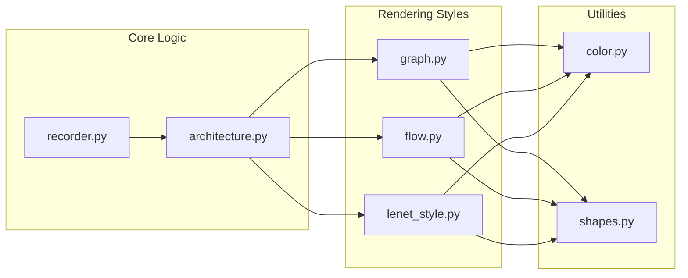

<!-- source: DeepWiki mcp.deepwiki.com · repo willyfh/visualtorch · page 1 VisualTorch Overview · fetched 2026-10-21 -->

# VisualTorch Overview

<details>
<summary>Relevant source files</summary>

The following files were used as context for generating this wiki page:

- [CITATION.cff](CITATION.cff)
- [README.md](README.md)
- [docs/source/_static/images/logos/fire-icon.png](docs/source/_static/images/logos/fire-icon.png)
- [docs/source/index.md](docs/source/index.md)
- [docs/source/markdown/api_references/index.md](docs/source/markdown/api_references/index.md)
- [docs/source/snippets/install/pypi.txt](docs/source/snippets/install/pypi.txt)
- [docs/source/snippets/install/source.txt](docs/source/snippets/install/source.txt)
- [paper/paper.md](paper/paper.md)
- [setup.py](setup.py)

</details>


VisualTorch is a Python library designed to automate the visualization of neural network architectures built with PyTorch [README.md:2-8](). By tracing a model's forward pass, it translates complex `torch.nn.Module` or `torch.nn.Sequential` structures into polished, publication-ready diagrams [paper/paper.md:31-31]().

The project addresses the difficulty of manually constructing architecture diagrams for scientific communication, providing a programmatic way to generate visual representations that accurately reflect the underlying code [paper/paper.md:33-43]().

## Core Visualization Styles

VisualTorch supports three distinct rendering styles to cater to different architectural granularities and aesthetic requirements:

| Style | Description | Typical Use Case |
| :--- | :--- | :--- |
| **Graph View** | Displays the model as a computational graph of nodes and edges. | Complex branching, skip connections, and non-sequential models. |
| **Flow View** | Uses volumetric boxes to represent layer dimensions and data flow. | CNNs where spatial resolution and channel depth are key. |
| **LeNet Style** | A classic stacked-box visualization inspired by early CNN diagrams. | Sequential convolutional pipelines and educational illustrations. |

Sources: [README.md:8-8](), [paper/paper.md:31-31](), [docs/source/index.md:3-3]()

## System Architecture & Workflow

VisualTorch operates through a multi-stage pipeline that bridges the gap between PyTorch code and a rasterized image. The system first records the execution of the model, extracts a high-level representation, and then dispatches it to a specific renderer.

### From Code to Diagram

The following diagram illustrates how high-level user requests are translated into internal code entities:

**VisualTorch Execution Pipeline**
```mermaid
graph TD
    User["User Model (nn.Module)"] -->|render()| Dispatcher["render.py: _render_dispatcher"]
    Dispatcher -->|trace_module_graph| Tracing["recorder.py: Recorder"]
    Tracing -->|Record Tensors| Subclass["recorder.py: RecorderTensor"]
    Subclass -->|Build Graph| Arch["architecture.py: Architecture"]
    Arch -->|Dispatch| Style{Style Selection}
    
    Style -->|graph| GView["graph.py: graph_view"]
    Style -->|flow| FView["flow.py: flow_view"]
    Style -->|lenet| LView["lenet_style.py: lenet_view"]
    
    GView & FView & LView -->|draw| Canvas["Pillow / aggdraw Canvas"]
```
Sources: [README.md:12-19](), [paper/paper.md:76-102](), [docs/source/index.md:97-105]()

### Major Subsystems

The codebase is organized into functional layers that handle tracing, logic, and rendering:

*   **Tracing Backend**: Uses a custom `RecorderTensor` to track how data moves through modules during a dummy forward pass [README.md:12-15]().
*   **Architecture IR**: An intermediate representation (the `Architecture` dataclass) that standardizes shapes, connections, and module metadata.
*   **Rendering Frontends**: Style-specific modules (`graph.py`, `flow.py`, `lenet_style.py`) that interpret the Architecture IR into geometric primitives.
*   **Utility Layer**: Shared logic for color palettes, geometric shapes (Box, Circle), and image layouting.

**System Component Mapping**

Sources: [README.md:54-55](), [setup.py:32-32]()

## Limitations & Considerations

Because VisualTorch relies on tracing a real forward pass, it has specific behavioral characteristics:
*   **Control Flow**: It only visualizes the execution path taken by the provided dummy input. Data-dependent branches not taken during the trace will not appear in the diagram [README.md:12-15]().
*   **Multi-Output Modules**: For modules returning multiple tensors (like `nn.LSTM`), node sizing is typically based on the first tensor, though all shapes are listed if dimension labels are enabled [README.md:16-19]().

## Child Pages

For detailed technical information, please refer to the following child pages:

*   **[Getting Started: Installation & Configuration](#1.1)**
    Covers installation via `pip` from PyPI or source, and environment setup for Python 3.10+ and PyTorch 2.0+ [setup.py:22-45]().
*   **[Academic Context & Research Showcase](#1.2)**
    Details the project's publication in the Journal of Open Source Software (JOSS) and highlights its use in Nature, IEEE, and MDPI research [README.md:37-41](), [paper/paper.md:67-79]().

Sources: [README.md:33-41](), [setup.py:42-42](), [docs/source/index.md:7-18]()

---

